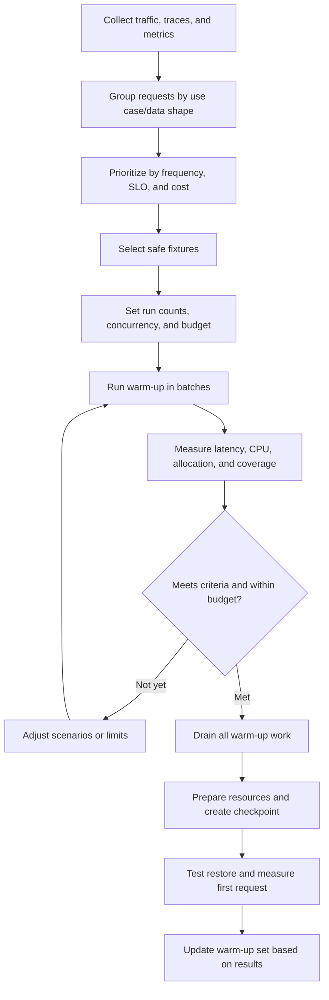

# Selecting a Warm-up Request Set Representative of Real Load

In CRaC, an application is typically started, initialized, and warmed up before creating a checkpoint. The prepared state can be restored in subsequent runs, helping reduce startup time and latency of the first requests. Checkpoint quality depends heavily on which execution paths the application executed before taking the snapshot.

If you only call a simple endpoint or repeat a single request with fixed data, the application may have warmed up a small part of the system while critical business flows remain cold. Conversely, sending too many requests or running every endpoint uncontrollably can prolong image creation time, pollute data, put load on dependencies, and create cache state unlike the real serving environment.

Therefore, it is necessary to build a **representative warm-up request set** from real usage data, performance targets, and the application's safety boundaries. This set needs to cover critical execution paths, input data types, and common processing branches, while having limits on invocation count, concurrency, duration, and side effects.

## 1. What Does Warm-up Aim to Prepare?

A first request can trigger many tasks at the same time:

- Loading classes and running static initializers.
- Creating internal objects, serializers, mappers, validators, and data structures.
- Executing Java methods so the JIT has the opportunity to compile frequently used code.
- Initializing frameworks, proxies, reflection metadata, and converters.
- Loading data into in-memory caches.
- Initializing clients, pools, or connections to dependencies.
- Going through processing branches dependent on payload type, profile, permissions, and feature flags.

Warm-up can prepare some state in the JVM and heap for the checkpoint to retain. However, not all state should be preserved across a checkpoint. Network or database connections may need to be closed before checkpoint and recreated after restore; cache data may need TTL verification; tokens or leases may expire. Therefore, warm-up targets need to be separated into two groups:

1. **Reusable state:** loaded classes, executed/compiled code, application structures, serializers, metadata, and still-valid internal caches.
2. **State requiring separate recovery:** connections, sessions, credentials, leases, subscriptions, and dynamic environment-dependent data.

Warm-up does not aim to make every request have zero latency. The goal is to reduce the initialization cost portion of critical execution paths within the checkpoint preparation budget.

## 2. Starting from Real Load Instead of Guessing Endpoints

A good warm-up set starts from how the application is actually used. Collect data at the route, operation, or use-case layer, depending on the application architecture. Data sources may include:

- Access logs or API gateway logs with sensitive identifying information removed.
- Metrics on request count, latency, error rate, and payload size.
- Distributed traces to know which services and business branches requests pass through.
- Query reports or database operation statistics.
- Event/consumer metrics if the application processes messages rather than just HTTP requests.
- Breakdowns by tenant, account type, feature flag, or API version if these factors change the execution path.

It is not necessary to store real user payloads for warm-up. Usually you only need statistics on request types, size distributions, and data characteristics, then create sanitized synthetic fixtures to represent those groups.

### Information to Collect

| Attribute | Why useful when selecting warm-up |
|---|---|
| Request frequency | Shows which execution paths appear frequently |
| p50/p95/p99 latency | Identifies execution paths with significant cost or SLO impact |
| CPU time or allocation | Finds code segments that can benefit from JIT and structure preparation |
| Payload size and data shape | Covers branches dependent on size, element count, and data types |
| Status/error class | Identifies common error flows and retry/validation handling |
| Dependency calls | Knows which requests trigger databases, caches, HTTP clients, or brokers |
| Tenant/feature profile | Detects different configurations or features that change execution paths |
| Concurrency and burst | Understands how the system behaves when many requests arrive simultaneously |

Use an observation period long enough to represent the business cycle. If the application has hourly, daily, weekend, or seasonal load, data from a short interval can skew the warm-up set. For new systems without traffic yet, use the expected load model, product requirements, and verified business scenarios; once production metrics are available, update the warm-up set.

## 3. Selecting Execution Paths by Importance

You should not choose requests solely because they have high frequency. An infrequently called endpoint on the payment, login, or order processing flow may have very strict latency requirements. Conversely, a high-frequency statistics endpoint that runs in the background or is not on the critical path may not need deep warm-up priority.

One ranking method combines four factors:

1. **Frequency:** how often the request appears.
2. **Performance impact:** whether the request has significant CPU, allocation, or latency cost.
3. **Criticality:** whether the request lies on a critical business flow or key SLO.
4. **Execution path distinctness:** whether the request represents a group of code paths not yet executed by other requests.

A qualitative matrix can be used:

| Group | Characteristics | Warm-up priority |
|---|---|---|
| Critical and common | Main execution path, high frequency, directly impacts SLO | Highest; needs fixtures and controlled repeated execution |
| Critical but infrequent | Occurs rarely, but large consequences if slow/failing | Select representative scenarios and verify separately |
| Common but non-critical | Frequent requests, low cost, or little SLO impact | Moderate warm-up proportional to share |
| Rare and non-critical | Secondary paths, little user impact | Usually does not need priority |

An effective warm-up set typically covers most critical traffic with a number of intentional scenarios, rather than calling every URL once. Coverage should be measured by use cases and processing branches, not just by endpoint count.

### Budget Allocation Example

Suppose an e-commerce service has the following main flows:

| Use case | Observed request share | Characteristics | Decision |
|---|---:|---|---|
| Read product details | 40% | Reads cache and database, serializes response | Warm up multiple product variants |
| Search | 25% | Query, filter, sort, and pagination | Warm up several common filter combinations |
| View cart | 15% | Depends on session and user data | Use dedicated fixtures, do not use real sessions |
| Login/refresh session | 10% | Hashing, tokens, and permission checks | Use test accounts, do not issue production credentials |
| Create order | 8% | Has side effects and transactions | Only run in an isolated environment or use a non-committing warm-up path |
| Rare reports | 2% | Heavy query, not on critical path | Do not prioritize unless it has its own SLO |

Share is only one input. If order creation has critical latency, it still needs to be represented in warm-up even though it only accounts for 8%. However, real orders must not be submitted just to warm up. Create fixtures, rollbackable transactions, and isolate external side effects.

## 4. Covering Multiple Data Shapes, Not Just Multiple URLs

One endpoint can execute many paths depending on payload. For example, `GET /products/{id}` may return a product with images, a product without images, a product on sale, or a product with many variants. A request using only one simple product may not trigger mappers, serializers, or pricing calculation branches for the remaining cases.

Group data by attributes that change processing:

- Small, medium, and large payloads.
- Empty lists, single-element lists, and multi-element lists.
- Optional fields present/absent, null, or boundary values.
- Different data types or subtypes.
- Different user permissions, tenants, or feature flags.
- Cache hits and cache misses.
- Valid data, boundary data, and errors that can occur in reality.

There is no need to combine every attribute as a Cartesian product because the number of scenarios can grow very quickly. Choose representatives based on impact on code paths, frequency, and risk. A small set with stratified data is often more useful than a large set containing many nearly identical requests.

### Example Variant Set for a Search API

```text
GET /search?q=phone&page=0&size=20
  - common keyword, first page, default size

GET /search?q=phone&brand=acme&sort=price&page=1&size=20
  - with filter, sort, and pagination

GET /search?q=wireless-headphones&category=audio&size=100
  - multi-element results and larger response payload

GET /search?q=rare-item&brand=unknown
  - few results or no results case
```

Values should be chosen from anonymized statistics or synthetic data. Avoid putting emails, phone numbers, addresses, access tokens, or personal data into warm-up fixtures.

## 5. Covering Code Paths and Initialization Costs

Warm-up needs to execute the code paths the application will use after restore. Simply creating objects or constructing requests does not necessarily warm up the actual processing. For reactive APIs, you need to subscribe and wait for the pipeline to execute. For asynchronous methods, you need to wait for futures to complete. For message consumers, you need to process a fixture message up to a safe commit point.

A representative request should traverse the critical layers:

```text
HTTP / RPC entry point
        |
        v
Authentication / authorization
        |
        v
Validation and mapping
        |
        v
Business service
        |
        +------> Cache lookup
        |
        +------> Repository / database access
        |
        +------> External client (if needed)
        |
        v
Response mapping and serialization
```

If a warm-up request only calls a method directly at the service layer, it may skip filters, interceptors, validation, serialization, or framework proxies that real requests must pass through. Conversely, calling the entire HTTP stack may trigger authentication, auditing, and unwanted side effects. Decide the entry point level based on the goal: if you need to warm up the entire request path, use the real entry point with safe fixtures; if you need to isolate an algorithm, call the service/benchmark directly.

### JIT Code Warm-up and Cache Warm-up Are Two Different Goals

JIT warm-up needs to execute methods enough times and with representative data so the runtime has the opportunity to optimize common paths. Cache warm-up needs to load keys or data likely to be used after restore. A request can contribute to both, but do not confuse a full cache with hot JIT or vice versa.

In addition, caches of databases, filesystems, DNS, TLS sessions, or proxies may reside outside the process and have their own lifecycle. If those resources are closed before checkpoint or external services change, you cannot assume that state is preserved along with the heap.

## 6. Choosing Invocation Counts and Concurrency Levels

A single request is usually only enough to trigger some class loading and initial paths. JIT compilation and certain optimizations need to observe a method being executed multiple times. However, there is no single fixed iteration count suitable for every application.

Choose the execution count based on:

- Expected frequency of the path in production.
- Latency stability across iterations.
- Compilation, class loading, and allocation signals if observable.
- Warm-up duration and checkpoint creation budget.
- Impact on CPU, heap, database, and dependencies.

Concurrency also needs to be chosen carefully. If production has concurrent requests, running only sequentially can miss contention, thread pools, and concurrency-dependent code paths. However, warming up at peak load can exhaust connection pools, build large queues, or checkpoint while requests are still running.

A commonly used strategy:

1. Run a few sequential iterations to trigger class loading and basic branches.
2. Gradually increase concurrency to a level representative of startup load or normal load.
3. Observe latency, CPU, allocation, queues, and dependencies.
4. Stop increasing load when warm-up criteria are met or resource limits are reached.
5. Drain all requests, futures, messages, and asynchronous tasks before preparing for checkpoint.

Do not warm up at maximum concurrency just because production can reach that level. Consider how many replicas the checkpoint will be used to create and how the combined warm-up load of preparing processes can affect shared dependencies.

## 7. Avoiding Side Effects When Running Warm-up Requests

Warm-up typically runs during the image preparation phase, which may be repeated when building a new image or when deployment pipelines rerun. Therefore, every warm-up request must be treated as a real execution in terms of side effects.

Effects that need to be controlled include:

- Writing or updating business data.
- Sending emails, SMS, webhooks, or push notifications.
- Charging money, creating orders, making reservations, or calling payment services.
- Publishing messages to a broker or triggering other consumers.
- Creating audit events or logs containing sensitive data.
- Modifying quotas, rate limits, counters, or user state.

Isolation approaches:

- Use a dedicated database/schema for warm-up.
- Use fixtures with dedicated IDs that can be safely deleted.
- Use stubs/mocks for services with side effects.
- Disable publishers or switch to a mock sink in the checkpoint creation environment.
- Use transaction rollback for database operations when appropriate, but do not treat rollback as a way to undo side effects already sent to external systems.
- Provide a warm-up mode that only executes read operations and internal processing steps.

Do not rely solely on an `X-Warmup: true` header to skip side effects unless every service layer truly checks and enforces that policy. A safe warm-up path needs to be designed at the use-case level, not merely by tagging the request.

## 8. Building a Manifest for the Warm-up Set

A manifest allows the warm-up set to be reviewed, version-controlled, and repeated across checkpoint builds. Each scenario should describe its purpose, fixture data, run count, concurrency, time limit, and allowed side effects.

Illustrative YAML example:

```yaml
version: 1
budget:
  maxDuration: 180s
  maxConcurrency: 4
  maxRequests: 500
  drainTimeout: 20s

scenarios:
  - name: product-detail-default
    route: GET /products/{id}
    fixture: product-standard
    iterations: 80
    concurrency: 2
    priority: critical
    expectedEffects: read-only

  - name: product-detail-with-variants
    route: GET /products/{id}
    fixture: product-with-many-variants
    iterations: 30
    concurrency: 2
    priority: high
    expectedEffects: read-only

  - name: search-filtered
    route: GET /search
    fixture: search-filter-brand-and-sort
    iterations: 50
    concurrency: 3
    priority: high
    expectedEffects: read-only

  - name: order-validation
    route: internal-warmup:validate-order
    fixture: order-valid-test-data
    iterations: 10
    concurrency: 1
    priority: critical
    expectedEffects: isolated
```

The numbers only illustrate the format. Frequency, iteration counts, and concurrency must be decided from application metrics and the preparation budget. The manifest should also specify fixture versions and schema versions to avoid silent changes in warm-up data.

A scenario should fail explicitly if a fixture is missing, a route does not exist, or a required dependency is not ready. Critical scenarios must not be silently skipped because a checkpoint could be created in an unprepared state.

## 9. Example Warm-up Runner in Java

Each scenario can be modeled with an interface and a runner responsible for limiting invocation count, duration, and concurrency. The example below illustrates the structure, not a complete warm-up framework:

```java
import java.time.Duration;
import java.util.List;
import java.util.concurrent.ExecutorService;
import java.util.concurrent.Executors;
import java.util.concurrent.Future;

public interface WarmupScenario {
    String name();
    void execute() throws Exception;
}

public final class WarmupRunner {

    public void runSequentially(List<WarmupScenario> scenarios,
                                int iterationsPerScenario)
            throws Exception {
        for (WarmupScenario scenario : scenarios) {
            for (int i = 0; i < iterationsPerScenario; i++) {
                scenario.execute();
            }
        }
    }

    public void runConcurrent(WarmupScenario scenario,
                              int workers,
                              int iterationsPerWorker)
            throws Exception {
        ExecutorService executor = Executors.newFixedThreadPool(workers);
        try {
            List<Future<?>> tasks = new java.util.ArrayList<>();
            for (int worker = 0; worker < workers; worker++) {
                tasks.add(executor.submit(() -> {
                    for (int i = 0; i < iterationsPerWorker; i++) {
                        scenario.execute();
                    }
                }));
            }

            for (Future<?> task : tasks) {
                task.get();
            }
        } finally {
            executor.shutdown();
            if (!executor.awaitTermination(20,
                    java.util.concurrent.TimeUnit.SECONDS)) {
                executor.shutdownNow();
            }
        }
    }
}
```

In a real implementation, you need to add an overall deadline, request limits, per-scenario exception handling, metrics, and cancellation. `WarmupScenario.execute()` must wait for asynchronous work to complete; if it only creates a `CompletableFuture` and returns, the runner may finish before the code path is actually executed. With reactive streams, you must subscribe and wait for the terminal signal.

The runner should also not create new executors without lifecycle control. If an executor needs to be retained across the checkpoint, decide explicitly; otherwise, shut it down and drain it before checkpoint and recreate it after restore.

## 10. Warm-up Completion Criteria

You should not finish warm-up merely after running a rigid number of requests. Request count is a limit, while completion criteria should be based on both coverage and system state.

A set of criteria may include:

- Mandatory scenarios have executed successfully.
- Priority payload groups and business branches have been covered.
- Latency of the final iterations no longer decreases significantly compared to earlier iterations, within defined measurement limits.
- Class loading/JIT or allocation metrics no longer change substantially for target execution paths, if appropriate observable signals exist.
- Critical internal caches are loaded or have a clear lazy-loading policy.
- CPU and heap are within expected budgets.
- No warm-up requests, futures, messages, or background tasks remain running.
- No side effects outside the allowed scope occurred.

JIT does not necessarily reach a completely optimal state after a fixed duration. A method may be recompiled or deoptimized when profiles change. Therefore, do not use a single "warm-up complete" log line or a single compilation counter as absolute proof. Combine scenario coverage, latency, CPU, and runtime signals.

### Comparing Latency by Iteration

For example, measuring latency of the same scenario batch by batch:

| Batch | Illustrative p50 | Illustrative p95 | Interpretation |
|---|---:|---:|---|
| 1 | 80 ms | 150 ms | Still significant initialization cost |
| 2 | 42 ms | 70 ms | Execution path has stabilized more |
| 3 | 28 ms | 45 ms | Continues improving |
| 4 | 27 ms | 43 ms | Small improvement |
| 5 | 27 ms | 42 ms | Near steady state under measurement conditions |

This is only an illustrative example. Measurements must be made on the same machine type, same fixture, same concurrency, and same dependency state. Do not compare p95 across batches with different payloads or loads and conclude that warm-up is complete.

## 11. Warm-up with Caches and External Dependencies

A representative request can populate internal caches, but out-of-process caches have their own lifecycle. Distinguish between:

- In-heap caches: can be retained in the checkpoint, but TTL and freshness must be checked.
- Distributed caches: exist outside the process; warm-up requests can warm shared caches, but can also create load or mutate shared data.
- Database buffer/query caches: managed by the database; not guaranteed to remain intact simply because the JVM is restored.
- DNS/TLS/session caches: depend on resolvers, clients, and external systems; need verification after restore.
- HTTP client connection pools: usually need handling according to CRaC integration and connection lifecycle.

If warm-up reads one million records to fill a cache, it can overload the database during image creation. Select popular keys, limit counts, and use lazy loading for infrequently accessed data. When multiple checkpoints are created concurrently, consider batching warm-up load to avoid having multiple preparing processes read the same large dataset simultaneously.

In particular, if `beforeCheckpoint()` closes connection pools, warm-up requests may still be useful for JIT, mappers, and internal caches, even though physical connections are not retained. After restore, pools need to be recreated according to connection budgets and readiness must only turn healthy once new connections are valid.

## 12. Updating the Warm-up Set as Production Changes

Traffic changes across product versions, seasons, new tenants, and feature flags. A warm-up set built from traffic six months ago may no longer be representative.

The warm-up set should be managed as a versioned artifact:

- Record the date/time range of data used to build the scenario set.
- Record the application version, API schema, and fixtures.
- Document the rationale for choosing each scenario and its coverage target.
- Track which scenarios no longer appear or are no longer important.
- Add new scenarios when new execution paths or payloads appear in production.
- Retain infrequent flows that have strict SLO requirements or high risk.

Do not change the warm-up set day by day merely due to small traffic fluctuations. Use an appropriate update cadence and compare sufficiently significant changes to avoid unstable image builds across runs.

## 13. Common Mistakes

### Only warming up the health endpoint

The health endpoint usually only checks a small part of the application. It does not execute the mappers, queries, serializers, or business logic of primary requests. Choose scenarios based on real use cases.

### Only repeating a single fixed payload

Simple payloads may skip processing branches for large lists, optional fields, filters, or other data types. Select several fixtures representative of data shapes.

### Running every endpoint once and considering warm-up done

A single call may trigger class loading, but is not enough for frequent execution paths to be JIT-optimized. Use appropriate execution counts and observation criteria.

### Warming up with real production data

Real payloads may contain PII, secrets, or cause side effects. Use synthetic/anonymized fixtures and control storage.

### Creating business side effects

Requests that create orders or publish messages can cause real impacts. Use isolated environments, stubs, or safe warm-up use cases.

### Running with excessively high concurrency

Warm-up can exhaust pools, increase queues, or put load on shared dependencies. Increase concurrency gradually and set limits.

### Not waiting for asynchronous work to complete

The runner finishes while futures have not completed, leaving code paths not actually executed or work continuing during checkpoint. Await/subscribe and drain.

### Using external caches as the sole criterion

External caches may be evicted or changed after checkpoint. Focus on reusable state and have a refresh policy for dynamic data.

### Not updating the scenario set when the product changes

Images may warm up old flows while new traffic enters cold code paths. Monitor traffic and version the warm-up set.

## 14. Workflow for Building a Warm-up Request Set



This workflow creates a feedback loop: real traffic determines scenarios, restore results indicate whether scenarios help reduce first-request cost, and then the warm-up set is updated by application version.

## 15. Measuring Effectiveness After Restore

Warm-up is only valuable if it improves behavior after restore. Measure at least:

- Time from restore to readiness.
- Latency of the first request and initial requests in each scenario.
- p50/p95/p99 after traffic starts.
- CPU, allocation, and GC during the initial requests.
- Cache hits/misses and data reload counts.
- Reconnection counts to dependencies and recovery time.
- Error or timeout rates on the first requests.

Compare a warmed-up checkpoint against a cold-start run or a checkpoint with a different warm-up set under equivalent machine and load conditions. Measuring only total startup time may miss cases where readiness is fast yet the first request is still slow because a branch was not warmed up.

Do not optimize only a single sample request. If one scenario is repeated too many times, it can dominate profiles and caches, making other execution paths less representative. Evaluate by use-case groups and expected load distribution.

## 16. Conclusion

A warm-up request set needs to reflect the execution paths the application will actually serve after restore. Build it from traffic, traces, latency, CPU, payload shapes, and use-case criticality. Prioritize common or SLO-impacting paths, while still representing infrequent high-risk flows. Choose safe synthetic fixtures, and control side effects, invocation counts, concurrency, and preparation time.

A good warm-up set executes enough code paths to prepare the JVM and reusable internal state, while letting environment-dependent resources recover according to their own lifecycle. Wait for all asynchronous work to finish, drain requests before checkpoint, and measure first requests after restore. Update the scenario set alongside traffic and application versions so checkpoints continue representing real load rather than merely reflecting an outdated set of requests.
