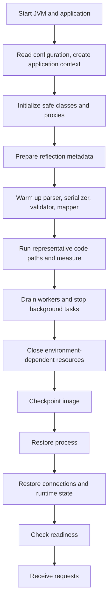

# Preparing Classes, Data Parsers, and Lazy-Initialized Components

A Java application can spend a lot of time on its first processing pass even after the process has finished starting up. The cause often lies in work performed only when a feature is called for the first time: the JVM loads and initializes classes, the framework creates proxies, libraries read metadata via reflection, parsers build schemas, serializers create caches, regexes are compiled, or a `@Lazy` bean is initialized for the first time.

CRaC allows safe and reusable portions of this work to be prepared in advance, then creates a checkpoint image from the warmed-up process state. On restore, the application can continue from that state instead of repeating every initialization step. To achieve this benefit, it is necessary to choose the right components to prepare before checkpoint, trigger them in a controlled manner, and separate shared state from environment-dependent resources.

## 1. Why Prepare Classes and Lazy-Initialized Components?

In Java, starting the JVM does not mean all application classes have been loaded, all static initializers have run, or all libraries have finished preparing metadata. Many frameworks and libraries intentionally defer work to reduce initial startup time and avoid creating unused components.

For example, the first request may have to perform multiple tasks simultaneously:

- Loading controller, service, DTO, and dependent classes.
- Initializing classes with static fields or static initializers.
- Creating proxies for transactions, security, AOP, or lazy dependencies.
- Analyzing annotations and generic types via reflection.
- Creating serializers/deserializers for JSON data types.
- Compiling regexes, expressions, or templates.
- Initializing validators, converters, mappers, or metadata caches.
- Warming up a processing path frequently enough for the JIT compiler to optimize.

If these tasks only happen when the first real request arrives, that request's latency will be higher than subsequent requests. For services needing fast readiness, moving safe initialization tasks into the pre-checkpoint preparation phase can significantly reduce restore-to-readiness time and reduce initial latency.

You should not try to initialize everything mechanically. A lazy bean might open a database connection, spawn a background thread, or read short-lived secrets. If those resources are included in the image and become stale while the image is stored, restore may fail. Classify before warming up.

## 2. JVM Class Processing Phases

The class processing flow is typically described through the phases of loading, linking, and initialization.

| Phase | Main work | Example |
|---|---|---|
| Loading | Finds bytecode and creates the class representation in the JVM | Loading `OrderService` from the classpath or module |
| Verification | Checks that bytecode obeys JVM constraints | Checking types, stack maps, and bytecode validity |
| Preparation | Allocates memory for static fields and assigns default values | `int count` is initially `0` |
| Resolution | Turns symbolic references into suitable runtime references | Resolving references to a called class or method |
| Initialization | Runs static initializers and assigns static values according to source code | Executing `static { ... }` or non-constant-variable `static final` |

Verification, preparation, and resolution belong to linking. The JVM can defer some resolution steps until a reference actually needs to be used. Therefore, loading a class does not necessarily mean all dependent classes and all symbolic references have been resolved.

### 2.1. Loading a Class Without Initializing It

`ClassLoader.loadClass()` and `Class.forName(name, false, loader)` can be used to ask the JVM to load a class without running static initialization.

```java
ClassLoader loader = Thread.currentThread().getContextClassLoader();
Class<?> type = Class.forName(
        "com.example.orders.OrderService",
        false,
        loader);

System.out.println(type.getName());
```

The `false` parameter requests not initializing the class. This approach is useful when you want to verify a class is present at runtime or prepare some metadata without wanting to run static initializers yet.

However, loading a class does not guarantee all dependencies are loaded, all methods are JIT-compiled, or all initialization errors have been detected. Dependent classes may only be loaded when code accesses them.

### 2.2. Explicitly Initializing a Class

`Class.forName(name, true, loader)` requests initializing the class if it has not yet been initialized by that class loader:

```java
Class<?> type = Class.forName(
        "com.example.orders.OrderService",
        true,
        Thread.currentThread().getContextClassLoader());
```

Initialization runs the class's static initializer and superclass initialization steps according to Java rules. A class is initialized once per class loader. If a static initializer fails, the JVM can mark the class in an erroneous state for that class loader; subsequent uses may receive `NoClassDefFoundError` instead of running the initializer again.

Therefore, only actively initialize a class when you understand the side effects of its static initializer. A static block might read configuration files, initialize native libraries, open sockets, create executors, or call external services. Those actions may not be suitable to include in a checkpoint image.

### 2.3. Active Use Can Trigger Initialization

Calling `Class.forName(..., true, ...)` is not required to initialize a class. Certain actions such as creating an instance, calling a static method, or reading/writing a non-constant-variable static field can trigger initialization according to the JLS.

Example:

```java
OrderService service = new OrderService(); // Can trigger initialization
OrderService.prepareDefaults();             // Static method
int limit = OrderService.DEFAULT_LIMIT;     // Depends on whether the field is a constant variable
```

When warming up, understand which execution paths will trigger class initialization. A `static final` primitive/String read that is a compile-time constant may be inlined into bytecode and not force the class to initialize in the way a source code reader might imagine.

## 3. Classifying Components Before Warm-up

A component should be evaluated based on when it initializes, what state it holds, and whether it is usable after restore.

| Group | Example | Typically appropriate handling |
|---|---|---|
| Pure in-memory metadata | Reflection metadata, annotation index, schema, serializer cache | Can be prepared before checkpoint using representative inputs |
| Safe classes and static initialization | DTO classes, enums, utilities without side effects | Can be selectively loaded/initialized |
| Parsers and converters | JSON parser, XML schema, regex, date formatter | Create and exercise before checkpoint if they do not hold out-of-process resources |
| Lazy beans without external connections | Mappers, validators, calculators, template engines | Can be proactively initialized and warmed up |
| Environment-bound resources | JDBC pool, HTTP connection pool, socket, file handle | Close before checkpoint and recreate after restore according to lifecycle |
| Time-limited information | Tokens, leases, DNS results, short-lived credentials | Re-acquire or revalidate after restore |
| Background tasks | Schedulers, consumers, polling threads, executors | Pause/drain before checkpoint; recreate or resume per policy after restore |

A bean can belong to multiple groups. For example, an `ObjectMapper` holds a serializer cache in the heap, but can also be configured with a custom serializer that references an external service. Inspect the entire object graph and dependencies rather than looking only at class names.

## 4. Preparing Reflection and Annotation Metadata

Reflection frequently appears in dependency injection, serialization, validation, ORM, mapping, and framework proxies. The first time a library inspects a class, it may have to traverse fields, methods, constructors, annotations, generic types, and hierarchies and then store the results in a cache.

Simple example:

```java
import java.lang.reflect.Constructor;
import java.lang.reflect.Field;
import java.lang.reflect.Method;

public final class ReflectionWarmup {

    public void inspect(Class<?> type) {
        type.getDeclaredFields();
        type.getDeclaredMethods();
        type.getDeclaredConstructors();

        for (Field field : type.getDeclaredFields()) {
            field.getAnnotations();
            field.getGenericType();
        }

        for (Method method : type.getDeclaredMethods()) {
            method.getAnnotations();
            method.getGenericReturnType();
            method.getGenericParameterTypes();
        }

        for (Constructor<?> constructor : type.getDeclaredConstructors()) {
            constructor.getAnnotations();
            constructor.getParameterTypes();
        }
    }
}
```

The code above requests some metadata from the Reflection API. It does not guarantee all framework caches have been created, because a framework may have its own analyzer and cache. For warm-up to be genuinely valuable, call the library's public API or execute a representative processing path that causes that cache to be built.

### 4.1. Avoiding Unnecessary Reflection Access Elevation

Do not call `setAccessible(true)` on every field or method just to warm up. Deep reflection can be restricted by the module system, produce `InaccessibleObjectException`, or require unnecessary `--add-opens`. Use the framework's public API and only open access when the application explicitly requires it.

### 4.2. Preparing Proxies and Method Metadata

Frameworks may create proxies the first time a bean is accessed. For example, Spring AOP or transaction proxies may defer certain operations until the bean is invoked. If the first processing path after restore goes through a proxy, perform a safe warm-up call to trigger that path.

Do not call a business method with side effects just to create a proxy. You can use a method that reads test data or an internal operation that does not write to a database, send messages, or call external services.

## 5. Preparing Parsers and Serializers

Data parsers often have significant initialization cost. A JSON mapper may need to analyze annotations, generic types, naming strategies, and create serializers/deserializers. An XML parser may need to load schemas, create factories, or compile schemas. An expression engine may parse expressions and build syntax trees.

### 5.1. Jackson `ObjectMapper`

With Jackson, creating an `ObjectMapper` does not necessarily create serializers and deserializers for every DTO. Many parts are only built when the mapper processes a specific data type for the first time.

Warm-up example using synthetic data:

```java
import com.fasterxml.jackson.databind.ObjectMapper;
import java.util.List;

public final class JsonWarmup {

    public void warm(ObjectMapper mapper) throws Exception {
        OrderRequest sample = new OrderRequest(
                "warmup-order",
                List.of(new OrderLine("SKU-DEMO", 2)));

        byte[] json = mapper.writeValueAsBytes(sample);
        mapper.readValue(json, OrderRequest.class);
    }
}
```

Sample write and read operations help trigger serializers/deserializers for the types used. Choose DTOs representative of common requests/responses, including nested types, enums, date/time types, and custom serializers if the application uses them.

Do not use customer data or production data for warm-up. Sample inputs must be valid but must not contain sensitive information. If a custom serializer calls a database or external service, handle that dependency separately and avoid executing side effects during warm-up.

### 5.2. Creating `ObjectReader` and `ObjectWriter`

Specialized readers/writers can be created for a type:

```java
ObjectReader orderReader = mapper.readerFor(OrderRequest.class);
ObjectWriter orderWriter = mapper.writerFor(OrderRequest.class);

byte[] bytes = orderWriter.writeValueAsBytes(sample);
OrderRequest restored = orderReader.readValue(bytes);
```

Readers/writers help reuse configuration per data type. However, merely creating an object reader/writer may not force all serializers to be initialized across every Jackson version/configuration. Executing sample serialization and deserialization is a more practical way to traverse the needed code paths.

Once configured, avoid arbitrarily mutating a shared `ObjectMapper`. Changing modules, features, or mix-ins after caches have already been used can produce unpredictable behavior. Finish configuration before warm-up.

### 5.3. XML Schemas and Parsers

With XML, the time-consuming part can be loading XSDs, compiling schemas, or creating parser factories. A `Schema` can be prepared before checkpoint:

```java
SchemaFactory factory = SchemaFactory.newInstance(
        XMLConstants.W3C_XML_SCHEMA_NS_URI);

Schema schema = factory.newSchema(
        new StreamSource(new File("schemas/order.xsd")));

Validator validator = schema.newValidator();
validator.validate(new StreamSource(new StringReader(sampleXml)));
```

If the schema is packaged on the classpath, prefer reading from immutable application resources. If the schema resides on a volume that can change or only exists in the build environment, determine whether the path exists with the same content on restore. Do not keep an open stream or file descriptor in the image unless necessary.

### 5.4. Regexes and Expression Parsers

`Pattern.compile()` creates a compiled regex for reuse:

```java
private static final Pattern ORDER_CODE =
        Pattern.compile("ORD-[A-Z0-9]{8}");

boolean valid = ORDER_CODE.matcher("ORD-AB12CD34").matches();
```

If the application uses many regexes, compile fixed patterns at startup or during warm-up. Do not recompile the same pattern on every request.

For expression languages such as Spring Expression Language, parse common expressions before checkpoint and evaluate them with a safe sample context. Avoid warm-up expressions that call methods with side effects or access real data.

## 6. Preparing Validators, Converters, and Mappers

Validation and mapping libraries typically generate per-class metadata on first use.

Example with Jakarta Bean Validation:

```java
ValidatorFactory factory = Validation.buildDefaultValidatorFactory();
Validator validator = factory.getValidator();

OrderRequest sample = new OrderRequest("warmup-order", List.of());
Set<ConstraintViolation<OrderRequest>> violations =
        validator.validate(sample);
```

The `validate()` operation causes the provider to analyze constraints of the checked type. Choose sample data to trigger the validation branches needing warm-up; there is no need to create a massive dataset or call every validator blindly.

With MapStruct, mappers are code-generated at compile time so they do not need runtime reflection like some dynamic mappers. However, mapper classes, dependencies, and processing paths may still be initialized for the first time. Calling mappers with sample DTOs helps load classes and traverse representative code paths.

With ModelMapper or reflection-heavy mapping frameworks, warm-up may need to invoke map for each common source/target pair to cache type metadata and converters. Check the specific library's API and configuration.

## 7. Triggering Lazy-Initialized Components in Frameworks

Lazy initialization helps reduce startup work by only creating beans or metadata when needed. With CRaC, certain critical lazy components should be triggered before checkpoint so the first request after restore does not pay initialization costs.

In Spring, a bean can be annotated with `@Lazy`, accessed through `ObjectProvider`, or only created when a proxy is called. Beans needing warm-up can be proactively retrieved from `ApplicationContext`:

```java
@Component
public final class ApplicationWarmup implements ApplicationRunner {

    private final ApplicationContext context;

    public ApplicationWarmup(ApplicationContext context) {
        this.context = context;
    }

    @Override
    public void run(ApplicationArguments args) {
        context.getBean(OrderJsonCodec.class);
        context.getBean(OrderValidator.class);
        context.getBean(OrderMapper.class);
    }
}
```

The example only retrieves beans to trigger initialization. If serializer caches, proxy metadata, or parser caches need to be built, call each component's dedicated warm-up method instead of stopping at `getBean()`.

### 7.1. Using `ObjectProvider` for Lazy Beans

`ObjectProvider` allows requesting a bean when needed:

```java
@Component
public final class WarmupCoordinator {
    private final ObjectProvider<OrderJsonCodec> codecProvider;

    public WarmupCoordinator(
            ObjectProvider<OrderJsonCodec> codecProvider) {
        this.codecProvider = codecProvider;
    }

    public void warm() {
        codecProvider.getObject().warm();
    }
}
```

This approach keeps the dependency lazy in the application structure while allowing a coordinator to trigger it at a chosen time. Ensure `warm()` does not send real data, create unnecessary transactions, or open resources that checkpoint callbacks do not manage.

### 7.2. Choosing Beans to Warm Up

Do not call `getBeansOfType(Object.class)` or initialize all beans just to eliminate lazy initialization. A large application may have many rarely used beans, environment-dependent beans, or beans with side effects. Overly broad warm-up increases image creation time and can cause the checkpoint to carry unnecessary resources.

Choose beans based on observable data:

- High-frequency endpoints or jobs.
- Processing paths with high first-use latency.
- Beans that create parsers, serializers, validators, or metadata caches.
- Components required for readiness after restore.
- Components that can be safely initialized using sample data.

## 8. Distinguishing Class Warm-up from JIT Warm-up

Class loading/initialization and JIT compilation are two different tasks.

- **Class warm-up:** loading classes, running initialization, creating proxies and metadata.
- **Library warm-up:** building caches for serializers, parsers, validators, or frameworks.
- **JIT warm-up:** executing code paths enough times and under suitable conditions for the JVM to consider compiling/optimizing.

Merely loading a class does not cause methods to be automatically JIT-compiled. Conversely, calling a method multiple times can simultaneously trigger class initialization, create metadata caches, and supply profile data to the JIT.

For example, a processing path can be invoked with synthetic data:

```java
for (int i = 0; i < warmupIterations; i++) {
    orderService.calculateQuote(sampleOrder);
}
```

The number of calls should be decided through measurement. Too little warm-up may not trigger optimization; too much warm-up increases image creation time and can cause unnecessary load. Sample data should represent commonly used data types and code branches without creating side effects.

Do not use artificial loops to force every method to compile at all costs. The JIT can change optimization decisions based on profiles, deoptimization, or real data after restore. How code caches and compilation state are preserved also depends on the specific CRaC JDK and runtime. Measure first-request time after restore instead of assuming warm-up loops always bring benefits.

## 9. Designing Side-Effect-Free Warm-up

Warm-up should traverse the necessary code paths without mutating real business data. A warm-up profile or dedicated sample objects can be used.

Do:

- Use dummy DTOs and clearly marked values like `warmup-order`.
- Parse/serialize in memory.
- Validate sample objects.
- Compile fixed regexes or expressions.
- Build necessary metadata and proxies.
- Call pure functions or side-effect-free calculations.
- Time each step and record the number of components warmed.

Avoid:

- Creating real orders or payments.
- Sending messages to production topics/queues.
- Writing sample data to real databases.
- Sending emails, webhooks, or requests with side effects.
- Opening network connections and keeping them across checkpoint without a clear lifecycle.
- Storing tokens, secrets, or personal data in shared objects inside the image.
- Running schedulers or polling loops while preparing for checkpoint.

If a code path that must be warmed calls a database, use a test database or a controlled read-only operation. Close transactions and connections before checkpoint. If you only need to build repository proxies or ORM metadata, you can separate metadata initialization from executing real queries.

## 10. Managing Class Loaders and Plugins

Applications using plugins, modules, or custom class loaders may not load all classes through the system class loader. Warm-up must use the same class loader the application will use when running.

Example:

```java
ClassLoader applicationLoader =
        Thread.currentThread().getContextClassLoader();

Class<?> pluginType = Class.forName(
        "com.example.plugins.CsvPlugin",
        false,
        applicationLoader);
```

With `ServiceLoader`, iterating providers can trigger loading and initialization of providers depending on the API called. If the application needs to warm up plugins, invoke the proper plugin lifecycle and identify resources owned by each plugin.

Do not load every class from every JAR by scanning the classpath without limits. That can increase memory footprint, cause errors due to missing optional classes, trigger unintended static initializers, or alter initialization order. Use a defined list of classes/components from the application configuration.

## 11. Order of Warm-up and Checkpoint

A warm-up process typically runs after the application context has initialized but before the process is checkpointed.



The specific order must follow the application's dependencies. For example, if serializer warm-up does not need the database, do it before closing the pool. If repository warm-up needs the database, perform it in a controlled environment, complete transactions, and close the pool afterward.

Do not checkpoint while warm-up is still running. A thread might be writing a cache, creating a class, or updating a singleton. Wait for all warm-up tasks to finish and publish results with appropriate synchronization before requesting checkpoint.

## 12. Warm-up Coordinator Example

Warm-up steps can be grouped into a coordinator with an explicit task list:

```java
import java.util.List;

public final class WarmupCoordinator {
    private final List<WarmupTask> tasks;

    public WarmupCoordinator(List<WarmupTask> tasks) {
        this.tasks = List.copyOf(tasks);
    }

    public WarmupReport run() {
        long started = System.nanoTime();
        int completed = 0;

        for (WarmupTask task : tasks) {
            long taskStarted = System.nanoTime();
            task.warm();
            long elapsed = System.nanoTime() - taskStarted;

            System.out.printf(
                    "Warm-up %s completed in %d ms%n",
                    task.name(),
                    elapsed / 1_000_000);
            completed++;
        }

        return new WarmupReport(
                completed,
                System.nanoTime() - started);
    }
}

public interface WarmupTask {
    String name();
    void warm();
}

public record WarmupReport(int completedTasks, long elapsedNanos) { }
```

This coordinator runs sequentially to make ordering and logging easy to control. If warm-up tasks are independent, they can run in parallel, but ensure the libraries and caches used are thread-safe, limit concurrency, and wait for all tasks to finish before checkpoint. Do not run warm-up asynchronously and then create a checkpoint immediately when the `run()` method returns.

A task for a parser might look like:

```java
public final class OrderJsonWarmup implements WarmupTask {
    private final ObjectMapper mapper;
    private final OrderRequest sample;

    public OrderJsonWarmup(ObjectMapper mapper, OrderRequest sample) {
        this.mapper = mapper;
        this.sample = sample;
    }

    @Override
    public String name() {
        return "order-json";
    }

    @Override
    public void warm() {
        try {
            byte[] encoded = mapper.writeValueAsBytes(sample);
            mapper.readValue(encoded, OrderRequest.class);
        } catch (Exception failure) {
            throw new IllegalStateException(
                    "Could not warm order JSON codec", failure);
        }
    }
}
```

If a warm-up task fails, the coordinator should report that startup/checkpoint conditions are not met. Do not record warm-up as successful when only a subset of tasks ran. Optional tasks may be allowed to fail if the application has a clear policy and the corresponding endpoint is not required for readiness.

## 13. Measuring Warm-up Effectiveness

Warm-up has costs: longer initialization time, larger heap, potentially larger image, and more classes/caches retained even if some features are rarely used. Therefore, measure before and after applying it.

Useful metrics:

| Metric | Interpretation |
|---|---|
| Startup to warm-up complete | Preparation cost before checkpoint |
| Warm-up time per component | Identifies which parser/bean/class takes time |
| Heap after warm-up | Evaluates objects/caches retained in the image |
| Number of loaded classes | Observes the scope of class warm-up |
| Checkpoint image size | Measures image storage and transfer cost |
| Restore to readiness | Practical time before receiving traffic |
| First-request latency | Identifies remaining first-use work |
| Subsequent-request latency | Serves as baseline after warm-up |

Measure across multiple runs and use the same environment. Do not draw conclusions from a single benchmark run because JIT, GC, filesystem cache, CPU contention, and network can cause results to fluctuate.

### 13.1. Excessive Warm-up Is Also Harmful

If you initialize every bean, every serializer, and every findable class, the image can grow significantly. Rarely used caches occupy heap and can increase checkpoint/restore time. Some initializers also create threads or hold resources the application does not need after restore.

Prioritize paths with high frequency, high first-use latency, and safe warm-up capability. For rarely used features, lazy initialization after restore may be a reasonable choice.

## 14. Components That Should Be Deferred Until After Restore

Some components need information or resources tied to the running instance. They should not be baked into a shared image if state can change while the image is stored.

| Component | Reason to create or refresh after restore |
|---|---|
| JDBC connection pool | Connections/sessions may expire or be closed |
| HTTP connection pool and socket client | Network, DNS, and peers may change |
| Message consumer | Subscriptions, leases, and broker state need re-registration |
| Short-lived tokens or credentials | May expire or be rotated |
| Instance ID and worker ID | Each restored instance needs its own identity |
| Time-dependent scheduler | Schedules may be stale or need recalculation based on current time |
| File handles on mutable volumes | Mounts, paths, or permissions may differ |
| Caches containing external data | Data may become stale while the image is stored |

Warming up classes or parsers does not mean keeping every resource the component uses. Pure in-memory metadata can be separated from clients with external connections. For example, prepare DTO schemas and serializers before checkpoint, but recreate the HTTP client after restore.

## 15. Common Mistakes

**Starting the JVM without calling real processing paths.** Many classes, serializers, and lazy beans are only created on first use. Call representative warm-up APIs.

**Thinking loading a class means initializing the class.** `Class.forName(..., false, loader)` does not run static initializers; if initialization is needed, trigger it intentionally and understand side effects.

**Initializing every class via reflection.** Static initializers can open files, sockets, threads, or call external services. Select safe and necessary classes.

**Only creating `ObjectMapper` and considering serializers warm.** Per-type serializers/deserializers may only be created when processing data. Run sample serialization and deserialization for important DTOs.

**Warming up with production data.** Real data can end up in the heap and checkpoint image. Use non-sensitive synthetic data.

**Calling warm-up methods with side effects.** This can create orders, send messages, or process real payments. Separate metadata preparation from side-effecting business operations.

**Initializing lazy beans that hold external connections.** Beans may hold stale sockets, credentials, or threads. Classify dependencies and close/recreate them in callbacks.

**Running warm-up asynchronously without waiting for completion.** Checkpoint may capture a cache state being updated mid-flight. Join or wait for futures/latches to finish.

**Over-warming JIT.** Large loops can prolong startup, increase CPU, and enlarge the image. Measure effectiveness by request latency and restore-to-ready.

**Assuming JIT code is always preserved identically across all JDKs.** Compiler state saving and restoration mechanisms depend on implementation. Verify on the exact CRaC JDK and measure after restore.

**Keeping stopped executors or schedulers in the image and reusing them.** Many executors cannot be restarted after `shutdown()`. Create new executors after restore if the lifecycle requires it.

## 16. Self-Check Your Understanding

1. **Why can the first request be slow even though the JVM has started?** Because classes, proxies, reflection metadata, parsers, serializers, or lazy beans may only be initialized when the feature is called for the first time.
2. **Does `Class.forName(name, false, loader)` run static initializers?** No. The `false` parameter requests loading the class without initializing it.
3. **Does creating an `ObjectMapper` guarantee all serializers are ready?** No. Many serializers/deserializers are created per type when the mapper processes data; sample serialization/deserialization must be run for important types.
4. **Why shouldn't every lazy bean be warmed up?** Some beans open external resources, hold secrets, or spawn threads; overly broad warm-up also enlarges the image and prolongs startup.
5. **What data should parser warm-up use?** Valid synthetic data representative of the types and processing branches to be used, containing no sensitive production information.
6. **Is class warm-up the same as JIT warm-up?** No. Class warm-up loads/initializes classes and metadata; JIT warm-up needs to execute code sufficiently to qualify for JVM optimization.
7. **Why must warm-up tasks finish before checkpoint?** To avoid capturing cache state or an object graph being partially updated mid-flight.
8. **Which components should typically be recreated after restore?** Connection pools, socket clients, message consumers, short-lived tokens, instance IDs, and time-dependent schedulers.

## Conclusion

Preparing classes, parsers, and lazy-initialized components moves first-use costs into the pre-checkpoint phase. You can proactively load/initialize safe classes, generate reflection metadata, warm up serializers/deserializers, schemas, validators, mappers, regexes, expressions, and lazy beans serving critical processing paths.

Warm up selectively using synthetic data, avoid side effects, and wait for all work to finish before checkpointing. Separate reusable metadata from environment-dependent connections, tokens, schedulers, and identifiers; these components need to be recreated or validated after restore. Finally, measure restore-to-readiness and first-request latency on the exact CRaC JDK to confirm warm-up genuinely improves the startup experience.
