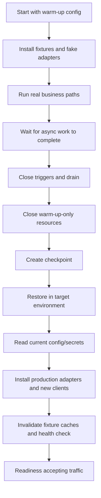

# Using Synthetic Data and Controlled Dependent Services

Warming up the JVM before creating a CRaC checkpoint helps the application enter a state where critical classes are loaded, frequently used code paths have executed, and part of the required caches are prepared. For this process to be repeatable and safe, the application should use **intentional synthetic data** along with **controlled dependent services**.

A warm-up pass can invoke across many layers: controller, validation, service, mapper, serializer, repository, HTTP client, and data-processing libraries. If warm-up connects directly to production systems, it can create fake orders, send notifications, consume real messages, mutate shared caches, or write unwanted data. Conversely, if all business code is replaced with mocks, the JVM only warms up mocks, not the code paths real requests will use.

The goal is to run **real application code with synthetic data and safe dependencies**, then replace warm-up adapters with appropriate production dependencies upon restore. The checkpoint needs to be created after warm-up has completed, asynchronous work has drained, and synthetic state cannot be mistaken for production data.

## 1. What Does Warm-up Need to Prepare?

Warm-up is not just sending an arbitrary request to the application. Depending on the application, it can help prepare several kinds of state:

- **Class loading and linking:** loading classes, resolving methods, annotations, reflection metadata, and proxies needed by frequently used processing paths.
- **JIT compilation:** executing critical code paths enough so the JVM collects profiles and has the opportunity to compile hot methods.
- **Framework initialization:** initializing serializers, validators, mappers, expressions, dependency injection, and framework metadata.
- **Application caches:** building lookup structures or reusable reference data if that data remains valid after restore.
- **Client preparation:** initializing client libraries, TLS configuration, connection pools, or prepared statements if their lifecycle is compatible with checkpoint/restore.
- **Data path execution:** running processing branches with data structures, request types, and complexity close to real traffic.

CRaC preserves process state at checkpoint time. Therefore, what warm-up has created in the heap can appear after restore. However, a socket, token, lease, or environment-dependent cache may have become stale. It is necessary to distinguish state that saves initialization time from state that must be recreated or verified after restore.

## 2. Why Use Synthetic Data?

Warm-up data should resemble real data closely enough to trigger critical code branches, without carrying personal information or causing side effects in business systems.

For example, for an ordering service, warm-up data may include:

- A synthetic customer with an ID dedicated to warm-up.
- A shopping cart with multiple items, variants, and varying quantities.
- Representative price levels, discounts, taxes, and shipping fees.
- Synthetic addresses following valid formats that validators need to process.
- Order statuses used to run through different processing branches.
- Some edge cases such as an empty cart, expired discount code, or out-of-stock product.

This data helps the JVM execute input validation, pricing calculation, object mapping, response serialization, and error-handling code. Because the IDs and contents are synthetic, warm-up does not need to read real customer information or create orders that could enter fulfillment workflows.

### Data Must Represent Realistic Shapes

A fixture with only a single simple record may miss branches that production frequently uses. Choose data based on workload structure and distribution:

| Data characteristic | Examples to prepare | Processing paths that can be triggered |
|---|---|---|
| Small and large sizes | One item, many items, large payloads within limits | Loops, allocations, serializers, and request limits |
| Optional fields | With/without secondary address, notes, metadata | Null/optional branches and validation |
| Different values | Positive prices, discounts, taxes, quantities | Calculations and business rules |
| Different states | Newly created, confirmed, canceled | State transitions and processing branches |
| Characters and formats | Unicode, dates/times, timezones, identifiers | Parsing, normalization, and serialization |
| Error cases | Non-existent ID, malformed data | Exception mapping and error responses |

There is no need to include every combination in warm-up. Choose critical paths based on frequency and initialization cost. An overly large workload can increase checkpoint creation time, heap size, and restore time without providing commensurate benefit.

### Synthetic Data Must Be Reproducible

Fixtures should follow stable generation rules:

- Use a dedicated ID namespace, for example `warmup-customer-001` or a dedicated tenant.
- Use a deterministic seed if reproducible random fake data is needed.
- Use a simulated clock or fixed timestamps for time-dependent calculations.
- Version the fixture set to know which dataset built a cache or snapshot.
- Do not take production data and merely rename fields; anonymized data can still contain sensitive information or identifiable traces.

Example of a synthetic data factory:

```java
import java.math.BigDecimal;
import java.util.List;

record WarmupLine(String sku, int quantity, BigDecimal unitPrice) {}

record WarmupOrder(
        String orderId,
        String customerId,
        List<WarmupLine> lines) {}

final class WarmupFixtures {
    private WarmupFixtures() {
    }

    static WarmupOrder representativeOrder() {
        return new WarmupOrder(
                "warmup-order-001",
                "warmup-customer-001",
                List.of(
                        new WarmupLine("SKU-A", 2, new BigDecimal("19.90")),
                        new WarmupLine("SKU-B", 1, new BigDecimal("42.50")),
                        new WarmupLine("SKU-C", 4, new BigDecimal("3.25"))
                )
        );
    }
}
```

This fixture intentionally uses IDs with the `warmup-` prefix so they are easy to recognize in logs and metrics. If the application stores fixtures into a warm-up database, use a separate schema or database and delete that data according to the warm-up environment lifecycle.

## 3. Using Controlled Dependencies Instead of Calling Production Services

Warm-up typically traverses many dependencies. Each dependency needs a clear strategy to ensure calls yield stable results and cause no unintended effects.

| Dependency | How to control during warm-up | What to keep like production |
|---|---|---|
| Database | Isolated database/schema with synthetic data; or in-memory adapter when only warming logic | Driver, dialect, data types, mappings, and SQL statements if the goal is warming the DB access path |
| HTTP service | Stub server or fake adapter returning deterministic responses | HTTP client, serializer, TLS/configuration path, and response types |
| Message broker | Dedicated broker, warm-up topic/queue, or simulated producer/consumer | Serialization, partition/key logic, and real handlers |
| Payment/email/SMS | Fake gateway recording requests in memory or a test sink | Business validation, request mapping, and error handling |
| Object storage | Dedicated bucket or fake store | SDK client, metadata, and how the application handles objects |
| Identity provider | Fake token with valid structure or test identity provider | Claim parsing flow, authorization mapping, and refresh logic |
| Clock | `Clock.fixed(...)` or controllable clock | Deadline calculation, timezone, and business schedules |

What needs to be controlled are side effects and data sources. Keep real application classes, validation, mapping, serialization, and business logic in the warm-up path. Swap adapters at integration boundaries so requests do not reach production systems.

### Do Not Mock the Exact Code Needing Warm-up

Suppose the order processing service has logic:

```java
OrderResult result = orderService.createOrder(request);
```

Warm-up should call the real `orderService.createOrder(...)`. You can replace `PaymentGateway`, `InventoryPort`, and `OrderRepository` with safe adapters. If you mock the entire `OrderService` and only call the mock, the JVM does not execute pricing calculation, inventory checking, entity creation, or result serialization code.

The degree of dependency substitution depends on the goal. If you want to warm up Hibernate mappings or the JDBC driver, an in-memory repository may not be enough; a separate database with a compatible schema and version is needed. If you only want to warm up business logic, an in-memory adapter may be appropriate.

## 4. Designing Dependency Boundaries to Switch from Warm-up to Production

A useful design is having services depend on interfaces/ports, while adapters are wired through a registry or factory. During the warm-up phase, the registry holds simulated adapters. After restore, the lifecycle manager installs production adapters.

```java
interface CatalogPort {
    CatalogItem findBySku(String sku);
}

interface PaymentPort {
    PaymentResult authorize(PaymentRequest request);
}

interface EventPort {
    void publish(OrderCreated event);
}

record ApplicationDependencies(
        CatalogPort catalog,
        PaymentPort payment,
        EventPort events) {}

final class DependencyRegistry {
    private volatile ApplicationDependencies current;

    ApplicationDependencies current() {
        ApplicationDependencies dependencies = current;
        if (dependencies == null) {
            throw new IllegalStateException("Dependencies are not installed");
        }
        return dependencies;
    }

    void install(ApplicationDependencies dependencies) {
        current = dependencies;
    }
}
```

The service retrieves dependencies from the registry at processing time:

```java
final class OrderService {
    private final DependencyRegistry dependencies;

    OrderService(DependencyRegistry dependencies) {
        this.dependencies = dependencies;
    }

    OrderResult createOrder(OrderRequest request) {
        ApplicationDependencies ports = dependencies.current();
        CatalogItem item = ports.catalog().findBySku(request.sku());
        PaymentResult payment = ports.payment().authorize(
                new PaymentRequest(request.customerId(), item.price())
        );

        OrderCreated event = new OrderCreated(
                request.orderId(), request.customerId(), payment.reference()
        );
        ports.events().publish(event);

        return new OrderResult(request.orderId(), payment.status());
    }
}
```

`OrderService` still runs real code during warm-up. Simulated adapters only replace integration ports. After restore, the entire `ApplicationDependencies` can be swapped with a new object through a single volatile assignment, so new requests see the same consistent set of dependencies.

This design requires the service to look up dependencies via the registry during processing. If the service stores a fake adapter directly into a field from its constructor, updating the registry will not change the adapter the service is using. In that case, recreate the service/client holder or design a provider/proxy to switch adapters safely.

## 5. Examples of Fake Adapters with Safe Side Effects

Warm-up adapters need to return realistic enough results for business code to run through the necessary branches. For payment, an adapter can record requests without calling the payment gateway:

```java
import java.util.ArrayList;
import java.util.List;

final class FakePaymentPort implements PaymentPort {
    private final List<PaymentRequest> received = new ArrayList<>();

    @Override
    public PaymentResult authorize(PaymentRequest request) {
        received.add(request);
        return new PaymentResult("warmup-payment-ref", "AUTHORIZED");
    }

    List<PaymentRequest> receivedRequests() {
        return List.copyOf(received);
    }
}
```

For an event publisher, a sink that only stores events in memory can be used:

```java
final class RecordingEventPort implements EventPort {
    private final List<OrderCreated> events = new ArrayList<>();

    @Override
    public void publish(OrderCreated event) {
        events.add(event);
    }

    List<OrderCreated> events() {
        return List.copyOf(events);
    }
}
```

In production, `PaymentPort` may call a payment provider and `EventPort` may publish to a real broker. During warm-up, those side effects are replaced with controlled adapters. Do not use fake adapters to serve production traffic after restore.

If warm-up runs across multiple threads, adapters recording data must be thread-safe. If results are only used to initialize code paths and do not need to be retained, use a sink that discards events instead of keeping an ever-growing list in the checkpoint heap.

## 6. Using a Warm-up Database Aligned with the Goal

A simulated database is not always enough. Two goals typically differ:

**Warming up business logic:** an in-memory adapter can return synthetic entities so the service executes validation, calculation, mapping, and serialization. This approach is fast, easy to reproduce, and requires no database startup.

**Warming up data access paths:** if the goal is warming up the JDBC driver, ORM metadata, SQL parsing, prepared statements, or query paths, a separate database with a compatible schema is needed. Use synthetic data and separate accounts, not the production database.

A warm-up database should have:

- Engine version and schema close to the target environment.
- Tables and indexes needed for critical queries.
- Sufficient synthetic data to trigger representative query patterns.
- Restricted write permissions and isolated data.
- A cleanup or reset process after warm-up.

Connection pools created before checkpoint may hold sockets and sessions that are no longer valid after restore. Use the pool's lifecycle API to close or prepare before checkpoint and create a new pool after restore. Do not assume connections to the warm-up database will become production connections simply because the process was restored.

## 7. Stub HTTP and Controllable External Services

For HTTP dependencies, a local stub server or one in a dedicated warm-up network can be run. The stub needs to return responses with representative structures and status codes:

- Success with common payloads.
- Success with optional fields or empty lists.
- 4xx errors to warm up business error mapping.
- 5xx errors or timeouts to warm up retry/error paths if those are critical paths.
- Large or paginated responses when the client handles those cases.

Use the same HTTP client, codec, and mapping code as production. The stub server only replaces endpoints and responses. If the goal is warming up TLS handshakes or real authentication, use a controlled test service with test certificates and identities; fake responses do not fully warm up all costs of TLS or auth providers.

Do not let stub URLs, test tokens, or internal warm-up DNS be stored as production configuration in the checkpoint. After restore, read endpoints and credentials from the current environment's configuration/secret provider.

## 8. Warming Up Through Real Application Processing Paths

A warm-up runner should call critical use cases with prepared fixtures. Example:

```java
final class ApplicationWarmup {
    private final OrderService orderService;
    private final SearchService searchService;
    private final ResponseEncoder responseEncoder;

    ApplicationWarmup(
            OrderService orderService,
            SearchService searchService,
            ResponseEncoder responseEncoder) {
        this.orderService = orderService;
        this.searchService = searchService;
        this.responseEncoder = responseEncoder;
    }

    void run() {
        OrderRequest order = WarmupFixtures.representativeOrderRequest();
        OrderResult result = orderService.createOrder(order);
        responseEncoder.encode(result);

        searchService.search(WarmupFixtures.representativeSearchQuery());
        searchService.search(WarmupFixtures.emptySearchQuery());
    }
}
```

The methods `representativeOrderRequest`, `representativeSearchQuery`, and `emptySearchQuery` are fixture factories defined by the application. The runner should call the service directly or go through an internal entry point with the same pipeline as real requests. If you want to warm up controllers, filters, validation, or serialization at the web layer, use internal HTTP requests to a warm-up server or a test harness with the same web stack.

It is not necessary to run every API. Prioritize code paths with high initialization cost, high usage frequency, or strong impact on first-request latency. Record the warm-up scope to know which paths were executed.

### Warm-up Must Complete Before Checkpoint

If the runner spawns asynchronous tasks, wait for them to complete. Do not checkpoint while fixtures are being written, a future is still pending, or events remain in internal queues.

```java
CompletableFuture<Void> warmup = warmupRunner.runAsync();
warmup.get(60, TimeUnit.SECONDS);

warmupCoordinator.awaitBackgroundWorkDrained();
```

The example uses `get` with a timeout to wait for the runner. `awaitBackgroundWorkDrained()` is application-specific coordination to wait for subtasks spawned by the runner. Waiting only on the root future is insufficient if it submits work to another executor and completes early.

## 9. Distinguishing Data Warm-up from JIT Warm-up

Data warm-up and JIT warm-up are related but not the same task:

- Loading fixtures into caches can warm up data structures and reduce source accesses during the first request.
- Calling methods with representative data helps the JVM collect execution profiles and potentially JIT-compile hot code.
- Initializing frameworks helps load classes and create proxies, validators, and serializers.
- Opening connections helps initialize clients, though sockets/sessions may have to be recreated after restore.

Merely loading objects into caches without executing methods will not warm up JIT for methods that have not run. Conversely, calling the same method with overly simple data may not represent production branches. Choose workloads with appropriate sizes, data types, and logic branches.

JIT compilation is a dynamic decision of the JVM. There is no fixed invocation count that guarantees every method will be optimally compiled. Monitor warm-up duration, compilation logs/JFR, or observability tools appropriate for the runtime to understand which parts are actually warmed up. Do not prolong warm-up just to force every rare method to become hot.

## 10. Preventing Synthetic Data from Becoming Production Data

A checkpoint preserves heap state, so warmed-up caches and singletons may continue containing fixtures after restore. This is dangerous if code treats every entry in a cache as real data.

Several safeguards:

- Use a dedicated namespace/key for warm-up and do not share namespaces with production caches.
- Tag fixtures with a dedicated data source or version.
- Clear caches holding synthetic results in `afterRestore` before opening readiness.
- Reload reference data from production sources if a warm cache is needed.
- Do not put warm-up customers, orders, or tokens into shared databases/caches.
- Use fake sinks for emails, SMS, payments, events, and other side effects.
- Check logs, metrics, and traces so warm-up data is not sent to production analytics systems as real traffic.

If you want to keep some warmed-up caches, only retain safely reusable data, such as code tables or metadata immutable per artifact version. Caches dependent on tenants, access permissions, pricing, inventory, or runtime configuration must be verified or reloaded.

## 11. Coordinating Dependencies During Checkpoint and Restore

A general workflow can consist of three phases:

### Warm-up Preparation Phase

1. Start the application with a dedicated warm-up configuration.
2. Create synthetic fixtures and install simulated adapters.
3. Initialize required test dependencies.
4. Run the warm-up runner through real use cases.
5. Wait for asynchronous tasks to finish and record executed code paths.

### Before Checkpoint

1. Stop accepting new warm-up requests and triggers.
2. Drain internal requests, tasks, consumers, and events.
3. Close stub servers, connection pools, and resources that only exist in the warm-up environment if they cannot be safely kept.
4. Clear or mark stale any caches that contain only fixtures.
5. Verify the application is in a consistent state and then create the checkpoint.

### After Restore

1. Read configuration and secrets of the target environment.
2. Recreate clients, connection pools, listeners, and production dependencies.
3. Replace warm-up adapters in the dependency registry with production adapters.
4. Invalidate caches containing fixtures and refresh necessary data.
5. Check health of mandatory dependencies.
6. Transition readiness to accepting traffic after all recovery steps succeed.



If warm-up and production use the same database/service with different namespaces, ensure the namespace is reconfigured after restore and test credential permissions cannot write to production data. A `warmup=true` setting stored in the heap should not be the sole mechanism deciding production endpoints; determine the target environment from a trusted configuration source.

## 12. Example Resource Coordinating Warm-up and Dependency Swap

The following example shows where to place lifecycle logic. The interfaces are application abstractions:

```java
import java.time.Duration;

import org.crac.Context;
import org.crac.Resource;

final class WarmupResource implements Resource {
    private final WarmupRunner runner;
    private final WarmupCoordinator coordinator;
    private final DependencyRegistry dependencies;
    private final ProductionDependencyFactory productionFactory;
    private final RuntimeConfigurationProvider configurationProvider;
    private final Duration drainTimeout;

    WarmupResource(
            WarmupRunner runner,
            WarmupCoordinator coordinator,
            DependencyRegistry dependencies,
            ProductionDependencyFactory productionFactory,
            RuntimeConfigurationProvider configurationProvider,
            Duration drainTimeout) {
        this.runner = runner;
        this.coordinator = coordinator;
        this.dependencies = dependencies;
        this.productionFactory = productionFactory;
        this.configurationProvider = configurationProvider;
        this.drainTimeout = drainTimeout;
    }

    void runWarmup() throws Exception {
        runner.run();
        coordinator.awaitWarmupWorkDrained(drainTimeout);
        coordinator.markWarmupComplete();
    }

    @Override
    public void beforeCheckpoint(Context<? extends Resource> context)
            throws Exception {
        coordinator.stopWarmupTriggers();
        coordinator.awaitWarmupWorkDrained(drainTimeout);
        coordinator.closeWarmupOnlyResources();
    }

    @Override
    public void afterRestore(Context<? extends Resource> context)
            throws Exception {
        RuntimeConfiguration configuration = configurationProvider.loadCurrent();
        ApplicationDependencies production =
                productionFactory.create(configuration);

        dependencies.install(production);
        coordinator.invalidateFixtureCaches();
        coordinator.verifyProductionDependencies();
    }
}
```

The code snippet is an illustrative skeleton; `runWarmup()` needs to be called during the checkpoint preparation phase, before requesting checkpoint creation. `beforeCheckpoint` confirms warm-up work has drained and closes warm-up-only resources. `afterRestore` installs production dependencies, clears fixture caches, and checks health. In a real application, ensure `productionFactory` does not depend on closed warm-up adapters and readiness only opens after the coordinator completes.

If a step in `beforeCheckpoint` fails, the callback must report an error so the checkpoint does not proceed with an inconsistent state. If a checkpoint attempt is canceled after callbacks have closed warm-up stubs or pools, the application controller needs a way to recover or reinitialize those dependencies before continuing to run. Do not assume `afterRestore` will be called on the old process to undo a failed checkpoint.

## 13. Choosing Between Fake Adapters, Stub Servers, and Real Test Dependencies

No single simulation style fits every goal. Choose based on the layer you want to warm up:

| Goal | Appropriate choice | Limitation |
|---|---|---|
| Warm up business logic | Fake/in-memory adapter | Does not warm up real drivers or protocols |
| Warm up HTTP client and codec | Stub HTTP server | Does not fully represent production latency, TLS, or behavior |
| Warm up JDBC/ORM/SQL | Test database with compatible schema | Requires managing data, versions, and connection lifecycle |
| Warm up message serialization/handlers | Dedicated broker or test adapter with the same codec | Must not consume production messages |
| Warm up external SDKs/drivers | Vendor sandbox/test service | Must verify sandbox has the same key features and configurations |
| Warm up pure caches | Fixture/cache builder | Caches must be classified and refreshed properly after restore |

Multiple approaches can be combined. For example, warm up business logic with fast fake adapters, then run some representative paths through a test database to warm up ORM. Keep the scope just large enough so the checkpoint does not bloat and preparation time does not outweigh the cold-start reduction benefit.

## 14. Common Mistakes

### Using production data to warm up

This can leak information, create side effects, or put one tenant's private data into a checkpoint shared across multiple replicas. Use synthetic fixtures and isolated environments.

### Mocking the entire service needing warm-up

If the business service is mocked, the JVM does not execute real logic. Only replace dependencies at I/O boundaries and call real use cases.

### Using stubs without refreshing endpoints after restore

If stub URLs reside in singletons or configuration snapshots, the application may continue calling stubs in production. Load production endpoints from current configuration and update the dependency registry.

### Keeping fixture caches as production caches

Caches may contain fake prices, inventory, permissions, or tenant data. Attach versions/namespaces and invalidate before readiness.

### Leaving warm-up tasks half-running during checkpoint

Asynchronous tasks may continue writing fixtures or emitting events after restore. Stop triggers, drain all subtasks, and only checkpoint once a steady state is reached.

### Warming up too little or too much

A single simple request does not trigger enough code paths; an overly large workload prolongs duration and increases heap. Choose data and call counts based on workload profiles and warm-up goals.

### Not distinguishing warm-up state from ready-to-serve state

The application may have completed warm-up successfully without yet connecting to production dependencies. Readiness must only open after target dependencies have been installed and verified.

## 15. Observing and Measuring Effectiveness

To know whether warm-up helps, record metrics before and after applying it:

| Metric | What to observe |
|---|---|
| Framework initialization time | Whether work that had to be repeated after restore is reduced |
| Warm-up duration | Whether checkpoint preparation cost is reasonable |
| Number of executed code paths | Which use cases were warmed up |
| JIT compilation/profile | Whether critical methods executed enough for the JVM to optimize |
| Heap/checkpoint size | Whether fixtures or caches make the process image too large |
| Restore and readiness time | Whether dependency swapping becomes a new bottleneck |
| First-request latency | Whether the first request after restore improves |
| Dependency errors after restore | Whether any URLs, credentials, or connections from the warm-up environment remain |

Compare against cold start on the same hardware, JDK, configuration, and workload. Use latency percentiles such as p50/p95/p99 instead of looking only at averages. Also observe over a period of real traffic to distinguish warm-up benefits from checkpoint creation and restore costs.

## 16. Data and Dependency Preparation Checklist

- [ ] Use cases and code paths needing warm-up have been identified.
- [ ] Fixtures are synthetic, reproducible, and contain no production data.
- [ ] Fixtures represent critical sizes, data types, and business branches.
- [ ] Data has a dedicated namespace/version to identify it as warm-up.
- [ ] Real business logic, validation, mapping, and serialization are executed.
- [ ] Dependencies with side effects are replaced with fake adapters, stubs, or controllable sandboxes.
- [ ] Warm-up database uses an isolated schema/data if JDBC/ORM needs warming up.
- [ ] No production payments, emails, SMS, messages, or events are emitted during warm-up.
- [ ] Warm-up tasks and all asynchronous work completed before checkpoint.
- [ ] Fixture caches are cleared or verified before serving production traffic.
- [ ] Endpoints, credentials, and clients are recreated according to target environment configuration after restore.
- [ ] Readiness only opens after production dependencies are installed and verified.
- [ ] A recovery plan exists if a checkpoint attempt fails after warm-up resources have closed.
- [ ] Warm-up duration, checkpoint size, restore time, and first-request latency have been measured.

## 17. Conclusion

Using synthetic data and controlled dependencies enables warm-up to execute critical code paths without mutating production systems or baking sensitive data into checkpoints. Fixtures must be reproducible and representative of realistic data shapes; fake adapters should replace I/O boundaries while real business logic is still invoked.

Before checkpoint, stop warm-up triggers, drain tasks, and close resources used only for the preparation environment. After restore, load configuration and credentials of the target environment, replace simulated adapters with production dependencies, invalidate fixture caches, and check health before opening readiness. In this way, a warmed-up state can help reduce cold start without causing the application to keep using synthetic data or simulated services when receiving real traffic.
