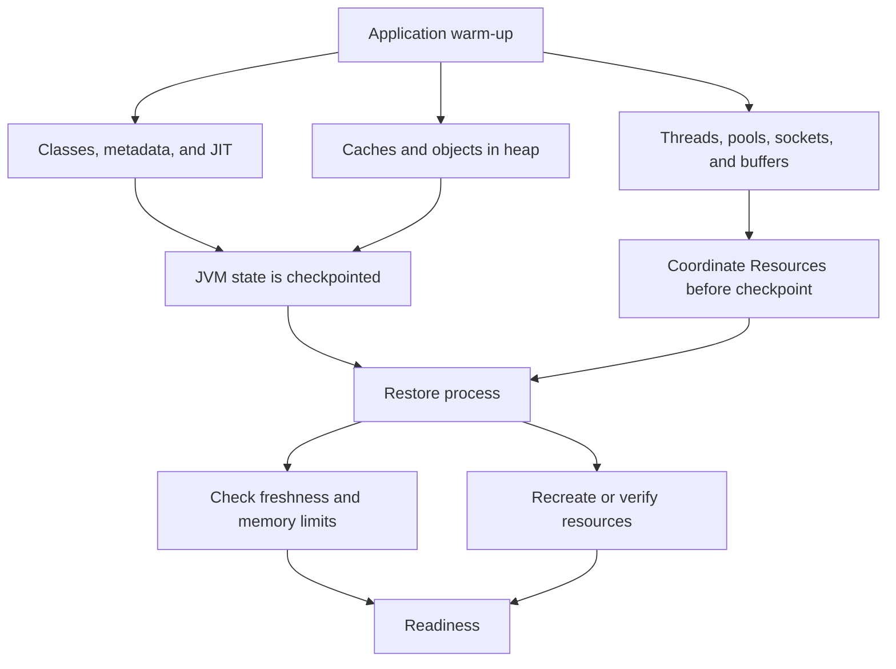

# Controlling Caches, Memory Allocation, and Resources Created During Warm-Up

Warming up the JVM before creating a checkpoint helps an application complete work that normally slows down startup: loading classes, building framework metadata, executing critical code paths, JIT compilation, and loading frequently used data into caches. Once the process is restored, part of the prepared state can continue to be reused, thereby reducing repeated work.

However, warm-up also creates new state: caches grow in size, the heap accumulates objects, JIT consumes code cache, frameworks may generate proxies and metadata, and the application may open connection pools, threads, files, sockets, or native buffers. If warm-up is uncontrolled, the checkpoint can become large, restore can consume substantial memory, caches can hold stale data, or the process can continue with external resources that are no longer valid.

Therefore, the goal is not to warm up as much as possible. The goal is to build the right useful state, keep memory usage within bounds, manage resource lifecycles, and re-verify whatever may have changed while the process was stopped.

## 1. What kinds of state does warm-up create?

A Java application has many distinct layers of state. They do not share the same lifecycle and not every kind is handled the same way across checkpoint/restore.

| State type | Examples | How to think about it during warm-up |
|---|---|---|
| Heap state | Configuration objects, metadata, business caches, lookup data. | Load only necessary data; set size limits and expiration policies. |
| JVM state | Loaded classes, runtime structures, profiling, and JIT-compiled code. | Execute representative code paths; retention effectiveness depends on the CRaC JDK and runtime. |
| Off-heap memory | Direct buffers, native allocations, memory mappings. | Track ownership, limits, and recoverability of the libraries in use. |
| Operating system resources | File descriptors, sockets, threads, timers, process state. | Identify what to keep, pause, close, or recreate via Resource callbacks. |
| External resources | Databases, brokers, HTTP services, secret providers. | Do not assume remote state is checkpointed alongside the JVM; verify and reconnect after restore. |

Three major groups can be distinguished:

1. **Useful state to retain:** loaded classes, stably initialized objects, rarely changing data caches, and part of warmed runtime state.
2. **State needing verification or refresh:** caches depending on external data, tokens, DNS, changeable configuration, time-sensitive data, and session state.
3. **Resources needing lifecycle management:** sockets, connection pools, executors, files, threads, native buffers, and library-managed resources.



The diagram illustrates the design-time classification. What specific state is saved, recreated, or requires handling depends on the CRaC JDK, operating system, and the application's libraries.

## 2. Selecting targeted warm-up workloads

Warm-up should be based on the actual processing paths the application needs to optimize. Running a huge volume of random requests may inflate the heap and caches without noticeably improving time to readiness.

### 2.1. Identifying critical code paths

Before warm-up, identify representative operations:

- Frequently invoked endpoints or use cases.
- Important serializers, validators, mappers, and data converters.
- Queries or computations with high initialization cost.
- Classes or modules loaded only when entering a particular feature.
- Framework components needing metadata or proxies generated before serving.

Prioritize paths directly affecting time to readiness and initial latency. There is no need to invoke every endpoint or every code branch if they are rarely used.

### 2.2. Using safe warm-up data

Warm-up can execute real business code, so side effects must be controlled. Do not use production data in ways that could create orders, send emails, charge money, consume messages, write unwanted audit entries, or mutate system state.

Safer approaches:

- Use fixtures or test data with dedicated identifiers.
- Call pure initialization/transformation functions where possible, instead of triggering full business flows.
- Use mocks or sandboxes for dependencies with side effects.
- Separate cache-loading steps from write-command execution.
- If calling real services is necessary, use test endpoints or controlled read operations.

Warm-up must be repeatable. If checkpointing fails and the application restarts from scratch, re-running warm-up must not create duplicate data or unexpected business effects.

### 2.3. Phased warm-up

Do not launch all warm-up tasks simultaneously if they contend for CPU, heap, database connections, or thread pools. You can split into phases:

1. Read configuration, create components, and initialize the framework.
2. Load critical classes and metadata.
3. Execute representative code paths to give the JVM an opportunity to optimize.
4. Populate bounded caches and necessary background data.
5. Inspect resources, stop or coordinate background tasks.
6. Bring the application to a safe state for checkpointing.

Exact ordering depends on dependencies. For example, if a cache needs the database, the database must be ready before populating the cache; workers using the cache must be held waiting until cache population completes.

## 3. Controlling caches populated during warm-up

Caches are one of the most visible sources of heap growth during warm-up. A useful cache can reduce queries or computation after restore, yet an unbounded cache can occupy most of the heap and retain data no longer needed.

### 3.1. Classifying caches before populating

| Cache type | Examples | Recommended policy |
|---|---|---|
| Metadata cache | Entity metadata, schemas, serializers, reflection, or parsed configuration. | Can retain if compatible with application version and post-restore configuration. |
| Rarely changing data cache | Catalogs, country codes, reference tables. | Load needed portions; use versioning or refresh intervals. |
| Frequently changing data cache | Prices, inventory, account status. | Load selectively and verify freshness before use. |
| Per-user/session cache | Profiles, permissions, tokens, or sessions. | Be careful with privacy, expiration, and sensitive data; usually do not pre-load en masse. |
| Computed result cache | Aggregated results or normalized structures. | Set bounds, weigh recomputation cost against staleness risk. |

Not every cache should be warmed up. Compare the reinitialization cost against the memory and time needed to populate the cache. A large cache used in only a few requests may add more checkpoint cost than the benefit it delivers.

### 3.2. Setting size bounds

Every cache should have explicit limits, such as:

- Entry count limit.
- Weight limit or estimated capacity.
- TTL (time-to-live) for time-bounded data.
- Eviction policy when thresholds are exceeded.
- Separate limits per tenant or data group.

Example with a bounded cache in Caffeine:

```java
Cache<String, ProductSummary> productCache = Caffeine.newBuilder()
        .maximumSize(20_000)
        .expireAfterWrite(Duration.ofMinutes(15))
        .recordStats()
        .build();
```

This is an illustrative example requiring the Caffeine dependency and corresponding imports. `maximumSize` caps the number of entries, not an exact byte limit. If individual value sizes vary substantially, consider `maximumWeight(...)` together with `weigher(...)` to estimate appropriate weights.

Do not set limits based solely on maximum heap capacity. Leave headroom for concurrent requests, temporary objects, GC, thread stacks, direct buffers, and other libraries.

### 3.3. Choosing which data to warm

A practical approach is ranking data by access frequency, loading cost, and rate of change:

| Group | Examples | Decision |
|---|---|---|
| Frequently used, high load cost, rarely changes | Metadata used in almost every request. | Prioritize for warm-up. |
| Frequently used yet changes rapidly | Prices or inventory. | Load only if freshness can be verified; can refresh after restore. |
| Rarely used, low load cost | An infrequently accessed lookup table. | Leave for lazy-loading on request. |
| Rarely used, high load cost | Specialized reports or analytics. | Warm only if the SLA genuinely requires it. |
| Per-user or containing secrets | Tokens, sessions, credentials. | Avoid bulk warm-up; manage via providers and security policies. |

Cache warm-up should rely on aggregated data or representative workloads, avoiding over-reliance on an overly narrow dataset that yields a high hit rate in tests yet a low one in production.

### 3.4. Freshness after restore

Caches kept in the heap may continue to exist after restore, yet the source data may have changed while the application was stopped. Determine:

- Which caches can be used immediately because the data rarely changes?
- Which caches must check a version, timestamp, or generation?
- Which caches must be cleared and reloaded before features are enabled?
- Which caches can refresh asynchronously while the application serves in a limited mode?

TTL is part of the policy, not an absolute freshness guarantee. Check how the cache library measures time and handles expiration when a process stays checkpointed for a long duration. For critical data, verify version or timestamp against the data source rather than relying solely on stale cached data.

### 3.5. Avoiding cache stampedes after restore

If many instances restore simultaneously and all see expired caches, they may simultaneously hit the database or external services to reload. This phenomenon creates a traffic spike right as the system starts up.

Ways to reduce load:

- Use single-flight or coalescing mechanisms so multiple requests wait on one load.
- Refresh in small groups rather than reloading the entire cache at once.
- Add jitter to refresh/expiration timestamps.
- Limit concurrency of warm-up and refresh tasks.
- Keep safe fallbacks for recomputable data.
- Expose dependent capabilities only after relevant caches are ready.

## 4. Managing memory allocation during warm-up

Warm-up can increase both live object volume and temporary allocations. These two numbers have different meanings:

- **Live set:** objects still referenced and needing to be retained.
- **Allocation rate:** the rate at which new objects are created over a time interval.
- **Committed heap:** the heap region the JVM has committed from the operating system.
- **Maximum heap:** the maximum heap limit per JVM configuration.
- **RSS:** the amount of physical memory currently resident for the process, including many non-heap components.
- **Native/direct memory:** memory allocated outside the heap by the JVM or libraries.

A warm-up creating many temporary objects may raise allocation rate and trigger GC without raising the live set proportionally. Conversely, loading a large cache can increase the live set long-term even when the subsequent allocation rate is low.

### 4.1. Setting a memory budget for checkpoints

Budget across the entire process, not just the heap:

| Component | What to track |
|---|---|
| Heap live set | Surviving objects after warm-up and after an appropriate GC cycle. |
| Heap committed/max | Heap used by the JVM and configured limits. |
| Metaspace | Classes and metadata loaded during warm-up. |
| Code cache | Compiled JIT code and related runtime data. |
| Direct/native memory | Buffers, native libraries, allocators, and networking libraries. |
| Thread stacks | Thread count and stack size. |
| File mappings and native mappings | Memory regions mapped from files or native components. |
| Operating system memory | RSS and headroom within container/cgroup limits. |

Checkpoint images and restore costs depend on how the JVM, checkpoint tool, and operating system handle memory mappings/pages. You cannot accurately deduce image size from `-Xmx` alone. Still, keeping a large live set or many resident memory pages usually increases footprint and can increase save/restore cost. Measure on the exact JDK, kernel, and deployment configuration.

### 4.2. Avoiding dummy allocations just to warm the heap

Do not allocate a huge array or millions of meaningless objects merely to "touch" the heap before checkpointing. This approach can:

- Increase the live set if references remain held.
- Cause extra GC and prolong warm-up.
- Increase footprint or checkpoint image size.
- Reduce headroom for real requests after restore.
- Obscure allocation issues of real workloads.

If the goal is to warm a processing path, execute that exact code path with representative data. If the goal is to inspect memory behavior, measure allocation rate, live set, and GC rather than intentionally filling the heap.

### 4.3. Do not force GC mechanically

Calling `System.gc()` does not guarantee reclaiming every object or leaving the heap in an optimal state. It is only a hint asking the JVM to consider GC; behavior still depends on the collector, JVM flags, and runtime state.

You can take measurements after warm-up to understand live set and GC, yet you should not treat a GC call as a mandatory prerequisite for checkpointing. If the application needs to release objects, fix references/lifecycles so objects are no longer reachable; let GC handle them according to runtime policy.

### 4.4. Monitoring GC and allocation

Collect data before and after warm-up:

- Heap used/committed/max.
- Post-GC live set under defined measurement conditions.
- GC count, pause durations, and collector type.
- Allocation rate and hot allocation sites.
- Metaspace and code cache.
- Direct buffers/native memory.
- RSS and container memory limits.

You can use Java Flight Recorder, GC logs, `jcmd`, and JVM metrics to observe. Measure using identical JDK configuration and workload when comparing cold start against warm-up/restore.

## 5. Controlling resources created during warm-up

Warm-up does not create only objects. It can create resources whose lifecycles live outside the heap. This is the group needing special attention during CRaC integration.

### 5.1. Threads and executors

Warm-up may start schedulers, worker pools, HTTP client executors, or library threads. Before checkpointing, determine which threads:

- Can safely continue across checkpoint.
- Must stop at a safe point and wait.
- Must be shut down before checkpoint and recreated after restore.
- Must not run new tasks during the preparation phase.

Do not create an overly large thread pool solely for warm-up. More threads increase thread stacks, scheduler overhead, and concurrent task capacity. Warm-up tasks should have their own concurrency limits, avoiding saturating request-serving executors.

### 5.2. Database and HTTP connection pools

Populating caches may open many database connections or HTTP connections. Those connections may be closed by servers during checkpointing. Make sure to:

1. Stop issuing new connections.
2. Drain running requests or transactions.
3. Close or prepare the pool using the library's API.
4. Create new pools/clients after restore.
5. Verify connections and reopen features only after dependencies are ready.

Do not use warm-up to open more connections than actually needed. Connection pools should have limits aligned with the database's total connection budget, instance count, and other clients.

### 5.3. Files, sockets, and temporary files

Warm-up may create temporary files, open file mappings, create sockets, or bind ports. Distinguish durable data files from temporary files tied to the process lifecycle.

- Flush necessary data before checkpointing.
- Close handles that do not need to be kept across restore.
- Do not assume sockets to external services remain alive.
- Record paths and recreation rules for temporary files if needed.
- Clean up unused temporary files to avoid accumulation across restarts.

### 5.4. Direct buffers and native resources

Some networking libraries, codecs, or native libraries use direct buffers and native allocations. They are not managed like ordinary heap objects. Determine:

- Who owns the buffer and who frees it?
- Are there any native handles or native threads?
- Does the library provide CRaC guidelines or dedicated lifecycle callbacks?
- Must the component be closed and recreated after restore?
- Are appropriate direct memory/native memory limits configured?

Do not use `Unsafe`, reflection into internals, or unsupported APIs to arbitrarily mutate library native state. Use public lifecycle APIs and the library's CRaC compatibility guidelines.

## 6. Distinguishing application caches, JIT code cache, and OS page cache

The word "cache" can refer to many different things. When optimizing CRaC, call each by its proper name so you do not confuse retained state with state that must be recreated.

| Cache | Where it lives | Checkpoint relevance |
|---|---|---|
| Application cache | Typically in heap or application off-heap. | Can be part of process state; requires capacity and freshness control. |
| Framework metadata cache | Heap/metaspace or runtime structures. | Can reduce post-restore initialization work if runtime retains corresponding state. |
| JIT code cache | JVM runtime memory. | Warm-up can help compile hot code paths; retention and reuse depend on JDK/CRaC implementation. |
| CPU cache | CPU hardware cache. | Not application state checkpointed like the heap; do not expect preservation across restore. |
| OS page cache | File page caches managed by the operating system. | Operating system state; should not be assumed packaged as application data inside the checkpoint image. |
| DNS cache | May reside in JVM, libraries, or OS. | TTL and address changes must be considered; new connections may need re-resolution. |

JIT warm-up requires running representative code paths enough times for the JVM to have an opportunity to optimize. No fixed iteration count fits every application; compilation thresholds, tiered compilation, and runtime state persistence depend on the JVM. Measure latency and compilation status rather than picking an iteration count by intuition.

## 7. Designing repeatable and stoppable warm-up

Warm-up should have its own state and budget. A coordinating component can track phases such as `NOT_STARTED`, `RUNNING`, `COMPLETED`, `FAILED`, and `CANCELLED`.

Illustrative example:

```java
public final class WarmupCoordinator {

    private final AtomicReference<WarmupState> state =
            new AtomicReference<>(WarmupState.NOT_STARTED);

    public void runWarmup() {
        if (!state.compareAndSet(
                WarmupState.NOT_STARTED, WarmupState.RUNNING)) {
            return;
        }

        try {
            warmFrameworkMetadata();
            executeRepresentativeCodePaths();
            populateBoundedCaches();
            state.set(WarmupState.COMPLETED);
        } catch (RuntimeException e) {
            state.set(WarmupState.FAILED);
            throw e;
        }
    }

    public WarmupState state() {
        return state.get();
    }

    private void warmFrameworkMetadata() { /* ... */ }
    private void executeRepresentativeCodePaths() { /* ... */ }
    private void populateBoundedCaches() { /* ... */ }
}
```

The example is a skeleton demonstrating coordinator-level idempotency; warm-up functions must have explicit time, concurrency, and side-effect bounds. If retrying after errors is needed, define retry state and how partially created resources are cleaned up.

Do not leave warm-up running in the background indefinitely when checkpointing starts. Before checkpointing, the coordinator must know whether warm-up has completed or stopped at a safe point. If warm-up is still unfinished, decide explicitly: wait for completion within a deadline, cancel safely, or reject the checkpoint.

## 8. Coordinating warm-up with `Resource` callbacks

`Resource` helps the application prepare and restore resources around a checkpoint. It does not replace cache management or memory budgeting.

### 8.1. Before checkpoint

A `beforeCheckpoint(...)` callback can:

- Prevent warm-up tasks or background refreshes from starting new work.
- Wait for in-progress cache-loading tasks to finish or cancel per policy.
- Ensure caches are not concurrently written while snapshotting process state.
- Flush/close files or release resources that must be closed.
- Stop connection pools, schedulers, or executors that must be recreated after restore.
- Record cache/version state to verify after restore.

Do not wipe all caches by default. If a cache is useful, stable, and reusable, keeping it can reduce startup time. Discard only caches that are no longer valid or whose retention cost outweighs their benefit.

### 8.2. After restore

In `afterRestore(...)`, the application can:

- Recreate closed pools, clients, executors, or resources.
- Verify cache generation/version.
- Remove expired or incompatible entries.
- Reload mandatory data before enabling capabilities.
- Start bounded background refreshes.
- Keep readiness false until essential resources are operational.

Do not perform a huge synchronous cache load inside the callback if it can excessively prolong restore. You can restore the minimum needed for the application to be safe, then refresh asynchronously, but only if features lacking data are blocked or have proper fallbacks.

### 8.3. Example Resource managing warm-up state

```java
import org.crac.Context;
import org.crac.Core;
import org.crac.Resource;

public final class WarmupResource implements Resource {

    private final WarmupCoordinator warmup;
    private final CacheManager caches;
    private final ExternalClients clients;

    public WarmupResource(
            WarmupCoordinator warmup,
            CacheManager caches,
            ExternalClients clients) {
        this.warmup = warmup;
        this.caches = caches;
        this.clients = clients;
        Core.getGlobalContext().register(this);
    }

    @Override
    public void beforeCheckpoint(Context<? extends Resource> context)
            throws Exception {
        warmup.stopNewTasksAndAwaitCompletion();
        caches.freezeWrites();
        clients.closeConnectionsForCheckpoint();
    }

    @Override
    public void afterRestore(Context<? extends Resource> context)
            throws Exception {
        clients.recreateClients();
        caches.removeExpiredAndIncompatibleEntries();
        caches.verifyRequiredData();
        warmup.resumeBackgroundRefresh();
    }
}
```

`WarmupCoordinator`, `CacheManager`, and `ExternalClients` are illustrative abstractions, not built-in CRaC classes. In a real application, call `freezeWrites()` only if the cache has a corresponding synchronization mechanism; close only clients owned by this resource; and do not mark the application ready before mandatory dependencies have been verified.

## 9. Controlling sensitive and environment-specific cache data

A checkpoint can include the heap, which contains caches and objects holding sensitive data. Therefore, warm-up data must follow data minimization principles.

- Do not load passwords, private keys, or access tokens merely to save a small initialization step.
- Limit caching personal data or multi-user sessions inside the same checkpoint.
- Do not use a checkpoint created in staging with production credentials or endpoints.
- Protect checkpoint images with appropriate access permissions, storage locations, and retention periods.
- When configurations or secrets can change, reload them from providers after restore rather than trusting old objects remain valid.
- Do not log sensitive cache contents when measuring warm-up or debugging.

Caches may hold per-tenant data. If checkpoint images are reused across instances, ensure cached data does not mix tenants, deployment regions, or service identities.

## 10. Measuring warm-up effectiveness and checkpoint cost

Do not evaluate warm-up solely by whether checkpoint creation or restore time is fast. Compare overall costs and post-restore behavior.

Metrics to record:

| Metric | Question to answer |
|---|---|
| Cold start to readiness | How long does the application take when starting from scratch? |
| Warm-up duration | How long does creating useful pre-checkpoint state take? |
| Checkpoint duration | How long does saving process state take? |
| Checkpoint image size | How large is the checkpoint artifact? |
| Restore duration | How long from launching restore until callbacks finish? |
| Time to readiness | How soon after restore can the application accept traffic? |
| Heap live set | How much do retained caches and objects increase the live set? |
| GC pause/allocation | How much extra GC or allocation pressure does warm-up cause? |
| RSS/native memory | Is the total process footprint within limits? |
| Cache hit/miss and refresh | Does the cache genuinely reduce post-restore work or require too much reloading? |
| First-request latency | Is the first request after restore faster? |

Measure under comparable conditions: same JDK, CPU/memory limits, workload, dependencies, and deployment environment. A fast checkpoint restore with stale caches or first requests forced to reload all data may fail to deliver the expected benefit.

### 10.1. Comparing scenarios

You can test at least three configurations:

1. No warm-up, cold start.
2. Class/JIT warm-up without populating large data caches.
3. Class/JIT warm-up plus selective, bounded cache population.

Compare time to readiness, first-request latency, live set, checkpoint image size, and checkpoint/restore times. The best configuration is the one meeting latency goals with acceptable memory and operational cost.

## 11. Common mistakes

**Warm up as much as possible.** Loading excessive data increases live set, checkpoint image size, and GC pressure. Warm only code paths and data with measurable benefits.

**Caches remaining on the heap mean data is still fresh.** Caches may have gone stale during checkpointing. TTL, versions, or verification from the data source are required.

**Increasing `-Xmx` solves every memory issue.** A larger heap can reduce allocation pressure in some cases, yet it also raises footprint bounds and does not solve direct/native memory, thread stacks, or container limits.

**Creating dummy objects to force JVM pre-allocation.** This can increase live set or GC without improving real code paths. Execute representative workloads instead.

**Calling `System.gc()` before checkpoint is mandatory.** This call does not guarantee an optimal heap state. Managing references and measuring the live set is more meaningful.

**Every resource created during warm-up stays safely across restore.** Sockets, pools, threads, and native resources may need to be closed or recreated. Ownership and lifecycles must be identified.

**Populating caches synchronously inside callbacks without limits.** This can prolong restore or make callbacks wait too long on external services. Separate mandatory and optional data, set deadlines, and use asynchronous refresh where safe.

**Using the same checkpoint across multiple environments.** Caches, endpoints, credentials, and configurations can vary across environments. Reuse checkpoints only when runtime and all compatibility conditions are guaranteed.

## 12. Recommended practical workflow

A practical workflow can be implemented in the following steps:

1. Measure cold start, first-request latency, heap, GC, and RSS as a baseline.
2. List code paths, classes, metadata, and caches to warm.
3. Classify cached data by frequency, load cost, freshness, and sensitivity.
4. Set cache limits, TTL, eviction, and concurrency bounds for warm-up.
5. Run representative workloads without producing business side effects.
6. Measure live set, allocation, GC, metaspace, code cache, direct memory, and RSS.
7. Identify threads, pools, files, sockets, and native resources created during warm-up.
8. Register Resources to stop, drain, close, or prepare resources before checkpoint.
9. After restore, recreate needed resources and verify cache freshness/version.
10. Open readiness only once mandatory data and dependencies are ready.
11. Compare cold start with warm-up/restore using identical workloads and configurations.
12. Check checkpoint image size, checkpoint/restore times, and behavior when dependencies are unavailable.

## 13. Warm-up control checklist

- [ ] Defined warm-up goals and representative code paths.
- [ ] Used warm-up data that produces no business side effects.
- [ ] Phased warm-up and bounded concurrency.
- [ ] Classified caches by criticality, frequency, and freshness.
- [ ] Configured size/weight limits, TTL, and eviction on caches.
- [ ] Avoided bulk-loading personal data, tokens, or secrets.
- [ ] Measured heap live set, allocation rate, GC, metaspace, and code cache.
- [ ] Measured direct/native memory, thread count, and RSS.
- [ ] Avoided creating dummy objects or habitually forcing GC.
- [ ] Identified which resources must be closed, retained, recreated, or verified after restore.
- [ ] Stopped warm-up/background refreshes at safe points before checkpoint.
- [ ] Checked cache version/freshness after restore.
- [ ] Prevented cache stampedes and unbounded retries.
- [ ] Reported readiness only after mandatory caches and resources are ready.
- [ ] Measured checkpoint image size, checkpoint/restore duration, and first-request latency.

## 14. Terms to remember

- **Warm-up:** intentional execution before checkpointing to prepare classes, code paths, metadata, and caches.
- **Application cache:** data or results retained to reduce queries and computation.
- **TTL:** duration an entry is considered valid under cache policy.
- **Eviction:** removing entries from a cache when limits are exceeded or entries become unsuitable.
- **Live set:** the set of objects still referenced and needing to stay in memory.
- **Allocation rate:** the rate of object allocation over a time period.
- **Code cache:** JVM memory area used for compiled code, including JIT code.
- **Direct/native memory:** memory outside the heap allocated by the JVM or libraries.
- **RSS:** the amount of process memory currently resident in RAM.
- **Cache stampede:** multiple threads or instances simultaneously reloading the same data when a cache expires.
- **Safe point:** the point at which a worker can pause without corrupting the operation in progress.
- **Readiness:** state confirming the application is ready to serve mandatory features.

Controlling warm-up for CRaC is a balance between useful state to retain and the cost paid to create, save, and restore that state. Warm up representative workloads, keep caches bounded with freshness policies, monitor the entire memory footprint, and manage threads, pools, sockets, and native resources with explicit lifecycles. After restore, verify what may have changed before letting the application accept traffic.