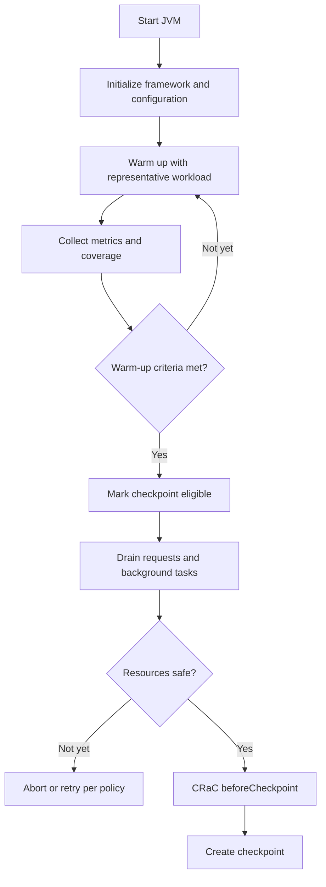
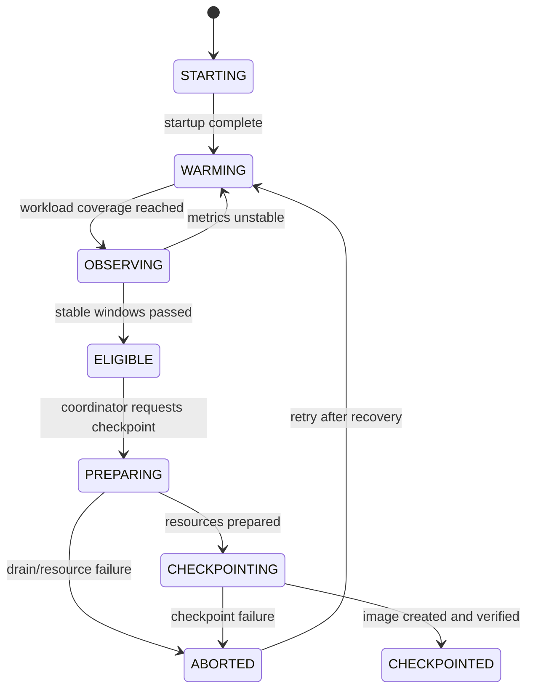

# Choosing Checkpoint Timing Based on Observable Criteria

In CRaC (Coordinated Restore at Checkpoint), an application is typically launched first, executes initialization and JVM warm-up steps, and only then creates a checkpoint. The checkpoint image can preserve much prepared state such as loaded classes, framework context, data structures, and part of JIT-compiled code. Upon restore, the application can continue from that prepared state and substantially reduce startup work.

Checkpoint timing directly affects the benefit achieved. If checkpointed too early, critical processing paths are not yet warmed up, caches are not ready, or the framework is still initializing. If checkpointed too late, the application may have spent extra CPU and memory for very little incremental gain; caches or credentials may also grow stale while the image is stored.

Therefore, decide checkpoint timing using **observable criteria**, such as processing-path coverage, representative execution counts, JIT compilation trends, latency and throughput stability, GC activity, cache state, and resource preparation capability. A fixed duration can serve as a bound or fallback, yet it should not be the sole proof that the JVM is warmed up.

## 1. Warm-up and checkpoint eligibility are two sequential phases

Warm-up is the process of running the application to prepare runtime state. Checkpoint eligibility is the condition indicating the application has reached the desired preparation level and can begin the image-creation process.

These two concepts are related yet distinct:

| Phase | Goal | Evidence to observe |
| --- | --- | --- |
| Initialization | Load classes, build framework context, read configuration, and construct data structures | Mandatory components initialized; no remaining startup errors |
| Warm-up | Run representative processing paths so JVM and caches accumulate useful state | Route/operation coverage, invocation counts, compilation activity, latency, and throughput |
| Stabilization | Confirm metrics meet targets and no longer fluctuate widely | Multiple consecutive measurement windows meet thresholds; errors and GC within bounds |
| Checkpoint preparation | Bring the application into a safe state for imaging | No requests/tasks left to drain; resource callbacks prepare successfully |
| Checkpoint creation | JVM coordinates with OS checkpoint mechanism to write process state | Checkpoint command completes and artifact is created successfully |

An application may have warmed up well yet still not be checkpoint-eligible because requests are still running or resources cannot close. Conversely, a process may have zero remaining requests yet not be sufficiently warmed up. Both sets of conditions must be satisfied before considering a checkpoint successful.



## 2. Defining warm-up goals before measuring

There is no single warm-up threshold right for every application. Before choosing checkpoint timing, identify which state genuinely reduces the time to bring an instance into service.

### 2.1. Identifying critical processing paths

List important operations or routes, for example:

- Most common data-read APIs.
- Frequent write or transaction-processing APIs.
- Authentication and authorization flows.
- Payload serialization/deserialization flows.
- Frequent database queries or cache operations.
- Business branches with complex logic or high call volume.
- Background tasks needing to be ready immediately after restore.

You do not need to warm every method in the application. The goal is covering execution paths that significantly affect startup time and initial performance. A rarely used yet business-critical endpoint may need to be included in the warm-up workload despite a low real-world request share.

Describe each operation with a stable name, weight, and target invocation level. For example:

| Operation | Weight | Warm-up to verify |
| --- | ---: | --- |
| `GET /catalog` | High | Load mappings, serializers, and catalog cache |
| `GET /account/{id}` | High | Load repository, query path, and authorization logic |
| `POST /orders` | High | Prepare validation and business processing path; use safe test data only |
| `GET /reports/{id}` | Medium | Load report parsers and templates |
| Background aggregation job | As required | Prepare code paths without creating real business side effects |

Route names are examples only. For non-HTTP-server applications, you can use message handler names, service operations, or job types.

### 2.2. Using representative workloads

Warm-up must exercise real processing paths at a representative level. Calling only a health endpoint usually does not warm controllers, serializers, repositories, queries, or other business branches.

The workload should reflect:

- Distribution of payload sizes.
- Common conditional branches.
- Realistic data types and object types.
- Query structures and mappings.
- Read/write ratio close to expected operation.
- Necessary synchronous and asynchronous processing paths.

If a workload calls only one method with one kind of data, JIT may optimize for that case without necessarily reflecting other data types or execution branches. Choose data representative enough while keeping cost controlled.

### 2.3. Avoiding real business side effects

Warm-up must not create real orders, send emails, charge money, publish real messages, or update shared data just to warm code paths. You can use:

- Isolated test datasets.
- Read-only requests.
- Stubs or sandboxes for external services.
- Controlled rolled-back transactions if suitable for the system.
- A dry-run mode designed specifically for warm-up.

Do not assume that calling an API and rolling back the database undoes all side effects. A request might already have sent a message, called an external service, or triggered a workflow before the transaction rolled back. Warm-up needs an explicit data and side-effect contract.

## 3. Observable signals to decide timing

Do not rely on a single metric. Combine signals reflecting initialization level, JIT, performance, and resource state.

### 3.1. Initialization completion level

Basic signals:

- Framework startup lifecycle has completed.
- Mandatory beans/services have been created.
- Necessary classes have been loaded.
- Configuration and schemas have been parsed.
- Critical startup caches have been loaded.
- Dependencies required for warm-up are connected or have suitable mocks/sandboxes.

You can monitor currently loaded classes and class-loading trends. Java provides `ClassLoadingMXBean` via `ManagementFactory`:

```java
import java.lang.management.ClassLoadingMXBean;
import java.lang.management.ManagementFactory;

ClassLoadingMXBean classLoading =
        ManagementFactory.getClassLoadingMXBean();

int currentlyLoaded = classLoading.getLoadedClassCount();
long totalLoaded = classLoading.getTotalLoadedClassCount();
long unloaded = classLoading.getUnloadedClassCount();
```

`getLoadedClassCount()` is the number of classes currently loaded; `getTotalLoadedClassCount()` and `getUnloadedClassCount()` are cumulative counters. When these values slow down in change, it can signal the application has traversed most expected initialization paths. However, stable class loading does not prove JIT has optimized critical methods or caches are complete.

### 3.2. JIT compilation activity

The JIT compiler compiles methods executed frequently enough or matching JVM optimization policies. Therefore, warm-up should invoke critical processing paths multiple times with representative data.

Several signals can be observed:

- Total JVM compilation time.
- Compilation events in Java Flight Recorder (JFR), if enabled.
- Compilation queues or code cache via diagnostic tools of the JDK version in use.
- CPU consumed by compiler threads during the warm-up phase.
- Latency changes on the same workload across measurement windows.

Java provides `CompilationMXBean`:

```java
import java.lang.management.CompilationMXBean;
import java.lang.management.ManagementFactory;

CompilationMXBean compilation =
        ManagementFactory.getCompilationMXBean();

if (compilation != null && compilation.isCompilationTimeMonitoringSupported()) {
    long totalCompilationMillis = compilation.getTotalCompilationTime();
    System.out.println("JIT compilation time: "
            + totalCompilationMillis + " ms");
}
```

`getTotalCompilationTime()` is cumulative compilation time reported by the JVM, not the count of optimized methods and not a direct indicator that JIT is finished. You can take two snapshots separated by an interval to observe the delta. If the delta decreases while the workload keeps executing, it can be a sign that compilation activity is stabilizing.

Do not require compilation delta to equal 0 in every window. As the workload keeps calling new code paths, the JVM may still compile more. Conversely, a delta of 0 because the workload is idle does not prove warm-up met its goal.

With HotSpot, some JDK builds provide diagnostic commands via `jcmd`, such as commands related to the compiler queue or code cache. Exact command names and support depend on the JDK version, so check `jcmd <pid> help` and documentation of the specific runtime. JFR can help identify which methods are compiled and when compilation happens, though enabling event recording also has observation overhead that must be accounted for.

### 3.3. Latency and throughput

This signal group is closest to real serving experience.

Monitor:

- Throughput: requests or operations completed per second.
- p50, p95, and p99 latency.
- Error rate and timeout rate.
- Queue time if requests must wait on an executor or connection pool.
- Processing time by route or operation.

Warm-up can be considered stable when the same workload meets target latency and throughput across multiple consecutive windows. A short measurement sample can be noisy due to GC, CPU scheduling, or network jitter; therefore, do not create a checkpoint immediately when a single window meets the threshold.

Illustrative criteria example:

| Metric | Example condition |
| --- | --- |
| p95 latency | Within the defined latency budget for the warm-up workload |
| Throughput | Achieves target ratio relative to baseline on the same machine type |
| Error rate | Does not exceed allowed error threshold |
| Stability | Consecutive windows show no significant worsening trend |

Do not copy a fixed latency or throughput threshold from another application. The baseline must be measured on CPU, memory, JDK, container limits, and workload matching the checkpoint-creation environment.

### 3.4. CPU and compiler load

Warm-up typically consumes CPU due to class loading, JIT compilation, cache building, and running workloads. If CPU remains high due to the compiler or startup tasks, checkpointing right away may save an unstable process and increase resource contention duration.

Monitor process CPU and system CPU in the same window as latency. When representative workload keeps running while CPU and compilation activity have stabilized, that can be treated as a positive signal. However, low CPU can also occur because the workload lacks sufficient load or threads are blocked waiting on dependencies.

Combine CPU with throughput, latency, and executed operation count. If CPU is high yet throughput does not increase, determine whether it is compilation, GC, contention, or an abnormal loop before deciding to continue warm-up.

### 3.5. GC, heap, and code cache

Monitor:

- Heap used and heap committed.
- GC frequency and duration.
- Allocation rate.
- Cumulative GC count and GC time.
- Code cache usage if the JVM exposes an appropriate metric.

General GC information can be obtained via `GarbageCollectorMXBean`:

```java
import java.lang.management.GarbageCollectorMXBean;
import java.lang.management.ManagementFactory;

for (GarbageCollectorMXBean gc :
        ManagementFactory.getGarbageCollectorMXBeans()) {
    System.out.printf("%s: collections=%d, time=%d ms%n",
            gc.getName(),
            gc.getCollectionCount(),
            gc.getCollectionTime());
}
```

GC counters are cumulative. Compare deltas between windows rather than looking only at totals since JVM startup. One normal GC cycle is not a reason to delay checkpointing; what to watch for is abnormal GC trends, pauses exceeding budget, or heap continuing to grow without stabilizing.

Do not try to force full GC just to shrink the heap before checkpointing. Calling `System.gc()` can cause pauses, does not guarantee freeing every object, and is not a criterion proving warm-up is complete.

### 3.6. Cache and dependency readiness

Cache hit ratio, number of loaded entries, source query duration, and connection status are also important signals. An application with low latency during warm-up whose primary cache is still empty can be slow when receiving real requests.

Monitor:

- Cache hit/miss ratio by cache type.
- Number of loaded entries or partitions.
- Cache load duration and refresh failure count.
- Version or timestamp of cache snapshots.
- Whether connection pools have sufficient capacity to serve warm-up.
- Whether external services are stable.

Not every cache should be kept across checkpoints. Caches with TTL, credentials, or data requiring high freshness must be checked or refreshed after restore. Warm-up should distinguish reusable caches from caches that must be recreated per instance.

## 4. Designing a checkpoint criteria suite

A good policy should have multiple condition groups. They can be divided into mandatory conditions and quality conditions.

### 4.1. Mandatory conditions

These conditions must be met before creating a checkpoint:

- Startup lifecycle completed.
- Mandatory operations warmed up with sufficient execution count or coverage.
- No unhandled initialization errors or warm-up errors.
- Warm-up workload finished or stopped at a safe boundary.
- No tasks/requests remaining to drain when checkpointing starts.
- Registered resources can complete their `beforeCheckpoint` callbacks.
- Checkpoint environment and directory are ready.

If one mandatory condition fails, do not mark checkpoint eligible simply because warm-up duration has elapsed.

### 4.2. Quality conditions

These conditions evaluate warm-up level:

- Route/operation coverage meets target.
- Call counts of critical methods reach representative levels.
- Latency and throughput remain stable across multiple measurement windows.
- Compilation activity trends downward or reaches expected state.
- Class loading and cache initialization have stabilized.
- CPU, allocation, and GC show no abnormal trends.
- Error rate and timeouts do not exceed thresholds.

Quality conditions can be weighted according to application goals. For example, a CPU-heavy service may emphasize JIT and throughput; a data-query-heavy service may emphasize caches, connection setup, and latency.

### 4.3. Using consecutive observation windows

Do not trigger a checkpoint based on a single snapshot. Split warm-up time into windows, such as 30-second or 1-minute windows depending on application speed and characteristics. In each window, compute:

- completed operations;
- cumulative coverage;
- p95 latency;
- throughput;
- error rate;
- compilation time delta;
- class loading delta;
- GC count/time delta;
- heap and code cache usage if available.

Mark stable only when multiple consecutive windows meet criteria. This helps prevent a short load burst or a quiet gap with no traffic from producing a false conclusion.

For example, you might require 5 consecutive windows meeting latency, throughput, and error rate targets while required coverage is met. The number 5 is only an example; the number of windows and window length must be calibrated using application data.

## 5. Building an observable warm-up workload

A warm-up workload needs an operation list and a way to record results. You can use an internal runner or an external tool to send requests to an instance not yet receiving user traffic.

A good workload needs to:

1. Invoke critical operations according to the defined distribution.
2. Use payloads representative in size and structure.
3. Have enough iterations to trigger code paths needing warm-up.
4. Measure processing time and error rate.
5. Record which operations ran and how many completed.
6. Be able to stop at a safe boundary once criteria are met or the deadline expires.

Example workload configuration:

```yaml
warmup:
  deadline: 8m
  observationWindow: 30s
  stableWindowsRequired: 5
  operations:
    - name: catalog-read
      weight: 40
      minimumExecutions: 500
    - name: account-read
      weight: 30
      minimumExecutions: 300
    - name: order-validation
      weight: 20
      minimumExecutions: 200
    - name: report-render
      weight: 10
      minimumExecutions: 100
  thresholds:
    maxErrorRate: 0.001
    maxP95LatencyMillis: 150
    minimumThroughputPerSecond: 100
```

Numbers in the example merely illustrate configuration structure. Each system must determine thresholds from SLAs, baselines, hardware, and real workloads. Do not use these values as defaults for every application.

### 5.1. Coverage must be meaningful

Coverage is not just total request count. If one endpoint is called 10,000 times yet other endpoints have never run, a high total request count still does not represent application-wide warm-up.

Coverage can be computed per operation:

\[
\text{Coverage} =
\frac{\text{Number of required operations reaching minimum invocations}}
{\text{Total number of required operations}} \times 100\%
\]

If operations have different weights, weighted coverage can be computed:

\[
\text{Weighted Coverage} =
\frac{\sum_{i \in \text{met}} w_i}
{\sum_{i \in \text{required}} w_i} \times 100\%
\]

Weighted coverage helps reflect operation importance, yet a high-weight operation must not mask a required operation that has not run. Critical operations still need individual conditions.

### 5.2. Warm-up workload vs. performance-measurement workload

These two workloads serve different purposes:

- A warm-up workload aims to drive the JVM and application through required initialization, JIT, and cache paths.
- A performance workload aims to measure performance under defined load and compare against a baseline.

You can use the same operation set, yet phases must be separated. When measuring performance, control concurrency, data, measurement duration, and environment. If you warm up and collect benchmark results simultaneously, measurements can be skewed by ongoing compilation and unstabilized caches.

JMH is suitable for benchmarking methods or components in a dedicated benchmark harness, yet JMH results do not automatically prove the entire application is warmed up. You must observe real application execution paths, frameworks, serialization, dependencies, and the network stack.

## 6. Building WarmupDecision in Java

Measurements of each window can be packaged into an object and evaluated by a policy to decide whether eligibility is reached. The example below focuses on decision logic; how metrics are collected and windows are stored depends on the application's telemetry system.

```java
import java.util.Map;

public record WarmupWindow(
        Map<String, Long> operationCounts,
        double p95LatencyMillis,
        double throughputPerSecond,
        double errorRate,
        double compilationTimeDeltaMillis,
        long loadedClassDelta,
        long gcCountDelta,
        double heapUsedRatio) {
}
```

Policy:

```java
import java.util.List;
import java.util.Map;

public final class WarmupPolicy {

    private final Map<String, Long> minimumExecutions;
    private final double maxP95Millis;
    private final double minThroughput;
    private final double maxErrorRate;
    private final int stableWindowsRequired;

    public WarmupPolicy(
            Map<String, Long> minimumExecutions,
            double maxP95Millis,
            double minThroughput,
            double maxErrorRate,
            int stableWindowsRequired) {
        this.minimumExecutions = Map.copyOf(minimumExecutions);
        this.maxP95Millis = maxP95Millis;
        this.minThroughput = minThroughput;
        this.maxErrorRate = maxErrorRate;
        this.stableWindowsRequired = stableWindowsRequired;
    }

    public boolean coverageComplete(Map<String, Long> totals) {
        return minimumExecutions.entrySet().stream().allMatch(entry ->
                totals.getOrDefault(entry.getKey(), 0L) >= entry.getValue());
    }

    public boolean windowIsStable(WarmupWindow window) {
        return window.p95LatencyMillis() <= maxP95Millis
                && window.throughputPerSecond() >= minThroughput
                && window.errorRate() <= maxErrorRate;
    }

    public boolean ready(
            Map<String, Long> totals,
            List<WarmupWindow> recentWindows) {
        if (!coverageComplete(totals)
                || recentWindows.size() < stableWindowsRequired) {
            return false;
        }

        return recentWindows.stream().allMatch(this::windowIsStable);
    }
}
```

The code snippet illustrates a basic policy. In real systems, add:

- Separate checks for critical operations.
- Checks that metric data is neither missing nor stale.
- Bounds on heap, GC pauses, CPU, and code cache relative to baseline.
- Compilation trend checks rather than storing only deltas.
- Checks for startup errors, dependency errors, and cache freshness.
- Requirements that measurement windows have enough requests for percentiles to be meaningful.
- Logging reasons why the policy has not passed so operations knows which part needs more warm-up.

Do not use `heapUsedRatio` or `compilationTimeDeltaMillis` as standalone thresholds. They must be interpreted together with the workload and other metrics. For example, a high compilation delta while latency is dropping can be a sign the JVM is still optimizing; a compilation delta of 0 while throughput is also 0 is meaningless.

## 7. Tracking metrics with JMX and JFR

Java Management Extensions (JMX) provides built-in MXBeans to retrieve JVM state. They are useful for observing trends, though they do not provide every metric needed for a warm-up policy.

| MXBean | Observable information |
| --- | --- |
| `ClassLoadingMXBean` | Currently loaded class count, total loaded classes, and unloaded classes |
| `CompilationMXBean` | Total compilation time if the JVM supports monitoring |
| `MemoryMXBean` | Heap and non-heap memory usage |
| `GarbageCollectorMXBean` | Cumulative GC count and GC time |
| `ThreadMXBean` | Thread count, peak thread count, and thread contention info if supported |
| `OperatingSystemMXBean` | CPU and OS info; some process-specific metrics depend on implementation |

JFR adds an event-oriented view such as compilation, GC, allocation, thread scheduling, and runtime hot spots. JFR can be used during testing to identify which parts remain heavily active. In deployment, choose appropriate event configurations and recording durations because telemetry collection also consumes resources.

### 7.1. Comparing snapshots instead of looking at cumulative numbers

Many MXBeans return cumulative counters since JVM startup. For example, total compilation time and GC time increase over time. Take two snapshots:

\[
\Delta M = M(t_2) - M(t_1)
\]

over the same observation interval. The delta shows activity occurring in the current window. Handle counter resets, JVM restarts, or unsupported metrics.

### 7.2. Application metrics often matter more than standalone JVM metrics

The JVM may look stable while the application is still not warmed up if business caches are not loaded or a critical route has not run. Conversely, small amounts of compilation may still occur while latency and throughput already meet targets.

Therefore, combine JVM metrics with application metrics: route coverage, operation count, cache hit ratio, connection pool state, error rate, and latency.

## 8. Choosing timing: too early, right, and too late

### 8.1. Checkpointing too early

Common signs:

- Framework startup has just finished, yet representative workload has not run.
- Many important classes are still loaded during the first requests.
- Compilation activity remains high and latency drops noticeably across windows.
- Important caches have not been populated.
- Important routes or jobs have not reached minimum execution counts.
- The first request after restore still performs substantial initialization work.

An image created too early may still technically restore successfully, yet fail to deliver the expected warm-up benefits.

### 8.2. Checkpointing at the right time

Signs:

- Critical operations have run using a representative workload.
- Class loading and primary startup steps have stabilized.
- Latency and throughput meet targets across multiple consecutive windows.
- Compilation activity trends toward stability consistent with the workload.
- Reusable caches are prepared with explicit version/freshness.
- CPU, heap, and GC are within expected bounds.
- No unhandled warm-up errors or tasks remain.
- Resource procedures can drain and close resources safely.

This is a reasonable moment to transition from warm-up to checkpoint preparation.

### 8.3. Checkpointing too late

Signs:

- Additional workload no longer noticeably improves latency or throughput.
- CPU and warm-up time keep being consumed while metrics have plateaued.
- Heap grows due to caches or unnecessary temporary data.
- Caches risk going stale or credentials are nearing expiration.
- Background tasks and timers have been running long, increasing state that must drain.
- Checkpoint creation time and image size increase without commensurate restore benefits.

Late checkpointing is not necessarily wrong. If further warm-up keeps improving critical paths, continuing can still help. However, measure marginal benefit: the incremental improvement after each window versus CPU, memory, time, and data freshness costs.

## 9. Balancing warm-up benefits and checkpoint costs

Choosing timing relies not only on how warmed up the JVM is, but also on overall operational efficiency.

Quantities to measure:

- `T_startup`: normal startup and initialization duration.
- `T_warmup`: duration preparing workload before checkpoint.
- `T_checkpoint`: image creation duration.
- `T_restore`: process restore duration.
- `T_afterRestore`: duration for callbacks and reconnecting resources.
- `T_readiness`: time from restore until the instance can accept traffic.
- `S_checkpoint`: checkpoint artifact size.

Time to bring an instance into service after restore should be measured from restore start until readiness, not merely JVM process reconstruction time.

Example table comparing checkpoint timings:

| Timing | Warm-up coverage | Post-restore p95 | Restore-to-ready | Image size |
| --- | ---: | ---: | ---: | ---: |
| A – early | 55% | 240 ms | 0.8 s | 420 MB |
| B – moderate | 92% | 125 ms | 1.0 s | 470 MB |
| C – late | 96% | 120 ms | 1.4 s | 610 MB |

The figures above are entirely hypothetical to illustrate comparison. Point B may be a better choice than C if the p95 improvement is tiny while checkpoint cost, image size, and preparation duration grow significantly. If an SLA demands p95 below 120 ms, results may lead to a different choice.

Compare across multiple runs on the same hardware configuration and same workload. A single run may be skewed by CPU contention, GC, or external service variance.

## 10. State machine for checkpoint decisions

A coordinator can use the states:

| State | Description |
| --- | --- |
| `STARTING` | JVM and framework are initializing |
| `WARMING` | Running warm-up workload |
| `OBSERVING` | Collecting metric windows to confirm stability |
| `ELIGIBLE` | Warm-up criteria met and permitted to request checkpoint |
| `PREPARING` | Draining requests/tasks and invoking resource callbacks |
| `CHECKPOINTING` | JVM and OS mechanism creating image |
| `CHECKPOINTED` | Image created successfully and verified |
| `ABORTED` | Criteria unmet or preparation failed; needs handling/retry |



`ELIGIBLE` is only a decision from the warm-up policy. It does not yet mean checkpointing has succeeded. Only when resource preparation and image creation complete does it transition to `CHECKPOINTED`.

## 11. Example coordinator tracking warm-up criteria

The following example illustrates how a coordinator checks coverage and stability windows before permitting checkpointing. The `WarmupMetrics` and `CheckpointRequester` interfaces are internal application APIs.

```java
import java.time.Duration;
import java.util.List;
import java.util.Map;

public final class CheckpointEligibility {

    public interface WarmupMetrics {
        Map<String, Long> operationTotals();
        List<WarmupWindow> recentWindows();
        boolean startupComplete();
        boolean requiredCachesReady();
        boolean noWarmupErrors();
    }

    public interface CheckpointRequester {
        void requestCheckpoint() throws Exception;
    }

    private final WarmupPolicy policy;
    private final WarmupMetrics metrics;
    private final CheckpointRequester requester;

    public CheckpointEligibility(
            WarmupPolicy policy,
            WarmupMetrics metrics,
            CheckpointRequester requester) {
        this.policy = policy;
        this.metrics = metrics;
        this.requester = requester;
    }

    public boolean isEligible() {
        return metrics.startupComplete()
                && metrics.requiredCachesReady()
                && metrics.noWarmupErrors()
                && policy.ready(
                        metrics.operationTotals(),
                        metrics.recentWindows());
    }

    public void checkpointIfEligible() throws Exception {
        if (!isEligible()) {
            throw new IllegalStateException(
                    "Warm-up criteria have not been met");
        }

        requester.requestCheckpoint();
    }
}
```

The coordinator does not perform `beforeCheckpoint` itself or call `Core.checkpointRestore()` in the example. It only decides when requesting a checkpoint is permitted. How the request is sent depends on the CRaC JDK and deployment platform. Once requested, the JVM coordinates resources per the CRaC API.

In production, ensure `checkpointIfEligible()` is called only once per cycle, avoiding multiple threads simultaneously sending checkpoint requests. You can use a state machine or an atomic transition from `ELIGIBLE` to `PREPARING` to guard this operation.

## 12. How must warm-up and resource callbacks coordinate?

Warm-up often needs to access databases, caches, brokers, or external services. However, those connections might not belong inside a checkpoint. Therefore, separate the warm-up phase from the resource preparation phase.

Typical sequence:

1. Initialize the application and required resources.
2. Run warm-up workload through those resources.
3. Measure metrics and confirm stability criteria.
4. Stop warm-up workload and drain remaining tasks/requests.
5. Invoke `beforeCheckpoint` to close connection pools, sockets, or environment-dependent resources.
6. Create the checkpoint.
7. After restore, invoke `afterRestore` to recreate resources and verify connections.
8. Open readiness only once the application is ready to serve.

Do not close connection pools before warm-up if the workload needs to query the database. Nor should you create a checkpoint while warm-up requests are still running and using the pool.

### 12.1. Reusable caches and caches needing refresh

If warm-up builds an immutable or versioned cache, the cache can be kept in the image to reduce initialization cost. If a cache holds data with short TTLs or environment dependencies, check freshness after restore.

A cache can have states:

- `WARMED`: populated with sufficient data before checkpoint.
- `VALID`: version/TTL remains valid after restore.
- `STALE`: needs refresh before serving.
- `REFRESHING`: currently reloading.
- `READY`: verified and usable.

A warm-up policy should not merely check whether a cache already has entries. It must verify the cache reaches the needed level and remains reusable over the duration the image will be stored.

### 12.2. Resource callbacks do not replace warm-up policies

`beforeCheckpoint` is used to put resources into a safe state. It does not know whether the workload was representative enough or whether JIT reached targets. `afterRestore` is used to recover resources. It does not prove the application was properly warmed up.

Therefore, keep warm-up policy in a separate component and use CRaC resources to manage resource lifecycles.

## 13. Time limits and fallback conditions

Warm-up should not run indefinitely. A maximum deadline and behavior when criteria are unmet are needed.

| Situation | Action |
| --- | --- |
| Criteria met before deadline | Transition to `ELIGIBLE` and start checkpoint preparation |
| Coverage incomplete yet deadline remains | Continue workload for missing operations |
| Latency not yet stable | Continue observing or investigate CPU/GC/dependency causes |
| Compilation still high and latency still improving | Can continue warm-up within budget limits |
| Error rate exceeds threshold | Stop warm-up, investigate errors; do not checkpoint from error state |
| Cache or dependency unavailable | Retry per policy or abort preparation attempt |
| Deadline expired without meeting criteria | Report ineligible; do not self-mark eligible |
| Resource callback fails | Abort checkpoint and recover current state per lifecycle manager |

You may have a fallback policy creating a checkpoint at a minimal warm-up level if operational goals permit, yet clearly record the coverage level and post-restore performance risk. Do not label a fallback as equivalent to a checkpoint that satisfied full criteria.

## 14. Common mistakes when choosing checkpoint timing

| Mistake | Consequence | How to address |
| --- | --- | --- |
| Waiting only a fixed number of minutes | JVM may not have run enough code paths or may have over-warmed | Use metrics and coverage combined with a deadline |
| Checking only startup complete | Framework ready yet JIT/caches insufficient | Run representative workloads and measure stability |
| Looking only at total requests | One route may dominate nearly the entire workload | Track coverage by operation |
| Treating compilation time = 0 as complete | Workload might not be running or metric unsupported | Combine JIT, throughput, latency, and workload counts |
| Looking only at p50 latency | Tail latency may still be high | Track p95/p99 and error rate |
| Not measuring GC/heap | Image may contain abnormally growing heap or unstable GC state | Track GC deltas and heap trends |
| Warming up with real data | May produce unintended side effects | Use test data and sandboxes |
| Checkpointing while warm-up tasks still run | Resources accessed while closing | Drain workload before callbacks |
| Forcing full GC before checkpoint | Large pause without guaranteed benefit | Measure natural GC and optimize causes holding objects |
| Not checking cache freshness | Restored instance may use stale data | Check version/TTL after restore |
| Measuring only JVM restore time | Misses callbacks, connections, and readiness | Measure restore-to-ready end-to-end |
| Using same thresholds for every machine | Results skewed by CPU, memory, and JDK | Calibrate per deployment environment |

## 15. Measurement records and comparing checkpoints

To choose thresholds on a solid basis, save a record for each trial:

| Group | Information to record |
| --- | --- |
| Runtime | JDK vendor/version, JVM flags, CRaC support, OS/kernel, CPU architecture |
| Infrastructure | CPU/memory limits, container image, storage, and network configuration |
| Workload | Workload version, operation coverage, invocation counts, concurrency, and dataset |
| JIT | Compilation time delta, relevant JFR events, code cache if available |
| Class loading | Loaded classes, total loaded, unloaded, and per-window deltas |
| Performance | Throughput, p50/p95/p99, error rate, and timeouts |
| Memory | Heap used, allocation rate, GC count/time, code cache |
| Cache | Hit ratio, entry count, version, and refresh timestamp |
| Checkpoint | Start time, creation duration, artifact size, and outcome |
| Restore | Restore duration, callback duration, dependency reconnect, and readiness |

When comparing two warm-up policies, keep workload and environment identical. If changing JDK, CPU limit, framework, or GC configuration, re-measure because JIT behavior and initialization times may change.

## 16. Process for applying in production

A deployment process can be organized as follows:

### Step 1: Define workload and goals

Select critical operations, define minimum execution counts, target latency/throughput, error budgets, and safe test data.

### Step 2: Instrument the application

Record operation counts, route coverage, latency, throughput, error rate, cache status, and active task count. Enable JMX/JFR at an appropriate level to observe the JVM.

### Step 3: Measure baseline

Run the application normally on the target configuration. Measure startup, warm-up, performance, and restore-to-ready to establish a realistic baseline.

### Step 4: Run warm-up workload

Run only after startup completes. Use representative payloads without creating real business side effects. Collect metrics by window.

### Step 5: Evaluate stability

Check coverage, latency, throughput, error rate, JIT trends, class loading, GC, and caches. Require multiple consecutive windows meeting thresholds.

### Step 6: Mark checkpoint eligible

Transition state only when all mandatory conditions pass and the policy has no remaining rejection reason. Record metric snapshots and decision timestamp.

### Step 7: Drain and create checkpoint

Stop workloads, stop accepting new requests/jobs, wait for current tasks to complete, and let resource callbacks close resources. Then ask the JVM to create the checkpoint.

### Step 8: Verify artifact and test restore

Verify checkpoint creation succeeded, restore in a compatible environment, verify callbacks, and measure time to readiness. If post-restore performance falls short, adjust the workload or policy.

## 17. Conclusion

Choosing checkpoint timing based on observable criteria helps create images from a sufficiently prepared JVM. Identify critical operations, run representative workloads, measure coverage, JIT, class loading, latency, throughput, CPU, GC, heap, and caches. Use multiple consecutive windows to confirm stability, rather than relying on a fixed duration or a single metric.

Warm-up eligibility only indicates the application is ready to enter the checkpoint process. The application must still drain requests and background tasks, close resources per CRaC callbacks, create the image successfully, and verify restore-to-ready. Measuring both performance gains and warm-up costs, image size, and recovery duration helps choose checkpoint timing aligned with real workloads and operational goals.