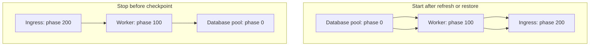
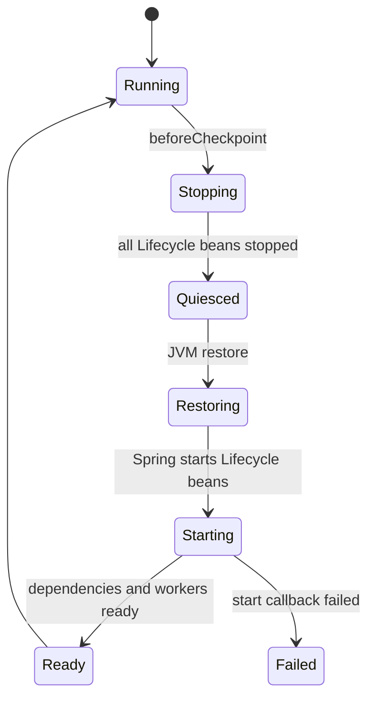

# Stopping and Restarting Beans on On-Demand Checkpoints

In a Spring Boot application using CRaC, a checkpoint may be requested while the application is already running and serving work. Before the JVM captures state, running components must stop accepting new work, complete or persist in-flight work, and release resources that cannot remain intact across a checkpoint. After restore, those components must be restarted in the right dependency order.

Spring Framework provides the `Lifecycle` and `SmartLifecycle` contracts to manage this lifecycle at the bean level. Starting with Spring Framework 6.1, `DefaultLifecycleProcessor` integrates with CRaC when the `org.crac:crac` library is on the classpath: during an on-demand checkpoint flow, Spring stops running `Lifecycle` beans; after restore, Spring restarts them. Beans remain inside `ApplicationContext`; stop/start operations do not mean closing the context, destroying singletons, and recreating new beans.

This lets the application attach pause and resume behavior to the exact right components. A background worker can stop threads and close sockets in `stop()`, then recreate workers and connections in `start()`. A message consumer can stop polling, finish or persist in-flight message state, and then resubscribe after restore. Components that are not Spring beans or need custom callbacks can still use `org.crac.Resource`.

## 1. Stop/Start Differs from Destroy/Recreate

A Spring bean can participate in different parts of the lifecycle:

| Mechanism | Timing | Purpose |
|---|---|---|
| `@PostConstruct`, `InitializingBean`, init method | After the bean is created and dependencies are injected | Complete object initialization |
| `Lifecycle.start()` | When the lifecycle processor requests starting | Start operations, threads, or accepting work |
| `Lifecycle.stop()` | When the lifecycle processor requests pausing | Stop operations and put resources into a safe state |
| `@PreDestroy`, `DisposableBean`, destroy method | When the bean is destroyed or context closes | Release resources during destruction |

On-demand checkpoints use stop/start to pause and resume the same existing beans. `@PreDestroy` is not a substitute callback for `stop()`: it belongs to the destruction phase when a bean or context is destroyed. Similarly, restore does not recreate `ApplicationContext` and does not re-run constructors or `@PostConstruct` merely because the JVM just restored.

For example, a bean holding an `ExecutorService`:

- `start()` creates a new executor and starts workers.
- `stop()` stops accepting tasks, waits for running tasks to complete, and shuts down the executor.
- After restore, `start()` creates a new executor because a shut-down executor cannot be reused.

If you only close the executor in `@PreDestroy`, that operation may not be invoked when a checkpoint occurs. If you close the executor in `stop()` without recreating it in `start()`, the bean exists after restore yet no longer has an active worker.

## 2. Requirements for Spring to Manage Checkpoint/Restore

For the Spring lifecycle to participate in CRaC, the following key elements are needed:

1. Use a JDK/runtime with CRaC support and a compatible deployment environment.
2. Have the `org.crac:crac` dependency on the classpath in a version supported by Spring Framework.
3. Use Spring Framework 6.1 or later to have checkpoint/restore integration in `DefaultLifecycleProcessor`.
4. Ensure beans needing pausing implement `Lifecycle` or `SmartLifecycle` and are in the running state.
5. Implement `stop()` and `start()` to handle the bean's own resources safely and idempotently.

Example dependency declaration in Maven:

```xml
<dependency>
    <groupId>org.crac</groupId>
    <artifactId>crac</artifactId>
    <version>1.5.0</version>
</dependency>
```

Or in Gradle:

```kotlin
dependencies {
    implementation("org.crac:crac:1.5.0")
}
```

`1.5.0` is an illustrative version; pick a version compatible with the Spring Framework and CRaC-enabled JDK your project uses. Current Spring Framework documentation requires `org.crac:crac` 1.4.0 or later.

Spring Boot builds on Spring Framework's integration. Spring Boot versions using Spring Framework 6.1 or later can use this lifecycle mechanism when the appropriate CRaC dependency is present. Check the project's actual Spring Boot, Spring Framework, and JDK versions; merely adding the dependency does not turn a regular JDK into a CRaC-enabled runtime.

When a checkpoint is requested, Spring uses `DefaultLifecycleProcessor` to stop running beans. After restore, the processor restarts them. Beans that do not implement lifecycle interfaces or are not Spring-managed do not automatically receive stop/start behavior merely by residing in the heap.

Spring documentation distinguishes two modes: on-demand checkpoints of a running application and automatic checkpoints during the startup refresh phase. This lesson focuses on the first mode. The `spring.context.checkpoint=onRefresh` property serves checkpointing at the refresh phase, before lifecycle beans are started and before `ContextRefreshedEvent`; it does not replace bean stop/start design for on-demand checkpoints.

## 3. The `Lifecycle` Contract

`org.springframework.context.Lifecycle` is the basic contract for objects whose operations must be started and stopped:

```java
package org.springframework.context;

public interface Lifecycle {
    void start();

    void stop();

    boolean isRunning();
}
```

A bean implementing this interface should obey three rules:

- `start()` begins operation if the bean is not yet running.
- `stop()` stops operation if the bean is running.
- `isRunning()` reflects actual state, not merely an arbitrarily toggled flag.

Methods should be idempotent: calling `start()` twice must not spawn two workers or two listeners; calling `stop()` twice must not throw an error merely because the resource is already closed. The `isRunning()` state should be updated after the operation genuinely succeeds or completes.

Example of a background data-sync bean:

```java
import org.springframework.context.Lifecycle;
import org.springframework.stereotype.Component;

@Component
public final class CatalogSyncLifecycle implements Lifecycle {
    private final CatalogSyncWorker worker;
    private volatile boolean running;

    public CatalogSyncLifecycle(CatalogSyncWorker worker) {
        this.worker = worker;
    }

    @Override
    public synchronized void start() {
        if (running) {
            return;
        }

        worker.start();
        running = true;
    }

    @Override
    public synchronized void stop() {
        if (!running) {
            return;
        }

        worker.stopAndAwait();
        running = false;
    }

    @Override
    public boolean isRunning() {
        return running;
    }
}
```

`CatalogSyncWorker` is an application-defined component. `stopAndAwait()` must have a timeout and ensure the worker no longer accesses databases or shared resources after returning. If stopping the worker fails, the bean should not report `running = false` while the worker keeps running.

Note: plain `Lifecycle` has no auto-start property. Implementing this interface does not automatically guarantee the bean is started when `ApplicationContext` refreshes. If the bean needs to start automatically and needs phase control, consider `SmartLifecycle`.

## 4. Using `SmartLifecycle` for Beans Requiring Coordination

`SmartLifecycle` extends `Lifecycle` and `Phased`, additionally providing:

- `isAutoStartup()`: decides whether the bean auto-starts during the refresh phase.
- `getPhase()`: determines start/stop ordering among bean groups.
- `stop(Runnable callback)`: allows asynchronous stopping and signaling when stopping has finished.

Implementations commonly use `SmartLifecycle` for listeners, consumers, schedulers, and worker pools because these components require clear start and stop ordering.

```java
import org.springframework.context.SmartLifecycle;
import org.springframework.stereotype.Component;

@Component
public final class MessageConsumerLifecycle implements SmartLifecycle {
    private final MessageConsumer consumer;
    private volatile boolean running;

    public MessageConsumerLifecycle(MessageConsumer consumer) {
        this.consumer = consumer;
    }

    @Override
    public synchronized void start() {
        if (running) {
            return;
        }

        consumer.subscribeAndStart();
        running = true;
    }

    @Override
    public void stop() {
        stop(() -> { });
    }

    @Override
    public void stop(Runnable callback) {
        consumer.stopPollingAndDrain();
        running = false;
        callback.run();
    }

    @Override
    public boolean isRunning() {
        return running;
    }

    @Override
    public boolean isAutoStartup() {
        return true;
    }

    @Override
    public int getPhase() {
        return 200;
    }
}
```

This example illustrates the structure. If `stopPollingAndDrain()` throws an error, the bean has not been marked stopped and the callback has not been invoked; log the error and let the lifecycle processor apply its timeout/error policy. With `SmartLifecycle`, the callback must be invoked exactly once after stopping has genuinely completed. If shutdown is asynchronous, invoke the callback only from the completion handler once the worker has stopped; do not invoke it immediately upon starting shutdown.

In the example above, `stop()` forwards to the callback overload so synchronous lifecycle call paths still exhibit stop behavior. `MessageConsumer` must support creating a new subscription in `start()` after restore; do not keep a closed handle and assume it remains valid.

## 5. Start and Stop Ordering Using Phases

Spring uses phases to coordinate `SmartLifecycle`:

- When starting, lower phases start first and higher phases start later.
- When stopping, the order reverses: higher phases stop first and lower phases stop later.

This matches provider–consumer relationships. A database pool is a provider; a worker using the database is a consumer; a listener receiving requests is a producer pushing work to the worker. Phases can be set as follows:

| Bean | Illustrative phase | Start | Stop |
|---|---:|---|---|
| Database pool lifecycle | 0 | First | Last |
| Background worker | 100 | After database | Before database |
| HTTP ingress/message listener | 200 | After worker | First |

Result on checkpoint:

1. Ingress stops accepting new work.
2. Workers stop polling and drain running tasks.
3. The database pool closes connections after consumers have stopped.

After restore, the order reverses:

1. The database pool reopens.
2. Workers start and confirm readiness.
3. Ingress begins accepting requests or messages.

Diagram:



Phase is part of the lifecycle contract, not bean creation order. If explicit dependency relationships exist via `depends-on`, Spring also respects those relationships: dependencies start before dependents and stop after dependents. Avoid choosing phases arbitrarily before identifying actual dependencies.

## 6. Pausing a Bean Safely

A background bean should not merely set a flag `running = false` and consider itself stopped. `stop()` must bring the component to a state where no operations are using resources about to be closed.

A typical stop sequence:

1. Close admission so no new tasks are accepted.
2. Stop pollers, listeners, or timers generating new work.
3. Wait for running tasks to complete within a finite deadline.
4. Commit/roll back transactions or persist required cursors/offsets.
5. Close sockets, file handles, connections, or executors owned by the bean.
6. Update state to stopped once required steps complete.

If running tasks cannot complete before the deadline, the bean must have a clear policy: cancel safely, save state to resume, or report an error so the checkpoint is not treated as safely prepared. Never close dependencies while workers might still access those dependencies.

Example adapter for a worker:

```java
public interface WorkerController {
    void start() throws Exception;

    void stopAcceptingTasks();

    boolean awaitIdle(Duration timeout) throws InterruptedException;

    void closeResources() throws Exception;
}
```

In `stop()`, call `stopAcceptingTasks()`, wait on `awaitIdle(timeout)`, and only then call `closeResources()`. If `awaitIdle()` returns `false`, do not proceed to close resources workers still need; report an error and let the system handle the failed checkpoint or perform rollback.

## 7. Restarting Beans After Restore

`start()` after restore should not assume external resources are still valid. You must recreate or validate them:

- Open new connection pools or clients using current configuration.
- Recreate shut-down threads/executors.
- Re-register listeners, subscriptions, or file watchers.
- Refresh credentials, tokens, DNS, or endpoints if time/environment-dependent.
- Restore consumer offsets or cursors before polling new messages.
- Enable readiness only after mandatory dependencies are ready.

`start()` must be safe to call multiple times without creating duplicate workers or subscriptions. If starting fails midway, close partially opened resources and keep the bean in the non-running state. Do not set `running = true` before the worker has actually started.

An example managing an executor that can be recreated on each start:

```java
import java.util.concurrent.ExecutorService;
import java.util.concurrent.Executors;
import java.util.concurrent.TimeUnit;

public final class RestartableWorker {
    private ExecutorService executor;
    private volatile boolean running;

    public synchronized void start() {
        if (running) {
            return;
        }

        ExecutorService candidate = Executors.newSingleThreadExecutor();
        try {
            candidate.submit(this::runLoop);
            executor = candidate;
            running = true;
        } catch (RuntimeException e) {
            candidate.shutdownNow();
            throw e;
        }
    }

    public void stopAndAwait() {
        ExecutorService current;
        synchronized (this) {
            if (!running) {
                return;
            }
            current = executor;
        }

        current.shutdown();
        try {
            if (!current.awaitTermination(20, TimeUnit.SECONDS)) {
                current.shutdownNow();
                if (!current.awaitTermination(5, TimeUnit.SECONDS)) {
                    throw new IllegalStateException("Worker did not stop");
                }
            }
        } catch (InterruptedException e) {
            current.shutdownNow();
            Thread.currentThread().interrupt();
            throw new IllegalStateException("Interrupted while stopping worker", e);
        }

        synchronized (this) {
            if (executor == current) {
                executor = null;
                running = false;
            }
        }
    }

    private void runLoop() {
        // Work-processing loop; must support safe stopping and interruption.
    }
}
```

This is a skeleton illustrating creating a new executor. Real applications need mechanisms to wake up `runLoop`, exit the loop when the executor shuts down, and handle exceptions inside workers. Do not rely solely on interruption if internal code does not respond to interrupts.

## 8. Integrating Bean Lifecycle with CRaC

When `org.crac:crac` is on the classpath and using `DefaultLifecycleProcessor` from Spring Framework 6.1 or later, Spring integrates CRaC callbacks to coordinate running bean lifecycles. Thus, beans only need to implement the `Lifecycle` or `SmartLifecycle` contract properly and manage their own resources.

A general approach:

```java
@Configuration
public class WorkerConfiguration {

    @Bean
    SmartLifecycle reportWorker(ReportWorker worker) {
        return new ReportWorkerLifecycle(worker);
    }
}
```

Spring manages the `ReportWorkerLifecycle` bean; the lifecycle processor calls start/stop on refresh, stop/start on checkpoint/restore, and close when the context closes. If the bean is a `SmartLifecycle` and `isAutoStartup()` returns `true`, it starts automatically during the lifecycle refresh phase. Otherwise, the application needs an appropriate explicit startup path.

In a Spring Boot application, check which infrastructure beans are already managed automatically by Spring Boot or libraries. Spring Boot provides lifecycle management for certain resources such as sockets, files, and thread pools within specific scopes; other dependencies and business code may need their own lifecycle. Avoid closing the same connection pool in both a library's integration and a custom bean, as that can cause duplicate callbacks or premature resource closure.

## 9. When Is a Separate `org.crac.Resource` Needed?

Not every resource is a Spring bean. A native library, a client created manually outside the Spring container, or a process-wide shared component may need direct CRaC integration via `org.crac.Resource`.

```java
import org.crac.Context;
import org.crac.Core;
import org.crac.Resource;

public final class NativeClientResource implements Resource {
    private final NativeClient client;

    public NativeClientResource(NativeClient client) {
        this.client = client;
        Core.getGlobalContext().register(this);
    }

    @Override
    public void beforeCheckpoint(Context<? extends Resource> context)
            throws Exception {
        client.closeHandles();
    }

    @Override
    public void afterRestore(Context<? extends Resource> context)
            throws Exception {
        client.reopenHandles();
    }
}
```

This example applies only to libraries not managed by the lifecycle processor. If the same object both implements `Lifecycle` for Spring stop/start and registers itself into the global CRaC context, it could be processed twice. Choose one clear lifecycle owner or separate adapters so each operation runs only once.

If a `Resource` is registered with `Core.getGlobalContext()`, maintain a strong reference to the instance throughout the application lifecycle. Do not create the resource in a local variable where it can be reclaimed by the garbage collector.

## 10. Testing Stop/Start Without Creating a Checkpoint

You can test bean lifecycles at the Spring level before trying a real checkpoint. `ConfigurableApplicationContext` provides `stop()` and `start()` to drive the lifecycle processor:

```java
try (ConfigurableApplicationContext context =
        SpringApplication.run(Application.class, args)) {

    // Application is running.
    context.stop();

    // Verify listeners, workers, and consumers have stopped.
    assertApplicationQuiesced(context);

    context.start();

    // Verify resources have reopened and beans are operational.
    assertApplicationRunning(context);
}
```

This is a Spring lifecycle test, not a replacement for a CRaC integration test. It helps catch bugs in `start()`, `stop()`, phases, and bean state without creating a snapshot. Afterward, you still need to run actual checkpoint/restore on a CRaC-enabled runtime to test native resources, sockets, threads, and post-restore process behavior.

Log bean names and callback timestamps to confirm ordering. With `SmartLifecycle.stop(Runnable)`, mark a bean stopped only after the callback is invoked and asynchronous work has genuinely completed.

## 11. Common Mistakes

| Symptom | Possible cause | How to handle |
|---|---|---|
| Bean is not stopped at checkpoint | Bean does not implement `Lifecycle` or is not in running state | Implement lifecycle and verify the bean was started |
| Bean does not auto-start after context refresh | Implements plain `Lifecycle` or `SmartLifecycle.isAutoStartup()` returns `false` | Use `SmartLifecycle` or call start via explicit lifecycle |
| Bean starts yet worker does not run | Executor shut down before checkpoint and was reused | Create a new executor/thread/client in `start()` |
| Workers are duplicated after restore | `start()` is not idempotent or does not check state | Ensure start creates only one worker/subscription |
| Checkpoint is slow or times out | `stop()` waits indefinitely or `SmartLifecycle` does not invoke callback | Use deadlines and invoke callback after stopping completes |
| Database pool closes while handlers still run | Wrong phase or dependency ordering | Stop ingress and consumers before the pool |
| `@PreDestroy` does not run at checkpoint | Checkpoint uses stop/start, not bean destruction | Put pause logic in `stop()` and recovery logic in `start()` |
| Resource is closed twice | Same resource is managed by both Spring lifecycle and CRaC Resource | Choose a single lifecycle owner |
| Application reports ready too early | Readiness does not wait for resources and workers to recover | Open traffic only after start completes |
| Restore hits connection errors | Bean holds old sockets or credentials | Recreate or refresh connections in start/afterRestore |

Another mistake is overriding the `lifecycleProcessor` bean with a custom implementation without preserving `DefaultLifecycleProcessor`'s checkpoint/restore behavior. If customizing the lifecycle processor is necessary, verify explicitly that CRaC integration remains enabled in the Spring Framework version in use.

## 12. Timeouts When Stopping and Starting

Stopping must have a deadline so checkpoints are not held indefinitely. `SmartLifecycle.stop(Runnable)` lets the processor wait for callbacks from asynchronously stopping beans. `DefaultLifecycleProcessor` applies timeouts per phase; default values and detailed configuration APIs depend on the Spring Framework version.

Practical principles:

- Every worker needs a deadline for draining or shutting down.
- Do not hold monitors or shared locks while waiting on I/O or workers.
- Do not invoke the callback before the resource has genuinely stopped.
- If stopping fails within the deadline, log and report a clear error state.
- After restore, starting must also verify resources are ready before opening traffic.
- Total stop budget across phases must fit within the checkpoint duration permitted by the platform.

With Spring Framework 6.2 and later, `DefaultLifecycleProcessor` has an API to configure shutdown timeouts per phase. Earlier versions have different timeout APIs; consult Javadoc for the exact version rather than copying configuration from a newer release.

## 13. Readiness and Application State

After restore, the fact that the JVM resumed running does not mean every bean is ready to accept work. The database pool may be open while consumers have not yet subscribed; workers may have started while caches have not refreshed; listeners may be open while a required dependency has not yet been validated.

Separate the states:



Transition readiness to ready only when mandatory components have started and health checks pass. For optional dependencies, a degraded mode can be allowed if business logic supports it. Never let listeners accept traffic before the consumers or workers they depend on are active.

## 14. Recommended Implementation Workflow

For a Spring Boot application with a database pool, background workers, and HTTP ingress, you can organize it as follows:

1. Confirm the Spring Framework version supports CRaC and `org.crac:crac` is on the classpath.
2. Identify beans needing stop/start: workers, consumers, schedulers, listeners, and adapters managing standalone resources.
3. Use `SmartLifecycle` for beans needing auto-start, phases, and asynchronous stop; use simple `Lifecycle` when a basic start/stop contract suffices.
4. Set phases according to dependencies: database pool before workers, workers before ingress when starting.
5. In stop, stop ingress, close admission, drain tasks, stop workers/consumers, and only then close dependencies.
6. In start after restore, recreate dependencies, start workers, and finally open ingress.
7. Ensure `start()` and `stop()` are idempotent, have timeouts, and update `isRunning()` accurately.
8. Use separate `org.crac.Resource` instances for libraries or resources outside Spring lifecycle; avoid duplicate registration.
9. Test `ApplicationContext.stop()`/`start()` and verify callback ordering.
10. Perform actual checkpoint/restore, checking connections, threads, readiness, and multiple restore cycles.

## 15. Bean Lifecycle Design Checklist

- [ ] Beans needing pausing implement `Lifecycle` or `SmartLifecycle`.
- [ ] Beans are started before checkpoint and `isRunning()` reflects real state.
- [ ] `start()` can recreate threads, executors, sockets, or subscriptions after stopping.
- [ ] `stop()` stops accepting new work and drains running work before closing dependencies.
- [ ] `start()` and `stop()` are idempotent, never creating duplicate workers or listeners.
- [ ] `SmartLifecycle.stop(Runnable)` invokes the callback after stopping completes.
- [ ] Phases and `depends-on` accurately reflect provider–consumer order.
- [ ] Beans do not use `@PreDestroy` as the sole logic to stop before checkpoint.
- [ ] The same resource is not managed twice via Spring lifecycle and `org.crac.Resource`.
- [ ] Non-Spring resources have separate CRaC integration with live references retained.
- [ ] Stop/start timeouts fit checkpoint and restore deadlines.
- [ ] Readiness is enabled only after mandatory dependencies have recovered.
- [ ] Tested `ApplicationContext.stop()`/`start()` and real checkpoint/restore.

## 16. References

- [Spring Framework — JVM Checkpoint Restore](https://docs.spring.io/spring-framework/reference/integration/checkpoint-restore.html): CRaC integration, on-demand checkpoints, and automatic checkpoints on refresh.
- [Spring Framework — Lifecycle and SmartLifecycle](https://docs.spring.io/spring-framework/reference/core/beans/factory-nature.html): start/stop contracts, auto-start, and phase ordering.
- [Spring `DefaultLifecycleProcessor` Javadoc](https://docs.spring.io/spring-framework/docs/6.1.21/javadoc-api/org/springframework/context/support/DefaultLifecycleProcessor.html): checkpoint/restore support from Spring Framework 6.1 when `org.crac:crac` is on the classpath.
- [Spring Boot — Checkpoint and Restore With the JVM](https://docs.spring.io/spring-boot/reference/packaging/checkpoint-restore.html): Spring Boot CRaC support and scope of managed lifecycle resources.
- [CRaC API — `Resource`](https://javadoc.io/doc/org.crac/crac/latest/org/crac/Resource.html): callbacks for resources requiring direct CRaC integration.

Spring beans that need pausing on checkpoint should manage operations through `Lifecycle` or `SmartLifecycle`. `stop()` stops work and releases resources before checkpoint; `start()` recreates or restores resources after restore. Use phases and dependency relationships to stop consumers before providers, and then start providers before consumers. Keep a clear boundary between stop/start and destroy/recreate, avoid registering the same resource under multiple lifecycle owners, and open traffic only once all mandatory components are ready.