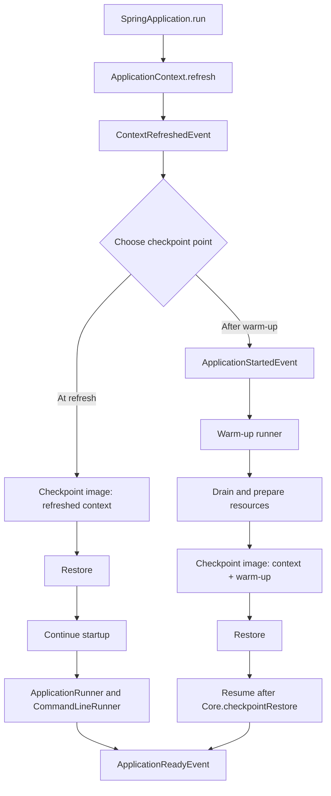
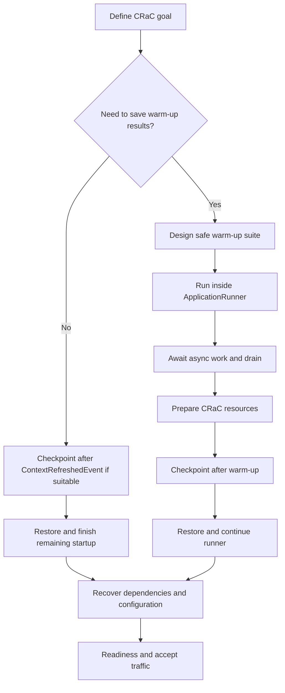

# Distinguishing Checkpoint at Refresh from Checkpoint After Warm-Up

In a Spring Boot application using CRaC, the timing of checkpoint creation determines which part of the startup process is saved and which part still must run upon restore. Two milestones commonly considered are checkpointing at the Spring `ContextRefreshedEvent` and checkpointing after the application has finished running a representative warm-up suite.

These two milestones are not equivalent. `ContextRefreshedEvent` indicates that the Spring `ApplicationContext` has completed its refresh phase, yet Spring Boot still has subsequent startup steps such as publishing `ApplicationStartedEvent`, running `ApplicationRunner`/`CommandLineRunner`, and publishing `ApplicationReadyEvent`. If checkpointing at the refresh milestone, warm-up steps placed in runners have not been executed yet and will continue running on every restore. If checkpointing after warm-up, state prepared by the warm-up requests can be saved in the image and reused.

The choice depends on the goal. Checkpointing at refresh can shorten Spring context initialization. Checkpointing after warm-up is usually better suited when the goal is reducing both initialization cost and first-request latency. Regardless of the milestone chosen, external resources such as database connections, sockets, tokens, and leases still need to be handled according to their own lifecycle.

## 1. Reviewing the Spring Boot Startup Order

To understand both milestones, first distinguish the lifecycle of `ApplicationContext` from the overall Spring Boot startup lifecycle.

A typical Spring Boot startup flow can be described as follows:

```text
Java launcher
    |
    v
SpringApplication.run(...)
    |
    v
Prepare Environment and ApplicationContext
    |
    v
ApplicationContext.refresh()
    |  - create early-initialized beans
    |  - initialize non-lazy singletons
    |  - start lifecycle components
    |  - publish ContextRefreshedEvent
    |
    v
ApplicationStartedEvent
    |
    v
ApplicationRunner / CommandLineRunner
    |
    v
ApplicationReadyEvent
    |
    v
Readiness switches to ACCEPTING_TRAFFIC
```

This is the conceptual order of a typical Spring Boot run; event and availability details may differ by version or how an application customizes startup. Check the exact Spring Boot version in use when integrating with CRaC.

### What does `ContextRefreshedEvent` mean?

`ContextRefreshedEvent` is published when the Spring `ApplicationContext` finishes the refresh phase. By this point, non-lazy singletons have been initialized and the context's lifecycle components have been processed per Spring's mechanism. This is a useful milestone indicating the context has been built.

However, this event does not mean the entire Spring Boot application has completed every startup step. `SpringApplication.run()` continues after `refresh()` returns. Runners such as `ApplicationRunner` and `CommandLineRunner` execute after the refresh phase, so logic placed inside them has not yet run when `ContextRefreshedEvent` is published.

Some components may be lazily initialized, created only when first used. Having a refreshed context does not mean all beans or every application code path have been executed.

### What do `ApplicationRunner` and `ApplicationReadyEvent` mean?

`ApplicationRunner` and `CommandLineRunner` run after the context has refreshed and Spring Boot has published the started event. They are commonly used to perform additional startup tasks such as loading data, checking integrations, or preparing the application.

After the runners finish, Spring Boot publishes `ApplicationReadyEvent`. This milestone signals that startup has reached the ready state. In web applications, also check readiness/availability and load balancer configuration to determine exactly when traffic is routed.

If you want the checkpoint to contain warm-up results run inside a runner, you can trigger the checkpoint at the end of the runner after warm-up completes and before the runner returns. Upon restore, the checkpoint call resumes and the runner finishes; Spring Boot continues the remaining startup steps.

## 2. Checkpoint at `ContextRefreshedEvent`

In this approach, the application requests a checkpoint right when the Spring context publishes `ContextRefreshedEvent`. The image will contain the process state after the refresh phase, yet before Spring Boot executes subsequent startup steps.

States typically already present at this milestone:

- `ApplicationContext` has been refreshed.
- Non-lazy singletons have been initialized.
- Beans have executed most initialization callbacks during bean creation.
- Spring-managed lifecycle components have gone through their corresponding refresh/start steps.
- Configuration has been loaded into created objects.

Tasks that may not yet be complete:

- `ApplicationRunner` and `CommandLineRunner` have not run yet.
- Warm-up tasks placed in runners have not been executed.
- Lazy beans may not have been created yet.
- Critical JIT code paths may still be cold.
- Caches populated only during real requests or inside runners may not be ready yet.
- Additional startup steps performed by the application after `refresh()` have not finished.

### Example trigger at refresh

```java
import org.crac.Core;
import org.springframework.context.ApplicationListener;
import org.springframework.context.event.ContextRefreshedEvent;

import java.util.concurrent.atomic.AtomicBoolean;

public final class RefreshCheckpointListener
        implements ApplicationListener<ContextRefreshedEvent> {

    private final AtomicBoolean requested = new AtomicBoolean();

    @Override
    public void onApplicationEvent(ContextRefreshedEvent event) {
        // In an application with parent/child contexts, restrict to the right context.
        if (!isTargetApplicationContext(event)) {
            return;
        }

        if (requested.compareAndSet(false, true)) {
            try {
                Core.checkpointRestore();
            } catch (Exception exception) {
                throw new IllegalStateException(
                        "Could not checkpoint after context refresh", exception);
            }
        }
    }

    private boolean isTargetApplicationContext(ContextRefreshedEvent event) {
        // Replace with the condition identifying the application's main context.
        return true;
    }
}
```

The example illustrates where to call the API, not a complete configuration for every application. You must identify the right context in systems with parent/child contexts, avoid triggering checkpoints multiple times if the context refreshes again, and register required CRaC resources. Specific integration details depend on Spring Boot, Spring Framework, and CRaC JDK versions.

When the checkpoint is invoked inside the listener, execution pauses at `Core.checkpointRestore()`. After restore, the call resumes and the listener returns. Spring finishes the remainder of `refresh()`, and then Spring Boot continues subsequent startup steps, including runners and the ready event.

### What happens to warm-up placed inside a runner?

Suppose the application has an `ApplicationRunner` invoking 100 warm-up requests. If the checkpoint is taken at `ContextRefreshedEvent`, these requests have not run when the image is created. On every restore, Spring continues startup after refresh and the runner executes. Thus, warm-up still happens on every restore and is not reused from the checkpoint image.

This can be a reasonable choice if you want the image to contain the built context while running warm-up tailored to each instance's environment after restore. However, you must account for startup cost and load on dependencies during each restore.

## 3. Checkpoint After Warm-Up

In this approach, the application completes context refresh, runs preparation steps, and executes a representative warm-up suite before requesting a checkpoint. The image contains both the initialized Spring state and the warmed-up internal states.

Results that can be retained when appropriate:

- Initialized beans and application structures.
- Loaded classes and executed code paths giving the JVM a chance to JIT compile them.
- Serializers, mappers, validators, and metadata already exercised.
- In-heap caches already populated, if data remains valid after restore.
- Internal data structures built while processing warm-up requests.

Resources that should not be kept as-is by default:

- Physical database connections and connection pools.
- HTTP/WebSocket/gRPC sessions and sockets.
- Tokens, sessions, or credentials with expiration times.
- Leases, leader states, and per-instance ownership.
- Timers, schedulers, or cached data with TTLs needing recalculation.

These resources require CRaC integration or callbacks to close/pause before checkpoint and recreate/refresh after restore.

### Placing warm-up in `ApplicationRunner`

`ApplicationRunner` runs after context refresh and before `ApplicationReadyEvent`. This is a suitable place to execute warm-up scenarios and request a checkpoint after they complete.

```java
import org.crac.Core;
import org.springframework.boot.ApplicationArguments;
import org.springframework.boot.ApplicationRunner;
import org.springframework.core.Ordered;
import org.springframework.core.annotation.Order;
import org.springframework.stereotype.Component;

@Component
@Order(Ordered.LOWEST_PRECEDENCE)
public final class WarmupAndCheckpointRunner implements ApplicationRunner {

    private final WarmupService warmupService;

    public WarmupAndCheckpointRunner(WarmupService warmupService) {
        this.warmupService = warmupService;
    }

    @Override
    public void run(ApplicationArguments args) throws Exception {
        warmupService.runRepresentativeScenarios();
        warmupService.awaitAllWorkToComplete();
        warmupService.verifyWarmupState();

        Core.checkpointRestore();

        // After restore, the thread resumes here and then the runner finishes.
    }
}
```

`WarmupService` is an application abstraction. Its methods must ensure asynchronous requests have finished, fixtures are safe, no background warm-up tasks remain running, and internal state meets the desired criteria. `@Order` only controls relative ordering among runners sorted by Spring; do not rely on it to control startup components outside the runner mechanism.

If there are multiple runners, clearly determine which runners must execute before checkpoint and which must not run before traffic is accepted. You can consolidate warm-up into a single orchestrating runner to simplify ordering and error handling.

### Does the runner rerun from the beginning after restore?

No. If the checkpoint is requested inside `run()`, when the process is restored, execution resumes after the `Core.checkpointRestore()` call. The warm-up lines preceding that call do not rerun merely because of restore. The runner completes the remainder, returns, and Spring Boot proceeds to the next startup steps.

This differs from checkpointing at `ContextRefreshedEvent`: in that case, Spring had not yet started running runners at checkpoint time. After restore, startup continues from after refresh and the runner executes for the first time in the restored startup flow.

## 4. Direct Comparison of the Two Points

| Aspect | Checkpoint at `ContextRefreshedEvent` | Checkpoint after warm-up in runner |
|---|---|---|
| Context refreshed | Yes | Yes |
| Non-lazy singletons initialized | Yes | Yes |
| Runners executed | Not yet | Warm-up runner ran up to the checkpoint point |
| Warm-up code paths | Not yet, except what was invoked during bean init | Executed according to the scenario suite |
| JIT profiles from warm-up requests | Not yet prepared by runner | May already be prepared |
| Internal caches loaded by warm-up | Not yet | May be retained if still valid |
| Lazy beans created only by warm-up | Not yet created | May already be created |
| Remaining work after restore | Finish refresh/startup, run runners, ready | Resume after checkpoint inside runner, finish startup, ready |
| Cost per restore | Still must run warm-up if placed after refresh | Usually lower because warm-up is inside the image |
| Image preparation time | Usually shorter | Longer due to running warm-up |
| Dependency load during restore | Warm-up may create load per replica | Mainly resources needing reconnection and post-restore work |

### Execution flow diagram



The diagram shows relative positions. If the application uses multiple runners, event listeners, or a custom startup lifecycle, check the actual ordering in the Spring Boot version and application configuration.

## 5. Choosing the Point Based on Application Goals

Checkpoint at refresh fits when:

- You want to save the context and initialized beans yet need to run part of startup per restore environment.
- Warm-up depends on endpoints, tenants, credentials, or data only known after restore.
- Warm-up produces side effects or depends on external state that should not be baked into the image.
- You want to shorten image creation time and accept the warm-up cost on every restore.
- You need to keep part of startup work in the post-restore stage to validate fresh configuration.

Checkpoint after warm-up fits when:

- You want to reduce first-request latency after restore.
- Warm-up code paths can be executed safely before checkpoint.
- Warm-up data is reusable or has a freshness validation policy.
- Warm-up cost is significant and you do not want to pay it again on each restore.
- The application can separate retainable internal state from external resources that must recover.

There is no single timing right for every application. A read-heavy request service may benefit noticeably from checkpointing after warm-up. A service needing to fetch per-instance credentials or configuration may keep the checkpoint earlier and finish certain steps after restore.

## 6. Be Careful with Lazy Initialization

`ContextRefreshedEvent` does not mean every bean has been initialized. Beans marked `@Lazy`, request/session-scoped beans, or objects created on demand by factories may not exist yet.

If checkpointing at refresh, these beans may be created for the first time after restore when real requests arrive. That causes part of initialization cost to reappear on the first request.

Checkpointing after warm-up can instantiate lazy beans if the scenarios actually traverse them. However, do not mechanically force-initialize all beans. Some beans are used only in rare flows, hold native resources, or depend on specific environments. Only warm up components that provide value and can be safely prepared.

Check indirect bean creation mechanisms such as:

- `ObjectProvider<T>` or `Provider<T>` retrieving beans only when needed.
- Factories creating per-tenant clients or serializers.
- Lazy proxies initializing targets when methods are invoked.
- Request/session-scoped beans.
- Reflection or service loaders used only in a specific business branch.

If you want a code path warmed up, execute that path deeply enough. Merely obtaining a reference to a proxy does not necessarily initialize its target or trigger the needed code.

## 7. Distinguishing JVM, Spring, and Dependency Warm-Up

A warm-up request can warm multiple layers, yet the outcomes do not share the same lifecycle:

| Layer | Examples | Retainability across checkpoint |
|---|---|---|
| JVM | Class loading, JIT compilation, runtime profile | Can be retained in supported runtime state |
| Spring | Beans, proxies, metadata, serializers, validators | Usually in-heap state that is restored |
| Application | Internal caches, lookup structures, parsed templates | Can be retained if data remains valid |
| Database | Connections, transactions, server-side sessions, query caches | Must follow lifecycle and driver/database supportability |
| Network client | Sockets, TLS sessions, WebSockets, gRPC channels | Not valid by default; may need recreation |
| Distributed systems | Leases, locks, subscriptions, consumer assignments | Verify or re-register after restore |

For example, warming up a repository query can help the JIT optimize repository and mapper code. However, if `beforeCheckpoint()` closes the connection pool, physical connections are not preserved just because the request ran. After restore, the pool must recover via the corresponding integration.

## 8. Preparing Resources Before Checkpoint in Both Approaches

Whether checkpointing at refresh or after warm-up, resources must be brought to a safe state before taking a snapshot. Components should register CRaC callbacks or use library-supported integrations.

A resource can be handled as follows:

```java
import org.crac.Context;
import org.crac.Core;
import org.crac.Resource;

public final class ExternalClientResource implements Resource {

    private final ClientFactory factory;
    private ExternalClient client;

    public ExternalClientResource(ClientFactory factory) {
        this.factory = factory;
        this.client = factory.connect();
        Core.getGlobalContext().register(this);
    }

    @Override
    public void beforeCheckpoint(Context<? extends Resource> context)
            throws Exception {
        stopNewCallsAndDrain();
        if (client != null) {
            client.close();
            client = null;
        }
    }

    @Override
    public void afterRestore(Context<? extends Resource> context)
            throws Exception {
        client = factory.connect();
        verifyClient(client);
        resumeCalls();
    }

    private void stopNewCallsAndDrain() throws Exception { /* ... */ }
    private void verifyClient(ExternalClient value) throws Exception { /* ... */ }
    private void resumeCalls() { /* ... */ }
}
```

`ClientFactory` and `ExternalClient` are illustrative types. In a real application, use the client's actual API and avoid registering duplicate callbacks if the library already has CRaC integration. Drain in-flight requests using the client before closing, and only resume after the new connection is verified.

When checkpointing after warm-up, the `beforeCheckpoint()` callback normally runs after scenarios have finished. Therefore, warm-up must conclude and release in-flight work before requesting the checkpoint. When checkpointing at refresh, callbacks run while Spring is still mid-startup; resources must be created/registered at the right time and callbacks must not assume runners have run.

## 9. Controlling Readiness and Traffic

A server may have already opened its socket during Spring context refresh, even though the application has not finished warm-up or recovered dependencies after restore. Thus, a listening port does not mean the replica should receive traffic.

With checkpoint after warm-up, keep the application unready until:

1. Warm-up is complete and all related futures/streams/requests have ended.
2. Resources have handled `beforeCheckpoint()` successfully.
3. After restore, `afterRestore()` callbacks have finished.
4. Database connections, clients, and required dependencies have been checked.
5. Dynamic configuration, tokens, and leases have been refreshed if needed.
6. Only then does the application transition readiness to accept traffic.

If checkpointing at refresh, runners and remaining startup steps execute after restore. Readiness must stay false throughout this interval; otherwise requests may arrive before warm-up and per-environment configuration finish.

With Spring Boot, use the availability/readiness mechanism appropriate to your version and deployment platform. Also configure the load balancer or orchestrator to send traffic only to instances reporting ready. Do not use a liveness probe to represent temporarily unready dependencies; repeated restarts can create a checkpoint/restore loop and increase load on external systems.

## 10. Warm-Up Must Be Safe and Representative

If choosing checkpoint after warm-up, the quality of the warm-up suite determines the quality of the image. The request set should be built from real traffic, traces, SLOs, and payload groups. Prioritize:

- Common and critical paths.
- Payload types that alter processing branches.
- Key serializers, mappers, validators, and repositories.
- Internal caches that can be retained and have clear freshness policies.
- Common error paths if they affect critical code paths.

Warm-up must use safe fixtures. Avoid creating real orders, sending emails, charging money, publishing messages, or unintentionally modifying business data. If a write path must be exercised, use an isolated database/schema, stubs, or a use case with a dedicated warm-up mode. Transaction rollback cannot undo emails or messages already sent to other systems.

Set limits on request count, concurrency, execution duration, and drain. Do not checkpoint while the runner still has active futures, reactive subscriptions, or warm-up threads running. If warm-up calls shared dependencies, prevent multiple image-building pipelines running simultaneously from overloading the database/cache.

## 11. Cases Where Checkpoint After Warm-Up Does Not Yield Expected Benefits

Checkpointing after warm-up does not automatically guarantee every request after restore is fast. Common causes include:

- Warm-up scenarios do not traverse the exact entry points or code paths of real requests.
- Warm-up payloads are too simple and fail to initialize important branches.
- Asynchronous tasks have not completed when checkpoint is requested.
- Warm-up only populates a distributed cache or database cache, whereas that state is not part of the heap image.
- `beforeCheckpoint()` closes a resource that the application expected to stay warmed up and intact.
- In-heap caches have expired TTL or underlying data has changed upon restore.
- JIT profiles represent only one kind of data, while post-restore traffic has a different shape.
- Certain lazy beans or proxy targets have not been initialized.
- Warm-up warmed one replica, yet the image is restored in an environment with incompatible CPU, architecture, or runtime configuration.

Therefore, measure the first request after restore per use-case group. Restore-to-readiness time and first-request latency are two distinct metrics.

## 12. Testing Both Strategies Under Equal Conditions

To decide the suitable milestone, create two test images:

- **Image A:** checkpoint right at `ContextRefreshedEvent`.
- **Image B:** checkpoint at the end of the warm-up runner after all scenarios have completed.

Keep the same application version, CRaC JDK, JVM settings, machine resources, dependencies, and test dataset. Compare the following metrics:

| Metric | Image A: at refresh | Image B: after warm-up |
|---|---|---|
| Image creation time | Usually shorter | Usually longer due to running scenarios |
| Restore-to-ready time | May still include runner/warm-up cost | May be shorter if resources recover quickly |
| First-request latency | May still hit cold class/JIT/cache paths | May be lower on warmed paths |
| Dependency load at restore | May be high if runner runs on every replica | May be lower if only resources need reconnecting |
| Dynamic data dependency | Warm-up can read current data after restore | Warm-up cache may be stale and require validation |
| Lifecycle complexity | Startup continues after restore | Requires coordinating warm-up, drain, and pre-checkpoint callbacks |

Measurements should include:

1. Time from restore to `ApplicationReadyEvent`/readiness.
2. p50, p95, and p99 latency of the first requests per scenario.
3. CPU, allocation, GC, and class loading in the initial phase.
4. Cache hit/miss and data reload duration.
5. Database/client reconnect time and retry counts.
6. Failed or timed-out requests before the system stabilizes.
7. Impact when multiple replicas restore simultaneously.

Do not compare two images if one uses fresh cache data while the other uses stale data, or one is restored on a differently configured machine. Test conditions must be equivalent for conclusions to be meaningful.

## 13. Common Mistakes

### Treating `ContextRefreshedEvent` as `ApplicationReadyEvent`

The context has refreshed yet runners and some startup steps have not run. If warm-up is needed in a runner, checkpointing at refresh happens too early to capture warm-up results.

### Calling checkpoint before warm-up completes

Creating an image while futures or messages are still processing can save an unstable state. Await all work and drain before requesting the checkpoint.

### Placing warm-up after checkpoint while expecting it to be saved

Code running after the checkpoint point is not inside the captured state. If warm-up is in a runner yet checkpoint is at refresh, the runner executes after restore every time.

### Allowing traffic before restore finishes

A listening port does not mean dependencies and warm-up are ready. Readiness must reflect actual status.

### Keeping all connections open because they were warmed up

Warm-up can help JIT and internal caches, yet does not keep sockets or database sessions valid. Handle them with CRaC integrations or callbacks.

### Using `ApplicationReadyEvent` without checking readiness order

If warm-up or checkpoint is attached to this event, verify the event publication order and availability in the Spring Boot version in use. Placing warm-up in a runner usually makes the boundary before ready clearer.

### Triggering checkpoints multiple times

Applications may have parent/child contexts, repeated refresh events, or multiple listeners. A one-shot guard and accurate context identification are needed to prevent unintended checkpoints.

## 14. Selection and Implementation Workflow



The implementation sequence should include:

1. Choose the right event/lifecycle point based on the goal.
2. Identify which runners, lazy beans, and startup tasks have run at that milestone.
3. Register CRaC resources for clients, pools, schedulers, and resources needing handling.
4. Ensure readiness is not enabled while the application is still warming up or restoring.
5. Create the checkpoint image and restore in a compatible environment.
6. Measure startup time, readiness, and first-request latency.
7. Test restoring multiple replicas and inspect side effects, leases, connections, and caches.

## 15. Conclusion

Checkpointing at `ContextRefreshedEvent` saves state after the Spring context has refreshed, yet before Spring Boot runs `ApplicationRunner`/`CommandLineRunner` and publishes `ApplicationReadyEvent`. Consequently, warm-up placed inside runners is not yet in the image and will execute on every restore.

Checkpointing at the end of the warm-up runner saves internal state prepared by the warm-up scenarios. Upon restore, execution resumes after the checkpoint call, the runner finishes, and Spring Boot proceeds to the ready steps. This approach usually fits when the goal is lowering first-request latency, though it requires warm-up to be safe, representative, finish all asynchronous work, and handle external resources according to their lifecycle.

Choose the milestone based on the state your application needs to reuse, which data may go stale, which dependencies need reconnecting, and how readiness is coordinated. Whether checkpointing at refresh or after warm-up, only put the application into service once startup/restore, resource callbacks, current configuration, and required dependencies are all ready.