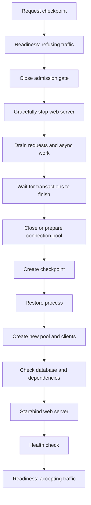

# Managing Embedded Web Servers and Database Connection Pools

Spring Boot applications typically run an embedded web server such as Tomcat, Jetty, or Undertow, while using a connection pool to manage database connections. These components are initialized within the ApplicationContext and usually hold sockets, threads, timers, connections, or state dependent on the operating system and external services.

When creating a CRaC checkpoint, saving JVM state does not guarantee every listener and database connection remains valid when the process is restored. Listening ports may need to rebind; database connections may have been closed by the server, timed out, or become incompatible with the new environment. If the application keeps using old objects without recovery, the first request after restore may fail even though the Spring beans still exist.

Therefore, the lifecycles of the web server and connection pool must be coordinated with CRaC: **stop accepting new requests, drain in-flight requests and transactions, prepare or close network resources before checkpoint, then recover pools and listeners before switching readiness to accepting traffic**. Spring Boot and each embedded server have their own lifecycle mechanisms; use the integration suited to the deployed version instead of manually closing sockets underneath the framework.

## 1. Network Components Managed by Spring Boot

In a Spring Boot web application, multiple layers participate in request handling:

1. The embedded server opens sockets and accepts connections from clients or a reverse proxy.
2. The server manages connections, request parsing, threads, or event loops.
3. Spring MVC/WebFlux routes requests through filters, interceptors, controllers, and handlers.
4. Services execute business logic and may call databases, caches, message brokers, or HTTP services.
5. The data access layer borrows connections from the pool, executes statements, and commits/rolls back transactions.

Components hold their own state:

| Component | Resources or state typically held | What to consider on CRaC restore |
|---|---|---|
| Tomcat/Jetty/Undertow | Listening sockets, worker threads, executors, connection state | Stop accepting requests, drain, rebind/restart via supported lifecycle |
| Netty/WebFlux server | Event loops, channels, selectors, and sockets | Stop accepting new channels, complete or close old channels, restore event loop/server properly |
| Servlet filter/interceptor | Request counters, caches, contexts | Ensure no requests are still using state being replaced |
| JDBC connection pool | Physical connections, pool threads, validation state | Drain borrowers, close or refresh connections, create a new pool if closed |
| JPA/Hibernate | EntityManagerFactory, transaction contexts, JDBC connections | Do not checkpoint in-flight transactions; verify pool and provider after restore |
| R2DBC connection pool | Reactive connections, channels, and pool lifecycle | Stop new subscriptions, drain active publishers, create or verify new connections |
| Health/readiness | Traffic-accepting state | Keep refusing traffic until the server and required dependencies are ready |

The ApplicationContext may still exist after restore. That does not mean every resource referenced by beans remains usable. A `HikariDataSource` or server wrapper may still be the same Java object in the heap, yet the underlying connections/sockets must be verified or recreated.

## 2. Target Lifecycle Before and After Checkpoint

A general sequence for a Spring Boot application:

### Before checkpoint

1. Switch readiness to refuse new traffic.
2. Close the application's admission gate so requests slipping past the load balancer are still not accepted for new processing.
3. Stop accepting new connections or requests on the embedded server via its lifecycle API.
4. Wait for in-flight requests to complete; drain async requests and streaming responses per application policy.
5. Stop schedulers, consumers, and background tasks that might open new transactions.
6. Wait for current transactions to commit/roll back and return connections to the pool.
7. Close or prepare pools and network clients according to driver/runtime guidance.
8. Allow checkpoint only once components have reached a safe state.

### After restore

1. Reload configuration and credentials from the current environment.
2. Create or restore the connection pool and verify database connectivity.
3. Recover dependent clients and check health of required dependencies.
4. Bind/start the embedded server using supported lifecycle APIs.
5. Verify the listener is actually active on the expected port.
6. Run required health checks, then open the admission gate and readiness.



The exact ordering depends on the embedded server and how the Spring Boot version integrates with CRaC. If the framework already provides CRaC integration managing the web server or pool automatically, use that integration and avoid registering another resource that closes the same component a second time.

## 3. Managing the Embedded Web Server

### Why shouldn't listeners be ignored?

An embedded server typically opens one or more sockets to accept connections. After a checkpoint, sockets may be closed by peers, the network namespace may change, or the checkpoint engine may be unable to restore socket state in the target environment. If the application reports ready while the listener no longer accepts connections, traffic will fail with timeouts or connection refused.

Some platforms can restore certain kinds of sockets under specific conditions. That capability depends on socket type, kernel, checkpoint engine, network configuration, and embedded server. Do not assume a socket is guaranteed usable just because the server object still exists in the heap.

### Graceful shutdown and request draining

Graceful shutdown has two objectives:

- Stop accepting new requests or stop spawning additional work from new requests.
- Give already accepted requests sufficient time to finish before closing resources.

Spring Boot supports graceful shutdown for embedded web servers in appropriate versions. Configuring `server.shutdown=graceful` and a lifecycle phase timeout helps when the ApplicationContext is closed. However, a CRaC checkpoint callback does not automatically mean the ApplicationContext is closed. Connect the checkpoint workflow to the lifecycle APIs provided by your Spring Boot version and server.

Example configuration in `application.yml`:

```yaml
server:
  shutdown: graceful

spring:
  lifecycle:
    timeout-per-shutdown-phase: 30s
```

The values above are only examples. The timeout must fit request processing duration, transactions, checkpoint limits, and the platform's stop deadline. If the checkpoint integration does not close the ApplicationContext, coordinate refusing traffic and graceful stop via a CRaC resource or corresponding integration.

### Using Spring Boot and embedded server lifecycles

Spring Boot manages embedded servers through abstractions such as `WebServer` and lifecycle beans. Tomcat, Jetty, and Undertow each have their own implementations for graceful shutdown, worker threads, and sockets. Use the APIs provided by Spring Boot/the server to start, stop, or shut down gracefully.

Do not extract the server's file descriptor and call `close()` via JNI, reflection, or OS operations. Doing so can leave the server thinking the listener is still open while the kernel closed the descriptor; restarting the server may fail or exhibit inconsistent internal state.

Some principles:

- Set readiness to refusing traffic before stopping the listener.
- Use graceful shutdown to wait for in-flight requests rather than merely closing the listening socket.
- Include async servlet requests, `DeferredResult`, `Callable`, WebFlux publishers, and streaming responses in the drain policy.
- Determine how to handle WebSockets or long-lived connections; they may not finish within normal drain windows.
- Do not reopen traffic until the listener binds successfully and dependencies are ready.
- Measure the actual port after server startup if using a dynamic port.

### Servlet and reactive servers

With Spring MVC/Servlet, requests typically run through a servlet container and may involve async processing. Request counters must decrement when the response actually completes, not merely when the controller method returns.

With Spring WebFlux on Reactor Netty, event loops and channel lifecycles differ from servlet containers. A request can be an asynchronous publisher; shutting down the server must coordinate with active subscriptions and tasks scheduled on event loops. Do not wrap a synchronous counter around creating `Mono`/`Flux` and treat that as request completion. Track appropriate completion/cancel signals and use Reactor Netty/Spring Boot lifecycle APIs.

## 4. Managing JDBC Connection Pools

### Why does the pool need recovery?

A connection pool such as HikariCP holds physical connections to the database for reuse. A connection can be closed by the database due to idle timeout, failover, restart, or network interruption while the application is checkpointed. Java objects such as `Connection` proxies and pool entries may still reside in the heap, yet the underlying sockets are not necessarily still valid.

Common risks after restore:

- Old connections fail when calling `prepareStatement`, `execute`, or `commit`.
- The pool still marks connections as idle/available even though the database closed them.
- Pool housekeeping/validation threads have state mismatched with the restored process.
- Database credentials or DNS have changed.
- The database failed over to another node.
- Unfinished transactions are left behind or the application does not know whether a transaction committed.

For a pool supporting CRaC, follow the guidance of that library version. Without a verified integration, a common safe approach is draining borrowers, closing the pool before checkpoint, and creating a new pool after restore. Do not assume every pool can be restarted after calling `close()`.

### Do not checkpoint open transactions

Before checkpoint, do not leave JDBC/JPA transactions in an unfinished state. Stop new requests, wait for active transactions to commit or roll back, and only then close the pool.

A transaction may have executed some statements without committing. If the process restores from mid-transaction state, connection state on the database may have timed out or rolled back while the application was paused. Keeping `EntityManager` or `Connection` objects in the heap cannot solve this problem.

For message consumers, ack/commit offsets only after the business transaction completes with proper semantics. If the checkpoint cannot wait for the consumer to finish processing, let the broker redeliver the message and ensure handlers are idempotent.

### HikariCP: close the old pool, create a new pool

With HikariCP, `HikariDataSource.close()` shuts down the pool. Do not rely on the same closed instance to keep operating after restore. Create a new `HikariDataSource` from current configuration:

```java
import com.zaxxer.hikari.HikariConfig;
import com.zaxxer.hikari.HikariDataSource;

final class DataSourceFactory {
    HikariDataSource create(DatabaseSettings settings) {
        HikariConfig config = new HikariConfig();
        config.setJdbcUrl(settings.jdbcUrl());
        config.setUsername(settings.username());
        config.setPassword(settings.password());
        config.setMaximumPoolSize(settings.maximumPoolSize());
        config.setConnectionTimeout(settings.connectionTimeoutMillis());
        config.setPoolName("application-db-pool");
        return new HikariDataSource(config);
    }
}
```

`DatabaseSettings` is an application-defined configuration. In practice, passwords should be retrieved from a secret provider, not logged or baked into the checkpoint if they can be provisioned after restore.

Creating a new pool must be coordinated with beans holding references to `DataSource`. If `JdbcTemplate`, `DataSourceTransactionManager`, Hibernate, or repositories hold the old pool instance directly, merely creating a new pool in another field will not switch those beans to the new pool.

There are two implementation approaches:

1. Use CRaC integration supported by the library/framework, if it already handles the pool and related beans.
2. Use a stable `DataSource` proxy injected into Spring, forwarding `getConnection()` to the active pool. The lifecycle manager swaps the target pool after restore while `JdbcTemplate` and the transaction manager keep the stable proxy.

Do not swap an active `DataSource` while transactions are still running. Only swap after all borrowers have drained and the old pool has closed safely.

### Switchable DataSource pattern

The following example illustrates the core of a proxy. In a real application, implement/delegate all remaining methods of `DataSource`, handle pool ownership, and ensure no transaction is using the pool when swapping targets.

```java
import java.sql.Connection;
import java.sql.SQLException;
import java.util.concurrent.atomic.AtomicReference;

import javax.sql.DataSource;

final class SwitchableDataSource {
    private final AtomicReference<DataSource> target = new AtomicReference<>();

    Connection getConnection() throws SQLException {
        DataSource current = target.get();
        if (current == null) {
            throw new SQLException("Database pool is not ready");
        }
        return current.getConnection();
    }

    void install(DataSource next) {
        target.set(next);
    }

    DataSource currentTarget() {
        return target.get();
    }
}
```

This snippet illustrates the delegation idea, not a drop-in `DataSource` replacement in Spring since it does not implement the full interface. In real usage, create a class implementing `DataSource` completely or use Spring's proxy abstractions. Keep a stable access point for the transaction manager and repositories, while ensuring the old pool is only closed after no connections remain borrowed.

## 5. Integrating DataSource and Transactions with Spring

In Spring Boot, `DataSource` is usually created by auto-configuration and injected into `JdbcTemplate`, JPA `EntityManagerFactory`, transaction managers, and repositories. If managing pool replacement after restore yourself, account for the entire dependency graph.

A simpler implementation is using CRaC support provided by Spring Boot or the pool library when that version supports it. Clearly establish which integration is responsible for:

- Stopping incoming requests and waiting for transactions to complete.
- Closing or suspending the pool before checkpoint.
- Recreating the pool after restore.
- Updating database health/readiness.
- Preserving references used by Spring beans or replacing beans via supported mechanisms.

Avoid registering two resources that both close the same `DataSource`. If Spring Boot already manages the pool, another custom resource may call `close()` again or close the pool in the wrong order.

### JPA and Hibernate

`EntityManagerFactory` is a long-lived component, while `EntityManager` is typically tied to a unit of work/transaction. Before checkpoint:

- Stop requests and jobs that could open new transactions.
- Wait for current transactions to finish.
- Do not retain active `EntityManager` instances across checkpoint.
- Let the pool close or refresh via supported integrations.

After restore, confirm that the `DataSource` used by Hibernate points to a valid pool. If you only swap the pool in one object while `EntityManagerFactory` still holds the old DataSource, subsequent queries can still fail.

Do not recreate `EntityManagerFactory` arbitrarily inside `afterRestore` if the framework is not designed for it; it is a heavy object with extensive metadata and lifecycle hooks. Prefer official CRaC integration or a stable DataSource proxy configured from the start.

### R2DBC

WebFlux applications may use an R2DBC connection pool instead of JDBC. Although the APIs differ, the principles are similar:

- Stop creating new subscriptions/work.
- Wait for publishers using connections to complete or cancel safely.
- Close/refresh the pool per the implementation's lifecycle.
- Create new connections after restore and verify database readiness.
- Do not enable readiness before the pool is able to serve requests.

Because reactive pipelines can continue asynchronously after a method returns, draining must track publisher completion, not just active thread counts.

## 6. A CRaC Resource Coordinating Web Server and Database Pool

The example below illustrates how to structure an application-layer resource. Interfaces such as `WebServerLifecycle`, `RequestTracker`, `DatabasePoolLifecycle`, and `ReadinessController` are application-defined abstractions; they are not built-in CRaC or Spring Boot APIs.

```java
import java.time.Duration;
import java.util.concurrent.TimeoutException;

import org.crac.Context;
import org.crac.Resource;

final class SpringInfrastructureResource implements Resource {
    private final ReadinessController readiness;
    private final RequestTracker requests;
    private final WebServerLifecycle webServer;
    private final BackgroundWorkLifecycle backgroundWork;
    private final DatabasePoolLifecycle databasePool;
    private final Duration drainTimeout;

    SpringInfrastructureResource(
            ReadinessController readiness,
            RequestTracker requests,
            WebServerLifecycle webServer,
            BackgroundWorkLifecycle backgroundWork,
            DatabasePoolLifecycle databasePool,
            Duration drainTimeout) {
        this.readiness = readiness;
        this.requests = requests;
        this.webServer = webServer;
        this.backgroundWork = backgroundWork;
        this.databasePool = databasePool;
        this.drainTimeout = drainTimeout;
    }

    @Override
    public void beforeCheckpoint(Context<? extends Resource> context)
            throws Exception {
        readiness.refuseTraffic();
        requests.stopAccepting();
        backgroundWork.stopCreatingWork();

        webServer.stopAcceptingAndDrain(drainTimeout);
        backgroundWork.awaitInFlight(drainTimeout);
        requests.awaitDrained(drainTimeout);

        if (!databasePool.awaitNoBorrowers(drainTimeout)) {
            throw new TimeoutException("Database connections are still in use");
        }

        databasePool.closeCurrentPool();
    }

    @Override
    public void afterRestore(Context<? extends Resource> context)
            throws Exception {
        databasePool.createPoolFromCurrentConfiguration();
        databasePool.verifyConnection();

        backgroundWork.recreateDependencies();
        webServer.bindAndStart();
        webServer.verifyListening();

        requests.resumeAccepting();
        backgroundWork.resume();
        readiness.acceptTraffic();
    }
}
```

This is a conceptual coordination structure. A production implementation must handle per-phase timeouts, clean up if a new pool is created yet the server fails to bind, and ensure readiness is enabled only when the server actually accepts requests. The resume order of background work should reflect business requirements; for example, consumers might only resume after both the database and listener are ready.

If `beforeCheckpoint` fails after the server has stopped or the pool has closed, a recovery path is required for the aborted checkpoint attempt. Do not assume CRaC will call `afterRestore` on the old process to undo completed actions. The resource/coordinator must know how to reinitialize the pool and server or let the orchestrator replace the instance.

## 7. Recovery Ordering and Readiness

Readiness must reflect the ability to serve real requests. The following states can be distinguished:

| State | Meaning | Accepting traffic? |
|---|---|---|
| Starting | JVM has restored yet dependencies are not ready | No |
| Restoring database | Pool is being created and tested | No |
| Restoring server | Listener is binding/starting | No |
| Verifying | Database, server, and required dependencies have been checked | Not yet |
| Accepting | Required components are ready | Yes |
| Failed | A recovery step could not complete | No |

Do not mark readiness healthy simply because the process is alive or an HTTP health endpoint returns a static response. A useful health check should confirm the listener is active and minimal request dependencies are ready.

If the readiness endpoint is also served via the embedded server, ensure the server has started before the platform probes the endpoint. Some applications may use separate startup/liveness probes alongside readiness; keep liveness reflecting process liveness and readiness reflecting capacity to accept traffic.

## 8. Configuring Timeouts and Graceful Shutdown

The drain deadline must be long enough for valid requests yet smaller than the overall budget allocated for checkpointing. The budget can be split as follows:

| Phase | Illustrative budget |
|---|---:|
| Readiness propagation and closing admission gate | 3 seconds |
| Web server stops accepting new requests | 5 seconds |
| Drain requests, async responses, and background tasks | 20 seconds |
| Complete transactions and return connections | 5 seconds |
| Close pool and prepare other resources | 5 seconds |
| Reserve for checkpoint engine | 10 seconds |
| Total | 48 seconds |

This is only a budgeting example. Measure actual p95/p99 request duration, transaction duration, and shutdown time. Timeouts for the server, Spring lifecycle, pool drain, and CRaC controller must be consistent so inner stages do not wait longer than outer deadlines.

When timing out:

1. Do not proceed with checkpointing while requests or transactions are still using resources.
2. Record the count of remaining requests, tasks, and connection borrowers.
3. Throw an error from the callback so the checkpoint attempt fails explicitly.
4. If the process keeps running, recover the server/pool or keep the instance unhealthy under a controlled procedure.
5. Do not force-close connections currently used by active transactions just to make the counter hit 0.

## 9. Common Mistakes

### Server object remains yet listening socket is no longer valid

The application sees the server bean still exists and flips readiness to accepting. Traffic arrives yet the socket refuses connections. Use the embedded server's lifecycle API, verify bind/listening after restore, and open readiness only after confirmation.

### Closing only the listening socket without draining requests

Already accepted requests may still be running and holding transactions. Closing the pool immediately after stopping accept can fail active requests. Drain requests and background work before closing the pool.

### Closing HikariDataSource and reusing the same object

`close()` shuts down the pool. Create a new pool and ensure the DataSource used by the Spring transaction manager/JPA points to the new target through the designed mechanism.

### Creating a new pool while repositories still hold the old pool

Beans may already hold references to the old DataSource. Use framework-supported integration or a stable DataSource proxy; do not replace a field in one isolated service and assume the entire ApplicationContext updates automatically.

### Transactions or async requests still unfinished

A controller method returning does not mean the async response has finished. Track the actual lifecycle of requests, reactive publishers, transactions, and child tasks.

### Registering two resources managing the same server or pool

Two callbacks closing/starting the same component can cause double-closes, out-of-order starts, or race conditions. Choose one clear lifecycle owner and coordinate dependent components through a coordinator.

### Switching readiness before database checks finish

The first request after restore may hit an empty pool, stale credentials, or an incomplete database failover. Open readiness only after connection tests and required health checks pass.

### Failing to handle failed checkpoint attempts

Callbacks may have already stopped the server and closed the pool before the checkpoint engine encountered an error. Provide a clear recovery path for the continuing process or replace the instance; do not expect restore callbacks to roll back automatically.

## 10. Observability and Measurement

Monitor dedicated signals for the web server and pool:

| Metric/log | Purpose |
|---|---|
| Active requests in progress | Confirm draining and detect stuck requests |
| Graceful shutdown duration | Measure how long the server takes to stop accepting and finish requests |
| Active async requests/streams remaining | Detect when drain misses async lifecycles |
| Port and listener state after restore | Confirm the server bound/started successfully |
| Pool active/idle/pending connections | Confirm borrowers drained and the new pool is ready |
| Connection validation failures | Detect stale connections or unready database |
| Database connection creation time | Measure cost of creating the pool after restore |
| Transaction duration and rollback count | Detect long-running transactions or recovery failures |
| Readiness transition time | Measure duration from restore to accepting traffic |

Do not log passwords, JDBC URLs containing secrets, tokens, or sensitive query data. You may log pool names, database aliases, error categories, and correlation IDs for investigation.

## 11. Test Scenarios

Test on the exact Spring Boot version, embedded server, JDK/CRaC runtime, JDBC driver, pool implementation, database, and container environment to be deployed:

1. Start the application, confirming the web server is listening and the pool holds valid connections.
2. Send representative read/write requests, confirming transactions complete.
3. Start a long request and trigger checkpoint; confirm readiness closes first and the request drains or checkpoint times out safely.
4. Create a checkpoint once no requests, transactions, or borrowers remain.
5. Restore and confirm the pool is recreated and connection validation succeeds.
6. Confirm the embedded server rebinds/listens again on the expected endpoint.
7. Send the first request after restore, checking queries, commit/rollback, and response.
8. Restart or fail over the database while checkpointed to verify the pool does not keep stale connections.
9. Make the database unavailable after restore, confirming readiness continues refusing traffic.
10. Cause port binding to fail, confirming the instance is not advertised as healthy.
11. Simulate a failed checkpoint attempt after callbacks stopped the server or closed the pool, confirming the recovery path works.

## 12. Implementation Checklist

- [ ] Identified the embedded server and lifecycle API suited to the Spring Boot version.
- [ ] Readiness and admission gate close before the server stops accepting requests.
- [ ] Graceful shutdown covers synchronous, async, reactive requests, and long-lived connections per policy.
- [ ] Background tasks and consumers do not start new transactions during drain.
- [ ] Transactions finish before the pool closes.
- [ ] The connection pool is recovered via supported integration; do not reuse a closed pool unless permitted by the implementation.
- [ ] `DataSource` used by JdbcTemplate, transaction manager, and JPA points to the active pool.
- [ ] The new pool passes connection checks before opening readiness.
- [ ] Listener is bound/started and port verified before accepting traffic.
- [ ] Only one lifecycle owner exists per server/pool.
- [ ] Callbacks have timeouts and report errors when requests or connections fail to drain.
- [ ] A recovery path exists if a checkpoint attempt fails after resources have stopped.
- [ ] Restore, database failover, stale connections, and server bind failures have been tested in a production-like environment.

## 13. Conclusion

The embedded web server and connection pool are two critical resource groups in a Spring Boot application. The embedded server must stop accepting new requests and drain in-flight requests; the connection pool should close only after transactions and borrowers have completed. After restore, the pool must be recreated or verified per library integration, the server must bind/start successfully, and readiness must open only when required dependencies are healthy.

Let Spring Boot, the embedded server, and the pool manage their own resources through supported lifecycle APIs. Coordinate those steps via CRaC resources or official integration, keep DataSource references consistent across the ApplicationContext, and test on the exact deployment runtime. That way, the application can leverage warmed-up state without accepting traffic using stale listeners or database connections.