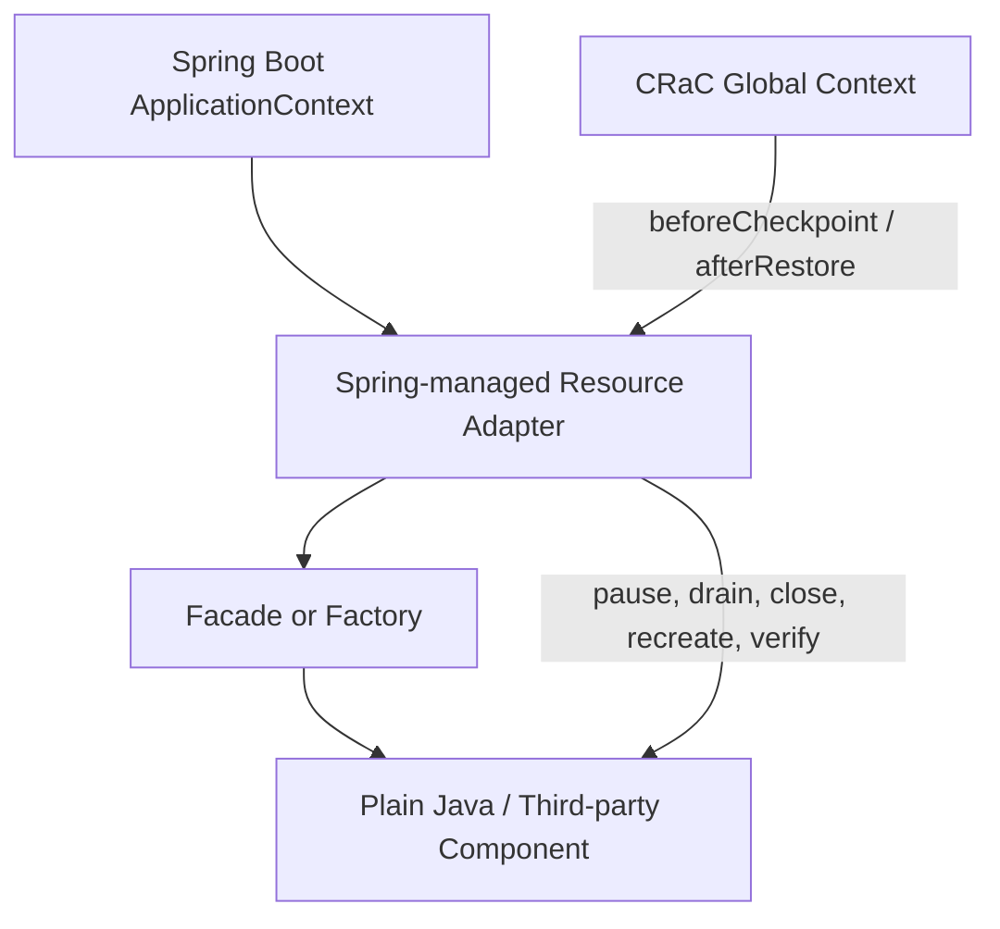

# Custom Resource Integration for Non-Spring Components

In a Spring Boot application, not every component is created and lifecycle-managed by Spring. A third-party library may create its own client, engine, or worker; a native component may be initialized through a dedicated factory; or the application may use a manually created plain Java object. Spring does not automatically know when to pause, close, or reinitialize these resources when the process performs CRaC checkpoint and restore.

CRaC provides `org.crac.Resource` so the application can describe two points in the checkpoint lifecycle:

- `beforeCheckpoint(...)`: prepare the resource before the process state is captured.
- `afterRestore(...)`: recover the resource after the process is restored.

For non-Spring components, the common integration approach is to create a **Resource adapter**. The adapter holds a reference to the component or to a facade that manages the component, then translates CRaC callbacks into lifecycle operations provided by the library. Spring manages the adapter and its required dependencies; CRaC invokes the adapter through the global context.

A point to distinguish is that an object implementing `Resource` is not automatically invoked by CRaC simply because it is a Spring bean. The application must register that object with the CRaC context exactly once. At the same time, callbacks need to respect the ownership and dependency order of the resources that the adapter manages.

## 1. When Is a Custom Resource Needed?

Several components typically do not belong directly to Spring's lifecycle:

| Component | Issue during checkpoint | Work the adapter can coordinate |
|---|---|---|
| Third-party library client | Holds sockets, connection pools, or internal threads | Stop new requests, drain operations, close the client, and create a new client after restore |
| Data processing engine | Holds buffers, native memory, or worker threads | Flush buffers, stop workers, release the engine, and reinitialize |
| Self-created cloud SDK | Holds credentials, HTTP connections, or tokens | Close the old client, read current configuration/credentials, and create a new SDK client |
| Native/JNI processor | Holds handles or contexts allocated by native code | Call native APIs to release and recreate the context after restore |
| Library with its own scheduler | Has background threads or schedules tied to old time | Pause, wait for tasks to finish, and restart based on the current time |
| Plain Java object created manually by the application | Has no Spring bean lifecycle to integrate with | Wrap the object with an adapter and explicitly register CRaC callbacks |

There is no need to create a separate Resource for every object. Only resources that require action before checkpoint or after restore need to be managed. An object that only holds immutable data in the heap and has no environment dependencies may not need callbacks.

## 2. Distinguishing Three Lifecycle Layers

In a Spring Boot application using CRaC, three different lifecycle layers can exist:

1. **Spring bean lifecycle:** Spring creates beans, injects dependencies, and executes callbacks such as `@PostConstruct`, `InitializingBean`, `SmartLifecycle`, or `@PreDestroy`.
2. **External component lifecycle:** a library may provide `start()`, `stop()`, `close()`, `shutdown()`, `pause()`, or its own factory. If the component is not a bean, Spring does not automatically invoke these methods.
3. **CRaC Resource lifecycle:** CRaC invokes `beforeCheckpoint` and `afterRestore` on a Resource registered with the context.

The adapter is the bridge between the second layer and the third layer. Spring can create the adapter as a bean to inject the factory, configuration, and facade. However, CRaC callbacks only run when the adapter is registered with the CRaC context.



You should not arbitrarily merge the Spring shutdown lifecycle with the checkpoint lifecycle. `@PreDestroy` is normally called when the ApplicationContext closes; a checkpoint does not necessarily close the ApplicationContext. `beforeCheckpoint` and `afterRestore` must handle the state of a process being checkpointed/restored, while normal shutdown still needs an appropriate resource closing path.

## 3. The `org.crac.Resource` API

A Resource implements two callbacks:

```java
import org.crac.Context;
import org.crac.Resource;

public final class ExampleResource implements Resource {

    @Override
    public void beforeCheckpoint(Context<? extends Resource> context)
            throws Exception {
        // Stop or close the resource before checkpoint.
    }

    @Override
    public void afterRestore(Context<? extends Resource> context)
            throws Exception {
        // Recreate or verify the resource after restore.
    }
}
```

`beforeCheckpoint` is called during the checkpoint preparation phase. The Resource should stop accepting new work, wait for in-flight work to finish, and bring the resource into a saveable state. If the callback cannot prepare safely, it should report an error so that the checkpoint process is rejected rather than silently continuing in an unclear state.

`afterRestore` is called once the process has been restored. The Resource should recreate or refresh environment-dependent items such as connections, native contexts, tokens, or background threads. Only complete the callback after the resource it owns has reached the required ready state.

Do not put arbitrary business logic into callbacks. Focus on the resource lifecycle: pause, drain, flush, close, create, initialize, and verify.

## 4. Designing an Adapter for a Plain Java Component

Suppose the application uses a document processing library named `LegacyEngine`. The library is unaware of Spring and does not implement `org.crac.Resource`, but it provides the following operations:

- Create an instance via a factory.
- `start()` to start the engine.
- `stopAccepting()` to stop accepting new work.
- `awaitDrained(...)` to wait for running tasks to finish.
- `close()` to release threads, buffers, and native handles.
- `verifyReady()` to verify that the engine is working.

The application can define a small interface representing the contract that the adapter needs:

```java
import java.time.Duration;

public interface LegacyEngine extends AutoCloseable {
    void start() throws Exception;
    void stopAccepting() throws Exception;
    boolean awaitDrained(Duration timeout) throws Exception;
    void resumeAccepting() throws Exception;
    void verifyReady() throws Exception;
    void process(Document document) throws Exception;

    @Override
    void close() throws Exception;
}
```

This interface is the application's adapter layer; the actual implementation can invoke the third-party library's API. If the library uses different method names, map the corresponding methods instead of requiring changes to the library.

The factory is responsible for creating a new instance:

```java
public interface LegacyEngineFactory {
    LegacyEngine create() throws Exception;
}
```

The factory should retrieve the current configuration, paths, credentials, and endpoints when creating the component. Do not cache time-limited values in the factory if they could expire while the checkpoint image is stored.

## 5. Using a Facade to Replace the Component After Restore

A common challenge is that other Spring beans may be holding references to the old component. If the adapter closes that component and creates a new object, the beans holding direct references will still call the closed old object.

The solution is to inject a stable facade into the Spring beans. The facade holds a replaceable reference to the actual component. Consumers invoke calls through the facade, while the Resource adapter is responsible for swapping the instance after restore.

```java
import java.time.Duration;

public final class LegacyEngineHandle {
    private final LegacyEngineFactory factory;
    private volatile LegacyEngine current;

    public LegacyEngineHandle(LegacyEngineFactory factory)
            throws Exception {
        this.factory = factory;
        this.current = createStartedEngine();
    }

    public void process(Document document) throws Exception {
        LegacyEngine engine = current;
        if (engine == null) {
            throw new IllegalStateException("Legacy engine is not ready");
        }
        engine.process(document);
    }

    public synchronized void closeForCheckpoint(Duration timeout)
            throws Exception {
        LegacyEngine engine = current;
        if (engine == null) {
            return;
        }

        engine.stopAccepting();
        if (!engine.awaitDrained(timeout)) {
            IllegalStateException failure = new IllegalStateException(
                    "Legacy engine did not drain before checkpoint");
            try {
                engine.resumeAccepting();
            } catch (Exception resumeFailure) {
                failure.addSuppressed(resumeFailure);
            }
            throw failure;
        }

        try {
            engine.close();
            current = null;
        } catch (Exception failure) {
            try {
                engine.resumeAccepting();
            } catch (Exception resumeFailure) {
                failure.addSuppressed(resumeFailure);
            }
            throw failure;
        }
    }

    public synchronized void recreateAfterRestore() throws Exception {
        if (current != null) {
            throw new IllegalStateException(
                    "Legacy engine is already installed");
        }

        LegacyEngine replacement = createStartedEngine();
        current = replacement;
    }

    private LegacyEngine createStartedEngine() throws Exception {
        LegacyEngine engine = factory.create();
        try {
            engine.start();
            engine.verifyReady();
            return engine;
        } catch (Exception failure) {
            try {
                engine.close();
            } catch (Exception cleanupFailure) {
                failure.addSuppressed(cleanupFailure);
            }
            throw failure;
        }
    }
}
```

In the example, `current` is `volatile` so that threads calling the facade see the newly published instance. Replacing the reference does not by itself protect operations currently running on the old instance; that is why `stopAccepting()` and `awaitDrained()` must ensure all already-started operations finish before `close()` is called.

The `LegacyEngine` contract needs to guarantee that `stopAccepting()` prevents new tasks, even if a consumer has already obtained a reference to the engine right before the stop point. Otherwise, an admission gate or lock must be added in the facade to eliminate the race between `process()` and `closeForCheckpoint()`.

`createStartedEngine()` closes the instance if initialization fails. In production code, you also need to handle errors during `close()` in the cleanup block and attach the cleanup exception to the original exception using `addSuppressed()` so the root cause is not lost.

## 6. Writing the Resource Adapter

The adapter does not need to know which library the component comes from. It only invokes the lifecycle through the facade:

```java
import org.crac.Context;
import org.crac.Resource;

import java.time.Duration;

public final class LegacyEngineCracResource implements Resource {
    private final LegacyEngineHandle handle;
    private final Duration drainTimeout;

    public LegacyEngineCracResource(
            LegacyEngineHandle handle,
            Duration drainTimeout) {
        this.handle = handle;
        this.drainTimeout = drainTimeout;
    }

    @Override
    public void beforeCheckpoint(Context<? extends Resource> context)
            throws Exception {
        handle.closeForCheckpoint(drainTimeout);
    }

    @Override
    public void afterRestore(Context<? extends Resource> context)
            throws Exception {
        handle.recreateAfterRestore();
    }
}
```

The Resource adapter holds a stable reference to the facade. On checkpoint, it closes the current component. On restore, it asks the factory to create a new component and then publishes it through the facade.

If the component can be safely reopened on the same instance, the adapter can call `pause/close` before checkpoint and `reopen/start` after restore. However, for libraries without a restartability guarantee, creating a new instance from the factory is usually easier to control. Follow the lifecycle documentation of the library itself.

## 7. Registering the Adapter in Spring Boot

You can let Spring create the adapter and register it with the CRaC global context after the required singletons have been created. The example below uses `SmartInitializingSingleton` as the registration point:

```java
import org.crac.Core;
import org.springframework.beans.factory.SmartInitializingSingleton;
import org.springframework.context.annotation.Bean;
import org.springframework.context.annotation.Configuration;

import java.time.Duration;

@Configuration
public class LegacyEngineCracConfiguration {

    @Bean
    LegacyEngineHandle legacyEngineHandle(LegacyEngineFactory factory)
            throws Exception {
        return new LegacyEngineHandle(factory);
    }

    @Bean
    LegacyEngineCracResource legacyEngineCracResource(
            LegacyEngineHandle handle) {
        return new LegacyEngineCracResource(
                handle,
                Duration.ofSeconds(30));
    }

    @Bean
    SmartInitializingSingleton registerLegacyEngineCracResource(
            LegacyEngineCracResource resource) {
        return () -> Core.getGlobalContext().register(resource);
    }
}
```

`SmartInitializingSingleton.afterSingletonsInstantiated()` is called after regular singletons have been created. The registration bean obtains the Resource via dependency injection, so the adapter and facade already exist at registration time. `Core.getGlobalContext().register(resource)` adds the Resource to the global context so CRaC invokes its callbacks.

In a real application, `LegacyEngineFactory` needs to be provided as a bean or an adapter to the library's factory. If the library creates components itself, the factory can be a wrapper around that API. Do not register the same Resource multiple times when there are multiple configuration classes or multiple ApplicationContexts.

### 7.1. Why Register Once?

If the same Resource is registered multiple times, callbacks may be invoked multiple times for the same object. That can easily lead to closing the component twice, creating multiple instances after restore, or performing repeated cleanup.

Make sure to:

- Have only a single registrar bean responsible for registering the Resource.
- Do not register on every request or every time a component is created.
- Do not re-register from `afterRestore()`.
- If the application has parent/child ApplicationContexts or multiple contexts, clearly determine which context owns the Resource.
- Keep the Resource and facade alive throughout the process lifetime.

Do not arbitrarily create a separate global context if the CRaC API requires using `Core.getGlobalContext()` for process callbacks. Read the documentation for the exact version of `org.crac` and JDK being deployed.

## 8. Registration Order with Multiple Resources

An application may have multiple custom Resources: a database client, a processing engine, a message consumer, and a scheduler. They may depend on one another.

For example:

```text
CredentialProvider
       ↓
DatabaseClient
       ↓
OrderProcessor
       ↓
BackgroundWorker
```

When recovering, a dependency must be ready before the component that uses it. When preparing for checkpoint, the dependent component must stop before its dependency.

For Resources registered in the same context, the callback order is designed to support dependency relationships: `beforeCheckpoint` runs in reverse registration order; `afterRestore` runs in registration order. Therefore, register the dependency first and the dependent afterward.

```java
Core.getGlobalContext().register(credentialResource);
Core.getGlobalContext().register(databaseResource);
Core.getGlobalContext().register(processorResource);
Core.getGlobalContext().register(workerResource);
```

With the order above:

- Before checkpoint: worker → processor → database → credential.
- After restore: credential → database → processor → worker.

For complex resources or those with many internal dependencies, a single coordinator can be used to manage the order explicitly. Do not register both the coordinator and individual child resources if that causes the same resource to be closed/opened twice.

## 9. Integrating Components with Their Own Lifecycle

Not every library has the same API. The adapter needs to map CRaC callbacks to the actual lifecycle.

| Library API | Possible mapping in `beforeCheckpoint` | Possible mapping in `afterRestore` |
|---|---|---|
| `start()` / `close()` | Stop accepting work and call `close()` | Create a new instance and call `start()` |
| `pause()` / `resume()` | Pause, drain, and release resources that cannot be retained | Recreate connections and then resume |
| `shutdown()` / factory | Shut down the current instance | Call the factory to create a new instance |
| `flush()` / `dispose()` | Flush buffers and then dispose | Create a new context, load required configuration and data |
| Native `destroy()` / `create()` | Release native handles/contexts | Allocate a new context and verify |

If the library already has an official CRaC integration, prefer using that integration instead of creating a second adapter that duplicates the lifecycle. If the library provides its own callbacks, the adapter can call those callbacks or bridge between the two APIs.

Do not call `close()` if the library documentation only allows `shutdown()` once and provides no way to create a new instance. Conversely, do not assume `stop()` is enough to release sockets or native memory. You need to determine the exact semantics of each method.

## 10. Error Handling in Callbacks

CRaC callbacks are part of the checkpoint/restore boundary. Ignoring errors here can cause an image to be created from an unsafe state or an instance after restore to accept work when dependencies are not yet ready.

### 10.1. `beforeCheckpoint` Failure

For example, the engine cannot drain within the timeout:

- Do not proceed to close dependencies that the engine still needs.
- Report an error from the callback so the checkpoint is rejected.
- If work acceptance was paused, attempt to resume according to the actual state.
- If cleanup completed only partially, mark the instance as not ready and perform a controlled recovery procedure.

Do not catch the exception and merely log it. Doing so allows CRaC to continue while the resource is still running or in an indeterminate state.

### 10.2. `afterRestore` Failure

If the factory fails to create the component or `verifyReady()` fails:

- Do not publish the component as ready.
- Do not open traffic or start dependent workers.
- Close the partially created instance if possible.
- Return an error from the callback so the restoration process is recognized as failed.
- Use bounded retries or let the orchestrator start a new instance according to the deployment policy.

Do not retry indefinitely in the callback. Set timeouts and distinguish transient errors from configuration errors.

### 10.3. Idempotency and Lifecycle State

Callbacks and lifecycle methods should have explicit states, such as `RUNNING`, `PAUSED`, `CLOSED`, `RESTORING`, and `FAILED`. Do not just use a single boolean `started` for all states.

If callbacks can be invoked across multiple checkpoint–restore cycles, the logic must handle the current state properly. For example, `closeForCheckpoint()` can return immediately if the component is already closed; `recreateAfterRestore()` must reject duplicate creation if the current instance is still active.

Being idempotent does not mean methods can be called concurrently at will. Lifecycle operations still need to be serialized and coordinated with business threads.

## 11. Should a Component Be Closed or Only Paused?

Not every resource needs to be completely destroyed before checkpoint. The decision depends on the restore capability of the resource and the library:

- **Pause:** used when the component can safely continue after restore and the runtime documentation allows preserving its state.
- **Drain:** used to wait for current work to complete before the snapshot.
- **Flush:** write buffered data that needs to be persisted to durable storage before checkpoint.
- **Close:** used when an FD/socket/session cannot be kept across restore or the library requires closing.
- **Recreate:** used when the old instance cannot be reopened or environment dependencies may change.
- **Verify:** used after restore to confirm that the new component actually works.

For example, a parser that only holds metadata on the heap may not need to be closed. An HTTP client holding a connection pool usually needs to be closed and recreated. A native engine may need to call `destroy()` to release handles and then call `create()` after restore.

## 12. Which Spring Bean Should Own the Adapter?

Place the adapter in the configuration layer or an integration module appropriate for the component. Avoid registering Resources from controllers or business services because checkpoint lifecycle is an application-level concern.

A possible package structure is:

```text
com.example.application
├── config
│   └── CracConfiguration.java
├── integration
│   └── legacy
│       ├── LegacyEngineFactory.java
│       ├── LegacyEngineHandle.java
│       └── LegacyEngineCracResource.java
└── order
    └── OrderService.java
```

`OrderService` only depends on the `LegacyEngineHandle` facade or a stable business interface. It does not need to know where CRaC callbacks are registered. `CracConfiguration` is responsible for wiring the Spring beans, factory, and Resource adapter.

If the component should not be accessed directly by other beans, keep the implementation class in the integration package and expose only the facade. This prevents beans from holding references to the old instance after restore.

## 13. Distinguishing CRaC Callbacks from Spring Shutdown/Startup Callbacks

Spring has mechanisms such as `@PostConstruct`, `InitializingBean`, `SmartInitializingSingleton`, `SmartLifecycle`, `ContextRefreshedEvent`, and `@PreDestroy`. They serve the lifecycle of the ApplicationContext.

| Mechanism | When called | Role |
|---|---|---|
| `@PostConstruct` | After bean injection and initialization | Prepare the bean during Spring startup |
| `SmartInitializingSingleton` | After regular singletons have been created | Can be used as a one-time Resource registration point |
| `SmartLifecycle.start()` | When the lifecycle processor starts the component | Start the component according to Spring's phase |
| `SmartLifecycle.stop()` | When Spring stops the lifecycle | Stop the component during context shutdown |
| `@PreDestroy` | When the bean is destroyed | Cleanup during normal shutdown |
| CRaC `beforeCheckpoint()` | When CRaC prepares for checkpoint | Prepare process state for snapshot |
| CRaC `afterRestore()` | After CRaC restores the process | Recover resources after snapshot |

You can use `SmartLifecycle` to manage start/stop of a Spring-managed component, but you should not assume by default that it replaces `Resource`. A checkpoint is not necessarily closing the ApplicationContext and creating a new context. A CRaC adapter must be designed specifically for CRaC's two callbacks.

If you are already using a Spring/Boot library with official CRaC integration, check the ordering and integration approach of that version. Avoid letting auto-configuration manage a resource while also registering a custom adapter that closes the same resource again.

## 14. Testing the Adapter

Testing needs to verify both the callbacks and the actual state of the component. A fake component that records method order can be used to test adapter logic without needing to launch CRaC in every unit test.

### 14.1. Unit Tests for the Adapter

A fake engine can record operations:

```java
public final class FakeLegacyEngine implements LegacyEngine {
    private final List<String> events;
    private boolean accepting;

    public FakeLegacyEngine(List<String> events) {
        this.events = events;
    }

    @Override
    public void start() {
        accepting = true;
        events.add("start");
    }

    @Override
    public void stopAccepting() {
        accepting = false;
        events.add("stopAccepting");
    }

    @Override
    public boolean awaitDrained(Duration timeout) {
        events.add("awaitDrained");
        return true;
    }

    @Override
    public void resumeAccepting() {
        accepting = true;
        events.add("resumeAccepting");
    }

    @Override
    public void verifyReady() {
        events.add("verifyReady");
    }

    @Override
    public void process(Document document) {
        if (!accepting) {
            throw new IllegalStateException("Engine is paused");
        }
        events.add("process");
    }

    @Override
    public void close() {
        accepting = false;
        events.add("close");
    }
}
```

Unit tests can verify:

- `beforeCheckpoint` calls stop, drain, and then close in the right order.
- A timeout during drain causes the callback to fail and does not close the component currently in use.
- `afterRestore` calls factory, start, and verify before publishing the instance.
- A factory failure does not leave the facade pointing to a half-initialized instance.
- Repeated callback invocations do not create multiple instances or unexpectedly close resources multiple times.
- Consumers using the facade see the new instance after restore.

### 14.2. Integration Tests on CRaC JDK

Unit tests do not prove that the JDK actually invokes callbacks during checkpoint/restore. Integration tests need to be run on a CRaC JDK and supported OS environment:

1. Start Spring Boot and verify the Resource has been registered.
2. Verify the external component is in a ready state.
3. Create a checkpoint and inspect the `beforeCheckpoint` logs.
4. Verify the old component has stopped and resources have been released.
5. Restore the image and inspect `afterRestore`.
6. Verify the factory creates a new instance, the new instance is verified, and the facade points to it.
7. Invoke business functionality through a Spring service to prove consumers are using the new component.
8. Test a factory or dependency failure and verify that readiness fails.

If deploying multiple instances from the same image, check that each instance has its own resources, IDs, and connections. Do not leave instance-specific state preserved in the shared image.

## 15. Common Pitfalls

**Assuming a Spring bean is automatically a CRaC Resource.** Spring manages the bean lifecycle; CRaC only invokes resources registered with the context. Register explicitly.

**Registering a Resource from multiple places.** The same object may receive duplicate callbacks. Use a single registrar and register once.

**Closing an object that other beans hold direct references to.** After restore, those beans still call the old instance. Inject a stable facade or use a controlled dependency replacement mechanism.

**Creating a new component without publishing it safely.** Consumers may see an uninitialized instance. Only update the reference after start and verify succeed.

**Not draining work before closing.** Running threads may access the object after it is closed. Stop accepting new work and wait for tasks to complete.

**Using `@PreDestroy` instead of `beforeCheckpoint`.** A checkpoint does not necessarily destroy the ApplicationContext. Integrate Resource callbacks separately.

**Keeping stale credentials or endpoints in the factory.** After restore, information may expire or change. Read current configuration when creating a new component.

**Swallowing exceptions in callbacks.** Checkpoint or restore may continue in an unsafe state. Report errors and keep readiness failing when needed.

**Registering both the adapter and the child component.** The same resource may be closed/recreated twice. Define a single lifecycle owner.

**Not testing on a real CRaC JDK.** Unit tests only check adapter logic. Checkpoint/restore integration tests on the target runtime and operating system are required.

## 16. Self-Check

1. **Why is a Resource adapter needed for non-Spring libraries?** Because Spring does not automatically manage the checkpoint/restore lifecycle of objects created or managed separately by a library; the adapter translates CRaC callbacks into the library's lifecycle operations.
2. **Is a Spring bean implementing `Resource` automatically invoked by CRaC?** No. It must be registered with the CRaC context, typically via `Core.getGlobalContext().register(resource)`.
3. **Why should a facade be used when recreating a component after restore?** Other beans may hold references to the old object; a stable facade allows switching to the new instance after initialization succeeds.
4. **What should `beforeCheckpoint` do before calling close?** Stop accepting new work, drain running operations, and bring the component into a safe state.
5. **When should a new instance be created instead of reopening the old instance?** When the library does not guarantee that the component can restart after closing or when environment-dependent resources need to be created fresh.
6. **Why should `@PreDestroy` not be used instead of CRaC callbacks?** `@PreDestroy` belongs to the bean/ApplicationContext destruction lifecycle; a checkpoint does not necessarily destroy the context.
7. **In what order should dependent Resources be registered?** Register the dependency first and the dependent afterward so restore callbacks recover the dependency first and checkpoint closes the dependent first.
8. **What proves the adapter works in CRaC?** Integration tests that create a checkpoint, restore, and verify that callbacks, the new component, and business functionality through the facade work on the target runtime.

## Conclusion

To integrate a non-Spring component with CRaC in Spring Boot, create an adapter implementing `org.crac.Resource`, let Spring manage the adapter and its dependencies, and register the adapter once with `Core.getGlobalContext()`. The adapter translates `beforeCheckpoint` into stop, drain, and close operations; and `afterRestore` into recreating, starting, and verifying the component.

For components that may be replaced after restore, let business beans access them through a stable facade rather than holding direct references to the old instance. Respect dependency order, handle callback errors explicitly, and keep readiness failing until the new component is operational. Finally, combine unit tests for the adapter with checkpoint/restore integration tests on the target CRaC JDK and deployment environment.
