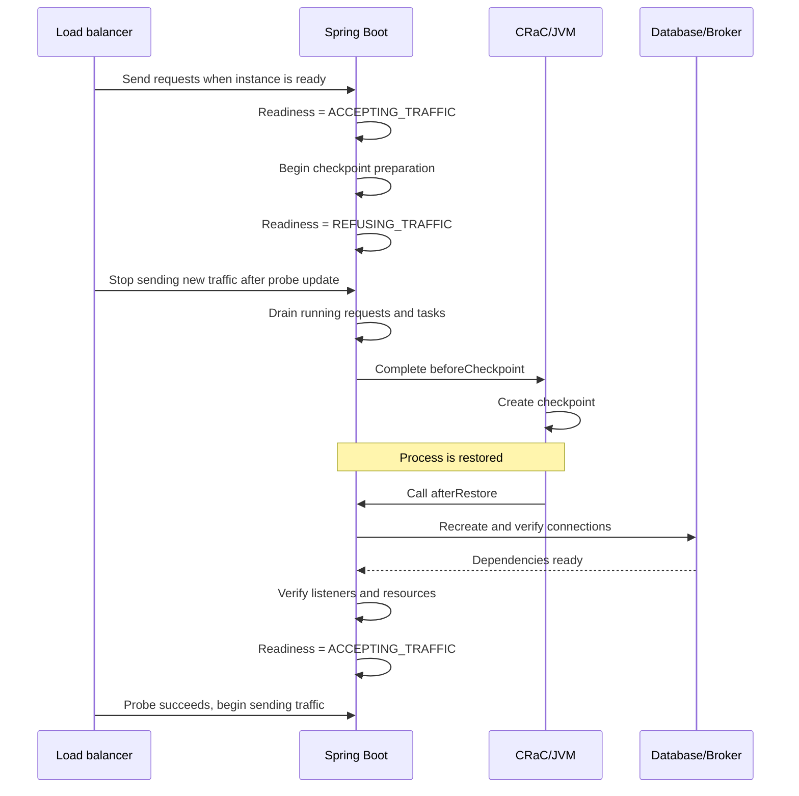

# Readiness, liveness, and when to allow traffic after restore

When a Spring Boot application is restored from a CRaC checkpoint, the process may come back very quickly, but that does not mean the application is ready to accept requests. The database pool may not have reconnected, broker consumers may not have been started, the cache needs a freshness check, or the HTTP listener has not completed the recovery lifecycle. If the load balancer sends traffic as soon as the process appears, requests may reach an instance that is not qualified to serve.

Spring Boot provides a **liveness** and **readiness** model to represent two different states. Liveness indicates whether the process is still running and can continue to operate. Readiness indicates whether the application should accept new traffic. During restore, readiness needs to remain in a traffic-refusing state until mandatory resources have been recovered, verified, and the listener can serve.

The key point is that **process restored does not mean application ready**. The correct timing for transitioning `ReadinessState` to `ACCEPTING_TRAFFIC` must be established, while keeping liveness independent from dependencies that are temporarily not ready.

## 1. Distinguishing liveness and readiness

The two states answer two different operational questions:

| State | Question | Meaning when checked |
| --- | --- | --- |
| Liveness | Is the application still alive and capable of continuing to operate? | If it fails persistently, the platform may need to restart the instance |
| Readiness | Can the instance accept new requests right now? | If it fails, the load balancer or service does not send business traffic to the instance |

An application can be alive but not ready. For example, the JVM has restored successfully but the database has not accepted connections. In this case, liveness can still be healthy while readiness is not ready.

Conversely, if the application falls into an unrecoverable internal state, such as a severe runtime error that prevents the process from continuing to handle work, liveness can transition to an error state so the platform performs a restart according to policy.

The two states should not be merged into a single general health check. If liveness depends directly on the database, a database outage could cause all instances to be restarted simultaneously. This does not fix the database and may even create a restart loop or increase load when the system is recovering.

## 2. Availability states in Spring Boot

Spring Boot represents availability states using types in the `org.springframework.boot.availability` package.

### 2.1. LivenessState

`LivenessState` has two main values:

- `CORRECT`: the application is still capable of operating.
- `BROKEN`: the application is in a state where it cannot continue serving safely and needs to be treated as a liveness failure.

Liveness should reflect the viability of the process and critical internal state. External dependencies such as databases, brokers, or HTTP services should not be included in liveness just because they are temporarily not responding.

### 2.2. ReadinessState

`ReadinessState` has two values:

- `ACCEPTING_TRAFFIC`: the application is ready to accept traffic.
- `REFUSING_TRAFFIC`: the application is not yet ready or is actively refusing traffic.

Before checkpoint, the application should transition readiness to `REFUSING_TRAFFIC` before beginning to drain requests and resources. After restore, readiness continues in a refusing state until all serving conditions have been met.

### 2.3. ApplicationAvailability

`ApplicationAvailability` allows reading the current availability state:

```java
import org.springframework.boot.availability.ApplicationAvailability;
import org.springframework.boot.availability.LivenessState;
import org.springframework.boot.availability.ReadinessState;

public final class AvailabilityReporter {

    private final ApplicationAvailability availability;

    public AvailabilityReporter(ApplicationAvailability availability) {
        this.availability = availability;
    }

    public LivenessState liveness() {
        return availability.getLivenessState();
    }

    public ReadinessState readiness() {
        return availability.getReadinessState();
    }
}
```

`ApplicationAvailability` reflects the availability states that Spring Boot is managing. It does not check all external connections by itself and does not by itself prove that the HTTP listener is ready. Those conditions need to be checked by the application and represented through readiness health indicators or a lifecycle coordinator.

## 3. Spring Boot Actuator health probes

When using Spring Boot Actuator, the application can provide health endpoints dedicated to liveness and readiness:

- `/actuator/health/liveness`
- `/actuator/health/readiness`

In a Kubernetes environment, Spring Boot can auto-configure these health groups when it detects the appropriate environment. If explicit enablement is needed, it can be configured:

```yaml
management:
  endpoint:
    health:
      probes:
        enabled: true
```

When probes are enabled, the liveness health group typically reflects `livenessState`, while readiness reflects `readinessState`. The application can add necessary health indicators to the readiness group according to operational requirements.

Example configuration for readiness that additionally checks the database and an application-provided broker health indicator:

```yaml
management:
  endpoint:
    health:
      probes:
        enabled: true
        add-additional-paths: true
      group:
        readiness:
          include: readinessState,db,broker
```

In this example, `db` is the database health indicator provided by Spring Boot when appropriate configuration exists; `broker` needs to be a health contributor registered by the application or an integrated library. Only include a dependency in readiness if the application truly cannot serve when that dependency is not ready. An optional service or one used only for background tasks may not need to block all HTTP traffic.

The `add-additional-paths` property allows providing additional probe paths on the main server port, typically `/livez` and `/readyz`. This is useful when the management endpoint runs on a separate port: the probe on the management port may be healthy while the port serving business requests has not opened or is not functioning correctly. The actual endpoint configuration of the application needs to be verified.

### 3.1. HTTP status of health groups

Typically, a health group with status `UP` returns HTTP 200; an unhealthy status such as `DOWN` returns a corresponding error code, usually HTTP 503. Kubernetes and load balancers rely on probe results to decide whether to send traffic or restart the container.

Health endpoints need to be protected according to security policy. Do not return detailed information about credentials, internal hostnames, URLs with tokens, or sensitive exceptions to unauthorized clients.

## 4. When to change readiness in the CRaC lifecycle

A lifecycle typically has three critical moments:

1. **Before checkpoint:** actively refuse new traffic, drain requests and background tasks, then close or prepare resources.
2. **During checkpoint and restore:** the instance does not accept business traffic. The readiness state must be considered not ready.
3. **After restore:** recover dependencies and listeners, check serving conditions, and only then allow traffic.



The exact timing of the readiness transition must be tied to the actual lifecycle. Setting readiness to `ACCEPTING_TRAFFIC` as soon as `afterRestore` begins is too early. Setting it after all mandatory resources and listeners are ready creates a reliable signal for the load balancer.

## 5. Setting readiness to REFUSING_TRAFFIC before checkpoint

Spring Boot publishes availability events to change state. `AvailabilityChangeEvent.publish(...)` can be used with `ReadinessState`.

```java
import org.springframework.context.ConfigurableApplicationContext;
import org.springframework.boot.availability.AvailabilityChangeEvent;
import org.springframework.boot.availability.ReadinessState;

public final class ReadinessController {

    private final ConfigurableApplicationContext applicationContext;

    public ReadinessController(
            ConfigurableApplicationContext applicationContext) {
        this.applicationContext = applicationContext;
    }

    public void refuseTraffic() {
        AvailabilityChangeEvent.publish(
                applicationContext,
                ReadinessState.REFUSING_TRAFFIC);
    }

    public void acceptTraffic() {
        AvailabilityChangeEvent.publish(
                applicationContext,
                ReadinessState.ACCEPTING_TRAFFIC);
    }
}
```

Before requesting a JVM checkpoint, the lifecycle coordinator can call `refuseTraffic()`, then wait for the ingress to update and drain requests. The `beforeCheckpoint` callback can re-publish the refusing state as a final safety layer, but should not be relied upon to replace the entire load balancer coordination process.

If the drain fails before resources are closed, the coordinator can restore the serving state by verifying that resources are still operational and only then publishing `ACCEPTING_TRAFFIC`. If some resources have been closed or are no longer reliable, keep readiness at `REFUSING_TRAFFIC` and perform controlled recovery.

## 6. Keeping liveness independent from readiness

During checkpoint preparation, the application actively stops accepting traffic but is still a valid process. Therefore, typically only readiness needs to be transitioned to `REFUSING_TRAFFIC`; liveness should not be transitioned to `BROKEN` just because draining is in progress.

For example:

```java
AvailabilityChangeEvent.publish(
        applicationContext,
        ReadinessState.REFUSING_TRAFFIC);

// Liveness remains CORRECT while the application is draining in a controlled manner.
```

Liveness should transition to `BROKEN` when there is an internal error that prevents the process from continuing to operate safely and restart is the designed recovery method. Do not use `BROKEN` to represent the following situations:

- Database is temporarily unable to connect.
- Broker is not ready after restore.
- Cache is refreshing.
- Instance is draining to prepare for checkpoint.
- Application has not opened the listener or is not accepting traffic.

These situations are typically represented by readiness. If a dependency is temporarily failing, the application can keep readiness at `REFUSING_TRAFFIC`, retry the connection within a deadline, and only report liveness as `BROKEN` when the process truly cannot recover on its own according to the defined policy.

### 6.1. Avoiding restart cascades

Suppose the database is interrupted for a few minutes. If all applications include database health in liveness, Kubernetes may restart all pods simultaneously. The new pods then connect to the database, increasing load on a system that is already failing. Readiness helps stop sending requests to pods that cannot serve while liveness still allows the process to continue retrying and recovering.

Liveness probes should focus on the internal state of the application. Readiness can include mandatory dependencies for serving traffic. This separation is especially useful during the restore phase, when dependencies are recreated in order and may need additional time to be ready.

## 7. Checking dependencies before allowing traffic

After restore, it is not sufficient to only check that an object reference is not `null`. The dependency needs to be verified to actually be capable of performing work.

Example conditions:

- Database pool has been created and can obtain a connection.
- Broker client is connected and has the necessary permissions.
- Cache has been refreshed or confirmed to have a valid version.
- Secrets and tokens have been reloaded, are within their validity period, and have the correct identity.
- Service discovery returns valid endpoints.
- Scheduler or consumer should only be resumed after their dependencies are ready.
- HTTP listener has bound and can accept requests.
- Mandatory background workers are ready or intentionally kept paused.

Not every dependency must be healthy before accepting traffic. Classify by serving capability: if the database is mandatory for all requests, readiness needs to reflect it; if a broker only serves optional background tasks, the consumer can be kept paused while the read API operates.

### 7.1. Custom HealthIndicator for dependencies

Spring Boot Actuator allows adding health indicators. For example:

```java
import org.springframework.boot.actuate.health.Health;
import org.springframework.boot.actuate.health.HealthIndicator;
import org.springframework.stereotype.Component;

@Component("broker")
public final class BrokerHealthIndicator implements HealthIndicator {

    private final BrokerClient brokerClient;

    public BrokerHealthIndicator(BrokerClient brokerClient) {
        this.brokerClient = brokerClient;
    }

    @Override
    public Health health() {
        if (brokerClient.isConnectedAndAuthorized()) {
            return Health.up().build();
        }

        return Health.down()
                .withDetail("reason", "Broker is not ready")
                .build();
    }
}
```

`BrokerClient` is an application abstraction. The check method should have a short timeout and should not create an expensive new connection on each probe. If the health check calls an external service, it needs to avoid having the probe create excessive load or block an HTTP server thread.

A health indicator describes the condition of a dependency; it does not recreate the connection itself. Restoring the client belongs to the resource lifecycle. When the client has been created and verified, the readiness health group can then transition to `UP`.

### 7.2. Readiness based on actual serving capability

It is not necessarily required to wait for all auxiliary components. For example, an application has a catalog read API and a consumer that processes emails. If the email broker is not ready, the catalog read API can still operate. Options include:

- keeping the entire application not ready if the broker is a mandatory dependency for all requests;
- separating readiness groups or routing by capability if the architecture supports it;
- allowing the API to operate while keeping the consumer paused if the broker only serves background tasks;
- representing a degraded state separately for monitoring to observe.

An instance-level readiness probe typically decides traffic for the entire pod. Therefore, if routes have different dependency requirements, the policy must be designed so the probe does not block more traffic than necessary while still not sending requests to a route that cannot serve.

## 8. Integrating readiness with CRaC Resource

A resource can be registered to coordinate readiness state. This resource sets readiness to refuse traffic before checkpoint and only transitions to accepting after recovering the necessary conditions.

```java
import org.crac.Context;
import org.crac.Core;
import org.crac.Resource;
import org.springframework.boot.availability.AvailabilityChangeEvent;
import org.springframework.boot.availability.ReadinessState;
import org.springframework.context.ConfigurableApplicationContext;
import org.springframework.stereotype.Component;

@Component
public final class ReadinessCracResource implements Resource {

    private final ConfigurableApplicationContext applicationContext;
    private final RestoreCoordinator restoreCoordinator;

    public ReadinessCracResource(
            ConfigurableApplicationContext applicationContext,
            RestoreCoordinator restoreCoordinator) {
        this.applicationContext = applicationContext;
        this.restoreCoordinator = restoreCoordinator;
        Core.getGlobalContext().register(this);
    }

    @Override
    public void beforeCheckpoint(Context<? extends Resource> context)
            throws Exception {
        AvailabilityChangeEvent.publish(
                applicationContext,
                ReadinessState.REFUSING_TRAFFIC);

        restoreCoordinator.stopAcceptingNewWorkAndDrain();
    }

    @Override
    public void afterRestore(Context<? extends Resource> context)
            throws Exception {
        try {
            restoreCoordinator.restoreAndVerifyRequiredResources();
            restoreCoordinator.verifyServerCanServe();

            AvailabilityChangeEvent.publish(
                    applicationContext,
                    ReadinessState.ACCEPTING_TRAFFIC);
        } catch (Exception ex) {
            AvailabilityChangeEvent.publish(
                    applicationContext,
                    ReadinessState.REFUSING_TRAFFIC);
            throw ex;
        }
    }
}
```

`RestoreCoordinator` is an internal interface/bean defined by the application. It is responsible for waiting until necessary resources are recovered, verifying the server, and ensuring no mandatory step is still running. This example demonstrates the coordination principle; in an actual Spring Boot application, the Spring Boot version and the CRaC integration mechanism being used need to be checked to avoid duplicate resource registration or repeating listener management that the framework has already handled.

### 8.1. Why is readiness published last?

Suppose the post-restore callback performs these steps:

1. Create the database pool.
2. Verify with a simple query.
3. Create the broker client and authenticate.
4. Refresh the mandatory cache.
5. Start the listener or confirm the listener has bound.
6. Confirm the necessary background components are ready.
7. Publish `ACCEPTING_TRAFFIC`.

If readiness is published at step 1, the load balancer may send requests while the broker or cache is still not ready. Publishing at the end ensures the health probe reflects the overall serving state.

If a step fails, keep readiness at `REFUSING_TRAFFIC`. Retry according to a limited policy; if recovery is not possible, let the lifecycle manager report the error and the platform handle restart or create a new instance.

### 8.2. Avoiding duplicate resource management callbacks

Some frameworks or libraries may register their own CRaC resources to close and recover connection pools, HTTP clients, or servers. If the readiness resource also closes/opens the same objects, the operation may be performed twice or in the wrong order.

There should be a clear owner for each resource. The readiness coordinator primarily coordinates and verifies; specialized resources manage the lifecycle of the resources they own. If multiple callbacks need to be synchronized, use a coordinator with a clear ordering contract and comply with the callback order of the runtime being deployed.

## 9. Kubernetes probes and deployment configuration

Kubernetes uses three commonly encountered probe types:

- `startupProbe`: gives the application time to start up; while the startup probe has not succeeded, liveness and readiness probes are not performed.
- `livenessProbe`: detects containers that need to be restarted.
- `readinessProbe`: decides whether the pod is included in endpoints/services to receive traffic.

Example configuration:

```yaml
containers:
  - name: app
    image: example/my-service:latest
    ports:
      - name: http
        containerPort: 8080
    startupProbe:
      httpGet:
        path: /actuator/health/liveness
        port: http
      periodSeconds: 5
      failureThreshold: 30
    livenessProbe:
      httpGet:
        path: /actuator/health/liveness
        port: http
      periodSeconds: 10
      failureThreshold: 3
    readinessProbe:
      httpGet:
        path: /actuator/health/readiness
        port: http
      periodSeconds: 5
      failureThreshold: 2
```

The timing values and thresholds above are examples only. They need to be tuned according to restore time, dependency reconnection time, drain time, and platform behavior. If restore is very fast, there is no need for an overly large startup allowance; if the restore callback may take a long time, the probe must not cause an unintended restart.

### 9.1. Role of startupProbe

`startupProbe` protects the application from premature liveness restarts during the startup phase. With CRaC workloads, it is necessary to test how the container runtime and orchestrator perceive the process after restore. It should not be assumed that all environments will handle freeze/restore the same way; probe timing, timeout, and failure threshold need to match the deployment process.

The startup probe typically checks the liveness endpoint because it answers whether the application has initialized sufficiently to continue running. Readiness may still be in a traffic-refusing state longer while the application reconnects dependencies.

### 9.2. Readiness probe does not replace the admission gate

Kubernetes takes time to update EndpointSlices and load balancers. During the propagation window, requests may still reach the pod. Therefore, the application should have an internal admission gate to reject new business requests once draining has begun.

The health endpoint must be configured so that probes can still read the state. The administrative endpoint can be separated from the admission filter, or additional probe paths on the main port can be used. The readiness endpoint should not be blocked by the very gate that is reporting not ready.

### 9.3. Management port and application port

If Actuator runs on a separate management port, the readiness probe may succeed even though the application port has not opened or the business listener has not recovered. This creates a false signal for the load balancer.

`management.endpoint.health.probes.add-additional-paths=true` can be used to expose `/livez` and `/readyz` on the main server port. Verify that this endpoint actually goes through the listener that clients will use and does not only check an independent management server.

## 10. Error handling after restore

Not all errors after restore have the same handling approach.

| Situation | Readiness | Liveness | Action |
| --- | --- | --- | --- |
| Database is restarting | `REFUSING_TRAFFIC` if database is mandatory | Usually still `CORRECT` | Retry connection within deadline, continue not ready |
| Broker not connected but API still serves independently | Can be accepting for API; keep consumer paused | `CORRECT` | Recover broker separately and monitor degraded state |
| Mandatory cache not refreshed | `REFUSING_TRAFFIC` | `CORRECT` | Refresh and verify before accepting requests that depend on the cache |
| HTTP listener not bound | `REFUSING_TRAFFIC` | Depends on process state | Recover listener, check port and server lifecycle |
| Unrecoverable configuration error | `REFUSING_TRAFFIC` | May be `BROKEN` if the process cannot continue | Report error for the platform to replace instance or restart |
| An optional resource fails | Based on actual serving capability | Usually `CORRECT` | Degrade the related feature, not necessarily blocking the entire app |

If `afterRestore` throws an exception, readiness should not have been published as accepting before that point. Whether the exception leads to process exit, retry, or restart depends on the runtime and lifecycle manager; the application needs a clear policy. Exceptions should not be caught and ignored to let the process continue reporting ready.

## 11. Order of readiness, listeners, and background components

Readiness is a composite signal. It needs to be decided which components must be ready before opening traffic.

A commonly used order:

| Phase | Component | Desired state |
| --- | --- | --- |
| Restore begins | Readiness | `REFUSING_TRAFFIC` |
| Dependency recovery | Database, broker, mandatory cache | Reconnecting/verifying |
| Runtime recovery | Executor and scheduler | Created but not yet accepting jobs |
| Server recovery | HTTP listener | Bound and able to accept connections |
| Final check | Health indicators | All mandatory conditions `UP` |
| Open serving | Admission gate | Allow new requests |
| Complete | Readiness | `ACCEPTING_TRAFFIC` |

It is not necessary to resume all background components before accepting traffic. For example, a scheduler running nightly reports can be started after the API is ready. Conversely, if requests need a synchronous broker client, the broker must be ready before readiness is set to accepting.

If readiness and the admission gate are opened by two different components, ensure the order does not create a window where the load balancer sends requests while the gate is still closed. A safe sequence is typically to recover resources, verify listeners, open the internal gate, then publish readiness accepting. If the framework automatically changes readiness during startup, coordination is needed or the state must be overridden at the appropriate lifecycle point to prevent a premature accepting event.

## 12. Multiple restores from the same checkpoint

A checkpoint can be used to create multiple instances. Each instance needs to perform an independent readiness procedure:

- Create its own instance identity.
- Reconnect dependencies using the current configuration.
- Obtain leases or leader rights if needed.
- Recover consumer group or partition assignment.
- Verify cache and credentials.
- Only publish accepting when that specific instance is ready.

A `ready=true` flag should not be saved before checkpoint and kept after restore. That flag only reflects the state of the process at the time the image was created, not the dependencies and ownership at the current time.

If multiple instances restore simultaneously, the database and broker may receive a large burst of connections. Consider retry with exponential backoff and jitter, limit connection pools, stagger the timing of opening readiness, and use leader/lease mechanisms if only one instance should run certain background tasks.

## 13. Observing readiness and restore-to-ready time

To evaluate the process, do not only measure JVM restore time. The entire duration from when restore begins to when the instance actually accepts traffic needs to be measured.

Useful metrics:

- Timestamp when restore begins and when the `afterRestore` callback starts/ends.
- Timestamp when database, broker, and cache start/complete recovery.
- Time to bind the listener and verify the server.
- Liveness and readiness state over time.
- Number of requests rejected during the admission-closed period.
- Number of readiness transitions between refusing and accepting.
- Number of restore retries or failures.
- Time from restore to readiness accepting.
- Time from readiness accepting to the first successful request.

Do not log credentials, connection strings with secrets, or business payloads. Instance ID, resource name, and correlation ID can be used to link lifecycle events.

### 13.1. Scenarios to test

| Scenario | Expected result |
| --- | --- |
| Begin drain before checkpoint | Readiness transitions to refusing before stopping traffic |
| Request arrives during propagation time | Admission gate rejects new requests |
| Restore completes but database is not ready | Readiness remains refusing; liveness remains correct if the process is healthy |
| Optional broker not ready | Only the broker-dependent feature is held back if the architecture allows |
| Listener not bound | Readiness is not accepting |
| All mandatory resources recovered | Readiness transitions to accepting at the end |
| `afterRestore` fails | Accepting is not published; error is propagated to lifecycle manager |
| Management port healthy but app port has errors | Probe must detect the actual serving listener state |
| Multiple instances restore from the same image | Each instance has its own readiness and identity |
| Liveness probe runs while readiness is refusing | Instance is not restarted just because it is intentionally draining |

An end-to-end test should create a checkpoint, restore the instance in a compatible environment, delay the database or broker in a controlled manner, and then observe readiness. Confirm that the load balancer does not send business traffic until mandatory dependencies and the listener are ready.

## 14. Common mistakes

| Mistake | Consequence | Remedy |
| --- | --- | --- |
| Publish `ACCEPTING_TRAFFIC` at the beginning of `afterRestore` | Requests arrive when resources are not ready | Only publish after restore and verification are complete |
| Use database as a liveness indicator | Restart cascade when database fails | Include mandatory dependency in readiness |
| Only change readiness, do not drain requests | Running requests may be interrupted when resources are closed | Drain in-flight requests before closing resources |
| No admission gate | Requests may still arrive during propagation time | Block new requests at the application |
| Readiness endpoint blocked by admission | Orchestrator cannot read the state | Separate health endpoint from business filter |
| Probe on a separate management port | Probe is healthy even though business listener is not ready | Probe on the main port or verify both listeners |
| Keep `ready=true` in checkpoint | New instance inherits the old state | Initialize readiness to refusing state in the restore lifecycle |
| Resume consumer before dependencies are ready | Message processing errors or burst retries | Start consumer after broker and dependencies are ready |
| Swallow exceptions in callbacks | Application may falsely report ready | Keep refusing and propagate the error |
| Liveness timeout too short | Process is restarted while restore is in progress | Tune startup/liveness probe to actual timing |
| Duplicate resource registration | Listener or client opened/closed multiple times | One owner per lifecycle resource |

## 15. Reference deployment process

A process that can be applied for Spring Boot running CRaC:

### Before checkpoint

1. Lifecycle manager requests the instance to stop accepting new traffic.
2. Publish `ReadinessState.REFUSING_TRAFFIC`.
3. Wait for load balancer/ingress to update state.
4. Close the internal admission gate.
5. Drain HTTP requests and background tasks.
6. Close or pause resources that need refreshing via the `beforeCheckpoint` callback.
7. Confirm no business operations are still using resources.
8. Let the JVM create the checkpoint.

### After restore

1. Keep readiness at `REFUSING_TRAFFIC`.
2. Recover database, broker, cache, credentials, and network clients.
3. Recreate executors, schedulers, and instance-specific resources.
4. Verify the listener on the actual serving port.
5. Start the components necessary for traffic.
6. Open the admission gate.
7. Publish `ReadinessState.ACCEPTING_TRAFFIC`.
8. Confirm the health probe succeeds and the first request is processed normally.

Liveness continues to reflect the health of the process throughout the entire procedure. Only transition to `BROKEN` when there is an unrecoverable internal error according to policy, not simply because the instance is refusing traffic.

## 16. Conclusion

In Spring Boot, liveness and readiness are two different signals. Liveness reflects the ability of the process to continue operating; readiness reflects the ability to accept traffic at the current moment. When preparing for checkpoint, the application actively transitions readiness to `REFUSING_TRAFFIC`, drains running requests and tasks, and only then closes resources. After restore, readiness continues to refuse traffic until dependencies, listeners, and mandatory components have been recovered and verified.

Only publish `ReadinessState.ACCEPTING_TRAFFIC` at the final step of the restore lifecycle. Keep liveness independent from temporary dependencies, configure health probes correctly for the actual serving port, and test restore-to-ready end-to-end. This way, the load balancer only sends requests when the instance can truly serve, even when a checkpoint is used to create multiple replicas.
