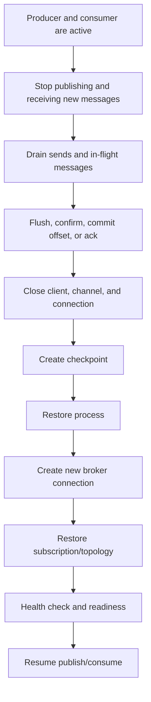

# Kafka, RabbitMQ, and producer or consumer lifecycle

Kafka and RabbitMQ are two popular messaging systems, but their producers, consumers, and connections have different lifecycles. When a Java application uses CRaC, a checkpoint saves the process state; it does not guarantee that the broker still preserves sockets, sessions, channels, assignments, or message acknowledgment state while the process is paused.

A `KafkaProducer`, `KafkaConsumer`, RabbitMQ `Connection`, or `Channel` object may still be referenced in the heap after restore, but that does not prove the connection to the broker is still valid. The broker, load balancer, or network may have closed the session. The consumer group may have rebalanced, leases may have expired, and unacknowledged messages may have been redelivered.

Therefore, the application must explicitly manage the messaging lifecycle across the checkpoint boundary: stop accepting new work, complete or save progress of running work, acknowledge processed messages at the right time, flush producer data, close clients, and recreate connections after restore. This design must preserve the broker's delivery semantics, prevent message loss, and handle message redelivery.

## 1. Distinguishing in-process state from broker-managed state

A messaging client has multiple layers of state:

- **Java objects:** producer, consumer, connection factory, channel, listener, callback, and configuration.
- **Transport:** TCP socket, TLS session, heartbeat, and network buffers.
- **Protocol:** Kafka requests/responses, consumer group membership, partition assignment, RabbitMQ channel, and consumer tag.
- **Delivery state:** sent records, publisher confirms, committed offsets, delivery tags, acknowledgments, and messages being processed.
- **Application state:** subscriptions, routing, retries, outbox, idempotency keys, and business progress.

A checkpoint can save the process memory state, but broker state is managed independently. During the checkpoint period, the broker continues handling timeouts, rebalances, redeliveries, and retention. Do not infer broker state from a field in the heap.

| Component | Example | What to verify after restore |
|---|---|---|
| Producer object | `KafkaProducer`, RabbitMQ publisher wrapper | Is the client still open or closed? Does a new instance need to be created? |
| Consumer object | `KafkaConsumer`, RabbitMQ consumer | Are membership, channel, and consumer registration still effective? |
| Transport | Socket, TLS connection | Does the peer still keep the connection? |
| Producer delivery | Send future, confirm, transaction | Has the broker received/committed the message? |
| Consumer progress | Kafka offset, RabbitMQ delivery tag | What progress has been durably committed/acked? |
| Topology | Kafka topic, Rabbit exchange/queue/binding | Is re-subscribing or re-declaring needed after restore? |

## 2. General lifecycle across checkpoint/restore

A messaging workflow typically includes the following phases:

1. **Quiesce:** stop accepting new publish requests and stop fetching new messages.
2. **Drain producer:** wait for already-accepted sends to finish per policy; flush and handle confirm results.
3. **Drain consumer:** complete in-flight messages, commit offsets or acknowledge only after business logic has committed.
4. **Close:** close producer, consumer, channel, and connection via client APIs.
5. **Checkpoint:** create the image once no incomplete messaging work remains in components that must be closed.
6. **Restore:** restore the process and application structures.
7. **Reconnect:** create new clients/connections, re-authenticate, and restore current configuration.
8. **Resume:** Kafka consumer joins the group and receives new assignments; RabbitMQ consumer re-registers queues and consumers.
9. **Readiness:** accept traffic or new work only once connections and messaging state are ready.



This is a conceptual sequence. Exact details depend on the Kafka client version, RabbitMQ Java client version, framework, and CRaC integration. If the library already has CRaC integration or manages recovery itself, choose a single lifecycle owner to avoid closing/opening resources twice.

## 3. Kafka producer: flush and close before checkpoint

`KafkaProducer` is a thread-safe client and typically has a background sender thread along with buffers to send records to the broker. Calling `send()` usually returns a `Future` immediately while network transmission occurs asynchronously. Thus, merely stopping calls to `send()` does not mean all records have been confirmed by the broker.

Before checkpoint, the producer must:

- Stop accepting new publish commands from requests, schedulers, or other consumers.
- Wait for threads creating records and calling `send()` to finish.
- Monitor callbacks or futures to detect failed sends.
- Call `flush()` to wait for sent records to complete according to client semantics.
- For transactional producers, complete or abort transactions according to business decisions before the checkpoint.
- Close the producer with an appropriate timeout to release threads and sockets.

`flush()` waits for pending send requests to finish, but does not automatically turn an open Kafka transaction into a committed transaction. If transactions are used, the application must call `commitTransaction()` or `abortTransaction()` according to business state. Do not commit a transaction merely to checkpoint if business data is not ready.

### Example managing a producer

```java
import org.apache.kafka.clients.producer.KafkaProducer;
import org.apache.kafka.clients.producer.ProducerRecord;
import org.crac.Context;
import org.crac.Core;
import org.crac.Resource;

import java.time.Duration;
import java.util.concurrent.atomic.AtomicReference;

public final class KafkaProducerResource implements Resource {

    private final ProducerFactory factory;
    private final AtomicReference<KafkaProducer<String, String>> current =
            new AtomicReference<>();
    private volatile boolean accepting = true;

    public KafkaProducerResource(ProducerFactory factory) {
        this.factory = factory;
        current.set(factory.create());
        Core.getGlobalContext().register(this);
    }

    public void send(ProducerRecord<String, String> record) {
        if (!accepting) {
            throw new IllegalStateException("Producer is quiescing");
        }
        KafkaProducer<String, String> producer = current.get();
        if (producer == null) {
            throw new IllegalStateException("Producer is not available");
        }
        producer.send(record, (metadata, exception) -> {
            if (exception != null) {
                recordPublishFailure(record, exception);
            }
        });
    }

    @Override
    public void beforeCheckpoint(Context<? extends Resource> context) {
        accepting = false;
        awaitPublishersToDrain();

        KafkaProducer<String, String> producer = current.getAndSet(null);
        if (producer != null) {
            producer.flush();
            producer.close(Duration.ofSeconds(10));
        }
    }

    @Override
    public void afterRestore(Context<? extends Resource> context) {
        current.set(factory.create());
        accepting = true;
    }

    private void awaitPublishersToDrain() { /* application coordinates and waits for producer callers */ }
    private void recordPublishFailure(ProducerRecord<String, String> record,
                                      Exception exception) { /* record failure */ }
}
```

`ProducerFactory`, `awaitPublishersToDrain()`, and `recordPublishFailure()` are illustrative application-defined components. Real code must synchronize checking `accepting` with acquiring the producer to avoid a race condition: a thread could pass the check and then call `send()` just as the callback closes the producer. A gate/read-write lock or admission control mechanism can stop new callers and wait for current callers to finish before flushing.

`KafkaProducer.close(Duration)` exists in modern Kafka client versions; verify the API of the version in use. Do not keep a closed producer to use after restore. Create a new instance from the factory and load current endpoints, credentials, and configuration.

### Idempotence and transactions

Kafka producers can be configured with idempotence to reduce duplicates caused by retries within the semantics Kafka supports. However, idempotence does not replace business-level idempotency when the application re-emits an event after restore or when a message is generated twice in two different processes.

With a transactional producer:

- Do not checkpoint in the middle of an open transaction before deciding to commit or abort.
- Clearly determine which records have been committed and which must be re-emitted.
- Do not copy an exclusive `transactional.id` across multiple simultaneously restored processes. Another producer using the same transactional ID can fence the previous producer; identity and ownership must be designed to match the deployment model.
- Use an outbox or durable source if you need to guarantee an event is emitted after a business transaction commits.

## 4. Kafka consumer: handling offsets and in-flight messages

`KafkaConsumer` is not thread-safe. A single thread should own `poll`, `pause`, `resume`, `commit`, and `close` operations. An important exception is `wakeup()`, which is designed for another thread to wake up the thread calling `poll`.

Before checkpoint, the consumer must stop fetching new records, finish or safely stop processing current records, and commit offsets at the right time. With at-least-once processing, a common principle is to commit offsets only after business logic has been processed successfully. If committed before processing completes, restore may cause messages to be skipped. If processing finishes without committing, messages may be redelivered; handlers must be idempotent.

If the application manages offsets itself, disable auto commit to prevent the client from committing progress while a handler is still processing:

```java
Properties properties = new Properties();
properties.put(ConsumerConfig.ENABLE_AUTO_COMMIT_CONFIG, "false");
properties.put(ConsumerConfig.GROUP_ID_CONFIG, "orders-worker");
```

This is supplementary configuration for `KafkaConsumer`; bootstrap servers, deserializers, and security properties are omitted. If auto commit is used, understand the exact commit timing under client configuration and accept the corresponding semantics. For processing requiring precise progress control across checkpoints, manual commits are usually easier to coordinate.

### Sequence for stopping a consumer

1. Set quiescing state so no new work is accepted from the application.
2. Send `wakeup()` to break out of `poll()` if the consumer thread is waiting.
3. On the thread owning the consumer, stop further polling and complete the current batch according to policy.
4. Wait for already-submitted asynchronous handlers to finish.
5. Commit the highest contiguous successfully processed offset for each partition.
6. Close the consumer with a timeout.
7. After restore, create a new consumer, resubscribe, and wait for rebalance/assignment.

Do not commit an offset merely because a record was polled or submitted to an executor. Offset commits should reflect completed processing progress. If records within the same partition are processed in parallel, track completion order so you do not commit past an unfinished earlier record.

### Example stoppable consumer loop

```java
import org.apache.kafka.clients.consumer.ConsumerRecord;
import org.apache.kafka.clients.consumer.ConsumerRecords;
import org.apache.kafka.clients.consumer.KafkaConsumer;
import org.apache.kafka.common.errors.WakeupException;

import java.time.Duration;
import java.util.concurrent.atomic.AtomicBoolean;

public final class KafkaConsumerLoop implements Runnable {

    private final KafkaConsumer<String, String> consumer;
    private final AtomicBoolean running = new AtomicBoolean(true);

    public KafkaConsumerLoop(KafkaConsumer<String, String> consumer) {
        this.consumer = consumer;
    }

    public void requestStop() {
        running.set(false);
        consumer.wakeup();
    }

    @Override
    public void run() {
        try {
            while (running.get()) {
                ConsumerRecords<String, String> records =
                        consumer.poll(Duration.ofMillis(500));

                for (ConsumerRecord<String, String> record : records) {
                    processAndCommitProgress(record);
                }
            }

            consumer.commitSync();
        } catch (WakeupException exception) {
            if (running.get()) {
                throw exception;
            }
            // Intentional stop: complete received work and commit progress.
            consumer.commitSync();
        } finally {
            consumer.close(Duration.ofSeconds(10));
        }
    }

    private void processAndCommitProgress(ConsumerRecord<String, String> record) {
        // Mark progress only after business processing succeeds.
    }
}
```

This is a simplified example illustrating how `wakeup()` wakes the `poll` loop. `requestStop()` must be called from the coordinating thread; commit and close operations are still performed by the thread owning the consumer. In real code, parallel processing must be coordinated, offsets committed per partition, and `processAndCommitProgress()` must not commit per record in a way that advances past an unfinished earlier record.

A CRaC resource can call `requestStop()` and wait for the consumer thread to finish via a latch or future before the checkpoint proceeds. If the thread does not stop within the timeout, the callback should report an error instead of checkpointing while the consumer is still interacting with the broker.

### Rebalance after restore

The new consumer must rejoin the consumer group. The Kafka coordinator may assign partitions differently from the previous run. Do not assume an in-memory partition assignment is the current assignment. Use rebalance callbacks to handle assigned/revoked partitions, commit appropriate progress, and begin processing only once the new assignment is ready.

`group.id` usually stays stable so replicas join the same consumer group. However, static membership settings like `group.instance.id` must be unique per active member. If multiple restored instances carry the same static member ID, they may conflict or fence each other. Assign appropriate identities to each instance or use dynamic membership by design.

## 5. RabbitMQ producer: publisher confirms before closing channel

The RabbitMQ Java client typically uses a `Connection` to connect to the broker and a `Channel` to perform publish/consume operations. One connection can have multiple channels. Channels should not be shared arbitrarily across multiple threads; follow the concurrency contract of your client version and application model.

Publishers must distinguish three states:

- The message has been passed by the application into a `basicPublish()` call.
- The broker has received the message and can acknowledge via publisher confirms.
- The message has been routed to the intended queue; with `mandatory`, the application must also handle returned messages if unroutable.

`basicPublish()` returning does not mean the broker has stored the message. To confirm broker receipt, enable publisher confirms with `confirmSelect()` and wait for confirms before closing the channel.

### Publisher confirms example

```java
import com.rabbitmq.client.Channel;
import java.io.IOException;
import java.util.concurrent.TimeoutException;

public final class RabbitPublisher {

    private final Channel channel;

    public RabbitPublisher(Channel channel) throws IOException {
        this.channel = channel;
        this.channel.confirmSelect();
    }

    public void publish(String exchange,
                        String routingKey,
                        byte[] body)
            throws IOException {
        channel.basicPublish(exchange, routingKey, body);
    }

    public void flushAndConfirm()
            throws IOException, TimeoutException, InterruptedException {
        channel.waitForConfirmsOrDie(10_000);
    }
}
```

This example uses the synchronous publisher confirm API to clearly show the confirmation boundary. For high throughput, asynchronous confirm listeners can be used while tracking sequence numbers of each publish. Before a checkpoint, stop new publishes, wait for all pending confirms, and handle nacks/returns. If a confirm does not arrive within the timeout, keep unconfirmed messages in an outbox or durable queue so they can be resent.

Publisher confirms validate that the broker received the publish per protocol, but do not automatically prove a consumer has processed the message. To prevent message loss on broker restart, configure appropriate exchanges/queues, persistent messages, and corresponding durability policies. Also understand that publisher confirms and routing returns are two separate signals.

## 6. RabbitMQ consumer: cancel, drain, and acknowledge

RabbitMQ consumers typically register with `basicConsume()` and receive deliveries via callbacks. With manual acknowledgement, the application calls `basicAck()` after successful processing. If a connection/channel closes while a delivery is unacked, the broker can typically requeue the message for redelivery; exact behavior also depends on whether the ack had reached the broker.

Before checkpoint:

1. Stop accepting new work from the application.
2. Call `basicCancel(consumerTag)` to cancel the consumer registration and stop receiving new deliveries on that consumer.
3. Wait for running callbacks/handlers to complete.
4. Ack successfully processed messages; nack/requeue or store progress for incomplete messages per policy.
5. Close the channel and connection.

Do not ack a message before business side effects have committed. If acked beforehand and a checkpoint happens before the database update finishes, the message may be removed from the queue while business state was not recorded. If the database commits but the ack never reaches the broker, the message may be redelivered; consumers need idempotency to handle redeliveries.

### Delivery tags are not durable identifiers

RabbitMQ delivery tags are scoped per channel. After closing a channel and creating a new channel, do not use an old delivery tag to ack on the new channel. Process/ack deliveries before closing the channel, or let the broker redeliver the message and handle it as a new delivery.

If using `multiple=true` in `basicAck`, ensure every delivery with a tag less than or equal to the acked tag has finished. With concurrent handlers, batch acking can mistakenly acknowledge an unfinished message. Completion order and status must be tracked explicitly.

### Consumer cancellation example

```java
import com.rabbitmq.client.Channel;
import java.io.IOException;
import java.util.concurrent.TimeoutException;

public final class RabbitConsumerLifecycle {

    private final Channel channel;
    private final String consumerTag;

    public RabbitConsumerLifecycle(Channel channel, String consumerTag) {
        this.channel = channel;
        this.consumerTag = consumerTag;
    }

    public void stopBeforeCheckpoint() throws IOException, TimeoutException {
        channel.basicCancel(consumerTag);
        awaitInFlightHandlers();
        // Handlers have acked/nacked deliveries according to business outcome.
        channel.close();
    }

    private void awaitInFlightHandlers() {
        // Application waits for callbacks and executors to finish within a bounded timeout.
    }
}
```

`awaitInFlightHandlers()` is application-level coordination. `basicCancel()` does not automatically wait for all asynchronous handlers submitted by the application to an executor to finish. Track accepted work and wait for completion before closing the channel. On timeout, do not checkpoint while callbacks could still use the channel or mutate business state.

## 7. Recreating RabbitMQ connections, channels, and consumers after restore

After restore, create a new connection using `ConnectionFactory`, then create new channels. Restore required settings and registrations:

- Current authentication and TLS configuration.
- Exchanges, queues, and bindings if the application owns topology and must re-declare them.
- QoS/prefetch via `basicQos()`.
- Publisher confirms via `confirmSelect()` if the producer requires confirmation.
- Consumer callbacks via `basicConsume()`.
- Listeners handling shutdown, recovery, and connection errors.

Structural example:

```java
import com.rabbitmq.client.Channel;
import com.rabbitmq.client.Connection;
import com.rabbitmq.client.ConnectionFactory;

public final class RabbitClientFactory {

    private final ConnectionFactory connectionFactory;

    public RabbitClientFactory(ConnectionFactory connectionFactory) {
        this.connectionFactory = connectionFactory;
    }

    public RabbitResources open() throws Exception {
        Connection connection = connectionFactory.newConnection();
        try {
            Channel channel = connection.createChannel();
            channel.exchangeDeclare("orders", "topic", true);
            channel.queueDeclare("orders.worker", true, false, false, null);
            channel.queueBind("orders.worker", "orders", "order.*");
            channel.basicQos(20);
            return new RabbitResources(connection, channel);
        } catch (Exception failure) {
            connection.close();
            throw failure;
        }
    }
}

record RabbitResources(Connection connection, Channel channel) { }
```

Exchange names, queue names, routing keys, and QoS in the example are illustrative only. Topology declarations must match existing configuration on the broker; re-declaring with different attributes can cause `PRECONDITION_FAILED` errors. If topology is managed by deployment or infrastructure-as-code, the application must adhere to that ownership.

Exclusive or auto-delete queues whose lifecycles are tied to a connection/consumer may disappear when the connection closes. After restore, the application needs to create new queues and bindings if the design requires them. Do not assume all queues persist after the old connection closes.

## 8. Automatic recovery does not replace CRaC management

The RabbitMQ Java client can be configured with automatic connection recovery and topology recovery to reconnect after a network failure. Kafka clients also have reconnect, retry, and consumer group rejoin mechanisms. These mechanisms are useful during network interruptions in a running process.

However, checkpoint/restore introduces a distinct lifecycle boundary: the process may stop running longer than heartbeat/connection timeouts; client objects are restored from the heap; recovery threads, timers, and sockets may have states unsuitable for the new environment. Automatic recovery does not guarantee that all application state, transactions, offsets, or in-progress callbacks are properly restored.

Define a clear strategy:

- Use the library's CRaC integration if the version supports it and documentation confirms usage.
- Or proactively quiesce/close in `beforeCheckpoint()` and create new clients in `afterRestore()`.
- If automatic recovery remains enabled, coordinate it with lifecycle callbacks so the two mechanisms do not simultaneously open connections or register duplicate consumers.

Do not allow a recovery thread to reconnect on its own while also creating a new connection in callbacks without synchronization. That can produce multiple connections, consumers, or channels for the same component.

## 9. Delivery semantics: at-most-once, at-least-once, and duplicate handling

Checkpointing does not provide exactly-once processing on its own. Outcomes depend on when messages are sent, broker confirmations, business commits, and consumer ack/offset recordings.

| Model | Risk across checkpoint | Risk mitigation |
|---|---|---|
| At-most-once | Committing/acking before processing may lose messages if the process stops mid-way | Use only when message loss is acceptable or business work can be regenerated |
| At-least-once | Completing processing without committing/acking may cause redelivery | Idempotent consumers, deduplication keys, and properly timed commits |
| Broker-scoped exactly-once | May offer transactions or broker-specific mechanisms, but does not automatically cover side effects outside the broker | Use transaction/offset integration per semantics and understand limitations |
| Business-level exactly-once | Requires synchronizing database state, messages, and side effects | Outbox/inbox, transactions, idempotency, and workflow design |

### Kafka scenario example

A consumer receives a record at offset 42, updates the database successfully, and then checkpoints before committing the offset. After restore, Kafka may redeliver record 42. If the handler is not idempotent, the database may be updated a second time.

If the consumer commits offset 43 before updating the database, and a checkpoint occurs before the database transaction commits, Kafka may not redeliver record 42 even though business work was not persisted. This creates a risk of lost processing.

For critical processing, commit offsets after side effects have committed and use appropriate idempotency keys or transactions. If coordinating a database with Kafka is needed, consider transactional outbox/inbox or a retryable processing model.

### RabbitMQ scenario example

A consumer receives delivery tag 7, writes to the database successfully, but has not sent `basicAck(7, false)` before the checkpoint. When the channel closes, the broker may redeliver the message. The consumer needs to recognize already-processed message IDs or use transactions/inbox tables to prevent repeating side effects.

If the ack is sent before the database commits, the broker may remove the message from the queue and then the process is checkpointed before the database finishes writing. The message will no longer be redelivered even though the business operation did not complete.

## 10. Integrating lifecycle with CRaC Resource

A component managing messaging can register `org.crac.Resource`. The pre-checkpoint callback quiesces producers/consumers, drains work, and closes clients. The post-restore callback creates new clients and restores subscriptions.

```java
import org.crac.Context;
import org.crac.Core;
import org.crac.Resource;

public final class MessagingResource implements Resource {

    private final MessagingClientFactory factory;
    private MessagingClients clients;

    public MessagingResource(MessagingClientFactory factory) throws Exception {
        this.factory = factory;
        this.clients = factory.openInitialClients();
        Core.getGlobalContext().register(this);
    }

    @Override
    public void beforeCheckpoint(Context<? extends Resource> context)
            throws Exception {
        clients.stopAcceptingNewWork();
        clients.drainPublishersAndConsumers();
        clients.flushAndCommitAcknowledgedProgress();
        clients.close();
        clients = null;
    }

    @Override
    public void afterRestore(Context<? extends Resource> context)
            throws Exception {
        MessagingClients restored = factory.openNewClients();
        try {
            restored.verifyConnections();
            restored.restoreSubscriptionsAndTopology();
            clients = restored;
            clients.resumeWork();
        } catch (Exception failure) {
            restored.close();
            throw failure;
        }
    }
}
```

`MessagingClientFactory` and `MessagingClients` are application abstractions, not standard Kafka/RabbitMQ APIs. The `drainPublishersAndConsumers()` and `flushAndCommitAcknowledgedProgress()` steps must be implemented per broker because Kafka offsets and RabbitMQ acknowledgments have different semantics. Do not use a generic operation to commit/ack without knowing which messages are actually complete.

If `afterRestore()` cannot connect to the broker, the callback must report an error and keep the application unready. Retries with backoff can be implemented in a lifecycle coordinator, but do not mark readiness true when required consumers/publishers are not operational. Set timeouts on connect, drain, and close so callbacks do not hang indefinitely.

## 11. Multiple restores from the same checkpoint

One checkpoint can spawn multiple replicas. Copies may start with identical consumer configurations, producers, transaction IDs, subscriptions, and heap state. Exclusive identities or ownership must not be duplicated.

For Kafka:

- Consumers with the same `group.id` can join the same group; the coordinator distributes partitions according to current membership.
- Static member IDs must be unique per active member.
- `transactional.id` must be designed not to accidentally fence another active producer.
- Each replica must create a new client and join the group/rebalance after restore.

For RabbitMQ:

- Each new connection/channel is a separate session.
- Multiple consumers on the same queue typically compete for messages; prefetch and consumer count determine how many messages are distributed.
- Exclusive queues tied to an old connection may cease to exist after closing.
- Old consumer tags, delivery tags, and channel states are not reusable identifiers on a new channel.
- If an exclusive consumer is required, use an external lock/lease mechanism or appropriate queue configuration.

Replicas need fresh instance identities if clients or topology require distinct identifiers. Using the same checkpoint does not mean copies should share a single transaction ID, static member ID, connection, or channel.

## 12. Backpressure, prefetch, and load limiting on reconnect

After restore, many consumers may connect simultaneously and begin receiving messages. If all immediately apply large prefetch settings or spawn many workers, the database and downstream services may become overloaded.

Consider:

- Keeping prefetch aligned with worker count and actual processing capacity.
- Starting consumers in batches or with jittered delays if multiple replicas restore simultaneously.
- Not receiving new messages before the database and downstream dependencies are ready.
- Bounding internal queues so messages do not accumulate indefinitely in the heap.
- Using backpressure and bounded retries.
- Avoiding having multiple replicas simultaneously execute a large initialization or replay task.

Kafka consumers can use `pause()` on partitions while continuing to `poll()` to maintain membership, but when preparing for a checkpoint, the poll loop must be stopped and the consumer closed per lifecycle. RabbitMQ has `basicQos()` to limit unacked deliveries. These two mechanisms are not identical; configure them according to each broker's processing model.

## 13. Readiness and health checks

An application may have restored its JVM without yet connecting to Kafka or RabbitMQ. Readiness should reflect real work-processing capability.

Conditions typically needing confirmation:

- Producers are created and can publish/confirm per policy.
- Consumers have subscribed or joined the group and hold appropriate assignments/consumer registrations.
- Required RabbitMQ topology exists or was declared successfully.
- Current credentials and TLS configuration are valid.
- Messages being processed before the checkpoint were drained or can be safely redelivered.
- Required database/downstream dependencies are ready.

Liveness and readiness should be separated. A broker temporarily unavailable can set readiness false while the process remains alive and retries. If a liveness probe repeatedly restarts a process that has not yet connected to the broker, the system may create a reconnect storm.

## 14. Observing the messaging lifecycle

Log clear lifecycle milestones:

- `messaging-quiesce-start`
- `producer-drain-start` and `producer-flush-complete`
- `consumer-stop-start` and `consumer-drain-complete`
- `offset-commit` or `message-ack`
- `channel-close` / `connection-close`
- `afterRestore-start`
- `broker-reconnect-complete`
- `consumer-assignment-ready` or `rabbit-consumer-registered`
- `messaging-readiness-ready`

Useful metrics:

| Metric | Meaning |
|---|---|
| Producer pending sends | Number of unfinished sends before flushing |
| Publish failures/nacks/returns | Messages that failed to send or were unroutable |
| Consumer lag | Gap between latest offset and committed offset |
| Records/messages in flight | Work received but not yet finished/acked |
| Rebalance count/duration | Frequency/duration of Kafka group membership changes |
| Rabbit unacked messages | Number of unacknowledged deliveries |
| Connection/channel count | Number of open broker sessions per instance |
| Reconnect attempts and latency | Time and attempts for client recovery |
| Restore-to-messaging-ready | Time from restore until messaging is active |

Attach sanitized instance ID, client role, and group/queue names. Do not log private payloads, tokens, or credentials. When multiple replicas restore simultaneously, per-instance metrics help identify connection bursts, rebalances, or redeliveries.

## 15. Testing checkpoint/restore scenarios

Do not test only when producers/consumers are idle. Test the boundaries between publishing, confirmation, processing, and acknowledgement.

Scenarios to include:

1. Checkpoint when the Kafka producer has no pending records.
2. Checkpoint when the Kafka producer has sends awaiting confirmation.
3. Checkpoint while a Kafka consumer is processing a batch.
4. Checkpoint after business work commits but before the Kafka offset commits.
5. Checkpoint when a RabbitMQ publisher has pending confirms.
6. Checkpoint when a RabbitMQ consumer has unacked deliveries.
7. Restore after the broker has closed connections due to heartbeat/idle timeout.
8. Restore when the Kafka consumer group has rebalanced.
9. Restore when old RabbitMQ queues/channels/connections no longer exist.
10. Restore multiple replicas from the same image and check for duplicate consumer/transaction identities.
11. Broker unavailable during `afterRestore()` and recovers after retries.
12. Handler re-receives a message already processed before checkpoint and demonstrates idempotency.

Verify that the producer does not drop confirmed records, the consumer does not commit past unprocessed messages, unacked messages can be redelivered safely, and readiness turns on only after the new clients are ready. Also test drain timeouts so callbacks report errors clearly.

## 16. Common errors

### Keeping producer/consumer objects because they remain in the heap

Object survival does not prove sockets, channels, or memberships remain valid. Close and create new clients via supported CRaC integration or lifecycle callbacks.

### Closing a Kafka producer without waiting for sends to finish

Records sitting in buffers may not yet be confirmed. Stop new publishes, wait for callers, flush, and check for errors before closing.

### Committing Kafka offsets before business processing

If the process checkpoints before the business transaction commits, records may be skipped. Commit after successful processing and use idempotency for redeliveries.

### Using KafkaConsumer from multiple threads

Consumers are not thread-safe. Use a single thread owning poll/commit/close operations; other threads only request stopping via `wakeup()` or a coordination mechanism.

### Closing a RabbitMQ channel while deliveries are still being processed

Unacked messages may be redelivered. Drain handlers, commit business work, and ack in the proper order; handle duplicates safely.

### Reusing RabbitMQ delivery tags after reconnect

Delivery tags belong to the old channel. Create a new channel and handle new deliveries; do not ack old tags on a new channel.

### Assuming publisher confirm means the consumer has processed the message

Publisher confirm only confirms the broker received the publish per protocol. Consumer acknowledgement is a separate step.

### Enabling automatic recovery while also creating new clients manually

Both mechanisms may create duplicate connections or consumers. Choose one lifecycle owner and synchronize callbacks.

### Enabling readiness before consumer group/topology is ready

The application may accept traffic while unable to process messages or publish. Enable readiness only after connections and required registrations are complete.

## 17. Reference implementation procedure

```text
Before checkpoint
  1. Take the application out of traffic if needed.
  2. Stop accepting new publish commands and stop consumers from receiving new messages.
  3. Drain in-flight sends, records, and deliveries.
  4. Kafka: flush producer; commit processed offsets; handle transactions.
  5. RabbitMQ: wait for publisher confirms; ack/nack deliveries according to outcome.
  6. Close producer, consumer, channel, and connection.
  7. Confirm no messaging worker is still using old resources.

After restore
  1. Load current endpoints, credentials, and identity.
  2. Create new Kafka producer/consumer and RabbitMQ connection/channel.
  3. Kafka: subscribe, join group, and wait for partition assignment.
  4. RabbitMQ: declare required topology, set QoS, and register consumers.
  5. Check publish/consume health and dependencies.
  6. Enable readiness before accepting new traffic/work.
```

Steps must be coordinated according to the client library and framework version. If using Spring Kafka or Spring AMQP, inspect the lifecycle container and CRaC support for that version; do not close underlying clients while the framework container still believes they are running. You may need to stop listener containers, drain listener threads, and restart containers after restore via a unified coordinator.

## 18. Conclusion

Kafka and RabbitMQ hold state across client, transport, broker, and business layers. CRaC can restore Java objects, but does not guarantee that connections, channels, consumer group memberships, delivery tags, or message confirmation states remain valid. Producers must stop accepting new publishes, drain, and flush/confirm before closing. Consumers must stop receiving messages, finish work, and commit offsets or ack properly after business logic commits.

After restore, create new clients and connections, restore subscriptions or topology, rejoin consumer groups, and resume processing only when readiness requirements are satisfied. Design idempotency, outbox/inbox, and retries to handle redelivered messages or uncertain publish outcomes. When running multiple restored replicas simultaneously, assign appropriate identities and control the number of consumers/connections. This ensures producer/consumer lifecycles cross checkpoints in a controlled manner without relying on the assumption that old broker sessions still exist.
