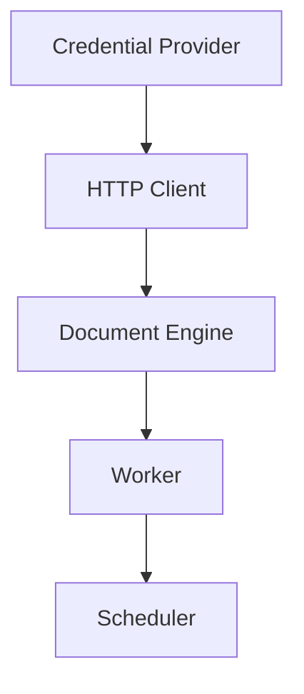
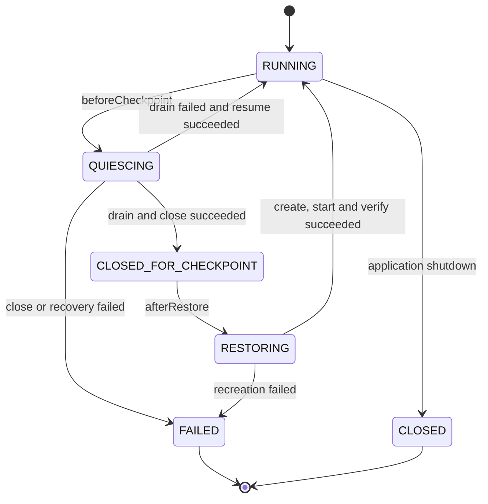

# Designing a Resource Wrapper for Libraries Without Built-in Integration

Many Java libraries are designed to run continuously in a single JVM and have no awareness of CRaC. They may hold connection pools, sockets, background threads, native handles, caches, or a dedicated processing engine. When a process is checkpointed, those resources may no longer be valid after restore. If a library does not yet implement `org.crac.Resource`, the application can still integrate it using a wrapper responsible for coordinating its lifecycle.

The wrapper does not need to modify the library's source code. It provides a lifecycle contract on the application side, translating `beforeCheckpoint` and `afterRestore` callbacks into operations the library supports, such as stopping incoming work, waiting for tasks to complete, closing the instance, and creating a new instance. If other services are using the library, the wrapper also needs to provide a stable facade so they can continue calling the new instance after restore.

Good design starts by identifying who owns the resources, how the library can be stopped and restarted, and what the application must guarantee before checkpoint. An adapter that merely calls `close()` and creates a new object is insufficient if threads are still using the old object or other beans hold direct references to it.

## 1. Why Is a Resource Wrapper Needed?

Suppose an application uses a document processing library. The library manages its own worker threads and native memory, but has no CRaC integration:

```text
Spring Service
      |
      v
Third-party Document Engine
      |
      +-- worker threads
      +-- native memory / handles
      +-- internal buffers
```

If the application checkpoints while the engine is processing a document, the snapshot may contain incomplete work state or resources that cannot continue operating in the restore environment. If the engine is closed while services still hold references to the old object, post-restore requests may call into a closed instance.

A wrapper solves this by placing a management layer between the application and the library:

```text
Spring Service
      |
      v
Stable Library Facade
      |
      v
Library Lifecycle Wrapper  <---- CRaC Resource callbacks
      |
      v
Third-party Library Instance
```

The wrapper can handle four responsibilities:

1. Control acceptance of new calls into the library.
2. Wait for in-flight calls and internal tasks to reach a safe state.
3. Close or release the instance before checkpoint.
4. Create, start, validate, and publish the new instance after restore.

Spring manages the wrapper as a bean if the application uses Spring Boot. CRaC invokes the wrapper through an object implementing `org.crac.Resource` registered with the CRaC context.

## 2. Identifying the Lifecycle Contract Supported by the Library

Before writing a wrapper, read the library's API and documentation to determine exactly how it stops and starts. Do not guess that all `close()`, `stop()`, or `shutdown()` methods have the same meaning.

Find answers to these questions:

- Can new work be stopped without canceling work already in progress?
- Is there an API to wait for running workers, requests, or jobs to finish?
- Which resources does `close()` release: sockets, threads, buffers, native handles, or all of them?
- After `close()`, can the object call `start()` again, or must a new object be created?
- Can the factory creating the new instance receive current configuration, credentials, and endpoints?
- Is there an API to check readiness after startup?
- Does the library create background threads or tasks invisible to the application?
- Does the library have official CRaC integration in a newer version?

From there, establish a clear lifecycle contract:

| Phase | Required action | Completion condition |
|---|---|---|
| Running | Accept and process calls | Instance operates normally |
| Quiescing | Reject new work, stop internal producers | No new work is generated |
| Draining | Wait for in-flight calls and jobs to complete | No operations are using the instance |
| Closed for checkpoint | Close the instance and release resources | The old instance is no longer accessed |
| Restoring | Create new instance, start, and verify | The new instance meets readiness criteria |
| Running after restore | Publish the new instance and accept work | Consumers use the new instance |

If the library has no way to stop accepting work or wait for tasks to complete, the wrapper cannot infer a safe state on its own. In that case, add an application-side admission gate, use the library's task management API, or choose another integration approach. Do not checkpoint when you cannot prove the resource is no longer in use.

## 3. Choosing the Appropriate Wrapper Pattern

There are several ways to structure a wrapper depending on how much control you have over the library.

| Design pattern | When appropriate | Characteristics |
|---|---|---|
| Direct adapter | Library has clear `pause`, `drain`, `close`, `start` | One class implements `Resource` and calls library APIs directly |
| Decorator | Want to add lifecycle around an interface services already use | Wraps the real object, keeping the business interface intact |
| Stable facade + replaceable delegate | A new instance must be created after restore | Consumers keep a stable facade while the internal delegate is swapped |
| Factory-managed wrapper | Instance cannot restart after `close()` | Factory creates a new instance on each restore |
| Coordinator | Multiple components have dependencies and lifecycle order | One Resource coordinates multiple wrappers in a clear order |

In many applications, a stable facade combined with a factory-managed wrapper is the easiest option to control. Services only know the business interface; the wrapper holds the library instance and the Resource adapter manages checkpoint/restore.

## 4. Defining Interfaces for the Library and Factory

The example below simulates a library without CRaC integration. The `DocumentEngine` interface represents the operations the wrapper needs. The actual implementation calls the corresponding APIs of the third-party library.

```java
import java.time.Duration;

public interface DocumentEngine extends AutoCloseable {
    void start() throws Exception;
    void stopAccepting() throws Exception;
    boolean awaitDrained(Duration timeout) throws Exception;
    void resumeAccepting() throws Exception;
    void verifyReady() throws Exception;
    DocumentResult process(Document document) throws Exception;

    @Override
    void close() throws Exception;
}
```

The meaning of each method must be defined in the adapter:

- `start()`: initializes or starts the workers of the new instance.
- `stopAccepting()`: prevents new work from entering the instance.
- `awaitDrained(timeout)`: waits for already-accepted work to finish within a time limit.
- `resumeAccepting()`: returns a still-valid instance back to accepting work if the checkpoint is aborted before closing.
- `verifyReady()`: verifies essential capabilities are operational.
- `close()`: releases resources and terminates the instance.

The factory creates a new instance from current configuration:

```java
public interface DocumentEngineFactory {
    DocumentEngine create() throws Exception;
}
```

The factory should not return an already-closed singleton. If the library has a builder, the factory can create a new builder, load configuration, initialize the engine, and return an unstarted instance so the wrapper calls `start()`.

## 5. Using a Stable Facade to Avoid Stale References

Suppose `DocumentService` directly injects `DocumentEngine`. At checkpoint, the wrapper closes the old engine and creates a new engine after restore. The reference inside `DocumentService` still points to the old object. Replacing a field inside the Resource adapter does not automatically update references already held by other beans.

Instead, services depend only on a stable facade:

```java
public interface DocumentProcessor {
    DocumentResult process(Document document) throws Exception;
}
```

The facade holds the current delegate and forwards calls to that delegate. The adapter can swap the delegate after restore without changing consumer beans.

```java
public final class DocumentProcessorFacade implements DocumentProcessor {
    private volatile DocumentEngine delegate;

    public DocumentProcessorFacade(DocumentEngine initial) {
        this.delegate = initial;
    }

    @Override
    public DocumentResult process(Document document) throws Exception {
        DocumentEngine current = delegate;
        if (current == null) {
            throw new IllegalStateException("Document engine is unavailable");
        }
        return current.process(document);
    }

    void install(DocumentEngine replacement) {
        this.delegate = replacement;
    }

    DocumentEngine current() {
        return delegate;
    }

    void clear() {
        this.delegate = null;
    }
}
```

`volatile` ensures threads reading the facade see the new delegate reference after it is published. It does not wait for calls already running on the old delegate to complete. The wrapper still needs an admission/drain mechanism so it does not close the instance while threads are using it.

Using only `AtomicReference` or `volatile` without managing in-flight calls can cause a race: thread A reads the old delegate; thread B swaps the delegate and closes the old object; thread A proceeds to call the closed object. The next section addresses that gap.

## 6. Guarding Calls and Draining Before Checkpoint

The wrapper needs to distinguish two groups of activity:

- New calls from services or consumers.
- Calls that have already started and are using the current instance.

When checkpoint begins, the wrapper transitions to `QUIESCING`, rejects new calls, asks the library to stop accepting work, and waits for active calls to finish. Only then does it close the instance.

`ReentrantLock` and `Condition` can be used to manage state and the active call count. The following example illustrates a handle with a replaceable delegate:

```java
import java.time.Duration;
import java.util.concurrent.TimeUnit;
import java.util.concurrent.locks.Condition;
import java.util.concurrent.locks.ReentrantLock;

public final class ManagedDocumentProcessor implements DocumentProcessor {
    private enum State {
        RUNNING,
        QUIESCING,
        CLOSED_FOR_CHECKPOINT,
        FAILED
    }

    private final ReentrantLock gate = new ReentrantLock(true);
    private final Condition noActiveCalls = gate.newCondition();
    private final DocumentEngineFactory factory;
    private final Duration drainTimeout;

    private DocumentEngine current;
    private State state = State.RUNNING;
    private int activeCalls;

    public ManagedDocumentProcessor(
            DocumentEngineFactory factory,
            Duration drainTimeout) throws Exception {
        this.factory = factory;
        this.drainTimeout = drainTimeout;
        this.current = createStartedEngine();
    }

    @Override
    public DocumentResult process(Document document) throws Exception {
        DocumentEngine target;

        gate.lockInterruptibly();
        try {
            if (state != State.RUNNING || current == null) {
                throw new IllegalStateException(
                        "Document engine is not accepting work: " + state);
            }
            activeCalls++;
            target = current;
        } finally {
            gate.unlock();
        }

        try {
            return target.process(document);
        } finally {
            gate.lock();
            try {
                activeCalls--;
                if (activeCalls == 0) {
                    noActiveCalls.signalAll();
                }
            } finally {
                gate.unlock();
            }
        }
    }

    public void beforeCheckpoint() throws Exception {
        DocumentEngine target;
        long deadline = System.nanoTime() + drainTimeout.toNanos();

        gate.lockInterruptibly();
        try {
            if (state == State.CLOSED_FOR_CHECKPOINT) {
                return;
            }
            if (state != State.RUNNING || current == null) {
                throw new IllegalStateException(
                        "Cannot checkpoint engine in state: " + state);
            }
            state = State.QUIESCING;
            target = current;
        } finally {
            gate.unlock();
        }

        boolean closeAttempted = false;
        try {
            // Prevent the library from accepting additional internal work.
            target.stopAccepting();

            long remaining = deadline - System.nanoTime();
            if (remaining <= 0 ||
                    !target.awaitDrained(Duration.ofNanos(Math.max(0, remaining)))) {
                throw new IllegalStateException(
                        "Document engine did not drain before checkpoint");
            }

            gate.lockInterruptibly();
            try {
                while (activeCalls != 0) {
                    remaining = deadline - System.nanoTime();
                    if (remaining <= 0) {
                        throw new IllegalStateException(
                                "Facade calls did not finish before checkpoint");
                    }
                    noActiveCalls.awaitNanos(remaining);
                }
            } finally {
                gate.unlock();
            }

            closeAttempted = true;
            target.close();

            gate.lock();
            try {
                current = null;
                state = State.CLOSED_FOR_CHECKPOINT;
            } finally {
                gate.unlock();
            }
        } catch (Exception failure) {
            if (closeAttempted) {
                setFailed();
            } else {
                try {
                    target.resumeAccepting();
                    setRunning();
                } catch (Exception resumeFailure) {
                    failure.addSuppressed(resumeFailure);
                    setFailed();
                }
            }
            throw failure;
        }
    }

    public void afterRestore() throws Exception {
        gate.lockInterruptibly();
        try {
            if (state != State.CLOSED_FOR_CHECKPOINT || current != null) {
                throw new IllegalStateException(
                        "Engine is not in a restorable state: " + state);
            }
        } finally {
            gate.unlock();
        }

        DocumentEngine replacement = null;
        try {
            replacement = createStartedEngine();

            gate.lockInterruptibly();
            try {
                current = replacement;
                state = State.RUNNING;
                replacement = null;
            } finally {
                gate.unlock();
            }
        } catch (Exception failure) {
            if (replacement != null) {
                try {
                    replacement.close();
                } catch (Exception cleanupFailure) {
                    failure.addSuppressed(cleanupFailure);
                }
            }
            setFailed();
            throw failure;
        }
    }

    private DocumentEngine createStartedEngine() throws Exception {
        DocumentEngine engine = factory.create();
        try {
            engine.start();
            engine.verifyReady();
            return engine;
        } catch (Exception failure) {
            try {
                engine.close();
            } catch (Exception cleanupFailure) {
                failure.addSuppressed(cleanupFailure);
            }
            throw failure;
        }
    }

    private void setRunning() {
        gate.lock();
        try {
            state = State.RUNNING;
        } finally {
            gate.unlock();
        }
    }

    private void setFailed() {
        gate.lock();
        try {
            state = State.FAILED;
        } finally {
            gate.unlock();
        }
    }
}
```

This is an example of a facade call-coordination mechanism. A real implementation needs to be adapted to the library's contract and how it manages internal threads. `awaitDrained()` must cover work accepted internally by the library; `activeCalls` only counts calls passing through the facade.

Notable points in the design:

- The lock is held only while updating state and counters; do not hold the lock while executing business logic or waiting on I/O.
- `QUIESCING` causes new calls to be rejected as soon as checkpoint begins.
- `stopAccepting()` stops the library's internal producers.
- `awaitDrained()` and `activeCalls` together confirm that work has finished.
- Only after draining succeeds is `close()` called.
- If `close()` has started and fails, the state transitions to `FAILED` because the instance cannot be assumed intact.
- After restore, the factory creates a new instance, and the wrapper publishes it only after `start()` and `verifyReady()` succeed.

If the library does not provide `stopAccepting()` or `awaitDrained()`, replace them with an actual task-management mechanism. Do not skip the drain step just to make the example shorter.

## 7. Writing a Thin Resource Adapter

Once the wrapper provides the two lifecycle operations, the Resource adapter only needs to forward CRaC callbacks to the wrapper:

```java
import org.crac.Context;
import org.crac.Resource;

public final class DocumentEngineResource implements Resource {
    private final ManagedDocumentProcessor processor;

    public DocumentEngineResource(ManagedDocumentProcessor processor) {
        this.processor = processor;
    }

    @Override
    public void beforeCheckpoint(Context<? extends Resource> context)
            throws Exception {
        processor.beforeCheckpoint();
    }

    @Override
    public void afterRestore(Context<? extends Resource> context)
            throws Exception {
        processor.afterRestore();
    }
}
```

Separating the wrapper from the adapter gives both parts clear responsibilities:

- `ManagedDocumentProcessor` guards calls, the state machine, the factory, and the delegate.
- `DocumentEngineResource` connects the state machine to the CRaC lifecycle.

The wrapper can be unit tested without starting CRaC. The adapter can be tested separately to verify callbacks invoke the right methods. Integration tests still need to run on a CRaC JDK to prove the runtime invokes callbacks at the right times.

## 8. Registering the Wrapper in Spring Boot

Spring can instantiate the factory, wrapper, and Resource adapter as beans. A registrar registers the adapter with the global context after required singletons have been created:

```java
import org.crac.Core;
import org.springframework.beans.factory.SmartInitializingSingleton;
import org.springframework.context.annotation.Bean;
import org.springframework.context.annotation.Configuration;

import java.time.Duration;

@Configuration
public class DocumentEngineConfiguration {

    @Bean
    ManagedDocumentProcessor managedDocumentProcessor(
            DocumentEngineFactory factory) throws Exception {
        return new ManagedDocumentProcessor(
                factory,
                Duration.ofSeconds(30));
    }

    @Bean
    DocumentEngineResource documentEngineResource(
            ManagedDocumentProcessor processor) {
        return new DocumentEngineResource(processor);
    }

    @Bean
    SmartInitializingSingleton registerDocumentEngineResource(
            DocumentEngineResource resource) {
        return () -> Core.getGlobalContext().register(resource);
    }
}
```

Services inject only `DocumentProcessor`, the stable facade:

```java
@Service
public class DocumentService {
    private final DocumentProcessor processor;

    public DocumentService(DocumentProcessor processor) {
        this.processor = processor;
    }

    public DocumentResult process(Document document) throws Exception {
        return processor.process(document);
    }
}
```

In a real configuration, `ManagedDocumentProcessor` can directly implement `DocumentProcessor` as in the example. If using a separate facade, expose the facade from the bean configuration and keep the delegate inside the wrapper. Do not inject the raw library instance into other services, otherwise they may continue calling the old object after restore.

Register the Resource exactly once. Do not re-register inside `afterRestore()`, do not register per request, and do not simultaneously register the same resource through another integration. If Spring Boot or the library already has CRaC auto-configuration, clearly identify which component owns the lifecycle to avoid closing/opening twice.

## 9. Lifecycle Ordering When the Library Has Dependencies

Third-party libraries often depend on other resources. For example, an engine needs a credential provider and an HTTP client; a worker uses the engine; a scheduler creates work for the worker.



Recovery order must open dependencies before the components that use them: credentials, HTTP client, engine, worker, scheduler. Before checkpoint, close in reverse order: scheduler, worker, engine, HTTP client, credentials.

For Resources registered in the same context, callback order supports dependencies: `beforeCheckpoint` runs in reverse registration order; `afterRestore` runs in registration order. Therefore, register dependencies first and dependents second.

If a wrapper manages multiple internal resources, let it coordinate order internally rather than registering some resources through the wrapper and others via standalone Resources without an ownership convention.

## 10. When the Library Only Has `close()` Without `pause()` or `drain()`

This is a harder case. `close()` may immediately close resources while internal threads are still running. Before using it, inspect the library's documentation and source/API to determine:

- Whether `close()` waits for workers to finish or not.
- Whether `close()` interrupts or cancels running tasks.
- Whether dedicated shutdown callbacks or hooks are provided.
- Whether external producers can be stopped before calling `close()`.
- Whether the number of active tasks or termination state can be observed.

If the library exposes an `ExecutorService`, `awaitTermination()`, or a lifecycle manager, they can be used for draining. If there is no way to confirm that work has finished, do not assume `close()` is enough. An application-side admission gate and a dedicated process shutdown flow may be required.

Do not use `Thread.sleep()` to guess that workers have stopped. Sleeping does not prove there are no remaining tasks and creates no synchronization relationship. Use a bounded termination-waiting API or a completion signal with a clear contract.

## 11. Distinguishing Closing an Instance from Releasing All Resources

A `close()` method may only close resources directly owned by the object. If the library creates static singletons, threads in a global executor, or shared native resources, closing the instance may not release everything.

Check:

- Do threads created by the library terminate?
- Are executors shut down and awaited for termination?
- Are native handles released?
- Do shutdown hooks only run at JVM exit, or is there an API to call them proactively?
- Do caches/static registries retain references to the old instance?
- Are callbacks or listeners registered with external systems unregistered?
- Have all connections/sockets been closed?

If the library only provides a process-wide singleton and does not support recreation, a wrapper cannot create an independent instance after restore on its own. Look for an official reinitialization mechanism, upgrade the library, change how it is used, or exclude that component from the checkpointing process.

## 12. Error Handling and State Recovery

Callbacks must have clear behavior when operations fail.

### 12.1. Drain Fails Before Closing

If the timeout expires while the instance is still active, the wrapper can attempt to resume accepting work and return an error so the checkpoint is aborted. Resuming is valid only if the instance has not been closed and the library supports returning to a running state.

If resuming fails, the wrapper must transition to a failed state and prevent services from continuing to use an indeterminate instance. Do not silently set the state to `RUNNING`.

### 12.2. Close Fails

When `close()` has started and throws an exception, you cannot assume the object still works normally. Some sockets may have closed while other threads have not stopped. Mark the failed state and let operational procedures handle it. Do not call `resumeAccepting()` as if close certainly did nothing.

### 12.3. Factory or Start Fails After Restore

If the factory creates an object but `start()` or `verifyReady()` fails, close the half-created object and keep the facade unavailable. Publish the delegate only after all mandatory steps succeed.

Do not retry indefinitely in `afterRestore`. Bounded retries with backoff may be used for transient failures, but configuration, credential, or binary incompatibility errors must be clearly reported. Readiness must not transition to healthy while the component is not working.

### 12.4. Clear State Machine

A state machine can use the following states:



You do not strictly have to use the exact state names above. What matters is that each lifecycle method defines valid input states, output states, and error handling. State transitions must be synchronized so multiple threads cannot simultaneously create or close instances.

## 13. Integrating with the Spring Shutdown Lifecycle

A CRaC checkpoint does not necessarily close the Spring `ApplicationContext`. Therefore, do not rely solely on `@PreDestroy` or `DisposableBean.destroy()` to handle checkpointing.

The application still needs cleanup during normal shutdown. The wrapper can implement `AutoCloseable` or `DisposableBean`, but it must distinguish:

- Normal shutdown: stops the component and releases resources before the process exits.
- `beforeCheckpoint`: stops the component for a safe snapshot, though the process may continue after checkpoint depending on runtime behavior.
- `afterRestore`: recreates the component in the restored process.

If using the same closing method for shutdown and checkpoint, the method must be state-aware and behave appropriately. Do not let Spring shutdown callbacks and CRaC callbacks close resources concurrently. A lifecycle coordinator can be used to serialize both closing paths.

## 14. Testing the Wrapper and Adapter

Split testing into two layers.

### 14.1. Unit Tests with a Fake Library

A fake library records events to verify ordering:

```java
public final class FakeDocumentEngine implements DocumentEngine {
    private final List<String> events;

    public FakeDocumentEngine(List<String> events) {
        this.events = events;
    }

    @Override
    public void start() {
        events.add("start");
    }

    @Override
    public void stopAccepting() {
        events.add("stopAccepting");
    }

    @Override
    public boolean awaitDrained(Duration timeout) {
        events.add("awaitDrained");
        return true;
    }

    @Override
    public void resumeAccepting() {
        events.add("resumeAccepting");
    }

    @Override
    public void verifyReady() {
        events.add("verifyReady");
    }

    @Override
    public DocumentResult process(Document document) {
        events.add("process");
        return DocumentResult.success();
    }

    @Override
    public void close() {
        events.add("close");
    }
}
```

Cases to test:

- Normal calls are forwarded to the current delegate.
- Once quiescing begins, new calls are rejected.
- In-flight calls are awaited to completion before `close()`.
- The sequence is stop accepting, drain, wait for active calls, close.
- Drain timeout fails the checkpoint callback and does not close an instance still in use.
- Close failure puts the wrapper into a failed state.
- Restore creates a new instance, starts, and verifies before publishing.
- Factory/start failure closes the partially created instance and prevents the facade from using a broken object.
- Repeated callbacks or invalid state transitions are handled cleanly.

### 14.2. Integration Tests with a CRaC JDK

Unit tests do not prove the runtime actually invokes callbacks. Run on a supported CRaC JDK and operating system:

1. Start Spring Boot and confirm the Resource is registered.
2. Call the service to confirm the initial component works.
3. Trigger a checkpoint and confirm the wrapper stops accepting work, drains, and closes the instance.
4. Restore the image.
5. Confirm the factory creates a new instance and `afterRestore` completes.
6. Call the service again through the same facade and confirm the request is handled by the new instance.
7. Test restoring when an external dependency is not yet ready.
8. Test checkpointing when a long-running task has not finished draining.
9. Check readiness and logs when callbacks fail.

If the same image is restored into multiple instances, confirm each instance has its own resources and identity. Do not use a static registry outside the wrapper that accidentally shares or retains old instances across processes.

## 15. Limitations That Cannot Be Solved by a Wrapper Alone

A wrapper can only control what the library or application exposes. Some limitations must be identified early:

- If a library cannot stop threads or provides no drain mechanism, a safe state cannot be proven simply by calling `close()`.
- If a library holds a static singleton and has no reset API, a factory may not be able to create a new instance in the same process after restore.
- If native code holds FDs without going through JDK APIs, the JDK FD policy may not handle them; native APIs or library changes are required.
- If a library stores business state externally, a wrapper cannot automatically synchronize that state with the checkpoint image.
- If a library does not support multiple instances, restoring the same image into multiple replicas may violate its assumptions.
- If a license or client identity is tied to a single process, verify how identity is reissued after restore.

When encountering such limitations, appropriate options may include upgrading the library, using an official extension, replacing the library, running the component in a separate process/service, or excluding that workload from checkpointing. Do not mask limitations with an over-assuming wrapper.

## 16. Design and Implementation Process

You can follow this sequence:

1. **Survey the library:** read documentation on lifecycle, threads, connections, native handles, and restart capability.
2. **Determine ownership:** clearly state which object owns the resource and which component is allowed to close it.
3. **Define application interfaces:** separate the business API from the library's lifecycle API.
4. **Create a factory:** ensure a new instance can be created using current configuration.
5. **Create a facade:** so consumers hold a stable reference and do not access raw instances.
6. **Add an admission/drain gate:** block new calls and wait for active calls to finish.
7. **Implement the Resource adapter:** translate CRaC callbacks into wrapper lifecycle steps.
8. **Register once:** let Spring create the adapter and register it with `Core.getGlobalContext()`.
9. **Test failures:** drain timeout, close failure, factory failure, dependency unavailable, and repeated callbacks.
10. **Run integration tests:** create a checkpoint, restore, and invoke business logic through the facade on the exact runtime.
11. **Measure:** drain, close, recreate, verify, and restore-to-readiness durations.
12. **Document limitations:** record verified library versions, JDK, OS, and configuration.

## 17. Common Mistakes

**Only implementing `Resource` and calling `close()`.** Threads or requests may still be using the object. Stop accepting new work and drain before closing.

**Letting services hold references to the raw library.** After restore, services keep calling the old object. Inject a stable facade and swap the delegate inside.

**Using `volatile` instead of a drain mechanism.** `volatile` publishes the new reference, but does not wait for calls on the old reference to finish.

**Assuming every `close()` can call `start()` again.** Many libraries treat close as terminal. Use a factory to create a new instance if documentation requires it.

**Creating a new instance before dependencies are ready.** The component may start with old credentials or endpoints. The factory needs to fetch current configuration and verify before publishing.

**Ignoring internal library tasks.** A counter of calls through the facade does not cover worker threads created by the library itself. Use the library's drain/termination API.

**Swallowing callback exceptions.** CRaC may continue with an unsafe state. Report errors and keep the instance in a non-ready state.

**Registering the Resource multiple times.** Callbacks may close or recreate the component multiple times. Only one registrar should own registration.

**Using `@PreDestroy` instead of a CRaC Resource.** A checkpoint does not necessarily close the Spring context. Integrate CRaC callbacks separately and keep normal shutdown cleanup.

**Not testing multi-instance restore.** Some singleton or identity assumptions only surface when the same image is used for multiple processes. Test the exact deployment pattern.

## 18. Self-Check Questions

1. **Why is a wrapper needed for a library without CRaC integration?** Because the wrapper translates CRaC callbacks into the lifecycle API the library provides, while managing state and resources around checkpoint/restore.
2. **Why should services use a facade instead of holding the library object directly?** Because the library instance may be closed and replaced by a new instance after restore; the facade keeps a stable reference for consumers.
3. **Why are an admission gate and draining needed?** To reject new work and wait for in-flight calls to finish before closing the instance.
4. **Is `volatile` enough to swap delegates safely?** No. It publishes the new reference, but does not wait for threads using the old delegate to finish.
5. **When is a factory needed instead of calling `start()` again?** When `close()` is a terminal operation or the library does not guarantee an instance can restart.
6. **What if the library has no drain API?** Find another task-management mechanism, or do not checkpoint without proving resources have stopped safely.
7. **Why should the `afterRestore` callback only publish the instance after `verifyReady()`?** So consumers do not see an object that is still initializing or not yet fully connected.
8. **Do unit tests prove CRaC invokes real callbacks?** No. Integration tests on a CRaC JDK and compatible deployment environment are required.

## Conclusion

For libraries without CRaC integration, design a wrapper that owns the lifecycle rather than merely calling `close()` in a callback. The wrapper must identify ownership, stop accepting new calls, drain active work, close the old instance, and create a new instance after restore via a factory. A stable facade lets Spring beans continue using the same interface while the internal delegate is swapped.

Place the state machine and synchronization mechanism in the wrapper, keep the Resource adapter thin, register the adapter once with the CRaC context, and respect dependency ordering. If the library does not expose a safe way to stop or reinitialize, treat that as an integration limitation to resolve at the library or architectural level. Finally, test both unit lifecycle behavior and real checkpoint/restore on a CRaC JDK to confirm the new component works before the instance accepts traffic.
