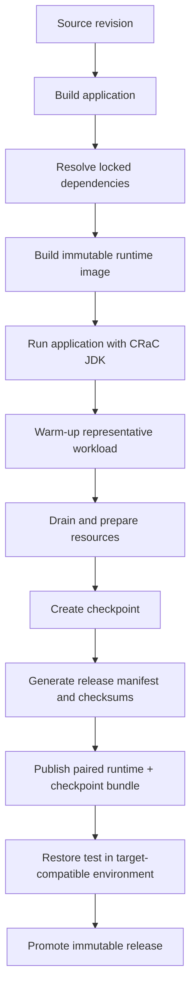

# Relationships Between Checkpoint Images, the JDK, Application Code, and Dependencies

A CRaC checkpoint is not a standalone file that can be arbitrarily paired with any JDK or application version. It stores the state of a Java process that has already run, including runtime state, memory, threads, and process resources supported by the checkpoint/restore mechanism. Therefore, a checkpoint image is tightly coupled to the JDK that created it, the loaded application code, dependencies, launch configuration, and the operating system environment.

When packaging for deployment, the checkpoint and the environment that created it must be treated as a single versioned artifact set. This set must preserve compatibility among the image, JDK, application, and dependencies. If you release only the checkpoint files and pair them with a new container image or a different JAR set, the process may fail to restore, or it may restore and behave incorrectly because in-memory state no longer matches external files and services.

The key principle is that **each checkpoint must be paired with the exact runtime and application set that created it, in a verified compatible environment**. When upgrading the JDK, application code, native libraries, or platform configuration, create a new checkpoint or explicitly prove that the new combination can restore safely.

## 1. Distinguishing Artifact Types

In a CRaC workflow, there are several distinct types of artifacts. They may be distributed together, but they do not share the same role.

| Artifact | Content | Role |
| --- | --- | --- |
| Application artifact | JAR, WAR, or application modules | Contains application code and packaged resources |
| Dependency set | Java libraries, native libraries, and runtime dependencies | Provides classes and components required by the application |
| JDK/runtime | CRaC-enabled JDK distribution and runtime components | Executes the application and interprets JVM state upon restore |
| Container image | Filesystem, JDK, application, system libraries, and base config | Provides a reproducible execution environment |
| Checkpoint image | Process state files created by the JVM and checkpoint/restore mechanism | Reconstructs the Java process from saved state |
| Release manifest | Metadata on component versions and checksums | Identifies the exact compatible artifact combination |

A checkpoint image does not replace the JAR, JDK, or container image. A container image may contain the checkpoint or reference a checkpoint stored in a volume/artifact store. Whichever option is chosen, the runtime and required files must match the environment that created the image.

### 1.1. A Checkpoint Is Not an Application JAR

A JAR contains the application's bytecode, resources, and metadata. A checkpoint saves the state of a process that has already loaded and executed the program. A checkpoint can hold class metadata, the object graph, JIT state, and runtime state that a JAR does not contain.

Therefore, you cannot replace the JAR with a checkpoint or treat a checkpoint as a new application build. The JAR remains part of the deployment bundle to provide the classpath and files that the process needs in the restore environment.

### 1.2. A Checkpoint Is Not a Container Image

A container image typically contains the filesystem and components needed to start a container. A checkpoint contains the state of a process at a point in time. In CRaC deployments, these two artifacts usually go together:

- The container image provides the JDK, application, dependencies, and compatible filesystem.
- The checkpoint provides the initialized process state.

A checkpoint can be stored outside the container image to avoid bloating image size, but on restore the exact checkpoint must be mounted or downloaded to the exact location the runtime expects. Do not swap out the container image while continuing to use an old checkpoint unless compatibility has been verified.

## 2. Why Does a Checkpoint Depend on the JDK?

The JVM manages the heap, stacks, class metadata, JIT code, garbage collector, threads, and many other runtime structures. A checkpoint records process state containing these structures. On restore, a CRaC-enabled JVM must continue interpreting and using the saved runtime state.

The JDK is thus part of the checkpoint creation environment. Attributes that must be identified include:

- JDK vendor/distribution.
- Specific Java version and build number.
- Update or patch level of the JDK.
- Build with CRaC integration and how it integrates with CRIU.
- CPU architecture and ABI the runtime was built for.
- JVM options related to heap, GC, modules, native access, and agents.
- Native libraries bundled with the JDK.

Two JDKs reporting the same `java.version` can differ in vendor, build, patch, or packaging. Do not record only `Java 21` in the manifest and assume all JDK 21 builds are compatible.

### 2.1. Recording Runtime Identity

When creating a checkpoint, capture the actual runtime details:

```bash
java -version
java -XshowSettings:properties -version 2>&1
```

Properties to record include `java.vendor`, `java.runtime.version`, `java.vm.name`, `java.vm.version`, `java.home`, `os.name`, `os.arch`, and the JDK build version. On Linux, also record the kernel and CRIU version:

```bash
uname -a
criu --version
criu check
```

The `criu check` command verifies certain environmental conditions. It does not replace a trial checkpoint/restore run with the actual application.

### 2.2. Using the Exact JDK on Restore

The safe default is to restore using the exact JDK distribution and build that created the checkpoint. A newer JDK update may contain changes in the JVM, GC, native libraries, or CRaC integration. Even if the application JAR has not changed, do not assume by default that an old checkpoint is compatible with a new JDK.

If a checkpoint must be migrated to a different JDK release, there must be compatibility evidence from the vendor's documentation and restore testing on the exact combination. In many deployment workflows, the simpler and more controllable approach is to create a new checkpoint after upgrading the JDK.

### 2.3. JVM Flags Are Also Part of Runtime Configuration

Startup parameters can affect memory layout, GC, module access, native agents, encoding, timezone, or application behavior. Record the JVM flags used when creating the checkpoint and apply the restore configuration according to the corresponding JDK's documentation.

Examples of parameter groups to manage:

- Heap sizing such as `-Xms` and `-Xmx`.
- Garbage collector and GC options.
- Module options such as `--add-opens` or `--add-exports`.
- Java agents and native agents.
- System properties such as timezone, locale, and application config.
- CRaC options used to create or restore checkpoints.

Not all parameters are forwarded or handled identically across all JDK builds. Keep launch configuration under version control and consult runtime documentation rather than arbitrarily changing flags at restore time.

## 3. Relationship Between Checkpoints and Application Code

When a checkpoint is created, the JVM has already loaded classes and the application may have created many objects from those classes. The state in the heap reflects the structure and logic of the exact code version that ran at image creation time.

If you restore the same checkpoint while swapping the JAR or classpath, inconsistencies can arise:

- Objects on the heap were created from the old class version, while class files on the filesystem belong to the new version.
- Loaded class metadata and methods do not match the new bytecode.
- Resources or serialization formats have changed.
- Classes loaded dynamically after restore may come from new dependencies.
- Resource files or templates opened by the application after restore differ in content from checkpoint time.

A checkpoint is not a hot-deployment mechanism. Replacing the JAR file underneath a checkpointed process does not automatically convert the object graph inside the image to the new version's structure.

### 3.1. Pairing Checkpoints with the Exact Application Build

Each checkpoint must reference a specific application build. Record:

- Application version or build ID.
- Git commit or source revision if the release process uses one.
- Checksum of the JAR/WAR or each module.
- List of required packaged resources.
- Classpath in its actual order.
- Versions of critical frameworks and runtime plugins.
- Build configuration related to code generation or instrumentation.

If the application is packaged as an executable JAR, the JAR checksum is a useful identifier. If the application uses multiple external JARs, record the checksum of the entire dependency set or use an immutable container image digest covering them.

### 3.2. Do Not Pair an Old Image with a New Classpath

Unsafe example:

```text
Checkpoint created from:
  app-1.4.0.jar
  jackson-2.16.x.jar
  spring-boot-3.x.y.jar

Restore with:
  app-1.5.0.jar
  jackson-2.17.x.jar
  spring-boot-3.x.z.jar
```

Even if the new versions are compatible at the normal source or binary compatibility level, that does not prove that the object graph and runtime state saved in the checkpoint are compatible with the new class set. A new checkpoint must be created from the new application build.

If you need to deploy a new application version, build the new application artifact, run warm-up with the corresponding JDK/runtime, create a new checkpoint, and publish the whole set as a new release.

## 4. Java Libraries and Runtime Dependencies

Java applications typically depend on frameworks, logging, database drivers, serialization libraries, HTTP clients, cache clients, and many other libraries. These dependencies may already be loaded into the JVM or may be lazily loaded after restore.

A dependency change can impact a checkpoint in multiple ways:

- Changing the structure of already-loaded classes or methods.
- Changing static initializers or how objects are constructed.
- Changing default configurations or resources on the classpath.
- Changing connection lifecycles or native integrations.
- Changing serialization/deserialization data formats.
- Changing lazy initialization behavior after restore.

Therefore, dependency locks and artifact checksums are part of release identification. Do not merely pin JAR versions in a build file and then pull from an uncontrolled repository at restore time.

### 4.1. Dependency Trees and Lockfiles

With Gradle, dependency locking can preserve resolved dependency versions. With Maven, dependency versions can be managed via a BOM and reproducible builds. Regardless of the tool used, the checkpoint pipeline must know the exact artifacts present on the classpath when the image was created.

Example partial manifest:

```yaml
application:
  version: 1.4.0
  buildId: service-1.4.0+build.281
  artifact: app.jar
  sha256: "<sha256-of-app-jar>"
dependencies:
  lockfile: gradle.lockfile
  classpathDigest: "<digest-of-resolved-runtime-classpath>"
```

Strings inside angle brackets are placeholders. An actual pipeline must write computed checksums and never leave placeholders in a published manifest.

### 4.2. Classpath Order and Class Loading

Classpath order can affect which class is loaded when multiple artifacts contain the same class or resource name. With custom classloaders, plugin systems, or module layers, loader ordering and configuration matter even more.

A checkpoint retains classloader state and loaded classes. Therefore, keep unchanged:

- Classpath order.
- List of JARs and versions.
- Classloader/module layer configuration.
- Initialized plugin or extension mechanisms.
- Resources resolved via the classpath.

Do not swap a single JAR in a `lib` directory and reuse an old checkpoint without creating and testing a new release.

## 5. Native Libraries and OS-Dependent Components

Some Java libraries use JNI, JNA, or native code loaded via `System.loadLibrary`. These components are tied to the environment's CPU architecture, ABI, libc, system libraries, and filesystem.

Examples:

- Native database drivers or compression libraries.
- TLS/crypto providers with native components.
- Image processing or machine learning runtimes.
- Application JNI libraries.
- Agents or profilers with native code.

If a native library changes between checkpoint creation and restore, the process may become incompatible with memory regions or handles referenced by the image. Even if filenames match, differing binary contents can cause errors.

Keep the exact same native library versions, ABI, and filesystem paths. If an upgrade is needed, create a new checkpoint in the new image. Verify both libraries loaded at startup and libraries loaded only when a rare code path runs after restore.

## 6. Operating System, Kernel, and CRIU in the Compatibility Set

CRIU and the kernel participate in recording and recovering process state at the OS level. Thus, a checkpoint also depends on the Linux environment, CPU architecture, namespaces, capabilities, cgroups, filesystem, and resource types supported by CRIU.

Factors to manage:

- CPU architecture, such as x86_64 or aarch64.
- Kernel version and required kernel features.
- CRIU version and environment check results.
- Container runtime configuration, namespaces, and capabilities.
- Cgroups and resource limits.
- Filesystems, mount points, and paths used by the process.
- System libraries such as libc and native dependencies.
- Types of open file descriptors, sockets, or kernel resources.

Do not treat a checkpoint as a portable format that can be moved arbitrarily across Windows, macOS, Linux, or between two CPU architectures. Create and restore in a supported and tested compatible environment.

### 6.1. Filesystem Paths Must Remain Stable

A process may hold references to files, working directories, native libraries, log paths, certificates, or temporary directories. If restored on a different filesystem, some paths may not exist or may point to different content.

Identify:

- Working directory at launch.
- Paths to the JDK and application artifacts.
- Paths to native libraries.
- Required mount points.
- Configuration, certificate, and trust store directories.
- Temporary directories and runtime data storage locations.
- Ownership and permissions of files that need access.

Do not allow the application to depend on a temporary path on a build machine and assume that path will exist in the restore container.

### 6.2. Container Image Digests

A tag like `my-service:latest` can point to different content in a later deployment. To pair a checkpoint with the exact environment, use an immutable image digest, for example:

```text
registry.example.com/my-service@sha256:<image-digest>
```

The digest must be taken from the actual image that created the checkpoint. Upon restore, deploy that exact digest or an image proven compatible with the checkpoint. If the base image or OS packages change, create a new checkpoint or run full compatibility testing.

## 7. Launch Configuration and Environment Variables

Not all configuration lives inside a checkpoint in the same way. Some values have already been read and stored in the object graph; some are read only after restore; some come from the external environment.

Examples:

- `SPRING_PROFILES_ACTIVE` may already have influenced beans created before checkpoint.
- `JAVA_TOOL_OPTIONS` may affect the JVM at startup.
- System properties may already have been read into singletons or static fields.
- Environment variables may be lazily read by libraries after restore.
- Endpoints or credentials may change when an instance is created on a different node.

If restore uses a different configuration, the application can fall into a hybrid state: some objects were created with the old config while others read the new config. This causes hard-to-diagnose bugs because a single process can hold two generations of configuration.

### 7.1. Configuration Classification

| Category | Examples | Handling Approach |
| --- | --- | --- |
| Release-immutable configuration | Feature mappings, schema versions, default rules | Keep unchanged and version alongside application artifacts |
| Environment configuration | Profiles, endpoints, regions, ports | Keep identical to image creation environment or reload under control |
| Dynamic secrets | Passwords, tokens, certificates, API keys | Retrieve from secret manager/identity provider after restore as appropriate |
| Instance configuration | Instance ID, hostname, pod metadata | Read or regenerate per current instance |
| Mutable configuration | Feature flags, routing rules, rate limits | Refresh or verify version prior to readiness |

Do not put secrets into the manifest. The manifest should only contain reference names, versions, or non-sensitive identifiers. Actual credentials must be supplied through a secret manager or platform security mechanism.

### 7.2. Do Not Assume Changing an Environment Variable Updates Created Objects

If a bean already read `DATABASE_URL` before checkpoint and stored the URL in a field, changing the environment variable in the restore container does not automatically update that field's value. If new config is needed, an explicit lifecycle hook must reload and recreate the resource.

Conversely, if a library reads an environment variable only when creating a client for the first time after restore, it may pick up the new value. Therefore, know when each piece of configuration is read and avoid uncontrolled changes between the two phases.

## 8. Packaging a Checkpoint into a Release Bundle

A controllable deployment approach is to release an immutable bundle consisting of:

1. A container image or runtime filesystem pinned by digest.
2. The exact JDK vendor, version, and build.
3. The application artifact along with its checksum.
4. The dependency set and native libraries along with checksums/versions.
5. The checkpoint directory generated by the runtime.
6. A manifest describing the environment, versions, and relationships among artifacts.
7. Signatures or checksums for integrity verification.



The bundle does not have to be a single archive file. You can store the container image in a registry and the checkpoint in an artifact/object store, provided the manifest accurately links the two artifacts and deployment always fetches the matching pair.

### 8.1. Example Release Manifest

```yaml
release:
  name: orders-service-crac-1.4.0
  createdAt: "2026-11-13T06:00:00Z"
  application:
    version: 1.4.0
    buildId: "orders-service+build.281"
    sourceRevision: "<git-commit>"
    artifact: /opt/app/app.jar
    sha256: "<application-jar-sha256>"
  runtime:
    jdkVendor: "<jdk-vendor>"
    javaRuntimeVersion: "<runtime-version-and-build>"
    javaHome: /opt/java/openjdk
    imageDigest: "sha256:<container-image-digest>"
    architecture: amd64
    os: linux
    kernel: "<validated-kernel-version>"
    criuVersion: "<criu-version>"
  dependencies:
    lockfile: /opt/app/gradle.lockfile
    classpathDigest: "<runtime-classpath-digest>"
    nativeLibraryDigest: "<native-library-set-digest>"
  checkpoint:
    path: /var/lib/app/checkpoint
    format: "<provider-specific-checkpoint-format>"
    sha256Manifest: /var/lib/app/checkpoint.sha256
  launch:
    workingDirectory: /opt/app
    classpath: /opt/app/app.jar
    jvmOptionsFile: /opt/app/jvm-options.txt
```

This is an illustrative structure, not a standard CRaC schema. The pipeline must populate real values. The `checkpoint.format` field can be adjusted per tooling and JDK distribution; do not assume a portable format on your own.

### 8.2. The Manifest Must Describe What Actually Ran

Do not pull versions from a build file and assume they represent the actual runtime. Capture information from the process that created the checkpoint and the resolved artifacts. For example, `java -version` in the shell may differ from the container's JDK or Gradle daemon. The manifest should be generated from the checkpoint environment itself and bind checksums to the released files.

## 9. Two Checkpoint Storage Strategies

### 9.1. Packaging the Checkpoint into the Container Image

A checkpoint can be copied into a layer of a container image after creation. The advantage is that the image and checkpoint share a single digest, making it easy during deployment to pair them accurately.

Disadvantages:

- The image can become very large.
- Every new checkpoint produces a new image.
- The registry must store and distribute checkpoint layers.
- Copying the checkpoint with the correct paths and permissions must be controlled.

This strategy fits when image size is acceptable and a single deployable artifact is desired.

### 9.2. Storing the Checkpoint Separately and Pairing via Manifest

The container image and checkpoint are stored in two separate places. The manifest explicitly records the image digest, checkpoint artifact ID, checksums, and runtime compatibility tuple.

Advantages:

- Images and checkpoints can be distributed independently.
- Easier to store multiple checkpoints per release.
- Dedicated object storage or artifact repositories can be used.

Disadvantages:

- Deployment must download the exact checkpoint matching the exact image.
- Checksums and versions must be verified prior to restore.
- Cases where one artifact is published while the other is incomplete must be handled.

With this strategy, mark a release complete only after the image, checkpoint, and manifest have all been uploaded, verified, and properly linked. Publish into an immutable version directory or release ID, and only then update pointers to the new release.

## 10. Integrity and Atomicity When Publishing

A checkpoint typically consists of multiple files. Do not copy part of the directory while CRIU is still writing, or publish an incomplete bundle. A safe process requires:

1. Waiting for the checkpoint command to complete successfully.
2. Confirming that the process and checkpoint directory are in their final state according to the tool in use.
3. Generating the file list and checksums.
4. Copying/uploading into a separate staging location.
5. Verifying sizes and checksums after transfer.
6. Publishing the manifest once all components are complete.
7. Moving the release from staging to the immutable published location atomically if storage supports it.

Do not edit content inside a checkpoint to shrink its size or rename files arbitrarily. If compression or packaging is needed, use an approach supported by the tooling/runtime and preserve the exact structure upon restore.

### 10.1. Checksum Verification

On Linux you can use:

```bash
sha256sum /opt/app/app.jar
find /var/lib/app/checkpoint -type f -print0 \
  | sort -z \
  | xargs -0 sha256sum > checkpoint.sha256
```

When restoring, verify checksums against the manifest before invoking the JVM. For multi-file checkpoints, the checksum manifest must cover both relative paths and the contents of each file to detect missing files or structural changes.

Checksums detect corruption or unintended modification. If you need to verify publisher origin, use digital signatures or protected provenance; a checksum stored alongside the artifact in a modifiable location does not prove who published the artifact.

## 11. Restoring from a Bundle

Before restoring, the deployment system should verify:

- The selected release ID is a complete set.
- The container image digest matches the manifest.
- The JDK vendor/version/build matches the environment that created the image.
- Application artifact and dependency checksums match.
- Native library set and CPU architecture are compatible.
- Kernel, CRIU, and container configuration fall within the tested range.
- The checkpoint directory is complete and checksums are valid.
- Required paths, mount points, and permissions exist.
- Dynamic config and secrets are supplied through the active mechanism.

Once conditions are satisfied, use the exact restore method supported by the CRaC JDK. Some distributions use options such as `-XX:CRaCRestoreFrom=<directory>`, but consult the documentation of the exact JDK and the launch command validated for the release.

Example command form:

```bash
cd /opt/app
/opt/java/openjdk/bin/java \
  -XX:CRaCRestoreFrom=/var/lib/app/checkpoint
```

This is a conceptual example. Syntax, additional JVM flags, classpath, and how the runtime locates dependent files may differ across JDKs. Use the script/entrypoint generated alongside the release manifest and test it inside the exact published container image.

After restore, the application must:

1. Run `afterRestore` callbacks.
2. Recreate sockets, connection pools, clients, and environment-dependent resources.
3. Reload secrets or dynamic configuration if required.
4. Verify cache versions, instance identity, leases, and schedulers.
5. Reach readiness before accepting traffic.

## 12. Upgrading the JDK, Application, or Dependencies

Any change in the runtime set can render an old checkpoint unsuitable. Have an explicit policy for each upgrade type.

| Change | Default Handling |
| --- | --- |
| JDK vendor or build | Create a new checkpoint with the new JDK; reuse an old image only if vendor-supported and explicitly tested |
| JDK patch update | Treat as a runtime change; verify compatibility and prefer creating a new checkpoint |
| Application JAR | Create a new checkpoint from the new application |
| Java dependency | Re-resolve dependency set, build, and create a new checkpoint |
| Native library | Check ABI and binary; prefer creating a new checkpoint |
| Base container image | Verify OS, libc, filesystem, and kernel assumptions; create a new image if the environment changed |
| JVM flags | Compare configuration; do not arbitrarily restore with a different flag set |
| Dynamic secrets or endpoints | Refresh/verify after restore per lifecycle; not strictly necessary to recreate checkpoint if code/runtime unchanged |
| Feature flags or business data | Read according to application freshness and consistency policy |

### 12.1. A New Release Should Have a New Checkpoint

An easily controllable pipeline is:

1. Build the application and resolve dependencies.
2. Create an immutable container image containing the JDK and application artifact.
3. Run the application in a CRaC-compatible environment.
4. Warm up with a representative workload.
5. Drain and create the checkpoint.
6. Generate the manifest, checksums, and signature.
7. Test restore using the exact image digest and newly created checkpoint.
8. Measure restore-to-ready time and verify functionality.
9. Promote the release only after passing.

Do not reuse a checkpoint from a previous release merely to save the warm-up step when application code or runtime has changed, unless there is a concrete and verified compatibility basis.

## 13. Compatibility Testing

A test matrix can be built to identify which combinations are supported. There is no need to test every possible combination of JDK, OS, and dependencies; define the compatibility tuple being released.

| Component | Information to Pin/Record | Verification |
| --- | --- | --- |
| JDK | Vendor, version, build, CRaC support | Launch, checkpoint, and restore with the same runtime |
| JVM flags | Heap, GC, modules, agents, system properties | Launch and restore with versioned config |
| Application | Version, commit, JAR checksum | Checksum matches the artifact that created the checkpoint |
| Dependencies | Lockfile, classpath digest, framework versions | Runtime classpath matches release manifest |
| Native libraries | Version, checksum, ABI | Loads and functions properly after restore |
| OS/container | Image digest, architecture, filesystem | Restore in compatible environment |
| Kernel/CRIU | Version and capabilities | `criu check` and checkpoint/restore smoke test |
| Configuration | Profile, endpoint, schema version | No hybrid configuration between pre- and post-restore |
| External resources | Database, broker, cache, secrets | Reconnect and verify in `afterRestore` |

### 13.1. Minimum Smoke Test

A release bundle should go through these steps:

1. Launch the image from the digest recorded in the manifest.
2. Verify JDK and application checksums.
3. Run the warm-up workload.
4. Create the checkpoint and confirm all image files completed.
5. Shut down the image-creating process per tool procedure.
6. Launch restore in a compatible environment.
7. Confirm `afterRestore` callbacks and resource reconnections.
8. Check health/readiness and send representative requests.
9. Compare latency and restore-to-ready time against targets.

### 13.2. Negative Testing

In addition to the happy path, confirm that deployment rejects restore if the manifest does not match. For example:

- Incorrect application checksum.
- Incorrect JDK build.
- Missing checkpoint files.
- Mismatched image digest.
- Different CPU architecture.
- Changed dependency lockfile or native library digest.

Failing early prevents starting a process with incompatible state. Do not let the system attempt restore and only discover mismatched artifacts afterward when pre-validation is possible.

## 14. Versioning, Rollback, and Retention

Each checkpoint release should be immutable and have a unique ID. For example:

```text
orders-service/
  releases/
    1.4.0-build.281/
      manifest.yml
      checkpoint/
      checksums/
    1.4.1-build.294/
      manifest.yml
      checkpoint/
      checksums/
  current-release.txt
```

Do not overwrite an old release's checkpoint with a new one. If a new release fails, deployment can roll back to the previous image + checkpoint pair. A rollback must revert the entire bundle, not just swap the container image or just swap the checkpoint.

The retention policy must balance rollback capability against storage capacity. Delete old releases only when no deployment still references them and the rollback window has expired. For checkpoints containing sensitive data, retention and deletion must follow system security policies.

## 15. Release Bundle Security

A checkpoint may contain heap data, tokens, credentials, user data, and internal state. Therefore, packaging and distributing checkpoints must be protected much like an application memory dump.

Recommended measures:

- Restrict checkpoint read/write access by release and environment.
- Encrypt in transit and at rest per system policy.
- Use an authenticated and audited registry/artifact store.
- Verify checksums and signatures before restore.
- Do not put secrets into manifests or build logs.
- Do not publish checkpoints to public repositories.
- Limit retention and delete expired artifacts.
- Do not use production checkpoints as uncontrolled test artifacts.

If the same checkpoint is distributed to multiple nodes, each node must be granted controlled access. Do not assume a checkpoint contains only source code, as it can hold runtime data and authentication credentials.

## 16. Common Packaging Mistakes

| Mistake | Consequence | Remediation |
| --- | --- | --- |
| Restoring a checkpoint with a different JDK build | JVM/CRaC state may be incompatible | Pin JDK vendor/version/build and test by tuple |
| Using a new JAR with an old checkpoint | Classes on heap do not match class files | Create a new checkpoint for the new application build |
| Recording only the Java major version | Cannot distinguish patches, vendors, and builds | Record full runtime version and image digest |
| Un-locked dependencies | Restore may use different libraries than checkpoint time | Lock dependencies and record classpath digest |
| Changed native library | ABI or native state mismatch | Pin binaries and create a new checkpoint when changed |
| Mutable container tag | Tag can point to a different image | Use immutable digests |
| Missing checkpoint files when copying | Restore fails or image incomplete | Publish entire directory after checkpoint finishes, verify checksums |
| Uncontrolled JVM flag changes | Runtime behavior may differ from created image | Version launch configuration with the release |
| Partial environment changes | Initialized objects hold old config, lazy objects read new config | Classify and refresh configuration intentionally |
| Using checkpoints as a code upgrade mechanism | Application resumes from old code state | Build, warm up, and re-checkpoint after upgrades |
| Copying checkpoint while process is still writing | Missing or inconsistent artifacts | Publish only after checkpoint command finishes |
| Skipping signature/checksum checks | Artifacts may be corrupted or tampered with | Verify prior to restore |

## 17. Reference Packaging Workflow

A pipeline can be divided into the following phases:

### Phase A: Build the Runtime Bundle

1. Select a CRaC-enabled JDK and pin vendor/build.
2. Build the application artifact from a specific source revision.
3. Resolve dependencies and save the lockfile.
4. Package required native libraries and OS packages.
5. Build an immutable container image and capture its image digest.
6. Record JVM flags, classpath, and working directory.

### Phase B: Create the Checkpoint

1. Launch the application from the exact image.
2. Verify JDK and application checksums.
3. Run the warm-up workload.
4. Drain requests and background tasks.
5. Execute resource callbacks and create the checkpoint.
6. Wait for checkpoint completion.

### Phase C: Package and Verify

1. Generate the manifest with actual runtime information.
2. Compute checksums for the application, dependencies, and checkpoint files.
3. Sign the manifest or generate provenance per policy.
4. Publish the bundle to an immutable location.
5. Pull the bundle as a fresh deployment and verify checksums.
6. Test restore using the exact image digest and checkpoint.
7. Verify resources, readiness, and representative workload.

### Phase D: Release

1. Promote releases that pass smoke testing.
2. Deploy according to rollout strategy.
3. Monitor restore-to-ready time, error rate, and latency.
4. Retain the previous release for rollback.
5. Clean up old artifacts only according to retention policy.

## 18. Conclusion

A CRaC checkpoint is tied to the state of a running process and therefore depends on the JDK, application code, Java dependencies, native libraries, and OS environment that created it. The application JAR, container image, and checkpoint image are distinct artifacts; they must be linked into a release bundle with clear versions and checksums.

Pin the JDK vendor/build, application artifact, dependency set, native libraries, container image digest, and launch configuration. Create the checkpoint from that exact bundle, publish the image intact, and test restore in a compatible environment. When changing the JDK, application code, or dependencies, prefer creating a new checkpoint. Packaging by runtime–application–checkpoint tuple prevents mismatched artifacts, supports accurate rollbacks, and makes the CRaC deployment workflow reproducible.
