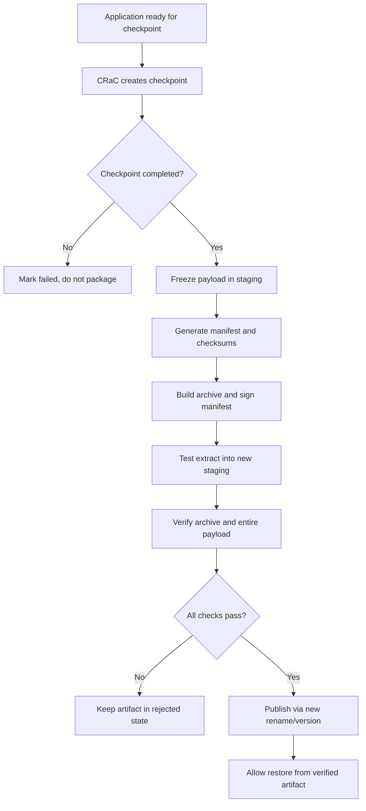

# Checksum Verification and Detecting Missing or Corrupted Images

A CRaC checkpoint is a collection of data that the JVM and runtime use to restore a process. Depending on the distribution and runtime version, the checkpoint directory may contain multiple images, metadata, and auxiliary files. If even a single required file is missing or part of the data is altered during copying, packaging, or storage, restore may fail or fail to recover the proper state.

Therefore, before transferring a checkpoint to another machine, pushing it to an artifact store, or using it for restore, you must verify the integrity of the entire bundle. A common approach is to create a manifest listing each file, its size, and its SHA-256 checksum; then verify the manifest against the packaged directory. The check must detect at least four cases: missing files, extra unexpected files outside the list, incorrect sizes, and content not matching the checksum.

Checksums detect unintended data corruption. They do not prove that a checkpoint is compatible with the target JDK, operating system, or architecture, nor do they prove that the manifest came from a trusted source. To protect the bundle from intentional replacement, sign the manifest or use an authenticated storage mechanism.

## 1. A Checkpoint Is a Multi-File Package

Do not treat a checkpoint as a single file. The CRaC runtime typically saves process state as a directory structure with multiple components. Filenames, directory structure, and internal metadata may vary by runtime, CRaC version, operating system, and how the checkpoint was created.

A checkpoint bundle can be organized at the outer packaging layer as follows:

```text
checkpoint-bundle/
├── checkpoint/                 # Content created by CRaC runtime
│   ├── ...                     # Runtime-dependent images and metadata
│   └── ...
├── checkpoint-manifest.json   # File list, sizes, and SHA-256
├── checkpoint-manifest.sig    # Detached signature of the manifest (if used)
└── bundle-info.txt             # Optional packaging information
```

The `checkpoint/` directory in the example is simply the runtime-generated checkpoint directory. Do not assume the filenames inside are fixed, and do not rename, delete, or edit internal images to make the package smaller. Treat that structure as an artifact owned by the runtime.

The manifest is placed outside the checkpoint directory so it can list and verify all payload files without having to exclude the manifest itself from the checksum list. The signature should also be a detached file outside the payload so the verification flow remains clear.

## 2. What Is a Checksum and What Can It Detect?

A checksum is a value computed from file contents using a hash algorithm. With SHA-256, the same input byte sequence produces the same 256-bit digest. If a single bit in the file changes, the recomputed digest will almost certainly differ.

Example manifest entry:

```json
{
  "path": "image-a.img",
  "size": 1048576,
  "sha256": "9f86d081884c7d659a2feaa0c55ad015a3bf4f1b2b0b822cd15d6c15b0f00a08"
}
```

The hash value here only illustrates the format; it is not the checksum of an actual checkpoint.

When verifying, the tool reads the file, recomputes SHA-256, and compares it against the value in the manifest. Combined with the file list and sizes, the workflow can detect:

| Situation | Detection Signal |
|---|---|
| Required file missing | Path appears in manifest but does not exist in payload |
| File truncated or size altered | Actual size differs from `size` in manifest |
| File content modified or corrupted | Actual SHA-256 differs from `sha256` in manifest |
| Unknown file added to bundle | Payload contains a file not listed in manifest |
| Manifest malformed or missing fields | Fails to parse or fails schema validation |
| Unsafe manifest path | Absolute path, contains `..`, or escapes payload directory |
| File unreadable | I/O error or access permission error during verification |

Size and checksum complement each other. Size mismatches quickly catch truncated files or replacements of different lengths; checksums catch content modifications even when size remains unchanged.

## 3. Why Use SHA-256?

SHA-256 belongs to the SHA-2 family and is provided in Java via `MessageDigest`. It is a suitable choice for detecting transfer errors, storage errors, and content changes in checkpoint bundles.

Do not use MD5 or SHA-1 for new designs requiring collision resistance. CRC32 is useful for detecting some simple transmission errors, but it is not a cryptographic hash function and is unsuitable for verifying integrity against intentional data substitution.

An important point: a checksum is not a digital signature. If a recipient downloads both the payload and the manifest from the same untrusted source, an attacker can modify a file and regenerate the manifest with new checksums. SHA-256 would still match in that case. To verify provenance, sign the manifest with a protected private key and verify the signature with a trusted public key, or use HMAC with a securely shared secret.

## 4. Generating the Manifest After Checkpoint Completion

Generate the manifest only after the runtime reports that checkpointing succeeded and no process is still writing to the checkpoint directory. If you compute hashes while files are still being created or copied, the manifest may describe an incomplete state.

A manifest should contain:

| Field | Meaning |
|---|---|
| `formatVersion` | Manifest schema version so verification tools know how to read it |
| `checkpointId` | Unique identifier of the checkpoint |
| `createdAt` | Timestamp when checkpoint was created or packaging completed |
| `runtime` | Vendor, JDK/CRaC version, OS, and architecture if available |
| `files` | List of payload files with relative path, size, and SHA-256 |

Example compact manifest:

```json
{
  "formatVersion": 1,
  "checkpointId": "orders-api-2026-11-13T064500Z",
  "createdAt": "2026-11-13T06:45:00Z",
  "runtime": {
    "jdk": "vendor-and-version-recorded-at-build-time",
    "crac": "runtime-version",
    "os": "linux",
    "architecture": "x86_64"
  },
  "files": [
    {
      "path": "metadata/file-a",
      "size": 4096,
      "sha256": "..."
    },
    {
      "path": "images/file-b",
      "size": 1048576,
      "sha256": "..."
    }
  ]
}
```

The names `metadata/file-a` and `images/file-b` are merely examples of relative paths from the `checkpoint/` payload directory, excluding that root folder name itself. Record every actual file created by the runtime; do not invent names or guess internal structure.

The manifest must be generated from the final payload to be distributed. If operations such as compression, encryption, format conversion, or file changes happen after creating the manifest, re-verify the payload after decompression or generate a new manifest for the final payload.

## 5. Computing SHA-256 in Java Using Streaming

Do not read an entire image into RAM just to compute a hash. Checkpoints can be much larger than the memory allocated to the packaging tool. Read block by block using an `InputStream` and update `MessageDigest`.

```java
import java.io.IOException;
import java.io.InputStream;
import java.nio.file.Files;
import java.nio.file.Path;
import java.security.MessageDigest;
import java.security.NoSuchAlgorithmException;
import java.util.HexFormat;

public final class CheckpointHashes {
    private CheckpointHashes() {
    }

    public static String sha256(Path file)
            throws IOException, NoSuchAlgorithmException {
        MessageDigest digest = MessageDigest.getInstance("SHA-256");
        byte[] buffer = new byte[1024 * 1024];

        try (InputStream input = Files.newInputStream(file)) {
            int read;
            while ((read = input.read(buffer)) != -1) {
                digest.update(buffer, 0, read);
            }
        }

        return HexFormat.of().formatHex(digest.digest());
    }
}
```

A 1 MiB buffer is just an illustrative choice. It can be tuned based on file size, storage speed, and memory. Use `try-with-resources` to close the stream even if reading encounters an error.

`MessageDigest.getInstance("SHA-256")` can throw `NoSuchAlgorithmException` if the JVM provider does not supply the algorithm. SHA-256 is a standard algorithm in common JDKs, yet the packaging tool should still handle errors rather than assuming every operation succeeds.

## 6. Building the File List in the Manifest

An inventory step must walk the entire directory tree, accept only supported file types, and compute the hash of each file. The example below uses a record to represent an entry:

```java
import java.io.IOException;
import java.nio.file.Files;
import java.nio.file.LinkOption;
import java.nio.file.Path;
import java.util.ArrayList;
import java.util.Comparator;
import java.util.List;
import java.util.stream.Stream;

public record CheckpointFile(
        String path,
        long size,
        String sha256) {
}

public final class CheckpointInventory {
    private CheckpointInventory() {
    }

    public static List<CheckpointFile> create(Path checkpointRoot)
            throws Exception {
        Path root = checkpointRoot.toRealPath();
        List<CheckpointFile> files = new ArrayList<>();

        try (Stream<Path> paths = Files.walk(root)) {
            for (Path path : paths
                    .filter(p -> !p.equals(root))
                    .sorted(Comparator.comparing(Path::toString))
                    .toList()) {

                if (Files.isSymbolicLink(path)) {
                    throw new IOException("Symlink is not allowed: " + path);
                }

                if (Files.isDirectory(path, LinkOption.NOFOLLOW_LINKS)) {
                    continue;
                }

                if (!Files.isRegularFile(path, LinkOption.NOFOLLOW_LINKS)) {
                    throw new IOException("Unsupported filesystem entry: " + path);
                }

                String relative = root.relativize(path).toString()
                        .replace(path.getFileSystem().getSeparator(), "/");

                files.add(new CheckpointFile(
                        relative,
                        Files.size(path),
                        CheckpointHashes.sha256(path)));
            }
        }

        return List.copyOf(files);
    }
}
```

The example requires Java 17 or newer because it uses records and `Stream.toList()`. If the project uses an older Java version, replace the record with a regular class and collect results with `Collectors.toList()`.

This code chooses a strict policy: rejecting symbolic links and filesystem entries that are neither regular files nor directories. This is a safe choice for checkpoint bundles with ordinary file structures. If the runtime's artifact format has special requirements for symbolic links, represent and verify link targets using a dedicated schema rather than following links to hash files outside the payload tree.

## 7. Verifying the Manifest and Detecting Missing, Extra, or Corrupted Files

When receiving a checkpoint bundle, do not check only a few sample files. Compare the entire actual inventory against the manifest:

1. Parse the manifest and confirm `formatVersion` is supported.
2. Verify each entry's path is a valid relative path.
3. Reject duplicate path entries.
4. Confirm each file exists and is a regular file.
5. Compare actual size against declared size.
6. Recompute SHA-256 and compare digests.
7. Walk the payload again to detect files not listed in the manifest.
8. Accept the bundle only if all checks pass.

The JSON manifest can be read with Jackson. Example Java schema:

```java
import java.util.List;

public record RuntimeMetadata(
        String jdk,
        String crac,
        String os,
        String architecture) {
}

public record CheckpointManifest(
        int formatVersion,
        String checkpointId,
        String createdAt,
        RuntimeMetadata runtime,
        List<CheckpointFile> files) {
}
```

The verifier below illustrates the core checks. It assumes `checkpoint-manifest.json` sits next to the payload directory and is read from a trusted location:

```java
import com.fasterxml.jackson.databind.ObjectMapper;

import java.io.IOException;
import java.nio.file.Files;
import java.nio.file.LinkOption;
import java.nio.file.Path;
import java.security.MessageDigest;
import java.util.HashMap;
import java.util.HashSet;
import java.util.Map;
import java.util.Set;
import java.util.stream.Stream;

public final class CheckpointVerifier {
    private static final int SUPPORTED_FORMAT = 1;

    private CheckpointVerifier() {
    }

    public static void verify(
            Path checkpointRoot,
            Path manifestPath) throws Exception {

        Path root = checkpointRoot.toRealPath();
        CheckpointManifest manifest = new ObjectMapper().readValue(
                manifestPath.toFile(), CheckpointManifest.class);

        if (manifest.formatVersion() != SUPPORTED_FORMAT) {
            throw new IOException("Unsupported manifest format: "
                    + manifest.formatVersion());
        }

        Map<String, CheckpointFile> expected = new HashMap<>();
        for (CheckpointFile entry : manifest.files()) {
            validateRelativePath(entry.path());
            if (entry.size() < 0 || entry.sha256() == null
                    || !entry.sha256().matches("[0-9a-fA-F]{64}")) {
                throw new IOException("Invalid manifest entry: " + entry.path());
            }
            if (expected.putIfAbsent(entry.path(), entry) != null) {
                throw new IOException("Duplicate manifest path: " + entry.path());
            }
        }

        // Inventory and reject symlinks before opening any file in the manifest.
        Set<String> actual = new HashSet<>();
        try (Stream<Path> paths = Files.walk(root)) {
            for (Path path : paths.filter(p -> !p.equals(root)).toList()) {
                if (Files.isSymbolicLink(path)) {
                    throw new IOException("Unexpected symbolic link: " + path);
                }
                if (Files.isDirectory(path, LinkOption.NOFOLLOW_LINKS)) {
                    continue;
                }
                if (!Files.isRegularFile(path, LinkOption.NOFOLLOW_LINKS)) {
                    throw new IOException("Unsupported filesystem entry: " + path);
                }

                String relative = root.relativize(path).toString()
                        .replace(path.getFileSystem().getSeparator(), "/");
                actual.add(relative);
            }
        }

        for (String expectedPath : expected.keySet()) {
            if (!actual.contains(expectedPath)) {
                throw new IOException("Missing file: " + expectedPath);
            }
        }
        for (String actualPath : actual) {
            if (!expected.containsKey(actualPath)) {
                throw new IOException("Unexpected file not in manifest: "
                        + actualPath);
            }
        }

        for (Map.Entry<String, CheckpointFile> item : expected.entrySet()) {
            Path file = root.resolve(item.getKey()).normalize();
            if (!file.startsWith(root)
                    || !Files.isRegularFile(file, LinkOption.NOFOLLOW_LINKS)) {
                throw new IOException("Missing or non-regular file: "
                        + item.getKey());
            }

            CheckpointFile entry = item.getValue();
            long actualSize = Files.size(file);
            if (actualSize != entry.size()) {
                throw new IOException("Size mismatch for " + entry.path()
                        + ": expected " + entry.size()
                        + ", got " + actualSize);
            }

            String actualHash = CheckpointHashes.sha256(file);
            if (!MessageDigest.isEqual(
                    actualHash.toLowerCase().getBytes(java.nio.charset.StandardCharsets.US_ASCII),
                    entry.sha256().toLowerCase().getBytes(java.nio.charset.StandardCharsets.US_ASCII))) {
                throw new IOException("SHA-256 mismatch for " + entry.path());
            }
        }
    }

    private static void validateRelativePath(String value)
            throws IOException {
        if (value == null || value.isBlank()
                || value.startsWith("/")
                || value.contains("\\")
                || value.contains(":")) {
            throw new IOException("Unsafe manifest path: " + value);
        }
        for (String segment : value.split("/", -1)) {
            if (segment.isBlank() || segment.equals(".")
                    || segment.equals("..")) {
                throw new IOException("Unsafe manifest path: " + value);
            }
        }
    }
}
```

The verifier above throws an exception on the first error to prevent using an unverified bundle. A full packaging tool can replace this with a `VerificationReport` that collects all errors so operators see every missing or corrupted file in a single run. Either way, the overall status should be `VERIFIED` only when every entry is valid and no extra files exist.

To use `ObjectMapper`, the project needs Jackson Databind on the classpath; if using records as in the example, use a Jackson version that supports records (2.12 or later). `RuntimeMetadata` in the record corresponds to the `runtime` object in the sample manifest. This example is illustrative code for the verifier structure; add logging, checkpoint ID information, and error reporting according to your project's tooling conventions.

## 8. Safe Manifest Path Validation

The manifest is input data. Never trust a path simply because it appears in JSON. If a manifest contains `../../some-file`, joining it directly with the checkpoint directory could cause the tool to read files outside the payload. This is a path traversal vulnerability.

A verifier must:

- Accept only relative paths.
- Reject `..`, `.`, empty segments, absolute paths, and non-standard separators.
- Normalize the path after resolving and confirm it still stays beneath the root.
- Do not follow symbolic links unless the schema explicitly supports links.
- Reject duplicate entries and unsupported filesystem entry types.
- Never allow the manifest to dictate writing files to arbitrary locations.

When running on Windows and Unix-like systems, use relative paths normalized with `/` in the manifest to avoid differing interpretations. Do not use absolute paths because the mount location of the checkpoint often differs across environments.

In addition, ensure the payload cannot be modified during verification. A safe workflow typically extracts into a separate staging directory, prevents other processes from writing to it, completes verification, and only then publishes or restores from that exact directory. If a file can be replaced after hashing but before restoring, the verification result no longer guarantees the file being restored. This is a time-of-check/time-of-use race condition.

## 9. Quick Checks Using OS Tools

For small bundles or incident investigation, built-in checksum utilities can be used. This is a manual check; automated pipelines should still compare the full manifest and detect extra files.

### Linux

Compute the checksum for a single file:

```bash
sha256sum checkpoint.tar.zst
```

Create a checksum list for the payload:

```bash
find checkpoint -type f -print0 \
  | sort -z \
  | xargs -0 sha256sum > checkpoint.SHA256SUMS
```

Verify saved checksums:

```bash
cd package-root
sha256sum -c checkpoint.SHA256SUMS
```

A file missing from the list or having different content will cause the command to report an error. This command does not automatically detect all extra files absent from the list; compare the inventory separately if you need to verify the exact payload.

### Windows PowerShell

Compute the hash of an archive:

```powershell
Get-FileHash -LiteralPath '.\checkpoint-bundle.zip' -Algorithm SHA256
```

Compute the hash of a single checkpoint file:

```powershell
Get-FileHash -LiteralPath '.\checkpoint\some-image-file' -Algorithm SHA256
```

Compare the `Hash` output against the SHA-256 value distributed through a trusted channel. `Get-FileHash` computes the hash for the specified file; it does not automatically cross-check the list of files in the manifest.

## 10. Verifying the Archive and Payload After Extraction

Packaging a checkpoint into ZIP, TAR, or another archive introduces another layer that can become corrupted during transfer. Verify both the archive and its extracted contents.

Recommended workflow:

1. Create the completed checkpoint in a staging directory.
2. Generate the manifest for the entire checkpoint payload.
3. Build the archive containing the payload and manifest.
4. Compute SHA-256 of the archive itself and store it in a trusted location or sign the bundle metadata.
5. Transfer the archive to storage or the restore host.
6. Verify the archive checksum before extraction.
7. Extract into a new staging directory without overwriting an active checkpoint.
8. Verify the manifest over the extracted directory tree.
9. Publish or restore only when both verification layers succeed.

The archive checksum detects whether the archive was altered in transit. The manifest inside the archive verifies each file after extraction. Both layers are useful: an archive may be readable yet one file inside does not match the manifest; or individual payload files are intact yet the transferred archive was truncated or structurally corrupted.

ZIP typically stores CRC32 per entry to detect common data errors. CRC32 does not replace SHA-256 when cryptographic verification is needed. TAR itself does not provide cryptographic checksums for the entire payload; use a manifest or an archive format with appropriate integrity support.

## 11. Distinguishing Checksums from Signatures and Compatibility

These three checks answer three different questions:

| Check | Question Answered | Example |
|---|---|---|
| Checksum | Is the content identical to the data when the manifest was created? | Per-file SHA-256 |
| Manifest signature/authentication | Did the manifest come from a trusted publisher? | Digital signature or HMAC |
| Compatibility check | Can the target runtime restore this checkpoint? | JDK, CRaC runtime, OS, architecture, native libraries, and config |

A bundle with completely valid checksums can still fail to restore if it was created by a different runtime version or in an incompatible environment. Conversely, a runtime-compatible checkpoint can still be corrupted due to missing files. Therefore, checksum verification is a necessary condition for reliable packaging, not a sufficient condition for successful restore.

Compatibility metadata should be stored in the manifest or bundle metadata: JDK vendor/version, CRaC runtime version, operating system, architecture, application version, critical native libraries, and required deployment conditions. These fields help decide whether to attempt restore; the runtime itself remains the final arbiter.

## 12. Signing the Manifest to Verify Origin

If a checkpoint is distributed via an artifact repository, object storage, or multi-team pipelines, ensure the manifest cannot be replaced alongside the payload. You can sign the manifest file with the publishing system's private key and verify the signature with a trusted public key at the restore site.

A verification flow:

1. Receive `checkpoint-manifest.json` and the detached signature.
2. Verify the signature using a public key provisioned independently of the bundle.
3. Trust the manifest entries only after the signature validates.
4. Recompute SHA-256 for each file and compare.
5. Check compatibility metadata.
6. Transition the bundle to verified state.

Do not place the sole public key inside the archive itself and treat it as a source of trust. An attacker could replace both the public key and the signature. Public keys or HMAC secrets must be distributed via a trust store, secret manager, KMS, or trusted key management mechanism.

If using HMAC, every party authorized to verify can also forge a valid signature because they hold the shared secret. Asymmetric digital signatures are better suited when the publisher needs to retain signing authority while multiple consumers only need verification rights.

## 13. Atomic Packaging and Avoiding Incomplete Checkpoints

Do not package a checkpoint directory while the runtime is still writing images. Premature copying can produce an inconsistent file tree: the manifest may miss newly created files, or a copied file may contain only partial data.

Use staging and atomic publishing:



A staging directory should reside on the same filesystem as the target directory if the workflow relies on atomic rename. If atomic move is not supported, do not silently treat a file-by-file copy as an atomic publish; use a versioned directory and a final reference/metadata switch after verification.

Never overwrite an already-published checkpoint. Create a new version, complete verification, and then update the release pointer or metadata to point to the new version. This enables rollback and prevents restore processes from reading a changing file tree.

## 14. Error Classification and Pipeline Reactions

When verification fails, return specific error codes or statuses so operators know whether to recreate the checkpoint, re-transfer the archive, or fix access permissions.

| Status | Cause | Action |
|---|---|---|
| `MISSING_FILE` | File in manifest does not exist | Reject bundle; recreate or re-transfer from trusted source |
| `SIZE_MISMATCH` | Size differs from manifest | Check for truncated copy, storage, or archive extraction issue |
| `HASH_MISMATCH` | Content differs from SHA-256 | Reject bundle; do not manually patch the image |
| `UNEXPECTED_FILE` | File exists outside inventory | Check packaging operation or extra data added to payload |
| `INVALID_MANIFEST` | Invalid JSON/schema/format version | Stop verification and check tool version |
| `UNSAFE_PATH` | Manifest contains path traversal or absolute path | Reject bundle as unsafe data |
| `SIGNATURE_INVALID` | Invalid signature or untrusted key | Reject bundle and inspect distribution source |
| `READ_ERROR` | Insufficient permissions or storage I/O error | Check permissions, mounts, and storage health |
| `INCOMPATIBLE_RUNTIME` | Metadata incompatible with target runtime | Use a compatible runtime or create a new checkpoint |

Do not automatically ignore a corrupted file just because the filename looks unimportant. If the runtime placed that file in the checkpoint payload, only the runtime can determine whether the file is mandatory. A general verifier should validate the exact inventory produced by a successful checkpoint.

## 15. Pre-Restore Verification Workflow

Before starting the JVM with a checkpoint path, the pipeline should perform all steps:

1. Confirm the original checkpoint operation ended successfully.
2. Verify bundle ID and manifest version.
3. Verify the manifest signature if the workflow requires origin authentication.
4. Verify the archive checksum prior to extraction.
5. Extract into an isolated staging directory.
6. Compare the entire actual file list against the manifest.
7. Verify size and SHA-256 of every file.
8. Check compatibility metadata against the restore runtime and environment.
9. Mark the artifact as verified and disallow payload modifications after this step.
10. Restore only from the exact verified directory.

If any step fails, do not run restore from that bundle. Recreate the checkpoint from the source or re-transfer the intact artifact. Never try to work around failures by creating empty files, renaming other images, or editing the manifest to force checksums to match.

## 16. Logging and Auditing

Each bundle creation or verification run should record:

- `checkpointId` and manifest version.
- Checkpoint creation timestamp and packaging completion timestamp.
- Runtime/JDK, CRaC version, OS, and architecture.
- File count and total payload size.
- Checksum algorithm and verification outcome.
- Archive hash and signature identifier, if present.
- Counts of missing files, extra files, size mismatches, and hash mismatches.
- Verifier tool and version executed.
- Final outcome: verified, rejected, or I/O error.

Never log image contents, tokens, secrets, or memory data. A checkpoint may contain sensitive application state; access to the bundle, manifest, and signatures must be controlled just like access to runtime data.

## 17. Checkpoint Packaging Checklist

- [ ] Runtime confirms checkpoint completion before packaging starts.
- [ ] Payload is kept immutable while generating manifest and verifying.
- [ ] Manifest lists every checkpoint file using relative paths.
- [ ] Each entry has size and SHA-256.
- [ ] Verifier detects missing files, extra files, size mismatches, and hash mismatches.
- [ ] Verifier rejects path traversal, absolute paths, and unsupported file types.
- [ ] Archive is checksummed prior to extraction.
- [ ] Extracted payload is re-verified against the manifest.
- [ ] Manifest is signed or authenticated via a trusted source if anti-tampering is required.
- [ ] Runtime metadata is recorded for compatibility checking.
- [ ] Bundle is published only after verification completes.
- [ ] Restore uses only the exact verified and subsequently unmodified artifact.
- [ ] Faulty artifacts are discarded or kept in rejected state, without manually patching images.

## 18. References

- [Java `MessageDigest`](https://docs.oracle.com/en/java/javase/21/docs/api/java.base/java/security/MessageDigest.html): API for computing digests such as SHA-256 via streaming.
- [Java `Files`](https://docs.oracle.com/en/java/javase/21/docs/api/java.base/java/nio/file/Files.html): walking directory trees, checking files, reading sizes, and handling symbolic links.
- [Java `Path`](https://docs.oracle.com/en/java/javase/21/docs/api/java.base/java/nio/file/Path.html): normalizing and validating relative paths.
- [CRaC Project](https://crac.org/): information on checkpoint/restore and the CRaC runtime.

Checksums and manifests verify that a checkpoint bundle is packaged completely and that each file's contents have not changed since the inventory was created. Generate the manifest after checkpointing completes, check all files and paths, verify the archive before and after extraction, and sign the manifest if provenance protection is needed. Transition a checkpoint to a restorable state only when all integrity and compatibility checks pass.
