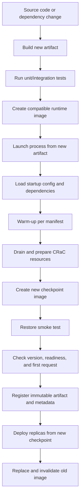

# When an Image Must Be Rebuilt After Source Code Changes or Patches

A CRaC checkpoint is the state of a Java process at a point in time. It captures memory state and execution state supported by the runtime and the checkpoint/restore environment. Upon restore, the application continues from the saved state; the JVM does not start over from scratch to read a new JAR or reload all classes like a cold start.

Therefore, when source code, bytecode, packaged resources, or dependencies change, the checkpoint image must be re-evaluated. If a change must affect the running code, the standard deployment approach is to build a new artifact, launch the application from that artifact, perform warm-up, and create a new checkpoint image. Processes restored from an old image still carry the state of the old version, even if the JAR file on the filesystem or the container image has been replaced.

The key point is to distinguish the **application artifact** from the **checkpoint image**. The application artifact contains the code and resources of an application version. The checkpoint image contains the process state initialized from a specific artifact, JDK, and environment. Replacing the artifact does not automatically update an existing checkpoint.

## 1. Which Code Version Does a Checkpoint Image Hold?

During a cold startup, the Java launcher loads classes from the classpath/module path, creates classloaders, runs static initializers, and initializes the application. At checkpoint time, the state of the running process is saved. Loaded classes, created objects, bound configuration, and execution state can be restored along with the process.

Suppose the application is running version `orders-service:1.4.2`. After warm-up, the process creates checkpoint `orders-service-1.4.2-crac`. Later, the development team fixes a bug in `OrderService.java` and builds `orders-service:1.4.3`.

If the old checkpoint is restored, the process continues using the state created from `1.4.2`. Copying JAR `1.4.3` to the same path does not replace classes already loaded into the JVM. Restore does not invoke the launcher again, does not re-run `main()`, and does not rebuild the Spring context.

```text
Build 1.4.2
    |
    v
Launch JVM from artifact 1.4.2
    |
    v
Load classes and initialize application
    |
    v
Warm-up
    |
    v
Checkpoint image A (code 1.4.2)
    |
    +---- Restore image A ----> continues code 1.4.2

Fix bug and build 1.4.3
    |
    v
Launch new JVM from artifact 1.4.3
    |
    v
Re-initialize and warm-up
    |
    v
Checkpoint image B (code 1.4.3)
    |
    +---- Restore image B ----> continues code 1.4.3
```

This is why source code changes or patches that alter application behavior usually require creating a new checkpoint image. The new image must be created from the exact released artifact.

## 2. Distinguishing Application Artifacts, Container Images, and Checkpoint Images

In a deployment pipeline, these three types of artifacts can be managed separately:

| Artifact | What does it contain? | Role |
|---|---|---|
| Application artifact | JAR/WAR, classes, resources, dependencies, or application package | Defines the code version and application resources |
| Container/runtime image | JDK, OS user space, system libraries, application, and runtime configuration | Provides the environment to launch the application or restore depending on the deployment model |
| Checkpoint image | Checkpointed process state, along with related metadata/runtime artifacts | Rapidly initializes the process from a prepared state |

Naming and storage of checkpoint artifacts depend on the CRaC JDK, checkpoint/restore tooling, and deployment platform. Some systems store checkpoints in a separate directory or volume; others package them with container layers or release artifacts. Regardless of how it is stored, a checkpoint remains bound to the captured process version.

A new container tag does not automatically make an old checkpoint contain new code. If the platform still points to the old checkpoint, it can continue restoring the old state. The pipeline must update the application artifact, the checkpoint artifact, and the active deployment reference.

## 3. Changes That Typically Require Creating a New Checkpoint Image

### Source Code or Bytecode Changes

The following changes typically require launching from a new build and creating a new checkpoint:

- Modifying business logic or algorithms.
- Fixing bugs, adding validation, or changing exception handling.
- Changing API contracts, controllers, services, repositories, or interceptors.
- Changing classes, methods, fields, annotations, or object structures that affect application state.
- Changing code automatically generated during the build process.

Classes already loaded in the JVM are not automatically replaced by new classes on disk. If some classes were loaded before checkpoint and others are only loaded after restore, replacing the JAR underneath the classloader can lead to a process containing classes from multiple versions. This is an unpredictable state and should not be used as an update mechanism.

### Packaged Resource Changes

Resources inside a JAR are also part of the application artifact:

- HTML, email, or report templates.
- SQL files, migration metadata, and schemas.
- Rules, mappings, serializer configurations, or XML/JSON files.
- Static assets, certificate bundles, or packaged data files.

One resource may have been read and retained in the heap before checkpoint. Another resource may only be read for the first time after restore. If the JAR is replaced while still using an old checkpoint, the two cases can yield different results: already-read objects retain old content, while lazily read resources may see the new file if the path/archive was replaced and remains accessible to the classloader. This can create a mixed-version state.

When packaged resources change and must apply uniformly, build a new artifact and create a new checkpoint. For external files designed for dynamic refresh, use a versioned, explicitly checked refresh mechanism instead of replacing files silently.

### Dependency or Classpath Changes

Create a new image when changes affect classes or runtime dependencies, such as:

- Upgrading/downgrading Java library versions.
- Replacing a JDBC driver, HTTP client, Kafka client, or RabbitMQ client.
- Replacing Spring Boot/Spring Framework or another framework.
- Changing the classpath, module path, service providers, or loaded plugins.
- Changing a Java agent or instrumentation agent.
- Changing native libraries, JNI/JNA bindings, or ABI-dependent components.

New dependencies must be loaded in a new process to ensure the entire classloader and object graph are consistent with the built version. Updating external dependency files alone does not replace loaded classes or created objects in the checkpoint.

### JDK, JVM Options, or Platform Runtime Changes

A checkpoint image also depends on the supported runtime and environment. Changing the JDK/CRaC distribution, critical JVM options, operating system, CPU architecture, kernel, or native libraries can make an old image incompatible or no longer meet operational requirements.

For example:

- Upgrading the JDK to receive security patches or runtime bug fixes.
- Changing the GC selection, heap sizing, or JVM flags tied to initialization.
- Upgrading a native library or OS package that the process depends on.
- Moving to a different CPU architecture or kernel environment.

For these changes, create and test the checkpoint in the new compatible runtime environment. Do not assume a checkpoint created with an older JDK or kernel can safely restore on any other runtime. Follow the compatibility matrix and guidance of the CRaC distribution being deployed.

## 4. Decision Table: Which Changes Require a New Image?

| Type of change | Typically appropriate action | Reason |
|---|---|---|
| Modifying Java classes or bytecode | Build and create a new checkpoint | Loaded classes do not automatically change upon restore |
| Replacing JAR/WAR or dependencies | Create a new checkpoint | Classloaders and object graph must come from the same build |
| Changing templates/resources packaged in the JAR | Create a new checkpoint if uniform application is required | Resources may already be loaded or lazily read from old/new archives |
| Replacing Java agents or native libraries | Start a new process and create a new checkpoint | Agent/native state is bound to the runtime and process |
| Upgrading JDK/CRaC or JVM startup options | Create a new checkpoint in the new runtime | Checkpoints depend on a compatible runtime |
| Changing startup config files already bound to beans | Intentional refresh or create a new checkpoint | Beans/objects in the heap still hold the old configuration |
| Changing feature flags from a config service | Can be refreshed after restore if supported | This is dynamic external configuration outside the process |
| Changing database or broker endpoints | Create new client/pool and refresh config; new image if static startup changes | Existing connections do not automatically switch to new endpoints |
| Short-lived tokens or certificates expiring | Refresh/re-authenticate after restore | Expiration time continues to advance during checkpoint |
| Changing database schema | Deploy coordinated, version-compatible migrations; usually accompanied by a new build | Old code and new schema must be compatible during the rollout phase |
| Changing log level via runtime API | Can be hot-changed if supported by the logging framework | Does not necessarily require changing bytecode or JVM |

This is a classification guide. The final decision depends on how the application loads configuration, framework refresh capabilities, and library compatibility requirements.

## 5. Why You Should Not Patch a JAR in Place and Restore an Old Image

Suppose a checkpoint was created from `/app/application.jar` version `2.0.0`. Later, the pipeline copies `2.0.1` over the same path while still requesting a restore of the old checkpoint.

Classes already loaded before checkpoint remain the class definitions from `2.0.0`. Objects in the heap still have fields and state created by `2.0.0` code. Static initializers do not re-run. Created Spring beans and proxies remain old objects.

Meanwhile, if a classloader needs to load a class that was never used before, it might read bytes from the current archive depending on how the classpath and files are managed. The potential result is a process mixing old and new classes. Resources may be mixed in a similar way.

```text
Checkpoint created from JAR 2.0.0
       |
       +-- Loaded Class A: bytecode 2.0.0
       +-- Unloaded Class B: no definition in JVM yet
       +-- Beans/configuration: objects created per 2.0.0

Replace JAR on disk with 2.0.1
       |
       +-- Restore old checkpoint
       +-- Class A remains 2.0.0
       +-- Class B may be loaded from the archive currently at the path
       +-- Beans/configuration remain in 2.0.0 state
       |
       v
Risk of mixed-version process and inconsistent behavior
```

Replacing files underneath a checkpointed process should not be used as a patching mechanism. Keep artifacts immutable and create a new checkpoint from a new build.

## 6. HotSwap and Instrumentation Do Not Replace the CRaC Release Workflow

Some development tools can swap class definitions inside a running JVM via Java Instrumentation or debugger HotSwap. This capability is limited, tool-dependent, and generally does not support all class structure changes. It also does not automatically update already created objects, bound configuration, packaged resources, or native state.

Even when a tool can replace a class definition before creating a checkpoint, this is not the default production release workflow. Using it would require class version control, object state verification, internal serialization compatibility, restore testing, and artifact management. The safer and more reproducible approach remains building a new artifact, starting a new process, warming up, and creating a new checkpoint.

Restore should not be understood as a HotSwap operation. Restore resumes saved state; its job is not to look up new classes, apply patches, or migrate an object graph to a new version.

## 7. Dynamic Configuration Can Be Refreshed Without Creating a New Image

Not every change requires a new checkpoint. Some values are designed to be read from external systems after restore:

- Feature flags or routing rules from a config service.
- Service endpoints re-resolved via service discovery.
- Tokens or credentials newly issued from a secret manager/identity provider.
- Leases, leader assignments, or instance identities re-registered.
- Log levels changed via the logging framework's API.
- Concurrency limits that can be resized if the executor or pool supports it safely.

To refresh properly, the application must read the new configuration, validate it, and apply it coherently. Changing an external environment variable or YAML file does not automatically update objects already bound in the heap. `System.setProperty()` also does not automatically reconfigure beans or change JVM options.

For example, a provider can load a new configuration snapshot after restore:

```java
import org.crac.Context;
import org.crac.Core;
import org.crac.Resource;

public final class RuntimeConfigResource implements Resource {

    private final ConfigProvider provider;
    private final ConfigApplier applier;

    public RuntimeConfigResource(ConfigProvider provider,
                                 ConfigApplier applier) {
        this.provider = provider;
        this.applier = applier;
        Core.getGlobalContext().register(this);
    }

    @Override
    public void beforeCheckpoint(Context<? extends Resource> context) {
        applier.stopConfigDependentWork();
    }

    @Override
    public void afterRestore(Context<? extends Resource> context)
            throws Exception {
        RuntimeConfig candidate = provider.loadCurrent();
        provider.validate(candidate);
        applier.apply(candidate);
    }
}
```

`ConfigProvider`, `ConfigApplier`, and `RuntimeConfig` are application abstractions. The example illustrates the refresh location, not standard CRaC APIs. If the new configuration requires replacing a datasource, HTTP client, or executor, `apply()` must create the new resource, verify operation, switch usage, and close the old resource in a safe sequence.

If the new configuration changes bean structure, classes, algorithms, or startup behavior that does not support refresh, create a new application artifact and checkpoint.

## 8. Security Patches Must Invalidate Old Checkpoints

When a patch fixes a vulnerability in the application, a dependency, the JDK, or a native library, building a new JAR is not enough. You must ensure no replicas can still be started from a checkpoint image containing the vulnerable component.

A patch-handling workflow should include:

1. Identify affected components: application code, dependencies, JDK, OS packages, or native libraries.
2. Build a new artifact from the patched source and lock dependency versions.
3. Build a new runtime/container image if the patch changes the underlying environment.
4. Launch the application from the new artifact, run warm-up, and create a new checkpoint.
5. Perform restore testing and verify the running build/version.
6. Update deployments to reference only the new checkpoint image.
7. Replace all old replicas, including idle replicas or replicas scaled to zero that could still be restored.
8. Revoke or delete old checkpoints according to storage and rollback policies.
9. Confirm autoscalers, jobs, node caches, and pipelines no longer have any path to launch the old image.

In particular, scaling to zero does not mean the old image has been eliminated. If the old checkpoint remains in a registry, object storage, or platform cache, a subsequent scale-up could inadvertently launch the vulnerable version again.

For urgent security patches, rolling back to an old image could reintroduce the vulnerability into the system. Evaluate the risk before allowing rollback, and it may be necessary to completely invalidate old checkpoints.

## 9. Versioning and Metadata Management for Checkpoint Images

A checkpoint image should be managed as an immutable artifact with a clear identity. Avoid using a generic name like `latest` and overwriting content under the same name.

Release metadata should record:

| Field | Purpose |
|---|---|
| Application version/build ID | Identifies the source code version |
| Source commit or release tag | Traces back to the change that produced the artifact |
| Application artifact digest | Verifies the JAR/package has the exact expected content |
| Dependency lock/SBOM revision | Identifies the packaged library set |
| JDK and CRaC distribution/build | Identifies the runtime that created the checkpoint |
| JVM startup options profile | Records relevant JVM configuration |
| OS/kernel/architecture | Tracks environmental compatibility conditions |
| Static config revision | Identifies the loaded initialization configuration |
| Warm-up manifest version | Identifies the scenario set that prepared the state |
| Checkpoint creation time | Tracks the age of the image |
| Checkpoint artifact digest | Verifies the exact checkpoint deployed |

Do not record passwords, access tokens, private keys, or secrets directly in metadata. You may record a secret version or identifier so the system fetches the current value after restore.

Illustrative metadata example:

```yaml
application:
  name: orders-service
  version: 2.1.0
  buildId: 2.1.0+build.1842
  sourceCommit: 7f3a91c
  artifactSha256: 8c1d...redacted-example

runtime:
  jdkDistribution: crac-enabled-jdk
  jdkBuild: 21.0.x+vendor
  jvmProfile: production-g1-2g
  architecture: amd64

checkpoint:
  id: orders-service-2.1.0-build1842
  createdAt: 2026-11-13T05:00:00Z
  warmupManifest: warmup-v7
  staticConfigRevision: config-2026-11-12.3
```

The values above only illustrate structure. Actual digests must be generated from artifacts; do not manually fill placeholders into release metadata.

## 10. Pipeline for Rebuilding a Checkpoint After a Patch

A pipeline can be organized into the following steps:



Application testing steps must be performed according to the project's pipeline. Worker STEP 4 only creates documentation; the diagram describes a reference release workflow, not results executed in the repository.

### Creating a Checkpoint from the Exact Build

It is crucial that the launch step uses the exact JAR/package whose digest is recorded in the metadata. Do not rebuild a different artifact after the checkpoint has been created and then label the checkpoint with the new build. If an artifact changes even solely due to dependency resolution or resource filtering, its digest must also change and the checkpoint must be associated with its actual content.

### Post-Restore Verification

After creating a new checkpoint, test restoring it in a compatible environment and confirm:

- The build ID or application version in the process matches the new artifact.
- Health/readiness endpoints operate properly.
- External dependencies reconnect properly.
- Routes or use cases related to the patch produce expected results.
- No classes/resources are picked up from a different artifact version.
- The first request after restore does not encounter initialization errors.
- Multiple replicas restored from the new image have distinct identities and resources.

## 11. Rolling Updates and Rollbacks

When replacing a checkpoint image, consider the concurrent state of old and new replicas. A rolling update may keep both versions running for a period of time. Database schemas and message contracts must be compatible with both versions during the transition window, or the rollout must be orchestrated so no old version runs alongside an incompatible new schema.

A common sequence:

1. Deploy backward-compatible schema changes if needed.
2. Create a new checkpoint and test restore.
3. Launch a small group of new replicas from the new image.
4. Monitor readiness, errors, and metrics.
5. Gradually shift traffic ratio to the new replicas.
6. Drain and stop old replicas.
7. Once rollback is no longer needed, retire the old checkpoint according to policy.

If rollback is required, restore both the application artifact and the checkpoint image belonging to the same release. Do not pair a new checkpoint with an old JAR or an old checkpoint with a new JAR. Also verify that the schema, event formats, and dependency contracts remain compatible with the rolled-back version.

## 12. Checkpoint Age and Expiration Policy

Even when source code does not change, a checkpoint can become unsuitable over time:

- The JDK or OS base image has received new security patches.
- Certificates, tokens, or secrets embedded in the heap have expired or been revoked.
- Endpoints, DNS, feature flags, or static configuration have changed.
- External dependencies have upgraded and are no longer compatible with old state.
- Warm-up caches have become stale or data in the image is no longer representative.
- Operational policy requires a maximum age limit for checkpoints.

Therefore, a TTL/expiry policy should exist for checkpoint artifacts. The maximum age depends on application risk, security patch frequency, secret lifetimes, and rate of configuration change. When an image expires, start a new process from the current artifact and create a new checkpoint.

Old checkpoints can be kept during a rollback window if policy permits, but must be clearly marked as no longer eligible for normal scale-out. For security patches, policy may mandate immediate deletion or blocking restores from old images.

## 13. Cases That Do Not Necessarily Require a New Image

Some changes can be applied after restore if the application is designed to support them:

- Feature flags loaded from a config service.
- Endpoints re-read from service discovery.
- Tokens refreshed from an issuer.
- Leases or locks re-acquired.
- Log levels updated via a logging framework's runtime API.
- TTL-backed caches invalidated or reloaded.
- Executors or pools with a safe resize API, after validating the change.

However, confirm that the change actually applies to active objects. Changing a property or file is not enough if beans, clients, or pools already hold old values. If refreshing requires changing classes, methods, object graphs, or unsupported startup lifecycle, create a new image.

## 14. Common Mistakes

### Building a new JAR while still restoring an old checkpoint

The old checkpoint restores the old process state. A new JAR does not automatically replace already loaded classes. Create a new checkpoint from the new build.

### Overwriting a JAR at the same path

Classloaders and objects may retain old classes/resources while unloaded classes read from the new file. This creates a risk of mixing versions. Use immutable paths/artifacts by version or digest.

### Updating only the container tag

Deployments may still reference an old checkpoint artifact or old cache. Update the entire release mapping and verify the actual image ID being restored.

### Treating HotSwap as a production release mechanism

HotSwap has limitations and does not update the full state of objects/resources. Building and launching from a new artifact is a more reproducible workflow.

### Leaving old checkpoints behind during a security patch

Replicas scaled to zero or node caches may still restore the vulnerable image. Invalidate all references to old checkpoints and confirm no scale-up path still uses them.

### Changing configuration without replacing dependent resources

Datasources or clients may continue using old endpoints. Refresh must create and verify new resources before switching over usage.

### Failing to record version metadata

When an incident occurs, it is hard to tell which build a replica was restored from. Attach build ID, digest, runtime, and checkpoint ID to metadata/metrics.

## 15. Release Checklist After Source Code Changes or Patches

| Question | Action when the answer is yes |
|---|---|
| Were Java classes, bytecode, or business logic changed? | Build a new artifact and create a new checkpoint |
| Were resources packaged inside the JAR changed? | Create a new checkpoint if the change must apply consistently |
| Were dependencies, agents, or native libraries upgraded? | Start a new process and create a compatible checkpoint |
| Were the JDK, CRaC runtime, or critical JVM options changed? | Create a new checkpoint in the new runtime environment |
| Was startup config already bound into beans changed? | Controlled refresh or create a new checkpoint |
| Were dynamic feature flags/secrets/endpoints changed? | Verify post-restore refresh mechanism and readiness |
| Is this an urgent security patch? | Invalidate old checkpoints and replace all replicas that could restore from them |
| Are there multiple replicas or scale-to-zero? | Check all reference sources, caches, and autoscalers |
| Is rollback needed? | Retain the matching application/checkpoint artifact pair and verify schema compatibility |

## 16. Conclusion

A checkpoint image is the state of a process initialized from a specific application version and runtime. Upon restore, the process resumes with the saved state; replacing JARs, dependencies, or files on disk does not automatically update classes, objects, beans, or configuration that have been checkpointed. Changes to source code, bytecode, packaged resources, dependencies, agents, native libraries, the JDK, or critical JVM startup options generally require building and creating a new checkpoint image.

Some external configurations can be refreshed after restore if the application has an explicit mechanism to read, validate, and apply them. Distinguish these dynamic values from startup state already residing in the heap. For security patches, replace all replicas and invalidate old checkpoints so scale-out cannot launch the vulnerable version again.

Manage application artifacts and checkpoint images with immutable versions/digests, record runtime and initialization configuration metadata, test restore from the exact build, and deploy and retire images per release. That practice ensures every restored process runs the exact released code and can be traced when investigation or rollback is needed.
