# Separating Image Creation from the Restore Stage

CRaC enables preparing a started Java process, taking a checkpoint of that process state, and restoring the state in a later run. In packaging and deployment workflows, the **checkpoint creation stage** and the **restore stage** should be treated as two separate stages with distinct inputs, responsibilities, and success conditions.

In the image creation stage, the application runs in a compatible preparation environment, completes initialization, warms up necessary code paths, brings resources to a safe state, and creates the checkpoint. The result is a checkpoint artifact bound to a specific application version and runtime.

In the restore stage, the deployment system retrieves that exact artifact, prepares a compatible target environment, restores the process, refreshes environment-dependent resources, verifies health, and only then accepts traffic. Restore is not re-running the entire build or warm-up steps; it is resuming a pre-prepared process state.

Separating the two stages makes the pipeline repeatable, easier to control compatibility, and easier to roll back. At the same time, it forces operations teams to clearly identify which checkpoint belongs to which build/version, which environments can restore that checkpoint, and which configurations must be freshly supplied at runtime.

## 1. Distinguishing Application Images from Checkpoint Images

In container environments, the word "image" can refer to two different kinds of artifacts. They must be distinguished:

| Artifact | Contents | Role |
|---|---|---|
| Application/container image | Filesystem, JDK, libraries, application JAR, default configuration, and entrypoint | Application execution environment capable of starting from scratch |
| CRaC checkpoint | Process state at checkpoint time and metadata/resource files needed for restore | Enables the runtime to resume from an initialized state |
| Release manifest | Application version, JDK, architecture, platform, checkpoint configuration, and checksum | Identifies which application image and environments a checkpoint is compatible with |

An application image is typically an immutable artifact built and distributed via a registry. A checkpoint, on the other hand, is a snapshot of a specific process. Depending on the deployment approach, a checkpoint may be stored as a separate directory or file set, packaged inside an image, or stored in an artifact repository and linked to the application image via a manifest.

Do not treat a checkpoint as a JAR or an ordinary configuration file. It can contain the heap, thread state, native memory, file descriptors, and sensitive data that existed in the process. Its size, access permissions, compatibility, and lifecycle differ from an application JAR.

## 2. Why Separate Creation and Restore?

If everything is combined into one startup step, each replica may have to start up, warm up, and checkpoint on its own. That increases scale-out time and makes results depend on load, execution timing, or external service state.

Separating the stages brings these benefits:

- **Preparation cost is paid once per version:** the checkpoint creation pipeline performs class loading, framework initialization, and warm-up before release.
- **Faster scale-out:** multiple instances can restore from the same verified checkpoint, if the platform allows cloning that state.
- **Separation of permissions and responsibilities:** the build/prepare pipeline has permission to create checkpoints; runtime deployment only needs to read the artifact and restore.
- **Independent testing:** the checkpoint artifact can be verified before release, and restore can then be tested in each target environment.
- **Clear rollback:** keep a known-compatible pair of application image and checkpoint to revert to the previous release.
- **Easy auditing:** the manifest explicitly records which commit, JDK, configuration, and environment created the checkpoint.

However, separating stages does not make a checkpoint an unconditionally portable artifact. Restore still depends on the CRaC runtime, OS, architecture, checkpoint engine, filesystem, network namespace, mounts, and external resources. Define a compatibility matrix rather than assuming a single checkpoint runs everywhere.

## 3. Two-Stage Pipeline Architecture

A pipeline typically has two main workflows:

### Stage A — Prepare and Create Checkpoint

1. Build the application image from source code and version-locked dependencies.
2. Select the corresponding CRaC JDK, OS base image, and runtime configuration.
3. Run the application in a preparation environment with controlled warm-up dependencies.
4. Wait for the ApplicationContext and required components to finish initializing.
5. Run a representative warm-up workload.
6. Stop accepting new work, drain requests/jobs, and prepare resources.
7. Create the checkpoint using the mechanism of the CRaC runtime and platform.
8. Record the manifest, checksum, and compatibility metadata, and store the artifact.
9. Test restoring the artifact in a verification environment before marking the release ready.

### Stage B — Deploy and Restore

1. Fetch the exact application image and checkpoint artifact according to the release manifest.
2. Verify the checksum and compatibility metadata.
3. Prepare the filesystem, mounts, permissions, network, and required resources.
4. Supply instance-specific configuration, secrets, and identity.
5. Launch the runtime in restore mode, pointing to the corresponding checkpoint.
6. Run `afterRestore` to recreate connections, listeners, exporters, leases, and required resources.
7. Verify health, readiness, and ability to serve real requests.
8. Add the instance to the load balancer/service discovery only after restore completes.

```mermaid
flowchart LR
    subgraph A[Stage A - Prepare]
        A1[Build application image] --> A2[Run in compatible environment]
        A2 --> A3[Initialize and warm up]
        A3 --> A4[Drain and prepare resources]
        A4 --> A5[Create checkpoint]
        A5 --> A6[Manifest and checksum]
    end
    subgraph B[Stage B - Restore]
        B1[Fetch matched artifacts] --> B2[Check compatibility]
        B2 --> B3[Prepare target environment]
        B3 --> B4[Restore process]
        B4 --> B5[Recreate runtime resources]
        B5 --> B6[Health and readiness]
    end
    A6 --> B1
```



Checkpoint creation can be a step in CI/CD or a separate release-preparation job. Restore is part of runtime startup/deployment. It is not necessary to force both steps to run in the same container or on the same machine, but the restore environment must satisfy the checkpoint's compatibility conditions.

## 4. What Must the Checkpoint Creation Stage Pin Down?

A checkpoint is created from a specific process. To be reproducible, complete image-creation information must be recorded.

### Software Versions

- Commit or release ID of the application.
- Hashes of the application JAR and dependency lockfile.
- JDK version, vendor/distribution, and build number.
- CRaC API library version and CRaC integrations.
- Versions of critical frameworks, drivers, and native libraries.
- JVM flags affecting heap, GC, class loading, JIT, and checkpoint.

### System Environment

- OS distribution and base image version.
- CPU architecture and relevant instruction set features.
- Kernel version and checkpoint engine/CRIU version if used.
- Container runtime, cgroup, and namespace configuration.
- Filesystem, mount points, volumes, and checkpoint paths.
- Capabilities, user/group permissions, and security profiles.

### Warm-up Configuration and Workload

- Warm-up configuration profile used.
- Fixture/dataset version and simulated dependency sources.
- Use cases executed.
- Resources closed, retained, or marked to be recreated.
- Checkpoint creation timestamp and warm-up completion status.
- Preliminary post-checkpoint verification results.

Production secrets should not be stored in a checkpoint just to make warm-up succeed. Use test credentials with minimal permissions, and supply the target environment's credentials at restore time. Because a checkpoint can contain heap and native memory, treat it as a sensitive artifact.

## 5. Manifest Linking the Application Image and Checkpoint

The application image and checkpoint must be linked via explicit metadata. A manifest may describe:

```yaml
release:
  id: orders-service-2026.11.13.1
  applicationImage: registry.example.com/orders-service:2026.11.13.1
  applicationDigest: sha256:APPLICATION_IMAGE_DIGEST
  applicationCommit: 8f12ab34

runtime:
  jdkDistribution: crac-enabled-jdk
  jdkVersion: 25.0.x
  architecture: linux-amd64
  osImageDigest: sha256:BASE_IMAGE_DIGEST
  kernelCompatibility: linux-kernel-family
  checkpointEngine: criu-version-and-build

checkpoint:
  artifact: orders-service-checkpoint-2026.11.13.1.tar
  digest: sha256:CHECKPOINT_DIGEST
  createdAt: "2026-11-13T06:00:00Z"
  warmupProfile: production-shaped-fixtures-v3
  status: verified
```

The values in the example are illustrative placeholders, not actual versions or digests. A real manifest should use a format and schema managed by the pipeline. Do not let placeholders or unverified information slip into a release.

The manifest needs to help deployments answer these questions:

- Which application image was the checkpoint created from?
- Which JDK and CRaC runtime created the checkpoint?
- Which architectures and operating systems are supported?
- Was the checkpoint artifact modified or corrupted during storage/transfer?
- Has it passed the restore smoke test?
- Are there any configuration, mount, or resource requirements that must be prepared before restore?

A checksum confirms artifact integrity; it does not confirm compatibility. A checkpoint with a valid checksum can still fail to restore on the wrong runtime version or an unsuitable system environment.

## 6. Creating Checkpoints in a Preparation Environment

The image creation stage should run the application with the exact application image and platform runtime that the release is expected to use. The goal is to produce a prepared startup state without carrying data specific to a single production instance.

A typical workflow:

1. Create a container or VM from the built application image.
2. Load warm-up configuration, test endpoints, and restricted credentials.
3. Start the JVM and wait for the framework to report initialized.
4. Run the warm-up runner with synthetic fixtures.
5. Wait for required async work, consumers, and schedulers to finish.
6. Close admission gates and stop sources generating new work.
7. Invoke lifecycle callbacks to flush/close resources as designed.
8. Request the CRaC runtime to create the checkpoint.
9. Store the checkpoint along with its manifest and checksum.

JVM flag names, checkpoint commands, system privileges, and how images are stored depend on the CRaC JDK distribution and platform. Some runtimes provide JVM options to specify checkpoint/restore paths; others integrate with container checkpoint engines. Use the documentation for the exact runtime being deployed instead of assuming a single command applies across all distributions.

### A Checkpoint Is Not a Snapshot of Application Source

A checkpoint does not replace a build. It is not a copy of source code or a JAR to rebuild from. It contains the runtime state of a process. The application JAR, native libraries, filesystem configuration, and required runtime must still remain in the exact locations and versions expected by the checkpoint.

If a JAR or native library is replaced after creating a checkpoint, do not use the old checkpoint with the new application image unless the runtime and application provide an explicit compatibility guarantee. The safe approach is to create a fresh application image/checkpoint pair for every release.

## 7. Preparing the Artifact After Image Creation

A checkpoint typically consists of multiple files and auxiliary metadata. The pipeline needs to handle the artifact as a consistent unit:

- Wait for the checkpoint operation to complete entirely before copying or compressing.
- Do not read/copy the checkpoint directory while the runtime is still writing.
- Preserve required filenames, permissions, and directory structure.
- Generate checksums after the artifact is complete.
- Package or upload using a mechanism that does not lose file metadata.
- Store the manifest alongside the artifact and sign the manifest if the release workflow requires it.
- Record size, creation time, and verification results.
- Do not modify checkpoint contents after the checksum has been generated.

If a checkpoint consists of multiple related files, do not upload them piecemeal and allow deployments to consume a partial set. Publish a versioned artifact or a manifest that transitions to a ready state only when all components are present and checksums match.

### Storage and Distribution

Checkpoints can be stored in:

- An artifact repository tied to the release.
- Object storage with versioning and access control.
- A registry or dedicated distribution mechanism of the container platform.
- A managed volume if the deployment platform requires a specific filesystem location.

The choice depends on checkpoint size, download speed, locality requirements, and how the runtime restores. For large checkpoints, download and extraction time can account for a significant share of startup. Measure end-to-end time from fetching the artifact to process readiness, not just restore engine time.

## 8. What Must the Restore Stage Prepare?

The restore stage is responsible for bringing the checkpoint into an environment where it can resume execution.

### Verifying the Artifact Pair

Before launching:

1. Read the release manifest.
2. Fetch the exact application image by digest, not solely by a mutable tag.
3. Fetch the exact checkpoint artifact by version/digest.
4. Verify the checksum and signature if present.
5. Compare JDK, OS, architecture, and checkpoint engine against compatibility metadata.
6. Check required mounts, paths, user/group, capabilities, and resources.

If the manifest does not match, halt the restore and fall back to normal startup or a compatible release according to deployment policy. Do not attempt a restore blindly and hope the runtime handles differences automatically.

### Supplying Per-Instance Configuration

A checkpoint may contain values created in the prepare environment. The restore stage needs to supply or refresh:

- Instance ID/incarnation ID.
- Hostname, IP, bind address, and advertise address.
- Actual ports if using dynamic ports.
- Database URL, credentials, and connection pools.
- Message broker clients, consumer group sessions, and leases.
- Secrets, tokens, certificates, and workload identity.
- Metrics/logging/tracing collector endpoints.
- Feature flags and remote configuration needing updates.

Do not let a warm-up configuration or the identity of the preparation process become the identity of every restored replica. When a checkpoint is cloned, each instance must obtain its own identity and leases.

## 9. Restore and Recovery Callbacks

When the runtime restores a checkpoint, the JVM resumes from the captured state. CRaC invokes `afterRestore(...)` callbacks on registered `Resource` objects according to the API/runtime contract. This callback is where the application recovers resources prepared before checkpoint.

A typical recovery sequence includes:

1. Read current configuration and secrets.
2. Recreate database pools, HTTP clients, and broker connections.
3. Re-determine network addresses and perform new service registration.
4. Start logging appenders, metrics exporters, and tracing processors.
5. Refresh environment-dependent caches, static state, and singletons.
6. Bind/start the embedded server.
7. Run health checks for mandatory dependencies.
8. Transition readiness to accepting traffic.

The order must follow the dependency graph. For example, readiness cannot open before the database pool is ready; endpoints should not be registered if the listener has not bound successfully. If independent resources have ordering dependencies, coordinate them via a lifecycle coordinator or callback ordering supported and verified by the runtime.

### Example Restore-Coordinating Resource

```java
import org.crac.Context;
import org.crac.Resource;

final class RestoreCoordinator implements Resource {
    private final RuntimeConfigurationProvider configuration;
    private final DatabaseLifecycle database;
    private final NetworkLifecycle network;
    private final TelemetryLifecycle telemetry;
    private final ApplicationReadiness readiness;

    RestoreCoordinator(
            RuntimeConfigurationProvider configuration,
            DatabaseLifecycle database,
            NetworkLifecycle network,
            TelemetryLifecycle telemetry,
            ApplicationReadiness readiness) {
        this.configuration = configuration;
        this.database = database;
        this.network = network;
        this.telemetry = telemetry;
        this.readiness = readiness;
    }

    @Override
    public void beforeCheckpoint(Context<? extends Resource> context)
            throws Exception {
        readiness.refuseTraffic();
        network.stopAcceptingAndDrain();
        database.awaitTransactionsComplete();
        telemetry.flushAndPrepare();
    }

    @Override
    public void afterRestore(Context<? extends Resource> context)
            throws Exception {
        RuntimeSettings settings = configuration.loadCurrent();
        database.recreate(settings.database());
        database.verify();
        network.recreate(settings.network());
        network.verifyListening();
        telemetry.recreate(settings.telemetry());
        telemetry.verifyExport();
        readiness.acceptTraffic();
    }
}
```

The interfaces and records in the example are application abstractions, not built-in CRaC API types. `beforeCheckpoint` must drain thoroughly and prepare resources per library. `afterRestore` must handle errors explicitly; if an essential dependency fails to recover, the callback must report an error and the application must not transition readiness to accepting.

Do not register multiple resources that close or recreate the same component. Each resource should have one clear lifecycle owner, while a coordinator orchestrates order among owners.

## 10. Keep Prepare-Environment Config Out of Production Restores

A checkpoint can retain values in static fields, singletons, environment-derived configuration, and client objects. If the prepare stage used a test database, fake payment adapter, or stub HTTP server, those references may still persist after restore.

Some safeguards:

- Separate the `prepare` profile from the `production` profile.
- Use a dependency registry or provider to replace warm-up adapters with production adapters.
- Re-read secrets and endpoints from trusted configuration sources after restore.
- Clear fixture-only caches before opening readiness.
- Generate a new instance ID for each replica.
- Do not use a checkpointed `isProduction` boolean as the sole source deciding endpoints or permissions.
- Ensure test credentials have no write permissions to production.

If warmed-up caches need to be kept, keep only immutable data or data with verified versions/TTLs. Caches holding tenant data, access permissions, prices, inventory, or remote configuration must be refreshed from authoritative sources.

## 11. Compatibility Between Checkpoint Creation and Restore Locations

Checkpoints are not necessarily portable across hosts. Compatibility can depend on:

| Factor | Why it matters |
|---|---|
| JDK distribution/build | Runtime structure, CRaC implementation, and native layout may differ |
| Java/application version | Checkpointed object graph and code must match loaded classes/native libraries |
| OS/kernel | Checkpoint engine interacts with the kernel and process state |
| CPU architecture | Registers, instruction sets, and native binaries depend on architecture |
| CRIU/checkpoint engine | Format and restore capabilities depend on version/features |
| Container namespace/cgroup | PID, mount, network, and resource limits can affect restore |
| Filesystem/mount | File paths, descriptors, and backing storage must match |
| Native library/driver | Native state and ABI may be incompatible |
| Network topology | IPs, sockets, DNS, routes, and peers may change |

In practice, compatibility tiers can be defined such as:

- **Exact match:** verified identical application image digest, JDK build, OS base image, and checkpoint configuration.
- **Qualified compatibility:** a tested set of hosts/kernels/runtimes supported by the provider.
- **Unsupported:** different architecture, native libraries, runtime, or unconfirmed platform conditions.

Do not expand the qualified group merely because one restore happened to succeed. Update the support matrix based on testing and runtime documentation.

## 12. Checkpoint Artifacts and Supply Chain Security

A checkpoint may contain sensitive data in heap and native memory:

- Access tokens, API keys, passwords, or session cookies.
- Private keys or material used for TLS.
- Request data, user profiles, or cache contents.
- JDBC URLs and connection information.
- Trace/log buffers containing sensitive payloads or metadata.

Therefore, checkpoints must be protected at least as strictly as an artifact containing secrets:

- Only required service accounts may read the artifact.
- Encrypt in transit and at rest per security policy.
- Do not publish checkpoints to public registries.
- Use checksums to detect corruption and signatures to verify provenance if supported by the pipeline.
- Manage retention and delete old artifacts per release policy.
- Do not introduce production secrets during the prepare stage if they can be re-supplied after restore.
- Write audit logs for checkpoint creation, download, and restore.

A checksum does not replace a signature: a checksum verifies bytes have not changed relative to a known value, whereas a signature helps confirm the artifact/manifest came from a trusted pipeline or identity.

## 13. Rollback and Normal Startup Fallback

A checkpoint release can fail due to a corrupted artifact, incompatibility, missing mounts, native resource errors, or unrecoverable dependencies. Deployments must have a clear fallback path.

A common strategy:

1. Retain the application image and checkpoint of both the current release and the previous release.
2. Verify manifest and checksum before restoring.
3. Test restore in a canary or smoke-test environment before increasing traffic.
4. If restore fails before the instance receives traffic, mark the instance unhealthy and exclude it from service discovery.
5. Depending on policy, start the corresponding application image from scratch or revert to the previous release artifact pair.
6. Do not pair a previous release's checkpoint with a new application image.
7. Retain error logs and metadata to determine root cause.

Cold-start fallback is useful when a checkpoint artifact is defective or the runtime does not meet restore conditions. It must be prepared and timed in advance; do not assume normal startup always has enough capacity during scale-out.

### Deployment Decision Table

| Scenario | Action |
|---|---|
| Invalid checksum | Reject artifact, re-download, or fall back to cold start |
| Manifest mismatches JDK/OS/architecture | Do not restore; choose a compatible checkpoint or cold start |
| Restore engine fails | Record error, keep instance not ready, attempt fallback per policy |
| Restore succeeds but database not ready | Retry with bounds, do not open readiness |
| Listener fails to bind | Do not register endpoint; keep instance unhealthy |
| Telemetry not yet recovered | Apply defined degraded policy; retain fallback logging |
| Some replicas fail restore | Route traffic only to healthy replicas, scale according to policy |

## 14. Checkpoint Versioning and Retention

Each checkpoint should be versioned by release without overwriting artifacts currently used by deployments. A convention may include:

```text
orders-service/
  2026.11.13.1/
    application-image.ref
    checkpoint.tar
    checkpoint.manifest.yml
    checkpoint.sha256
    restore-smoke-test.json
  2026.11.06.2/
    ...
```

The names and structure above are examples only. What matters is that the artifact and manifest have an explicitly declared one-to-one or one-to-many relationship, avoiding accidental selection by ambiguous tag names.

Retention policies need to balance storage cost against rollback capability. Keep currently deployed releases, the previous release, and checkpoints needed for auditing. When deleting checkpoints, ensure no active deployment or rollback plan still references them.

## 15. Measuring the Effectiveness of Separating Stages

Do not measure restore engine time alone. Total time to bring an instance into service consists of multiple parts:

```text
time-to-ready =
    artifact fetch
  + artifact verify/unpack
  + environment preparation
  + process restore
  + resource recreation
  + dependency health checks
  + readiness propagation
```

Metrics to track:

| Metric | Purpose |
|---|---|
| Checkpoint creation duration | Measures preparation and image creation cost |
| Checkpoint size | Tracks heap/native state and distribution cost |
| Artifact fetch/unpack time | Detects storage or network bottlenecks |
| Restore duration | Measures runtime process restoration time separately |
| Resource recreation duration | Measures database, network, telemetry, and client initialization |
| Time to readiness | Actual time before the instance receives traffic |
| Restore success rate | Tracks reliability per runtime/host group |
| Cold-start fallback rate | Measures how often checkpoints are unusable |
| First-request latency | Confirms real user benefit |

Compare against cold start on the same hardware, configuration, and workload. If restore is fast but fetching the artifact or creating connection pools takes a long time, optimize that part instead of focusing solely on the checkpoint engine.

## 16. Checklist for the Create/Restore Pipeline

### Create Stage

- [ ] Application image, JDK, and native dependencies are version-locked.
- [ ] Checkpoint creation environment is compatible with the intended restore environment group.
- [ ] Warm-up uses synthetic fixtures and controllable dependencies.
- [ ] Warm-up completes and async tasks have drained.
- [ ] Resources are prepared per the CRaC lifecycle before checkpoint.
- [ ] Checkpoint engine reports completion before the artifact is copied/packaged.
- [ ] Manifest includes release, JDK, OS, architecture, engine, and warm-up metadata.
- [ ] Checksum/signature generated and artifact stored under an immutable version.
- [ ] Checkpoint has passed the restore smoke test.

### Restore Stage

- [ ] Deployment fetches the exact application image and checkpoint per the manifest.
- [ ] Checksum/signature and compatibility metadata verified.
- [ ] Filesystem, mounts, permissions, and network environment are ready.
- [ ] Instance ID, secrets, endpoints, and runtime configuration freshly supplied.
- [ ] Runtime restore uses the checkpoint matching the application image pair.
- [ ] `afterRestore` recreates resources and verifies dependencies.
- [ ] Listeners, pools, exporters, and service registration are ready.
- [ ] Readiness opens only after health checks pass.
- [ ] Cold-start fallback and rollback to the previous release artifact pair are available.
- [ ] Metrics exist for restore duration, time-to-ready, and restore errors.

## 17. Conclusion

Separating the checkpoint creation stage from the restore stage turns CRaC into a controllable release workflow. The create stage prepares the application, warms up, drains, and produces a checkpoint bound to a specific application image/runtime. The restore stage verifies the artifact pair, prepares the target environment, recovers resources, checks health, and only then accepts traffic.

Version checkpoints alongside release manifests, protect artifacts as sensitive data, and define an explicit compatibility matrix. Restore must reissue identities, secrets, endpoints, and environment-dependent connections; if a checkpoint is unsuitable, deployments must have a fallback or rollback path. In this way, a checkpoint can be created once for a verified release and reused reliably across subsequent deployments.
