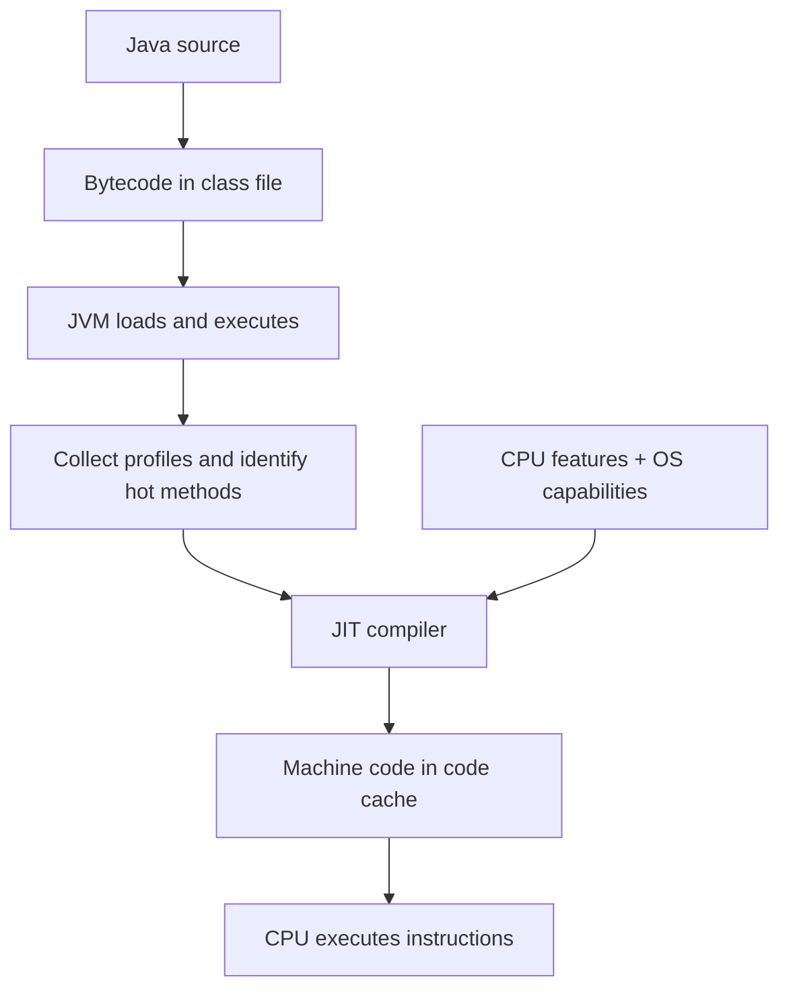

# CPU Architecture and Instruction Sets Used by JIT Code

Java bytecode can run on many platforms because the JVM compiles and executes bytecode according to the architecture of the machine it runs on. However, after JIT compilation, part of the application's code has become machine code that depends on the CPU architecture and the instruction sets detected by the JVM. CRaC saves the state of a running process, so a checkpoint may contain the code cache, runtime state, and memory structures tied to the source machine's architecture.

This creates an important compatibility limit: a checkpoint is not a portable Java artifact like a JAR. A checkpoint created on x86-64 cannot be assumed to be restorable on AArch64. Even when two machines share the same architecture, the set of instruction extensions advertised by the CPU and operating system to the JVM can differ. If JIT code or a native library uses an instruction that the target CPU does not support, the application may encounter an illegal instruction error or crash when that code path is executed.

When deploying CRaC, you need to identify the CPU architecture, ISA extensions, and CPU capabilities that the JVM actually sees. Then build a restore policy based on the same architecture and a compatible baseline instruction set, especially when migrating VMs across different physical hosts.

## 1. Distinguishing CPU Architecture, ISA, and Microarchitecture

These three concepts are related but not synonymous.

- **CPU architecture:** the architecture family and execution model that software targets, such as x86-64 or AArch64.
- **Instruction Set Architecture (ISA):** the instruction set, registers, data types, calling conventions, and behaviors that software can use. The ISA defines the contract between machine code and the CPU.
- **Microarchitecture:** how a manufacturer implements the ISA inside a processor, such as pipelines, caches, branch predictors, and execution units. Two CPUs with different microarchitectures can still execute the same ISA.

| Concept | Example | Meaning for CRaC |
|---|---|---|
| Architecture | x86-64, AArch64 | Different architectures usually mean different machine code, ABI, and process state; do not treat checkpoints as cross-portable. |
| ISA extension | SSE4.2, AVX2, AVX-512, AES, NEON, SVE | JIT code or native libraries may use extensions depending on the CPU/OS; the target machine must support the extensions already used. |
| Microarchitecture | Intel Core, AMD Zen, Arm Neoverse | Can affect performance and hardware characteristics; what matters first is whether the exposed features are compatible. |
| ABI and runtime platform | Linux x86-64 ABI, AArch64 ABI | Native libraries, calling conventions, pointer width, and process structures must match the restore environment. |

Two machines both being x86-64 does not mean they have the same instruction set. An older CPU may support SSE but not AVX2; a newer CPU may additionally support AVX-512 or other extensions. Similarly, AArch64 CPUs can differ in SVE/SVE2, crypto extensions, and optional features.

## 2. Why Does JIT Code Depend on the CPU?

The JVM starts from bytecode. As the program runs, the runtime collects information about frequently called methods and hot code paths. The JIT compiler can compile those methods into machine code to reduce interpretation overhead and optimize based on observed data.

Overview of the process:



The JIT compiler must generate machine code suited to the CPU on which the JVM is running. Therefore, the same JAR can be compiled into different instruction sequences on two machines.

### 2.1. C1, C2, and Tiered Compilation

HotSpot typically uses multiple compilation tiers. C1 can compile quickly to reduce initial execution overhead; C2 can optimize more deeply for hot methods. With tiered compilation, a method may pass through multiple compilation levels as profiles are collected.

All compiler tiers must adhere to the instruction set that the JVM allows to be used. When the CPU has matching extensions, the compiler can choose more efficient instructions or optimizations. Without the extension, the JVM typically selects another code path or omits that optimization.

### 2.2. CPU Intrinsics and Vectorization

The JVM can replace certain common Java calls with intrinsics implemented using special instructions. For example, encryption, hashing, checksums, bit manipulation, or vector operations can leverage hardware when the corresponding feature is supported.

On x86-64, common instruction groups include:

- SSE and extended versions such as SSE4.x.
- AVX, AVX2, and AVX-512 enabling wider vector processing.
- AES-NI, SHA extensions, and cryptography-supporting instructions.
- BMI and bit manipulation instructions.

On AArch64, feature groups can include:

- Advanced SIMD/NEON.
- Crypto extensions for certain cryptographic operations.
- CRC extension.
- SVE and SVE2 on supporting CPUs.

These examples are only ISA extension groups. Not every JVM or CPU supports all of them; the actual feature list must be obtained from the running environment.

### 2.3. Code Cache and Compiled Machine Code

HotSpot stores JIT-compiled machine code in the code cache region. A warmed-up process can have many compiled methods and corresponding runtime profiles. During checkpoint, the process state is saved according to the mechanism of the CRaC JDK and the checkpoint engine. How each version handles executable mappings and the code cache is a runtime implementation detail.

You should not assume that the code cache will always be preserved intact, always cleared, or always recompiled by the JIT after restore. Refer to the documentation of the exact CRaC JDK and test on the target runtime. Even if the runtime has mechanisms to verify or regenerate part of the code, the checkpoint still depends on the CPU architecture and ABI of the source process.

## 3. What Can Happen When Restoring on a Different CPU?

Consider an application warmed up on a source CPU with AVX2. The JIT compiler may generate code using AVX2 for a hot method. If the checkpoint is restored on a target CPU that does not support AVX2 and that code is executed, the CPU may raise an illegal instruction error. Depending on the runtime, the error may occur during restore itself or only when the corresponding method runs.

Some common scenarios:

| Source Machine | Target Machine | Assessment |
|---|---|---|
| x86-64 with baseline features | x86-64 with the same baseline features | Usually the easiest option to control, provided JDK, OS, and runtime are also compatible. |
| x86-64 with AVX2 | x86-64 without AVX2 | Risky if code cache or native libraries use AVX2. Do not restore without compatibility guarantees. |
| x86-64 with AVX-512 | x86-64 with only AVX2 | May encounter unsupported instructions if the source code uses AVX-512. |
| x86-64 | AArch64 | Incompatible machine code/ABI; not considered a supported restore path. |
| AArch64 with SVE | AArch64 not exposing SVE | Risky if machine code or native libraries use SVE. |
| Source machine with lower feature set | Target machine with higher feature set | Generally safer regarding instructions if all source features are exposed on the target; does not automatically make already-compiled code utilize new features. |

A target CPU having more features does not mean the JVM will automatically recompile the entire code cache to use them. Conversely, a target CPU lacking features already used by the source code can cause errors. Compare the feature set that the JVM actually sees, not just the CPU model name.

### 3.1. Illegal Instruction Error

When a CPU executes an unsupported opcode, the operating system typically raises a signal such as `SIGILL` on Linux. Logs may show that the process was terminated by an illegal instruction, though not all restore errors exhibit the same symptom. Failure may occur earlier due to an architecture mismatch, an incompatible native library, or the checkpoint engine being unable to restore a mapping.

Do not draw conclusions from a single error-free run. JIT code using an extension may reside in a method that runs only under a specific workload. After restore, execute representative hot code paths to verify that they work on the target CPU.

### 3.2. CPU Features and Operating System State

Some instructions require both CPU support and operating system support to save/restore extended register state. For example on x86, AVX requires CPU support for AVX and the OS to enable appropriate state management via OSXSAVE/XCR0. Therefore, merely reading a CPU flag is not always sufficient to know whether the JVM can use that instruction.

The JVM typically checks both CPU and OS conditions when deciding which features can be used. In a VM/container environment, the hypervisor can mask or restrict the features visible to the guest. The feature list inside the guest is what directly relates to the code that the guest JVM can generate.

## 4. How Does the JVM Detect and Use Instruction Sets?

When the JVM starts up, the runtime checks the architecture, CPU features, and certain operating system conditions. HotSpot uses this information to select code paths, intrinsics, and compiler options.

On some platforms, JVM flags can control the instruction limits that the JIT is allowed to use. For example, HotSpot on x86 has flags related to SSE/AVX; names, value ranges, and support depend on the JDK version. You should not copy a flag from another machine without checking `java -XX:+PrintFlagsFinal -version` or the documentation of the running JDK.

Key points to remember:

- CPU feature detection happens in the context of JVM startup and the environment it sees.
- The JIT compiler can use features permitted by the JVM to generate machine code.
- Intrinsics and vectorization can produce different instructions across CPUs.
- JVM flags can restrict certain optimizations, but they do not make a native library compiled for the wrong architecture portable.
- Changing CPU feature masks or JVM flags between checkpoint and restore must be tested very carefully.

### 4.1. Example of an AVX Baseline

Suppose a fleet has both x86-64 CPUs supporting AVX2 and older CPUs supporting only a lower baseline. If the source JVM sees AVX2, the JIT may choose code that uses AVX2. When moving a checkpoint to an older machine, sharing the x86-64 architecture alone is not enough.

There are two deployment approaches:

1. Keep the fleet homogeneous so all hosts share the same feature baseline.
2. If the JDK supports configuring instruction set limits, configure the JVM to use a common baseline supported by all hosts in the group, then test performance and restore.

The second approach may reduce some optimizations. Specific flags depend on the HotSpot build and CPU architecture; inspect the output of the JVM in use before choosing. Do not manually set `UseAVX` or `UseSSE` to a number without confirming its meaning on that specific JDK.

## 5. Native Libraries Also Depend on Architecture and ISA

Even when Java bytecode is compatible, an application may load native libraries via JNI, FFM, or agent dependencies. Those libraries are compiled for a specific architecture and may use specific instruction extensions.

For example:

- A compression library compiled with AVX2.
- A cryptography library with AES-NI or ARM crypto extension code paths.
- A native profiler with separate binaries for x86-64 or AArch64.
- A JNI library built with `-march=native`, inadvertently depending on the build machine's CPU.

If a checkpoint is restored on a host with lower CPU features, the native library may fail even if the application's JIT code does not use that instruction.

### 5.1. Avoid Building Native Libraries with `-march=native` for Heterogeneous Fleets

`-march=native` instructs the compiler to optimize for the build machine's CPU. The resulting binary may use instructions absent on other hosts. For applications deployed across multiple machines, choose an explicit target architecture and feature baseline.

If high performance is needed across multiple CPU types, you can build multiple implementations and select runtime dispatch based on safe feature detection. Dispatching must be performed by a library with official support; do not jump directly into a function containing extended instructions before confirming the feature.

### 5.2. JNI and Native Handles

A checkpoint also involves native memory, threads, and library handles. A native pointer in the heap does not guarantee that the memory region or resource it points to is compatible with the target CPU. Check the binary architecture, ABI, dependent libraries, and lifecycle of native resources.

## 6. CPU Architecture in Virtualized and Container Environments

In a virtualized environment, the CPU seen by the JVM may be a virtual model advertised by the hypervisor rather than all features of the physical host. This is important when checkpointing a VM and then restoring or migrating it to another host.

### 6.1. Guest CPU Model

The hypervisor can expose a common CPU model so that VMs can migrate across multiple hosts. If the common model only advertises baseline features, the JVM will JIT-compile against that baseline, even if the source host has newer instruction extensions.

This is one way to control portability within the same architecture: pin the guest-visible CPU feature set before the JVM starts. Do not change the VM's CPU model or feature mask in a way that removes features already used by the process.

### 6.2. Containers Do Not Create an Independent ISA

Containers share the host's kernel and CPU architecture. A Java container image does not make JIT code portable between x86-64 and AArch64. When running a multi-architecture image, each architecture needs appropriate native binaries; the checkpoint image still needs to be compatible with the target runtime's architecture and features.

CPU quota or CPU affinity does not necessarily imply ISA restriction. However, the virtualization environment, seccomp, or platform configuration can affect access to certain resources. Check CPU features from inside the exact container/VM where the JVM runs.

## 7. Building a Compatibility Policy for Checkpoints

A practical policy should record at least four layers of information:

1. **Architecture:** x86-64 or AArch64 and the associated ABI.
2. **CPU feature baseline:** the instruction extensions that the guest/OS exposes and the JVM can use.
3. **JVM runtime:** vendor, version, build, compiler flags, and options affecting code generation.
4. **Native dependencies:** binary architecture, ISA baseline, and native library/agent versions.

You can define a runtime compatibility profile for each checkpoint group. For example:

| Profile | Architecture | Feature policy | Restore target |
|---|---|---|---|
| `linux-x86-baseline` | x86-64 | Baseline features agreed upon for the entire group. | Only hosts/VMs exposing that baseline or higher. |
| `linux-x86-avx2` | x86-64 | Allows AVX2 and features explicitly listed in the profile. | Only hosts/VMs exposing all required features. |
| `linux-arm64-baseline` | AArch64 | Fleet-wide common ARM64 baseline. | Only AArch64 hosts/VMs with compatible baseline features. |
| `linux-arm64-sve` | AArch64 | Requires SVE/SVE2 per specific configuration. | Only hosts/VMs exposing the corresponding extensions. |

Profile names are examples defined by the deployment system, not standard CRaC or JVM names. Each profile must clearly record the actual feature list, JDK build, and native dependencies.

### 7.1. Target Selection Principles

- Do not restore across architectures.
- Ensure the target CPU exposes every instruction feature that the source code and native libraries may use.
- Keep the guest CPU model stable throughout the checkpoint lifecycle.
- Use a common baseline if migration across a heterogeneous host group is required.
- Do not treat the CPU model name as sufficient; compare feature flags and OS capabilities.
- If compatibility cannot be determined, create separate checkpoints for each profile instead of sharing one.

A target CPU with a feature superset can usually execute the instruction subset used by the source, but this is only a CPU-level condition. The JDK build, OS/kernel, ABI, native libraries, and checkpoint engine must still be compatible.

## 8. Collecting CPU and JVM Information Before Creating a Checkpoint

Before checkpointing, record the fingerprint of the runtime environment. Collect it from inside the actual VM/container, since that is the CPU feature set seen by the JVM.

### 8.1. Information from Linux

```bash
uname -m
lscpu
grep -m1 -E '^(flags|Features)' /proc/cpuinfo
```

- `uname -m` shows the machine architecture reported by the kernel.
- `lscpu` displays the architecture, model, and feature flags exposed by the operating system.
- `/proc/cpuinfo` provides flags/features per CPU; the format differs between x86 and ARM.

In a container, run the commands inside the container rather than only on the host. Some runtimes may restrict visible information or expose a virtual CPU model.

### 8.2. Information from the JVM

You can record the JVM flags:

```bash
java -XX:+PrintFlagsFinal -version
```

With HotSpot supporting the corresponding unified logging, you can view the CPU information detected by the JVM at startup:

```bash
java -Xlog:os+cpu=info -version
```

For a running process, `jcmd` can provide runtime and flag information:

```bash
jcmd <pid> VM.info
jcmd <pid> VM.flags -all
```

Commands and output contents can vary by JDK vendor/version. Not every runtime supports the same logging tags or diagnostic commands. Save the actual output alongside the checkpoint metadata.

### 8.3. Runtime Fingerprint to Save

| Field | Example Information to Record |
|---|---|
| OS architecture | `x86_64`, `aarch64`. |
| CPU vendor/model | Guest-visible CPU information. |
| CPU features | SSE, AVX2, AVX-512, AES, NEON, SVE... according to the actual environment. |
| OS support | Capabilities enabled by the OS for instruction state. |
| JVM | Vendor, version, build, architecture. |
| Compiler options | Flags related to JIT and intrinsics. |
| Native dependencies | Name, version, binary architecture, and ISA baseline. |
| Virtualization | Guest CPU model and feature masking policy if any. |

You do not need to log all CPU information for every request. Store it as image metadata or deployment profile metadata so the orchestration system can compare it before restore.

## 9. CPU Compatibility Testing Before Production Rollout

Testing needs to cover both restoring and executing JIT/native methods after restore. A successful restore alone is not enough if a method containing an unsupported instruction has not been called yet.

### 9.1. Test Matrix

| Checkpoint Machine | Restore Machine | Test Scenario | Expected Result |
|---|---|---|---|
| Host in baseline A | Host in same baseline A | Restore and run representative workload. | Restore and workload complete. |
| Host with high feature set | Host with same feature set | Run hot methods and native paths. | No instruction errors; performance within threshold. |
| Host with high feature set | Host lacking used extension | Test in an isolated environment. | Rejected by policy or error identified; not deployed to production. |
| x86-64 | AArch64 | Check policy before restore. | System rejects due to incompatible architecture. |
| VM guest CPU baseline | Different physical host exposing the same guest model | Restore after migration. | Compatible behavior according to the tested profile. |
| Has native agent/library | Host with same architecture but lower features | Call full native paths. | No native illegal instruction or ABI errors. |

### 9.2. Representative Warm-Up Workload

If the application has JIT-compiled methods, run a workload sufficient to execute those hot code paths before checkpoint. After restore, call those paths again and monitor:

- Illegal instruction or process crash.
- JVM compiler/deoptimization logs if diagnosis is needed.
- Native library loading errors.
- Latency and throughput compared to baseline.
- Behavior of intrinsic/vectorized code.

Do not run only a simple endpoint if heavy computations reside in another module. The workload needs to represent the critical code paths of the application.

### 9.3. Testing When CPU Features Are Masked

In a test environment, you can use a VM/hypervisor configured with different CPU models or feature masks to verify the policy. Do not alter the CPU features of a production machine hosting a warmed-up process solely to test compatibility.

If using JVM flags to limit JIT features, you must create the checkpoint with that exact configuration and restore with a compatible runtime. Do not merely change the flag on the restore command and assume the old code cache will automatically be recompiled safely.

## 10. Deployment Strategies

### 10.1. Homogeneous Fleet

The simplest approach is to create and restore checkpoints within a host group sharing the same architecture and feature baseline. This reduces the number of variables to manage, especially for applications with many native dependencies or heavy JIT warm-up.

### 10.2. Splitting Checkpoints by CPU Profile

If the fleet has multiple CPU groups, create a separate checkpoint for each profile. For example, the x86 baseline group and the x86 AVX2 group use separate images. The orchestrator only restores an image onto a group with compatible features.

### 10.3. Restricting JIT to a Common Baseline

In some HotSpot deployments, the compiler can be configured not to use instruction extensions beyond the fleet baseline. This makes the same checkpoint more suitable for multiple hosts in the group, at the trade-off of potentially reduced performance on newer CPUs.

Only use flags supported by the specific JDK and confirmed via runtime output. Do not use JIT flags to try to turn an x86-64 checkpoint into an AArch64 checkpoint; those are different architectures and ABIs.

### 10.4. Building Native Libraries Against a Baseline

Build native dependencies with an explicit target architecture and ISA baseline. If multiple optimization paths are needed, use runtime dispatch supported by the library. Avoid binaries that inadvertently depend on the build host's CPU.

## 11. Common Misconceptions

**“Java bytecode is portable, so checkpoints are also portable.”** Bytecode can run on many JVMs, but a checkpoint contains process state and machine/runtime code tied to the architecture. The two types of artifacts have different portability characteristics.

**“Same x86-64 guarantees restore will work.”** x86-64 CPUs can differ in AVX, AVX2, AVX-512, and other features. You must compare the instruction sets used by the JVM and native libraries.

**“A newer target CPU is always safe.”** Newer CPUs generally support more instructions, but you must still verify actually exposed features, OS support, ABI, JDK, and native dependencies.

**“Completing restore without errors means there are no unsupported instructions.”** The method containing that instruction may not have executed yet. You need to run a representative workload after restore.

**“The JVM automatically recompiles every method on restore.”** You should not assume that. How the runtime handles the code cache depends on the CRaC JDK; check the documentation and test on the exact build.

**“The container image determines the CPU architecture.”** Containers use the CPU and kernel of the host/VM. A multi-architecture image does not make a checkpoint process snapshot portable across ISAs.

**“Only JIT code depends on the CPU.”** JNI, JVMTI agents, profilers, and native libraries can also contain CPU-dependent instructions.

## 12. CPU Architecture Compatibility Checklist

- [ ] Identify the architecture of both the checkpoint machine and the restore machine.
- [ ] Do not cross-restore between x86-64 and AArch64.
- [ ] Record the CPU vendor/model and feature flags actually exposed by the guest/container.
- [ ] Verify OS support for instruction state, not just CPUID/feature labels.
- [ ] Record the JDK vendor/version/build and related compiler flags.
- [ ] Identify which extensions JIT intrinsics, vectorization, or native libraries may use.
- [ ] Avoid native binaries built with `-march=native` if the fleet is heterogeneous.
- [ ] Use a stable guest CPU model or feature baseline when VMs require migration.
- [ ] Create separate checkpoints for each CPU profile if necessary.
- [ ] Test restore on a host whose feature set matches the target baseline.
- [ ] After restore, execute representative hot paths and native paths.
- [ ] Reject restore if the target CPU lacks required features or compatibility cannot be determined.

## 13. Key Terms to Remember

- **CPU architecture:** an architecture family such as x86-64 or AArch64.
- **ISA:** the set of instructions, registers, and execution rules that software can use.
- **ISA extension:** an extension to the instruction set, such as AVX2, AVX-512, AES-NI, NEON, or SVE.
- **Microarchitecture:** how a CPU implements the ISA at the hardware level.
- **JIT compiler:** the component that compiles bytecode into machine code while the application runs.
- **Code cache:** the JVM memory region that stores JIT-compiled machine code.
- **Intrinsic:** a Java call replaced by the JVM with an optimized implementation, which may use hardware instructions.
- **Vectorization:** performing multiple data operations in a single vector instruction.
- **CPU feature mask:** the set of features advertised to the process by the virtualization environment or system.
- **ABI:** binary conventions such as calling conventions, data layout, and linkage between a program and native libraries.
- **`SIGILL`:** a signal on Unix-like systems typically related to an invalid or CPU-unsupported instruction.
- **Runtime fingerprint:** the set of information about CPU, OS, JVM, and native dependencies used to determine compatibility.

With CRaC, treat the CPU architecture and the instruction set used by the JIT as part of the checkpoint environment identity. Java bytecode can run on many architectures, but a warmed-up process state is not a portable package. Only restore within the same architecture and on a CPU/OS exposing all features required by JIT code and native dependencies; if migration across multiple hosts is needed, standardize on a CPU baseline or create separate checkpoints per profile.

## References

- [OpenJDK HotSpot VM Options](https://docs.oracle.com/en/java/javase/21/docs/specs/man/java.html): JVM options, including platform-dependent compiler and runtime option groups.
- [Java HotSpot VM Performance Enhancements](https://docs.oracle.com/en/java/javase/21/vm/java-hotspot-virtual-machine-performance-enhancements.html): HotSpot JIT mechanisms, tiered compilation, and optimizations.
- [JVM Tool Interface (JVMTI) Specification](https://docs.oracle.com/en/java/javase/21/docs/specs/jvmti.html): native agents and JVM interaction.
- [CRaC — About CRaC](https://crac.org/about/about-crac/): process checkpoint/restore model and compatible environment requirements.
- [CRaC — Best Practices](https://crac.org/reference/best-practices/): practices for preparing resources and operating checkpoint/restore.