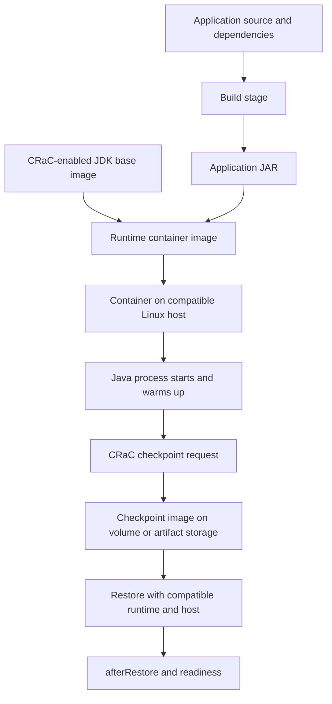

# Building Containers with a CRaC-Enabled JDK

To run a Java application with CRaC inside a container, the runtime image must contain a JDK distribution that supports checkpoint/restore, the application, and the required system libraries. The container environment must also run on a Linux host, kernel, CPU architecture, and container runtime that meet the requirements of the CRaC JDK and the checkpoint/restore mechanism being used.

An important distinction is that a **container image** and a **checkpoint image** are two different artifacts. A container image contains the filesystem, JDK, application JAR, and runtime configuration. A checkpoint image stores the state of a running process. Being able to build a container image with a CRaC JDK does not automatically mean the container can checkpoint or restore on every host. You need to prepare the runtime image, checkpoint storage directory, system permissions, how checkpoint is triggered, and the restore process.

## 1. Container Architecture When Using CRaC

A deployment typically includes these components:



Responsibilities can be divided as follows:

| Component | Responsibility |
|---|---|
| Build stage | Compiles and packages the application into a JAR |
| CRaC JDK runtime image | Provides a CRaC-enabled JVM and required user-space libraries |
| Linux host | Provides the kernel, architecture, and system features needed for checkpoint/restore |
| Container runtime | Creates namespaces, cgroups, mounts, and grants required permissions to the process |
| Checkpoint directory | Stores the files and metadata of the process snapshot |
| Application Resource | Closes, pauses, or restores environment-dependent resources |
| Orchestrator/deployment process | Selects the image, compatible host, and restore timing; controls readiness |

CRaC does not replace the container runtime or the operating system. Depending on the JDK distribution, checkpoint/restore on Linux may integrate with CRIU (Checkpoint/Restore In Userspace). Follow the vendor documentation to know where CRIU is invoked, which components must be installed, and which capabilities must be granted.

## 2. Choosing a Base Image with a CRaC-Enabled JDK

Not every Docker image with Java contains a CRaC JDK. A standard `eclipse-temurin`, `openjdk`, or ordinary JRE image does not automatically support checkpoint/restore just because it can run Java applications.

When selecting a base image, verify:

- The vendor and distribution officially state CRaC support for that JDK line.
- The full version and build of the JDK.
- Supported operating systems and CPU architectures.
- Required kernel version, CRIU version, and host configuration.
- Whether `jcmd`, compiler tools, or diagnostic utilities are needed in the runtime image.
- Whether any native libraries, libc, or system packages are required.
- How the vendor recommends triggering checkpoint and restore.
- Whether the image provides an immutable digest for pinning in the pipeline.

The example below uses a placeholder for the vendor image:

```dockerfile
FROM <vendor>/<crac-jdk-distribution>:<exact-version>@sha256:<verified-digest>
```

Replace the placeholder with the actual image published by the vendor. Do not use `latest` in build/release environments because the tag can point to different content over time. Record both the tag and the digest so the exact runtime can be reproduced.

### 2.1. Using a JDK or a JRE?

Some minimal runtime images contain only a JRE or a runtime stripped of development tools. For a CRaC workflow, `jcmd` may be needed to request a checkpoint and diagnostic tools may be needed to inspect JVM state. If the runtime image lacks `jcmd`, you must use a vendor-supported tool in the same PID namespace or another checkpoint control mechanism.

Choose the image based on actual operational practices. Do not install an extra regular JDK just to obtain `jcmd` and control another CRaC JVM without verifying compatibility. Prefer using the tools bundled with the same distribution and build.

### 2.2. Pinning Version and Architecture

Record the JDK vendor, version, build, OS, and architecture in the manifest. `amd64` and `arm64` are two separate targets; do not assume a checkpoint image created on one architecture can be restored on the other.

If the application supports multiple architectures, build the runtime image and create the checkpoint image separately for each architecture. JNI, JNA, and `.so` libraries must match the target CPU.

## 3. Creating a Container Image with a Multi-Stage Build

A multi-stage build separates compilation tools from the runtime image. The first stage uses Gradle/JDK to build the JAR; the final stage uses a CRaC-enabled JDK to run the application.

Example Dockerfile:

```dockerfile
ARG CRAC_JDK_IMAGE

# Stage 1: build application
FROM gradle:8.10-jdk21 AS build

WORKDIR /workspace
COPY gradlew settings.gradle build.gradle ./
COPY gradle ./gradle
COPY src ./src

RUN ./gradlew --no-daemon clean bootJar

# Stage 2: runtime with a CRaC-enabled JDK
FROM ${CRAC_JDK_IMAGE} AS runtime

WORKDIR /app

COPY --from=build /workspace/build/libs/application.jar /app/application.jar
COPY docker/entrypoint.sh /app/entrypoint.sh

RUN mkdir -p /var/lib/application/checkpoint \
    && mkdir -p /var/log/application \
    && chmod 0755 /app/entrypoint.sh

ENV CRAC_CHECKPOINT_DIR=/var/lib/application/checkpoint
ENV CRAC_START_MODE=normal

ENTRYPOINT ["/app/entrypoint.sh"]
```

This is an illustrative structure. Adjust the JAR name, Gradle task, Gradle/JDK build version, and paths to match your project. The `CRAC_JDK_IMAGE` value must be a CRaC-enabled image with a full tag and verified digest. Do not pass a standard Java image into this variable.

The build argument `CRAC_JDK_IMAGE` must be passed during the build and must be a CRaC-enabled image with a full tag and verified digest. Example command structure:

```bash
docker build \
  --build-arg CRAC_JDK_IMAGE=<vendor>/<crac-jdk>:<exact-version>@sha256:<verified-digest> \
  -t orders-api:3.1.0 .
```

Replace the placeholders with actual vendor image references.

### 3.1. Why Separate the Build Stage and Runtime Stage?

The build stage may contain Gradle, compilers, source code, and dependency caches. The runtime stage only needs the CRaC JDK, the JAR, and files needed at runtime. Separating the two stages helps:

- Reduce the runtime image size.
- Reduce unnecessary tools in production.
- Pin the runtime JDK independently of the build environment.
- Avoid including source code and build caches in the runtime image.
- Make it easier to control the digest of the JDK used to create and restore checkpoints.

However, building the JAR with a different JDK from the runtime still requires adhering to bytecode and framework compatibility requirements. The runtime JDK is the most critical component for the checkpoint image; the build JDK must still be recorded for artifact reproducibility.

## 4. Designing the Entrypoint for Fresh Startup and Restore

The container needs to know when to start the application from the JAR and when to restore the process from a checkpoint image. These two paths differ:

- Fresh startup: runs `java` with `-jar` to create a process and launch the application.
- Restore: uses the CRaC JDK's restore option to recover the process from the checkpoint image. It does not re-run the application as a new startup.

Example entrypoint:

```sh
#!/bin/sh
set -eu

CHECKPOINT_DIR="${CRAC_CHECKPOINT_DIR:-/var/lib/application/checkpoint}"

case "${CRAC_START_MODE:-normal}" in
  normal)
    exec java \
      "-XX:CRaCCheckpointTo=${CHECKPOINT_DIR}" \
      -jar /app/application.jar
    ;;
  restore)
    if [ ! -d "$CHECKPOINT_DIR" ]; then
      echo "Checkpoint directory does not exist: $CHECKPOINT_DIR" >&2
      exit 1
    fi
    exec java "-XX:CRaCRestoreFrom=${CHECKPOINT_DIR}"
    ;;
  *)
    echo "Unsupported CRAC_START_MODE: ${CRAC_START_MODE}" >&2
    exit 2
    ;;
esac
```

The flags `-XX:CRaCCheckpointTo` and `-XX:CRaCRestoreFrom` are common usage on CRaC JDK distributions that support them; verify the exact option names and workflow in the vendor documentation. Some implementations may require different invocation methods or control tools.

`exec` replaces the shell with the Java process so that Java receives container signals directly and can run as PID 1. This is useful when the container is stopped or orchestrated. The script does not decide on its own when checkpointing must occur; a control command or orchestration component must send the checkpoint request using the mechanism supported by the vendor.

### 4.1. Setting the Checkpoint Path

The checkpoint directory should be an explicit path, writable by the user running the JVM, and mounted if the image needs to persist after the container stops.

Example:

```text
/var/lib/application/
  checkpoint/
  metadata/
```

Do not use temporary directories in the container's writable layer if the checkpoint must survive across new container creations. The writable layer can be deleted when a container is replaced. Use a volume or an artifact store suited to the JDK/CRIU checkpoint structure.

Do not allow multiple processes to write concurrently to the same checkpoint directory. Each process/build/image-creation run needs its own output path, unless the vendor provides a specific concurrency management mechanism.

## 5. Installing CRIU and Preparing the Host

On Linux deployments using CRIU, distinguish between user-space packages and host kernel capabilities and permissions. Simply adding a command to install `criu` in the Dockerfile does not guarantee the container can checkpoint.

Depending on the integration model, CRIU may need to be installed inside the container, on the host, or provided by the runtime/platform. Follow the exact instructions from the JDK vendor and container runtime.

On the Linux host, perform at least the following checks:

```bash
uname -a
uname -m
cat /etc/os-release
criu --version
```

Then verify specific conditions:

- The kernel has the features required by the CRIU/JDK version in use.
- The CRIU version is within the supported range.
- The container runtime supports the chosen checkpoint/restore approach.
- Namespaces, cgroups, and mounts can be saved/restored as required.
- Capabilities and security profiles allow the necessary operations.
- The filesystem supports the metadata and file types used by the checkpoint image.
- The host has sufficient disk space and I/O capacity to write and read the checkpoint image.

### 5.1. Container Permissions and the Principle of Least Privilege

Checkpoint/restore may require special privileges. Some kernels and runtimes use capabilities such as `CAP_CHECKPOINT_RESTORE`; some operations may also require additional privileges or configuration depending on CRIU, the kernel, and namespaces.

Do not enable `--privileged` by default for every container just to make checkpointing work. Identify the exact capabilities, seccomp rules, AppArmor/SELinux policies, and filesystem permissions required by the vendor, then grant the minimum necessary level. Overly broad privilege configurations increase the blast radius if the application is compromised.

Running containers as a non-root user remains a good goal, but checkpoint capability depends on rootless support in the kernel, CRIU, and runtime. Do not assume rootless works in every environment. If elevated privileges are required, document the reason clearly and restrict the privileges to the exact container/host that needs them.

### 5.2. Do Not Confuse CRIU with JDK CRaC

CRIU is an operating-system-level tool. It does not replace JDK CRaC, nor does it know how the application needs to close database pools or refresh tokens. JDK CRaC and `org.crac.Resource` coordinate with the platform to prepare JVM and application state.

A container that has CRIU but runs a JDK without CRaC support cannot necessarily use the Java CRaC workflow. Conversely, a CRaC-enabled JDK on a host lacking the necessary kernel features or permissions also cannot complete checkpoint/restore.

## 6. Managing Resources in Containerized Applications

Containerization does not eliminate the application's resource management requirements. Before checkpoint, the application still needs to:

- Stop accepting new requests or messages.
- Wait for in-flight tasks to reach a safe boundary.
- Complete or roll back transactions.
- Close database connection pools and non-reusable HTTP connections.
- Pause schedulers, consumers, and background threads.
- Flush necessary data.

After restore, the application needs to:

- Recreate network connections and connection pools.
- Refresh expiring credentials or tokens.
- Re-register message consumers/subscriptions.
- Generate a unique instance ID or worker ID if the image is used for multiple replicas.
- Verify dependencies and transition readiness to passing only when ready.

For example, a Resource for a database pool or third-party client must be registered with the CRaC context. The container image only packages the code and runtime; callbacks are still executed by the application.

Do not retain resources in the checkpoint image that depend on a specific container instance, such as IPs, leases, short-lived tokens, or client sockets. Recreate them after restore using current configuration and secrets.

## 7. Creating a Checkpoint Inside a Container

A typical checkpoint workflow consists of:

1. Start the container with a CRaC-enabled JDK.
2. Confirm the application has initialized and finished warming up.
3. Confirm that Resources are registered.
4. Stop accepting new work and drain in-flight tasks.
5. Request the JVM checkpoint according to vendor instructions.
6. Verify the checkpoint image has been completely created in the configured directory.
7. Write a manifest containing the JDK, application build, container digest, OS, kernel, CRIU, and architecture.
8. Check permissions and integrity of the artifact.
9. Run a test restore before publishing the image.

For CRaC JDK distributions that support `jcmd`, a common example is:

```bash
jcmd <java-pid> JDK.checkpoint
```

The command must run in an environment that can access the target JVM, in the same PID namespace, and with a compatible tool version. If Java runs as PID 1 in the container, how you determine the PID or invoke `jcmd` must match the image's operational setup. Do not hardcode the PID if the process ID can change.

Depending on the JDK distribution, checkpointing may cause the original process to exit, continue running, or exhibit specific control behavior. Confirm the vendor's lifecycle behavior before building automation around exit codes or container status.

### 7.1. Do Not Create Checkpoints Inside Docker Build by Default

Docker builds typically run in a builder environment whose kernel, privileges, and container runtime differ from production. Creating a checkpoint inside a Dockerfile `RUN` instruction can fail or produce an image dependent on a builder that does not match the deployment host.

Only create a checkpoint in the build stage if the vendor provides an official build-time checkpoint workflow and the build environment satisfies all compatibility requirements. For standard workflows, build the container image first, run it on a compatible host, warm up the application, and then create the checkpoint in a controlled runtime environment.

## 8. Packaging and Storing the Checkpoint Image

A checkpoint image may consist of multiple files and metadata. Do not assume it is always a single file. When storing or transferring it, preserve the directory structure, permissions, ownership, symlinks, and metadata required by the image creation tool.

Some key principles:

- Use separate directories per application build, JDK build, architecture, and checkpoint run.
- Do not overwrite an image currently in use by a deployment.
- Do not copy the directory while the checkpoint is still writing data.
- Only publish the artifact after the checkpoint finishes and the restore test succeeds.
- Store checksums or a manifest for files requiring integrity verification.
- Protect the image as sensitive data because the heap may contain tokens, credentials, and user data.
- Clean up old artifacts according to the retention policy while retaining images currently referenced by workloads.

Example storage layout:

```text
artifacts/
  orders-api/
    3.1.0/
      commit-91ab23/
        linux-amd64/
          crac-jdk-vendor-build-456/
            checkpoint-image/...
            manifest.yml
            checksums.txt
            restore-test.log
```

The version names in the example are illustrative only. Use the actual identity of the JDK and image. If the checkpoint directory is mounted from a volume, ensure the volume exists and is mounted at the exact path during restore.

### 8.1. Checkpoint Image and OCI Image

You can store the checkpoint image alongside the OCI container image in an artifact repository, or package it into a new artifact/container image if the vendor and pipeline support that approach. Either way, manage two separate identities:

- The digest of the OCI image containing the JDK and application.
- The version/checksum of the checkpoint image created from the process running inside that OCI image.

Do not modify the contents of an already-published OCI image to swap checkpoint data while keeping the old digest. If you package the checkpoint into a new OCI image, that is a new image artifact and must have a new digest.

## 9. Restoring a Container from a Checkpoint Image

Restoring requires the exact runtime and an environment compatible with the image. General workflow:

1. Select the exact OCI image and JDK build verified in the manifest.
2. Run on a host with compatible OS, kernel, architecture, CRIU, and privileges.
3. Mount the checkpoint directory to the exact expected path.
4. Select the entrypoint's restore mode.
5. Launch the JVM using the vendor's restore option.
6. Wait for `afterRestore` callbacks to complete.
7. Validate the database, HTTP clients, brokers, and required dependencies.
8. Transition readiness to passing before accepting traffic.

Example using the entrypoint above:

```bash
docker run --rm \
  -e CRAC_START_MODE=restore \
  -e CRAC_CHECKPOINT_DIR=/var/lib/application/checkpoint \
  -v /srv/orders/checkpoint:/var/lib/application/checkpoint \
  <runtime-image-reference>
```

The command only illustrates how to mount the volume and choose the mode. Docker options, permissions, networking, cgroups, and capabilities must follow the guidelines of your actual environment. Do not add `--privileged` or broad capabilities without determining exact requirements.

Restoring is not re-running `java -jar application.jar`. The JVM must restore the process from the checkpoint image. If the entrypoint always runs `-jar`, it will spawn a fresh process and ignore the saved state.

## 10. Health Checks and Readiness

The container may already be running while the application is not yet ready after restore. Callbacks may still be creating connection pools, fetching secrets, registering subscriptions, or refreshing caches.

Distinguish between:

- **Process running:** the JVM/container exists.
- **Liveness:** the process is not hung or in an unrecoverable error state.
- **Readiness:** the application and required dependencies have recovered and can accept traffic.

Readiness should succeed only after:

- Required `afterRestore` callbacks have completed.
- Database connections are created and verified.
- Required HTTP clients or SDKs are operational.
- Message consumers are registered according to policy.
- Workers/schedulers are resumed only when dependencies are ready.
- A distinct instance identity and lease have been acquired if needed.

Do not use a health check that merely probes the JVM's TCP port as proof that the application is ready. In Kubernetes, the readiness probe must reflect application-level recovery state.

## 11. Containers and Kubernetes

Running CRaC applications in Kubernetes requires coordination across the container image, host nodes, container runtime, storage, and orchestration mechanism. A standard Pod restart does not automatically restore a checkpoint image just because the image contains a CRaC JDK.

Kubernetes manages Pods and containers according to its own lifecycle. Checkpointing a Java process and restoring from a checkpoint image requires corresponding integration with the runtime, kubelet/platform, or a dedicated controller. Do not assume every cluster provides this capability by default.

### 11.1. Node Requirements

Nodes used for restore must be compatible regarding:

- CPU architecture.
- Kernel and features required by CRIU/JDK.
- Container runtime and checkpoint/restore configuration.
- Capabilities, seccomp, AppArmor/SELinux, and security policies.
- Mounts and storage paths.
- JDK/container image digest according to the manifest.

If the image is tied to a narrow set of host conditions, use node labels, affinity, or an appropriate admission/scheduling mechanism to avoid placing workloads onto incompatible nodes. The exact approach depends on the cluster and runtime.

### 11.2. Storing Checkpoints on Volumes

If the checkpoint image must persist after a Pod/container is replaced, it must be stored on suitable persistent storage. EmptyDir or the writable layer is usually unsuitable if data must survive new Pod creations.

When choosing a PersistentVolume, check its ability to store the files, permissions, ownership, metadata, and capacity required by the checkpoint image. Not all network filesystems work with every checkpoint mechanism. Test writing, reading, and restoring on the exact target volume type.

Do not let two Pods write to the same checkpoint directory. If multiple replicas need to use the same checkpoint image as their source, manage it as a read-only artifact once published; each restored process must have its own runtime area for mutable files.

### 11.3. Lifecycle Hooks Do Not Automatically Replace CRaC Callbacks

A Kubernetes `preStop` hook or container termination signal can be used to ask the application to drain before stopping the Pod. However, they are not automatically equivalent to `beforeCheckpoint`; they belong to the container termination lifecycle. Similarly, a startup probe does not automatically invoke `afterRestore`.

Clearly define which component requests the checkpoint, which component launches the restore, and how the application reports readiness. If there is a dedicated operator or controller, it must coordinate with CRaC Resources and store checkpoint artifacts following a consistent workflow.

## 12. Container and Checkpoint Artifact Security

A checkpoint image may contain heap state, tokens, credentials, user data, request payloads, and sensitive configuration. Protect checkpoint artifacts at a level equivalent to the application's sensitive data.

Measures to consider:

- Restrict read/write permissions on the checkpoint directory.
- Do not expose checkpoint artifacts publicly via HTTP or unsuitable image registries.
- Encrypt storage and data in transit according to security policy.
- Manage secrets so fresh credentials can be fetched after restore instead of relying on tokens baked into the heap.
- Avoid creating images from processes holding real user data unless necessary.
- Delete expired artifacts according to the retention policy.
- Pin runtime image digests and verify provenance.
- Grant only the minimum capabilities required by CRIU/JDK.
- Do not include debug tools, compilers, or unnecessary packages in production runtime images.

If the image is copied to another environment, control access permissions and recipient identity. Anyone who can read the checkpoint image can access extensive data that the process held in memory at the time of the snapshot.

## 13. Testing Containers with CRaC

A successful container build does not prove that checkpoint/restore works. A smoke test running on a compatible host and container runtime is required.

### 13.1. Checking the Runtime Image

Inside the container, record:

```bash
java -version
java -XshowSettings:properties -version
jcmd -l
```

Verify:

- `java` is the correct binary of the CRaC-enabled JDK.
- Vendor, version, build, and architecture match the manifest.
- Required CRaC options are recognized by the runtime.
- `jcmd` is present if the workflow uses this tool.
- Application JAR and native dependencies exist at the expected paths.
- The checkpoint directory is writable and has sufficient free space.

### 13.2. Checking the Host

On the host, record the OS, kernel, architecture, CRIU, container runtime, and granted privileges. Run CRIU diagnostic checks according to the distribution's documentation and verify that required features are supported.

Do not test solely on a developer machine if production runs a cluster with a different kernel or security profile. Tests must use a configuration close to the target nodes.

### 13.3. Full Lifecycle Testing

1. Build the runtime image with the pinned CRaC JDK.
2. Run the container on a compatible host.
3. Wait for the application to initialize and finish warming up.
4. Send several test requests and verify readiness.
5. Request a checkpoint and verify that Resource callbacks are invoked.
6. Verify that the checkpoint artifact is completely generated.
7. Create a new container with the same runtime and mount the checkpoint directory.
8. Restore the process.
9. Confirm that `afterRestore` recreates external resources.
10. Check readiness and send business requests after restore.
11. Simulate an unavailable external dependency and confirm the application does not accept traffic.
12. Record checkpoint duration, image size, restore duration, and restore-to-readiness time.

### 13.4. Multi-Instance Testing

If one checkpoint image is used as the source for multiple replicas, verify:

- Each instance has a distinct ID/worker identity.
- Connection pools and sockets are created independently.
- Tokens, leases, and subscriptions are refreshed as required.
- No two instances share ownership of an exclusive resource.
- Each instance has its own writable runtime state.
- Scaling up does not overload databases or external services with simultaneous connections.

## 14. Manifest for Container and Checkpoint Images

Store OCI image metadata alongside the checkpoint artifact so deployment can identify the exact runtime. Example:

```yaml
containerRuntime:
  application:
    version: "3.1.0"
    gitCommit: "<commit-sha>"
    jarSha256: "<jar-sha256>"
  image:
    reference: "<registry>/<application-runtime>:<version>"
    digest: "sha256:<oci-image-digest>"
  jdk:
    vendor: "<vendor>"
    distribution: "<crac-jdk-distribution>"
    version: "<full-version-and-build>"
    architecture: "amd64"
  platform:
    os: "<linux-distribution>"
    kernelBaseline: "<tested-kernel>"
    criu: "<tested-criu-version>"
    containerRuntime: "<runtime-and-version>"
  checkpoint:
    directory: "/var/lib/application/checkpoint"
    artifactId: "<checkpoint-artifact-id>"
    createdAt: "<timestamp>"
    restoreValidation: "PASS"
```

Values in angle brackets are placeholders. Generate the manifest from pipeline and test outputs rather than entering them manually. Before restoring, compare the actual runtime against the manifest; if the JDK, architecture, or host conditions fall outside the validated matrix, halt deployment and require a matching image.

## 15. Common Pitfalls

**Using a standard Java base image.** Having a Java runtime does not mean having CRaC. Choose a JDK distribution that declares checkpoint/restore support.

**Installing CRIU in the container and assuming it is enough.** Kernel, permissions, namespaces, and the container runtime belong to the host environment. Verify the entire stack according to vendor documentation.

**Creating a checkpoint during Docker build without verifying the builder.** The builder may not have the same kernel or privileges as production. Only perform build-time checkpointing when the vendor supports that workflow.

**Storing checkpoints in the writable layer.** Replacing the container can lose the image. Use a volume or suitable artifact storage if you need to restore in a new container.

**Always running `java -jar` on restore.** That command starts a new process. Restore must use the `CRaCRestoreFrom` mechanism or the vendor-specified method.

**Assuming Kubernetes automatically restores CRaC images.** A standard Pod restart does not automatically perform a CRaC restore. Corresponding container runtime/orchestrator and storage integration is required.

**Granting `--privileged` as a default configuration.** Broad privileges increase risk. Identify the minimum required capabilities and security profile.

**Not pinning the JDK image digest.** Tags can change contents. Record and use the digest of the verified runtime image.

**Sharing a checkpoint directory across multiple processes.** This can overwrite or mix artifacts. Separate directories by build and instance/checkpoint run.

**Baking old sockets and credentials into the image and reusing them.** Resources may expire or change. Close and recreate them via Resource callbacks.

**Only checking that the container is running.** The JVM may be running while the application is not ready. Readiness must wait for callbacks and dependencies to finish recovering.

## 16. Self-Check Questions

1. **How do a container image and a checkpoint image differ?** A container image contains the filesystem, JDK, and application; a checkpoint image contains the state of a running process.
2. **Why is a CRaC-enabled JDK needed in the base image?** Because a regular JDK does not automatically gain checkpoint/restore capability simply by adding the `org.crac` library.
3. **Is installing CRIU inside the container enough?** No. A compatible kernel, permissions, namespaces, cgroups, and container runtime on the host are also required.
4. **Why should a multi-stage build be used?** To separate build tools from the runtime image and package only the CRaC JDK along with the runnable artifact.
5. **Why should the checkpoint directory reside on a volume?** So the checkpoint artifact persists when the container is replaced and can be remounted during restore.
6. **Should `java -jar` be run during restore?** No. Restore must use the CRaC JDK's restore option or mechanism.
7. **Does a Kubernetes Pod restart automatically restore the image?** Not by default; it requires runtime/orchestrator integration that supports the checkpoint/restore workflow.
8. **When should readiness report success?** After recovery callbacks and required dependencies have been validated.

## Conclusion

Containers can run CRaC when the runtime image uses a proper JDK with checkpoint/restore support and the host provides a compatible kernel, CRIU, architecture, permissions, and container runtime. Multi-stage builds help package the application into a lean runtime image with explicit version and digest. The entrypoint must distinguish between fresh startup and restore, and the checkpoint directory must be stored in a way that can be reused when creating new containers.

Within the application, Resource callbacks are still needed to drain workers, close connections, and refresh resources after restore. For Kubernetes, orchestration integration, storage, and readiness must be explicitly designed; a standard Pod restart does not automatically restore a checkpoint image. Only publish container/checkpoint artifacts after testing the full lifecycle on a host and runtime close to the real deployment environment.
