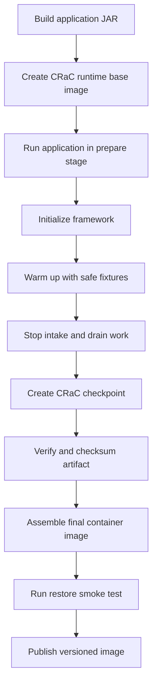

# Creating Checkpoint Images in Container Build Workflows

CRaC can be integrated into container packaging workflows so a Java application is initialized and warmed up before the image is released. Instead of having every new container go through the full cold start process, the pipeline can run the application in a compatible build environment, create a checkpoint from the prepared state, and package the checkpoint alongside the application image.

When a container starts in the deployment environment, the runtime uses the corresponding checkpoint to restore the process. This approach can reduce the time to bring an instance into service, especially for applications with heavy framework initialization or warm-up overhead.

An important point is that a checkpoint is created from a specific process and depends on the environment that produced it. The container image containing the checkpoint must preserve the exact application binary, JDK, native libraries, filesystem layout, and runtime conditions that the checkpoint requires. Therefore, the pipeline needs to manage the **application image**, **checkpoint artifact**, and **release metadata** as a tightly coupled bundle of deliverables.

## 1. Two Image Types in the CRaC Workflow

In container builds, distinguish between the filesystem image and the process state:

| Component | Contents | Purpose |
|---|---|---|
| Application image | CRaC-enabled JDK, application JAR, libraries, default configuration, and entrypoint | Provides the filesystem/runtime to run the application from scratch or restore |
| Checkpoint artifact | Process state snapshot and metadata required for restore | Initializes the process from a warmed-up state |
| Release metadata | Application version, image digest, JDK, OS, architecture, checkpoint engine, and checksums | Pairs the right checkpoint with a compatible runtime image |

The checkpoint can be stored in a directory inside the image, copied from a build stage, or distributed as a separate artifact and fetched into the container at startup. The packaging approach depends on checkpoint size, the container platform, and how the restore runtime locates checkpoints.

A checkpoint does not replace the application JAR or runtime. A snapshot may reference files, native libraries, paths, mounts, and resources from the environment that created it. If the final image lacks a library or places the application at a different path, restore may fail even if the checkpoint files were copied completely.

## 2. General Workflow: Build, Warm Up, Checkpoint, Package

A container pipeline can be broken down into these steps:

1. Build the application JAR and version-locked dependencies.
2. Build the runtime image from the selected CRaC-enabled JDK and OS base image.
3. Run the application image in a prepare environment whose conditions are compatible with the restore environment.
4. Wait for the application to finish initializing, then run a warm-up workload using synthetic data and controlled dependencies.
5. Stop accepting new work, drain requests/tasks, and prepare resources via the CRaC lifecycle.
6. Instruct the CRaC runtime to create the checkpoint.
7. Wait for the checkpoint to complete, verify the generated files, and record metadata/checksums.
8. Embed the checkpoint into the final image or store it as an artifact tied to the application image digest.
9. Test restoring from the packaged artifact itself.



The build stage and restore stage do not have to run on the same machine. However, the environment creating the checkpoint must be compatible with the pool of environments that will restore it. Separating the stages also does not mean checkpoints can be moved arbitrarily across different kernels, CPU architectures, or CRaC runtimes.

## 3. Requirements for the Checkpoint Creation Environment

Creating a checkpoint during a container build differs from running an ordinary build command. The CRaC runtime needs to interact with process state and the operating system's checkpoint engine. Depending on the platform, this may require privileges, capabilities, namespaces, and kernel features that default build sandboxes do not grant.

Before designing the Dockerfile, determine:

- The CRaC JDK distribution and build being used.
- The operating system, kernel, and CPU architecture of the build runner.
- The checkpoint engine/CRIU and compatible version.
- The container runtime and BuildKit mode being executed.
- The capabilities/privileges needed by the checkpoint process.
- Access to `/proc`, cgroups, namespaces, and required filesystems.
- Any seccomp, AppArmor/SELinux, or security profile restrictions.
- The checkpoint path and write permissions in the build stage.

Do not assume a Dockerfile `RUN` instruction can checkpoint a process on every builder. An ordinary build sandbox typically has restricted privileges and is not equivalent to a container runtime configured for checkpoint/restore. If the build runner does not provide sufficient conditions, create the checkpoint in a dedicated prepare job or a container running on a suitably configured runner, then feed the verified artifact into the image packaging step.

### Privileges and Security

The checkpoint engine may need privileges to operate on processes, memory mappings, file descriptors, and namespaces. The specific privilege set depends on the kernel, CRIU, and how the runtime is deployed. Do not enable `privileged` or grant all capabilities out of habit; identify the minimum privileges from platform documentation and test on a dedicated runner.

If an elevated-privilege runner must be used:

- Run in an isolated runner, using one job per checkpoint attempt.
- Do not mount the Docker socket or host filesystem more broadly than necessary.
- Do not inject production credentials into the prepare environment.
- Restrict read permissions on the checkpoint artifact once created.
- Tear down the prepare environment after the artifact is stored and verified.
- Record the actual privileges/capabilities used so the pipeline is reproducible.

## 4. Using a Multi-Stage Docker Build

A multi-stage build separates checkpoint creation from the final image. A key principle is that **the prepare stage and the final stage must use the same runtime base or filesystem layers proven to be compatible**.

Illustrative Dockerfile structure example:

```dockerfile
# Runtime base containing a CRaC-enabled JDK and required system libraries.
FROM registry.example.com/java-crac-runtime:25 AS runtime-base
WORKDIR /opt/app

COPY build/libs/orders-service.jar /opt/app/orders-service.jar
COPY docker/prepare-checkpoint.sh /opt/app/prepare-checkpoint.sh
RUN chmod 0755 /opt/app/prepare-checkpoint.sh

# Stage that runs the application, warms up, and creates the checkpoint.
FROM runtime-base AS checkpoint-build
RUN mkdir -p /opt/app/checkpoint

# The script must start the application, wait for readiness, warm up,
# drain, and invoke the checkpoint command of the exact CRaC JDK.
RUN /opt/app/prepare-checkpoint.sh /opt/app/checkpoint

# Final image shares the same runtime filesystem as runtime-base.
FROM runtime-base AS final
COPY --from=checkpoint-build /opt/app/checkpoint /opt/app/checkpoint

ENV CRAC_CHECKPOINT_DIR=/opt/app/checkpoint
ENTRYPOINT ["/opt/app/start-container.sh"]
```

This is a Dockerfile skeleton. `registry.example.com/java-crac-runtime:25`, the scripts, checkpoint path, and CRaC commands are illustrative values that must be replaced for your real runtime. The example cannot be run as-is without supplying the corresponding script files and base image.

Points to keep consistent:

- `runtime-base` provides the same JDK, native libraries, and filesystem paths for both the prepare and final stages.
- The application JAR in the final image must be the exact binary used to create the checkpoint.
- The checkpoint directory must be copied completely, preserving required structure and metadata.
- The final entrypoint must launch the runtime in restore mode, rather than re-running the normal startup command when a checkpoint is selected.
- If the application requires files outside the checkpoint for restore, those files must exist at the exact paths in the final image or be mounted before restore.

### Why Not Use a Different Base Image in the Final Stage?

If the checkpoint was created on a filesystem with a different JDK or native library than the final image, the restore process may fail to find the right binary or ABI. Even when image tags look identical, the tag may have been updated. For strict pipelines, use image digests to lock the runtime base.

If the final stage needs to reduce size, do not arbitrarily switch the checkpoint over to a different slim JRE or distroless image. You must first prove that the runtime and all files needed for restore are compatible. Unnecessary build tools can be excluded by designing the runtime base cleanly from the outset, but libraries used by the checkpointed process must not be removed.

## 5. Prepare Script: Startup, Warm-Up, and Checkpoint

The script in the build stage is responsible for orchestrating a real Java process. It typically needs to execute the following steps:

1. Load the prepare configuration and safe dependency endpoints.
2. Launch the application with the CRaC JDK.
3. Wait for the application's health/readiness check to report initialized.
4. Invoke the warm-up runner or internal endpoint with synthetic fixtures.
5. Wait for all async tasks triggered by warm-up to complete.
6. Close the admission gate and stop unnecessary schedulers/consumers.
7. Prepare resources via `beforeCheckpoint` callbacks.
8. Invoke the checkpoint command according to the JDK documentation.
9. Verify the checkpoint completed and the process/build step exited according to runtime semantics.

Example shell pseudocode illustrating the sequence:

```sh
#!/bin/sh
set -eu

CHECKPOINT_DIR="$1"

# 1. Start application using the selected CRaC-enabled JDK.
# 2. Wait for its prepare-only readiness endpoint.
# 3. Run deterministic warm-up fixtures.
# 4. Wait for async warm-up work to finish.
# 5. Request checkpoint using the command supported by this JDK build.
# 6. Verify the checkpoint output exists and is complete.

mkdir -p "$CHECKPOINT_DIR"
/opt/app/bin/run-prepare-and-checkpoint \
  --checkpoint-dir "$CHECKPOINT_DIR"
```

`run-prepare-and-checkpoint` here is a wrapper provided by the pipeline or runtime, not a standard command built into every CRaC JDK. How `jcmd`, JVM options, or the checkpoint API are invoked varies by distribution/version and integration method. Obtain the exact command from the documentation of the JDK you are using.

### Example CRaC Commands

Some OpenJDK-based CRaC JDKs provide a mechanism to request a checkpoint via a diagnostic command, such as `jcmd <pid> JDK.checkpoint`, and restore via a JVM option such as `-XX:CRaCRestoreFrom=<directory>`. Exact syntax, command names, attach permissions, and paths must be verified against the specific build. Do not copy these commands verbatim to another vendor/runtime if their documentation specifies a different invocation.

When using diagnostic commands, the process must run with the matching user/permissions needed to attach. If the application runs as a non-root user, the checkpoint script must also respect that user and the process's file permissions. Avoid creating a checkpoint as root and running the final container as another user unless read/write permissions and ownership are configured accurately.

## 6. Packaging the Checkpoint in the Final Image

After the checkpoint completes, the pipeline must place the full artifact into the final image or an artifact repository. When copying into the image:

- Copy the entire checkpoint directory; do not copy just a single hardcoded filename.
- Preserve permissions and directory layout as required by the runtime.
- Do not change the path if checkpoint metadata depends on the original path.
- Do not run extra scripts that modify checkpoint files after creation.
- Ensure the checkpoint directory is not shadowed by an empty volume when the container starts.
- Compute checksums after copying/packaging and store them in the release manifest.

If the checkpoint is stored on an external volume, the entrypoint must verify that the volume is mounted and the artifact is fully downloaded before invoking restore. Do not allow the container to start restoring when the checkpoint directory is freshly mounted but still empty.

### Checkpoint Inside the Image or Fetched at Runtime?

| Packaging Approach | Advantages | Limitations |
|---|---|---|
| Copy checkpoint into final image | A single image digest contains both app and checkpoint; simple deployment | Larger image; every checkpoint update requires building/pushing a new image |
| Store checkpoint separately and fetch at deploy | Independent distribution/retention; reuses application image | Requires version matching, download/verification before startup, and artifact cache management |
| Use volume/artifact mount | Can reduce duplication across multiple containers on the same host | Depends on storage, locality, mount permissions, and volume lifecycle |

Regardless of the approach, the manifest must unambiguously identify which application image a checkpoint belongs to. Do not select checkpoints by mutable tag names or by "latest" when multiple releases run in parallel.

## 7. Entrypoint for Restore Containers

The final image needs an entrypoint that understands the container is running in restore mode. You can choose between two models:

### Restore-Only Image

The image contains the checkpoint and the entrypoint always invokes runtime restore. This model is simple when the environment uses the image exclusively for CRaC.

### Image Supporting Both Restore and Cold Start

The entrypoint checks a configuration variable or deployment mode to choose between restore and normal startup. This is useful when fallback is needed, but you must avoid having prepare-time environment variables saved inside the checkpoint and overriding runtime configuration.

Entrypoint pseudocode:

```sh
#!/bin/sh
set -eu

if [ "${USE_CRAC_RESTORE:-true}" = "true" ]; then
    test -d "$CRAC_CHECKPOINT_DIR"
    test -n "$(find "$CRAC_CHECKPOINT_DIR" -mindepth 1 -print -quit)"

    exec /opt/java/bin/java \
      -XX:CRaCRestoreFrom="$CRAC_CHECKPOINT_DIR"
fi

exec /opt/java/bin/java -jar /opt/app/orders-service.jar
```

This is pseudocode for one runtime model with a corresponding restore option. The Java path, options, and application argument requirements depend on the JDK. In some integrations, the restore command is provided by a runtime launcher or container platform rather than the entrypoint directly invoking `java` as shown above.

The restore command typically resumes the process from the checkpoint; do not add `-jar` or re-run the main class unless the runtime documentation requires it. If the restore option already points to process state, use the exact invocation specified by the runtime.

### PID 1 and Signal Handling

The container entrypoint should use `exec` so the Java process becomes PID 1 when required by the runtime. If a shell wrapper without `exec` is used, stop signals may reach only the shell and not the JVM. During deployment, verify that signals, graceful shutdown, and the checkpoint/restore lifecycle interact properly with the container runtime.

Do not allow a supervisor to start an extra JVM while the checkpointed process is already restored. Each container must have clear process ownership and a unified restart policy.

## 8. Prepare and Runtime Configurations Must Be Separated

The build stage typically uses test endpoints, fixture data, and restricted credentials. These values may reside in static fields, singletons, or client objects inside the checkpoint. After restore, the application must load the target configuration and replace those dependencies.

Values that should be freshly supplied when the container runs:

- Database URL, username/password, or token.
- Message broker endpoint and consumer group session.
- Service registry identity, lease, and instance ID.
- Bind/advertise address and port.
- HTTP client endpoints, DNS, and TLS certificates.
- Logging, metrics, and tracing collector endpoints.
- Secrets, feature flags, and remote configuration.

Do not bake production secrets into image layers or checkpoints. Use a secret manager, workload identity, or the platform's secret injection mechanism. Checkpoints may hold sensitive data in the heap, so they should be encrypted and read-restricted like artifacts containing secrets.

### Using Safe Warm-Up Fixtures

Warm-up should exercise real code paths while avoiding production side effects:

- Use a dedicated namespaced ID for warm-up.
- Use a test database/schema or fake repository depending on the goal.
- Stub payment, email, SMS, and event sinks.
- Do not consume production messages.
- Do not create real user sessions.
- Drain asynchronous tasks before checkpoint.
- Clear or mark stale any caches that contain only fixture data before production readiness.

To warm up JDBC/ORM, use a test database with a compatible schema and dialect. If you only need to warm up business logic, a fake adapter may suffice. Choose based on your measurement objectives.

## 9. File Descriptors, Mounts, and Filesystem in Containers

A checkpoint can save state related to file descriptors, mappings, and paths. The final image and restore environment must provide the necessary files/resources.

Verify:

- Whether the working directory and absolute paths match the checkpoint creation stage.
- Whether the application JAR and native libraries are at the exact paths.
- Whether config files, truststores, and certificates exist at runtime.
- Whether required mount points are mounted before restore.
- Whether file permissions, UID/GID, and ownership are compatible.
- Whether temporary directories or socket paths are recreated.
- Whether file descriptors depending on external files/daemons are closed or recreated according to the lifecycle.

Do not rely on a file in the build container's writable layer if that file is not copied to the final image. Conversely, do not copy temporary files or unnecessary fixture data into the final image, as they can increase image size and expose data.

If the application uses `mmap`, shared memory, Unix sockets, or device handles, verify restore capability on the exact target kernel/container runtime. The existence of a path in the final image does not guarantee an old descriptor remains valid.

## 10. Kernel, Architecture, and Container Runtime Compatibility

Checkpoints are often tightly coupled to the system environment. At a minimum, record and control:

| Component | Pipeline Control |
|---|---|
| CPU architecture | Do not create a checkpoint on `amd64` and assume restore on `arm64` |
| JDK distribution/build | Pin verified vendor, version, and build |
| OS base image | Pin digest and required native libraries |
| Kernel/checkpoint engine | Use runners and host groups within the supported matrix |
| CRIU/runtime integration | Record version/build and enabled features |
| Namespace/cgroup | Check PID, mount, network, and resource limits |
| Container security profile | Ensure required privileges are granted in both build and restore stages |
| Filesystem | Preserve paths, permissions, mounts, and backing files |

A fixed image digest is not enough to guarantee successful restore if the host kernel differs. You can run the same application image across multiple hosts while enabling CRaC restore only on verified node pools. For incompatible hosts, deployment should use cold start or route workloads to a supported node pool.

## 11. Testing the Checkpoint Before Publishing

A successful build only proves that the Dockerfile produces an image. It does not prove the checkpoint can restore. Add a verification step after assembling the final image:

1. Run the final image in a compatible container runtime.
2. Verify the checkpoint directory exists, is non-empty, and checksums match.
3. Launch the container via the exact restore entrypoint.
4. Wait for `afterRestore` callbacks and resource recreation to complete.
5. Check database, listeners, service registration, and telemetry.
6. Send smoke test requests through the real processing path.
7. Confirm readiness passes only after health checks succeed.
8. Verify logs contain no endpoints or credentials from the prepare environment.
9. Stop the container and verify normal shutdown.

The restore smoke test should run from the packaged final image, not just from the build stage. If the build stage can restore but the final image cannot, there is usually a difference in filesystem, permissions, runtime, or entrypoint between the two stages.

## 12. Versioning, Checksums, and Release Manifest

The application image and checkpoint must be released under an immutable version. Example manifest:

```yaml
release:
  id: catalog-service-2026.11.13.1
  image: registry.example.com/catalog-service:2026.11.13.1
  imageDigest: sha256:APPLICATION_IMAGE_DIGEST
  commit: 3b7d9e10

checkpoint:
  path: /opt/app/checkpoint
  artifactDigest: sha256:CHECKPOINT_ARTIFACT_DIGEST
  createdAt: "2026-11-13T06:00:00Z"
  status: restore-tested

runtime:
  jdk: crac-enabled-jdk-build
  osImageDigest: sha256:OS_IMAGE_DIGEST
  architecture: linux-amd64
  kernelCompatibility: approved-linux-kernel-group
  checkpointEngine: tested-engine-version
```

The values are illustrative placeholders. Real manifests must pull digests and versions from build outputs rather than manually writing dummy values. Checksums detect corrupted or altered artifacts; signatures help verify artifact provenance if supported by the pipeline.

Do not use the `latest` tag to pair a checkpoint with an application image. Use an image digest or immutable release ID. If the checkpoint is stored separately, the manifest must explicitly identify which image digest produced which checkpoint.

## 13. Optimizing Size and Build Time

Checkpoints can significantly increase image size because they contain heap and native memory. Measure and optimize intentionally:

- Only warm up code paths that deliver meaningful latency improvements after restore.
- Avoid loading large fixtures or data that does not need to stay in the heap.
- Clear regenerable caches if the cost of restoring the cache outweighs the benefit.
- Do not retain log buffers, response bodies, or temporary objects after warm-up.
- Use multi-stage builds to avoid carrying compilers, source trees, or unnecessary tools into the final image.
- Compress artifacts if the restore workflow allows it, and measure decompression overhead too.
- Use build caching for dependencies and application layers, but do not reuse old checkpoints when inputs/runtime have changed.
- Measure fetch, unpack, restore, and resource recreation durations separately.

Do not arbitrarily discard objects right before checkpointing if they represent warm-up state worth keeping. Measure heap usage, checkpoint size, and first-request latency to choose what data to retain.

### Build Cache and Correctness

Docker/BuildKit can cache layers based on build step inputs. A checkpoint step depends on many factors outside the Dockerfile, such as kernel, CRIU, host capabilities, time, and external dependencies. If the build cache does not reflect these factors, the pipeline may reuse a checkpoint created in a different environment.

Version the checkpoint using runtime/host compatibility metadata and actively invalidate the cache when influential inputs change. Do not treat a layer cache hit as proof that the checkpoint remains compatible.

## 14. Common Pitfalls in Container Builds

### Build Stage Lacks Checkpoint Privileges

Docker builds run in a sandbox without the necessary capabilities or kernel features. The checkpoint command fails even though the application runs normally. Use a suitably configured prepare runner/job or separate checkpoint generation from the standard Docker build.

### Final Stage Uses a Different Runtime Base

The checkpoint was created with one JDK or native library, while the final image uses a different base. Restore may fail due to missing binaries, ABI mismatches, or runtime metadata issues. Pin the runtime base digest and reuse the exact same stage.

### Copying Only Part of the Checkpoint

The checkpoint consists of multiple files, but the Dockerfile copies only a single file or copies while the engine is still running. Restore cannot locate metadata/resources. Wait for completion and copy the entire directory preserving the original structure.

### Wrong Ownership or Permissions

The checkpoint was created by root, whereas the container runtime runs as a non-root user. The process cannot read the artifact or access required files. Set explicit ownership/permissions according to the runtime user and security requirements.

### Entrypoint Runs Cold Start Instead of Restore

The image contains the checkpoint, yet the startup command still runs `java -jar`. The application starts from scratch, ignoring the checkpoint. Check the entrypoint and startup logs to confirm the runtime actually enters the restore path.

### Checkpoint Contains Prepare Endpoints

Clients or singletons retain stub/test database URLs. After restore, the application continues calling the prepare environment. Re-read runtime configuration and replace adapters/clients before opening readiness.

### Incompatible Deployment Host

The image restores on the build runner but fails on production nodes due to a different kernel, architecture, CRIU version, or security profile. Use compatibility groups and test on the exact target node pool.

### Incorrectly Cached Checkpoint

The build system reuses the checkpoint layer even though the application JAR or JDK changed. Bind the checkpoint to the image digest and runtime metadata, and invalidate the cache whenever inputs change.

## 15. Rollback and Cold-Start Fallback

Not every restore succeeds. Deployments must retain a fallback path:

1. Verify the image/checkpoint digest before launching.
2. Test restore in a canary or smoke-test stage.
3. If restore fails, keep the container not ready and do not register endpoints.
4. According to policy, attempt a cold start from the corresponding application image or roll back to the previous image/checkpoint release pair.
5. Never pair an old checkpoint release with a new application JAR/runtime.
6. Log the error, host metadata, and restore duration for investigation.

Cold start must be tested as a real deployment path. If an entire node pool relies on checkpoints and the artifact breaks, the system may fail to scale. You can retain a few cold-start replicas or a fallback rollout mode depending on availability requirements.

## 16. Securing Checkpoints in Image Registries

A checkpoint can contain credentials, tokens, sessions, request data, and sensitive objects in the heap. When the checkpoint is copied into a container image, this data becomes part of an image layer.

This means:

- Deleting a secret file in a later layer does not remove the secret from an earlier layer in the image history.
- Anyone with permission to pull the image may be able to extract the checkpoint and the data inside it.
- Registry retention and builder caches may retain the checkpoint longer than intended.
- Image promotion across environments could accidentally carry prepare-environment credentials.

Mitigations:

- Do not load production secrets during the prepare stage.
- Use minimal test credentials and revoke/rotate them before publishing.
- Restrict pull permissions on images containing checkpoints.
- Encrypt artifacts or use a controlled artifact store if required by the platform.
- Do not push checkpoints to public registries.
- Manage retention and purge caches/layers according to policy.
- Scan images and artifacts following the organization's security workflow.

If the checkpoint contains data that cannot be safely removed, consider storing it as a separate artifact with strict access control rather than embedding it in an image shared across all environments.

## 17. Pipeline Testing and Observability

Measure both the creation and restore phases:

| Metric | Phase | Meaning |
|---|---|---|
| Build application duration | Create | Cost of building the JAR/runtime image |
| Application warm-up duration | Create | Time to establish hot state |
| Checkpoint creation duration | Create | Cost of creating the process snapshot |
| Checkpoint size | Create | Storage/distribution cost |
| Artifact packaging/upload duration | Create | Packaging and storage bottlenecks |
| Artifact download/verify duration | Restore | Cost of preparing the checkpoint on the node |
| Process restore duration | Restore | Time for the runtime to recover the process |
| Resource recreation duration | Restore | Cost of database/network/telemetry setup |
| Time to readiness | Restore | Time until the instance actually serves traffic |
| Restore success/fallback rate | Both | Reliability per release and node pool |

Minimum test scenarios:

1. Build the image and checkpoint on the target runner.
2. Restore the final image on the same supported host type.
3. Restore on other hosts within the compatibility group.
4. Test mismatched image/checkpoint digests and verify deployment rejects them.
5. Test missing checkpoint files or incorrect permissions.
6. Test an unavailable dependency after restore and confirm readiness stays closed.
7. Test cold-start fallback.
8. Restore multiple replicas and verify each replica gets its own instance ID, lease, and endpoint.
9. Measure first-request latency compared to cold start.

## 18. Checklist for Container Checkpoint Builds

### Build/prepare stage

- [ ] Application JAR, dependencies, CRaC JDK, and OS base image are pinned.
- [ ] Build runner has the required kernel/checkpoint engine and privileges.
- [ ] Warm-up runs with synthetic fixtures and safe dependencies.
- [ ] Warm-up tasks and requests are drained before checkpoint.
- [ ] CRaC command matches the distribution/version in use.
- [ ] Checkpoint engine finishes before the artifact is copied.
- [ ] Checkpoint directory is verified and checksums are generated.
- [ ] Manifest records image digest, JDK, OS, architecture, and engine.

### Final image/restore stage

- [ ] Final image uses a runtime filesystem compatible with the checkpoint creation stage.
- [ ] Entire checkpoint is copied preserving structure and permissions.
- [ ] Entrypoint actually invokes the restore path as defined by the runtime.
- [ ] Runtime config, secrets, and instance identity are supplied per target environment.
- [ ] Mounts, paths, and networking are prepared before restore.
- [ ] Resources are recreated and health checks pass before readiness.
- [ ] Restore smoke test runs from the final image.
- [ ] Cold-start fallback and release rollback are available.
- [ ] Image/checkpoint is protected as an artifact that may contain secrets.

## 19. Conclusion

Creating checkpoint images in a container build workflow is a way to prepare JVM state once for a release and package it alongside the application image. The pipeline must run the application in a compatible CRaC environment, warm it up with safe data, drain work, create the checkpoint, and store the artifact under an immutable version. The final image must preserve the exact runtime/filesystem required by the checkpoint and provide a proper restore entrypoint.

Not every Docker build sandbox has sufficient privileges or kernel features to create a checkpoint. If the build stage is restricted, use a dedicated prepare runner and pass the verified artifact into the packaging step. During deployment, verify image/checkpoint pairing, supply distinct configuration and identity, recover resources, check readiness, and maintain a cold-start fallback. In this way, the checkpoint becomes a controllable part of the container release rather than a snapshot file copied into an image without compatibility guarantees.
