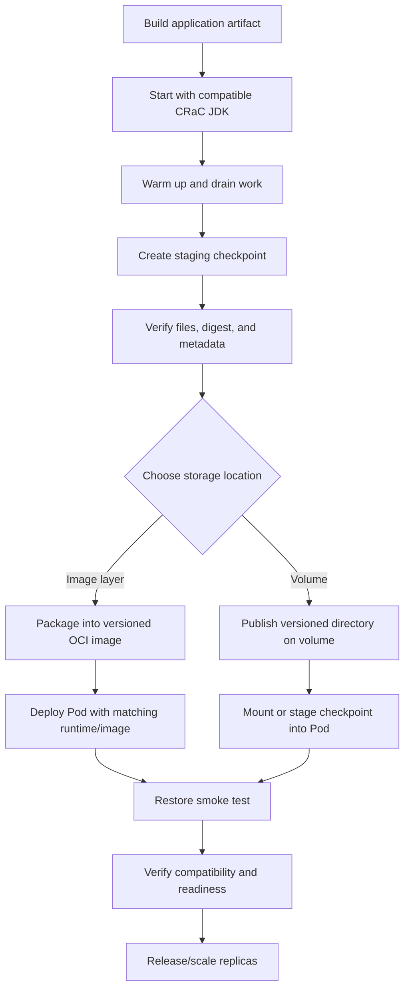

# Placing Checkpoints in an Image Layer or Volume

When deploying Java CRaC in containers, the checkpoint must be placed in a location accessible to the restore process with the proper permissions and runtime environment. Two common placement approaches are packaging the checkpoint into an **OCI/Docker image layer** or storing the checkpoint on a **volume** mounted into the container.

These two approaches address different needs. An image layer fits checkpoints created in advance, tied to an application version, and released as an immutable artifact. A volume fits scenarios where the checkpoint is created at runtime, must survive container/Pod replacements, or needs to be managed independently from the application image.

Before choosing, distinguish two concepts: a **CRaC checkpoint** is the Java process state created by the CRaC JDK/runtime; an **image layer** is the filesystem layer of an OCI/Docker image holding those checkpoint files. Placing CRaC files into an image layer does not turn it into a container-runtime checkpointing feature. Checkpointing an entire container via CRIU or a container runtime feature is a different mechanism with its own scope and requirements.

## 1. Checkpoints as Filesystem Artifacts

With CRaC, the application can instruct the runtime to create a checkpoint after initialization and warm-up. Depending on the JDK distribution and deployment tooling, a checkpoint is typically saved as a directory containing multiple process-state files and related metadata. The runtime needs to read these exact files during restore.

Example conceptual flow:

```text
Launch CRaC-enabled JVM
        |
        v
Initialize application and warm up
        |
        v
Prepare/close resources to be handled
        |
        v
Create checkpoint in a directory
        |
        v
Package checkpoint directory into an image layer
or store the directory on a volume
        |
        v
New container mounts/receives checkpoint
        |
        v
JVM restores from checkpoint path
```

The checkpoint path must match how the runtime is configured to restore. The illustrative example below uses options commonly found in some CRaC JDK distributions:

```bash
# When creating checkpoint
java -XX:CRaCCheckpointTo=/opt/app/checkpoint -jar /opt/app/app.jar

# When restoring
java -XX:CRaCRestoreFrom=/opt/app/checkpoint
```

Option names, checkpoint trigger tools, and execution conditions depend on the CRaC JDK distribution. Refer to the documentation for the exact version being deployed. Do not assume every CRaC JDK uses the same syntax or that every checkpoint can be restored by any runtime.

A checkpoint is not merely a JAR or configuration file. It represents the state of an initialized process, which can include the heap, thread state, and supported portions of runtime/operating-system state. Therefore, the checkpoint must be managed together with the application version, JDK, operating system, architecture, and related compatibility conditions.

## 2. Placing the Checkpoint in an OCI/Docker Image Layer

With this approach, the checkpoint directory is placed into a layer of the container image. When the image is pulled to a node, the checkpoint travels with the image and is available at the defined path inside the container.

Example filesystem layout:

```text
/opt/app/
├── app.jar
└── checkpoint/
    ├── ... checkpoint metadata/files ...
    └── ... runtime state files ...
```

An image layer works well when the pipeline generates the checkpoint before release and each release has its own checkpoint. The image is tagged/pinned with an immutable digest; new Pods simply pull the right image and restore from the path inside the image.

### Example Dockerfile Packaging a Pre-Built Checkpoint

Suppose the pipeline has already created a checkpoint in `build/checkpoint/` using the exact JDK/runtime and artifact to be released. The Dockerfile can copy that directory into the image:

```dockerfile
FROM eclipse-temurin:21-jre

WORKDIR /opt/app

COPY --chown=10001:10001 build/app.jar /opt/app/app.jar
COPY --chown=10001:10001 build/checkpoint/ /opt/app/checkpoint/

USER 10001:10001

ENTRYPOINT ["java", "-XX:CRaCRestoreFrom=/opt/app/checkpoint"]
```

This is an illustrative example; replace the base image with a compatible CRaC JDK distribution and use the exact restore option for that JDK. Paths, user/group, and entrypoint must also match the actual pipeline. If the checkpoint needs additional runtime files or system libraries, they must be present in the image at the exact versions used when creating the checkpoint.

Do not create a checkpoint from one JDK and package it into an image using another JDK merely because both share the same Java major version. Pin the exact vendor/build/runtime and verify CRaC compatibility conditions.

### Create Checkpoint First, Package Afterward

A pipeline typically separates checkpoint creation from image packaging:

1. Build the JAR and lock dependencies from a specific source commit.
2. Create the runtime image or builder environment with the exact CRaC JDK, OS userspace, and JVM configuration.
3. Launch the application, load startup configuration, and warm up according to the manifest.
4. Wait for warm-up requests/futures/jobs to finish; prepare resources following the CRaC lifecycle.
5. Create the checkpoint in a staging directory.
6. Verify the completed checkpoint and collect metadata/digests.
7. Copy the checkpoint into the image layer of the corresponding release.
8. Run a restore smoke test from the newly built image itself.
9. Publish the image with an immutable tag and digest.

Separating these steps gives the artifact clear provenance: which build, runtime, and warm-up manifest produced the checkpoint. Do not rebuild the JAR or alter dependencies after creating the checkpoint while keeping the old checkpoint label.

### Placing the Checkpoint in a Dedicated Layer

If the checkpoint is large, you can organize the Dockerfile or packaging process so that the layer containing the checkpoint is separated from the application and runtime layers. When the checkpoint changes, the registry can reuse unchanged base layers, depending on build and caching behavior.

Conceptual layer layout example:

```text
Layer 1: base OS/runtime libraries
Layer 2: JDK CRaC distribution
Layer 3: application artifact and static resources
Layer 4: checkpoint files for this release
Layer 5: entrypoint and release metadata
```

The actual ordering should be optimized according to how images are built. Earlier layers can be shared across multiple images if their contents are identical. Because the checkpoint layer usually changes per release, isolating it helps reduce rebuilding or re-transferring unchanged layers. However, if subsequent layers depend on checkpoint contents or if build tooling alters earlier layers, caching benefits may diminish.

### Advantages of Image Layers

- The checkpoint is released together with the application/runtime image and can be identified by the image digest.
- New Pods can restore without downloading the checkpoint from a separate service during startup.
- Image layer contents are immutable; multiple Pods can read the same checkpoint artifact.
- Registry and node image caches can reuse underlying base layers.
- It is easy to tie a checkpoint to a release and roll back as an application/checkpoint image pair.

### Limitations of Image Layers

- Checkpoints can be very large, increasing image size, push/pull times, and registry storage usage.
- Every new checkpoint can create a large new layer, increasing storage cost even when base layers are shared.
- Replacing a checkpoint typically means releasing a new image and updating the deployment.
- Container image layers are inherently immutable filesystems; they are unsuitable for writing new runtime checkpoints.
- A checkpoint may be coupled to a specific kernel, CPU architecture, JDK build, or environment, so publishing an image does not guarantee portability by itself.

Image layers are a suitable choice for checkpoints prepared in advance and released as part of a release. Do not use a container's writable layer as long-term checkpoint storage: the writable layer is normally lost when the container is replaced.

## 3. Placing the Checkpoint on a Volume

With this approach, the checkpoint resides outside the image filesystem and is mounted into the container at a path such as `/var/lib/app/checkpoints`. The container image contains only the application and runtime; the checkpoint is supplied via a volume or copied onto the volume during deployment.

Volumes are useful when:

- Checkpoints are created at runtime and must persist after the container terminates.
- Checkpoints are large and you want to manage/store them independently of the application image.
- Multiple Pods need access to the same immutable checkpoint artifact.
- You need to swap checkpoints without rebuilding the entire application image.
- You want to retain checkpoints per release on a PVC or storage service with its own lifecycle.

Example layout:

```text
Container filesystem             Mounted volume
--------------------             -----------------------------
/opt/app/app.jar                 /var/lib/app/checkpoints/
/opt/app/bin/entrypoint.sh          orders-2.1.0-build1842/
                                    orders-2.2.0-build1901/
```

The entrypoint can select the checkpoint directory based on release metadata or a managed configuration variable. Avoid using a `latest` directory that could be overwritten while another Pod is restoring from it.

### Docker Compose: Mounting the Checkpoint Directory

```yaml
services:
  orders:
    image: registry.example.com/orders-service:2.1.0
    volumes:
      - type: volume
        source: orders-checkpoints
        target: /var/lib/app/checkpoints
        read_only: true
    environment:
      CRAC_CHECKPOINT_DIR: /var/lib/app/checkpoints/orders-2.1.0-build1842

volumes:
  orders-checkpoints:
    external: true
```

This is an illustrative configuration. The volume must be created and populated with the checkpoint before the service runs. A `read_only` mount is appropriate if the runtime only reads the checkpoint and does not need to write metadata/working files into the same directory; if the runtime requires writes, use a separate writable working directory or mount appropriately per the JDK documentation.

Do not allow multiple application versions to write into the same checkpoint directory. Each release should have its own path and switch references only after the new checkpoint has been created, verified, and completely published.

## 4. Choosing a Volume Type in Kubernetes

Kubernetes provides multiple ways to mount data into a Pod. They have different semantics and lifecycles.

| Volume Type | Lifecycle | Suitable for Checkpoints? | Notes |
|---|---|---|---|
| `emptyDir` | Exists for the lifetime of the Pod; data is lost when the Pod is deleted | Suitable as a checkpoint staging/copy directory for a single Pod | Can be used to unpack/copy checkpoints from an artifact store; not for persistent storage across Pod replacements |
| PVC | Bound to a PersistentVolume according to storage class and reclaim policy | Suitable for storing checkpoints that must survive Pod replacement | Depends on access mode, CSI driver, performance, and topology |
| `hostPath` | Tied to the node's filesystem | Suitable only in controlled node-local environments | Pods rescheduled to another node may not see the data; increases security and operational risk |
| `configMap`/`secret` | Configuration data managed by Kubernetes | Not suitable for large checkpoints | Intended for config/credentials, not for process state storage |
| Object storage via init container | Data lives outside the cluster and is downloaded at Pod startup | Suitable for distributing large versioned checkpoints | Requires digest verification, access permissions, and sufficient local staging space |

### `emptyDir`

`emptyDir` is useful when the checkpoint is stored in an OCI image or object storage, yet each Pod needs its own copy for restore. An init container can copy the checkpoint into `emptyDir`, and the application container restores from there.

`emptyDir` persists across container restarts within the same Pod, but is deleted when the Pod is removed from the node. Therefore, if you need to retain a checkpoint created by the application after the Pod is replaced, `emptyDir` is insufficient. It fits staging, caching, or Pod-private copies.

### PersistentVolumeClaim

A PVC is suitable when the checkpoint is created at runtime and must persist across Pod replacements. However, check the storage class's access modes:

- `ReadWriteOnce` typically allows read-write mounting from a single node; multiple Pods on the same node may have behavior dependent on the CSI driver and mount setup.
- `ReadOnlyMany` allows multiple nodes to mount read-only if the storage backend supports it.
- `ReadWriteMany` allows multiple nodes to mount read-write if supported by the backend.
- `ReadWriteOncePod` restricts read-write mounting to a single Pod where supported by Kubernetes/CSI.

Do not assume every storage class supports every access mode. For immutable checkpoint artifacts read by multiple replicas, prefer a read-only/shared model if the backend supports it. If each Pod needs to write or mutate data after restore, provision a separate working directory for each Pod rather than letting multiple replicas write into a shared checkpoint directory.

### `hostPath`

`hostPath` can deliver good performance when checkpoints reside on a node's NVMe/local disk, but the data is tied to that node. If the scheduler places the Pod onto another node, the path may not exist or may contain a different checkpoint. Using `hostPath` requires explicit node affinity/selectors, disk capacity management, filesystem permissions, and security policies. Do not treat it as a portable cluster storage solution.

## 5. Kubernetes Example: Mounting a Checkpoint from a PVC

The following example mounts a PVC into a Pod to read a release-specific checkpoint:

```yaml
apiVersion: v1
kind: PersistentVolumeClaim
metadata:
  name: orders-checkpoint-2-1-0
spec:
  accessModes:
    - ReadOnlyMany
  resources:
    requests:
      storage: 8Gi
  storageClassName: shared-checkpoint-storage
---
apiVersion: apps/v1
kind: Deployment
metadata:
  name: orders-service
spec:
  replicas: 3
  selector:
    matchLabels:
      app: orders-service
  template:
    metadata:
      labels:
        app: orders-service
    spec:
      containers:
        - name: orders
          image: registry.example.com/orders-service:2.1.0
          env:
            - name: CRAC_CHECKPOINT_DIR
              value: /var/lib/app/checkpoints/orders-2.1.0-build1842
          volumeMounts:
            - name: checkpoint
              mountPath: /var/lib/app/checkpoints
              readOnly: true
      volumes:
        - name: checkpoint
          persistentVolumeClaim:
            claimName: orders-checkpoint-2-1-0
```

This manifest illustrates the structure, not a configuration ready for every cluster. `ReadOnlyMany` works only if the storage class/CSI backend supports it. Some environments may require `ReadWriteMany`, object storage, or an init container copying the checkpoint into `emptyDir`. Also verify actual checkpoint size, PVC capacity, filesystem semantics, and mount duration.

If the runtime only needs to read the checkpoint, a read-only mount prevents Pods from accidentally modifying the shared artifact. If the runtime must write into the restore directory or create auxiliary files, separate the read-only source checkpoint from a read-write working directory. Do not switch the mount to shared read-write without identifying which files can be modified.

## 6. Init Container Copying the Checkpoint into `emptyDir`

A useful pattern is to keep the checkpoint in an immutable distribution location and copy it into each Pod's private `emptyDir`. The source can be a read-only PVC or a dedicated image/artifact holding the checkpoint. An init container verifies checksums and copies the data before the application container starts.

```yaml
apiVersion: v1
kind: Pod
metadata:
  name: orders-restore-example
spec:
  initContainers:
    - name: stage-checkpoint
      image: registry.example.com/checkpoint-tools:1.0
      command:
        - sh
        - -c
        - |
          set -eu
          cp -a /checkpoint-source/orders-2.1.0-build1842/. /checkpoint-work/
          sha256sum -c /checkpoint-source/orders-2.1.0-build1842/SHA256SUMS
      volumeMounts:
        - name: checkpoint-source
          mountPath: /checkpoint-source
          readOnly: true
        - name: checkpoint-work
          mountPath: /checkpoint-work
  containers:
    - name: orders
      image: registry.example.com/orders-service:2.1.0
      env:
        - name: CRAC_CHECKPOINT_DIR
          value: /checkpoint-work
      volumeMounts:
        - name: checkpoint-work
          mountPath: /checkpoint-work
  volumes:
    - name: checkpoint-source
      persistentVolumeClaim:
        claimName: orders-checkpoint-source
    - name: checkpoint-work
      emptyDir:
        sizeLimit: 10Gi
```

This is an illustrative template. The init container must include the appropriate checksum tool, and the checksum file must be generated by the release pipeline rather than regenerated on the spot from an unverified source. Paths in the example must match the checkpoint layout exactly. If the runtime requires specific metadata files or permissions, preserve them during copying; verify `cp -a` behavior or use an appropriate copy utility.

This pattern has the following benefits:

- Each Pod receives its own checkpoint copy to restore from.
- The checkpoint source can be mounted read-only.
- Pods can use a separate working directory if the runtime needs to write auxiliary files.
- Copying and digest verification complete before the application starts.

In exchange, init duration and local disk consumption increase with checkpoint size. If checkpoints are large, measure copy duration and consider node-level caching or distribution via image layers.

## 7. Volumes Must Be Intact Before Restore

A partially copied or partially written checkpoint can cause restore failures or hard-to-diagnose errors. Never allow a Pod to restore from a directory while the pipeline is still writing to it.

A safe way to publish checkpoints:

1. Create the checkpoint in a dedicated versioned staging directory.
2. Wait for the checkpoint command to finish and confirm the process/tool reports success.
3. Verify all required files, sizes, permissions, and metadata.
4. Compute digests/checksums to verify integrity.
5. Write a manifest containing the application build, JDK/CRaC build, architecture, kernel compatibility, checkpoint ID, and checksums.
6. Write a `READY` marker last once all steps finish.
7. Publish the immutable versioned path for deployment.
8. Update the Pod template to the new version only after the artifact is ready.

Example layout on the volume:

```text
/var/lib/app/checkpoints/
├── orders-2.0.0-build1800/
│   ├── checkpoint-files...
│   ├── manifest.yml
│   └── READY
└── orders-2.1.0-build1842/
    ├── checkpoint-files...
    ├── manifest.yml
    └── READY
```

You can create the staging directory on the same filesystem and rename it to the versioned directory once finished. Renaming within the same filesystem usually makes directory publishing atomic at the directory-entry level, though filesystem/CSI semantics should be verified. When writing to network filesystems or object storage, do not assume rename and consistency behave identically to a local POSIX filesystem.

Do not use a `current` directory that gets overwritten directly while Pods are reading from it. If a `current` alias is needed, update it only after the versioned checkpoint is complete and use a synchronization mechanism so Pods resolve the alias once when starting restore.

## 8. File Permissions and Ownership

Containers commonly run as a non-root user. If the checkpoint was created by a different user, the Pod may fail to read files or create temporary files required during restore.

Check:

- The UID/GID of the user running the JVM.
- Owner/group and mode of the checkpoint directory and all files inside it.
- `runAsUser`, `runAsGroup`, and `fsGroup` in the Pod security context.
- Whether the storage driver supports changing ownership or required mount options.
- Whether SELinux/AppArmor or node security policies block access.
- Whether a read-only volume matches the runtime's actual requirements.

Example security context:

```yaml
spec:
  securityContext:
    runAsNonRoot: true
    runAsUser: 10001
    runAsGroup: 10001
    fsGroup: 10001
```

`fsGroup` can help grant group permissions on a volume, though behavior depends on the volume type and CSI driver. Do not run containers as root simply to bypass permission errors. Standardize ownership/mode in the pipeline or configure storage properly.

A checkpoint can hold sensitive data residing in the heap, such as tokens, passwords, private keys, or user data. Restrict read access to checkpoints, encrypt storage/backups per policy, protect registries, and do not allow arbitrary workloads in the cluster to mount that volume.

## 9. Mount Paths Must Be Consistent Between Creation and Restore

A checkpoint can contain file descriptor state or path-related runtime information. Depending on the mechanism and libraries, the application may still hold opened absolute paths or resources that must appear at the same locations on restore.

Therefore:

- Choose a stable checkpoint path, such as `/opt/app/checkpoint` or `/var/lib/app/checkpoint`.
- Use the same logical path in the checkpoint-creation environment and the restore environment when required by the runtime.
- If a volume mounts at a different path, check any resource/file paths stored inside the process.
- Do not rename or move files inside the checkpoint after creation.
- Ensure native libraries, config files, and mount points the process depends on remain present.

The checkpoint path passed to the JVM and the paths of application resources are two separate concerns. Mounting the checkpoint directory accurately does not automatically guarantee that all external files referenced by the application are mounted correctly as well.

## 10. Storage Performance and Restore Time

Checkpoints can contain large amounts of data. Restore must read the state files and set up the process according to the runtime's mechanism. Storage location directly affects read time, I/O latency, and the ability of multiple Pods to restore concurrently.

### Image layer

When the image is already pulled and layers are in the node cache, reading the checkpoint can leverage local image storage. However, if a node does not yet have the image, pulling a large checkpoint layer can account for a significant share of startup time. Many Pods scaling out simultaneously can place heavy load on the registry or network.

### Persistent/network volume

Volumes backed by network storage allow sharing checkpoints across nodes, but throughput, IOPS, latency, and mount limits can impact restore. Multiple Pods reading the same large checkpoint can generate a read burst on the storage backend. Some CSI drivers require attach/mount time before the container starts.

### Local SSD or Node Cache

Local SSDs can reduce read times, but data is typically tied to the node and requires cache/eviction policies. If a Pod is scheduled to another node, the checkpoint must be redistributed or that node must have an appropriate cached copy.

Measure:

- Actual checkpoint size.
- Image pull or volume attach/mount duration.
- Duration of copying the checkpoint into a working directory.
- Throughput/IOPS and latency during restore.
- Time from Pod scheduling to restore completion and readiness.
- Behavior when multiple replicas restore simultaneously.

Do not measure only the restore command duration. Total time to readiness also includes scheduling, image pull, volume mount, init containers, checkpoint copy/verification, dependency reconnection, and readiness checks.

## 11. Multiple Replicas Sharing One Checkpoint

An immutable checkpoint can serve as the source for multiple replicas if the runtime and environment support the same restore conditions. However, distinguish the **checkpoint source** from **each replica's writable state**.

A generally suitable model:

- A versioned checkpoint is published in an image layer, read-only PVC, or object storage.
- Each Pod restores from that source.
- Each Pod has its own working directory or volume if the runtime needs to write auxiliary files.
- Each Pod creates its own identity, connections, leases, and subscriptions after restore.
- Replicas never modify the shared source checkpoint directory.

If the storage only supports a single writer, the same PVC cannot be mounted read-write across multiple Pods on different nodes. When using a shared filesystem, verify the backend's concurrent read and file-locking semantics. Some runtimes may modify or create files in the restore directory; if so, copy the checkpoint into each Pod's private `emptyDir`/local scratch space.

Identical checkpoints do not mean restored instances are allowed to share an instance ID, lease, lock, transaction ID, or exclusive consumer state. Those states must be re-acquired or coordinated after restore.

## 12. Distinguishing the Source Checkpoint from Post-Restore Runtime Data

Do not write Pod operational data back into the source checkpoint directory. After restore, the application may create logs, caches, temporary files, PID files, socket paths, or runtime metadata. This data has a different lifecycle from the initial checkpoint.

A clean layout could be:

```text
/opt/app/checkpoint-source/   # immutable, read-only checkpoint
/var/lib/app/runtime/         # Pod runtime data
/var/log/app/                 # logs, preferably directed to stdout/stderr
/tmp/app/                     # regenerable temporary files
```

Separating directories avoids overwriting the source checkpoint and makes lifecycle cleanup easier. With `readOnlyRootFilesystem: true`, mount dedicated volumes for runtime paths that require writes. Do not loosen write permissions across the entire container filesystem just because a library needs a temporary directory.

## 13. Storing Checkpoints Created While a Pod Is Running

If the application creates a checkpoint while running, the destination path must sit on a volume with an appropriate lifecycle. Do not write into the container's writable layer if the checkpoint needs to persist after the Pod is deleted or replaced.

A runtime workflow may include:

1. Receive a checkpoint request from a coordinator or operational tool.
2. Transition the application to a quiescent state and handle CRaC resources.
3. Write the checkpoint to a staging directory on a read-write volume.
4. Wait for the checkpoint to finish and verify its status.
5. Generate a manifest/checksums and publish the versioned directory.
6. Notify the coordinator that the checkpoint is ready.
7. Manage the current Pod/process according to the deployment strategy.

The PVC must be reattached to a Pod with a compatible runtime on restore. If the Pod is created on a different node, CSI must attach/mount the volume and that node must satisfy the required kernel/architecture/JDK conditions. A persistent volume preserves the files, but it does not make the checkpoint environment-independent.

If you need to back up or replicate the checkpoint to another zone, use storage backend snapshots or backup mechanisms after the checkpoint completes. Do not copy the directory while the runtime is still writing checkpoint files.

## 14. Ensuring Compatibility When Kubernetes Schedules Pods

Whether placed in an image layer or a volume, a checkpoint can be constrained by the environment that created it. A successful storage mount does not prove that restore will succeed on an arbitrary node.

Checkpoint metadata should record:

- Application build/version and digest.
- JDK/CRaC vendor, version, and build.
- JVM startup options profile.
- CPU architecture and any instruction set requirements.
- Verified OS/kernel or runtime compatibility.
- Versions of key native libraries and dependencies.
- Checkpoint path and checksums.
- Version of the startup/warm-up manifest configuration.

In Kubernetes, you can use `nodeSelector`, node affinity, taints/tolerations, or `RuntimeClass` to constrain Pods to verified environments. Example:

```yaml
spec:
  nodeSelector:
    kubernetes.io/arch: amd64
    node-pool: crac-compatible
```

The `node-pool` label in the example is a cluster-managed label. Do not rely solely on `kubernetes.io/arch`; nodes of the same architecture can still differ in kernel, CRIU/runtime configuration, or system libraries. Use labels/affinity that reflect the tested compatibility matrix.

## 15. Deciding Between Image Layer and Volume

| Criterion | Checkpoint in Image Layer | Checkpoint on Volume |
|---|---|---|
| Release model | Bundled with the image release | Released independently or created at runtime |
| Immutability | High; image layers are read-only | Depends on mount mode and management workflow |
| Updates | Build/push a new image | Update directory/version on volume or swap PVC |
| Image size | Grows with checkpoint size | Does not inflate the application image |
| Startup on new node | May require pulling large layers | May require attaching/mounting or downloading/copying the checkpoint |
| Sharing across Pods | Via the same image digest | Via shared volume/object storage if supported by backend |
| Writing runtime checkpoints | Unsuitable for immutable layers | Suitable if the volume is read-write and managed |
| Rollback | Re-select the old image digest | Re-select the matching checkpoint version/PVC snapshot |
| Primary risks | Large images, old layers remaining referenced | Permissions, mounts, concurrency, and storage performance |

### Choose Image Layer When

- Checkpoints are created in the CI/release pipeline prior to deployment.
- The checkpoint is tightly coupled to a specific build and runtime image.
- You want to deploy an immutable artifact easily traceable by digest.
- Image size and pull cost are acceptable.
- Checkpoints do not need to be updated independently of application releases.

### Choose Volume When

- Checkpoints are created after the Pod is running or updated outside the image build pipeline.
- Checkpoints are large and need independent lifecycle management.
- Checkpoints must survive container/Pod replacements.
- A storage backend meets throughput, access mode, and durability needs.
- A shared source checkpoint is needed while still giving each Pod its own working copy.

### Hybrid Model

A practical pattern is to keep the immutable source checkpoint in an image layer or read-only object storage/PVC, and have an init container copy it into each Pod's private `emptyDir`. This combines releasing a versioned artifact with an isolated working directory, preventing multiple replicas from writing to a single source checkpoint.

## 16. Common Pitfalls

### Writing Checkpoints to the Container Writable Layer and Expecting Persistence

The writable layer is tied to the container lifecycle. When the container is deleted and recreated, data can be lost. Use an image layer for pre-built checkpoints or persistent volumes for runtime-created checkpoints.

### Packaging a Checkpoint into an Image While Changing the JDK in the Final Stage

A checkpoint created by a different runtime may be incompatible. Builder and final runtimes must be pinned per the compatibility matrix and restore-tested.

### Mounting a PVC Without Pod File Read Permissions

UID/GID, file modes, `fsGroup`, the CSI driver, or SELinux can cause restore to fail. Standardize ownership and test using the exact user running the JVM.

### Using `emptyDir` for Long-Term Checkpoint Storage

`emptyDir` is deleted when the Pod is deleted. Use it for staging or working copies; checkpoints that must survive Pod replacement belong on a PVC or persistent storage.

### Multiple Replicas Writing to the Same Checkpoint Directory

Files can be overwritten or left in an inconsistent state. Keep the checkpoint source read-only and create a dedicated working directory per Pod.

### Updating a Checkpoint Directory Currently Used by Pods

Pods may read a mix of old and new files. Use immutable versioned directories, stage them, and publish only after completion.

### Assuming a PVC Makes Checkpoints Portable Across All Nodes

A PVC only provides filesystem data. The kernel, CPU, JDK, and runtime must still be compatible. Use node affinity/selectors aligned with tested environments.

### Excluding Copy/Pull Time from the Startup Budget

Restore itself may be fast while image pulls, volume mounts, or init container checkpoint copies are slow. Measure total time from scheduling to readiness.

### Failing to Protect Checkpoints Containing Sensitive Data

Checkpoints may hold secrets in the heap. Restrict mount permissions, encrypt storage/backups, and manage retention securely.

## 17. Reference Deployment Workflow



Before rolling out broadly, test at least one Pod on each compatible node group. With volumes, verify mounts and permissions under the exact UID/GID. With image layers, verify the image digest and release-matching checkpoint directory. Then test scaling multiple replicas to observe image pulls, storage read bursts, dependency reconnection, and readiness.

## 18. Conclusion

Checkpoints in an image layer suit pre-created checkpoints released together with an immutable application/runtime release. This simplifies versioning and rollback, though it increases image size and requires the checkpoint to be built in an environment compatible with the image's runtime.

Checkpoints on a volume suit storing runtime-created state, managing checkpoints independently of the application image, or retaining files across container/Pod replacements. When using volumes, manage access modes, UID/GID permissions, performance, integrity, and concurrency. `emptyDir` fits staging or Pod-private copies; PVCs or persistent storage fit checkpoints that must survive Pod replacement.

In both models, use immutable versioned checkpoints, verify checksums and metadata, separate the source checkpoint from post-restore runtime data, and ensure compatibility across JDK/CRaC, kernel, CPU architecture, and native libraries. Multiple Pods can share one source checkpoint if supported by the backend and runtime, but each Pod needs its own writable state, identity, and resources. Measure the entire duration from scheduling, pull/mount/copy through restore and readiness to choose the storage location aligned with your deployment goals.
