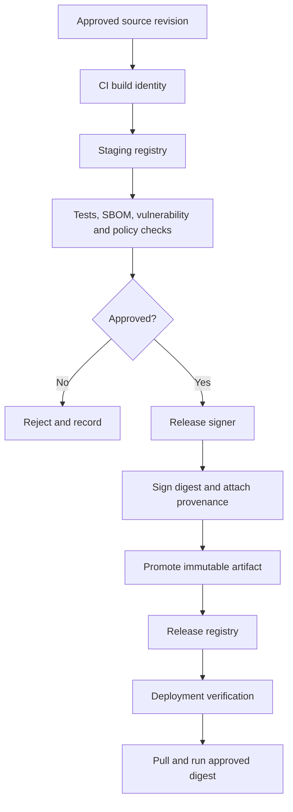

# Image download authorization and release provenance control

In systems using Java CRaC, protecting checkpoints does not stop at container execution permissions. A checkpoint image contains the state of a running process and may include data on the heap such as access tokens, credentials, user information, caches, and request payloads. Anyone who can download or restore the image can access that sensitive state. Therefore, it is necessary to explicitly control **who is permitted to download artifacts**, **which pipeline an artifact came from**, **whether contents have been altered**, and **which runtime is permitted to restore**.

In this article, the word "image" can refer to two different artifact types:

- **OCI/container image:** the filesystem containing the CRaC-enabled JDK, application JAR, system libraries, and entrypoint.
- **Checkpoint image:** a state snapshot of a Java process created during checkpointing.

Both artifact types may be stored in the same registry or artifact repository, yet they have different lifecycles and sensitivity levels. Appropriate access permissions, provenance verification, and storage policies must be applied to each type.

## 1. Security goals when downloading and releasing images

A secure workflow needs to answer four questions:

1. **Who is permitted to download?** Which users, CI jobs, cluster nodes, or deployment controllers are authorized to read the artifact?
2. **Who is permitted to release?** Which pipeline or identity is authorized to write images into the official repository?
3. **Is the artifact from the right source and intact?** Do the digest, signature, and provenance prove the artifact came from an approved build?
4. **Is restoring permitted?** Does the image belong to an approved release, match the right runtime, and remain unrevoked and unreplaced?

These goals are related but do not replace one another. Logging into a registry successfully only proves identity; it does not prove the user has permission to read a specific repository. A digest detects altered content; it does not prove who created the artifact. A signature confirms an identity signed the data; additional policy is needed to determine whether that identity is authorized to release.

| Goal | Common mechanisms | Verification question |
|---|---|---|
| Authentication | IAM, service account, workload identity, token | Who is requesting to download or release? |
| Authorization | RBAC, repository policy, scoped token | Which repositories can this identity read/write? |
| Integrity | Digest, checksum, immutable artifact | Does the content match the published artifact? |
| Provenance/authenticity | Digital signature, attestation, build provenance | Which pipeline/identity created the artifact? |
| Deployment control | Admission policy, allowlist, release policy | Is the artifact allowed to run or restore in this environment? |
| Auditability | Audit logs, release metadata, access logs | Who downloaded, signed, promoted, restored, or revoked the artifact? |

## 2. Distinguishing OCI images from checkpoint images

OCI images are typically stored in a container registry. The registry manages manifests, layers, tags, and digests according to the OCI/Docker format. Mechanisms such as repository IAM, image signing, and admission policies can apply directly to OCI images.

A checkpoint image, however, is the output of the checkpointing process. It may consist of multiple files and metadata in the JDK/CRIU format, and is not an OCI image by default. If stored in object storage or an artifact repository, manifests, checksums, signatures, and read/write permissions must be managed according to the repository's capabilities.

| Characteristic | OCI/container image | Checkpoint image |
|---|---|---|
| Contents | JDK, application, filesystem, and runtime config | State of an already running process |
| Creation source | Container build pipeline | CRaC process after warm-up and checkpoint |
| Common storage location | OCI registry | Object storage, artifact repository, or separately managed bundle |
| Content identification | OCI digest | Manifest/checksum of the checkpoint set or digest of an immutable archive |
| Provenance verification | OCI signature, provenance/attestation | Manifest or bundle signature and checkpoint creation metadata |
| Sensitive data | May contain secrets if built improperly | May contain runtime data, tokens, and credentials on the heap |
| Verification workflow | Verify signature, policy, and image scan | Verify signature/manifest, runtime compatibility, and restore test |

Do not assume that signing an OCI image automatically protects a checkpoint image mounted from a volume. If a checkpoint is packaged as a separate OCI artifact, clearly define which manifest is signed, what content is included in the digest, and how to verify before restore.

## 3. Authenticating and authorizing artifact downloads

### 3.1. Authentication and authorization

Authentication verifies the identity of a user or workload. Authorization determines which actions that identity is allowed to perform on which resources.

For example, a CI pipeline may authenticate to a registry using workload identity. The registry then evaluates policy to decide whether that pipeline is permitted to push to the `staging` repository. A Kubernetes node may use a service account or issued credentials to pull images from the `release` repository, without needing push permissions.

Do not use one shared administrative account for developers, CI, clusters, and release automation. Each identity needs permissions sufficient only for its job.

### 3.2. Roles and least privilege

Permissions can be divided by role:

| Role | Permissions to grant | Permissions NOT to grant by default |
|---|---|---|
| Developer | Read source, view metadata and build logs; may pull development images | Push official releases, read production checkpoints containing sensitive data |
| CI build identity | Push images to staging repository; generate SBOM/provenance | Delete releases, sign production without approval |
| Release signer/promoter | Sign and promote verified artifacts | Modify source or bypass build policy |
| Deployment controller/node | Pull exact repositories and digests permitted for deployment | Push, modify release tags, or read all repositories |
| Checkpoint operator | Request checkpoint/restore within assigned workload scope | Download all checkpoints from all environments |
| Security/audit | Read signatures, provenance, manifests, and audit logs | Read raw checkpoint contents unless needed for the task |
| Registry administrator | Administer policies, repositories, and retention per procedure | Use administrative credentials for daily build tasks |

Role names are examples only. Map them to actual IAM groups, service accounts, repository roles, or policy engines. Checkpoint read permissions should be separated from OCI runtime image read permissions because checkpoints can contain far more sensitive data.

### 3.3. Separating repositories by environment and artifact type

Do not keep all artifacts in one repository where every pipeline has read/write access. You can separate:

```text
registry.example.internal/
  app-builds/                 # test build images
  app-release/                # approved OCI images
  app-checkpoint-staging/     # temporary checkpoints, restricted readers
  app-checkpoint-production/  # production checkpoints, very narrow permissions
```

Separating repositories enables applying different retention, encryption, auditing, and permissions. If the platform supports separate projects/namespaces per environment, you can additionally use `dev`, `test`, `staging`, `production`.

Staging checkpoints should not automatically become production checkpoints. Explicit verification, promotion, and approval steps are required. Production artifacts should only be written by pipelines or operators with authorized identities.

## 4. Issuing image download credentials securely

### 4.1. Prefer workload identities

For CI/CD and Kubernetes, prefer workload identity mechanisms or short-lived tokens instead of long-lived static passwords. Examples include OIDC federation, cloud workload identity, service account tokens, or registry-supported credential helper mechanisms.

Benefits:

- Credentials have clear scope and expiration.
- No need to distribute a shared password to many nodes.
- Workload identities or policies can be revoked without updating every application configuration.
- Audit logs can attribute actions to specific pipelines, service accounts, or workloads.

If static tokens are unavoidable, restrict repositories and permissions, set expirations, store them in a secret manager, rotate periodically, and never put tokens in Dockerfiles, source code, image layers, or checkpoint images.

### 4.2. Do not embed registry credentials into images

Do not write credentials into `ARG`, `ENV`, configuration files copied into the image, or build shell history. Docker build arguments and environment variables can appear in metadata or layers depending on usage; they are not secret stores.

With Docker BuildKit, use secret mounts when a build step genuinely needs credentials:

```dockerfile
# syntax=docker/dockerfile:1.7
FROM <build-base-image> AS build
WORKDIR /workspace

RUN --mount=type=secret,id=repo_token \
    ./gradlew --no-daemon build
```

The build command can pass secrets from the CI environment using BuildKit's mechanism:

```bash
docker build \
  --secret id=repo_token,src=<temporary-secret-file> \
  -t <staging-image-reference> .
```

This is a secret mount example; Gradle or the dependency-fetching tool must be configured to read the secret at the path provided by BuildKit. Do not copy secret files into layers and do not print secret values to logs.

### 4.3. Kubernetes pull secrets and workload identity

Kubernetes supports `imagePullSecrets` for kubelet to pull images from private registries. Secrets should reside in the namespace where they are needed and be attached only to appropriate service accounts. If the cluster supports workload identity or credential provider plugins, prefer that mechanism to reduce manual registry password management.

Example Pod referencing an image by digest and using a pull secret:

```yaml
apiVersion: v1
kind: Pod
metadata:
  name: orders-api
spec:
  serviceAccountName: orders-runtime
  imagePullSecrets:
    - name: release-registry-read
  containers:
    - name: app
      image: registry.example.internal/app-release/orders-api@sha256:<approved-digest>
```

The `release-registry-read` secret should only have pull permission for necessary repositories. Do not give push or admin credentials to kubelet. If using workload identity, the corresponding configuration can replace `imagePullSecrets` depending on the platform.

## 5. Controlling release provenance

Push permission to a registry should not be synonymous with production release permission. Release provenance needs to be established through a chain of evidence:

1. Source code comes from an approved repository and revision.
2. The build runs in a controlled pipeline.
3. Dependencies and base images have clear origins.
4. The artifact is created in a build environment with an identifiable identity.
5. Scan, test, and policy results are recorded.
6. The artifact is signed by an authorized release identity.
7. The artifact is promoted by immutable digest to the release repository.
8. Deployment verifies signature, provenance, and policy before pulling/restoring.

### 5.1. Separating staging and release

The pipeline can push the build to a staging repository first. After tests, scans, and metadata checks finish, a narrowly privileged promotion step copies the artifact by digest to the release repository.



The promotion step needs to preserve the artifact's contents verbatim. If copying or converting changes the digest, a new digest must be generated, re-signed, and provenance updated according to procedure. Do not rely on the `latest` tag to prove an artifact has been approved.

### 5.2. Separating build identity and signing identity

The build job that creates artifacts should not necessarily have permission to sign for production. Separating identities reduces impact if build scripts or dependencies are compromised:

- The build identity can push to staging and generate metadata.
- The verification job reads artifacts, checks policies, and checks test results.
- The release signer only signs artifacts meeting conditions, optionally requiring approval.
- The promoter writes signed artifacts into the release repository.
- The deployment identity only pulls approved artifacts.

Do not allow arbitrary source builds to access private signing keys. If using keyless signing, restrict the OIDC identity, issuer, repository, workflow, and branch allowed to sign according to system policy.

## 6. Digests, tags, and immutability

Tags like `1.4.0`, `stable`, or `latest` are reference names. Depending on registry policy, tags can be moved to point to different content. Digests like `sha256:...` identify the exact manifest/layer contents of an OCI image.

In production deployments, prefer referencing by digest:

```text
registry.example.internal/app-release/orders-api@sha256:<approved-digest>
```

Tags remain useful for humans and release workflows, yet need protection through an immutable tag policy if supported by the registry. Digest pinning ensures workloads download the exact verified content even if tags are moved.

For non-OCI checkpoint images, create a manifest containing the file list, sizes, and SHA-256 hashes. If packaged into an archive, compute the digest of the complete archive after creation. If using multiple individual files, the manifest must cover all required files and how to verify structure.

### 6.1. Checksums do not authenticate origin

Checksums detect changes if the checksum value is obtained from a trusted source. If an attacker can replace both the artifact and the checksum file, a checksum alone does not prove release provenance.

Therefore, sign the manifest or digest using a protected release key/identity. The downloading side needs to verify the signature using a trust root or identity configured outside the artifact. Do not download a public key from the same untrusted location and use it to verify that very artifact.

## 7. Signing OCI images and verifying before deployment

For OCI images, signing tools such as Sigstore Cosign or Notation can be used depending on the ecosystem. Signatures must attach to an immutable digest; deployment policy must verify the signer identity and issuer/trust root.

Illustrative Cosign example with a separately managed key:

```bash
# Sign the exact digest of the approved OCI image
cosign sign --key cosign.key \
  registry.example.internal/app-release/orders-api@sha256:<approved-digest>

# Verify the signature using a public key distributed through a trusted channel
cosign verify --key cosign.pub \
  registry.example.internal/app-release/orders-api@sha256:<approved-digest>
```

Placeholders need to be replaced with actual digests and key paths. In production, private keys must be protected using KMS/HSM or an appropriate keyless signing mechanism; never store private keys in source repositories or container images.

Successful signature verification only proves the signature matches a trusted key. Deployment policy still needs to check whether that signer is authorized to release images for this application, environment, and release.

### 7.1. Verifying keyless identity

With keyless signing, policy needs to restrict the signing OIDC identity: issuer, subject/certificate identity, repository, workflow, and branch/tag conditions per CI platform. Do not accept every certificate issued by a broad issuer if only one specific release workflow is authorized to release.

A Cosign keyless verification example can use identity and OIDC issuer flags depending on tool version:

```bash
cosign verify \
  --certificate-identity <approved-workflow-identity> \
  --certificate-oidc-issuer <approved-oidc-issuer> \
  registry.example.internal/app-release/orders-api@sha256:<approved-digest>
```

Actual identity names depend on the CI provider and certificate configuration. Use values observed in certificates and controlled policies; do not guess subjects.

### 7.2. Admission policy

To avoid relying on every developer remembering to run verification commands, use an admission controller or policy engine to reject workloads referencing images without valid signatures or failing provenance policies.

Policies can require:

- The image comes from an allowed release registry.
- The image is referenced by digest.
- The signature belongs to an approved release identity.
- Provenance identifies the exact repository, revision, and builder.
- SBOM and scan results meet policy thresholds.
- The artifact is not revoked or on a denylist.

An admission policy for OCI images does not automatically govern a checkpoint directory mounted from a volume. The checkpoint restore step needs its own manifest/signature verification before the JVM uses the artifact.

## 8. Provenance, SBOM, and dependency origin

A signature indicates an identity signed the artifact. Provenance provides additional information on how the artifact was built: source revision, builder, build parameters, and input materials. An SBOM lists the packaged software components.

For CRaC runtime images, provenance/SBOM should include:

- Source repository and commit.
- Pipeline/workflow and builder identity.
- JDK vendor, distribution, version, and build.
- Base image reference and digest.
- Application JAR digest.
- Dependency lockfile and dependency versions.
- Native libraries and important agents.
- Build timestamp and verification results.

For checkpoint images, additionally include:

- OCI runtime image digest that ran when creating the checkpoint.
- JDK vendor/build and JVM options.
- Tested OS, kernel, architecture, and CRIU.
- Application build ID and artifact digest.
- Checkpoint timestamp and creation environment.
- Restore validation results.
- Identity of the pipeline/operator requesting the checkpoint.

Provenance does not replace signatures. A JSON file stating `builder: trusted` has no value unless signed or authenticated over a trusted channel. Deployment needs to verify signatures first, then evaluate provenance fields against policy.

## 9. Signing and protecting checkpoint artifacts

A checkpoint image might not be handled by a registry as an OCI image. A simple approach is to generate a manifest after checkpointing completes, compute checksums for the files, and sign the manifest with a release/checkpoint signing identity.

Manifest example:

```yaml
checkpointArtifact:
  artifactId: "orders-api-3.1.0-build-418"
  application:
    gitCommit: "<commit-sha>"
    jarSha256: "<jar-sha256>"
  runtime:
    ociImageDigest: "sha256:<runtime-image-digest>"
    jdkVendor: "<vendor>"
    jdkVersion: "<full-version-and-build>"
    architecture: "amd64"
  platform:
    os: "<linux-distribution>"
    kernel: "<tested-kernel>"
    criu: "<tested-criu-version>"
  checkpoint:
    createdAt: "<timestamp>"
    files:
      - path: "checkpoint/metadata"
        sha256: "<file-sha256>"
      - path: "checkpoint/memory-file"
        sha256: "<file-sha256>"
    restoreValidation: "PASS"
```

This is an illustrative schema. A real manifest needs to list all files according to the runtime's output format; filenames in the example are not a standard structure across all CRaC/CRIU implementations. Do not omit files or arbitrarily alter the checkpoint structure.

The manifest can be signed using Cosign blob signing:

```bash
cosign sign-blob \
  --key checkpoint-signing.key \
  --output-signature checkpoint-manifest.sig \
  checkpoint-manifest.yml

cosign verify-blob \
  --key checkpoint-signing.pub \
  --signature checkpoint-manifest.sig \
  checkpoint-manifest.yml
```

Store the public key or trust policy in an independent, protected location. When downloading a checkpoint, verify the manifest signature first, check checksums of all files after download, cross-check runtime metadata, and only then permit restore.

If the artifact platform directly supports OCI artifact signing or attestation, that approach can be used instead of detached file signing. The key requirement is that the signature covers the exact content being restored and is verified against a trust policy outside the artifact.

## 10. Securing checkpoint contents

A checkpoint image is sensitive data because it may contain:

- Access tokens, refresh tokens, and API keys.
- Passwords or decrypted credentials in memory.
- Cookies, sessions, and user authentication details.
- Request, response, or message payload data.
- Cache data and business objects.
- Encryption keys or secrets currently used by the application.
- Connection information and runtime configuration.

Therefore, checkpoint download permissions need to be narrower than regular runtime image pull permissions. A developer may need to pull a container image to run locally yet should not read production snapshots.

Protective measures:

- Encrypt storage at rest and transport via TLS.
- Manage encryption keys through KMS/HSM or a controlled key service.
- Separate keys by environment and repository when needed.
- Restrict download permissions by workload, namespace, environment, and expiration.
- Audit every read, copy, export, and deletion of artifacts.
- Do not put checkpoint images into public registries or broadly shared locations.
- Delete expired artifacts and temporary copies according to retention policy.
- Do not create checkpoints from workloads with real sensitive data unless there is a justified need and proper controls.

Storage encryption does not replace authorization. Anyone with permission to decrypt and download the artifact can still read the data inside. Conversely, signatures guarantee authenticity/integrity but do not hide contents. Encryption, access control, and signatures must be combined.

## 11. Controlling restore and preventing rollback

Download control is one layer; before restoring, the artifact must also be verified as authorized for use. A checkpoint image with a valid signature may still be too old, revoked, or no longer compatible with the current runtime.

Before restore, the deployment process should:

1. Authenticate the identity of the workload permitted to read the artifact.
2. Download from allowlisted repositories and paths.
3. Verify the signature of the manifest/bundle.
4. Check checksums of all checkpoint files.
5. Cross-check application build, OCI digest, JDK build, OS, kernel, architecture, and CRIU.
6. Check release status: approved, active, and not revoked.
7. Check artifact age and anti-rollback policy.
8. Run restore in a compatible environment and wait for readiness.

### 11.1. Anti-rollback

Attackers or operational mistakes can cause a deployment to reuse an older checkpoint that has a valid signature yet contains vulnerable software or revoked configuration. Therefore, a valid signature is insufficient to accept any arbitrary older version.

Controls can include:

- Release metadata with monotonically increasing version/sequence per policy.
- Allowlists of releases and checkpoint artifacts permitted for use.
- Maximum age limits for checkpoint artifacts.
- Revocation lists of blocked artifacts.
- Dedicated approval workflows when rolling back to older releases.
- Binding checkpoint artifacts to specific application builds and runtime digests.

Valid rollbacks still need to be permitted intentionally. Anti-rollback does not mean banning all rollbacks; it requires an audited decision and a compatible runtime.

### 11.2. Do not restore directly from untrusted sources

Do not mount user-uploaded checkpoint directories, artifacts from uncontrolled forks, or unknown attachments into JVM restore. A checkpoint can resume a process from an arbitrary state and may contain dangerous code, objects, or configuration on the heap. Only restore artifacts created by authorized pipelines/operators that have passed verification.

## 12. Auditing and tracing downloads/releases

Audit logs should make it possible to answer:

- Who or which workload pushed the artifact?
- Which pipeline built the image and from which commit?
- Who signed or approved the release?
- When was the artifact promoted from staging to release?
- Which identity downloaded the OCI image or checkpoint image?
- Which node/pod restored which artifact?
- Who revoked or deleted the artifact?
- Were any download or restore attempts denied?

Logs should record actor identity, repository, digest/artifact ID, action, timestamp, result, and necessary request context. Do not record credentials, tokens, or heap contents in audit logs.

Monitor both successful and failed actions. Multiple downloads of production checkpoints from unusual identities, downloads from unusual locations, or repository policy modifications can be signs requiring investigation.

## 13. Example authorization by environment

A reference model:

| Environment | OCI runtime image | Checkpoint artifact | Release permissions |
|---|---|---|---|
| Development | Developers and CI can pull; CI pushes staging | Only the development team is granted permission to read dev checkpoints | CI dev identity |
| Test | Test runners pull built images | Test runners read test checkpoints | Created by test pipeline; automated promotion per policy |
| Staging | Staging cluster pulls only signed release candidates | Staging controller reads staging checkpoints | Release pipeline after tests |
| Production | Production nodes pull only approved digests | Only production workloads/operators are granted permission to read production checkpoints | Approved release signer/promoter |

This is a reference role split. Organizations can use separate registries, separate projects/namespaces, or path-based policies. Ensure staging credentials cannot read production checkpoints and pull credentials cannot overwrite release artifacts.

## 14. CI/CD workflow for releasing trusted images

A pipeline can be implemented in the following stages:

**Step 1 — Control source.** Build only from protected branches/tags; require reviews and commit checks per repository policy.

**Step 2 — Build runtime image.** Use CRaC JDK base images pinned by digest; lock dependencies and record JDK vendor/build.

**Step 3 — Generate metadata.** Generate SBOM, provenance, application checksums, and base image details.

**Step 4 — Push staging.** The CI build identity has push permission only to the staging repository.

**Step 5 — Verify.** Run tests, vulnerability scans, license/policy checks, and confirm the runtime image has CRaC support.

**Step 6 — Create checkpoint artifact.** Run the image on a compatible host, warm up, drain, and checkpoint according to an approved procedure. Record runtime/host manifest and checksums.

**Step 7 — Restore validation.** Download the artifact with a test identity, verify manifest, signature, and checksums; restore on a compatible environment and check readiness.

**Step 8 — Sign and promote.** The release signer signs the OCI image digest and checkpoint manifest; the promoter copies the immutable artifact to the release repository.

**Step 9 — Deploy verification.** Admission/deployment policy verifies provenance, signatures, digests, provenance metadata, release state, and runtime compatibility prior to deployment.

**Step 10 — Audit and retention.** Store results, monitor download/restore counts, revoke faulty artifacts, and delete expired artifacts per policy.

A single job should not build, sign, promote, deploy, and hold registry administration rights simultaneously. Separating permissions by stage reduces impact if one step is compromised.

## 15. Handling revocation and provenance incidents

If an image or checkpoint is discovered to have been built from untrusted source/builds, there must be a way to prevent the artifact from continuing to be downloaded and restored.

A revocation procedure may include:

1. Mark the digest/artifact ID as revoked in release metadata.
2. Block pulls or restores via policy; do not merely delete a tag if the digest remains accessible.
3. Revoke or rotate signing keys/identities if the signer was compromised.
4. Inspect audit logs to determine who downloaded or restored the artifact.
5. Identify workloads running from the affected artifact.
6. Create a new release from verified source and runtime.
7. Replace checkpoint artifacts and runtime images via a safe rollout procedure.
8. Delete temporary copies and revoked artifacts per retention/security policy.

Deleting a tag does not necessarily delete all copies or block access by digest. Use deny/revocation mechanisms in the registry, artifact store, and deployment policy.

## 16. Implementation checklist

Before allowing artifacts to be downloaded or restored, confirm:

- [ ] OCI runtime images and checkpoint images are classified, stored, and authorized separately.
- [ ] Registries/repositories enforce role-based authentication and authorization.
- [ ] CI, signer, promoter, deployer, and operator use distinct identities.
- [ ] Tokens have narrow scope, appropriate expiration, and are managed via secret manager/workload identity.
- [ ] Production checkpoints are not shared as broadly as OCI runtime images.
- [ ] Images are referenced by immutable digest.
- [ ] Signatures are verified against trust roots and allowlisted signer identities.
- [ ] Provenance links artifacts to source revisions, builders, and materials.
- [ ] Checkpoint manifests cover all files and runtime metadata completely.
- [ ] Checksums are verified after download; manifests are authenticated via signatures.
- [ ] Restore policies check release state, runtime compatibility, and anti-rollback.
- [ ] Checkpoint storage is encrypted, audited, and governed by a retention policy.
- [ ] Revocation procedures exist for artifacts and signing identities.
- [ ] Readiness succeeds only after restore callbacks and dependencies complete.

## 17. Common mistakes

**Using one registry credential for all pipelines and nodes.** If the credential leaks, the blast radius is huge. Create separate identities with narrow read/write permissions.

**Giving nodes push permissions.** Nodes only need to pull images to run workloads. Do not grant write access to release repositories to runtime identities.

**Assuming a private registry is secure enough.** Private registries still need RBAC, auditing, encryption, signatures, and policies. Users with registry access can still download sensitive artifacts.

**Using mutable tags in production.** Tags can point to different contents. Pin digests and enable immutable tag policies where possible.

**Using SHA-256 without signing.** Hashes do not prove who built an artifact if an attacker can replace both the file and the hash. Sign manifests/digests with a trusted identity.

**Signing with a key stored in the source repository.** Anyone with source read access can obtain the key. Use KMS/HSM, keyless identities, or a controlled secret store.

**Not checking signer identity.** Valid signatures from identities unauthorized to release must still be rejected. Policy must specify accepted signers and issuers.

**Assuming OCI signatures cover checkpoint volumes.** If checkpoints are stored separately, sign and verify checkpoint manifests/bundles separately.

**Allowing developers to download production checkpoints.** Snapshots may contain tokens and data on the heap. Restrict permissions by environment and job need.

**Putting secrets into Docker layers or checkpoint images.** Secrets can persist longer than intended and be accessed by anyone downloading the artifact. Use secret mounts during builds and refresh secrets after restore.

**Restoring an image solely because the checksum matches.** Checksums do not confirm release origin, runtime compatibility, or release state. Combine signatures, provenance, and restore policies.

**Having no revocation mechanism.** Signed artifacts can still be found buggy or compromised. Maintain denylists/revocation and block restores by digest.

## 18. Self-check questions

1. **How does authentication differ from authorization?** Authentication verifies identity; authorization determines what actions that identity can perform on repositories/artifacts.
2. **Why should checkpoint download permissions be narrower than OCI image pull permissions?** Checkpoints can contain tokens, credentials, and runtime data on the heap.
3. **Does a digest prove who released an image?** No. A digest identifies content; signatures and provenance are needed to verify release origin.
4. **Why separate build identity and signing identity?** So a build job cannot arbitrarily sign production artifacts if source or dependencies are compromised.
5. **Does an OCI image signature protect a checkpoint image on a volume?** Not by default. Checkpoint manifests/bundles must be signed and verified separately.
6. **What registry permissions should Kubernetes nodes have?** Typically only permission to pull authorized repositories and digests; no push or admin permissions.
7. **Why do checksums not replace signatures?** If an attacker can replace both the artifact and the checksum, integrity is no longer authenticated by a trusted source.
8. **What needs to be checked before restore?** Download identity, signature, checksums, provenance, runtime compatibility, release state, and anti-rollback policy.
9. **Why audit downloads?** To trace who or which workload read/copied sensitive checkpoints and to investigate incidents.

## Conclusion

Image download authorization and release provenance control must be designed for both OCI runtime images and checkpoint images. Authenticate workload identities, grant read/write permissions by repository and environment, separate CI builds from signing/promotion, pin artifacts by digest, and verify signatures alongside provenance before deployment. For checkpoint images, sign manifests covering full contents, verify checksums after download, and bind artifacts to application builds, JDK, host, and restore test results.

Checkpoints can contain sensitive data in memory, so strict encryption, download restrictions, auditing, and retention are required. Before restore, verify that the release is still approved, the artifact is neither revoked nor too old, and the runtime falls within the compatibility matrix. Only when release origin, contents, and environment are all verified should a deployment be permitted to use the image.
