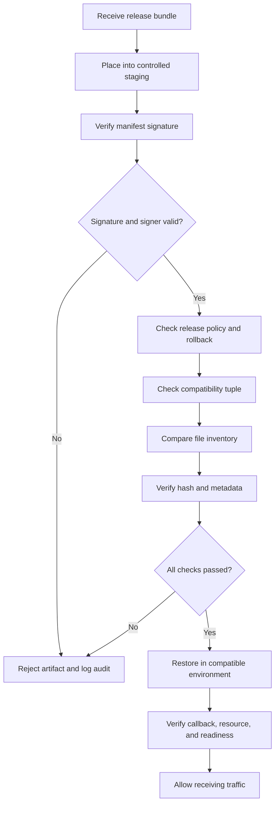

# Verifying Integrity and Trust Before Restore

A CRaC checkpoint is a special artifact: it contains the state of a running Java process, which can include the heap, object graph, class metadata, thread state, application data, and sensitive information currently residing in memory. Before restoring, the system needs to verify that the entire checkpoint is intact, comes from a trusted release source, and belongs to the expected release/runtime.

Simply checking that the checkpoint directory exists or that the restore command can read the files is not enough. The artifact may be missing files, modified in transit, overwritten, swapped with a checkpoint from another release, or created by an unauthorized source. A corrupted checkpoint can cause restore to fail; a substituted checkpoint can introduce unwanted code or data into the process.

A secure workflow needs to combine multiple layers: checksums to detect modification, digital signatures to authenticate the release source, a manifest to link the checkpoint with the JDK and application build, provenance to identify the artifact creation process, access control, and compatibility checks before restore. Then, a trial restore should be performed in an isolated environment to verify resources and readiness before putting the instance into service.

## 1. Distinguishing Integrity, Authenticity, and Trust

Three concepts are often confused:

| Concept | Question to answer | Commonly used mechanisms |
| --- | --- | --- |
| Integrity | Has the data been modified, missing, or corrupted compared to the recorded version? | Cryptographic hash, checksum, manifest |
| Authenticity | Was the artifact or manifest actually created by an authorized issuer? | Digital signature and trusted signing key identity |
| Trust | Was the artifact created from an approved process, source, and environment? | Provenance, build attestation, release control, and approval policy |

A SHA-256 checksum can detect file changes against a saved checksum. However, if an attacker can replace both the checkpoint and the checksum file, the check can still succeed. A digital signature on the manifest helps confirm that the manifest was created by the corresponding signing key; however, the system must also know that the key belongs to the right organization or release pipeline.

A valid signature alone does not prove that the checkpoint was created from safe source code. To evaluate trust, one must also inspect the source revision, build pipeline, image digest, dependency set, the person or service identity performing the release, and the approval policy.

## 2. Components to Verify Before Restore

A checkpoint does not exist in isolation. A CRaC release typically consists of multiple components that must be linked together:

| Component | What to verify |
| --- | --- |
| Checkpoint files | Complete set of files, matching sizes and hashes, no extraneous or substituted files |
| Checkpoint manifest | Contains release ID, file list, checksums, and image creation metadata |
| Manifest signature | Valid signature, signing key belongs to a managed trust store |
| Application artifact | Matching released version/build and checksum |
| JDK/runtime | Matching vendor, version, build, and verified CRaC capability |
| Dependency set | Classpath, framework, native library, and lockfile match the release |
| Container image | Immutable digest matches the checkpoint creation environment |
| OS/kernel/CRIU | Within the tested compatibility profile |
| Launch configuration | JVM flags, classpath, working directory, and required parameters have not been altered outside policy |
| Provenance | Artifact was created by an approved pipeline and source revision |

Checking individual checkpoint files is necessary but not sufficient. The deployment needs to confirm that the checkpoint belongs to the right runtime–application–dependency set. An intact checkpoint paired with an incompatible JDK or application JAR still should not be restored.

## 3. Checkpoint Hashes and Checksums

A cryptographic hash produces a fixed-size fingerprint from file contents. When the contents change, the hash almost certainly changes. SHA-256 is a common choice for checking artifact integrity.

Example of computing the hash for an application JAR:

```bash
sha256sum /opt/app/app.jar
```

A checkpoint typically consists of multiple files in a directory. Therefore, checksums need to be generated for the entire file tree, not just hashing the directory name. A simple way on Linux:

```bash
cd /var/lib/app
find checkpoint -type f -print0 \
  | sort -z \
  | xargs -0 sha256sum > checkpoint-files.sha256
```

The command above generates a list of hashes for regular files in the checkpoint directory. In a production pipeline, a policy needs to be defined for symbolic links, special files, permissions, and metadata. If the checkpoint format or restore tool requires those attributes, the manifest must record and verify them. Symlinks or special files that the runtime needs should not be silently ignored.

### 3.1. Verifying Checksums Before Restore

After downloading the artifact to a staging directory, you can check:

```bash
cd /var/lib/app
sha256sum --check checkpoint-files.sha256
```

A successful result indicates that the listed files match the checksums. However, you must ensure that the checksum list itself is also protected by a digital signature or obtained from an independent trusted source.

A complete check needs to detect all of the following:

- Files with modified contents.
- Missing files.
- Added files not present in the manifest.
- Renamed or relocated files.
- Duplicate filenames or abnormal paths.
- Modified important metadata such as mode or symlink target if the runtime depends on them.

Simply running `sha256sum --check` against an existing list does not automatically detect extraneous files added to the directory. The deployment validator should compare the actual set of paths against the signed set of paths in the manifest.

### 3.2. Why Not Use MD5 or SHA-1?

MD5 and SHA-1 are no longer suitable for verifying artifacts with high security requirements due to known collision weaknesses. You should use SHA-256 or a modern hash algorithm approved by your organization. Hashing is only part of the process; a signature or trusted channel is needed to protect the hash values.

## 4. Manifest Describing the Release and Checkpoint

A manifest is a machine-readable document linking the checkpoint to the environment that created it. The manifest should be generated automatically from the actual process and artifacts, not manually entered based on assumptions.

A manifest may contain:

- Unique release ID.
- Checkpoint creation timestamp.
- Source revision and build ID.
- Application artifact version and checksum.
- JDK vendor/version/build.
- Container image digest.
- Dependency lockfile and classpath digest.
- Native library inventory.
- OS, kernel, architecture, and CRIU version.
- Important effective JVM flags.
- List of checkpoint files, sizes, hashes, and required metadata.
- Identity of the pipeline or service that created the artifact.
- Schema version of the manifest.

Example:

```json
{
  "schemaVersion": 1,
  "releaseId": "orders-service-1.4.0-build.281",
  "createdAt": "2026-11-13T07:00:00Z",
  "source": {
    "revision": "<approved-git-commit>",
    "buildId": "<pipeline-run-id>"
  },
  "application": {
    "version": "1.4.0",
    "artifact": "app.jar",
    "sha256": "<application-sha256>"
  },
  "runtime": {
    "vendor": "<jdk-vendor>",
    "version": "<jdk-runtime-version-and-build>",
    "imageDigest": "sha256:<container-image-digest>",
    "architecture": "amd64",
    "os": "linux",
    "criuVersion": "<criu-version>"
  },
  "dependencies": {
    "classpathDigest": "<runtime-classpath-digest>",
    "nativeLibrariesDigest": "<native-library-digest>"
  },
  "checkpoint": {
    "path": "checkpoint/",
    "filesManifest": "checkpoint-files.sha256",
    "filesManifestSha256": "<manifest-sha256>"
  }
}
```

Strings in angle brackets are illustrative placeholders. The pipeline must populate actual values and verify them from the created artifacts. Do not leave placeholders or speculative information in a released manifest.

### 4.1. The Manifest Must Properly Link All Artifacts

The manifest must clearly identify which checkpoint goes with which image, which JDK, and which application build. Simply recording `javaVersion: 21` is too generic to identify a specific CRaC JDK build.

Use immutable digests for container images and checksums for application/dependency artifacts. Tag names such as `latest` or `stable` can point to different content in the future, so they are insufficient as release identifiers.

### 4.2. Manifest Format and Canonicalization

A digital signature is computed over specific bytes. If the manifest is parsed and re-serialized with a different field order, whitespace, or encoding, the signature may no longer be valid.

Several ways to handle this:

- Sign the original manifest file directly and verify those exact bytes.
- Use a canonical format with clear serialization rules.
- Do not modify the manifest after signing; if changes are needed, create a new manifest and re-sign it.
- Specify encoding and schema version explicitly.

Do not sign one representation and verify a different representation without an agreed canonicalization rule.

## 5. Digital Signatures to Authenticate the Release Source

Checksums answer whether the content matches. Digital signatures help verify that the manifest was created by the owner of the corresponding private key and that the manifest contents were not altered after signing.

A common workflow:

1. The build pipeline creates the checkpoint and manifest.
2. The pipeline computes hashes for all artifacts.
3. The signing service signs the manifest with a protected key.
4. The manifest and signature are published together with the release.
5. The deployment retrieves the public key or certificate from an independently managed trust store.
6. The deployment verifies the signature before trusting any path or checksum in the manifest.
7. Only after the signature is valid does the deployment check the hashes of the checkpoint and artifacts.

Example using a GPG detached signature:

```bash
# In the release pipeline: sign the exact finalized manifest file
gpg --batch --local-user "$SIGNING_KEY_FINGERPRINT" \
  --armor --detach-sign \
  --output release-manifest.json.asc \
  release-manifest.json

# In deployment: verify using a trusted managed keyring
gpg --verify release-manifest.json.asc release-manifest.json
```

This is an illustrative example. Signing keys must be managed in an appropriate KMS, HSM, or signing service; private keys should not reside in a source repository or container image. Deployment must verify that the public key's fingerprint belongs to an authorized organization/pipeline rather than accepting just any key shipped with the artifact.

### 5.1. A Valid Signature Does Not Mean the Artifact Is Completely Safe

A signature only proves that the manifest was signed by the corresponding key and the contents did not change after signing. If the pipeline or signing key is compromised, a malicious artifact can still be validly signed.

Therefore, it is also necessary to protect:

- Permission to use the signing key.
- Workload identities permitted to request signing.
- Source repository and merge permissions.
- Build runners and dependency resolution.
- Release approval process.
- Deployment trust store.
- Audit logs of signing and release activities.

## 6. Provenance and Artifact Origin

Provenance describes where an artifact was created from and by what process. For a CRaC checkpoint, provenance should help answer:

- Which source revision was built?
- Which pipeline run created the application artifact?
- Which JDK and container image were used to run warm-up?
- On which environment was the checkpoint created?
- Which dependency lockfile and native libraries were used?
- Which person or service identity requested creating and signing the release?
- Which verification steps were completed?

Provenance aids investigation when a checkpoint has issues and supports policies that only allow restoring artifacts from approved pipelines. Build attestations or equivalent metadata can be stored alongside the manifest.

Do not use a self-declared text file containing `trusted: true` as proof of provenance. Origin must be protected by signatures or an attestation system with identity and audit.

## 7. Protecting Checkpoints at Rest and in Transit

A checkpoint may contain data in the heap, including credentials, tokens, sessions, user information, business data, and internal configuration. Integrity and confidentiality are two different requirements; checksums or signatures do not encrypt checkpoint contents.

Protective measures should include:

- Restrict checkpoint read/write permissions by release and environment.
- Encrypt data in transit over the network.
- Encrypt artifacts at rest if required by policy.
- Use a dedicated bucket/artifact repository with authentication and audit.
- Do not publish checkpoints to public repositories.
- Do not put tokens or heap contents into logs.
- Apply retention policies and procedures for deleting old artifacts.
- Separate permissions for creating checkpoints, signing releases, and deploying restores when appropriate.

If a checkpoint is shared across multiple environments, clearly define which data may cross environment boundaries. A checkpoint created from production may contain production data; it should not be used in staging or developer environments without an appropriate data handling policy.

## 8. Immutable Storage and Access Control

After a release is signed and published, the artifact should be stored in an immutable location. Do not overwrite an old release's checkpoint with new content under the same name.

Principles:

- Each release has its own ID.
- Checkpoints and manifests are published to versioned paths.
- Permission to modify published artifacts is restricted or locked.
- Deployment only reads artifacts from a trusted repository.
- Every permission change, deletion, or promotion operation is audited.
- Old releases are retained according to a retention policy for rollback.

An object store supporting versioning or object lock can help protect artifacts from accidental overwriting or deletion. Specific configuration depends on the storage platform.

## 9. Preventing Rollback and Replay of Old Artifacts

An old checkpoint may still have a valid signature and accurate checksums. However, it may contain an application with vulnerabilities, old credentials, or an incompatible schema. Therefore, signature verification alone is not enough; an anti-rollback policy is needed.

The manifest can contain:

- Monotonically increasing release sequence or build number.
- Release timestamp.
- Validity expiration if applicable.
- Minimum allowed release version.
- Allowed environment or deployment target.
- Revocation status of the signing key or release.

Deployment should cross-check the release against current policy. For example, if release sequence 281 has been revoked and the minimum accepted sequence is 294, do not allow restoring release 281 just because its signature is still valid.

Do not rely solely on self-declared timestamps in the manifest because clocks or metadata can be manipulated. For high requirements, use a release registry or policy service with verified state to determine which releases are allowed to be deployed.

## 10. Checking Compatibility Before Restore

After verifying the manifest signature, check that the checkpoint belongs to the right environment:

| Check | Condition |
| --- | --- |
| JDK | Vendor, version, and build match the compatibility profile |
| JVM flags | Heap, GC, object layout, and critical flags match |
| Application | Version and checksum match the manifest |
| Dependencies | Classpath digest and native library inventory match |
| Container image | Image digest matches the release |
| OS/architecture | OS family, kernel capability, and CPU architecture are supported |
| CRIU | Version and capability are within the tested profile |
| Filesystem | Required paths, mount points, and permissions exist |
| Checkpoint files | Complete file set, valid checksums, and metadata |
| Configuration | Required profile and configuration match the environment |

A checkpoint with valid checksums that does not match the JDK build or architecture must still be rejected. Do not attempt a restore in production just to see if it runs when preflight checks have already detected a mismatch.

### 10.1. Do Not Trust Manifest Data Before Verifying the Signature

A manifest may contain paths, image references, or filenames. If the manifest has not been authenticated, do not use those fields to automatically download files, mount volumes, or run commands. First verify the signature and policy; only then interpret the values in the manifest.

In particular, path validation must ensure paths reside within the allowed staging directory. Disallow absolute paths outside the workspace, `..` traversal, or symbolic links pointing outside the artifact area. If an archive must be extracted, use a library/tool with path traversal protection and inspect contents before placing them into the restore location.

## 11. Multi-File Checkpoint Verification Workflow

A practical workflow can include:

1. Download the manifest, signature, and artifact into a staging location with restricted permissions.
2. Verify the signature using an independently managed trust store.
3. Check the release ID, anti-rollback policy, and environment target.
4. Check the manifest schema and file size/count limits.
5. List all actual checkpoint files.
6. Compare actual paths with the signed list in the manifest.
7. Verify the hash, size, and required metadata of each file.
8. Verify the application, JDK, dependency, and image digests.
9. Check access permissions, symlinks, file types, and mount points.
10. Allow restore only after all steps pass.



### 11.1. Example of Checking Checksums and Signatures

A simple shell workflow can be organized as follows:

```bash
set -euo pipefail

RELEASE_DIR=/var/lib/releases/orders-service-1.4.0
cd "$RELEASE_DIR"

# 1. Verify the manifest using a trusted managed keyring.
gpg --verify release-manifest.json.asc release-manifest.json

# 2. Verify the files listed in the checksum manifest.
sha256sum --check checkpoint-files.sha256

# 3. Verify the application artifact.
sha256sum --check app.jar.sha256

# 4. Proceed only when the validator has additionally checked the inventory,
#    release policy, JDK/image digest, and metadata.
```

The script snippet is illustrative, not a complete validator. `sha256sum --check` only verifies paths listed in the checksum file. A production validator must also compare the actual inventory against the signed manifest, check symlinks and metadata, and verify the release policy and compatibility tuple.

## 12. Avoiding Race Conditions and TOCTOU

TOCTOU (time-of-check to time-of-use) occurs when an artifact is checked at one point in time but modified before restore uses it.

Example:

1. Deployment verifies the checkpoint checksums in a shared directory.
2. Another process with write permissions replaces a file after the check.
3. JVM restore reads the modified contents.

To reduce risk:

- Download artifacts into a dedicated staging directory where other processes cannot write.
- Verify signatures and checksums on the staging copy.
- Change permissions or mount read-only after verification.
- Use immutable object/version IDs instead of mutable paths.
- Do not restore directly from a directory being updated by another pipeline.
- If copying to a restore location, re-verify checksums after copying.
- Grant only read permissions to the restore process.

A verified release should remain unchanged until restore completes. Do not share a staging directory across multiple concurrent deployments if files could be overwritten or mixed.

## 13. Trial Restore in an Isolated Environment

Even when signature, checksum, and compatibility preflight checks all pass, a trial restore is still needed before promoting a release. An artifact may be intact while a resource callback fails, a dependency cannot connect, or the application does not reach readiness.

Smoke tests should run in an environment close to the target:

1. Use the exact container image digest and JDK build.
2. Mount the verified checkpoint.
3. Restore the process according to the JDK distribution's documentation.
4. Observe JVM, CRIU, and CRaC callback logs.
5. Confirm that databases, brokers, caches, and required resources are recreated.
6. Check liveness and readiness.
7. Send a representative workload in the isolated environment.
8. Measure restore-to-ready time, latency, and error rate.
9. Promote the artifact only after testing passes.

Do not use real production traffic during the trial restore without a plan to control side effects. Use a sandbox or appropriate test data.

## 14. Handling Verification Failures

When a verification step fails, stop before restoring and classify the root cause.

| Symptom | Possible cause | Action |
| --- | --- | --- |
| Invalid signature | Manifest was altered, wrong signature, or untrusted signer | Reject artifact; verify key identity and audit pipeline |
| File hash mismatch | File corrupted or modified in storage/transit | Re-download from a trusted source; do not update checksums manually to bypass the error |
| Missing file in checkpoint | Copy/upload incomplete or artifact deleted | Recreate the bundle from the original release |
| Extraneous file or abnormal path | Mixed artifacts or incomplete manifest | Reject and investigate the artifact source |
| Release sequence lower than policy | Old or revoked artifact | Reject out-of-policy rollback; use an approved release |
| JDK/image digest mismatch | Wrong runtime paired with checkpoint | Retrieve the matching bundle or create a new checkpoint |
| Checkpoint restore fails despite valid hashes | Incompatible environment or faulty checkpoint creation | Check CRIU/JVM logs and verify the compatibility tuple |
| `afterRestore` fails | Resource or dependency could not recover | Keep readiness refusing traffic; handle recovery according to lifecycle |
| Application does not reach readiness | Dependency or configuration not ready | Do not place instance in load balancer; investigate and retry with limits |

Do not edit checksum files to match a suspect artifact. If hashes do not match, re-fetch the artifact from an authenticated source or recreate the checkpoint from a trusted pipeline.

## 15. Audit and Traceability

Each verification and restore should generate an audit record so the release that was used can be traced.

Useful information:

- Release ID and manifest digest.
- Signer identity and key fingerprint.
- Signature verification result.
- Checkpoint inventory and checksum result.
- Application/JDK/container image digest.
- Deployment environment and instance identity.
- Start/end timestamps of verification and restore.
- Results of preflight and compatibility checks.
- Callback/health/readiness result.
- Person or service identity that approved the deployment.

Audit logs should not contain checkpoint contents, tokens, passwords, heap dumps, or sensitive data. Store only enough metadata to identify the artifact and operational decisions.

## 16. Role Separation in the Checkpoint Lifecycle

A single service does not necessarily need full permissions to create, sign, store, verify, and restore checkpoints. Permissions can be separated to reduce impact if one component is compromised.

| Role | Appropriate permissions |
| --- | --- |
| Checkpoint builder | Runs the application and creates checkpoints in an authorized environment |
| Manifest generator | Reads artifact metadata and generates the manifest |
| Signing service | Signs manifests when requests come from an authorized pipeline identity |
| Artifact repository | Stores immutable artifacts and writes audit logs |
| Deployment verifier | Reads artifacts and verifies signatures/hashes/policies |
| Restore runtime | Reads verified checkpoints and performs restore |
| Release approver | Approves release promotion according to policy |

Separating permissions helps prevent a compromised build runner from modifying an artifact, signing it, and deploying it directly without independent controls.

## 17. Key Revocation and Rotation Policy

Signing keys can be compromised, expire, or be replaced. Trust policies need to support:

- List of authorized signers per environment.
- Validity periods and revocation status of keys/certificates.
- Key rotation procedures.
- Ability to verify older artifacts within the allowed rollback window.
- Policy to reject releases signed by a revoked key.
- Auditing every update to the trust store.

When a key is revoked, do not continue trusting manifests previously signed with that key without policy evaluation. Depending on the reason for revocation, the organization may need to revoke the associated releases and create new checkpoints using a trusted pipeline/key.

## 18. Common Security Mistakes

| Mistake | Risk | Remediation |
| --- | --- | --- |
| Only checking file existence | Does not detect corrupted or substituted files | Hash the entire inventory and verify the manifest |
| Storing checksums next to artifacts without signing | Anyone who replaces the artifact can also replace the checksum | Sign the manifest using a protected key |
| Trusting any public key bundled with the artifact | An attacker can generate their own key and signature | Obtain the trust anchor from an independent trust store |
| Signing only the application JAR | Checkpoints or other dependencies can still be swapped | Sign a manifest linking the entire release bundle |
| Ignoring extraneous files in the directory | May restore the wrong thing or use files outside the manifest | Perform an exact inventory comparison |
| Restoring directly from a mutable directory | TOCTOU after verification | Use immutable or read-only staging |
| No anti-rollback protection | Old releases with valid signatures can still be used | Check release sequence and revocation policy |
| Verifying only checksums without checking compatibility | Artifact is intact but fails to restore on the right runtime | Check JDK, flags, image, OS, and CRIU |
| Exposing checkpoints in logs or public repositories | Leaks data in the heap | Restrict access, encrypt, and enforce retention |
| Ignoring `afterRestore` errors | Instance may receive traffic when resources are not ready | Keep readiness refusing traffic and report errors |
| Sharing build/sign/deploy permissions | One compromised identity can control the entire chain | Separate permissions and enforce audit/approval |

## 19. Pre-Restore Operational Checklist

The checklist below can be used in a release pipeline or deployment controller:

- [ ] Manifest is downloaded from a trusted artifact repository.
- [ ] Manifest signature is valid.
- [ ] Signer fingerprint/identity is in the trust policy.
- [ ] Release has not been revoked and does not violate anti-rollback policy.
- [ ] Checkpoint file inventory matches the signed manifest.
- [ ] All checksums and file sizes match.
- [ ] No extraneous files, path traversal, or disallowed symlinks.
- [ ] Application JAR and dependency digests match the release.
- [ ] JDK vendor/version/build and JVM flags match the compatibility profile.
- [ ] Container image digest, OS, kernel, architecture, and CRIU are compatible.
- [ ] Staging artifact cannot be modified after verification.
- [ ] Dynamic secrets/config are loaded via the current security mechanism.
- [ ] Restore test passed in a compatible environment.
- [ ] `afterRestore` callback, resource verification, and readiness passed.
- [ ] Audit record is logged without containing sensitive data.

This checklist is part of operational policy. Mandatory conditions should be automated in the deployment validator to avoid relying on manual steps.

## 20. Conclusion

Before restoring a CRaC checkpoint, simultaneously verify the integrity, authenticity, and provenance of the entire release bundle. Hashes help detect content modification; digital signatures confirm the manifest comes from a trusted signer; provenance and release policies determine that the artifact was created by an approved process and has not been revoked.

Sign a manifest linking the checkpoint to the JDK, application build, dependencies, container image, and image creation environment. Verify the signature before trusting metadata, compare the full file inventory and checksums in immutable staging, check compatibility, and enforce anti-rollback. Then run a trial restore, verify resources and readiness, and only then put the instance into service. Because a checkpoint can contain sensitive data in the heap, protect both access permissions and confidentiality of the artifact throughout storage, transit, and disposal.
