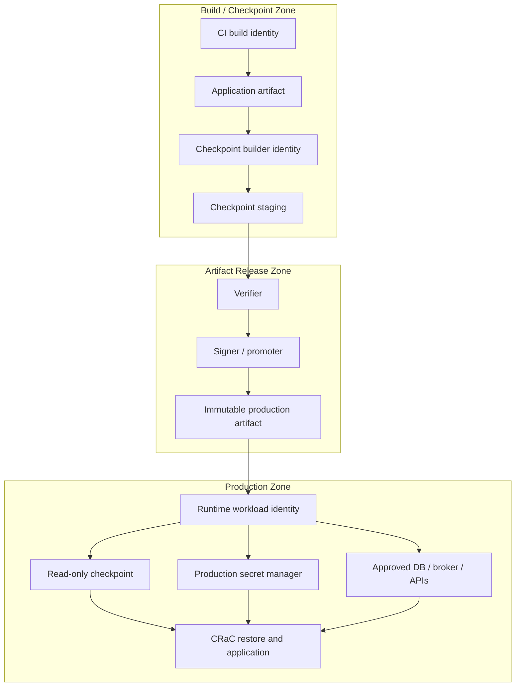

# Separating Image Creation Permissions from Production Application Runtime Permissions

A CRaC checkpoint stores the state of an initialized Java process. Because that state can contain the heap, threads, loaded configuration, and sensitive data currently in memory, permission to create a checkpoint must be managed as a privileged permission. Running the application in production has a different goal: reading an approved checkpoint, restoring the process in a compatible environment, and accessing only the services the application needs.

The same identity, credentials, or permission scope should not be used for both jobs. The checkpoint creation component typically requires permission to write artifacts and may require additional operating system permissions to perform the checkpoint. The production application only needs permission to read released artifacts, access business dependencies, and minimal execution permissions to restore. If the production application can overwrite checkpoints, publish images, or access pipeline credentials, a vulnerability in the application could turn into the ability to tamper with released artifacts and affect subsequent scale-outs.

A secure model should separate at least three roles: the **checkpoint builder** creates the process state in a controlled environment; the **artifact promoter/signer** verifies and publishes the artifact; and the **production runtime** only accepts approved artifacts and runs them. This separation reduces the blast radius when one component is compromised and helps trace who created, approved, released, or used a checkpoint.

## 1. Distinguishing Checkpoint Creation Permissions and Application Runtime Permissions

Creating a checkpoint and restoring are two distinct operations in the CRaC lifecycle.

- **Checkpoint creation:** the application is running, warmed up, and asks the runtime to save the process state to a directory or storage location. The executing component must be permitted to create checkpoint files and have sufficient OS/runtime permissions according to the mechanism in use.
- **Restore:** the runtime reads an existing checkpoint and restores the process. The executing component needs to read the artifact, run in a compatible environment, and have the permissions required for the restore operation.
- **Running the application after restore:** the process uses production configuration and credentials, opens new connections, receives traffic, and performs business logic.
- **Artifact release:** the pipeline verifies the checkpoint, attaches metadata, signs it, and pushes the artifact to the production registry or storage.

In some deployments, the same binary or container entrypoint may support both checkpoint and restore. That does not mean the same operational identity should be granted all permissions. Control permissions by environment, command, service account, and storage path.

| Activity | Appropriate identity | Required permissions | Permissions to avoid |
|---|---|---|---|
| Application build | CI build identity | Read source/dependencies, write build artifacts | Reading production secrets or accessing production databases |
| Checkpoint creation | Checkpoint builder identity | Run CRaC runtime in a controlled environment, write to staging directory, required OS permissions | Production cluster admin permissions, publishing directly to production registry if unnecessary |
| Verification and signing | Artifact signer/promoter | Read staging artifacts, check digest/provenance, sign and promote approved artifacts | Modifying source or running production workloads |
| Production restore and run | Runtime workload identity | Read released checkpoints, read required runtime config/secrets, access permitted dependencies | Overwriting checkpoints, publishing images, reading CI credentials, or creating production checkpoints arbitrarily |
| Cluster operations | Platform operator identity | Deploy workloads, manage nodes/storage per role | Sharing application or builder credentials |

A key point to remember is that Kubernetes RBAC permissions and Linux kernel permissions are two different layers. RBAC determines which Kubernetes resources an identity can create/modify/delete through the API server. Linux capabilities, UID/GID, filesystem permissions, and seccomp determine which OS operations a process inside a container can perform. Granting `create` permission for a Kubernetes object does not automatically grant the ability to checkpoint a process; conversely, adding a Linux capability to a container does not automatically grant permission to modify a Deployment or read a Kubernetes Secret via the API.

## 2. Separating the Checkpoint Creation Environment from Production

The checkpoint builder should run in a dedicated, short-lived, and reproducible environment. This environment uses the exact tested JDK/CRaC, kernel, CPU architecture, and system libraries, but does not need to carry the full permissions of production workloads.

A reference pipeline:

```text
Source repository
      |
      v
CI build identity
  - build JAR/container
  - run tests
      |
      v
Checkpoint builder (isolated)
  - use pinned-version CRaC JDK
  - run application with fixture data
  - warm up per manifest
  - create checkpoint into staging
      |
      v
Artifact verification
  - check metadata and compatibility
  - compute digest
  - check secret/data policy
      |
      v
Signer / promoter
  - sign provenance
  - promote immutable artifact
      |
      v
Production registry / checkpoint store
      |
      v
Production runtime identity
  - pull/read the exact artifact
  - restore
  - load fresh runtime secrets
  - create connections and unique identity
  - pass readiness then receive traffic
```

The builder should not run in the production namespace using the application's service account. If a checkpoint must be created in a production-like environment so warm-up behaves realistically, create a dedicated namespace or account, grant access only to selected test dependencies, and use restricted data/credentials. Similarity in configuration does not mean production permissions should be shared.

### Separating Identities by Stage

Each stage needs a separate identity:

- The CI builder reads the repository and writes build artifacts to the staging registry.
- The checkpoint builder reads the exact built artifact and creates the checkpoint in a writable staging area.
- The signer/promoter only reads created artifacts, verifies them, and signs/promotes them according to policy.
- The production workload reads the released image/checkpoint and retrieves runtime secrets through the workload's identity mechanism.

Do not embed production registry tokens, signing keys, admin kubeconfigs, or cloud administrator credentials in the checkpoint builder. If the builder is compromised, an attacker should not already have permission to release production artifacts or alter deployments.

## 3. Why Is Checkpoint Creation Permission More Sensitive Than Application Runtime Permission?

Creating a checkpoint typically involves saving the memory state of a process. Depending on the runtime and Linux environment, checkpoint/restore operations may require special operating system permissions or capabilities to observe and recreate process state. Those permissions can be stronger than what a normal web service needs to handle requests.

With CRIU-based checkpoint/restore on Linux, capabilities such as `CAP_CHECKPOINT_RESTORE` may be involved; some kernels, CRIU/JDK builds, or configurations may require additional permissions. There is no single capability list that applies to every distribution. Determine exact requirements from the runtime documentation, kernel version, and tested deployment approach. Avoid granting `privileged: true` or broad `CAP_SYS_ADMIN` just to make a command work without understanding the cause.

If the builder requires elevated permissions, confine those permissions to a dedicated job/worker:

- Run the builder on a dedicated node pool or build environment.
- Limit lifetime and terminate the worker after creating the artifact.
- Mount only the necessary staging directory in read-write mode.
- Do not mount the Docker socket, host root filesystem, or cluster admin credentials unless strictly required.
- Restrict network egress to the staging registry and approved warm-up dependencies.
- Log/audit checkpoint creation commands, runtime builds, and artifact outputs.

The production runtime may also need operating system permissions for restore, depending on how CRaC JDK and the container runtime are deployed. Do not assume restore will always work when dropping all capabilities. Grant the exact minimum set of permissions verified as needed for restore, only to the corresponding container/process, without granting additional permissions to create/publish artifacts. If a controlled launcher or helper can perform the privileged part of restore, keep post-restore request handling under a minimal user and minimal capabilities; verify that model with the specific runtime.

## 4. Checkpoints May Contain Secrets and Production Data

A checkpoint may contain objects residing in the heap at the time of creation, for example:

- Database passwords or tokens loaded into beans/clients.
- Access tokens, refresh tokens, session cookies, or API keys.
- Private keys, certificate material, or message broker credentials.
- User data, request payloads, caches, and query results.
- Internal configuration, endpoints, or service identification information.

Therefore, a checkpoint must be protected as an artifact that can contain secrets and sensitive data. It must not be treated merely as a regular cache file or build file.

### Avoiding Putting Production Secrets in the Builder

During the checkpoint creation phase, prefer synthetic fixtures, test databases/schemas, and short-lived, narrowly scoped credentials. If warm-up must call an external service, issue credentials sufficient only to call the exact test endpoint and capable of being revoked after completion.

Do not pass production passwords, long-lived tokens, or private keys into the builder solely for warm-up. If credentials have already been loaded into the heap before checkpoint, clearing the field afterward does not guarantee every copy in the heap or native memory has disappeared. The safer approach is not to load production secrets into the process used to create the checkpoint.

### Loading Production Secrets After Restore

The production application should retrieve current credentials from a secret manager, workload identity, or the platform's credential issuance mechanism after restore. Credential-dependent resources such as datasources, HTTP clients, Kafka producers/consumers, or RabbitMQ connections need to be recreated after obtaining fresh credentials.

Conceptual lifecycle example:

```text
Checkpoint builder
  - use staging credentials
  - warm up safe code paths
  - close clients and clear staging sessions
  - create checkpoint

Production restore
  - restore process
  - authenticate workload with secret manager
  - retrieve current production credentials
  - create new connections/clients
  - health check
  - readiness
```

Do not just change `System.setProperty()` and expect a client created before the checkpoint to automatically switch to the new credentials. Resources must be recreated or refreshed according to the library's API.

## 5. Permissions on Checkpoint Storage and Registries

Checkpoint storage should have clear policies by role and by release. One way to partition:

| Storage | Checkpoint builder | Signer/promoter | Production runtime |
|---|---|---|---|
| Source repository | Read per repo/job | Not needed | Not needed |
| Build artifact staging | Read exact build | Read | Not needed |
| Checkpoint staging directory/bucket | Write new version | Read/verify | No access |
| Production image registry | None, or push only to staging namespace | Promote/push approved artifacts | Pull/read only |
| Production checkpoint store | No direct write | Publish signed version | Read exact version |
| Production secrets | None | None | Read exact secret/runtime identity |
| Kubernetes API | No production permissions needed | Promotion/deploy permissions only if role permits | Usually no API token needed |

The runtime should reference checkpoints by specific version or digest. Avoid read/write permissions on an entire bucket or mutable `latest` tags that can be silently changed. If storage supports prefix/object-level policies, grant read access only to the exact release path. If the registry supports repository-level pull, do not give push-capable credentials to the runtime.

The checkpoint builder should write to a separate staging area. After the artifact is verified and signed, the promoter copies or publishes it to the production store. Promotion should create an immutable artifact or digest reference rather than modifying content in place.

### Integrity and Provenance

Artifact signatures and provenance metadata help the runtime or admission policy confirm that a checkpoint was created by a trusted pipeline. Metadata should record:

- Application build ID, source commit, and artifact digest.
- JDK/CRaC vendor, version/build, and JVM startup profile.
- CPU architecture and verified kernel/runtime compatibility.
- Warm-up manifest version and static configuration revision.
- Checkpoint creation time, checkpoint ID, and checkpoint file digests.
- Pipeline/builder identity and verification step results.

The signer should use an independently managed signing key rather than storing private signing keys in the checkpoint builder or application image. The runtime verifies the signature/digest before restore or relies on an admission/promotion gate that has verified the artifact. A signature proves origin and integrity under a trust policy; it does not prove the checkpoint contents are free of secrets or malicious logic. Content controls, provenance, and access controls are all required.

## 6. Example of Separating Service Accounts in Kubernetes

A Kubernetes ServiceAccount is a workload's identity when calling the Kubernetes API or integrating with a cloud provider's workload identity. The same ServiceAccount should not be used for the checkpoint builder and the production Deployment.

Example of a production Deployment that only needs to run the application and read the checkpoint from a volume:

```yaml
apiVersion: v1
kind: ServiceAccount
metadata:
  name: orders-runtime
  namespace: production
automountServiceAccountToken: false
---
apiVersion: apps/v1
kind: Deployment
metadata:
  name: orders-service
  namespace: production
spec:
  replicas: 3
  selector:
    matchLabels:
      app: orders-service
  template:
    metadata:
      labels:
        app: orders-service
    spec:
      serviceAccountName: orders-runtime
      automountServiceAccountToken: false
      securityContext:
        runAsNonRoot: true
        runAsUser: 10001
        runAsGroup: 10001
        seccompProfile:
          type: RuntimeDefault
      containers:
        - name: app
          image: registry.example.com/orders-service@sha256:REPLACE_WITH_VERIFIED_DIGEST
          securityContext:
            allowPrivilegeEscalation: false
            readOnlyRootFilesystem: true
            capabilities:
              drop: ["ALL"]
          volumeMounts:
            - name: checkpoint
              mountPath: /opt/app/checkpoint
              readOnly: true
            - name: runtime-tmp
              mountPath: /tmp
      volumes:
        - name: checkpoint
          persistentVolumeClaim:
            claimName: orders-checkpoint-release-42
        - name: runtime-tmp
          emptyDir:
            sizeLimit: 512Mi
```

This manifest is an illustrative baseline for a runtime that can restore without additional Linux capabilities. If CRaC/JDK restore in a specific environment requires additional capabilities, add only the exact verified capabilities and only within the scope of the container that needs them. Do not blindly copy `drop: ["ALL"]` into production while skipping restore testing. `automountServiceAccountToken: false` is appropriate when the application does not call the Kubernetes API; if workload identity or API access is needed, enable it via a governed mechanism and grant least privilege.

The checkpoint volume is mounted read-only so the application cannot modify the source artifact. `/tmp` is a separate writable area for temporary files. If the runtime requires another writable working directory, mount it separately instead of opening write permissions on the entire root filesystem.

### Builder Job with a Separate Identity

The checkpoint builder can be a Job running in a build/staging namespace without using the production ServiceAccount:

```yaml
apiVersion: v1
kind: ServiceAccount
metadata:
  name: checkpoint-builder
  namespace: build-system
automountServiceAccountToken: false
---
apiVersion: batch/v1
kind: Job
metadata:
  name: orders-checkpoint-build-42
  namespace: build-system
spec:
  backoffLimit: 0
  template:
    spec:
      restartPolicy: Never
      serviceAccountName: checkpoint-builder
      automountServiceAccountToken: false
      containers:
        - name: checkpoint-builder
          image: registry.example.com/orders-checkpoint-builder@sha256:REPLACE_WITH_VERIFIED_DIGEST
          command: ["/opt/builder/create-checkpoint.sh"]
          securityContext:
            allowPrivilegeEscalation: false
            runAsNonRoot: true
            runAsUser: 10001
            runAsGroup: 10001
          volumeMounts:
            - name: checkpoint-staging
              mountPath: /workspace/checkpoint
      volumes:
        - name: checkpoint-staging
          emptyDir:
            sizeLimit: 10Gi
```

This is only a structural skeleton. Some CRaC/CRIU setups may not run under the default security configuration or may require Linux capabilities, mount namespaces, kernel configuration, and additional permissions. If needed, grant verified permissions only to the dedicated builder Job, and restrict the node pool, execution duration, and filesystem. Do not switch the builder to `privileged: true` as a default solution.

The example also grants no Kubernetes API permissions to the builder since `automountServiceAccountToken` is disabled. If the builder must read artifacts from a registry or upload staging checkpoints, use workload identity/cloud IAM or short-lived secrets scoped only to the required staging repository/bucket. Do not grant permission to read production Secrets or modify production Deployments.

## 7. RBAC Does Not Replace Filesystem Permissions and Linux Capabilities

When designing policy, distinguish the following permission layers:

| Permission layer | What does it control? | Example |
|---|---|---|
| Kubernetes RBAC | What a ServiceAccount may call on the API server | `get` Pod, create Job, read ConfigMap |
| Cloud IAM/object storage policy | Which objects or secrets a workload may read/write | Read checkpoint objects by release prefix |
| Registry permission | Which images an identity may pull/push | Runtime pull-only; promoter push |
| Linux UID/GID and mode | Which files a process may read/write in container/volume | Checkpoint owner/group and read-only mode |
| Linux capabilities | Which privileged kernel operations a process may perform | Capabilities required for CRIU/CRaC per environment |
| seccomp/LSM | Restricted system calls and actions | RuntimeDefault seccomp, SELinux/AppArmor policy |
| Network policy | Which endpoints a workload may connect to | Builder only to staging registry; runtime to DB/broker |

For example, a Pod might lack `get secrets` permission via the Kubernetes API yet still receive a Secret declared in the Pod spec via a volume mount. Conversely, a ServiceAccount with API permission to read Secrets does not automatically allow the process to read files on a volume if UID/GID and file mode forbid it. Evaluate each layer separately.

## 8. Separating Write and Read Permissions on the Filesystem

The checkpoint builder needs to write to the staging directory. The production runtime typically only needs to read the source checkpoint. Use appropriate owner/group and mode, and mount read-only in production.

Example layout:

```text
/workspace/checkpoint-staging/        # writable by builder
    orders-build-42/

/opt/app/checkpoint-source/           # read-only for production runtime
    orders-build-42/

/var/lib/app/runtime/                 # dedicated runtime data, writable
/tmp/app/                             # recreatable temporary files
```

Do not grant write permissions to the production user on the source checkpoint directory. If the application needs to write logs, caches, or PID files, place them in a dedicated runtime directory. If the runtime must modify checkpoint files during restore as required by a specific distribution, copy the read-only source to the Pod's own working directory and allow writes on that copy.

Verify the following attributes:

- UID/GID of the user creating the checkpoint and the user restoring it.
- Owner/group/mode of all checkpoint directories and files.
- ACLs, SELinux labels, AppArmor profiles, and mount options.
- Whether the volume is actually read-only at the container runtime or merely treated as read-only by convention in the application.
- Whether the checkpoint has sensitive files requiring restricted read permissions.
- Whether the builder and runtime share the same absolute path or mount point requirements.

Do not use `chmod -R 777` to fix permission errors. Grant read permission to the specific group and execute permission on required directories; limit write permissions to staging or working directories.

## 9. Network Policy and Dependency Access Permissions

The checkpoint builder and production runtime typically require different network access.

The builder may need:

- Source/dependency registries and artifact staging.
- Test config service or mock servers.
- Staging database/schema if warm-up needs to run queries.
- Pipeline services for verification, signing, or metadata storage.

The builder should not have a default network path to production databases, production brokers, payment providers, or the production secret manager. If production compatibility verification is needed, use contract tests or a controlled staging environment.

The production runtime may need:

- Secret manager/workload identity endpoints.
- Databases, brokers, caches, or APIs used by the application.
- DNS/service discovery and telemetry collectors.
- Registry/object store only when the runtime needs to download checkpoints at startup.

Use Kubernetes NetworkPolicy, security groups, firewalls, or service mesh authorization to restrict egress by namespace, label, and port. Network policies must be tested against the actual CNI; a policy has no effect if the cluster lacks a network plugin that supports enforcement.

## 10. Separating Publish Permissions from Restore Permissions

The production runtime should not hold credentials capable of pushing images or overwriting checkpoints. If a container is compromised, an attacker should only be able to affect the current instance within its runtime permissions, not replace the checkpoint for all future replicas.

A promotion model:

1. The builder writes the checkpoint to a staging bucket/repository with a versioned name.
2. The verifier reads the artifact and checks metadata, checksums, compatibility, and policy.
3. The signer signs the digest/provenance using an independently protected key.
4. The promoter places the signed artifact into the production registry/store.
5. The deployment controller references only approved digests.
6. The runtime identity has pull/read access to that exact artifact.

If using a registry that supports immutable tags or digests, prefer referencing digests in deployments. Tags can be helpful for humans, but mutable tags should not be the sole proof of an approved version.

Do not put registry push tokens in environment variables of the application container. Do not mount the Docker socket into production workloads. Do not allow the runtime to modify `stable`, `latest` tags, or release metadata.

## 11. Separating Runtime Checkpoint Creation Permissions from Application Permissions

Some systems need to create new checkpoints while production is running, such as creating a post-warm-up image for fast scaling or periodic checkpointing. If needed, do not grant checkpoint write permissions to the entire request-handling process by default.

It can be split into a coordinated workflow:

- The application workload only receives an authenticated checkpoint request signal.
- The coordinator checks policies, replica state, and allowed timing.
- A dedicated checkpoint component performs quiesce/checkpoint within its granted permission scope.
- Output is written to a versioned staging area.
- The artifact is verified/signed before being allowed for new replicas.

If the CRaC API is invoked directly inside the application process, checkpoint creation still occurs within that process; you cannot assume kernel operations can be separated from the process without an appropriate runtime design. Even so, control permissions and storage permissions can be separated: the application does not hold publish credentials, the coordinator decides whether to permit checkpointing, and a separate uploader/promoter handles publishing the artifact. Necessary OS permissions must still be confined to the checkpoint execution environment.

A runtime checkpoint must not be pushed straight into the production registry merely because the checkpoint command succeeded. It requires metadata, integrity checks, compatibility validation, and secret/data policy checks before being used as a restore source.

## 12. Least Privilege for the Production Runtime

The post-restore application should receive only the permissions required for its business logic:

- Run under a dedicated non-root UID/GID.
- Disable privilege escalation.
- Use an appropriate seccomp profile and LSM policy.
- Drop unnecessary Linux capabilities; add only verified restore capabilities if required by the runtime.
- Mount the source checkpoint read-only.
- Mount dedicated temporary/runtime directories with quotas or size limits.
- Disable automounting the Kubernetes API token if the application does not need it.
- Use workload identity to retrieve only the required secrets and credentials.
- Restrict network egress to mandatory dependencies.
- Do not grant read access to source repositories, build caches, signing keys, or staging credentials.
- Do not grant write access to the production image registry or checkpoint store.

Least privilege does not mean breaking restore by dropping permissions the runtime needs. Measure and verify the minimum permission set against the exact kernel, CRIU/JDK build, container runtime, and storage. Then record the policy as part of the release and test it in CI/CD.

## 13. Protecting Checkpoints During Storage and Transit

Because checkpoints may contain secrets and user data, protect them at rest, in transit, and in use:

- Encrypt storage/volumes/backups per organizational policy.
- Use TLS when uploading/downloading from registries or object storage.
- Restrict read access by release and workload identity.
- Use checksums/digests to detect modified or corrupted files.
- Sign provenance and verify before restore.
- Do not store checkpoints in public registries or public buckets.
- Enforce retention limits and delete old artifacts per policy.
- Audit who creates, reads, promotes, deploys, and revokes checkpoints.
- Protect logs/metadata so secret contents or personal data are not leaked.

Encryption at rest does not replace access control. If every Pod can decrypt the same checkpoint, their read permissions still need to be restricted. Similarly, checksums only detect changes if the digest is protected; an attacker with write access to both the file and the checksum can alter both.

## 14. Revocation and Incident Response Procedure

If a checkpoint is discovered to contain unintended secrets, a tampered artifact, or a compromised builder/runtime identity, handle both the artifact and associated credentials.

A response procedure may include:

1. Block new deployments from referencing the affected checkpoint.
2. Revoke read/pull permissions for untrusted identities.
3. Mark the checkpoint digest invalid in promotion/admission policy.
4. Revoke or rotate secrets that may have been present in the heap image.
5. Create a new checkpoint from a clean builder with policy-compliant data/credentials.
6. Replace running replicas if needed to remove compromised secrets or state from memory.
7. Delete old checkpoints, caches, and backups per retention/incident response policy.
8. Inspect audit logs to determine who read or promoted the artifact.

Simply deleting the checkpoint file from the registry is not enough if node caches, volume snapshots, backups, or old image layers can still be restored. Revoke every reference capable of relaunching that artifact.

## 15. Testing Permission Separation

Do not only test that both the builder and runtime succeed. Verify that unauthorized actions are denied.

| Test | Expected result |
|---|---|
| Builder reads assigned source and build artifacts | Succeeds |
| Builder writes checkpoint to staging path | Succeeds |
| Builder reads production Secret or production DB | Denied |
| Builder publishes directly to production registry without authorization | Denied |
| Signer reads staging artifact and signs digest | Succeeds |
| Runtime pulls/reads promoted checkpoint | Succeeds |
| Runtime overwrites source checkpoint | Denied |
| Runtime pushes image or modifies release tag | Denied |
| Runtime reads CI token or signing key | Denied |
| Runtime accesses permitted dependencies | Succeeds |
| Runtime accesses endpoint not allowed by policy | Denied |
| Restore on incompatible node/runtime | Fails with clear logs, does not auto-fallback to another artifact |

In addition, inspect UID/GID and permissions on volumes, actual capabilities inside the container, seccomp/LSM enforcement, and cloud IAM permissions. Verify that the runtime Pod has no API token if unneeded and does not mount host paths or the Docker socket outside policy.

## 16. Common Mistakes

### Using the Same ServiceAccount for Builder and Runtime

The runtime may inherit permissions to create Jobs, write artifacts, or read staging. Separate ServiceAccounts and cloud identities by stage.

### Granting `privileged: true` to Make Checkpoints Work

Privileged containers typically have a very broad scope of permissions. Identify specific capability/kernel requirements and grant only what is needed in a controlled builder or restore environment.

### Allowing the Production App to Write to the Source Checkpoint

An application bug could corrupt an artifact shared by multiple replicas. Mount the source read-only and use a separate pipeline/promoter to publish new versions.

### Putting Production Secrets into the Checkpoint Builder

Secrets may be saved inside the heap image. Use staging data and credentials; load production secrets after restore.

### Relying Only on RBAC and Forgetting Linux Capabilities

Kubernetes RBAC does not govern whether a process has kernel or filesystem permissions. Control RBAC, UID/GID, capabilities, seccomp, and storage policies together.

### Using Checksums Alone Without Protecting the Digest

An attacker can replace both the file and the checksum if they have write access to both. Use signatures/provenance with an independently protected key and immutable storage.

### Putting Registry Push Credentials Inside the Application Container

When the app is compromised, an attacker can replace the image or checkpoint for future deployments. The runtime only needs pull/read.

### Forgetting to Revoke Old Checkpoints

Old artifacts may remain in registries, node caches, volume snapshots, or backups and get restored again. Manage versions, expiry, and revocation.

## 17. Reference Permission Separation Model



This model creates clear boundaries: the builder can create artifacts but cannot self-approve them for production; the signer/promoter can publish verified artifacts without needing to run the application; the runtime can consume artifacts and production secrets without being able to alter released artifacts.

## 18. Design Checklist Before Taking CRaC to Production

- [ ] Separate identities exist for build, checkpoint creation, signing/promotion, and production runtime.
- [ ] Checkpoint builder runs in an isolated environment and uses staging data/credentials.
- [ ] OS permissions needed for checkpoint/restore have been determined for the exact JDK, kernel, and CRIU/runtime.
- [ ] Do not use `privileged: true` or broad administrative permissions without clear justification and explicit approval.
- [ ] Runtime only reads released checkpoints and has no push/overwrite permissions.
- [ ] Checkpoint storage is encrypted, restricts read access, and has a retention/revocation policy.
- [ ] Artifacts have versions, digests, provenance, and verified signatures.
- [ ] Production secrets are loaded after restore via workload identity/secret manager.
- [ ] Per-instance connections, sessions, leases, and identities are recreated after restore.
- [ ] RBAC, cloud IAM, registry policies, filesystem permissions, capabilities, and network policies are controlled separately.
- [ ] Readiness turns on only after required resources and dependencies are ready.
- [ ] Negative tests prove the builder/runtime cannot perform actions outside its assigned permissions.

## 19. Conclusion

Checkpoint creation permissions and production application runtime permissions serve two different purposes. The checkpoint builder needs to create process state in a controlled environment and may require special OS permissions. The production runtime needs to read a verified checkpoint, restore with a compatible runtime, obtain current credentials, and access dependencies within the proper scope. Both roles should not be merged into a single identity with permissions to write artifacts, read secrets, and operate production.

Separate the builder, signer/promoter, and runtime; use immutable versioned artifacts; mount source checkpoints read-only; restrict capabilities to actual requirements; and keep production secrets out of the checkpoint-creating process's heap. After restore, load secrets, connections, and identities for the real environment. Combine RBAC, cloud IAM, filesystem permissions, Linux capabilities, seccomp, network policies, and audits so each component holds only the permissions it needs. When a checkpoint is compromised or a security patch is issued, revoke the affected artifacts and credentials so no replica accidentally restores an untrusted state.
