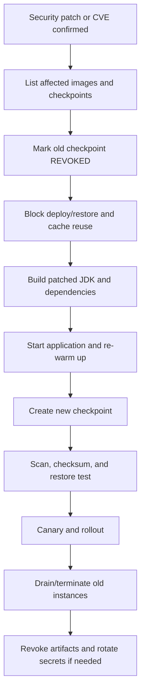

# Revoking Old Images and Recreating Images When Patching the JDK or Libraries

A CRaC checkpoint is the state of a Java process at the time of capture. It can contain the heap, class metadata, JIT state, threads, native memory, file descriptors, and objects referencing external libraries or services. Therefore, when patching the JDK, frameworks, Java dependencies, or native libraries, a checkpoint created from an older version does not automatically become a safe checkpoint for the new version.

If a JDK or library has a security vulnerability, simply updating the JAR file or package on the filesystem is not enough to eliminate old code residing in the checkpointed process state. Restore can bring back loaded classes, objects, method state, and native mappings from the old image. The safe approach is to **revoke the old checkpoint from the release flow, build the patched application/runtime, start up and warm up again, create a new checkpoint, test restore, and then deploy the new artifact pair**.

Revocation must also cover container images, artifact copies, build caches, nodes running from the old checkpoint, and any backups that could still be used for restore. If the old checkpoint may contain credentials or sensitive data, evaluate secret rotation and revoking related tokens.

## 1. Why Can't You Just Patch Files and Keep Using the Old Checkpoint?

A checkpoint does not merely record the path to the application JAR. It captures the state of the process. Depending on the runtime and checkpoint engine, the image can include:

- The heap with object graphs and class instances created from loaded code.
- Class metadata, classloader state, and related runtime state.
- JIT-compiled code and profile/runtime data.
- Native memory, mapped native libraries, and JNI state.
- Thread state, stacks, locks, and process resources.
- File descriptors, sockets, mappings, and metadata required for restore.

Suppose an application loaded `library-a-1.4.jar`, initialized a singleton, and created a checkpoint. Then the pipeline replaces the file on the filesystem with `library-a-1.5.jar` while keeping the old checkpoint. Restoring does not mean the JVM restarts the classloader and reloads all classes from the new JAR file. The process is restored from the old state; loaded classes and objects in the heap may still be the previous version.

Similarly, if you replace the JDK binary or native libraries underneath a checkpoint, the runtime may be incompatible with the process state created by the old binary. Even if the restore operation does not fail immediately, mixing old and new runtimes can produce unsupported behavior.

**A checkpoint must be treated as bound to the exact application image, JDK, native libraries, and environment that created it.** When those components change due to a patch, create a new checkpoint from the patched runtime and application, unless the runtime vendor explicitly confirms a supported checkpoint upgrade path.

## 2. Distinguishing Patch Types

Not every change has the same impact scope. Before deciding to revoke a checkpoint, determine which component is patched and whether it resides in the process state or the restore environment.

| Change type | Example | Action for checkpoint |
|---|---|---|
| JDK security update | CPU/PSU update, JVM, TLS, class library, or CRaC implementation fix | Recreate the checkpoint using the exact patched JDK and test on the target runtime |
| Java dependency update | Updating Spring, logging, HTTP client, ORM, or a library with a CVE | Rebuild application, run again to load new classes, warm up, and create a new checkpoint |
| Native library update | Updating OpenSSL, compression library, JNI library, or driver | Recreate the checkpoint from an image with the new native library; verify ABI and lifecycle |
| OS/base image update | Updating libc, system packages, CA bundle, or base image | Evaluate compatibility; typically create a new checkpoint on the patched base image |
| Runtime configuration without code changes | Changing endpoints or timeouts | Can be refreshed at restore if the design supports it; still verify the checkpoint does not retain old config |
| Rotating secrets or certificates | Rotating passwords, API keys, TLS certificates | Issue fresh ones on restore and revoke old credentials; checkpoints containing old secrets must be treated as sensitive copies |

If a patch only changes configuration not stored in the process snapshot and the application can re-read configuration after restore, recreating the entire checkpoint may not be necessary in some designs. However, if the patch alters code, classes, the JDK, native libraries, or any component already loaded into the process, recreate the checkpoint.

## 3. Old Checkpoints Can Still Carry Vulnerabilities

A vulnerability in the JDK or a dependency can be exploited through code already loaded into the process. If an old checkpoint is still restored, the application can revert to a vulnerable state even though the new container image contains the patched files.

Example of an incorrect workflow:

1. Create a checkpoint from an old JDK and a dependency with a CVE.
2. Update the JDK or JAR on the final image's filesystem.
3. Keep the old checkpoint directory unchanged.
4. Deploy the image and restore the old checkpoint.

Here, the pipeline changed the filesystem but still restored process state created from old code. Updating files is not proof that loaded classes, JIT code, or old native state were replaced.

A more proper workflow:

1. Identify affected releases and checkpoints.
2. Prevent new deployments from using the old checkpoint.
3. Build the application image with the patched JDK/dependencies/native libraries.
4. Start the new application from scratch in a compatible environment.
5. Warm up with safe fixtures and drain work.
6. Create a new checkpoint and bind it to the new image digest.
7. Test restore from the new final image.
8. Deploy the new version, remove old instances, and revoke old artifacts per policy.

## 4. Determining the Scope of Revocation

Before deleting artifacts, identify all places where checkpoints may be stored or used. A release can exist across multiple layers:

| Storage or usage location | Required actions |
|---|---|
| Container registry | Mark old images as disallowed for deployment; delete tags or manifests per policy and control digests |
| Checkpoint artifact repository | Revoke download permissions, mark as revoked, and delete old versions when retention permits |
| Object storage | Check versioning, object lock, replication, and backups; revoke access or delete per policy |
| CI/CD artifact cache | Invalidate cache layers containing the old checkpoint and prevent pipeline reuse |
| Build runner/local workspace | Delete temporary checkpoints and workspaces after the new artifact is verified |
| Running nodes/containers | Drain traffic, replace processes/containers restored from the old checkpoint |
| Kubernetes workloads/volumes | Update image digests, checkpoint references, init containers, and volumes storing artifacts |
| Backups/replicas/DR sites | Mark old copies invalid, control restore capability, and update standby copies |
| Developer workstations or mirrors | Track distributed copies; revoke access or delete per internal policy |

Deleting a tag does not necessarily delete content-addressed blobs in a registry. Deleting a file in the primary repository also does not remove copies in caches, mirrors, backups, or nodes that have already downloaded it. Distinguish between **halting distribution**, **revoking usage permissions**, and **physically deleting all copies**; the ability to completely delete depends on the storage system and retention policy.

## 5. Response Workflow When a Security Patch Is Discovered

When a JDK or library has a CVE affecting the application, coordinate the response by release and checkpoint identity:

### Step 1 — Identify Affected Releases

- Identify the installed JDK version, vendor, build, and packages.
- Identify Java dependencies and native libraries present in the application image.
- Cross-check the SBOM, scan reports, and vendor advisories.
- List application image digests and checkpoint digests created from those components.
- Identify node pools, environments, and replicas running from affected checkpoints.

### Step 2 — Prevent Use of the Old Checkpoint

- Mark the checkpoint release as `REVOKED` or equivalent status in the release catalog.
- Block deployment pipelines from selecting that checkpoint.
- Block restore jobs from downloading the old artifact per policy.
- Invalidate build caches that could reuse the old checkpoint.
- Prevent the old tag from being promoted back into production.

### Step 3 — Build the Patch and Create a New Checkpoint

- Update the affected JDK/base image and dependencies.
- Rebuild the application binary, native libraries, and container image.
- Generate a new SBOM and re-scan artifacts.
- Start the application from scratch using the patched runtime.
- Warm up using synthetic data and controlled dependencies.
- Execute `beforeCheckpoint` to drain and prepare resources.
- Create a new checkpoint, checksums, and new manifest.

### Step 4 — Verify Restore

- Restore the new checkpoint from the final image/artifact exactly as deployment will run it.
- Confirm the JDK and dependency versions in the actual runtime are the patched versions.
- Check connections, listeners, service discovery, logging, metrics, and tracing.
- Run smoke tests across critical business paths.
- Check scan/provenance metadata of the image and checkpoint.

### Step 5 — Deploy and Replace Old Processes

- Deploy a canary with the new image/checkpoint.
- Wait for readiness and health checks to succeed.
- Gradually shift traffic to the new instances.
- Drain and terminate instances running from the old checkpoint.
- Confirm no old replicas are still receiving traffic or holding leases.

### Step 6 — Revoke and Close the Incident

- Revoke old artifacts and tags according to the retention policy.
- Delete caches, workspaces, and controllable temporary copies.
- Rotate credentials if the old checkpoint may contain exposed or invalidated secrets.
- Record the revoked release, new artifacts, updated nodes, and verification evidence.



## 6. Creating a New Checkpoint from a Patched JDK

When the JDK is updated, rebuild the runtime image from the exact patched distribution/build. Do not just replace the `JAVA_HOME` directory in an old image and reuse the old checkpoint.

New preparation workflow:

1. Select the patched CRaC-enabled JDK and verify CRaC compatibility.
2. Update the OS base image and system packages if required by the advisory.
3. Build a new application image with an immutable digest.
4. Start the application from scratch on the patched runtime.
5. Confirm the actual running JVM has the expected vendor, version, and build.
6. Run warm-up with safe fixtures and dependencies.
7. Drain requests, schedulers, consumers, and background tasks.
8. Create the checkpoint using the patched runtime.
9. Store the checkpoint in a new release path without overwriting the old artifact.
10. Test restore from the exact new image/checkpoint pair.

A checkpoint created from an old JDK build generally should not be restored using a new JDK build without an explicit compatibility guarantee. JDK changes can affect runtime layout, class libraries, native code, and the CRaC implementation. Prefer creating the checkpoint on the exact runtime that will be packaged and used for restore.

### Recording the Actual Runtime Version

In the prepare stage, record the output of `java -version`, vendor/build info, and relevant JVM flags in the manifest or build provenance. Do not rely solely on a tag name like `java-crac:latest`, because a tag can point to different content on a later build.

The manifest should record:

- JDK vendor/distribution and full build version.
- Application image digest and application commit.
- OS base image digest and architecture.
- CRIU/checkpoint engine version if used.
- Key native libraries and drivers.
- Checkpoint creation timestamp and digest.
- SBOM reference and vulnerability scan results.

## 7. Creating a New Checkpoint When Patching Java Dependencies

For Java libraries, rebuild the application artifact so the new dependency graph is packaged. Then start the application from scratch so the classloader loads the patched version and warms up the necessary code paths.

For example, if `http-client` has a CVE:

1. Update the version in dependency management or the lockfile.
2. Inspect the dependency tree to ensure no vulnerable version remains via transitive dependencies.
3. Rebuild the JAR/image and record a new SBOM.
4. Start the new application on a compatible runtime.
5. Confirm the actual classpath no longer contains the old JAR.
6. Warm up requests using the updated HTTP client.
7. Create a new checkpoint from the process that has loaded the new library.
8. Test restore and confirm the runtime uses the exact dependency.

Do not replace the JAR in the container filesystem after a checkpoint has been created and continue using that checkpoint. Previously loaded classes and old objects may still reside in the snapshot. Nor should classloader hot reload be used as a substitute for recreating the checkpoint when the patch involves code retained in process state.

### Checking Transitive Dependencies

A direct patch may not be enough if another dependency still pulls the old version into the classpath. Use dependency locks, dependency insight/tree, and SBOMs to inspect the entire library graph. If multiple versions coexist, determine which version the classloader actually loads.

After building, inspect the built artifact rather than checking only the build script file. The release manifest must point to the exact JAR/image digest that was scanned and used to create the checkpoint.

## 8. Patching Native Libraries and Drivers

Native libraries can be mapped into the process and called via JNI or by the JDK. Examples: OpenSSL, zlib, font/rendering libraries, native database clients, GPU drivers, or custom C/C++ libraries.

When updating native libraries:

- Rebuild the container/base image containing the patched binary.
- Verify ABI, architecture, and dynamic linker paths.
- Start a new process to load the exact new binary.
- Check `ldd`, package inventory, or equivalent tools in the build environment to confirm native dependencies.
- Run warm-up and test critical JNI/native paths.
- Create a new checkpoint from the process that has loaded the patched library.
- Run restore tests on a compatible host/kernel/driver.

Do not overwrite `.so` or DLL files while an old checkpointed process still exists and assume restore will use the new binary. Memory mappings and native state of the old process may still reference the old binary. Some driver/kernel changes also require checking OS and host node compatibility.

## 9. Revoking Old Checkpoints and Images in the Registry

Revocation requires a clear artifact catalog. For each release, record the relationships among:

```text
release ID
  -> application image digest
  -> checkpoint artifact digest
  -> JDK/runtime build
  -> dependency/native SBOM
  -> restore test result
  -> deployment/node references
```

When a release is revoked:

1. Mark the release/checkpoint as revoked in the catalog or manifest registry.
2. Block deploy/restore permissions for that digest.
3. Delete or disable mutable tags pointing to the old image.
4. Delete old checkpoint artifacts when policy allows.
5. Purge registry caches and artifact caches using the platform's mechanism.
6. Check whether replication/mirrors and backups retain the old copy.
7. Store an audit record of the revoked artifact and the reason.

Do not just delete a tag and assume the checkpoint has disappeared. The registry may keep blobs by digest, nodes may have already pulled the image, and builder caches may retain layers. Check retention/garbage collection and confirm the old artifact is no longer referenced by active deployments.

### Using Revoked Status Instead of Immediate Deletion in All Cases

In some organizations, artifacts must be retained for a period for auditing. You can mark them as revoked, block usage permissions, and keep the archived copy isolated per retention policy. That archived copy must not appear in the list of releases eligible for deploy or restore.

If regulations require physical deletion, follow the deletion policy of the registry/object store and check replicas/backups. Do not promise that every copy downloaded outside the system can be remotely deleted.

## 10. Revoking Checkpoints Currently Running on Nodes

Deleting an artifact from the registry does not stop processes already restored from that artifact. Those instances may still be running old code and continuing to serve traffic.

For each node or workload:

- Identify the image digest and checkpoint release the instance is using.
- Mark the old instance not ready and stop receiving new traffic.
- Drain requests, transactions, message handlers, and background tasks.
- Remove old service registrations/leases.
- Terminate the process/container following graceful shutdown procedures.
- Create new instances from the patched image/checkpoint pair.
- Confirm readiness and health before shifting traffic.
- Verify no old pods/containers/VMs still hold leases or participate in consumer groups.

If a vulnerability is critical and actively exploited, drain times may need to be shortened per incident policy. However, do not leave an old instance serving traffic just because a new checkpoint cannot yet be created; you can temporarily fall back to cold start from the patched image if compatible.

### Kubernetes

In Kubernetes, update the image digest in the Deployment/StatefulSet/DaemonSet and roll out to replace old pods. If the checkpoint is mounted from a PVC, object storage, or downloaded by an init container, update the checkpoint reference along with the release ID and ensure old volumes/caches are not mistakenly reused.

Do not simply restart pods while keeping a volume containing the old checkpoint. Also inspect whether node-local caches, image pull caches, init containers, and sidecars reference the old artifact. After rollout, check that all replicas are running the new digest and old endpoints have disappeared from service discovery.

## 11. Secret Rotation When Old Checkpoints May Contain Sensitive Information

A checkpoint may contain passwords, API tokens, session cookies, private keys, TLS contexts, or credentials already loaded into heap/native memory. If the old artifact was leaked or distributed somewhere no longer under control, deleting the artifact may not be enough.

Evaluate these actions:

- Rotate database passwords, API keys, or service credentials present in the old checkpoint.
- Revoke access tokens or refresh tokens that may still be valid.
- Replace certificates/private keys if the checkpoint may contain private keys and faces exposure risk.
- Delete/revoke sessions or leases bound to old instances.
- Issue fresh workload identities for restored instances.
- Inspect logs and audit events to determine where the artifact was downloaded or used.

Not every checkpoint requires rotating every secret. Base the decision on credential type, permission scope, lifetime, likelihood of access, and incident policy. However, when there is any sign that a checkpoint was exposed, treat secrets inside the snapshot as at risk and handle them according to incident response procedures.

## 12. Rollback After Patching: Do Not Revert to a Vulnerable Checkpoint

Rollback normally uses the previous release when a new release encounters bugs. However, during a security patch, the previous release may be the very one containing the vulnerable JDK or dependency.

Therefore, distinguish between:

- **Technical rollback:** reverting to a known-working application image/checkpoint pair.
- **Safe rollback:** reverting to an artifact pair that still meets current security requirements.

If the previous release still has the vulnerability, do not use the old checkpoint as a production fallback simply because it restores quickly. Options can include:

1. Fix the patch quickly and create a new checkpoint.
2. Use cold start from the patched application image if the new checkpoint is not yet ready.
3. Revert to an even older release that was patched or is unaffected.
4. Temporarily reduce features or traffic while recreating a safe artifact.

The release catalog should track security approval/revocation status separately from restore-tested status. A checkpoint may restore successfully from a technical standpoint yet still be forbidden from deployment because it contains vulnerable code.

## 13. Controlling Caches and Avoiding Accidental Checkpoint Reuse

Build caches are a source of accidental old artifact reuse if cache keys do not include every critical input. A checkpoint depends on the application image, JDK, native libraries, OS, kernel, CRIU/checkpoint engine, configuration, and warm-up workload.

When patching:

- Increment the release ID or checkpoint generation.
- Use immutable image digests instead of mutable tags.
- Include the JDK build, dependency lock/SBOM digest, and native base image digest in the manifest.
- Invalidate checkpoint layers/caches whenever any input affecting process state changes.
- Do not copy a checkpoint from an old cache simply because a Docker layer reports a cache hit.
- Store checkpoints in versioned paths without overwriting the active release directory.
- Verify the checkpoint digest after copying and before restoring.

Example path convention:

```text
artifacts/
  orders-service/
    release-2026.11.13.2-patched/
      application-image.digest
      checkpoint.tar
      checkpoint.sha256
      release-manifest.yml
      sbom.spdx.json
      restore-test.json
```

The names above are illustrative only. Each release needs an immutable artifact path traceable back to the exact commit/build.

## 14. Manifest and Provenance for the New Checkpoint

A good manifest helps prove that the new checkpoint was created from the exact patched runtime. Example:

```yaml
release:
  id: orders-service-2026.11.13.2
  status: approved
  applicationCommit: 3b7d9e10
  applicationImage: registry.example.com/orders-service@sha256:IMAGE_DIGEST

runtime:
  jdkVendor: example-vendor
  jdkVersion: 25.0.x+patched-build
  osImageDigest: sha256:OS_IMAGE_DIGEST
  architecture: linux-amd64
  checkpointEngine: tested-engine-build

dependencies:
  lockfileDigest: sha256:LOCKFILE_DIGEST
  sbom: sbom.spdx.json
  nativeLibrariesDigest: sha256:NATIVE_LIBRARIES_DIGEST

checkpoint:
  generation: 2
  artifact: checkpoint.tar
  digest: sha256:CHECKPOINT_DIGEST
  createdAt: "2026-11-13T08:00:00Z"
  restoreTest: passed

security:
  patchedAdvisories:
    - CVE-YYYY-NNNN
  scanResult: passed
  supersedes: orders-service-2026.11.13.1
```

The values are placeholders, not information about a real CVE or runtime. The pipeline must populate data from the build, SBOM, scanner, and restore test. Do not mark `passed` without corresponding evidence.

The manifest should be signed or accompanied by a provenance attestation if the supply chain supports it. The signature must cover the release identity and the checkpoint/image digests so deployers can verify origin.

## 15. Verifying the Patch Before Releasing the New Checkpoint

Creating a new checkpoint does not replace patch verification. Before publishing:

1. Confirm the JDK build is the exact patched build from the vendor.
2. Confirm the dependency tree no longer contains the affected version.
3. Scan the application image, OS packages, and native libraries.
4. Check the SBOM and provenance.
5. Run functional and integration tests on the new application image.
6. Create the checkpoint from the exact scanned image.
7. Restore from the final image/artifact exactly as deployment will use it.
8. Confirm the runtime version after restore.
9. Run smoke tests and check resource lifecycles.
10. Confirm the checkpoint digest in the deployment manifest matches the tested artifact.

If the scanner reports a CVE in a package not loaded into the process, still evaluate the impact scope according to security policy. Do not automatically ignore findings just because a package is not on the Java classpath; native libraries or system packages can still be used by the process.

## 16. Canary Rollout and Confirming No Old Processes Remain

A controlled rollout helps catch restore failures before replacing the entire fleet:

1. Deploy a canary with the new image/checkpoint.
2. Verify the image digest, checkpoint digest, and JDK build on the instance.
3. Check restore callbacks and resource recreation.
4. Send test traffic and observe latency/error rate.
5. Expand rollout in batches.
6. Drain and terminate old instances by exact release identity.
7. Check the service registry, consumer groups, leases, and node inventory.
8. Mark the rollout complete only when no instances remain using the revoked release.

A useful metric is the instance count by checkpoint generation. If the count for the old generation does not drop to 0, track down missed processes, un-rolled pods, unreplaced VMs, or workers running outside the deployment controller.

## 17. Artifact Revocation and Retention

It is not always possible to immediately delete old checkpoints. Registries may enforce retention, object locks, or immutable backups. In those cases:

- Mark the artifact as revoked in the catalog.
- Block download and restore permissions.
- Move the artifact to an isolated storage area if retention for audit is required.
- Attach an expiration timestamp and an owner responsible for deletion.
- Periodically inspect replicas and backups.
- Confirm deployment manifests no longer reference the old digest.

If physical deletion is required, execute it via the storage provider's mechanism and retain proof of deletion. For externally downloaded copies, access can only be revoked if the platform supports it; remote deletion of unmanaged copies cannot be guaranteed.

## 18. Revocation and Recreation Test Scenario

An operational procedure should be rehearsed before a critical CVE occurs:

1. Create a sample release with an application image and checkpoint generation 1.
2. Mark generation 1 as revoked in the test environment.
3. Verify the deployment pipeline rejects restoring generation 1.
4. Update the JDK or a dependency in the application build.
5. Create the application image and checkpoint generation 2.
6. Verify the manifest records the exact new JDK/dependency and new digest.
7. Restore generation 2 from the final image.
8. Check the runtime version, classpath, native libraries, and readiness.
9. Roll out generation 2 and confirm generation 1 instances are drained/terminated.
10. Check registries/caches/backups and the revoked status of generation 1.
11. Attempt a rollback to verify policy prevents reverting to a vulnerable checkpoint.
12. Test secret rotation if the fixture checkpoint contains simulated credentials.

This scenario tests both the ability to create a new checkpoint and the ability to prevent the system from accidentally reusing a revoked checkpoint.

## 19. Observing and Reporting Revocation Status

There should be a report for each patching cycle:

| Field | Meaning |
|---|---|
| Advisory/CVE | Reason for patching |
| Affected release IDs | Releases potentially affected |
| Old image/checkpoint digest | Artifact to revoke |
| New image/checkpoint digest | Replacement artifact |
| JDK/dependency version | Evidence of patched versions |
| Restore test result | Verification result for the new artifact pair |
| Running old instances | Number of old processes still running |
| Revocation status | Where the old artifact has been blocked/revoked |
| Secret rotation status | Whether related credentials have been handled |
| Exceptions | Backups or environments not yet updatable |

Operational metrics may include:

- Instance count by checkpoint generation.
- Number of deployments blocked due to a revoked checkpoint.
- Number of old artifacts remaining in registries or backups.
- Time from patch advisory until zero old instances remain.
- Restore success rate of the new checkpoint generation.
- Cold-start fallback rate during the rollout.

Do not include secrets or checkpoint contents in the report. Store only digests, versions, statuses, and metadata required for audit.

## 20. Checkpoint Revocation and Recreation Checklist

### Identification and Revocation

- [ ] Identified affected JDK/dependency/native library and advisories.
- [ ] Listed application image digests and checkpoint digests created from old versions.
- [ ] Marked old checkpoint as revoked in the release catalog.
- [ ] Deploy/restore pipelines no longer select old artifacts.
- [ ] Build caches, registries, object storage, mirrors, and backups checked.
- [ ] Instances running from old checkpoints drained and replaced.
- [ ] Secrets/tokens/certificates evaluated for rotation or revocation.

### Recreation and Verification

- [ ] JDK, application dependencies, native libraries, and base image patched.
- [ ] New application image has an immutable digest.
- [ ] New SBOM and scan report generated.
- [ ] Application started from scratch using the patched runtime.
- [ ] Warm-up and drain completed before checkpoint.
- [ ] New checkpoint created from the exact patched runtime/application image.
- [ ] Manifest links the exact image digest, checkpoint digest, and runtime build.
- [ ] Restore smoke test run from the final packaged artifact.
- [ ] Canary and rollout confirmed resources/health/readiness.
- [ ] No old processes remain using the revoked checkpoint generation.

### Closing the Incident

- [ ] Old artifact blocked from use and deleted/isolated per retention policy.
- [ ] Rollback policy does not point to vulnerable checkpoints.
- [ ] Evidence of scans, restore tests, rollout, and revocation preserved.
- [ ] Remaining exceptions have an owner and remediation deadline.

## 21. Conclusion

A CRaC checkpoint is process state, so it can retain classes, objects, JIT state, and native resources from a previously loaded JDK or library version. When patching the JDK, Java dependencies, native libraries, or base image, rebuild the application/runtime and create a new checkpoint from a process running on the patched binaries. Do not replace files on the filesystem and continue restoring an old image.

Revocation must include artifact repositories, container registries, build caches, backups, and running instances. Mark the old checkpoint as disallowed for deployment, roll out new processes, verify no old replicas remain, and rotate secrets if the snapshot may contain credentials that must be revoked. Bind the new checkpoint to the image digest, runtime build, SBOM, and restore test so every deployment can accurately verify the patched state.
