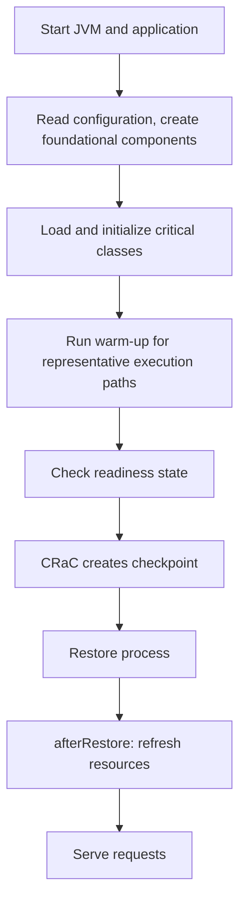

# Class Loading and Class Initialization Before Checkpoint Time

In a Java application using CRaC (Coordinated Restore at Checkpoint), a checkpoint saves the process state at a chosen point in time. When restoring from a checkpoint, the JVM resumes from the saved state instead of starting the application from scratch. Therefore, work that can be safely completed before the checkpoint—such as loading frequently used classes, running static initializers, and preparing critical execution paths—can be performed early to reduce latency after restore.

Class loading and class initialization are two distinct stages. Loading a class makes its definition known to the JVM; class initialization runs `static` field assignment expressions and `static` blocks. A loaded class is not necessarily initialized yet. To properly prepare state for a checkpoint, you need to understand this difference, know how to actively trigger each stage, and control side effects of initialization code.

## 1. Why Prepare Classes Before Checkpoint?

On the first run, the JVM may have to read bytecode, define classes, verify bytecode, link references, and execute static initialization code when the application uses a class for the first time. These operations are often spread out during request handling. If the first request after restore touches a class that has not yet been loaded or initialized, the user still has to wait for that work.

A pre-checkpoint preparation workflow can:

- Move the cost of loading and initializing critical classes into a controlled startup phase.
- Detect missing class errors, linkage errors, or static initializer failures early.
- Warm up framework components that are normally created only when the first request arrives, such as data converters, serializers, validators, or routers.
- Store the prepared Java state inside the checkpoint so the process is restored in that corresponding state.

Preparing classes does not automatically make every request faster. The benefit depends on which classes and execution paths are prepared, as well as the added pre-checkpoint time and memory. An application should only warm up components that deliver real value for post-restore response time.

## 2. Lifecycle of a Class in the JVM

According to the JVM model, processing a class comprises three groups of work: loading, linking, and initialization. Linking includes verification, preparation, and resolution. Some references may be resolved lazily when the program needs them.

| Stage | JVM performs | Main result |
|---|---|---|
| Loading | Locates bytecode and creates a `Class` representation through a class loader | The JVM has the class definition available for use |
| Verification | Checks the structure and validity of the bytecode | Bytecode satisfies JVM constraints |
| Preparation | Allocates storage for `static` fields and assigns default values | Static fields hold default values for their data types |
| Resolution | Turns symbolic references into direct references when needed | Class, field, and method references can be used |
| Initialization | Runs the class initializer `<clinit>` if present | `static` assignments and `static` blocks are executed |

Example:

```java
public final class PricingRules {
    static final int DEFAULT_DISCOUNT = 5;
    static final Map<String, Integer> DISCOUNTS = loadDiscounts();

    static {
        System.out.println("PricingRules initialized");
    }

    private static Map<String, Integer> loadDiscounts() {
        return Map.of("WELCOME", 10, "LOYAL", 15);
    }

    private PricingRules() {
    }
}
```

When `PricingRules` is initialized, the JVM executes static field assignments and `static` blocks in the order they appear in source code. In this example, `loadDiscounts()` runs during class initialization. If that method reads a file, calls an external service, or depends on a resource that only exists during startup, that side effect also occurs when the class is initialized.

### 2.1. Class Loading Does Not Mean Class Initialization

`ClassLoader.loadClass()` normally loads a class without requiring class initialization. Similarly, `Class.forName(name, false, loader)` asks the JVM to load the class without running its static initializer.

Conversely, `Class.forName(name, true, loader)` requests class initialization after loading. Calling `Class.forName(name)` also requests initialization and uses the calling class's class loader according to the API contract.

```java
ClassLoader loader = Thread.currentThread().getContextClassLoader();

// Load class; do not actively run static initializer.
Class<?> loadedOnly = Class.forName(
        "com.example.PricingRules", false, loader);

// Load and initialize class if the class has not been initialized yet.
Class<?> loadedAndInitialized = Class.forName(
        "com.example.PricingRules", true, loader);
```

Do not use `PricingRules.class` as a guarantee that the static initializer has run. A class literal provides the `Class` object, but that operation itself is not an active use that triggers class initialization under JVM initialization rules.

### 2.2. When Does the JVM Initialize a Class?

The JVM initializes a class when the program performs certain active uses of the class, for example:

- Creating a new instance with `new`.
- Calling a `static` method declared in the class.
- Reading or writing a `static` field that is not a compile-time constant.
- Calling `Class.forName(name, true, loader)`.

When initializing a class, the JVM also handles initializing its superclass according to Java rules. Initializing a class can trigger initialization of superinterfaces with `default` methods as required by the specification. Therefore, actively initializing one class can trigger additional initialization code in related types.

Class initialization is synchronized by the JVM mechanism. If multiple threads touch an uninitialized class concurrently, the JVM ensures the class initializer runs only once for that class definition. If initialization fails, the first initialization attempt typically receives `ExceptionInInitializerError` when the original error is not an `Error`; subsequent uses may receive `NoClassDefFoundError` because the JVM marks the class as having failed initialization.

A class's identity consists of the class name and the class loader that defined it. Two different class loaders can define two classes with the same name, and the JVM treats them as two distinct types. This is especially important in applications with plugins, application servers, or multiple class loaders.

## 3. What Does CRaC Retain at Checkpoint?

CRaC allows creating a checkpoint of a Java process and restoring the process from the saved state. When a class has already been loaded and initialized before checkpoint time, the corresponding JVM state is stored in the checkpoint. After restore, the JVM resumes with that class in the initialized state; the static initializer does not re-run merely because the process has just been restored.

This avoids repeating part of the startup work. However, static state is also restored just like other memory state. If a `static` field holds stale data, a closed connection, or startup-time-dependent information, the application may continue running with data that is no longer appropriate.

Unsuitable example:

```java
public final class RuntimeState {
    // This value is captured together with the process state.
    static final Instant STARTED_AT = Instant.now();

    // Network connection may no longer be valid after restore.
    static final RemoteClient CLIENT = RemoteClient.connect();

    private RuntimeState() {
    }
}
```

`STARTED_AT` will reflect the pre-checkpoint initialization time, not automatically update to the restore time. `CLIENT` may hold a socket or communication state that is no longer valid when the process is restored. The fact that a class initialized successfully before checkpoint does not prove that every resource it holds remains usable after restore.

Therefore, distinguish two kinds of state:

- **Java state that can be retained:** immutable data structures, precomputed lookup tables, metadata, fixed deployment configuration, and pure Java objects without external resource dependencies.
- **State that needs refreshing:** sockets, database connections, file descriptors, background threads, timers, time-dependent data, credentials with independent lifecycles, or caches needing resynchronization.

For the second group, manage resource lifecycles using CRaC mechanisms and refresh state after restore. Do not place connection opening or background thread startup inside a static initializer just to force the class to initialize before checkpoint.

## 4. Designing the Pre-Checkpoint Warm-Up Phase

A good warm-up phase should run after configuration and required application components are ready, yet before the checkpoint creation request is executed. This phase needs an explicit list of targets and must be safe to run repeatedly in test environments.

Typical workflow:



Key steps to pay attention to:

1. **Choose the right class loader.** Use the class loader responsible for defining the application's classes. In environments with plugins or containers, the current thread's class loader may differ from the class loader of the module needing warm-up.
2. **Load and initialize from a list.** Prioritize classes on critical paths, adapters, serializers, validators, controllers, or framework components with significant initialization cost.
3. **Execute representative execution paths.** Loading classes does not guarantee every dependent class is resolved, every proxy is created, or every framework branch is prepared. Run representative operations using safe test data.
4. **Verify completion.** If a required class fails to load or initialize, fail startup before creating the checkpoint. Do not mark the application ready while warm-up still has errors.
5. **Prepare resources for checkpoint.** Stop or release resources that need handling before checkpoint according to the CRaC lifecycle.
6. **Refresh after restore.** Reopen connections, recreate threads, or resynchronize necessary caches in post-restore callbacks before the application accepts requests depending on them.

### 4.1. Actively Loading and Initializing Classes

`Class.forName` can be used to initialize a known list of classes. An explicit list helps readers understand which components the application is preparing and avoids scanning the entire classpath uncontrollably.

```java
import java.util.List;

public final class ClassWarmup {
    private static final List<String> IMPORTANT_CLASSES = List.of(
            "com.example.api.OrderController",
            "com.example.json.OrderSerializer",
            "com.example.validation.OrderValidator",
            "com.example.pricing.PricingRules"
    );

    private ClassWarmup() {
    }

    public static void run(ClassLoader loader) {
        for (String className : IMPORTANT_CLASSES) {
            try {
                Class.forName(className, true, loader);
            } catch (ClassNotFoundException e) {
                throw new IllegalStateException(
                        "Cannot warm up required class: " + className, e);
            }
        }
    }
}
```

Invoke warm-up during startup:

```java
public final class Application {
    public static void main(String[] args) {
        ApplicationContext context = createApplicationContext();
        context.start();

        ClassLoader appLoader = Application.class.getClassLoader();
        ClassWarmup.run(appLoader);

        warmupImportantPaths(context);
        markReadyForCheckpoint();
    }

    private static void warmupImportantPaths(ApplicationContext context) {
        // Invoke representative operations using safe test data.
        context.orderSerializer().serialize(sampleOrder());
        context.orderValidator().validate(sampleOrder());
    }
}
```

This is a structural illustration. In real applications, integrate warm-up into the framework's existing lifecycle to ensure dependency injection, configuration, and class loaders are already in the right state. Avoid spawning a parallel startup thread that is not awaited to completion before checkpoint.

`Class.forName` can throw `ClassNotFoundException`. Static initializers can also throw errors during initialization; such errors should be treated as startup failures. Do not catch all `Throwable` and ignore them, because a checkpoint could then be created even though an essential component is unready.

### 4.2. Warming Execution Paths, Not Just a Class List

A class can be loaded and initialized while critical parts of the system are still unprepared. For example, a framework may generate proxies when a bean is first retrieved, a serializer may analyze types on first serialization, or a router may build metadata upon receiving the first request.

Therefore, after loading core classes, execute several representative paths:

- Serialize and deserialize a sample object.
- Run validation on valid data and, if necessary, invalid data.
- Initialize converters or mappings for key data types.
- Register and verify routes that must serve immediately after restore.
- Create proxies or metadata that the framework builds only when components are used.

Warm-up should use synthetic data or test resources. Do not send real transactions, emit customer notifications, write business data, or consume one-time operations that must execute only once. If warm-up operations have side effects, design them to be safely repeatable or provide appropriate rollback/undo mechanisms.

## 5. Managing Resources With CRaC Callbacks

Class preparation and resource management are related yet distinct responsibilities. Classes and static state can be retained in the checkpoint; resources tied to the OS or external services may need to be closed before checkpoint and recreated after restore.

With the CRaC API, an application can register a `Resource` to handle two points in time:

- `beforeCheckpoint`: brings the resource to a safe state before capturing process state, such as stopping new work intake and closing connections that need reopening.
- `afterRestore`: restores the resource so the application can resume operation, such as recreating connection pools or reconnecting to external services.

Example illustrating a client-managing resource:

```java
import org.crac.Context;
import org.crac.Core;
import org.crac.Resource;

public final class ClientResource implements Resource {
    private RemoteClient client;

    public ClientResource() {
        Core.getGlobalContext().register(this);
        this.client = RemoteClient.connect();
    }

    @Override
    public void beforeCheckpoint(Context<? extends Resource> context)
            throws Exception {
        if (client != null) {
            client.close();
            client = null;
        }
    }

    @Override
    public void afterRestore(Context<? extends Resource> context)
            throws Exception {
        client = RemoteClient.connect();
    }

    public RemoteClient client() {
        if (client == null) {
            throw new IllegalStateException("Client is not available");
        }
        return client;
    }
}
```

The example assumes `RemoteClient` can be closed and recreated in this manner. Real applications must follow the API and lifecycle rules of the library in use; some libraries have dedicated CRaC integration or require extra configuration. Also ensure threads using the client have stopped or synchronized before closing.

Do not use `afterRestore` callbacks to replace the entire warm-up. This callback is suited for recovering resources and state that need refreshing. Classes that can be safely loaded and initialized before checkpoint should be prepared during startup so post-restore callbacks do not bear the full application initialization cost again.

## 6. Common Design Mistakes

### Calling only `loadClass` and assuming the class is ready

`loadClass` does not require running the static initializer. If the goal is to perform static initialization before checkpoint, use an appropriate active initialization action, such as `Class.forName(name, true, loader)`, or execute the actual code path using the class.

### Initializing too many classes

Scanning and initializing every class found on the classpath can lengthen startup, increase memory usage, and trigger unnecessary static initializers. Some classes should only be loaded when the corresponding feature is actually used. Choose based on observed request and post-restore latency data.

### Putting side effects inside static initializers

A static initializer runs only once per class definition in a class loader's lifetime. If it opens connections, starts threads, reads frequently changing data, or writes external state, those actions may not fit restoring from a snapshot. Move resource management to explicit lifecycles and keep static initializers as simple and deterministic as possible.

### Ignoring the class loader

Loading a class with the wrong class loader can cause `ClassNotFoundException`, create a class definition distinct from the one used by the framework, or break type relationships between modules. In modular applications, plugins, or application servers, identify the class loader owning the class before warming up.

### Assuming class loading equals JIT warm-up

Loading and initializing a class does not mean compiling methods into optimized machine code. JIT compilation depends on execution behavior and JVM thresholds. If a path's latency also depends on JIT, run representative workloads and measure separately; you cannot conclude that calling `Class.forName` alone has warmed execution code.

### Storing caches or time-dependent values in static fields

A checkpoint preserves memory values at capture time. Caches can become stale, tokens can expire, startup clocks do not reflect restore time, and random number generators may continue from the saved state. Identify which data needs refreshing after restore and perform that through an appropriate lifecycle.

### Warm-up having business side effects

If warm-up sends emails, places orders, charges payments, or writes real data, each checkpoint creation or startup run can produce unintended outcomes. Use only test data and safe operations; if side effects cannot be avoided, a verifiable idempotent design is required.

## 7. Measuring and Verifying Effectiveness

Warm-up is worthwhile only when it can be proven to improve post-restore behavior. Measure at least three milestones: pre-checkpoint startup time, restore-to-ready time, and latency of the first request after restore.

JVM logging can be enabled to observe class loading and initialization:

```bash
java -Xlog:class+load=info,class+init=info -jar application.jar
```

Logging tags and detail levels may vary across distributions or JVM versions; check your running runtime's documentation if an option is unsupported. Logs help identify which classes load or initialize during warm-up and which appear only when the first request runs.

Practical verification workflow:

1. Run the application with class loading and class initialization logs to identify classes appearing during the first request.
2. Add critical classes and execution paths to warm-up.
3. Create the checkpoint after warm-up completes and resources have been properly handled.
4. Restore in an environment equivalent to the deployment environment.
5. Send the same test workload and compare first-request latency, subsequent-request latency, time to readiness, and memory usage.
6. Repeat multiple checkpoint/restore cycles to detect un-recreated resources or stale static state.

A good result is not just a faster first request. The application must also preserve correct behavior, avoid leaking resources across multiple restores, and not inflate startup time to the point of negating the gains achieved.

## 8. Design Checklist

Before incorporating warm-up into the checkpoint creation workflow, confirm:

- [ ] The list of classes to prepare originates from critical execution paths with clear justification.
- [ ] Each class is initialized using the correct class loader.
- [ ] Static initializers perform no side effects unsafe for restore.
- [ ] Necessary execution paths have been exercised with safe test data.
- [ ] Class loading or initialization errors fail startup before a checkpoint is created.
- [ ] Connections, threads, files, and external resources are handled via appropriate lifecycles.
- [ ] Post-restore callbacks refresh required state before requests use it.
- [ ] Multiple checkpoint/restore cycles have been tested and real latencies measured.
- [ ] Startup time and memory overhead from loading extra classes have been weighed.

## 9. Conclusion

Preparing classes before checkpoint is a way to shift part of startup and initialization work into a controlled startup phase. It is necessary to distinguish loading from initialization, use the right class loader, actively exercise critical paths, and control static state stored in the snapshot. For resources depending on the OS or external services, use CRaC callbacks to close them before checkpoint and recreate them after restore. Finally, measure the first request after restore and test multiple cycles to confirm warm-up genuinely improves time-to-readiness while preserving correct application behavior.
