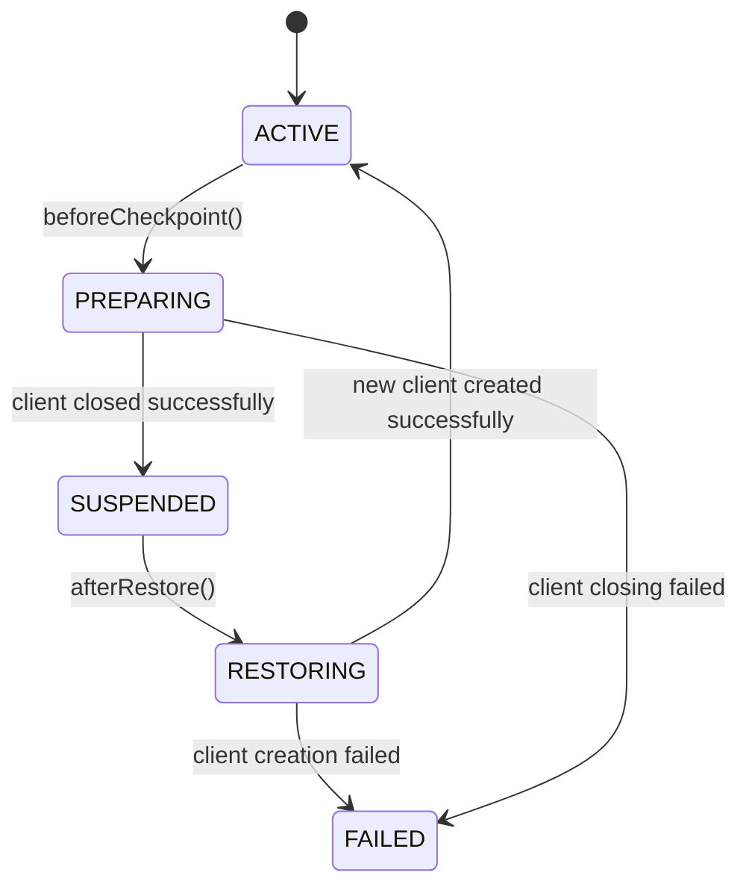
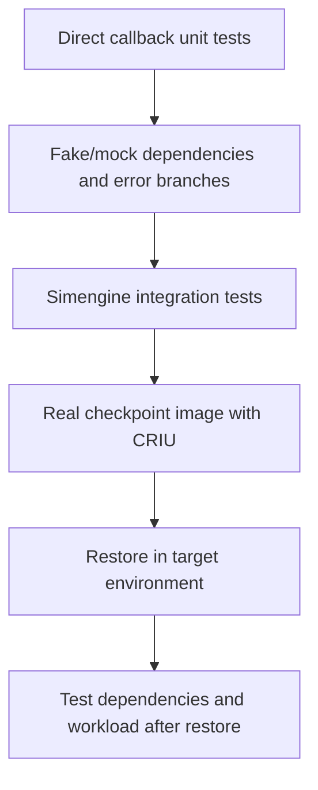

# Testing Callbacks Independently of the Image Creation Mechanism

In CRaC, `beforeCheckpoint(...)` and `afterRestore(...)` are the two coordination points for an application to prepare resources before a checkpoint and recover them after restore. When developing an application, testing these two callbacks does not necessarily have to start by creating a real checkpoint image. You can test callback logic directly with unit tests, and then use `simengine` to run through the entire notification cycle without writing an image to disk.

These two testing approaches answer two different questions:

- **Callback unit tests:** Does each Resource's logic close, pause, recreate, or validate resources as expected?
- **Simengine integration tests:** When the CRaC runtime emits a checkpoint/restore cycle, do registered Resources receive callbacks and coordinate in the proper order?

`simengine` simulates a checkpoint followed immediately by a restore within the same process. It invokes `beforeCheckpoint(...)` and then `afterRestore(...)` for registered Resources without creating a checkpoint image on the filesystem. Therefore, this is a useful testing method on development machines that cannot run CRIU or lack permissions to checkpoint processes. However, its results do not prove that a real image can be created or restored successfully.

## 1. Separating Resource Logic from the Image Creation Mechanism

A Resource typically manages resources such as files, sockets, connection pools, HTTP clients, executors, or schedulers. The logic that needs testing mainly concerns how the component transitions state between two phases:

1. Before checkpoint, stop accepting new work and bring the resource to a safe state.
2. After restore, recreate or validate the resource and then allow the application to continue.

This is ordinary Java logic. If the callback does not call checkpoint-engine-specific APIs, the Resource's methods can be called directly in unit tests without creating an image.

For example, a `Resource` managing a client connected to an external service can have the following states:



Unit tests can verify every state transition, every error branch, and side effects such as calling `close()` exactly once. Simengine adds verification that the runtime actually invokes the two callbacks across a simulated cycle.

## 2. Two Testing Layers and Their Scope

| Testing Approach | Requires CRaC-enabled JDK? | Creates Real Image? | What Can Be Verified |
|---|---:|---:|---|
| Unit test calling callbacks directly | No, if `org.crac:crac` is on the test classpath. | No. | Java logic inside callbacks, internal operation order, error handling, and Resource state. |
| Test with fake/mock dependencies | No. | No. | How the application reacts when closing, reopening, or checking resources succeeds/fails. |
| Integration test using `simengine` | Yes, runtime must provide this engine. | No; engine simulates the cycle inside the same process. | CRaC invokes callbacks of registered Resources and application execution resumes after the simulated cycle. |
| Integration test with `criuengine` | Yes, along with a Linux/CRIU environment meeting requirements. | Yes. | Ability to create a real checkpoint image and restore conditions in the tested environment. |

Do not treat unit tests or simengine as a complete substitute for CRIU testing. Each layer provides its own kind of evidence and should be used for the exact question it is meant to answer.

## 3. Testing Callbacks Directly with JUnit

A callback is a Java method on an object implementing `org.crac.Resource`. Unit tests can instantiate the Resource, prepare fake dependencies, and invoke the methods directly.

Example of a Resource managing a client:

```java
import org.crac.Context;
import org.crac.Resource;

public final class ClientResource implements Resource {

    private final ClientFactory factory;
    private ClientHandle client;
    private boolean suspended;

    public ClientResource(ClientHandle initialClient, ClientFactory factory) {
        this.client = initialClient;
        this.factory = factory;
    }

    @Override
    public synchronized void beforeCheckpoint(
            Context<? extends Resource> context) throws Exception {
        if (suspended) {
            return;
        }

        if (client != null) {
            client.close();
            client = null;
        }
        suspended = true;
    }

    @Override
    public synchronized void afterRestore(
            Context<? extends Resource> context) throws Exception {
        if (!suspended) {
            return;
        }

        // Change state only after the new client is created successfully.
        ClientHandle restored = factory.open();
        client = restored;
        suspended = false;
    }

    public synchronized boolean isAvailable() {
        return !suspended && client != null;
    }
}
```

Abstractions used in the example:

```java
public interface ClientHandle {
    void close() throws Exception;
}

public interface ClientFactory {
    ClientHandle open() throws Exception;
}
```

`ClientHandle` and `ClientFactory` are illustrative application interfaces, not CRaC APIs. In real code, they represent a client or connection pool managed by the application.

### 3.1. Unit Testing with Mockito

Because callbacks accept a `Context<? extends Resource>`, tests can pass a mock context if the callback does not interact with that context. You do not need to call `Core.checkpointRestore()` to test the method's logic.

```java
import org.crac.Context;
import org.crac.Resource;
import org.junit.jupiter.api.BeforeEach;
import org.junit.jupiter.api.Test;

import static org.junit.jupiter.api.Assertions.*;
import static org.mockito.Mockito.*;

class ClientResourceTest {

    private ClientHandle initialClient;
    private ClientHandle restoredClient;
    private ClientFactory factory;
    private Context<? extends Resource> context;

    @BeforeEach
    void setUp() {
        initialClient = mock(ClientHandle.class);
        restoredClient = mock(ClientHandle.class);
        factory = mock(ClientFactory.class);
        context = mock(Context.class);
    }

    @Test
    void beforeCheckpointClosesClientAndMarksResourceUnavailable()
            throws Exception {
        ClientResource resource =
                new ClientResource(initialClient, factory);

        resource.beforeCheckpoint(context);

        verify(initialClient).close();
        assertFalse(resource.isAvailable());
        verifyNoInteractions(factory);
    }

    @Test
    void afterRestoreCreatesNewClientAndMakesResourceAvailable()
            throws Exception {
        when(factory.open()).thenReturn(restoredClient);
        ClientResource resource =
                new ClientResource(initialClient, factory);

        resource.beforeCheckpoint(context);
        resource.afterRestore(context);

        verify(initialClient).close();
        verify(factory).open();
        assertTrue(resource.isAvailable());
    }

    @Test
    void failedReopenKeepsResourceUnavailable() throws Exception {
        when(factory.open()).thenThrow(new IllegalStateException("service unavailable"));
        ClientResource resource =
                new ClientResource(initialClient, factory);

        resource.beforeCheckpoint(context);

        assertThrows(
                IllegalStateException.class,
                () -> resource.afterRestore(context));
        assertFalse(resource.isAvailable());
    }
}
```

The example uses JUnit 5 and Mockito. If the project uses another test framework, the principle remains the same: create fake dependencies, call the callbacks, and assert state and side effects. `Context` is a callback parameter; if the Resource code actually uses the context to register or coordinate child Resources, tests must provide a fake context with corresponding behavior rather than an empty mock.

### 3.2. What Unit Tests Should Verify

- `beforeCheckpoint(...)` properly stops or closes the resource.
- Using the resource is no longer allowed once checkpoint preparation finishes.
- `afterRestore(...)` recreates or verifies the required resource.
- The application transitions to an available/ready state only after recovery succeeds.
- Errors during resource closing or recreation are propagated, not swallowed.
- Repeated callback invocations do not cause double-closes or duplicate resources if the design requires idempotency.
- Optional and mandatory resources are handled according to their respective policies.
- Timeouts, cancellations, and rollbacks are tested using simulated dependencies.

There is no need to verify a checkpoint image in these unit tests. The goal is to verify the Resource's logic as an independent Java object.

## 4. Using Fake Dependencies to Test Error Branches

Mockito is not always the best choice. For multi-step lifecycles, fake objects can clarify state and ordering better than mocks.

Example of a fake client:

```java
final class FakeClient implements ClientHandle {
    private boolean closed;
    private int closeCount;

    @Override
    public void close() {
        closed = true;
        closeCount++;
    }

    boolean isClosed() {
        return closed;
    }

    int closeCount() {
        return closeCount;
    }
}
```

A fake factory can be configured to succeed or throw an error:

```java
final class FakeClientFactory implements ClientFactory {
    private boolean fail;
    private FakeClient lastCreated;

    void failNextOpen() {
        fail = true;
    }

    @Override
    public ClientHandle open() {
        if (fail) {
            fail = false;
            throw new IllegalStateException("simulated connection failure");
        }
        lastCreated = new FakeClient();
        return lastCreated;
    }

    FakeClient lastCreated() {
        return lastCreated;
    }
}
```

Fakes make it possible to test cases such as:

1. The initial client is closed exactly once.
2. The factory is not called during `beforeCheckpoint(...)`.
3. The factory is called during `afterRestore(...)`.
4. If the factory fails, the Resource stays unavailable.
5. When retrying after an error, the Resource can create a new client without reusing the closed client.

Fakes do not test real TCP sockets, TLS, or database servers. Those checks belong to integration tests with real dependencies or test servers.

## 5. Why Is `simengine` Needed After Unit Tests?

Unit tests invoke `beforeCheckpoint(...)` and `afterRestore(...)` directly as directed by the test. They do not confirm that the CRaC runtime recognized the Resource, that the Resource was registered with the right context, or that the runtime actually dispatches callbacks during a checkpoint/restore cycle.

`simengine` fills this gap. It is a simulated checkpoint engine included in OpenJDK CRaC builds that support that engine. It executes a checkpoint-then-restore cycle immediately within the same process without writing a checkpoint image to disk. Registered Resources receive `beforeCheckpoint(...)` followed by `afterRestore(...)`.

As a result, you can verify:

- Whether the Resource is registered with the context used by the runtime.
- Whether callbacks are invoked when the application requests a checkpoint.
- Whether coordination logic among multiple Resources works.
- Whether the application resumes after `Core.checkpointRestore()`.
- Whether coordination errors are caught inside callbacks.

`simengine` is a real CRaC runtime engine, though it only simulates the cycle. It differs from the dummy implementation in the `org.crac` library on JVMs without CRaC support. The dummy implementation allows registering Resources, yet checkpoint requests fail; it does not invoke callbacks like `simengine`.

## 6. Running the Application with `simengine`

Select the engine using the JVM option `-XX:CRaCEngine=simengine`. For example:

```bash
java \
  -XX:CRaCEngine=simengine \
  -XX:CRaCCheckpointTo=./build/crac-sim \
  -jar target/application.jar
```

Current CRaC documentation shows selecting the engine with `-XX:CRaCEngine=` and using `simengine` together with `-XX:CRaCCheckpointTo`. With `simengine`, the checkpoint path passed to the option does not become an image holding process state; the engine simulates the cycle without writing an image to disk.

The runtime must actually provide `simengine`. Available engines depend on the JDK build/vendor; if the build lacks the specified engine, the JVM reports an error at startup. Consult the documentation of your specific runtime rather than assuming every JDK supports this option.

### 6.1. Triggering the Simulated Cycle from Code

The application can call `Core.checkpointRestore()` at a safe point:

```java
import org.crac.Context;
import org.crac.Core;
import org.crac.Resource;

import java.util.ArrayList;
import java.util.List;

public final class SimengineProbe {

    private static final List<String> EVENTS = new ArrayList<>();

    // Hold a strong reference so the Resource is not garbage-collected.
    private static final Resource PROBE = new Resource() {
        @Override
        public void beforeCheckpoint(Context<? extends Resource> context) {
            EVENTS.add("beforeCheckpoint");
        }

        @Override
        public void afterRestore(Context<? extends Resource> context) {
            EVENTS.add("afterRestore");
        }
    };

    static {
        Core.getGlobalContext().register(PROBE);
    }

    public static void main(String[] args) throws Exception {
        EVENTS.add("beforeRequest");
        Core.checkpointRestore();
        EVENTS.add("returnedFromCheckpointRestore");
        System.out.println(String.join(" -> ", EVENTS));
    }
}
```

Run this class with the JVM option for `simengine`. The expected trace in the success case is:

```text
beforeRequest -> beforeCheckpoint -> afterRestore -> returnedFromCheckpointRestore
```

The example keeps the Resource in a static field because the context and Resource management require holding a strong reference to the handler object. Never register an anonymous Resource that only exists inside `register(new Resource() { ... })` without another strong reference keeping it alive.

This is a minimal probe. In a real application, the Resource closes/opens resources and may emit logs or metrics rather than just appending strings to a list.

### 6.2. Triggering from `jcmd`

If you want to test an externally requested cycle, start the application with `simengine`, obtain the PID, and send the checkpoint command:

```bash
jcmd <pid> JDK.checkpoint
```

This is useful for testing a running application when checkpointing is requested from an operations tool. Replace `<pid>` with the actual PID. Application logs are where to look to determine which callbacks ran and what errors appeared.

When using `Core.checkpointRestore()`, the code actively chooses the call site. When using `jcmd`, the checkpoint is requested from outside the process. Both can use `simengine`, but they differ in trigger path and thread context; test both if the application supports both operational modes.

## 7. Organizing `simengine` Tests in a Child Process

Do not run `Core.checkpointRestore()` by default inside the same JVM running the entire JUnit suite. When `simengine` is triggered, every Resource registered in that JVM's global context may receive callbacks, including Resources created by the test framework, extensions, or the application.

A better isolation strategy is to run a probe or test application in a child process:

1. The parent JUnit test launches a separate Java process.
2. The child process uses a CRaC-enabled JDK and `-XX:CRaCEngine=simengine`.
3. The child process registers only the Resources under test.
4. The child process invokes `Core.checkpointRestore()`.
5. The child process writes an event trace and exits.
6. The parent test reads stdout, exit code, and verifies the callback sequence.

Conceptual example with `ProcessBuilder`:

```java
Process process = new ProcessBuilder(
        javaExecutable,
        "-XX:CRaCEngine=simengine",
        "-XX:CRaCCheckpointTo=" + checkpointPath,
        "-cp",
        System.getProperty("java.class.path"),
        SimengineProbe.class.getName())
    .redirectErrorStream(true)
    .start();

String output;
try (var input = process.getInputStream()) {
    output = new String(input.readAllBytes(), StandardCharsets.UTF_8);
}

int exitCode = process.waitFor();
if (exitCode != 0) {
    throw new AssertionError("simengine process failed: " + output);
}
if (!output.contains(
        "beforeRequest -> beforeCheckpoint -> afterRestore -> "
                + "returnedFromCheckpointRestore")) {
    throw new AssertionError("Unexpected callback trace: " + output);
}
```

This is an illustrative snippet; a complete test needs to obtain `javaExecutable` from the CRaC JDK configured for tests, create an appropriate temporary `checkpointPath`, and enforce a timeout on the child process. Do not default to `java.home` if the test runner itself runs on a non-CRaC JDK.

Running in a child process helps:

- Avoid triggering callbacks of Resources belonging to JUnit or the test framework.
- Avoid the global context accumulating Resources from previous tests.
- Isolate callback errors or runtime failures from the JVM running the suite.
- Test the actual command line and JDK build just like deployment.

## 8. Testing Multiple Resources and Callback Order

An application may register multiple interdependent Resources. Under CRaC context rules, `beforeCheckpoint(...)` callbacks are called in registration order and `afterRestore(...)` in reverse order. Write tests to confirm the ordering that the application relies upon, especially when Resources close/open components that depend on one another.

Example expected event trace with two Resources:

```text
before-A
before-B
after-B
after-A
```

Here B may depend on a resource managed by A: A prepares first, B prepares second; on restore, B is recovered first and then A completes according to the designed dependency. Do not rely on accidental bean initialization order or Resource registration order if the application requires a specific sequence.

A `simengine` test can register two Resource probes, each appending events to a shared list, then invoke `Core.checkpointRestore()` and compare the event sequence. Direct unit tests can also verify ordering inside a coordinator that invokes collaborators itself, but only `simengine` confirms that the active runtime context dispatches notifications in a real cycle.

## 9. Testing Callback Errors

An important part of testing is confirming that callbacks fail safely.

### 9.1. `beforeCheckpoint(...)` Throws an Exception

If a Resource cannot bring its resource to a safe state, the callback should report an error rather than leaving it half-closed/half-open and pretending to succeed. Unit tests can configure fake dependencies so `close()` throws an exception and assert:

- The error is propagated.
- The Resource does not mark preparation as successful if the operation did not finish.
- Checkpointing does not proceed with a resource still in active use.
- Rollback or state recovery paths are tested if supported by the design.

`simengine` can help confirm that errors surface along the runtime-triggered callback path. During testing, observe the exception, logs, and application state after the simulated cycle fails.

### 9.2. `afterRestore(...)` Throws an Exception

If a connection pool cannot be recreated or a file cannot be reopened, the application must not report ready. Tests should verify:

- The Resource stays in an unavailable/failed state.
- The callback propagates the error per the API contract.
- Readiness or the recovery gate remains closed.
- Bounded retries or fail-stop behavior is triggered according to policy.
- No duplicate resources are created if recovery is retried.

### 9.3. Distinguishing Callback Errors from Engine Errors

Under `simengine`, callbacks execute without a real image. If a callback throws an exception, that is a bug in application logic or dependencies during the notification phase. If the JVM does not recognize `simengine` right at startup, that is a runtime/build/engine configuration issue. If the process never reaches callbacks, check Resource registration and the trigger point.

## 10. What `simengine` Does Not Test

`simengine` is useful for testing coordination logic, yet it does not perform OS-level process saving and restoration. Thus, it does not prove:

- Whether a checkpoint image is actually created.
- Whether CRIU can dump all process state, memory mappings, and file descriptors.
- Whether the kernel, container runtime, namespaces, capabilities, or seccomp permit checkpoint/restore.
- Whether files, sockets, and native handles can actually be restored on the target host.
- Whether the checkpoint image is compatible with the CPU, JDK, OS, native libraries, and deployment configuration.
- Whether restoring in a new process or on a different machine succeeds.
- Restore time, image size, cold-start improvement, or production performance.
- Whether external services maintain connection state or consistent data across a checkpoint pause window.

A callback succeeding in `simengine` only shows that notification logic ran through a simulated cycle. For instance, `afterRestore(...)` successfully creating a new HTTP client in `simengine` does not prove DNS, TLS, firewalls, or the real HTTP service will permit connections upon CRIU restore.

## 11. Distinguishing `simengine` from the `org.crac` Dummy Implementation

These are two cases easily confused when running tests on a laptop.

| Characteristic | `org.crac` dummy implementation | `simengine` |
|---|---|---|
| Runtime | JVM without a compatible CRaC implementation, using the compatibility library. | CRaC-enabled runtime providing the `simengine` engine. |
| Resource registration | Can be registered. | Can be registered. |
| Calling `Core.checkpointRestore()` | Throws `UnsupportedOperationException` per dummy behavior. | Executes a simulated checkpoint-then-restore cycle. |
| Callback invocation | Does not emit callback notifications. | Calls `beforeCheckpoint(...)` then `afterRestore(...)`. |
| Writes image | No. | No. |
| Purpose | Allows applications to run on JVMs without CRaC support. | Tests coordination code without creating a real image. |

If a unit test runs on a regular JDK and calls `resource.beforeCheckpoint(...)` directly, that test can still pass. However, if a test calls `Core.checkpointRestore()` on the dummy implementation, callbacks are not invoked automatically. To test runtime notifications, you must use a CRaC runtime with `simengine`.

## 12. Combining Unit Tests, `simengine`, and Real Image Testing

A layered testing pipeline catches bugs early while still providing evidence for deployability.



| Phase | Goal | When to Run |
|---|---|---|
| Unit tests | Test method logic, state, errors, and idempotency. | During frequent development loops. |
| Fake/mock integration in regular JVM | Test coordination with fake dependencies. | When editing resource logic without needing CRaC runtime. |
| Simengine | Test runtime notifications, registration, and callback order. | In CI with a CRaC-enabled JDK supporting the engine. |
| Real CRIU checkpoint | Confirm process state can produce an image. | In a Linux/CI environment matching deployment. |
| Real restore | Confirm the image restores in the target environment. | Prior to release or when changing runtime/OS/agents. |

There is no need to run CRIU for every minor change to a callback method if unit tests already cover the logic. However, changes to the JDK, OS, kernel, CRIU, native libraries, or deployment configuration must be verified at the real image layer.

## 13. Configuring CI for `simengine` Tests

A pipeline can separate standard tests and `simengine` tests into two tasks or two jobs:

```text
Job 1: Unit tests
  - JDK used to compile/test
  - org.crac:crac on test classpath
  - JUnit/Mockito
  - Direct callback invocations

Job 2: Simengine integration tests
  - CRaC-enabled JDK with simengine
  - Run probe in a separate process
  - -XX:CRaCEngine=simengine
  - -XX:CRaCCheckpointTo=<temporary-path>
  - Assert callback trace and exit code

Job 3: Real checkpoint/restore (environment-specific)
  - Linux runner meeting CRIU requirements
  - Compatible JDK/CRIU/kernel/runtime
  - Create real image and restore
  - Run smoke tests after restore
```

If the pipeline uses containers, the test image must contain the exact CRaC-enabled JDK. Do not use a runner with only a regular JDK and add `-XX:CRaCEngine=simengine`; an engine is not supplied by a JVM flag alone.

Keep test output detailed enough for diagnostics: callback event traces, Resource names, exceptions, and readiness state. Never log passwords, tokens, or sensitive payloads in CI logs.

## 14. Common Mistakes When Testing Callbacks

**Testing only by calling `Core.checkpointRestore()` on a regular JDK.** If the runtime is using the dummy implementation, callbacks do not run. Call callbacks directly in unit tests or use a CRaC runtime with `simengine`.

**Assuming `simengine` creates a checkpoint image.** `simengine` simulates the cycle inside the same process and writes no image. Use a real engine such as `criuengine` to test images.

**Registering an anonymous Resource without keeping a reference.** The handler may be garbage-collected before the runtime emits notifications. Keep a strong reference in an appropriate component or registry.

**Running `simengine` inside the JVM of the entire JUnit suite.** Other Resources registered in the global context may also receive callbacks. Use an isolated child process.

**Unit tests checking only that callbacks throw no exceptions.** You must verify resource state, operation ordering, dependency errors, and post-restore readiness.

**Mocking all dependencies and concluding real restore succeeds.** Mocks do not test sockets, file descriptors, CRIU, kernel, native libraries, or the filesystem.

**Ignoring the `afterRestore(...)` failure branch.** The application could keep running when a mandatory resource is not ready. Verify readiness stays false or fail-stop triggers.

**Using `simengine` to measure restore speed.** Because the engine neither writes nor reads a real image, its timings are not production restore numbers.

## 15. Image-Independent Callback Testing Checklist

- [ ] Separate resource open/close logic into collaborators that can be faked or mocked.
- [ ] Write unit tests invoking `beforeCheckpoint(...)` and `afterRestore(...)` directly.
- [ ] Supply a mock/fake context if callbacks use the context parameter.
- [ ] Check resource state after each callback.
- [ ] Check exceptions when resource closing or recreation fails.
- [ ] Check that readiness/recovery gates remain closed when restoration fails.
- [ ] Check idempotency and repeated callback invocation if required by design.
- [ ] Hold strong references to registered Resources.
- [ ] Verify the test JDK supports `simengine` before running integration tests.
- [ ] Run `simengine` in a separate process with `-XX:CRaCEngine=simengine`.
- [ ] Use `Core.checkpointRestore()` or `jcmd ... JDK.checkpoint` to trigger the cycle.
- [ ] Assert the event trace follows the sequence before -> after -> code resumes.
- [ ] Test multiple Resources and callback ordering if the application depends on that ordering.
- [ ] Do not treat `simengine` as proof of a real image or successful CRIU restore.
- [ ] Run real checkpoint/restore in an appropriate pipeline or environment before release.

## 16. Terms to Remember

- **Callback test:** direct testing of the logic in `beforeCheckpoint(...)` and `afterRestore(...)`.
- **Unit test:** testing an isolated component with controlled dependencies.
- **Fake:** a simplified implementation substituting for a real dependency to test behavior.
- **Mock:** a test double allowing configured results and invocation verification.
- **Integration test:** testing multiple components working together inside a real runtime.
- **`simengine`:** a CRaC engine that simulates checkpoint/restore cycles inside the same process without writing an image to disk.
- **`criuengine`:** an engine that uses CRIU to create and restore checkpoint images on Linux.
- **Global context:** the shared CRaC context used to register Resources for runtime notifications.
- **Event trace:** a sequence of events recording callback order and application operations.
- **Dummy implementation:** the fallback of `org.crac` on runtimes without a CRaC implementation; allows registering Resources but does not run callbacks when a checkpoint request is unsupported.
- **Checkpoint image:** data created by a real engine to recover process state.

Testing callbacks independently of the image creation mechanism catches Resource logic bugs early and runs frequently. Use unit tests to examine every open/close and error branch, use `simengine` to confirm the CRaC runtime invokes callbacks across a simulated cycle, and then use a real image-creating engine to verify OS-level checkpoint/restore capability. The three testing layers complement each other and keep conclusions aligned with the evidence gathered.

## References

- [CRaC — Checkpoint engines](https://crac.org/reference/engines/): describes `criuengine`, `simengine`, choosing an engine with `-XX:CRaCEngine`, and simulation limitations.
- [CRaC — Integrating CRaC in your Application](https://docs.azul.com/crac/usage/integrating-crac): registering a `Resource`, the two callbacks, and notification ordering.
- [CRaC — Best practices](https://crac.org/reference/best-practices/): managing Resources, holding strong references, and callback coordination patterns.
- [CRaC — Checkpoint and restore](https://crac.org/use/checkpoint-and-restore/): configuring the checkpoint engine, image path, and triggering checkpoints with `jcmd` or API.
