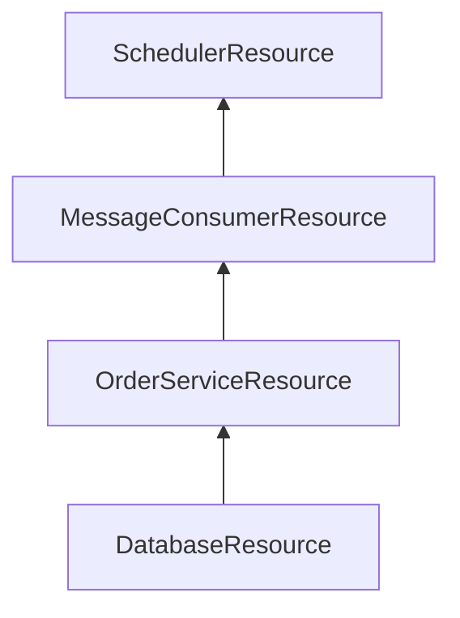

# Testing Resource Registration Order, Dependencies, and Lifecycle

In CRaC (Coordinated Restore at Checkpoint), an application can register multiple `Resource` instances to prepare resources before checkpointing and recover them after restore. When resources depend on one another, registration order directly determines callback order. If the database pool has not yet recovered when the message consumer starts receiving messages, the consumer may process work while its dependency is unready. If the consumer has not stopped yet when the database pool closes, an in-flight message may fail.

Therefore, CRaC testing must verify three aspects: resources are registered exactly once into the proper context; callback order reflects dependency relationships; and each resource traverses the prepare, close, restore, and reopen lifecycle safely. Unit tests verify the logic of each resource and the registration plan. Integration tests with a CRaC JDK and a real checkpoint/restore environment confirm the actual order dispatched by the runtime.

## 1. Resource Lifecycle in CRaC

A class implementing `org.crac.Resource` provides two callbacks:

```java
void beforeCheckpoint(Context<? extends Resource> context)
        throws Exception;

void afterRestore(Context<? extends Resource> context)
        throws Exception;
```

`beforeCheckpoint` is called when the JVM prepares to create a checkpoint. The resource must bring the resources it owns to a safe state, such as stopping acceptance of new work, flushing data, completing active operations, and closing connections that cannot persist across checkpoint.

`afterRestore` is called when the process is recovered. The resource recreates or validates resources, reconnects to external services, and permits usage only once dependencies are ready.

For resources registered in the same `Context`, CRaC's standard orchestration rule is:

- `beforeCheckpoint`: callbacks are invoked in reverse registration order.
- `afterRestore`: callbacks are invoked in registration order.

This rule enables expressing dependencies via registration order: register dependencies first, and dependent components afterward. On checkpoint, dependents stop first; on restore, dependencies recover first.

Example:

```java
Core.getGlobalContext().register(databaseResource);
Core.getGlobalContext().register(orderServiceResource);
Core.getGlobalContext().register(messageConsumerResource);
```

Expected order:

| Phase | Callback Order |
| --- | --- |
| Before checkpoint | `messageConsumer` → `orderService` → `database` |
| After restore | `database` → `orderService` → `messageConsumer` |

In the example, `orderService` needs the database; the consumer needs the order service. When preparing to checkpoint, the consumer stops receiving messages first, the order service finishes dependent activity, and only then does the database pool close. On restore, the database becomes ready before the order service and consumer.

## 2. Expressing Dependencies as Registration Order

Before writing tests, draw the dependency graph of your resources. Arrows should represent the relationship "A requires B to operate."



With this graph, registration order is dependencies first, dependents afterward:

```text
1. DatabaseResource
2. OrderServiceResource
3. MessageConsumerResource
4. SchedulerResource
```

On checkpoint, the order is reversed to stop work-generating sources and upper components first. On restore, registration order ensures dependencies are recovered before the components using them.

### 2.1. The Dependency-First Registration Rule

If `A` depends on `B`, register `B` before `A`:

```java
context.register(databaseResource);  // Dependency
context.register(repositoryResource); // Uses database
context.register(serviceResource);    // Uses repository
context.register(consumerResource);   // Calls service
```

Do not sort by class name, bean creation order, or package appearance order. Ordering must originate from actual runtime dependencies.

### 2.2. Independent Dependencies

If two resources do not depend on each other, their relative order typically does not affect correctness. However, still choose a deterministic order so logs, tests, and operations remain predictable. Do not rely on `HashSet` iteration order, reflection, or discovery mechanisms without an ordering contract.

### 2.3. Circular Dependencies

If A needs B while B also needs A to stop or recover, a simple linear registration order cannot resolve it. This is usually a sign that responsibilities should be separated or a resource coordinator should be introduced to manage the entire group.

The coordinator can stop the two components using an internal protocol, or split the lifecycle into explicit phases. Determine which operations genuinely require the dependency and which simply need to run after the whole group has stopped activity.

## 3. Defining Resource Ownership Boundaries

Each resource should have a clear lifecycle owner. For example, if `DatabaseResource` owns the connection pool, only that resource closes and recreates the pool. `OrderServiceResource` may stop accepting operations and verify database readiness, but it does not close the pool a second time on its own.

| Component | Appropriate Responsibility |
| --- | --- |
| `DatabaseResource` | Drain database operations, close pool, and recreate pool |
| `OrderServiceResource` | Stop new work, finish running logic, and verify service can use the database |
| `MessageConsumerResource` | Pause consumer, wait for in-flight messages, and resume after restore |
| `SchedulerResource` | Cancel new triggers, drain running jobs, and rebuild schedule after restore |
| `ResourceCoordinator` | Coordinate multiple resources when a shared synchronous workflow is needed |

Do not register the same underlying resource through multiple independent Resources if they both open/close the same object. Doing so can cause double-closing, creating duplicate clients, or launching duplicate listeners.

## 4. Structuring Registration for Testability

If every class independently calls `Core.getGlobalContext().register(this)` across many places, testing registration order becomes difficult. Registration can be centralized in a small component with an explicit order.

Example of a registration abstraction:

```java
import org.crac.Core;
import org.crac.Resource;

@FunctionalInterface
public interface ResourceRegistrar {
    void register(Resource resource);
}

public final class CracResourceRegistrar implements ResourceRegistrar {

    @Override
    public void register(Resource resource) {
        Core.getGlobalContext().register(resource);
    }
}
```

Application registry:

```java
import java.util.List;
import org.crac.Resource;

public final class ApplicationResourceRegistration {

    private final Resource database;
    private final Resource orderService;
    private final Resource messageConsumer;

    public ApplicationResourceRegistration(
            Resource database,
            Resource orderService,
            Resource messageConsumer) {
        this.database = database;
        this.orderService = orderService;
        this.messageConsumer = messageConsumer;
    }

    public void registerAll(ResourceRegistrar registrar) {
        List.of(database, orderService, messageConsumer)
                .forEach(registrar::register);
    }
}
```

In a real application, fields should use concrete types such as `DatabaseResource`, `OrderServiceResource`, and `MessageConsumerResource` to express dependencies. The example uses generic `Resource` to focus on registration order.

This abstraction creates an independent test seam: unit tests can pass a fake registrar and verify that resources are submitted in the exact order. In production, `CracResourceRegistrar` registers them into the global context.

## 5. Unit Testing Registration Order

Use JUnit 5 to test that the registry invokes the registrar in proper dependency order. This test does not need to launch a CRaC JVM.

```java
import static org.junit.jupiter.api.Assertions.assertEquals;

import java.util.ArrayList;
import java.util.List;

import org.crac.Resource;
import org.junit.jupiter.api.Test;

class ApplicationResourceRegistrationTest {

    @Test
    void registersDependenciesBeforeDependents() {
        Resource database = new NamedResource("database");
        Resource service = new NamedResource("service");
        Resource consumer = new NamedResource("consumer");

        ApplicationResourceRegistration registration =
                new ApplicationResourceRegistration(
                        database, service, consumer);

        List<Resource> registered = new ArrayList<>();
        registration.registerAll(registered::add);

        assertEquals(
                List.of(database, service, consumer),
                registered);
    }
}
```

`NamedResource` is a simple implementation used in tests. Tests can verify object identity to ensure the registry registers the exact instances managed by the application rather than creating replacement instances.

```java
import org.crac.Context;
import org.crac.Resource;

final class NamedResource implements Resource {

    private final String name;

    NamedResource(String name) {
        this.name = name;
    }

    @Override
    public void beforeCheckpoint(Context<? extends Resource> context) {
        // No operation needed in registration test.
    }

    @Override
    public void afterRestore(Context<? extends Resource> context) {
        // No operation needed in registration test.
    }

    String name() {
        return name;
    }
}
```

The unit test above verifies **the application's registration plan**. It does not yet confirm that the CRaC runtime actually invokes callbacks in that order. Runtime verification is performed in integration tests.

## 6. Testing Callback Order Using a Trace

To test the logic of each callback, a trace collector can record events. Each resource records its name and lifecycle phase.

```java
import java.util.List;
import java.util.concurrent.CopyOnWriteArrayList;

public final class LifecycleTrace {

    private final List<String> events = new CopyOnWriteArrayList<>();

    public void record(String event) {
        events.add(event);
    }

    public List<String> events() {
        return List.copyOf(events);
    }

    public void clear() {
        events.clear();
    }
}
```

A trace-recording resource:

```java
import org.crac.Context;
import org.crac.Resource;

public final class RecordingResource implements Resource {

    private final String name;
    private final LifecycleTrace trace;

    public RecordingResource(String name, LifecycleTrace trace) {
        this.name = name;
        this.trace = trace;
    }

    @Override
    public void beforeCheckpoint(Context<? extends Resource> context) {
        trace.record(name + ":beforeCheckpoint");
    }

    @Override
    public void afterRestore(Context<? extends Resource> context) {
        trace.record(name + ":afterRestore");
    }
}
```

For resources that do not use the `context` parameter, unit tests can call callbacks with `null`. If the implementation interacts with the context, use a test double or mock matching the `Context` API of the CRaC version in use.

### 6.1. Testing the Dispatch Model

You can simulate the dispatch rules over the registered list to verify the dependency plan:

```java
import java.util.List;
import org.crac.Resource;

final class LifecycleDispatchModel {

    static void beforeCheckpoint(List<Resource> registered)
            throws Exception {
        for (int i = registered.size() - 1; i >= 0; i--) {
            registered.get(i).beforeCheckpoint(null);
        }
    }

    static void afterRestore(List<Resource> registered)
            throws Exception {
        for (Resource resource : registered) {
            resource.afterRestore(null);
        }
    }
}
```

Test:

```java
import static org.junit.jupiter.api.Assertions.assertEquals;

import java.util.List;
import org.crac.Resource;
import org.junit.jupiter.api.Test;

class LifecycleDispatchModelTest {

    @Test
    void stopsDependentsFirstAndRestoresDependenciesFirst()
            throws Exception {
        LifecycleTrace trace = new LifecycleTrace();

        Resource database = new RecordingResource("database", trace);
        Resource service = new RecordingResource("service", trace);
        Resource consumer = new RecordingResource("consumer", trace);

        List<Resource> registered = List.of(database, service, consumer);

        LifecycleDispatchModel.beforeCheckpoint(registered);
        assertEquals(List.of(
                "consumer:beforeCheckpoint",
                "service:beforeCheckpoint",
                "database:beforeCheckpoint"), trace.events());

        trace.clear();
        LifecycleDispatchModel.afterRestore(registered);
        assertEquals(List.of(
                "database:afterRestore",
                "service:afterRestore",
                "consumer:afterRestore"), trace.events());
    }
}
```

This test verifies the ordering model expected by the application. Because it invokes callbacks directly according to the modeled rule, it does not replace integration tests with `Core.getGlobalContext()` and a real CRaC JVM.

## 7. Testing Resource State and Idempotency

Correct order alone is still insufficient if the resource's callbacks do not manage state safely. Each resource needs its own state machine or an equivalent state contract.

Example database resource with states:

```text
OPEN -> QUIESCING -> CLOSED -> RESTORING -> OPEN
                         \-> FAILED
```

Invariants to check:

- Accept no new operations after quiescing begins.
- Close the pool only after running operations have finished.
- `afterRestore` opens the resource only after the new pool is created and verified.
- If pool creation fails, the resource remains in an error state and disallows access.
- The resource is never closed or opened multiple times outside the lifecycle contract.

Example of a simple resource where a factory can be injected so unit tests need no real database:

```java
import org.crac.Context;
import org.crac.Resource;

public final class DatabaseResource implements Resource {

    public interface Pool {
        void close() throws Exception;
        void verify() throws Exception;
    }

    @FunctionalInterface
    public interface PoolFactory {
        Pool create() throws Exception;
    }

    private final PoolFactory factory;
    private Pool pool;
    private boolean open;

    public DatabaseResource(PoolFactory factory) throws Exception {
        this.factory = factory;
        this.pool = factory.create();
        this.pool.verify();
        this.open = true;
    }

    @Override
    public synchronized void beforeCheckpoint(
            Context<? extends Resource> context) throws Exception {
        if (!open) {
            throw new IllegalStateException("Database is not open");
        }

        pool.close();
        pool = null;
        open = false;
    }

    @Override
    public synchronized void afterRestore(
            Context<? extends Resource> context) throws Exception {
        if (open) {
            throw new IllegalStateException("Database is already open");
        }

        Pool restored = factory.create();
        try {
            restored.verify();
            pool = restored;
            open = true;
        } catch (Exception ex) {
            try {
                restored.close();
            } catch (Exception closeFailure) {
                ex.addSuppressed(closeFailure);
            }
            throw ex;
        }
    }

    public synchronized boolean isOpen() {
        return open;
    }
}
```

This is a simplified example to illustrate a test seam. In a real application, you need an operation gate and draining of in-flight operations using the pool before closing. `synchronized` in the example only protects simple state transitions; it does not replace mechanisms managing active requests or transactions.

### 7.1. Testing Successful Close and Recovery

```java
import static org.junit.jupiter.api.Assertions.assertFalse;
import static org.junit.jupiter.api.Assertions.assertTrue;

import org.junit.jupiter.api.Test;

class DatabaseResourceTest {

    @Test
    void closesBeforeCheckpointAndRecreatesAfterRestore() throws Exception {
        FakePoolFactory factory = new FakePoolFactory();
        DatabaseResource resource = new DatabaseResource(factory);

        assertTrue(resource.isOpen());

        resource.beforeCheckpoint(null);
        assertFalse(resource.isOpen());
        assertEquals(1, factory.createdCount());
        assertEquals(1, factory.closedCount());

        resource.afterRestore(null);
        assertTrue(resource.isOpen());
        assertEquals(2, factory.createdCount());
        assertEquals(1, factory.closedCount());
    }
}
```

`FakePoolFactory` is a test double counting how many times pools are created, closed, and verified. Assertions catch cases where a resource is not recreated or is closed the wrong number of times.

### 7.2. Testing Recovery Failures

The fake factory can throw an exception on the second creation. Tests must verify:

- `afterRestore` propagates the error to the caller.
- The resource does not report `open=true`.
- Any partially created pool is closed if possible.
- The application keeps readiness in a traffic-rejecting state.

Never catch the exception and proceed as if restore succeeded. A failed resource must stay unusable until handled by the lifecycle manager.

## 8. Testing Dependency Order with Observable Conditions

A dependency test should not check only a list of callback names. It should verify the actual condition a callback requires at execution time.

For example, `OrderServiceResource.afterRestore` is allowed to complete only if the database is open. `MessageConsumerResource.afterRestore` is allowed to resume only if the order service is ready.

```java
public final class OrderServiceResource implements Resource {

    private final DatabaseResource database;
    private boolean ready;

    public OrderServiceResource(DatabaseResource database) {
        this.database = database;
    }

    @Override
    public void beforeCheckpoint(Context<? extends Resource> context) {
        ready = false;
    }

    @Override
    public void afterRestore(Context<? extends Resource> context) {
        if (!database.isOpen()) {
            throw new IllegalStateException(
                    "Database must be restored before order service");
        }
        ready = true;
    }

    public boolean isReady() {
        return ready;
    }
}
```

Consumer checks service:

```java
public final class MessageConsumerResource implements Resource {

    private final OrderServiceResource orderService;
    private boolean running;

    public MessageConsumerResource(OrderServiceResource orderService) {
        this.orderService = orderService;
    }

    @Override
    public void beforeCheckpoint(Context<? extends Resource> context) {
        running = false;
    }

    @Override
    public void afterRestore(Context<? extends Resource> context) {
        if (!orderService.isReady()) {
            throw new IllegalStateException(
                    "Order service must be ready before consumer resumes");
        }
        running = true;
    }

    public boolean isRunning() {
        return running;
    }
}
```

In the example, dependencies are checked with simple state flags. A real system should verify actual functionality: acquiring a connection, running a validation query, verifying the broker, or checking listeners. Checking only a boolean flag set by the resource itself can fail to detect that the dependency lost connectivity.

## 9. Testing Duplicate Registration and Unregistration

Registering a resource twice or registering the same underlying resource through multiple owners can cause callbacks to execute multiple times or lead to repeated closing/opening. Registration should be controlled at a centralized point.

Cases to test:

- `registerAll()` is not invoked twice within the same lifecycle.
- Each resource instance is registered exactly once.
- A replaced resource is unregistered when the old lifecycle ends.
- An unregistered resource no longer participates in the next checkpoint cycle.
- Unregistration does not happen merely because a resource temporarily closes in `beforeCheckpoint`; the resource still needs to receive `afterRestore`.

If the application performs dynamic registration/unregistration, tie those operations to component lifecycles and ensure the registry is not mutated arbitrarily while CRaC is dispatching callbacks. Verify `register`/`unregister` behavior against the API version in use.

An application registry can enforce once-only registration:

```java
import java.util.Collections;
import java.util.IdentityHashMap;
import java.util.Set;
import org.crac.Resource;

public final class OnceOnlyRegistrar implements ResourceRegistrar {

    private final ResourceRegistrar delegate;
    private final Set<Resource> registered =
            Collections.newSetFromMap(new IdentityHashMap<>());

    public OnceOnlyRegistrar(ResourceRegistrar delegate) {
        this.delegate = delegate;
    }

    @Override
    public synchronized void register(Resource resource) {
        if (!registered.add(resource)) {
            throw new IllegalStateException(
                    "Resource instance was registered more than once");
        }
        delegate.register(resource);
    }
}
```

An identity-based set distinguishes specific instances rather than relying on `equals()`. In production, handle the case where `delegate.register()` throws an exception: the registry should roll back the newly added entry so a retry is not erroneously blocked. Also add `unregister` if the application has dynamic resource lifecycles.

## 10. Testing Errors and Timeouts in Callbacks

Callbacks can fail when a resource cannot close or recover. Tests must verify that errors propagate upward and application state is not falsely marked as successful.

### 10.1. Pre-Checkpoint Errors

For example, a database pool cannot close because operations remain active. `beforeCheckpoint` must report an error. Never continue treating the resource as `CLOSED` if the pool is still open or its state is indeterminate.

Tests should verify:

- The exception from the resource propagates out of the callback.
- The coordinator does not report checkpoint preparation as successful.
- Readiness keeps rejecting traffic until the resource is verified.
- If rollback exists, rollback fully restores partially closed resources.

Do not write tests assuming every CRaC implementation continues or halts dispatching remaining resources identically when one callback throws an exception, unless the specific runtime documentation explicitly defines it. Assert the overall result: the checkpoint fails and the application never enters an unsafe serving state.

### 10.2. Post-Restore Errors

If the database is recreated yet the broker client cannot connect, readiness must continue rejecting traffic if the broker is a mandatory dependency. The callback should propagate the error or report failed recovery state per design.

If an optional resource fails, the application may serve partial functionality if the readiness policy allows it. The policy must be explicitly defined rather than silently ignoring all exceptions.

### 10.3. Timeouts

Draining may wait for running operations. Tests should use latches or controllable fakes to verify:

- The callback waits while operations remain active.
- When operations finish, the callback proceeds.
- When timeout expires, the callback fails.
- Dependencies are never closed while operations are still using them.
- Cancel/rollback mechanisms reopen admission only if the resource was not closed or has already been safely recovered.

Do not use long `Thread.sleep()` calls for test synchronization when `CountDownLatch`, `CyclicBarrier`, or `CompletableFuture` can control timing deterministically.

## 11. Testing Multiple Checkpoint/Restore Cycles

A resource can undergo multiple cycles within a single deployment lifetime. Do not test only a single `beforeCheckpoint` and a single `afterRestore`.

Example cycle:

```text
OPEN
  -> beforeCheckpoint
CLOSED
  -> afterRestore
OPEN
  -> beforeCheckpoint
CLOSED
  -> afterRestore
OPEN
```

Tests should verify:

- After a successful restore, the resource returns to an operational state.
- The next checkpoint cycle can begin normally.
- No references to old connections/clients are retained.
- No extra duplicate resource is registered on each restore unless intended.
- Callbacks do not double-close or double-initialize the same resource.
- Counters, leases, and admission state are properly reset.

If a callback fails, state must transition to error or controlled recovery; never allow the next cycle to execute on a state machine in an indeterminate state.

## 12. How Unit Tests and Integration Tests Differ

Unit tests and integration tests serve different purposes:

| Test Type | What It Can Verify | What It Cannot Prove |
| --- | --- | --- |
| Resource unit tests | Open/close logic, state transitions, timeouts, exceptions, and operation gates | Real CRaC runtime callback dispatch |
| Registrar unit tests | Ordering and identity of registered resources | In what order the runtime context invokes callbacks |
| Dispatch model tests | Expected callback plan per modeled rules | Whether real JDK/CRIU performs correctly in deployment environment |
| CRaC integration tests | Real callback order dispatched by runtime, checkpointing, and restoring | That all production scenarios or all kernels/containers are compatible |
| End-to-end tests | Resources, readiness, requests, and dependencies after restore | Correctness under all untested loads or environments |

Do not treat callback-simulating unit tests as final proof for CRaC. They are very helpful for catching logic errors quickly, whereas integration tests must run on a CRaC JDK and a supported operating system environment.

## 13. Integration Testing with a Real CRaC JVM

To verify actual dispatch order, build a small program registering two or three resources into `Core.getGlobalContext()`. Each callback appends a line to an out-of-heap trace file, opening and closing the file on each write so data is flushed.

Example trace-writing resource:

```java
import java.io.IOException;
import java.nio.file.Files;
import java.nio.file.Path;
import java.nio.file.StandardOpenOption;

import org.crac.Context;
import org.crac.Resource;

public final class FileTraceResource implements Resource {

    private final String name;
    private final Path traceFile;

    public FileTraceResource(String name, Path traceFile) {
        this.name = name;
        this.traceFile = traceFile;
    }

    private void append(String event) throws IOException {
        Files.writeString(
                traceFile,
                event + System.lineSeparator(),
                StandardOpenOption.CREATE,
                StandardOpenOption.WRITE,
                StandardOpenOption.APPEND);
    }

    @Override
    public void beforeCheckpoint(Context<? extends Resource> context)
            throws Exception {
        append(name + ":beforeCheckpoint");
    }

    @Override
    public void afterRestore(Context<? extends Resource> context)
            throws Exception {
        append(name + ":afterRestore");
    }
}
```

Probe application registering in dependency order:

```java
import java.nio.file.Path;
import org.crac.Core;

public final class CracResourceOrderProbe {

    public static void main(String[] args) throws Exception {
        Path trace = Path.of(System.getenv("CRAC_TRACE_FILE"));

        Core.getGlobalContext().register(
                new FileTraceResource("database", trace));
        Core.getGlobalContext().register(
                new FileTraceResource("service", trace));
        Core.getGlobalContext().register(
                new FileTraceResource("consumer", trace));

        System.out.println("CRAC resource order probe is ready");
        System.out.flush();

        while (true) {
            Thread.sleep(1_000);
        }
    }
}
```

Run the probe using the exact CRaC JDK in a compatible Linux/CRIU environment. Example general command:

```bash
export CRAC_TRACE_FILE=/tmp/crac-resource-order.log
mkdir -p /tmp/crac-resource-checkpoint

java -XX:CRaCCheckpointTo=/tmp/crac-resource-checkpoint \
  -cp target/classes CracResourceOrderProbe
```

In another terminal, find the PID and request a checkpoint:

```bash
jcmd -l
jcmd <pid> JDK.checkpoint
```

After checkpointing completes, inspect the trace. The expected order before checkpoint is:

```text
consumer:beforeCheckpoint
service:beforeCheckpoint
database:beforeCheckpoint
```

Restore using the exact JDK and launch method supported by your CRaC distribution's documentation. On JDK builds with common restore options, the command takes the form:

```bash
java -XX:CRaCRestoreFrom=/tmp/crac-resource-checkpoint
```

After restore, expected trace:

```text
database:afterRestore
service:afterRestore
consumer:afterRestore
```

An out-of-heap trace file makes both the pre-checkpoint and post-restore phases observable. In real tests, create a fresh trace file per run to avoid mixing results across attempts.

### 13.1. Conditions for Integration Tests

Integration tests must record:

- JDK vendor, version, and build.
- CRIU version and environment check results.
- Kernel, architecture, and container configuration.
- Resource registration order.
- PID before checkpoint and process information after restore.
- Pre- and post-restore callback logs.
- Checkpoint creation and restore results.
- Readiness and dependency connections after restore.

Do not run this test in a production environment serving live traffic. Use a test VM or container with appropriate permissions and kernel capabilities.

## 14. Testing Real Dependencies Instead of Log Order Alone

A trace in the right order does not prove a dependent resource is ready. Integration tests should add dependency verification conditions.

Examples:

- Database callback after restore creates a new pool and runs a validation query.
- Service callback then confirms the repository can reach the database.
- Consumer callback finally connects to the broker, authenticates, and resumes only when the service is ready.

Tests should record both start and completion timestamps of each callback:

```text
database:afterRestore:start
database:afterRestore:verified
service:afterRestore:start
service:afterRestore:ready
consumer:afterRestore:start
consumer:afterRestore:resumed
```

If `consumer:afterRestore:start` appears before `service:afterRestore:ready`, the test must fail. Events can be written to a file, structured logs, or a test event collector. What matters is observing the milestone when the dependency actually becomes ready, not merely that the callback was entered.

## 15. Intentional Failure Testing

A good test suite must verify that the application rejects traffic when restoration is incomplete.

Scenarios:

| Scenario | Expected Outcome |
| --- | --- |
| Database fails to close before checkpoint | Checkpoint preparation fails; resource is not marked closed |
| Consumer fails to drain | Database is not closed while consumer still uses it |
| Database restore fails | Service and consumer are not marked ready |
| Service restore fails | Consumer does not resume |
| Consumer fails to connect to broker | Readiness keeps rejecting if consumer is a mandatory dependency |
| Callbacks invoked out of order in test harness | Dependency assertion fails immediately |
| Resource registered twice | Registrar rejects it or test detects duplicate callbacks |
| Unregistered resource | Does not participate in next cycle per context policy |
| Drain timeout | Does not proceed with checkpoint as if quiesced |
| Second restore succeeds | Resource reopens once for the new cycle |

Do not simulate failures by altering runtime callback ordering in production. Use fakes, test harnesses, or controllable integration environments to inject failures deterministically.

## 16. Testing Coordinators with Many Resources

When the number of resources grows large, a coordinator can manage dependency groups. A coordinator needs an explicit plan:

1. Stop producers at the outermost layer.
2. Drain already-accepted operations.
3. Close dependencies in dependency order.
4. After restore, recover dependencies first.
5. Verify middle-tier services.
6. Resume outermost producers.

If the coordinator is the sole Resource registered for the group, child resources should not also register individually with the global context and receive the same callbacks a second time. If each resource registers individually, do not have the coordinator invoke their callbacks again. Choose a single ownership model.

Coordinator tests should verify:

- Shutdown and restore ordering.
- A failure at an intermediate step does not let subsequent steps proceed as if successful.
- Cleanup or rollback runs according to policy.
- Readiness opens only after all mandatory resources are ready.
- The coordinator does not stay in `READY` state after a dependency transitions to `FAILED`.

## 17. Testing with the Spring Boot Lifecycle

In a Spring Boot application, resources may be registered via bean lifecycles, a CRaC integration configuration, or a dedicated initialization component. Identify precisely when beans are created and registered.

Points to check:

- Resources are already created before a checkpoint is requested.
- Dependency injection has finished before registration.
- No critical lazy bean is created only after checkpoint.
- A resource is not registered multiple times due to a listener receiving multiple application events.
- Upon context shutdown, resources are unregistered or cleaned up according to ownership.
- `afterRestore` does not open readiness before required beans and dependencies are ready.

Spring integration tests can verify bean wiring and registrar ordering, yet those tests still do not substitute for restoring a real JVM. If a framework or library already provides CRaC integration, identify which resources the framework owns to avoid duplicate registration.

## 18. Observing and Diagnosing Callback Order

Callback logs should contain the resource name, lifecycle phase, timestamp, and correlation/release ID. Example:

```text
2026-11-13T07:00:00Z release=281 resource=consumer phase=beforeCheckpoint
2026-11-13T07:00:01Z release=281 resource=service phase=beforeCheckpoint
2026-11-13T07:00:02Z release=281 resource=database phase=beforeCheckpoint
2026-11-13T07:00:10Z release=281 resource=database phase=afterRestore
2026-11-13T07:00:11Z release=281 resource=service phase=afterRestore
2026-11-13T07:00:12Z release=281 resource=consumer phase=afterRestore
```

Useful metrics:

- Number of registered resources.
- Callback duration per resource and phase.
- Number of callback failures.
- Drain duration per resource.
- Active operations when callback starts.
- Time from restore until each dependency is ready.
- Time from final callback until readiness starts accepting.

Do not log connection strings, passwords, tokens, or business payloads in lifecycle logs. Resource names and states suffice to diagnose ordering in most cases.

## 19. Recommended Test Matrix

Tests can be organized by layer to isolate defects quickly:

| Layer | Scope | Appropriate Frequency |
| --- | --- | --- |
| Resource unit tests | State transitions, close/recreate, timeouts, and failures | On every change to resource code |
| Registrar unit tests | Ordering, identity, and duplicate registration | On every change to resource configuration |
| Dispatch model tests | Dependency ordering and expected trace | On every change to dependency graph |
| Spring integration tests | Bean lifecycle, wiring, and readiness policy | On every change to framework integration |
| CRaC integration tests | Checkpoint/restore and runtime callback order | On every release or JDK/CRaC change |
| End-to-end tests | Real dependencies, readiness, and post-restore requests | Prior to release promotion |

There is no need to run CRIU integration tests for every small unit change if the pipeline is tiered; however, any change to the JDK, CRaC distribution, dependency lifecycle, or container configuration requires corresponding runtime testing.

## 20. Conclusion

Testing `Resource` registration order, dependencies, and lifecycle must start from the dependency graph. Register dependencies first and dependent components afterward; CRaC invokes `beforeCheckpoint` in reverse order and `afterRestore` in registration order within the same context. Consequently, dependent components stop first and resume only after dependencies have recovered.

Unit tests should verify registration plans, state transitions, failures, timeouts, duplicate registration, and multiple lifecycle cycles. Integration tests with a CRaC JDK and compatible environment must verify actual callback order, successful checkpoint/restore, and genuine dependency readiness. A properly ordered trace is useful evidence; the final confirmation must still verify that resources can serve traffic and that readiness opens only once all mandatory dependencies have recovered.
