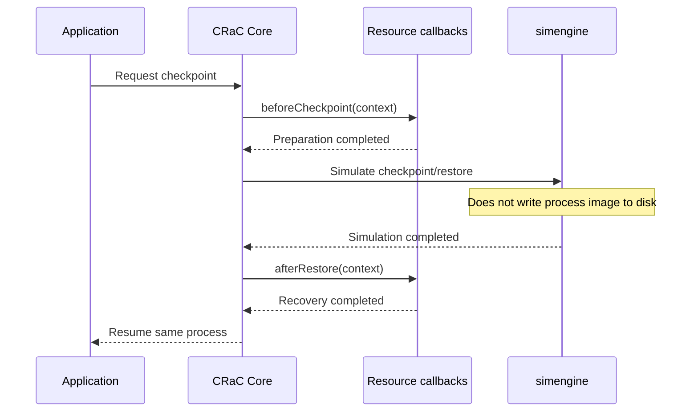
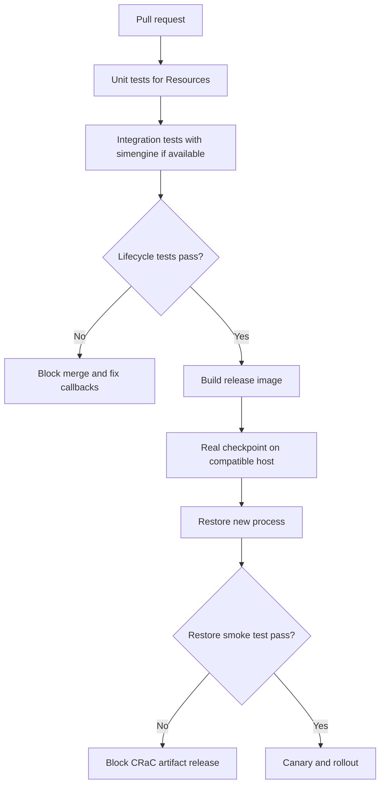

# Simulated Testing with `simengine` When Supported by the Build

`simengine` is a simulated checkpoint engine included in some CRaC builds. It lets developers test the checkpoint/restore coordination cycle on machines that cannot create real process images. When the application requests a checkpoint, the simulated engine invokes `beforeCheckpoint(...)` and then `afterRestore(...)` on registered `Resource` instances. The cycle runs inside the same process and writes no checkpoint image to disk.

This is very useful when developing and testing lifecycle logic: does the application close its admission gate, drain work, flush and close resources, recreate clients after restore, and put readiness in the proper state? If a callback lacks coordination or leaves a resource in an invalid state, bugs can surface on a developer's machine without requiring a Linux environment with checkpoint privileges.

However, `simengine` does not snapshot memory and does not test recovery of the kernel, file descriptors, sockets, native threads, namespaces, or CPU. It creates no deployable artifact and does not prove that a real checkpoint will restore. Therefore, use it as a fast testing layer for CRaC code, and still run smoke tests with a real checkpoint engine in a compatible environment.

## 1. Where Does `simengine` Fit in the CRaC Architecture?

CRaC separates the application coordination contract from the checkpoint execution mechanism. The CRaC API notifies the application that a checkpoint is about to occur and when the process has been restored. The engine handles creating the image and recovering the process.

In OpenJDK CRaC builds, two engines are commonly mentioned:

| Engine | Role | Characteristics |
|---|---|---|
| `criuengine` | Performs real checkpoint/restore via CRIU on Linux | Creates process images; requires compatible kernel, CRIU, and permissions/capabilities |
| `simengine` | Simulates the checkpoint/restore cycle | Invokes callbacks inside the same process, writes no image to disk |

Some vendor builds may provide custom engines or have different support matrices. Which engine is available depends on the **JDK build**, not merely on whether the application added the CRaC API. Therefore, never assume every JDK having `jdk.crac` or `org.crac` supports `simengine`.

You can select an engine with the JVM option:

```text
-XX:CRaCEngine=simengine
```

The checkpoint path is configured with `-XX:CRaCCheckpointTo=...`. With `simengine`, this path does not represent a process image written to disk; some builds require this option to enable checkpointable mode even though the simulated engine does not use the path contents.

## 2. How Does the Simulation Cycle Work?

With a real checkpoint, the runtime prepares resources, the engine captures process state, and then a restore run continues from the image. With `simengine`, the engine simulates application coordination without creating a process image:

1. The application starts on a CRaC-enabled JDK that has `simengine`.
2. The application registers `Resource` instances with a CRaC context.
3. A command or API call requests a checkpoint.
4. The engine calls `beforeCheckpoint(...)` so resources prepare state.
5. The engine simulates completing the cycle and calls `afterRestore(...)`.
6. The application continues running in the same process.



The important point is that `simengine` still executes the application's callback code. It is not a mode that bypasses the CRaC lifecycle. A resource that fails to close files, stop workers, or recreate clients can still expose errors during simulation if its callback logic detects invalid state.

Conversely, the engine performs no real snapshot. If callbacks succeed, it shows only that coordination code ran through the simulated cycle; it does not show whether the kernel can save full process state or restore an image on another host.

## 3. Verifying That a Build Supports `simengine`

Before writing tests, identify the exact JDK running. Check at a minimum:

- JDK vendor/distribution.
- Full version and build number.
- Platforms supported by that build.
- Whether `simengine` is included in the build.
- CRaC options required by the build.

Do not merely check that `java -version` contains the word CRaC and conclude the engine is present. A runtime may support the CRaC API and the real engine without packaging the simulated engine; a vendor build may also have different default engines per OS.

### Quick Verification Using the Startup Option

Start a small program or test application with the specified engine:

```bash
java \
  -XX:CRaCEngine=simengine \
  -XX:CRaCCheckpointTo=./simulated-checkpoint \
  -jar app.jar
```

If the build lacks the requested engine, the JVM fails at startup rather than waiting until the application has done substantial work. This catches an unsuitable build early.

Some runtimes may require different options or invocation styles. Consult the documentation of the exact vendor/build. On builds supporting `-XX:CRaCEngineOptions=help`, that option can show engine options exposed by the runtime:

```bash
java -XX:CRaCEngine=simengine -XX:CRaCEngineOptions=help
```

Do not assume every build supports the same set of engine options. If the help command is unsupported or meaningless for this engine, rely on runtime documentation and startup tests.

### Testing on Windows or macOS

Some CRaC builds for Windows/macOS provide `simengine` for testing callbacks where the operating system does not perform real checkpoints the way CRIU does on Linux. This is the typical situation where the simulated engine helps.

Results on Windows/macOS do not prove the application can perform real checkpoint/restore on Linux. When moving toward deployment, still test with the real engine and target environment.

## 4. Launching and Triggering the Simulation Cycle

Configuring `-XX:CRaCEngine=simengine` alone does not automatically execute callbacks at JVM startup. The application still needs an operation requesting a checkpoint through a mechanism supported by the runtime.

A manual workflow usually uses two terminals.

**Terminal 1 — Start the application:**

```bash
java \
  -XX:CRaCEngine=simengine \
  -XX:CRaCCheckpointTo=./simulated-checkpoint \
  -jar app.jar
```

**Terminal 2 — Request simulated checkpoint:**

```bash
jcmd -l
jcmd <pid> JDK.checkpoint
```

Replace `<pid>` with the PID of the test JVM. Command names and attach behavior depend on the build. Some implementations also allow requesting a cycle from inside the application via `Core.checkpointRestore()`.

Example API call inside a test or internal test hook:

```java
import jdk.crac.Core;

public final class SimulationTrigger {
    private SimulationTrigger() {
    }

    public static void runCycle() throws Exception {
        Core.checkpointRestore();
    }
}
```

This example uses the `jdk.crac` API of the CRaC JDK. If the application uses `org.crac`, follow the corresponding library and runtime API. Never expose a checkpoint trigger endpoint publicly to users; expose it only through a test harness or a protected internal admin channel.

After requesting a checkpoint, observe application logs to confirm callbacks ran. Do not rely solely on `Command executed successfully` from `jcmd`: depending on the implementation, attach tool output may not reflect all errors occurring inside the process. Inspect logs, exceptions, and application state.

## 5. Writing a Small Resource to Observe Callbacks

A simple probe resource confirms that `beforeCheckpoint` and `afterRestore` are called in the right cycle.

```java
import java.util.concurrent.atomic.AtomicInteger;

import jdk.crac.Context;
import jdk.crac.Resource;

public final class SimulationProbe implements Resource {
    private final AtomicInteger beforeCount = new AtomicInteger();
    private final AtomicInteger afterCount = new AtomicInteger();

    @Override
    public void beforeCheckpoint(Context<? extends Resource> context) {
        int count = beforeCount.incrementAndGet();
        System.out.println("beforeCheckpoint count=" + count);
    }

    @Override
    public void afterRestore(Context<? extends Resource> context) {
        int count = afterCount.incrementAndGet();
        System.out.println("afterRestore count=" + count);
    }

    public int beforeCount() {
        return beforeCount.get();
    }

    public int afterCount() {
        return afterCount.get();
    }
}
```

Register the resource once during application initialization:

```java
import jdk.crac.Core;

SimulationProbe probe = new SimulationProbe();
Core.getGlobalContext().register(probe);
```

After triggering one simulation cycle, logs are expected to show one message from each callback. Multiple cycles can be executed to inspect resource counters and state.

The example above only proves callbacks were invoked. In a real application, `Resource` must execute actual lifecycle work such as draining tasks, closing connections, and recreating dependencies. Never leave production code merely logging inside callbacks and consider it CRaC-ready.

## 6. Testing State Transitions Instead of Logs Alone

A good test confirms application state before, during, and after the cycle. For example, a resource can use a simple state machine:

```java
import java.util.concurrent.atomic.AtomicReference;

import jdk.crac.Context;
import jdk.crac.Resource;

final class LifecycleStateResource implements Resource {
    enum State {
        RUNNING,
        PREPARING
    }

    private final AtomicReference<State> state =
            new AtomicReference<>(State.RUNNING);

    @Override
    public void beforeCheckpoint(Context<? extends Resource> context) {
        if (!state.compareAndSet(State.RUNNING, State.PREPARING)) {
            throw new IllegalStateException(
                    "Cannot prepare from state " + state.get()
            );
        }
        stopAcceptingWork();
        drainWork();
        closeCheckpointSensitiveResources();
    }

    @Override
    public void afterRestore(Context<? extends Resource> context) {
        if (state.get() != State.PREPARING) {
            throw new IllegalStateException(
                    "Restore callback ran in unexpected state " + state.get()
            );
        }
        recreateResources();
        verifyDependencies();
        state.set(State.RUNNING);
        resumeAcceptingWork();
    }

    private void stopAcceptingWork() { /* application code */ }
    private void drainWork() { /* application code */ }
    private void closeCheckpointSensitiveResources() { /* application code */ }
    private void recreateResources() { /* application code */ }
    private void verifyDependencies() { /* application code */ }
    private void resumeAcceptingWork() { /* application code */ }
}
```

The methods in this example are placeholders for application logic. In real code, handle exceptions, timeouts, and rollbacks for each operation. `afterRestore` should open the admission gate only after every mandatory dependency has recovered.

With `simengine`, you can observe the code transitioning from `RUNNING` to `PREPARING`, executing recovery, and returning to `RUNNING`. In a real process after restore, objects are recovered from the snapshot; with the simulated engine, objects remain inside the same process. Thus, this test validates state transition logic but does not test object-graph recovery from a real image.

## 7. Application Areas to Test with `simengine`

`simengine` is especially effective for testing parts controlled by the application:

### Resource Registration and Orchestration

- Is the Resource registered into the right CRaC context?
- Are callbacks invoked when checkpointing is requested?
- Does each resource finish preparation work before returning from the callback?
- Does the coordinator handle dependencies among resources?
- Is any resource registered twice, causing callbacks to run unexpectedly multiple times?

### Stopping and Resuming Work

- Does the admission gate close prior to draining?
- Are running requests/tasks awaited until completion?
- Do schedulers/consumers stop creating new work?
- After restore callbacks, are triggers restarted at the right moment?
- Do async tasks hold leases or state preventing drain counters from reaching zero?

### External Resources

- Are connection pools closed or prepared per lifecycle?
- Are HTTP clients, message clients, and registry clients recreated?
- Are credentials, DNS, and endpoints re-read after restore?
- Are logging/metrics/tracing exporters flushed and reinitialized when needed?
- Does readiness transition to accepting only after dependencies are healthy?

### Errors and Edge States

- Does the callback report an error if draining or closing resources fails?
- Are timeouts enforced rather than waiting indefinitely?
- Do resources handle unexpected states?
- Can multiple consecutive simulation cycles run without double-closing or double-registering?
- Does a failed preparation attempt leave the application in an unrecoverable state?

These tests can run frequently in unit/integration test suites and on developer workstations, provided the build includes the simulated engine.

## 8. Example of Testing Multiple Consecutive Cycles

One successful simulation run is insufficient to catch resources that work only the first time. Run multiple cycles to detect bugs such as double-closing, failing to reopen connections, keeping a stale `isClosed` flag, or re-registering the same listener.

Manual scenario:

1. Start the application with `simengine`.
2. Trigger one checkpoint/restore cycle.
3. Send a test request and verify the application works.
4. Trigger a second cycle.
5. Send another request and verify dependencies remain ready.
6. Inspect callback counts, resource counts, and error logs.

A test harness can track invocation counts:

```java
final class LifecycleAssertions {
    static void assertCycleCounts(
            SimulationProbe probe,
            int expectedCycles) {
        if (probe.beforeCount() != expectedCycles) {
            throw new AssertionError("Unexpected beforeCheckpoint count");
        }
        if (probe.afterCount() != expectedCycles) {
            throw new AssertionError("Unexpected afterRestore count");
        }
    }
}
```

How cycles are triggered and how the `probe` reference is obtained depend on your test harness structure. If the application uses multiple JVM forks, static state in the test runner is not automatically shared across processes; verify state in the actual process running the engine.

## 9. Testing Exceptions Inside Callbacks

A resource can fail during `beforeCheckpoint` or `afterRestore`. Common situations:

- Unable to drain requests before timeout.
- Unable to close files/sockets or pools.
- Unable to flush mandatory data.
- Unable to recreate connections or credentials after restore.
- Dependency unavailable.
- A resource executes callbacks in an invalid state.

For `beforeCheckpoint`, errors must cause the checkpoint attempt to fail rather than allowing an image to be created when the application is unsafe. For `afterRestore`, recovery failures for essential resources must be clearly reported and readiness must remain closed.

`simengine` helps traverse callback branches and observe how the application handles exceptions. However, details of how exceptions are displayed or how the engine concludes the cycle may differ across runtimes. Inspect logs and process state on the build in use rather than asserting exact output strings from one vendor version.

A test should intentionally trigger controlled failures:

```java
import java.io.IOException;

import jdk.crac.Context;
import jdk.crac.Resource;

final class FailingResource implements Resource {
    private final boolean failBeforeCheckpoint;

    FailingResource(boolean failBeforeCheckpoint) {
        this.failBeforeCheckpoint = failBeforeCheckpoint;
    }

    @Override
    public void beforeCheckpoint(Context<? extends Resource> context)
            throws Exception {
        if (failBeforeCheckpoint) {
            throw new IOException("Simulated preparation failure");
        }
    }

    @Override
    public void afterRestore(Context<? extends Resource> context) {
        System.out.println("restore callback reached");
    }
}
```

The example needs imports for `java.io.IOException` and the corresponding CRaC types. Use a separate test process for callback failure cases to avoid corrupting state for other tests. Confirm that a checkpoint is never treated as successful if preparation failed.

## 10. Using `simengine` in Unit Tests and Integration Tests

It is not necessary to trigger the engine via terminal for every test. Testing can be layered:

| Test Level | How It Is Performed | Role of `simengine` |
|---|---|---|
| Unit test | Test each resource/coordinator with fake dependencies | Can test callback logic directly; running the engine is optional |
| In-JVM integration test | Run application with CRaC JDK and request checkpoint | `simengine` invokes callback cycle to test real coordination among beans |
| Multi-process integration test | Create checkpoint and launch new process from image | Requires real checkpoint engine; `simengine` is insufficient |
| Platform test | Run on exact deployment Linux/kernel/container/runtime/CPU | Requires real engine to confirm image creation and restore capability |
| Performance test | Measure checkpoint size, restore time, and time-to-ready | Never use `simengine` as real checkpoint performance metrics |

Unit tests should still test each resource independently because they make it easy to inject intentional errors and isolate root causes. Integration tests with `simengine` add verification that resources are registered and coordinated inside the real application.

## 11. Matrix: What `simengine` Tests and What It Does Not Test

| Item | Tested with `simengine` | Requires Real Checkpoint Engine |
|---|---|---|
| `beforeCheckpoint` is invoked | Yes | Can be reconfirmed in smoke tests |
| `afterRestore` is invoked | Yes | Can be reconfirmed in smoke tests |
| Application-authored resource open/close logic | Can test code paths and state transitions | Additional tests needed to confirm real OS resources are handled properly |
| Admission gate and drain | Yes | Yes, to verify interaction with real processes/traffic |
| Recreating clients with fake dependencies | Yes | Insufficient if real sockets/drivers must be verified |
| File descriptors saved/restored | No | Yes |
| TCP sockets and network namespaces | No | Yes |
| Native threads, signals, mutexes, and native memory | Cannot prove | Yes |
| CRIU privileges/capabilities and kernel compatibility | No | Yes |
| CPU feature compatibility | No | Yes |
| Checkpoint artifact created and loadable | No | Yes |
| Restore to a new process or another host | No | Yes |
| Image size and restore duration | Not representative | Yes |

Never elevate `simengine passed` into a claim that "the application is CRaC-ready for production." It is evidence of callback/lifecycle logic on the tested build, not evidence for the full native checkpoint/restore path.

## 12. Combining `simengine` with the Real Engine in CI

An effective pipeline can employ multiple testing layers:

### On Every Pull Request

- Compile with a JDK/build supporting the CRaC API.
- Run unit tests for each resource and lifecycle coordinator.
- If the runtime provides `simengine`, run simulated integration tests.
- Verify callbacks enforce timeouts and handle errors explicitly.
- Do not require OS checkpoint privileges for every developer or CI runner.

### Before Release

- Run the application image on a compatible Linux host.
- Use the real checkpoint engine, e.g., `criuengine` if that is the runtime's engine.
- Create a real checkpoint and verify the artifact is written completely.
- Launch a new process using the restore option.
- Confirm resources, databases, listeners, and telemetry work.
- Run smoke tests and check readiness.

### Before Broad Rollout

- Run on node pools matching production kernel, CPU, container runtime, and security profiles.
- Test multiple replicas restoring from the same checkpoint if the deployment scales out.
- Check networking, leases, identity, and dependency refresh.
- Measure time-to-ready and first-request latency.
- Retain cold-start fallback if required by policy.



If a build lacks `simengine`, you do not need to halt all development. Callback unit tests can invoke coordinator logic directly while reserving real-engine integration tests for dedicated runners. However, clearly document in the build report which tests ran and which did not.

## 13. Notes When Testing Across Different Builds

Engine names and options depend on the runtime distribution. Things to verify:

- `simengine` may exist in upstream CRaC and some vendor builds, but not every JDK packages it.
- Default engines may differ by operating system or vendor.
- How checkpoints are triggered via `jcmd` and attach permissions may vary.
- How callback exceptions and engine logs are displayed may differ.
- `CRaCCheckpointTo` may be required by configuration even when the simulated engine writes no image.
- Some builds include additional simulated engines or proprietary options; do not infer that they are upstream standards.

Clearly record in the CI report:

```text
JDK vendor: <vendor>
JDK version/build: <full build>
OS/architecture: <platform>
CRaC engine: simengine
Simulation trigger: <jcmd or API>
beforeCheckpoint callbacks: <count/result>
afterRestore callbacks: <count/result>
Result: <passed/failed>
```

Values in the template must be populated from an actual run. Do not report the engine as `simengine` if a test merely called callback methods directly without running the engine.

## 14. Avoiding Common Misconceptions

**`simengine` creates reusable checkpoint files.** No. The engine simulates the cycle and writes no process image to disk.

**Passing `simengine` tests proves CRIU can checkpoint.** No. It does not invoke CRIU to save process state and does not check kernel privileges.

**`afterRestore` is invoked in a different process.** Not with `simengine`; the simulated cycle occurs within the same process.

**If callbacks throw no exceptions, the application is CRaC-compatible.** Not sufficient. You still must test native resources, file descriptors, sockets, kernel, CPU, filesystem, and real restores.

**Every CRaC build supports `simengine`.** No. Available engines depend on the JDK build and vendor.

**Setting the JVM option makes callbacks run automatically.** Not necessarily. A checkpoint must still be requested via a command or API supported by the runtime.

**`simengine` can benchmark restore time.** No. Because it neither creates nor reads a process image, its timings do not represent checkpoint I/O or real restoration.

**If an app runs on Windows with `simengine`, its checkpoint can be deployed on Windows.** You cannot draw that conclusion. The results confirm only callback logic in that simulated build and environment; real checkpoint capability depends on supported engines/platforms.

## 15. Example Test Checklist for a Service

Suppose a service has an HTTP server, HikariCP, scheduled jobs, and OpenTelemetry. A simulated test cycle can verify:

1. Readiness transitions to refusing traffic.
2. Admission gate rejects new requests.
3. Scheduled jobs stop spawning new executions.
4. In-flight requests and transactions drain.
5. Pool is closed or moved into prepared state.
6. Trace batches and async logs flush within deadline.
7. `afterRestore` callback creates a new pool and verifies connectivity.
8. HTTP server lifecycle returns to ready state per application abstraction.
9. Telemetry exporter reopens and checks export capability.
10. Readiness switches back to accepting only after essential dependencies are healthy.
11. New requests succeed after the simulation cycle.
12. A second cycle executes without double-closing or duplicate registration.

Test results must state clearly that this is a simulation. Afterward, run the same scenario on the real engine to confirm sockets, pools, native state, and process images truly work.

## 16. When Should You Use `simengine`?

Use it when:

- Developers work on machines lacking real checkpoint permissions or capabilities.
- You want fast callback integration tests in CI.
- You want to test `beforeCheckpoint`/`afterRestore` logic without provisioning a CRIU host for every commit.
- You want to test resource coordinators, state transitions, timeouts, and exception paths.
- You want early detection of unregistered callbacks or resources failing to recover properly.

Do not rely on it as sole evidence when:

- Changing the JDK, kernel, CRIU, or native libraries.
- Changing file/socket/JNI/driver lifecycles.
- Changing container capabilities, mounts, or network namespaces.
- Releasing a new checkpoint artifact.
- Changing CPU architecture or restore host pools.
- Measuring real checkpoint size, restore duration, or time-to-ready.

In those cases, test using the real engine in a compatible environment.

## 17. Checklist for Using `simengine`

- [ ] Confirmed the exact JDK vendor, version, and build support `simengine`.
- [ ] Launched the JVM with `-XX:CRaCEngine=simengine`.
- [ ] Configured `-XX:CRaCCheckpointTo` as required by the runtime.
- [ ] Triggered the cycle using `jcmd` or a build-supported API.
- [ ] Confirmed `beforeCheckpoint(...)` was called.
- [ ] Confirmed `afterRestore(...)` was called.
- [ ] Checked state transitions and resource states after the cycle.
- [ ] Checked timeouts and exception paths.
- [ ] Executed multiple consecutive cycles to detect repeated-lifecycle bugs.
- [ ] Confirmed the application continues serving after simulation.
- [ ] CI report clearly records the engine, build, and actual trigger.
- [ ] Did not treat simulation results as proof of a real checkpoint image.
- [ ] Scheduled smoke tests using the real engine on a compatible host/kernel.

## 18. Conclusion

`simengine` is a development and testing tool for CRaC when supported by the JDK build. It simulates the checkpoint/restore cycle within the same process, calling `beforeCheckpoint(...)` and `afterRestore(...)` on registered resources without creating a process image on disk. Thus, developers can verify drain logic, opening/closing of resources, dependency refreshing, and readiness right on machines without a real checkpoint engine.

Include `simengine` tests in the development loop and CI to catch lifecycle bugs early. At the same time, keep a separate test step using the real engine on the exact kernel, container runtime, CPU, and deployment privileges. `simengine passed` proves callback logic ran in simulation; only real restore testing proves a checkpoint artifact can be created and recovered in the target environment.

## References

- [CRaC — Checkpoint engines](https://crac.org/reference/engines/): describes `criuengine`, `simengine`, simulation scope, and differences across upstream/vendor engines.
- [CRaC — Checkpoint and restore](https://crac.org/use/checkpoint-and-restore/): guide to configuring `-XX:CRaCCheckpointTo`, requesting checkpoints, and restoring with `-XX:CRaCRestoreFrom`.
- [Azul — Running an Application With CRaC](https://docs.azul.com/crac/usage/running-crac.html): describes using simulated checkpoint/restore to test callbacks on Windows/macOS and limitations of simulation mode.
- [Azul — CRaC Command-Line Options](https://docs.azul.com/crac/usage/vm-options): describes `-XX:CRaCEngine`, `-XX:CRaCCheckpointTo`, `-XX:CRaCRestoreFrom`, and engine availability by build.
