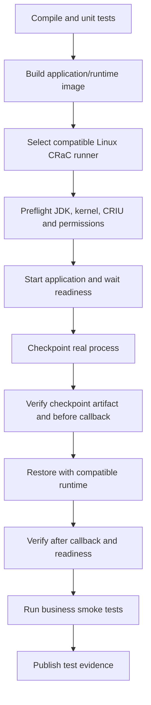

# Integration Testing with Real Checkpoints and Restores on Linux

A unit test can confirm that `beforeCheckpoint()` calls `close()` and `afterRestore()` calls a factory to create a new resource. However, it does not prove that the JVM can actually create a checkpoint image, that CRIU can recover the process, or that the application continues working on Linux after restore. To validate the full CRaC cycle, run integration tests using a CRaC-enabled JDK in a compatible Linux environment and perform real checkpoints and restores.

This testing must pass through the layers: JVM, CRaC API, kernel, CRIU, container runtime if applicable, filesystem, network, and external dependencies. A valuable test must confirm both sides: pre-checkpoint callbacks put the application into a safe state; post-restore callbacks recovered resources; and the restored process actually serves requests or completes business work.

## 1. What Do Unit Tests and Integration Tests Verify?

The two test types have different goals:

| Test Type | Scope | Proves Real Checkpoint/Restore? |
|---|---|---|
| Resource unit tests | Test `beforeCheckpoint`/`afterRestore` call order, exception handling, and state machine using mocks/fakes | No |
| Spring context tests | Test bean creation, Resource registration, and dependency injection | No |
| Linux integration tests | Start CRaC-enabled JVM, request checkpoint, restore image using real runtime | Yes |
| End-to-end tests | Restore then call APIs or execute business logic through real dependencies or a test environment | Yes, while also verifying application behavior |

Unit tests remain necessary because they run quickly and help pinpoint logic errors. However, checkpoint/restore depends on the JVM and kernel; only integration tests on the real runtime validate those conditions.

## 2. Selecting a Compatible Linux Environment

Before writing a test harness, identify the exact runtime to be tested. Not every JDK with the same Java feature version supports CRaC; nor does every Linux host satisfy checkpoint/restore requirements.

Record at a minimum:

- JDK vendor, distribution, full version, and build number.
- JVM name and CRaC-related startup flags.
- CPU architecture such as `x86_64` or `aarch64`.
- Linux distribution and version.
- Kernel version and required features.
- CRIU version if the JDK build uses CRIU.
- Container runtime, namespaces, cgroups, and security profile if running inside a container.
- Native libraries, JNI/JNA, agents, and drivers loaded by the application.

Example of gathering information on Linux:

```bash
java -version
java -XshowSettings:properties -version
uname -a
uname -m
cat /etc/os-release
criu --version
criu check
```

`criu check` is a baseline check when the environment uses CRIU; specific requirements and detailed check commands depend on CRIU version, kernel, and JDK vendor. Follow the documentation of the exact CRaC distribution you are running. Do not conclude the environment is ready simply because `criu --version` returns a version.

### 2.1. Permissions and Host Configuration

Checkpointing may require capabilities, access to `/proc`, namespaces, or special security configuration. Depending on the host and container runtime, these requirements may include checkpoint/restore permissions, seccomp profiles, AppArmor/SELinux configuration, and process manipulation capabilities.

Do not enable `--privileged` or run as root as a default workaround. Determine minimum permissions from vendor documentation, then run tests under a configuration close to production. A test succeeding in a privileged container does not prove a production workload with restricted security profiles can also restore.

### 2.2. Testing on Host or Inside a Container?

If setting up CRaC for the first time, start on a compatible Linux host to separate JVM/CRIU issues from container configuration issues. Once host tests pass, repeat inside a container with the exact image, volumes, namespaces, and permissions of the deployment environment.

A container uses the host kernel. Installing CRIU inside a container does not by itself supply missing kernel features or capabilities. If production runs on Kubernetes, you must eventually test on the corresponding node and container runtime; an ordinary Pod restart does not automatically perform a CRaC restore.

## 3. Preparing the Test Application

A test application should have at least:

1. A Resource registered with the CRaC context.
2. An out-of-process trace proving callbacks ran.
3. An endpoint or task testable after restore.
4. A dependency closed before checkpoint and recreated after restore.
5. A readiness signal that succeeds only after recovery completes.

Do not inspect only a static variable on the heap. Because the heap is restored, that variable may retain its old value and fail to prove the `afterRestore()` callback executed. Use a marker file or test service outside the checkpoint directory to observe callbacks from outside the process.

### 3.1. Resource Writing Markers Before Checkpoint and After Restore

Example simple Resource writing events into an independent marker directory:

```java
import org.crac.Context;
import org.crac.Core;
import org.crac.Resource;

import java.io.IOException;
import java.nio.charset.StandardCharsets;
import java.nio.file.Files;
import java.nio.file.Path;
import java.nio.file.StandardOpenOption;
import java.time.Instant;

public final class CheckpointProbe implements Resource {
    private final Path markerDirectory;
    private volatile boolean restored;

    public CheckpointProbe(Path markerDirectory) {
        this.markerDirectory = markerDirectory;
    }

    public static CheckpointProbe register(Path markerDirectory)
            throws IOException {
        Files.createDirectories(markerDirectory);
        CheckpointProbe probe = new CheckpointProbe(markerDirectory);
        Core.getGlobalContext().register(probe);
        return probe;
    }

    @Override
    public void beforeCheckpoint(Context<? extends Resource> context)
            throws Exception {
        append("before-checkpoint");
    }

    @Override
    public void afterRestore(Context<? extends Resource> context)
            throws Exception {
        restored = true;
        append("after-restore");
    }

    public boolean isRestored() {
        return restored;
    }

    private void append(String event) throws IOException {
        String line = Instant.now() + " " + event + System.lineSeparator();
        Files.writeString(
                markerDirectory.resolve("lifecycle.log"),
                line,
                StandardCharsets.UTF_8,
                StandardOpenOption.CREATE,
                StandardOpenOption.WRITE,
                StandardOpenOption.APPEND);
    }
}
```

Register the Resource when the application starts:

```java
Path markerDirectory = Path.of(
        System.getenv().getOrDefault(
                "CRAC_TEST_MARKER_DIR",
                "/tmp/crac-integration-test/markers"));

CheckpointProbe probe = CheckpointProbe.register(markerDirectory);
```

In Spring Boot, the probe can be registered from a configuration bean or a startup callback after required dependencies are ready. Ensure it is registered only once.

The marker directory must live outside the checkpoint directory and be readable by the test runner after the process checkpoints/restores. If the marker sits inside the checkpoint directory, it may be snapshotted along with the process and defeat external observation.

Markers are test instrumentation. Do not write tokens, credentials, or sensitive data into this file. In parallel tests, use a separate marker directory per run.

### 3.2. Endpoint Observing State After Restore

For HTTP applications, you can expose an endpoint enabled only under the test profile:

```java
import org.springframework.web.bind.annotation.GetMapping;
import org.springframework.web.bind.annotation.RestController;

import java.util.Map;

@RestController
public final class CracTestController {
    private final CheckpointProbe probe;
    private final TestDependencyHandle dependency;

    public CracTestController(
            CheckpointProbe probe,
            TestDependencyHandle dependency) {
        this.probe = probe;
        this.dependency = dependency;
    }

    @GetMapping("/internal/test/crac-state")
    public Map<String, Object> state() {
        return Map.of(
                "restored", probe.isRestored(),
                "dependencyReady", dependency.isReady(),
                "pid", ProcessHandle.current().pid());
    }
}
```

This endpoint is strictly for the test profile or isolated environments. Never expose PID and internal state via production endpoints unless there is a clear operational need.

The test runner checks `restored == true` and `dependencyReady == true` after restore. The PID may be logged for diagnostics, but never assume the host PID always changes or always stays identical: behavior depends on PID namespaces and how restoration runs.

## 4. Testing Closed and Recreated Dependencies

A callback marker proves the callback ran; it does not yet prove external resources were handled properly. Include at least one representative dependency, such as a connection pool or library client.

A test handle can track instance generations:

```java
import java.util.concurrent.atomic.AtomicInteger;
import java.util.concurrent.atomic.AtomicReference;

public final class TestDependencyHandle {
    private final AtomicInteger generations = new AtomicInteger();
    private final AtomicReference<TestClient> current = new AtomicReference<>();

    public void closeForCheckpoint() throws Exception {
        TestClient old = current.getAndSet(null);
        if (old != null) {
            old.close();
        }
    }

    public void recreateAfterRestore() throws Exception {
        TestClient replacement = new TestClient(generations.incrementAndGet());
        replacement.connectAndVerify();
        if (!current.compareAndSet(null, replacement)) {
            replacement.close();
            throw new IllegalStateException("Client is already installed");
        }
    }

    public boolean isReady() {
        TestClient client = current.get();
        return client != null && client.isReady();
    }

    public int generation() {
        TestClient client = current.get();
        return client == null ? 0 : client.generation();
    }
}
```

`TestClient` here represents a test client. In a real integration test, replace it with an adapter to the database, HTTP service, or library the application needs to recover. Generation is meaningful only when stored where tests can observe it; if stored on the heap and snapshotted, tests must combine an out-of-process marker or server-side observation to prove a new instance was created.

A stronger test confirms that the external server observes a new connection, such as recording a new database session ID or verifying a post-restore request is served by the new client generation. Do not rely solely on the `DataSource` object being non-null.

## 5. Preparing Checkpoint and Marker Directories

Checkpoint output must be separated from external test data. Example:

```text
/tmp/crac-test-run-<id>/
  checkpoint/       # CRaC/CRIU output
  markers/          # lifecycle log, outside checkpoint
  logs/             # stdout/stderr of JVM and test runner
  metadata/         # versions and test results
```

Create directories with proper permissions:

```bash
RUN_DIR="$(mktemp -d /tmp/crac-it.XXXXXX)"
CHECKPOINT_DIR="$RUN_DIR/checkpoint"
MARKER_DIR="$RUN_DIR/markers"
LOG_DIR="$RUN_DIR/logs"

mkdir -p "$CHECKPOINT_DIR" "$MARKER_DIR" "$LOG_DIR"
chmod 0700 "$RUN_DIR" "$CHECKPOINT_DIR" "$MARKER_DIR" "$LOG_DIR"
```

Never share a checkpoint directory among multiple parallel tests. Each test needs its own output path to avoid overwriting or restoring the wrong image.

Ensure the user running the JVM has write permission to the checkpoint and marker directories. If CRIU/JDK needs extra host privileges, grant them per test environment guidance and revoke after testing completes.

## 6. Launching the CRaC JVM on Linux

Run the application with the exact selected CRaC JDK. Example:

```bash
export CRAC_TEST_MARKER_DIR="$MARKER_DIR"

"$JAVA_HOME/bin/java" \
  "-XX:CRaCCheckpointTo=$CHECKPOINT_DIR" \
  -jar application.jar \
  > "$LOG_DIR/source-jvm.log" 2>&1 &

APP_PID=$!
```

The option `-XX:CRaCCheckpointTo` is common across CRaC JDK builds supporting it. Verify syntax and launch usage in the documentation of the vendor under test. Never use a regular JDK and merely add the `org.crac` dependency.

Wait until the application is ready before checkpointing:

```bash
for attempt in $(seq 1 60); do
  if curl --fail --silent http://127.0.0.1:8080/actuator/health/readiness >/dev/null; then
    break
  fi
  sleep 1
done

curl --fail http://127.0.0.1:8080/internal/test/crac-state
```

If the application lacks Actuator, use a custom readiness endpoint. The test runner must fail if the timeout expires before the application is ready; never continue checkpointing a process that has not finished starting up.

Before checkpointing, send some test business requests and verify outcomes to establish a baseline. If background workers exist, generate observable work to confirm `beforeCheckpoint` drains properly.

## 7. Requesting a Real Checkpoint

On CRaC JDKs supporting diagnostic commands, a checkpoint can be requested via `jcmd`:

```bash
"$JAVA_HOME/bin/jcmd" "$APP_PID" JDK.checkpoint
```

The command needs access to the target JVM, a matching PID environment, and a tool compatible with the running JDK. If the JVM is in a container, run `jcmd` inside the same container/PID namespace or use a vendor-supported control mechanism.

Do not check only the exit code of `jcmd`. After the command, confirm:

- Logs record `beforeCheckpoint` callbacks.
- The `before-checkpoint` marker appears in the external marker directory.
- The checkpoint directory contains files/metadata created by the runtime.
- Logs contain no callback, CRIU, or filesystem errors.
- Source process state matches the behavior documented by the vendor.

### 7.1. Do Not Assume the Source Process Always Exits

Behavior of the original process after checkpoint depends on the runtime and how checkpointing was triggered. Some workflows allow the process to continue running, while others terminate or change state depending on the control tool.

The test harness must follow the documentation of the JDK in use. If the source process continues running after snapshot completion, manage it separately before restore so tests do not accidentally serve requests from the source process instead of the restored process. Never kill the process before confirming the checkpoint completed and all artifacts were written cleanly.

Never use PID changes as the sole assertion. A PID may be restored inside a namespace or mapped differently on the host. Use callback markers, readiness, and dependency behavior to confirm restoration.

## 8. Inspecting the Checkpoint Artifact

After checkpointing, inspect the output directory:

```bash
find "$CHECKPOINT_DIR" -maxdepth 3 -type f -printf '%p %s bytes\n'
du -sh "$CHECKPOINT_DIR"
test -n "$(find "$CHECKPOINT_DIR" -type f -print -quit)"
```

These commands only verify that the artifact has files and non-zero size. Exact structure depends on JDK/CRIU. Never edit, rename, or delete files inside the checkpoint directory before restoring.

Record:

- Checkpoint start and completion timestamps.
- Size of the checkpoint directory.
- File count and total size.
- JVM and CRIU logs.
- JDK vendor/version/build and host metadata.
- Pre-checkpoint callback results.

A non-empty directory does not yet prove the image is valid. Only a real restore confirms the runtime can use the artifact.

## 9. Restoring from the Checkpoint Image

Restoration must use the exact CRaC JDK and a compatible environment. Example on builds supporting `-XX:CRaCRestoreFrom`:

```bash
export CRAC_TEST_MARKER_DIR="$MARKER_DIR"

"$JAVA_HOME/bin/java" \
  "-XX:CRaCRestoreFrom=$CHECKPOINT_DIR" \
  > "$LOG_DIR/restored-jvm.log" 2>&1 &

RESTORED_PID=$!
```

This is an example using a common CRaC-enabled JDK option; use the exact restore command required by your vendor. Restore is not re-running `java -jar application.jar`. The JVM must recover the process from the checkpoint artifact.

After restore, wait for readiness and check the test endpoint:

```bash
curl --fail http://127.0.0.1:8080/actuator/health/readiness
curl --fail http://127.0.0.1:8080/internal/test/crac-state
```

The output should confirm `restored` is `true` and mandatory dependencies are ready. If `afterRestore` callbacks fail, readiness must remain unready or the process must report failure per application policy.

### 9.1. Verifying Out-of-Process Markers

Read the lifecycle log:

```bash
cat "$MARKER_DIR/lifecycle.log"
```

At a minimum, there must be a `before-checkpoint` event from image creation and an `after-restore` event from the restored process. Because the marker resides outside the checkpoint directory, the test runner observes real callbacks rather than reading back snapshotted data.

If running multiple checkpoint cycles, attach a run ID or event ID to each run to distinguish callbacks. Never delete markers before the test runner has collected the results.

## 10. Verifying Business Behavior After Restore

Callbacks succeeding is not enough. After restore, exercise actual application functionality:

- Send representative HTTP requests.
- Read/write a record in a test database.
- Send and receive messages on a test broker.
- Call a test HTTP service.
- Process a job via workers.
- Confirm caches or parsers/serializers continue working.

If the application uses transactions, confirm pre-checkpoint data is neither processed twice nor lost. If it has message consumers, confirm subscriptions re-register and messages are acknowledged properly. If it has schedulers, confirm schedules recompute from current time.

Never use production databases or brokers for destructive tests. Create isolated test namespaces, schemas, topics, or tenants and clean up test data upon completion.

### 10.1. Verifying Newly Created Resources

For databases, you can inspect the new session/connection on the server side or run queries via the repository after restore. For HTTP clients, call a test endpoint and verify the server receives a new request. For native engines, run a test operation and verify the new handle works.

A `DataSource` object existing or `isClosed() == false` does not necessarily prove the external server is still reachable. Verification must exercise the real operations the application needs.

## 11. Testing Errors and Negative Conditions

An integration suite must test failure cases for checkpoint/restore, not just the happy path.

| Scenario | How to Trigger | Expected Result |
|---|---|---|
| Resource fails to drain in time | Keep a test task running longer than drain timeout | Checkpoint rejected; active dependency is not closed prematurely |
| `beforeCheckpoint` throws error | Test Resource intentionally throws | Checkpoint fails and logs pinpoint the Resource |
| Checkpoint directory not writable | Use a directory without write permission | Checkpoint fails explicitly, no artifact published |
| Runtime lacks CRIU/kernel conditions | Run in an incompatible test environment | Preflight or checkpoint fails; cause is recorded |
| External dependency unavailable after restore | Stop test service or configure invalid endpoint | `afterRestore` fails or readiness fails |
| Expired credentials | Use an expired test credential | Application never reports ready and rejects traffic |
| Artifact missing files or modified | Omit a file during copy or alter a test file | Restore/verification is rejected |
| Wrong runtime build | Attempt restore with a runtime outside the matrix | Deployment/test gate rejects before entering service |

Never corrupt production checkpoint artifacts to test negative cases. Use dedicated test images, copy into a sandbox directory, and keep originals intact.

## 12. Testing Multiple Checkpoint–Restore Cycles

Some bugs appear only in the second cycle: improper idempotency when closing a Resource, a new pool failing to close in the subsequent cycle, duplicate callback registration, or old threads persisting.

Run at least two cycles on the same process lineage if the runtime and application workflow support it:

1. Cold start and confirm readiness.
2. First checkpoint.
3. First restore and confirm new dependency generation.
4. Execute business operations after restore.
5. Second checkpoint.
6. Second restore.
7. Re-execute business operations and confirm no old threads, connections, or listeners remain.

Using a single base checkpoint image to spawn multiple independent processes is a different scenario from checkpointing multiple times on the same lineage. Test both if the deployment architecture supports both.

### 12.1. Restoring Multiple Replicas from the Same Image

When one image serves as the source for multiple replicas, verify:

- Each instance has a unique identity.
- Connection pools and sockets are created independently.
- Credentials, leases, and subscriptions are refreshed properly.
- No two instances share the same worker ID or exclusive resource.
- No RNG state or heap counters cause colliding IDs across replicas.
- Databases/brokers are not overloaded by simultaneous instance connections.

Do not run only two restores sequentially. If production scales multiple replicas concurrently, test parallel restores at an appropriate scale in the test environment.

## 13. Reference Orchestration Script

A shell script can orchestrate tests. The script below is a skeleton; adapt readiness endpoints, JDK options, and source-process handling for your exact vendor:

```bash
#!/usr/bin/env bash
set -Eeuo pipefail

: "${JAVA_HOME:?Set JAVA_HOME to the CRaC-enabled JDK}"
: "${APP_JAR:?Set APP_JAR to the application jar}"

RUN_DIR="$(mktemp -d /tmp/crac-it.XXXXXX)"
CHECKPOINT_DIR="$RUN_DIR/checkpoint"
MARKER_DIR="$RUN_DIR/markers"
LOG_DIR="$RUN_DIR/logs"
PORT="${PORT:-8080}"

mkdir -p "$CHECKPOINT_DIR" "$MARKER_DIR" "$LOG_DIR"
chmod 0700 "$RUN_DIR" "$CHECKPOINT_DIR" "$MARKER_DIR" "$LOG_DIR"
export CRAC_TEST_MARKER_DIR="$MARKER_DIR"

SOURCE_PID=""
RESTORE_PID=""

cleanup() {
  if [[ -n "$RESTORE_PID" ]] && kill -0 "$RESTORE_PID" 2>/dev/null; then
    kill "$RESTORE_PID" || true
  fi
  if [[ -n "$SOURCE_PID" ]] && kill -0 "$SOURCE_PID" 2>/dev/null; then
    kill "$SOURCE_PID" || true
  fi
}
trap cleanup EXIT

"$JAVA_HOME/bin/java" -version
criu check

"$JAVA_HOME/bin/java" \
  "-XX:CRaCCheckpointTo=$CHECKPOINT_DIR" \
  -jar "$APP_JAR" >"$LOG_DIR/source.log" 2>&1 &
SOURCE_PID=$!

wait_http() {
  local url="$1"
  for attempt in $(seq 1 90); do
    if curl --fail --silent "$url" >/dev/null; then
      return 0
    fi
    sleep 1
  done
  return 1
}

wait_http "http://127.0.0.1:$PORT/actuator/health/readiness"

"$JAVA_HOME/bin/jcmd" "$SOURCE_PID" JDK.checkpoint

test -n "$(find "$CHECKPOINT_DIR" -type f -print -quit)"
grep -q "before-checkpoint" "$MARKER_DIR/lifecycle.log"

# Apply the vendor-documented source-process handling here.
# Do not terminate the source until the checkpoint is confirmed complete.

"$JAVA_HOME/bin/java" \
  "-XX:CRaCRestoreFrom=$CHECKPOINT_DIR" \
  >"$LOG_DIR/restore.log" 2>&1 &
RESTORE_PID=$!

wait_http "http://127.0.0.1:$PORT/actuator/health/readiness"
curl --fail "http://127.0.0.1:$PORT/internal/test/crac-state"
grep -q "after-restore" "$MARKER_DIR/lifecycle.log"

echo "CRaC integration test passed: $RUN_DIR"
```

This is a skeleton illustrating the steps, not a portable script across all vendors. Adapt checkpoint triggering, source-process handling, ports, readiness, cleanup, and restore options per JDK documentation. In environments with systemd, container runtimes, or CRIU wrappers, the workflow may be driven by another tool instead of `jcmd` directly.

In particular, the script should not automatically `kill` the source process immediately after the checkpoint command without confirming checkpoint completion and how the runtime expects the source process to be handled. Complete that part according to the supported workflow before using in CI.

## 14. Integrating into CI on Linux

Checkpoint/restore tests require runners with compatible permissions and kernels. A standard containerized CI runner may not qualify, even when builds and unit tests run normally.

A reference pipeline:



CI should separate standard build jobs from CRaC integration jobs if runners have special requirements. Integration jobs should run only on configured, controlled runners; never grant broad host privileges to untrusted pull requests.

### 14.1. When Should Tests Run?

Tests can run at these points:

- When changing Resource callbacks or dependency lifecycles.
- When upgrading JDK vendor/version/build.
- When changing kernel, CRIU, container runtime, or base image.
- When changing native libraries, agents, JDBC drivers, or critical frameworks.
- Prior to publishing a new checkpoint artifact.
- On a recurring schedule against a production-like runtime.

Unit tests can run on every commit. CRaC integration tests can run on protected branches, nightly builds, or release gates depending on runner cost. Changes directly affecting checkpoint/restore should block release if mandatory integration tests fail.

### 14.2. Saving Test Evidence

Each run should preserve:

- Commit and application artifact digest.
- JDK vendor/version/build and JVM options.
- OS, kernel, architecture, CRIU, and container runtime.
- Startup, checkpoint, and restore logs.
- Lifecycle markers.
- Checkpoint size and creation duration.
- Time from restore to readiness.
- Request/transaction/message test results.
- Critical negative test results.

Never publish checkpoint images containing sensitive runtime data as public CI artifacts. If an image must be retained for diagnostics, store it in an access-restricted, encrypted repository with a short retention period.

## 15. Diagnosing Integration Failures

Errors can occur across multiple phases. Determine whether the test failed before, during, or after checkpoint.

| Phase | Symptom | Root-Cause Groups to Check |
|---|---|---|
| Preflight | `criu check` fails | Kernel, CRIU, capabilities, security profile, or namespaces |
| Startup | JVM rejects CRaC options | Non-CRaC JDK or incorrect option/vendor |
| Resource preparation | `beforeCheckpoint` throws exception | Undrained tasks, unclosed FDs, buggy dependency lifecycle |
| Dump | CRIU/JVM fails to create image | Permissions, kernel features, filesystem, sockets, or native resources |
| Artifact validation | Checkpoint directory empty/missing files | Incomplete checkpoint, wrong path, or wrong permissions |
| Restore | JVM/CRIU rejects image | Incompatible runtime/build/architecture/host or corrupted artifact |
| `afterRestore` | Factory or callback fails | Credentials, network, database, Resource order, or configuration |
| Readiness | JVM running but endpoint unready | Unrecovered dependency or application stuck in error state |
| Business test | API fails after restore | Stale connection/session, transaction, cache, or worker state |

### 15.1. Collecting Complete Logs

Keep separate logs for:

- Source JVM prior to checkpoint.
- Control tool such as `jcmd`.
- CRIU or container runtime.
- Restored JVM after restore.
- External test dependencies.

Record timestamps and run IDs to correlate events across processes. Do not preserve only the final exception line; the root cause often appears in earlier log entries.

### 15.2. Distinguishing Callback Errors from Runtime Errors

If `beforeCheckpoint` or `afterRestore` throws an exception, it is an error in the application lifecycle or a dependency. If CRIU cannot dump/restore the process, it may be a kernel/runtime-layer issue. Classify accurately before changing code; adding retries inside a callback will not solve missing capabilities or an incompatible image.

## 16. Measuring Performance of Checkpoint/Restore Tests

Beyond pass/fail, measure:

| Metric | Meaning |
|---|---|
| Startup to readiness | Initial process creation time |
| Warm-up duration | Pre-checkpoint preparation cost |
| Drain duration | Time to bring workers to a safe state |
| Checkpoint duration | Time to create the snapshot |
| Checkpoint size | Storage and transfer footprint |
| Restore duration | Time for JVM to recover the process |
| Restore-to-readiness | Time until application accepts traffic |
| First request latency | Latency of the first post-restore request |
| Resource recreation duration | Time to recreate connections/clients/workers |

Measure multiple runs under identical host and load configurations. Compare against standard startup to evaluate benefits. A fast restore followed by slow database pool recreation or cache warming may not improve overall time-to-ready as much as expected.

## 17. Common Mistakes

**Mocking callbacks only in unit tests.** Mocks verify method call logic but do not test JVM/CRIU. Add real Linux checkpoint/restore integration tests.

**Using a JDK without CRaC support.** Having the `org.crac` dependency does not mean the JVM supports checkpointing. Use the exact vendor-published CRaC JDK distribution.

**Checking CRIU version without checking host capability.** CRIU needs kernel features and appropriate permissions. Run preflight checks per vendor guidance on the target runner.

**Checking only that the checkpoint directory exists.** The directory may be empty or missing files. Inspect output and perform a real restore.

**Checking only heap variables after restore.** Those variables may have been snapshotted. Use markers outside the checkpoint directory and verify behavior outside the process.

**Assuming PID must change after restore.** PID depends on namespaces and restore mechanisms. Use callback markers, readiness, and business operations as primary assertions.

**Relaunching the JAR instead of restoring the image.** `java -jar` starts a fresh process. Use the restore command supported by the CRaC JDK.

**Killing the source process too early.** Doing so can interrupt checkpointing or violate runtime procedures. Confirm checkpoint completion and follow vendor documentation.

**Placing markers inside the checkpoint directory.** Markers may be snapshotted and fail to prove callbacks in the restored process. Place markers in an external path.

**Testing only one cycle.** Bugs in repeated callbacks, resource generations, or lingering threads may appear only on subsequent cycles. Test multiple cycles.

**Not testing parallel restores.** Some states like IDs, RNG, or leases may be duplicated. Test multi-replica patterns if production shares one image.

**CI runners differing from production.** Testing on privileged runners or different kernels can yield unrepresentative results. Use runners configured closely to production and save metadata.

## 18. Self-Check Questions

1. **Why are Resource unit tests insufficient?** Because they do not perform real checkpoint/restore and do not test the JVM, CRIU, kernel, or filesystem.
2. **What must be verified before running integration tests?** CRaC JDK, vendor/build, Linux kernel, architecture, CRIU, permissions, and container runtime if applicable.
3. **Why should markers stay outside the checkpoint directory?** So the test runner observes genuine post-restore callbacks rather than reading back a snapshotted marker.
4. **What is `jcmd <pid> JDK.checkpoint` used for?** Requesting a checkpoint on CRaC JDKs supporting this diagnostic command; a compatible tool and matching PID namespace must be used.
5. **Should you assume the source process always exits after checkpointing?** No. Behavior depends on runtime and vendor workflow; the harness must handle it per documentation.
6. **What proves a dependency has recovered?** Real operations executed through the client/repository after restore, plus evidence from external systems if needed.
7. **Why test multiple cycles?** To detect non-idempotent Resources, surviving old instances, or duplicate callback registrations.
8. **Why does CI need specialized runners?** Checkpoint/restore depends on kernel, CRIU, permissions, and runtimes that standard CI runners may not provide.

## Conclusion

CRaC integration testing is valuable when performing real checkpoints and restores on Linux using the exact JDK, kernel, CRIU, and permissions supported by the deployment environment. Tests must observe callbacks via out-of-process markers, confirm resources close before checkpoint and recreate after restore, and verify the application actually serves requests or finishes business work.

Combine fast unit tests with a dedicated Linux integration runner. Test negative conditions, multiple checkpoint–restore cycles, and multiple replicas if architecture shares images. Record runtime metadata, JVM/CRIU logs, checkpoint size, and restore-to-readiness time so every result is reproducible. Mark a release acceptable only after both restore testing and readiness pass in a compatible environment.
