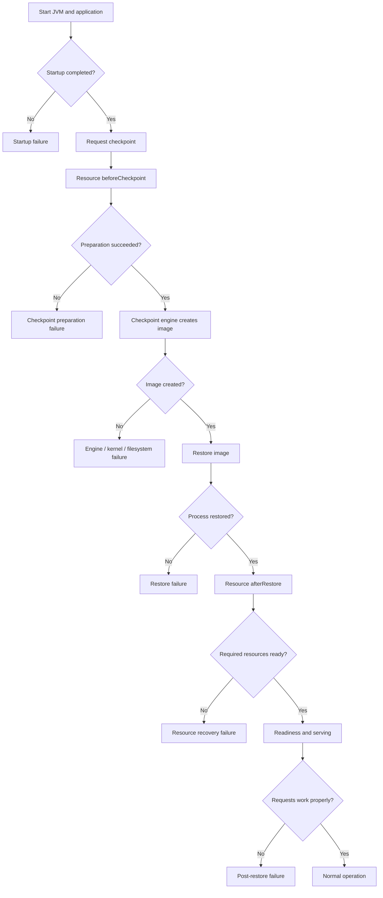

# Classifying Startup, Checkpoint, Restore, and Post-Restore Serving Failures

When operating Java applications with CRaC, a "checkpoint failed" message is not enough to identify the root cause. A failure can occur before the application finishes starting, while a Resource is preparing for checkpoint, while CRIU or the runtime is creating the image, when the process is being restored, or after the application has resumed running while a dependency is not yet ready. Each stage has different symptoms, diagnostic data, and remediation paths.

An effective way to diagnose is to identify the **last completed stage**, then narrow down the responsible layer: application code, CRaC API/runtime, checkpoint engine, kernel/container runtime, filesystem, external dependencies, or application readiness. Do not rely solely on an exit code or the last log line; assemble timestamps, callbacks, JVM logs, engine logs, and dependency states into a timeline.

## 1. Four Stages to Distinguish

A CRaC lifecycle can be divided into four operational stages:

1. **Startup:** the JVM starts, loads the CRaC API/engine, and the application initializes its initial state.
2. **Checkpoint:** the application requests a checkpoint; Resources prepare resources; the runtime and engine save process state.
3. **Restore:** the runtime reads the image and restores the process; Resources handle post-restore resources.
4. **Post-restore serving:** the application resumes processing work, reconnects dependencies, and accepts traffic only once ready.



This diagram helps classify incidents rather than describing a single API. When a checkpoint is requested via `Core.checkpointRestore()`, the Java thread calling the API can resume after a successful restore. When the request comes from `jcmd` or an external tool, the observation point and the thread executing callbacks may differ.

## 2. First Step: Identify the Stage Where Failure Occurred

Before editing configuration or adding retries, answer these questions:

- Did the JVM start and load the application?
- Did the application finish initialization and reach initial readiness?
- Was the checkpoint command received?
- Did `beforeCheckpoint(...)` start and complete?
- Did the checkpoint engine start creating the image? Does a complete image or metadata exist?
- Did restore start? Did the process reach the `afterRestore(...)` callback?
- Did callbacks finish while the application stayed unready, or did requests run first and then fail?
- Did the failure occur immediately or after a specific duration or request type?

Record a timeline with timestamps and an identifier for the run or checkpoint:

| Milestone | Evidence to collect |
|---|---|
| JVM start | JDK vendor/version/build, command line, architecture, PID, and initial JVM logs. |
| Application initialization | Startup logs, bean/component initialization, and dependency check results. |
| Checkpoint requested | Request source (`Core`, `jcmd`, or orchestration), timestamp, and caller if available. |
| Callback start | Resource name, callback, thread, and start time. |
| Callback completion | Success/failure, exceptions, and execution duration. |
| Engine checkpoint | Engine/CRIU version, engine logs, artifact path, and completion status. |
| Restore start/end | Runtime logs, PID/process state, and per-Resource outcome. |
| Readiness | Liveness/readiness results, dependency state, and time traffic opened. |
| First request | Endpoint/operation, status, latency, and correlation ID with sensitive data stripped. |

If you only have a "process exited" log, you cannot yet conclude whether it was a checkpoint failure, restore failure, or normal shutdown. Cross-check with runtime and orchestrator logs.

## 3. Failures During the Startup Stage

Startup failures occur before the application reaches a checkpointable state. They can be split into Java/API errors, engine/runtime errors, and dependency initialization errors.

### 3.1. Missing CRaC API or Compatibility Library

Common symptoms:

- Compiler reports missing package `org.crac` or `jdk.crac`.
- JVM throws `ClassNotFoundException` or `NoClassDefFoundError` when loading a class referencing the CRaC API.
- The application builds in one module but fails at runtime because the dependency is absent from the runtime classpath/module path.

Possible causes:

- Missing `org.crac:crac` dependency when the application uses the `org.crac` API.
- Using an API package that does not match the running JDK distribution.
- Dependency declared only in test/runtime configuration and not packaged into the artifact.
- Module path or agent/framework classloader cannot see the library.

Remediation approach:

1. Confirm whether the code uses `org.crac` or `jdk.crac`.
2. Inspect the dependency tree and contents of the deployed artifact.
3. Verify the exact JDK vendor, version, and build.
4. Run a minimal test class that imports and calls the API on the exact runtime.

Do not confuse a missing-class error with a JVM lacking checkpoint support. These are two different layers: a missing class is a packaging/loading error; a runtime without an implementation can use a dummy implementation if the application uses an appropriate compatibility library.

### 3.2. JVM Does Not Support Checkpoint or Engine Does Not Exist

If an application uses the `org.crac` compatibility library on a JVM without a CRaC implementation, the dummy implementation may allow Resource registration while `Core.checkpointRestore()` throws `UnsupportedOperationException`. In that case, callbacks do not run automatically and no checkpoint image is produced.

If the command line requests an engine that the JDK build does not provide, the JVM may reject the option or fail immediately at startup. For example, `-XX:CRaCEngine=simengine` only works if that specific runtime includes that engine.

Distinctions:

| Symptom | Interpretation |
|---|---|
| `UnsupportedOperationException` from dummy `org.crac` when requesting checkpoint | The current runtime has no CRaC implementation recognized by the compatibility library. |
| JVM reports invalid option/engine | The JDK build does not support the specified option or engine. |
| `ClassNotFoundException` / `NoClassDefFoundError` | The API library is not on the class-loading path. |
| `CheckpointException` or `RestoreException` | The CRaC API/runtime entered the corresponding handling path, but the operation hit an error; inspect the root cause. |

Verify the engine and JDK before investigating CRIU. You cannot fix a JVM lacking an engine by granting extra capabilities to the container.

### 3.3. Failures During Application Initialization

An application can fail before checkpoint because of constructors, init callbacks, Spring beans, configuration, or remote dependencies.

For example:

- Database unreachable inside `@PostConstruct`.
- Token or secret not provisioned.
- HTTP client TLS initialization failing.
- Warm-up running too long or allocating past memory limits.
- Background threads created while a later component fails initialization.

Distinguish application errors from CRaC errors. If `ApplicationContext` has not refreshed or `ApplicationReadyEvent` has not fired, the process has not reached the checkpoint-ready stage by application design. Inspect the root logs of the failing bean/component and examine whether remote calls should occur during init or be deferred until lifecycle start.

### 3.4. Inspecting the Startup Environment

Record at minimum:

```bash
java -version
java -XX:+PrintFlagsFinal -version
uname -a
uname -m
```

On Linux, you can also record CPU and kernel information visible to the process:

```bash
lscpu
cat /proc/self/status
```

Commands and output depend on the JDK/OS. They help characterize the environment, though they do not by themselves prove checkpoint/restore is supported.

## 4. Failures During the Checkpoint Stage

Checkpointing has at least two layers to distinguish: the application preparing Resources and the engine performing process state saving.

### 4.1. Errors in `beforeCheckpoint(...)`

If a callback fails to prepare a resource, the checkpoint may be aborted or report an error. Common causes:

- Unable to drain requests or workers using the resource.
- Lock held too long or deadlock occurring.
- Connection pool fails to close.
- File buffer fails to flush.
- Scheduler or executor does not stop at a safe point.
- Callback waits indefinitely on an external dependency.
- Resource registered twice and closed multiple times.

Collect:

- Failing Resource name and callback.
- Exception along with all causes and suppressed exceptions.
- Thread dump at the time the callback hangs.
- Wait durations on locks, barriers, executors, or I/O.
- Worker status and active request count.
- Which Resources prepared successfully before the error occurred.

Example of a callback that reports a clear error if it cannot bring resources to a safe state:

```java
@Override
public void beforeCheckpoint(Context<? extends Resource> context)
        throws Exception {
    if (!requestGate.stopAndDrain(Duration.ofSeconds(10))) {
        throw new IllegalStateException(
                "HTTP requests did not drain before checkpoint deadline");
    }

    try {
        client.close();
        clientClosed = true;
    } catch (Exception e) {
        throw new IllegalStateException(
                "Unable to close HTTP client before checkpoint", e);
    }
}
```

`requestGate` and `client` in the example are application abstractions. Callbacks should not swallow errors and continue as though the resource were ready. A rollback policy is needed if some resources have already closed before another Resource fails.

### 4.2. Hanging Callbacks

If checkpoint stalls inside `beforeCheckpoint(...)`, inspect a thread dump. Dangerous patterns include:

- Callback waits for a worker while the worker waits for a lock held by the callback.
- Callback calls `Future.get()` on a task submitted to the very single-thread executor currently executing the callback.
- Worker blocks on I/O without a timeout.
- A `Phaser`/barrier waits on a party that already exited or no longer participates.
- Callback waits on a remote service with no deadline.

Set timeouts on every wait step. If a deadline expires, fail the checkpoint instead of closing resources while workers are still using them. Do not use `Thread.sleep(...)` to guess that workers have stopped.

### 4.3. Failures Caused by Checkpoint Engine, CRIU, or Kernel

If callbacks completed yet the engine fails to create an image, shift investigation to the runtime/OS layer.

Common cause categories:

| Category | Example symptoms/causes | Evidence to collect |
|---|---|---|
| Permission/capability | `EPERM`, `EACCES`, dump operation rejected. | UID/GID, capabilities, user namespace, seccomp, AppArmor/SELinux, and CRIU/runtime logs. |
| Filesystem | Unable to create image, `ENOSPC`, `EDQUOT`, `EROFS`, `ENOENT`. | Mount path, owner/mode, free space, inodes, quota, and mount options. |
| Kernel/CRIU | Kernel feature or CRIU does not support a resource type. | Kernel version, CRIU version, `criu check`, detailed logs, and rejected resource type. |
| Process resource | Unsupported socket, file descriptor, pipe, namespace, or mapping. | CRIU logs, FD list, `/proc/<pid>/maps`, open resources. |
| Container runtime | Runtime or orchestrator does not support the requested checkpoint operation. | Runtime version, container config, node and cluster events/logs. |
| Storage | Checkpoint image or auxiliary files cannot be written/read. | Storage backend, mount consistency, ownership, I/O errors, and capacity. |

Specific errors and capability requirements depend on the kernel, CRIU, container runtime, and deployment setup. There is no single minimal permission list valid for every environment. Identify which process performs the checkpoint: the JVM inside the container, a CRIU helper, the container runtime, or a node agent.

### 4.4. Inspecting Filesystem and Storage Space

Diagnostic commands on Linux:

```bash
id
umask
df -h <checkpoint-directory>
df -i <checkpoint-directory>
ls -ld <checkpoint-directory>
namei -l <checkpoint-directory>
```

These help check identity, free space, inodes, and permissions across every parent directory. When using `readOnlyRootFilesystem`, confirm the checkpoint path is mounted on a writable volume and the mount is not set to `readOnly: true`.

Do not assume the checkpoint image always resides in a fixed directory inside the container. Some platforms manage artifacts outside the container. Use the exact path configured by the engine or orchestrator.

### 4.5. Inspecting CRIU and Kernel

On Linux environments with CRIU, you can collect:

```bash
criu --version
criu check
uname -r
```

`criu check` is only a check of CRIU's capabilities in the current environment; a passing result does not guarantee a specific application can checkpoint. A process with special sockets, namespaces, mounts, or native resources can still fail.

If deeper investigation is needed, collect the CRIU logs produced by the integration and look up rejected syscalls. `strace` can help in debug environments if permitted; `dmesg` or kernel logs may be restricted by the cluster. Do not enable heavy tracing in production without evaluating overhead.

## 5. Failures During the Restore Stage

Restore can fail before the process resumes, or the process can be restored while some Resources fail to recover.

### 5.1. Image Incompatible With Target Environment

Conditions to compare:

- JDK vendor, version, and build.
- CPU architecture and instruction features visible to the JVM.
- OS, kernel, and checkpoint engine/CRIU version.
- Container runtime, namespaces, and security context.
- Native libraries, JNI/JVMTI agents, and ABI.
- Mount paths, filesystems, and related file descriptors.
- UID/GID, capabilities, and image read permissions.

A checkpoint is process state, not a portable JAR. Do not restore cross-architecture between x86-64 and AArch64. Even matching architecture is insufficient if the target machine lacks CPU instruction extensions used by JIT code or native libraries.

### 5.2. Errors Reading the Checkpoint Image

Symptoms may include missing files, permission denied, incomplete image, invalid checksum/metadata, or unmounted storage.

Check:

1. Were the image and metadata created completely?
2. Did any process delete or overwrite artifacts after checkpoint?
3. Does restore mount the right volume and exact path?
4. Does the restore process's UID/GID have read permission on all required files?
5. Does storage have sufficient space, inodes, and no I/O errors?
6. Does the image belong to the right JDK, engine, and runtime profile?

Do not fix errors by relaxing the entire directory to `0777`. Grant required read permissions to the proper user/group and protect the checkpoint image because it may contain sensitive data in the heap.

### 5.3. Errors in `afterRestore(...)`

If the process has been restored yet a callback fails, the cause usually lies in external resources or recovery logic:

- Old database connections are no longer valid.
- Broker or HTTP service is not yet ready.
- Credentials/tokens expired.
- TLS certificates or trust stores changed.
- Files/volumes are no longer at the same path or permissions changed.
- Native library cannot reinitialize.
- Executor or scheduler started twice.
- Cache needs refreshing while its data source is unreachable.

Record which Resource failed, which steps already succeeded, which steps did not run, and what readiness state the application is holding. Do not log only "restore callback failed" without the resource or dependency name.

Example handling a mandatory dependency failure:

```java
@Override
public void afterRestore(Context<? extends Resource> context)
        throws Exception {
    readiness.markRestoring();

    try {
        client = clientFactory.createAndVerify();
        readiness.markDependencyReady("catalog-api");
    } catch (Exception e) {
        readiness.markFailed("catalog-api", e);
        throw new IllegalStateException(
                "Unable to restore required catalog client", e);
    }
}
```

`readiness` and `clientFactory` are application abstractions. If a dependency is optional, you can disable the related capability and proceed in degraded mode. If a dependency is mandatory, do not mark the application ready when the callback fails.

### 5.4. Restore Fails Before Callbacks

If no `afterRestore(...)` logs appear, do not hastily conclude that callbacks were not registered. Restore may have failed before the runtime reached the notification phase. Inspect engine and runtime logs to determine whether the image was read, memory mappings were restored, and the JVM was able to resume.

## 6. Post-Restore Failures Once the Application Begins Serving

One of the hardest scenarios to diagnose is when restore succeeds and callbacks finish, yet the first request or background worker still fails.

### 6.1. Process Alive but Not Ready

Liveness and readiness answer two different questions:

- **Liveness:** is the process still alive and able to continue operating?
- **Readiness:** can the application serve the traffic routed to it?

After restore, the JVM may be alive while the database pool, HTTP client, or broker consumer is not yet ready. If a readiness probe checks only the process or a simple endpoint returning `200`, the orchestrator may send traffic too early.

Solutions:

- Set a `RESTORING` state before recovering resources.
- Keep readiness false until mandatory dependencies are operational.
- Use application capability gates for sensitive features.
- Start workers/consumers only after corresponding resources are ready.
- Use degraded mode only when failing functionality is clearly isolated.

### 6.2. Stale Connections or Network Errors on the First Request

A connection object may remain on the heap while the peer closed the socket during the checkpoint period. The first request after restore may hit reset, broken pipe, timeout, or TLS errors.

Check:

- Were old clients/pools closed or reset before checkpoint?
- After restore, are new clients/pools created per library guidance?
- Are DNS, proxies, TLS, and credentials reloaded when needed?
- Can the request be retried safely?
- Are response bodies or async futures from before checkpoint still retained?

Do not automatically retry every request. For POST or write operations, the server may already have processed the request even though the client never received the response. Use idempotency keys or reconcile state before resending.

### 6.3. Stale Caches and Inconsistent Data

In-heap caches can survive across checkpoint while source data changes. Symptoms:

- Requests return stale data right after restore.
- User permissions or state are no longer accurate.
- Cache misses spike abruptly as many entries expire simultaneously.
- Multiple instances refresh caches concurrently and overload the database.

Verify versions, generations, or timestamps against the data source; set TTLs/eviction; prevent cache stampedes via single-flight, jitter, and concurrency limits. Critical business data should not rely solely on TTL when strong correctness is required.

### 6.4. Duplicate Threads, Schedulers, and Consumers Running

If callbacks start workers or schedulers while pre-checkpoint state still holds old schedules, two sets of tasks may run concurrently after restore. Symptoms include duplicate message processing, duplicate heartbeats, elevated CPU, or the same task running concurrently multiple times.

Check:

- Were old scheduled futures canceled before checkpoint?
- Was an already shut-down executor improperly reused?
- Can `afterRestore(...)` be invoked through another code path causing tasks to start twice?
- Did consumers commit offsets/acks properly before checkpoint?
- Are workers idempotent with deduplication mechanisms?

Ensure lifecycle start is idempotent with a single owner per executor, scheduler, or consumer.

### 6.5. Poor Performance Despite Successful Restore

A successful restore does not mean every hot path hits expected latency. Causes can include:

- Unrepresentative warm-up workload leaving some methods uncompiled by the JIT.
- Stale caches or caches needing reload.
- New connection pools not yet warmed.
- Target machine CPU features or JDK build differing from the source environment.
- Different GC, heap sizing, container CPU quota, or memory pressure.
- Profilers/agents inactive or introducing new overhead.

Compare cold start, warm-up, checkpoint duration, restore duration, time-to-readiness, and first-request latency using identical workloads. Do not use `simengine` timings as real restore metrics.

## 7. Symptom Classification Table by Stage

| Symptom | Suspected stage | Primary cause layer to check first |
|---|---|---|
| `ClassNotFoundException` for `org.crac` | Startup | Dependencies/classpath/module path. |
| `UnsupportedOperationException` calling checkpoint on regular JVM | Startup/checkpoint request | Dummy implementation; runtime lacks a CRaC engine. |
| JVM rejects `-XX:CRaCEngine=...` | Startup | Unsupported JDK build or engine option. |
| App fails before first ready | Startup | Bean/init code, config, dependencies, or resource limits. |
| `beforeCheckpoint` callback throws exception | Checkpoint | Resource logic, locks, drain, timeouts, or dependencies. |
| Checkpoint hangs in callback | Checkpoint | Deadlock, non-quiescent workers, untimed I/O, or broken barrier. |
| Callbacks complete but no image is produced | Checkpoint | CRIU, kernel, permissions, filesystem, namespaces, or unsupported resources. |
| `EPERM`/`EACCES` in engine logs | Checkpoint/restore | Capabilities, UID/GID, seccomp, LSM, or mount permissions. |
| `ENOSPC`/`EDQUOT` | Checkpoint | Storage space, inodes, or quota. |
| Image unreadable | Restore | Artifact path, ownership, storage mount, or incomplete image. |
| Restore fails before `afterRestore` | Restore | Runtime/CRIU/kernel/image compatibility. |
| `afterRestore` throws exception | Restore | Resource recreation, credentials, network, files, or native dependencies. |
| Readiness false after restore | Post-restore serving | Mandatory dependency unready or recovery gate still closed. |
| First request hits socket/TLS error | Post-restore serving | Stale connection, DNS, proxy, certificate, or credential. |
| Request returns stale data | Post-restore serving | Cache freshness/version and consistency. |
| Worker/consumer runs twice | Post-restore serving | Scheduler/executor lifecycle or retry/idempotency. |
| Restore succeeds but latency is high | Post-restore serving | Warm-up, JIT, caches, pools, CPU profile, or resource limits. |

This table is a starting point for investigation. One symptom can have multiple causes; always confirm using logs and actual state.

## 8. Step-by-Step Investigation Workflow

A consistent workflow helps avoid changing multiple variables simultaneously:

### Step 1: Record the Runtime Fingerprint

Save JDK vendor/version/build, command line, OS/kernel, CPU architecture/features, CRIU version, container runtime, image digest, and security context. If the environment changed between checkpoint creation and restore, compare fingerprints before investigating code.

### Step 2: Identify the Trigger Source

Explicitly record whether checkpoint was invoked via `Core.checkpointRestore()`, `jcmd <pid> JDK.checkpoint`, or orchestration. Confirm the process/PID and logs of the tool issuing the request.

### Step 3: Identify the Last Callback Executed

Add logs containing Resource name, phase, thread, timestamp, and duration at the start/end of each callback. Do not log secrets or sensitive payloads. If callbacks did not run, check registration and whether the engine reached the notification phase.

### Step 4: Separate Application Failures From Engine Failures

If a callback throws an exception, investigate code and dependencies first. If callbacks completed yet no image was created, shift to CRIU/kernel/filesystem/runtime. If an image exists yet restore fails, compare the target environment and restore logs.

### Step 5: Check Resources and Permissions

Inspect file descriptors, sockets, mounts, UID/GID, capabilities, volumes, disk space, inodes, seccomp, and LSM. Grant additional permissions only after identifying the specific operation requiring them.

### Step 6: Verify Readiness and Real Requests

After restore, check health/readiness, dependencies, caches, schedulers, consumers, and the first request. Confirm which features are permitted to serve in degraded mode.

### Step 7: Minimal Reproduction

Reduce the application to a single Resource or single dependency. Use unit tests for callback logic, `simengine` for notification flow, and real CRIU for image/restore. Add components back step by step to isolate the cause.

## 9. Diagnostic Tools and Data

No single command diagnoses every CRaC failure. Choose tools according to the layer under investigation.

| Tool/data | Used to inspect | Limitations |
|---|---|---|
| `java -version` | JDK vendor, version, and build. | Does not prove engine/runtime can checkpoint. |
| `java -XX:+PrintFlagsFinal -version` | JVM flags and runtime configuration. | Large output; specific flags depend on each build. |
| `jcmd <pid> VM.info` | Information about the running JVM. | Diagnostic command depends on JDK and attach permissions. |
| `jcmd <pid> VM.flags -all` | Actual runtime flags. | Does not replace CRIU or kernel logs. |
| `jcmd <pid> JDK.checkpoint` | Request checkpoint externally if runtime supports it. | Requires attach/appropriate permissions; not all engines behave identically. |
| `criu --version`, `criu check` | CRIU version and environment check. | Does not guarantee a specific process can dump/restore. |
| `uname`, `lscpu`, `/proc` | Kernel, CPU, and process state. | Output may be constrained inside containers. |
| `df`, `df -i`, `ls -l`, `namei` | Storage, inodes, and path permissions. | Does not reveal full LSM or runtime policies. |
| Thread dump | Locks, workers, deadlocks, and waiting threads. | Must be captured near the incident time; dumps may miss native hangs. |
| CRIU/runtime logs | Engine errors, syscalls, unsupported resources. | Paths and detail levels depend on the integration. |
| Application metrics | Readiness, pools, caches, retries, latency, and worker state. | Only useful if instrumentation was present prior to the incident. |

Example commands:

```bash
jcmd <pid> VM.info
jcmd <pid> VM.flags -all
jcmd <pid> JDK.checkpoint

criu --version
criu check

uname -a
uname -m
lscpu

df -h <checkpoint-directory>
df -i <checkpoint-directory>
namei -l <checkpoint-directory>
```

Replace `<pid>` and `<checkpoint-directory>` with real values. Run only commands appropriate for the runtime and environment; `jcmd` must be able to attach to the target and `criu` requires permissions per system configuration.

## 10. Designing Logs for Fast Incident Classification

Good logs indicate phase and resource rather than merely saying "failed". Structured fields can be used:

```json
{
  "event": "crac.resource.callback.failed",
  "checkpointId": "run-2026-11-13-001",
  "phase": "afterRestore",
  "resource": "orders-database-pool",
  "thread": "main",
  "durationMs": 4200,
  "errorType": "ConnectionTimeoutException",
  "dependency": "orders-db",
  "retryable": true
}
```

The JSON values are examples only. Do not log connection strings, passwords, tokens, private keys, request bodies, or user data.

Log at the start and end of callbacks to detect hanging callbacks. Record duration and state before/after the operation. If a Resource has multiple steps, log by step name to see which step failed.

Useful metrics:

- Duration of `beforeCheckpoint` and `afterRestore` per Resource.
- Count of succeeded/failed callbacks.
- Image creation and restore durations if provided by the engine.
- Count of active workers/requests when checkpoint begins.
- Time from restore to readiness.
- Retry counts and unready dependency counts.
- Fail-stop or degraded mode counts.
- First-request latency and post-restore request errors.

## 11. Choosing Retry, Degraded Mode, or Fail-Stop

Not every error should be retried. Policy should depend on resource type and application safety level.

| Error type | Generally appropriate handling |
|---|---|
| Dependency temporarily unavailable | Retry with backoff, deadline, and readiness false while waiting. |
| Incorrect credentials or invalid config | Do not retry indefinitely; report config error and stop if dependency is mandatory. |
| Optional resource cannot recover | Degraded mode, disable secondary capability, and perform bounded background recovery. |
| Mandatory resource cannot recover | Keep readiness false; finite retries if possible, then fail-stop. |
| Incompatible image/runtime/CPU | Reject restore; create new checkpoint on compatible profile. |
| Workers cannot drain safely | Abort checkpoint request and handle workers; do not save contended resource state. |
| Write request with indeterminate outcome | Reconcile or use idempotency; do not retry blindly. |

An application should not report ready merely because callbacks did not throw an exception. Readiness must reflect mandatory resources and capabilities that can genuinely serve.

## 12. Diagnostic Testing Matrix

To verify that error classification works properly, maintain test scenarios for each stage:

| Scenario | Stage | Outcome to verify |
|---|---|---|
| Missing CRaC dependency | Startup | Classpath/module path error is identified. |
| Standard JVM uses dummy implementation | Startup/request | `UnsupportedOperationException` is distinguished from engine errors. |
| Unsupported engine option | Startup | Startup fails clearly on incompatible JDK/build. |
| Bean init remote service call fails | Startup | Logs identify the root component/dependency. |
| `beforeCheckpoint` fails to drain workers | Checkpoint | Callback times out and checkpoint does not proceed with resources in use. |
| `beforeCheckpoint` pool close fails | Checkpoint | Error is reported and rollback/fail-stop state is defined. |
| Read-only checkpoint path | Checkpoint | Engine reports filesystem error; do not relax permissions container-wide. |
| Out of space or inodes | Checkpoint | Storage error is distinguished from Resource error. |
| CRIU/kernel does not support resource | Checkpoint | Engine logs identify the incompatible resource/feature type. |
| Image created on different CPU/JDK profile | Restore | Policy rejects incompatible environment before serving. |
| `afterRestore` fails to recreate database pool | Restore | Callback fails; readiness stays false. |
| Database temporarily unavailable | Restore/serving | Bounded retries occur and readiness opens once connection succeeds. |
| Cache expired after checkpoint | Post-restore serving | Cache is refreshed/invalidated before stale data causes business errors. |
| Scheduler started twice | Post-restore serving | Tests detect duplicate tasks and lifecycle is ensured idempotent. |
| POST request response lost | Post-restore serving | No blind retry; idempotency/reconciliation handles it. |

Unit tests can simulate Resource and dependency failures. `simengine` can test notification flow. Scenarios involving images, CRIU, kernel, mounts, native resources, and restoring on target hosts must be tested in corresponding real environments.

## 13. Common Diagnostic Mistakes

**Calling every error "CRaC unsupported".** Missing API, dummy implementation, wrong engine option, and callback exceptions are distinct cases. Identify the exact exception and stage before changing the JDK.

**Looking only at exit codes.** An exit code does not show which callbacks ran or whether the image is complete. Read runtime, engine, and application logs together.

**Assuming absent callbacks mean the Resource was not registered.** Restore may have failed prior to the notification phase. Verify whether the engine reached that phase.

**Increasing timeouts for every error.** Longer timeouts do not fix deadlocks, bad credentials, or read-only filesystems. Distinguish transient errors from configuration and unrecoverable errors.

**Granting root/privileged to fix `EPERM`.** First determine which process needs permission and which operation was blocked. Grant minimal capabilities to the right component per runtime requirements.

**Marking readiness right after restore.** The process may be alive while dependencies are still unready. Keep the gate closed until mandatory resources are operational.

**Retrying every request after restore.** For write operations, the server may already have processed the request. Use idempotency or reconciliation.

**Using simengine to conclude CRIU works.** Simengine tests callback coordination without creating an image. Real checkpoint/restore is needed to verify the engine and kernel.

## 14. Checklist for Investigating a CRaC Incident

- [ ] Record timestamp, checkpoint ID, and trigger source.
- [ ] Record JDK vendor/version/build, OS/kernel, CPU, and CRIU/runtime version.
- [ ] Determine whether the application started and reached initial readiness.
- [ ] Identify the last callback started/completed.
- [ ] Collect full exceptions, causes, and suppressed exceptions.
- [ ] If a callback hangs, capture a thread dump and inspect locks/barriers/I/O.
- [ ] If callbacks completed yet image creation failed, inspect engine/CRIU/kernel logs.
- [ ] Check UID/GID, capabilities, seccomp/LSM, mounts, free space, and inodes.
- [ ] If restore failed, compare image metadata against the target host's runtime fingerprint.
- [ ] If `afterRestore` failed, identify the specific Resource/dependency.
- [ ] If the process is alive yet unready, inspect the readiness gate and dependency health.
- [ ] Check stale connections, cache freshness, schedulers, and consumers after restore.
- [ ] Choose retry, degraded mode, or fail-stop according to criticality.
- [ ] Reproduce with unit tests, simengine, or real CRIU matching the failure layer.
- [ ] Preserve logs/metrics sufficient for diagnosis without secrets or sensitive data.

## 15. Terms to Remember

- **Startup failure:** failure occurring before the application finishes initialization.
- **Checkpoint failure:** failure while preparing Resources or saving process state.
- **Restore failure:** failure while reading the image or restoring the process.
- **Post-restore failure:** failure after the process resumes, typically involving dependencies, caches, workers, or requests.
- **`CheckpointException`:** exception indicating an error during checkpoint notification/checkpoint per the CRaC API.
- **`RestoreException`:** exception indicating an error during restore notification/restore per the CRaC API.
- **`UnsupportedOperationException`:** in the dummy implementation, indicates checkpoint requests are unsupported by the runtime.
- **CRIU:** Linux tool for checkpointing and restoring processes.
- **Runtime fingerprint:** JDK, OS, CPU, CRIU, container, and native dependency metadata used to compare environments.
- **Readiness:** condition indicating the application is ready to accept traffic.
- **Liveness:** condition indicating the process is still alive and able to continue running.
- **Degraded mode:** mode serving only functions that remain safe while an optional dependency is unready.
- **Fail-stop:** proactively halting service and terminating the process when correctness cannot be guaranteed.
- **Idempotency:** ability to repeat an operation without creating duplicate business side effects.

When classifying a CRaC incident, start from the last completed stage and observable evidence. Startup failures usually lie in the API, JDK, engine, or application initialization; checkpoint failures can stem from Resource callbacks or CRIU/kernel/filesystem; restore failures can result from incompatible image/target environments or Resources failing to recreate; post-restore failures usually relate to readiness, connections, caches, and workers. Accurate classification helps select the right remediation, avoiding infinite retries or opening traffic before the application can safely serve.

## References

- [CRaC — Checkpoint and restore](https://crac.org/use/checkpoint-and-restore/): how to request checkpoints, use engines, and inspect processes.
- [CRaC — Checkpoint engines](https://crac.org/reference/engines/): distinguishing simulation engines from engines creating real checkpoint images.
- [CRaC — Best practices](https://crac.org/reference/best-practices/): managing Resources, callbacks, threads, and resources around checkpoint/restore.
- [CRIU — Documentation](https://criu.org/): diagnosing Linux requirements, supported resources, and checkpoint/restore errors.
- [Kubernetes — Security Context](https://kubernetes.io/docs/tasks/configure-pod-container/security-context/): UID/GID, capabilities, and container security control layers.
