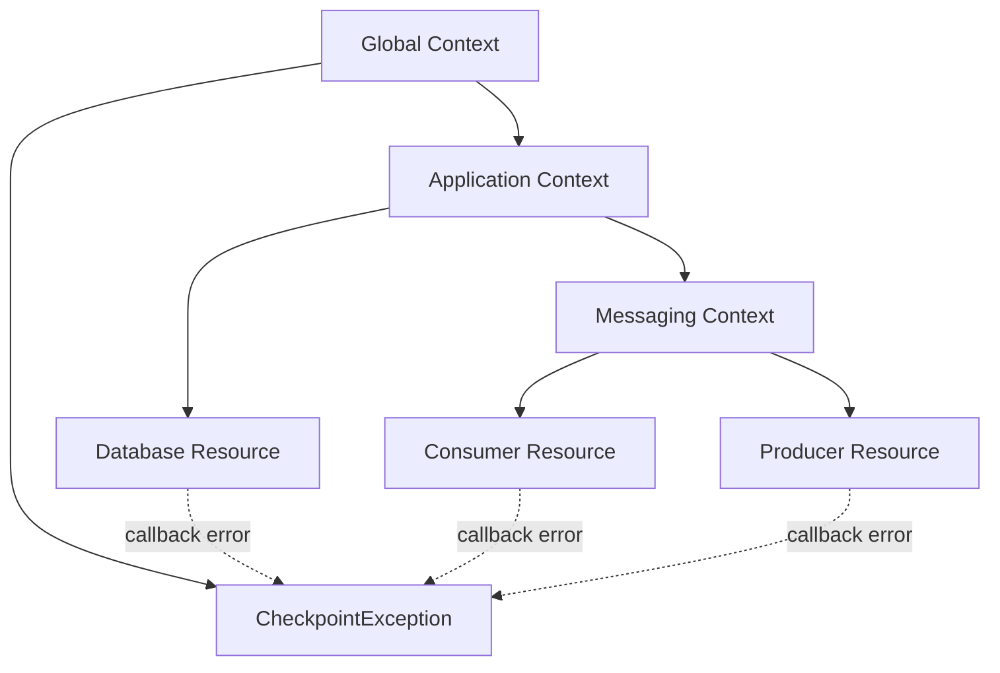

# Reading `CheckpointException`, `RestoreException`, and Suppressed Exceptions

When a checkpoint/restore operation fails, the outermost exception usually indicates only which phase failed to complete. The concrete causes may reside across multiple different `Resource` instances: a callback fails to close a socket, a worker does not stop, a connection pool cannot reopen, or a file descriptor remains open. CRaC aggregates exceptions thrown during resource notification as **suppressed exceptions** inside `CheckpointException` or `RestoreException`.

Therefore, reading only `getMessage()` or `getCause()` of the outermost exception is usually not enough. You need to read `getSuppressed()` as well, traverse the `cause` of each child error, and inspect the full stack trace. It is also important to properly understand the difference between a checkpoint failure and a restore failure: `CheckpointException` is typically thrown in the original JVM, whereas `RestoreException` is thrown in the restored JVM.

## 1. CRaC's Two Aggregate Exceptions

The `org.crac` API defines two exceptions to report errors in two distinct phases:

| Exception | Related phase | Meaning when thrown by `Core.checkpointRestore()` |
|---|---|---|
| `CheckpointException` | Checkpoint notification and errors related to the checkpoint operation | An error occurred while preparing the checkpoint; execution continues in the original JVM |
| `RestoreException` | Restore notification | A checkpoint was created and a new process was restored, yet one or more post-restore callbacks failed |

Both are checked exceptions extending `java.lang.Exception`. They act as aggregate exceptions: resource errors are stored in the suppressed list instead of picking only a single error as the cause.

`Core.checkpointRestore()` declares both exception types:

Method signature used directly in applications:

```java
import org.crac.CheckpointException;
import org.crac.Core;
import org.crac.RestoreException;

void requestCheckpoint() throws CheckpointException, RestoreException {
    Core.checkpointRestore();
}
```

The CRaC API is also available in the `jdk.crac` namespace on CRaC-enabled JDKs. If an application compiles against the `org.crac:crac` compatibility library, consistently use `org.crac.Core`, `org.crac.Resource`, `org.crac.CheckpointException`, and `org.crac.RestoreException`; do not mix `org.crac` types with `jdk.crac` types within the same processing flow.

## 2. `CheckpointException`: Errors During Checkpoint Preparation

Before the runtime snapshots process state, the global `Context` notifies resources via the `beforeCheckpoint` callback. A resource may close sockets, flush data, stop threads, release locks, or bring components into a safe state.

If one or more callbacks fail, the context records those exceptions. The context continues notifying the remaining resources so they have a chance to complete cleanup work. After notifications finish, the checkpoint operation does not produce an image as intended, and `Core.checkpointRestore()` throws `CheckpointException` in the original JVM.

Example of a resource unable to close a connection:

```java
import org.crac.Context;
import org.crac.Resource;

public final class DatabaseResource implements Resource {
    private final DatabasePool pool;

    public DatabaseResource(DatabasePool pool) {
        this.pool = pool;
    }

    @Override
    public void beforeCheckpoint(Context<? extends Resource> context)
            throws Exception {
        pool.closeForCheckpoint();
    }

    @Override
    public void afterRestore(Context<? extends Resource> context)
            throws Exception {
        pool.reopen();
    }
}
```

If `closeForCheckpoint()` throws `IOException`, the global context catches the exception from the callback and adds it to the suppressed list of `CheckpointException`. The application sees a single aggregate error even when multiple independent resources fail simultaneously.

### 2.1. Special Behavior: `afterRestore` May Run Even Without Image Creation

When an error occurs during checkpoint notification, CRaC must return resources to their normal operating state. Therefore, restore notifications are executed immediately inside the original JVM without creating an image. Errors occurring during this recovery `afterRestore` pass are also added to `CheckpointException`.

This means `CheckpointException` does not necessarily contain only errors from `beforeCheckpoint`. It can contain:

- An error where one resource could not prepare before checkpoint.
- Errors from other resources in the same checkpoint phase.
- Errors when a resource attempts to resume operation after the checkpoint was aborted.

For example, worker A closes its executor in `beforeCheckpoint`, but worker B fails to flush state so the checkpoint is aborted. When CRaC invokes `afterRestore` to recover the original JVM, worker A's executor fails to restart. Both worker B's flush error and worker A's restart error can appear in the suppressed tree of the same `CheckpointException`.

Do not manually invoke the entire `afterRestore` pass a second time merely because `CheckpointException` was caught. If the runtime already executed restore notifications to roll back after a checkpoint error, invoking them repeatedly can create duplicate workers or connections. Read the error, check resource state, and perform additional recovery only if the application lifecycle explicitly requires it.

## 3. `RestoreException`: Errors After Process Recovery

If checkpoint notifications succeed and the runtime creates an image, the original process terminates. Later, a new JVM is created from the image and resumes at the checkpoint point. CRaC sends `afterRestore` callbacks to resources so they can reopen sockets, connect to databases, register watchers, refresh tokens, or renew environment-dependent state.

If one or more `afterRestore` callbacks fail, the global context collects the errors and throws `RestoreException` in the restored process. The new JVM already exists, yet the application may not be ready to serve.

Example:

```java
public final class RemoteClientResource implements Resource {
    private final RemoteClient client;

    public RemoteClientResource(RemoteClient client) {
        this.client = client;
    }

    @Override
    public void beforeCheckpoint(Context<? extends Resource> context)
            throws Exception {
        client.close();
    }

    @Override
    public void afterRestore(Context<? extends Resource> context)
            throws Exception {
        client.connect();
        client.validateConnection();
    }
}
```

If `connect()` fails because the external service is not ready yet, the error can become a suppressed exception of `RestoreException`. Other resources are still notified because they also need the opportunity to complete recovery or report their own errors.

Do not mark the application Ready merely because the JVM restored. If a mandatory dependency cannot connect, readiness must remain false; depending on policy, the process may attempt bounded recovery or exit so the orchestrator provisions a new instance. Do not keep accepting requests with a connection pool or client in a half-recovered state.

## 4. Comparing Cause and Suppressed Exceptions

Java's `Throwable` has two distinct relationships:

- **Cause (`getCause()`)** describes the direct reason the current exception was created. This is a causal relationship.
- **Suppressed (`getSuppressed()`)** holds other independent exceptions that occurred while handling the same operation and could not become the primary thrown exception.

For example, a file write operation fails and closing the stream also fails. The write exception is thrown; the stream-close error is attached via `addSuppressed()`. This is why suppressed exceptions are used in try-with-resources.

CRaC uses the same mechanism to retain multiple callback errors. A `CheckpointException` may have no cause yet carry multiple suppressed exceptions. Calling only `e.getCause()` can return `null` and miss all actual root causes.

| API | Purpose | Important note |
|---|---|---|
| `getMessage()` | Retrieves the message of the current exception | Usually only a general description |
| `getCause()` | Retrieves the directly linked cause | Can be `null` even when suppressed exceptions exist |
| `getSuppressed()` | Retrieves independent errors aggregated into the exception | This is the first place to read on CRaC wrappers |
| `getStackTrace()` | Retrieves the stack trace of the current exception | Child error stack traces reside on the child exceptions themselves |
| `printStackTrace()` | Prints the exception, cause, and suppressed tree | Helpful for manual investigation when logs preserve full output |

A suppressed exception can itself have its own cause and suppressed exceptions. Hence, the error structure can be a multi-level tree rather than a flat list.

## 5. Reading a `CheckpointException` Stack Trace

A typical stack trace looks like:

```text
Exception in thread "main" org.crac.CheckpointException
    at org.crac.Core.checkpointRestore(Core.java:...)
    at com.example.CheckpointController.request(CheckpointController.java:42)
    Suppressed: java.io.IOException: Connection pool still has active leases
        at com.example.db.DatabasePool.closeForCheckpoint(DatabasePool.java:88)
        at com.example.db.DatabaseResource.beforeCheckpoint(DatabaseResource.java:24)
        ...
    Suppressed: java.lang.IllegalStateException: Worker did not stop before deadline
        at com.example.jobs.WorkerLifecycle.beforeCheckpoint(WorkerLifecycle.java:61)
        ...
```

Read in order:

1. The first line shows the wrapper type and general message.
2. The top frames show where the application requested the checkpoint.
3. Each `Suppressed:` branch is an error collected from a callback or context.
4. The stack trace beneath that branch identifies which resource and line of code threw the error.
5. If a child branch has its own `Caused by:` or `Suppressed:`, keep reading deeper.

Do not assume the first suppressed exception is the sole root error. Multiple resources can fail independently. Display order typically reflects the order in which errors were collected during notifications, yet you should use the class/resource and stack trace to identify causes rather than relying on index position.

## 6. Reading a `RestoreException` Stack Trace

A restore stack trace may look like:

```text
Exception in thread "main" org.crac.RestoreException
    at org.crac.Core.checkpointRestore(Core.java:...)
    at com.example.Application.main(Application.java:19)
    Suppressed: java.net.ConnectException: Connection refused
        at java.base/sun.nio.ch.Net.pollConnect(...)
        at com.example.remote.RemoteClient.connect(RemoteClient.java:73)
        at com.example.remote.RemoteClientResource.afterRestore(RemoteClientResource.java:31)
        ...
    Suppressed: java.io.IOException: Could not refresh credentials
        at com.example.security.TokenProvider.refresh(TokenProvider.java:55)
        at com.example.security.TokenResource.afterRestore(TokenResource.java:28)
        ...
```

In this example, the JVM was restored, yet the remote service is not accepting connections and token refresh also failed. The two errors are two independent branches. Fixing only the connection refused error does not guarantee the application is ready if credentials remain unrefreshed.

When diagnosing restore failures, identify which resources are mandatory dependencies and which can recover in the background. Not every error must halt the whole application, but that decision must be reflected in readiness and operational policy.

## 7. Traversing Suppressed Exceptions in Java

To log the full error, do not log only `exception.getMessage()`. Use `printStackTrace()` to print Java's standard error tree:

```java
try {
    Core.checkpointRestore();
} catch (CheckpointException e) {
    e.printStackTrace(System.err);
} catch (RestoreException e) {
    e.printStackTrace(System.err);
}
```

If the logging system needs to record each branch separately to filter by resource, recursively traverse `getSuppressed()` and `getCause()`:

```java
import java.util.Collections;
import java.util.IdentityHashMap;
import java.util.Set;

public final class ThrowableTreeLogger {
    private ThrowableTreeLogger() {
    }

    public static void log(Throwable error) {
        Set<Throwable> visited = Collections.newSetFromMap(
                new IdentityHashMap<>());
        visit(error, "root", visited);
    }

    private static void visit(
            Throwable error,
            String relation,
            Set<Throwable> visited) {
        if (error == null || !visited.add(error)) {
            return;
        }

        System.err.println(relation + ": "
                + error.getClass().getName() + ": " + error.getMessage());
        for (StackTraceElement frame : error.getStackTrace()) {
            System.err.println("    at " + frame);
        }

        Throwable[] suppressed = error.getSuppressed();
        for (int i = 0; i < suppressed.length; i++) {
            visit(suppressed[i], "suppressed[" + i + "]", visited);
        }

        if (error.getCause() != null) {
            visit(error.getCause(), "cause", visited);
        }
    }
}
```

`IdentityHashMap` is used to avoid repeatedly traversing the same `Throwable` object if the exception graph contains cyclic references. The example code writes to `System.err`; in real applications, replace it with a structured logger tagged with checkpoint ID, phase, and resource name. Preserve full stack traces, causes, and the suppressed tree.

## 8. Catching Exceptions Properly at the Checkpoint Call Site

If the application actively invokes `Core.checkpointRestore()`, distinguish three primary cases:

```java
import org.crac.CheckpointException;
import org.crac.Core;
import org.crac.RestoreException;

public final class CheckpointService {
    public void requestCheckpoint() {
        try {
            Core.checkpointRestore();
            // This line resumes in the restored JVM on success.
            System.out.println("Checkpoint restored successfully");
        } catch (CheckpointException e) {
            System.err.println("Checkpoint did not complete");
            ThrowableTreeLogger.log(e);
            // The original JVM continues; verify resources have returned to a safe state.
        } catch (RestoreException e) {
            System.err.println("Restore completed with resource failures");
            ThrowableTreeLogger.log(e);
            // The new JVM has restored, but is not necessarily ready to serve.
            throw new IllegalStateException(
                    "Application cannot become ready after restore", e);
        } catch (UnsupportedOperationException e) {
            System.err.println("CRaC is not supported by this runtime");
            ThrowableTreeLogger.log(e);
        }
    }
}
```

This example illustrates error classification. Real applications need an explicit policy:

- With `CheckpointException`, the original JVM continues. If the cause is a checkpoint notification error, CRaC already ran restore notifications so resources recover their initial state; verify resource health before resuming work.
- With `RestoreException`, the new JVM has recovered yet one or more `afterRestore` callbacks failed. If a mandatory dependency is unready, keep readiness false and usually fail fast so orchestration replaces the instance.
- With `UnsupportedOperationException`, the runtime does not support checkpoint/restore and no notifications ran. This is not a resource callback error.

Do not swallow `RestoreException` and open traffic as usual. If a transient connection needs retrying, do so under explicit deadlines and retry policies, and transition to Ready only after the dependency reaches a valid state.

## 9. Why Does the Context Still Call Other Resources When One Callback Fails?

Suppose an application registers three resources in the order `database`, `worker`, `listener`. At checkpoint, callbacks run in reverse registration order: listener, worker, database. If the listener stops successfully but the worker throws an exception, the database still needs to be notified to close its connection pool or flush data per the lifecycle contract.

If the context stopped immediately on the first error, the database might still hold open sockets or invalid file descriptors during the checkpoint. Therefore, the global context collects exceptions and continues notifying remaining resources. Afterward, the aggregate exception shows every callback that encountered a problem.

At restore, resources are notified in registration order. If reopening the database fails, the worker and listener are still notified so they can clean up partially initialized state or record the failure. The fact that every callback ran does not mean the application is allowed to resume serving; it simply makes error collection and per-component recovery more complete.

## 10. Nested Contexts and Multi-Level Suppressed Exceptions

An application can create child contexts to group resources by subsystem. A context is itself a `Resource`, so it can be registered inside a parent context. When a child context aggregates errors and throws `CheckpointException` or `RestoreException`, the parent context handles that exception according to the corresponding phase.

Across the hierarchy, errors can occur at multiple levels. The CRaC API specifies that suppressed exceptions in a child context are forwarded into the parent context's aggregate exception according to notification type. Thus, when reading stack traces, you may find context wrappers or resource exceptions nested inside the suppressed tree. Traverse recursively; do not assume `getSuppressed()` is only one level deep.

Conceptual diagram:



The diagram shows logical aggregation relationships; the exact `Throwable` object structure depends on how contexts and the runtime forward exceptions. Inspect actual stack traces and `getSuppressed()` instead of relying on a fixed number of levels.

## 11. Example: Multiple Errors in a Single Checkpoint Attempt

Suppose an application has three resources:

| Resource | `beforeCheckpoint` | Outcome |
|---|---|---|
| `HttpListenerResource` | Stop accepting requests | Succeeded |
| `DatabasePoolResource` | Close pool | Throws `IOException` because active connection lease remains |
| `FileWatcherResource` | Stop watcher | Throws `IllegalStateException` because worker did not stop in time |

The global context still notifies all three resources. The output may look like:

```text
org.crac.CheckpointException
    Suppressed: java.io.IOException: Active connection lease remains
        at com.example.db.DatabasePoolResource.beforeCheckpoint(...)
    Suppressed: java.lang.IllegalStateException: Watch worker did not stop
        at com.example.fs.FileWatcherResource.beforeCheckpoint(...)
```

Here, there is no single error to fix. Both the connection lease and the watcher worker must be handled. Then re-run the checkpoint to confirm all resources can bring the system to a safe state.

If the rollback `afterRestore` in the original JVM also hits errors, those recovery errors can additionally appear in the `CheckpointException` suppressed tree. In that case, identify which resources remain closed or unready before resuming service.

## 12. Diagnosing Open File Descriptors

A common checkpoint error is leaving a file descriptor open when the runtime requires the process to be isolated from its external environment. CRaC's debugging guide includes an example of a `CheckpointException` containing a suppressed `CheckpointOpenFileException` with descriptor and file path information.

Condensed example:

```text
org.crac.CheckpointException
    Suppressed: jdk.crac.impl.CheckpointOpenFileException:
        FileDescriptor 4 left open: /var/lib/app/state.db (regular)
        Use -Djdk.crac.collect-fd-stacktraces=true to find the source.
```

Key details are:

- The concrete exception type indicates the runtime detected an open file descriptor.
- The descriptor number helps cross-reference with OS tools.
- The path or resource type helps locate the owning subsystem.
- The hint `-Djdk.crac.collect-fd-stacktraces=true` enables capturing the stack trace where the descriptor was created in Java.

When you need to locate where a file was opened, re-run the application with the appropriate diagnostic flag:

```bash
java -Djdk.crac.collect-fd-stacktraces=true \
  -XX:CRaCCheckpointTo=./checkpoint \
  -jar app.jar
```

This option is a diagnostic flag of CRaC-enabled JDKs, not a standard Java property across all runtimes. Check your JDK's documentation. The descriptor creation stack trace can pinpoint which `FileInputStream`, `FileReader`, or library opened a file and forgot to close it before checkpoint.

## 13. Diagnosing Descriptors Opened From Native Code

A descriptor can be created by JNI or a native library without a corresponding Java `FileDescriptor`. CRaC can still detect the descriptor, yet cannot display a Java stack trace for where it was opened.

In this case, the suppressed exception may be `CheckpointOpenResourceException` and provide the descriptor type or native path. Trace the native library, driver, or system call creating the descriptor. On Linux, `strace` can help identify processes calling `open`, `socket`, `pipe`, or related syscalls:

```bash
strace -f -o /tmp/crac-strace.log java \
  -XX:CRaCCheckpointTo=./checkpoint \
  -jar app.jar
```

`-f` traces forked/spawned processes and threads; the log file must be protected and can grow very large. Use tracing in diagnostic environments rather than leaving it permanently enabled in production.

## 14. When Java Stack Traces Lack Sufficient Information

Not every checkpoint/restore failure has its full cause inside suppressed exceptions. When an error originates in the native checkpoint engine or CRIU, the Java stack trace may show only the `Core.checkpointRestore()` call site and a generic exception.

In that case:

1. Read runtime and CRIU output at the time of failure.
2. Check the checkpoint directory configured via `-XX:CRaCCheckpointTo`; some runtimes write native logs such as `dump4.log` there.
3. Verify permissions and capabilities required for checkpointing in the container or host.
4. Distinguish Java Resource checkpoint notification errors from native engine errors.
5. If restore fails, read CRIU/restore engine logs instead of relying solely on `RestoreException`.

For example, a PID conflict error in a container may appear in CRIU logs with a message that it cannot fork because a PID already exists. That is a namespace/process restore error, not a `Resource.afterRestore` error. Similarly, lacking write access to `ns_last_pid` or missing a capability can cause native restore to fail even though Java's suppressed list contains no resource callbacks.

Do not guess native causes from the name `CheckpointException` or `RestoreException`. Combine the wrapper, suppressed tree, runtime console output, and engine logs.

## 15. Distinguishing CRaC Exceptions From Application Exceptions

A callback can throw `IOException`, `SQLException`, `TimeoutException`, or business exceptions. The global context collects them inside a CRaC wrapper. Distinguish the outermost wrapper layer from the concrete error layer:

| Exception layer | Role | Diagnostic action |
|---|---|---|
| `CheckpointException` | Aggregates checkpoint phase errors | Read the entire suppressed tree and identify failing callbacks |
| `RestoreException` | Aggregates restore phase errors | Read the entire suppressed tree and check readiness |
| `IOException` | Resource I/O error | Check files, sockets, permissions, and filesystem state |
| `SQLException` | Database error | Check pool, transactions, server, and credentials |
| `TimeoutException` | Wait timeout expired | Identify which operation timed out and whether the deadline is reasonable |
| `UnsupportedOperationException` | Runtime does not support the requested service | Verify CRaC-enabled JDK and running implementation |
| Specific native/runtime exceptions | Error in checkpoint engine or runtime | Read engine logs and vendor/runtime documentation |

Do not catch all exceptions and log only `Checkpoint failed`. Preserve child exception types, stack traces, and suppressed/cause relationships so the owning subsystem can be found.

## 16. Common Mistakes When Reading the Exception Tree

### Reading only `getMessage()`

The message on `CheckpointException` may be empty or generic. The real errors live in `getSuppressed()`. Always log the full stack trace or traverse the exception tree.

### Reading only `getCause()`

Suppressed exceptions are not causes. `getCause()` can be `null` even when many resource errors occurred. Traverse both relationships.

### Fixing only the first suppressed exception

A single checkpoint attempt can fail across multiple resources. Fixing the first error may simply expose the second error on the next run. Read the full list and group by resource.

### Assuming `CheckpointException` always means `beforeCheckpoint` is the sole cause

When checkpoint notification fails, restore notification may run immediately to roll back inside the same JVM; errors from that recovery phase are also aggregated. Moreover, the native engine may record additional details in its own logs.

### Treating `RestoreException` as failure to create the checkpoint image

`RestoreException` reports failures during post-restore notifications. The new process has already restored, yet some resources are not yet ready.

### Swallowing `RestoreException`

If the application still opens readiness, requests can enter a process whose dependencies have not recovered. Keep readiness false or terminate the process per policy.

### Losing suppressed exceptions when re-wrapping

Code like `throw new RuntimeException(e.getMessage())` strips the cause and suppressed tree. If wrapping is needed, pass the original exception as the cause: `new IllegalStateException("CRaC operation failed", e)`.

### Logs lacking context

Stack traces must be correlated with checkpoint ID, phase, resource name, Pod/process identity, and timestamp. Do not log tokens, passwords, private keys, or sensitive data from messages/causes.

## 17. Incident Investigation Workflow

When encountering `CheckpointException` or `RestoreException`, you can follow these steps:

1. Determine whether the wrapper is `CheckpointException` or `RestoreException`.
2. Record JDK/CRaC version, runtime vendor, checkpoint ID, and the `Core.checkpointRestore()` call site.
3. Print the full stack trace, suppressed exceptions, and cause chain.
4. Group errors by resource or subsystem: file, socket, database, worker, scheduler, credentials, native descriptor.
5. If the error lies in `beforeCheckpoint`, inspect stop, drain, and resource-close ordering.
6. If the error lies in `afterRestore`, inspect reconnection, tokens, DNS, leases, volumes, and readiness.
7. If stack traces do not identify the source, enable diagnostic flags or collect native/CRIU logs per runtime.
8. Fix the root cause in the owning resource rather than merely catching the wrapper at the checkpoint call site.
9. Re-test checkpoint/restore and verify no suppressed errors remain.
10. Record results by checkpoint ID to compare across attempts.

## 18. Recommended Logging and Metrics

Each failure should record:

- Wrapper type and phase: checkpoint or restore.
- Checkpoint ID, application version, and runtime version.
- Count of suppressed exceptions at each level.
- Class name, message, and stack trace of each child error.
- Related resource/subsystem and whether the callback was `beforeCheckpoint` or `afterRestore`.
- Rollback/cleanup outcome after a checkpoint failure.
- Readiness and recovery status after a restore failure.
- Paths to related native or CRIU logs, if available.

Metrics can include `crac_checkpoint_failures_total`, `crac_restore_failures_total`, `crac_resource_callback_failures_total`, and `crac_suppressed_exceptions`. Use low-cardinality labels such as phase, resource type, and error category; do not use exception messages or dynamic file paths as metric labels.

## 19. Exception-Reading Checklist

- [ ] Correctly identified `CheckpointException` vs. `RestoreException`.
- [ ] Read `getSuppressed()` rather than only `getMessage()` or `getCause()`.
- [ ] Traversed multi-level causes and suppressed exceptions.
- [ ] Preserved original stack traces and exception types when logging or wrapping.
- [ ] Identified the resource/subsystem owning each error.
- [ ] For checkpoint notification failures, verified state after restore-notification rollback.
- [ ] For restore failures, kept readiness false until mandatory dependencies are ready.
- [ ] Distinguished callback exceptions from native checkpoint/restore engine errors.
- [ ] Enabled appropriate diagnostic flags/logs when source stack traces were missing.
- [ ] Retried and confirmed the exception tree contains no unhandled errors.

## 20. References

- [CRaC API 1.5.0 — `CheckpointException`](https://javadoc.io/static/org.crac/crac/1.5.0/org/crac/CheckpointException.html): aggregate exception for checkpoint notification failures.
- [CRaC API 1.5.0 — `RestoreException`](https://javadoc.io/static/org.crac/crac/1.5.0/org/crac/RestoreException.html): aggregate exception for restore notification failures.
- [CRaC API 1.5.0 — `Core`](https://javadoc.io/static/org.crac/crac/1.5.0/org/crac/Core.html): contract of `checkpointRestore()` and exceptions that may be thrown.
- [CRaC API 1.5.0 — Package `org.crac`](https://javadoc.io/static/org.crac/crac/1.5.0/org/crac/package-summary.html): global context rules, callback order, and exception aggregation.
- [CRaC Debugging Failures](https://crac.org/reference/debugging/): suppressed exception examples for file descriptors and locating Java/native error sources.
- [Java `Throwable`](https://docs.oracle.com/en/java/javase/21/docs/api/java.base/java/lang/Throwable.html): `getCause()`, `getSuppressed()`, `addSuppressed()`, and how Java prints exception trees.

`CheckpointException` and `RestoreException` are aggregate exceptions that do not always contain the actual root cause in their message or cause. Read the entire suppressed tree, follow the cause of each branch, and link each error to the resource that threw it. `CheckpointException` usually leaves the original JVM running after a checkpoint failure; if checkpoint notification fails, restore notification may run immediately to roll back and errors from both phases are aggregated. `RestoreException` appears in the new JVM when post-restore callbacks fail, so readiness must remain false until mandatory dependencies recover successfully.
