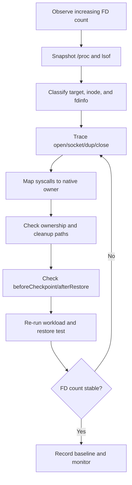

# Diagnosing File Descriptors Originating from Native Code

A Java application can open file descriptors (FDs) not only through `FileInputStream`, `SocketChannel`, or standard Java APIs. Native libraries invoked via JNI, JNA, Panama, or a third-party dependency can also open files, sockets, pipes, eventfd, epoll descriptors, and many other resources directly using operating system APIs.

These descriptors belong to the process file descriptor table. The JVM does not necessarily know which descriptor was created by which library, and an existing Java object does not prove the underlying descriptor is still valid. When an application runs for a long time, leaked FDs can cause the process to hit the `ulimit -n` limit, causing new file opens or connections to fail. With CRaC, native descriptors also need to be considered across the checkpoint/restore lifecycle: some types can be restored by the operating system mechanism, some need to be closed and recreated, and some depend on external state so they cannot be kept as-is from a business perspective.

Effective diagnosis needs to move from inventorying `/proc`, `lsof`, and `fdinfo` to tracing `open`, `socket`, `dup`, and `close` syscalls, then mapping the descriptor back to the Java code or native library that owns it. Once the owner is identified, you need to check success paths, error paths, asynchronous operations, and CRaC callbacks to ensure the descriptor is closed or restored exactly once.

## 1. What Is a File Descriptor?

On Linux, a file descriptor is a non-negative integer representing an entry in the process descriptor table. The kernel uses that entry to reference an open file description or another type of kernel resource.

Common native APIs that create descriptors include:

| API | Typical resource type created |
| --- | --- |
| `open()`, `openat()` | File or device |
| `socket()` | Network socket or Unix domain socket |
| `accept()`, `accept4()` | Socket for an accepted connection |
| `pipe()`, `pipe2()` | Two ends of a pipe |
| `dup()`, `dup2()`, `dup3()` | New descriptor referencing the same open file description |
| `eventfd()` | Event notification descriptor |
| `epoll_create1()` | Epoll instance |
| `inotify_init1()` | Inotify instance |
| `timerfd_create()` | Timer descriptor |
| `memfd_create()` | Anonymous file in a memory-backed filesystem |
| `signalfd()` | Descriptor for receiving signals |

An FD does not necessarily point to a regular file. When reading `/proc/<pid>/fd`, you may encounter forms such as:

```text
0 -> /dev/null
1 -> pipe:[421103]
2 -> pipe:[421104]
7 -> /var/log/service/native.log
8 -> socket:[421205]
9 -> anon_inode:[eventpoll]
10 -> anon_inode:[eventfd]
11 -> /memfd:runtime-cache (deleted)
```

This is an illustrative example. Names and display formats depend on the kernel and descriptor type.

### 1.1. FD Numbers Are Not Durable Identities

The kernel frequently reuses closed FD numbers. For example, descriptor `12` might be opened for a socket, closed, and then assigned to another file. Therefore, merely noting "FD 12 is leaked" is not sufficient to identify the same resource across multiple snapshots.

When comparing, you should record:

- PID and FD number at the time of observation.
- Descriptor type and target shown in `/proc/<pid>/fd`.
- Inode or socket inode if available.
- Contents of `fdinfo`.
- Snapshot timestamp and descriptor creation/closing activity.

PID and FD numbers can change after restore. You should not use them as business IDs or long-lived resource IDs.

### 1.2. Descriptors Are Shared Across Threads

Threads in a typical Linux process share the file descriptor table. One native thread may open an FD and another thread may use or close that FD. Therefore, searching only within the thread handling a request may miss the true owner.

If a native library runs its own worker threads, descriptors opened by those workers still appear in the process's `/proc/<pid>/fd`. You need to check both the worker's lifecycle and how the library transfers descriptor ownership.

## 2. Distinguishing Descriptors Managed by Java and Native Code

Standard Java APIs typically wrap descriptors in objects such as `FileInputStream`, `FileOutputStream`, `Socket`, `SocketChannel`, or NIO implementation classes. When the object is closed properly, Java typically closes the underlying resource according to the API contract.

Native code can open an FD without creating a corresponding Java object. For example, a JNI library calls `open()` and stores the integer in a C struct; Java only holds a `long` representing the native handle. In this case, the garbage collector does not automatically know when to close the FD unless the library has designed a specific cleanup mechanism.

| How the FD is created | Common owner | How to close |
| --- | --- | --- |
| `new FileInputStream(...)` | Java object or its wrapper | `close()` or API-supported cleanup mechanism |
| `SocketChannel.open()` | Java NIO channel | `close()` |
| JNI calling `open()` | Native wrapper or native object managed by Java | Native method calling `close()` on the proper owner |
| JNA calling `socket()` | JNA code or library using the FD | Call the corresponding close API, such as `close()` |
| Native library creating internal workers | Native library | Stop/join workers and call cleanup per library API |
| `dup()` creating a second descriptor | Owner of each descriptor | Each FD must be closed exactly once |

You should not infer an FD's origin solely from the `/proc` target. A socket can be opened from Java, JNI, or a native library. Combine the inventory with syscall tracing, logs, and source code.

### 2.1. Ownership Must Be Clear

Every FD needs an ownership rule:

- Who creates the descriptor?
- Who is allowed to use the descriptor?
- Who is responsible for closing the descriptor?
- Are descriptors duplicated?
- Are there APIs transferring ownership from native to Java or vice versa?
- When initialization fails partway through, who cleans up already-created FDs?

If both the Java wrapper and native library think they are the owner, the descriptor may be closed twice. If both think the other side is responsible, the descriptor may leak. Clearly document ownership in the API and method names, such as `adoptFd`, `duplicateFd`, or `closeOwnedFd`.

## 3. Why Do Native FDs Matter for CRaC?

Checkpoint/restore operates at the process and operating system level. Mechanisms such as CRIU can handle certain types of file descriptors, though capability depends on resource type, kernel, CRIU version, namespaces, socket state, and runtime configuration.

A descriptor may fall into one of the following groups:

1. **Restorable by the checkpoint mechanism:** for example, certain file descriptors or resource types supported by CRIU in the corresponding environment.
2. **Requires external coordination:** for example, TCP sockets or connections to databases or brokers where the external peer maintains its own state.
3. **Needs to be closed and recreated:** for example, native clients holding sessions or handles dependent on external services.
4. **Unsupported in the current environment:** checkpoint may fail or restore cannot recover that descriptor.

Do not assume that all native FDs are lost on restore, nor assume that all FDs are restored properly. Check the documentation of the CRaC JDK, CRIU, and the specific descriptor type, then test checkpoint/restore in the exact deployment environment.

### 3.1. A Restored Descriptor Does Not Mean the Connection Is Still Valid

A socket descriptor may still exist after restore, yet the connection to the external service is no longer in the state the application expects. The peer may have timed out, the server may have closed the session, credentials may have expired, or the protocol may require a new handshake.

Therefore, for native connections to databases, brokers, or network services, the safe approach is typically to:

- Stop using them and drain in-flight operations.
- Close the client/FD in the `beforeCheckpoint` callback if required by the library.
- After restore, create a new client/FD in `afterRestore`.
- Verify connectivity, authentication, and protocol state before reopening traffic.

Keep a descriptor across checkpoint only when the library, runtime, and environment are confirmed to support it, and the external service's semantics remain safe.

## 4. Counting Open Descriptors

On Linux, `/proc/<pid>/fd` is a quick starting point to inspect a process's descriptors.

```bash
PID=12345
ls -1 "/proc/$PID/fd" | wc -l
```

The command counts entries in the FD directory. This is an instantaneous snapshot; descriptors can be opened or closed while it is being read. When measuring trends, take multiple snapshots over time and compare after the workload has stabilized.

You can list the targets:

```bash
ls -l "/proc/$PID/fd"
```

Or use `lsof`:

```bash
lsof -nP -p "$PID"
```

`lsof` displays FD, file type, device/inode, mode, and name/path depending on the descriptor type. The `-nP` options avoid resolving hostnames and ports to names, making the output faster and easier to compare.

### 4.1. Comparing Before and After a Workload

A single measurement is unlikely to prove a leak. Follow this procedure:

1. Launch the application and let startup complete.
2. Run a fixed warm-up workload to eliminate FDs opened lazily on first use.
3. Record the FD count and inventory as a baseline.
4. Execute a defined number of operations, for example 100 or 1,000 times.
5. Wait for tasks and cleanup to finish.
6. Record the inventory again.
7. Repeat the same workload to see whether the FD count keeps increasing or reaches a plateau.

If each iteration leaves behind an additional FD of the same type or from the same library, a cleanup path may be missing. If the FD count rises initially and then stabilizes, that may be a bounded cache or pool rather than necessarily a leak.

### 4.2. Inventory Snapshot Script

You can save the FD list for comparison:

```bash
PID=12345
OUT="fd-snapshot-$(date +%s).txt"

for path in /proc/"$PID"/fd/*; do
    fd="${path##*/}"
    target=$(readlink "$path" 2>/dev/null || true)
    printf '%s\t%s\n' "$fd" "$target"
done | sort -n > "$OUT"

cat "$OUT"
```

This is a raw snapshot. When comparing across runs, supplement it with `fdinfo` and inode information. FD numbers can be reused, so do not compare only the first column.

## 5. Reading `/proc/<pid>/fdinfo`

Each FD typically has a corresponding file under `/proc/<pid>/fdinfo/<fd>`. This file provides metadata depending on the descriptor type.

```bash
PID=12345
FD=17
cat "/proc/$PID/fdinfo/$FD"
```

For a regular file, the output might include:

```text
pos:    4096
flags:  0100002
mnt_id: 35
ino:    812345
```

Common fields:

- `pos`: current file position if supported by the descriptor type.
- `flags`: file open flags in kernel representation.
- `mnt_id`: associated mount ID.
- `ino`: inode.

For special descriptors, specific fields such as epoll or eventfd information may appear. Do not assume all FD types share the same format.

### 5.1. Distinguishing FDs Sharing the Same Inode

If two FDs are created via `dup()`, they may reference the same open file description. For regular files, they may have the same inode and share the file offset. For sockets, duplicated FDs may reference the same kernel socket.

This matters when diagnosing leaks: a library might duplicate an FD and close the original while forgetting to close the duplicate. An inventory looking only at targets may show multiple descriptors with the same inode; you need to trace `dup`, `dup2`, `dup3`, or `fcntl(F_DUPFD...)` to locate the source.

## 6. Classifying Descriptors with `lsof`

`lsof` helps identify the type of resource holding an FD:

```bash
lsof -nP -p "$PID"
```

Some useful columns:

| Column | Meaning |
| --- | --- |
| `COMMAND` | Process name |
| `PID` | Process ID |
| `FD` | Descriptor number and mode, such as `17r`, `18u` |
| `TYPE` | Resource type, such as `REG`, `IPv4`, `IPv6`, `unix`, `FIFO`, `a_inode` |
| `DEVICE` | Device or equivalent information |
| `SIZE/OFF` | Size or offset if applicable |
| `NODE` | Inode or kernel identifier |
| `NAME` | Path, socket endpoint, or target |

Filter some common types:

```bash
lsof -nP -p "$PID" | grep -E 'IPv4|IPv6|unix|FIFO|REG|a_inode'
```

If you suspect a native library is opening log files, search for the related path. If you suspect a socket leak, group by `TYPE` and endpoint. If you suspect an event loop, inspect `anon_inode:[eventpoll]`, `eventfd`, and related sockets.

### 6.1. Socket Inodes and Network Connections

`/proc/<pid>/fd` typically displays sockets in the form `socket:[inode]`. You can cross-reference that inode with tables in `/proc/net` or the `ss`/`lsof` tools to find the endpoint.

```bash
ss -tanp
ss -xap
```

`ss -tanp` helps observe TCP sockets; `ss -xap` helps observe Unix domain sockets. Access may require the owner process's privileges or administrative privileges. Sockets do not display full process information if the system restricts permissions.

### 6.2. Deleted Files Still Open

An FD may point to a file that has been removed from its directory yet remains open. `lsof` may show the `(deleted)` suffix; `/proc/<pid>/fd/<fd>` may also indicate the target has been unlinked.

The file continues occupying resources until the last descriptor is closed. If a native library creates a temporary file and immediately unlinks it while keeping the FD, this may be intentional behavior. If the count grows continuously, inspect cleanup.

## 7. Checking Process and System FD Limits

A process can hit its FD count limit before the system exhausts global resources.

Check the limit of the exact process:

```bash
grep -i 'Max open files' "/proc/$PID/limits"
```

Check the current shell limit:

```bash
ulimit -n
```

Note: the shell's `ulimit -n` is not necessarily the limit of the running process. `/proc/<pid>/limits` is the information to verify against the target PID.

Check system-wide file handle counters:

```bash
cat /proc/sys/fs/file-nr
cat /proc/sys/fs/file-max
```

`file-nr` indicates the number of allocated file handles and limits in the kernel's representation; the meaning of each field depends on the kernel version. `file-max` is the system-wide file handle limit. A `Too many open files` error usually requires checking both the per-process limit and system-wide usage.

### 7.1. Identifying FD Exhaustion Errors

Some symptoms:

- Native `open()` or `socket()` returns `EMFILE`: the process has hit its FD limit.
- A syscall returns `ENFILE`: the system has hit the global file handle limit.
- Java reports `Too many open files` when opening a file or socket.
- The connection pool cannot create new connections.
- A native library reports unexplained I/O errors due to ignoring errno.

When encountering an error, record `errno`, the syscall, and the descriptor count. Do not simply raise `ulimit -n` to mask the issue if the FD count keeps increasing over time.

## 8. Tracing Syscalls That Create and Close FDs

After identifying the type of FD that is growing, you need to find out which code calls the syscall that creates it and whether a corresponding close call is made.

### 8.1. Using `strace`

`strace` can attach to the process and log relevant syscalls:

```bash
strace -ff -ttT -yy \
  -e trace=open,openat,close,dup,dup2,dup3,fcntl,socket,accept,accept4,pipe,pipe2,eventfd2,epoll_create1,inotify_init1,timerfd_create,memfd_create \
  -p "$PID" \
  -o /tmp/native-fd-trace
```

Options:

- `-f`: follow child threads/processes according to `strace`'s attach capabilities.
- `-ff`: separate output by thread/process ID.
- `-ttT`: record timestamps and syscall duration.
- `-yy`: attempt to resolve FDs into paths or endpoints.
- `-e trace=...`: trace only the relevant group of syscalls.
- `-p`: attach to a running PID.
- `-o`: write trace output to a file.

`strace` can introduce overhead and alter timing. Use it in a test environment or during a short diagnostic window. Attaching may also be blocked by ptrace permissions, container security policies, or system configuration.

### 8.2. Reading open/close Pairs

Example trace:

```text
openat(AT_FDCWD, "/var/lib/app/native-cache", O_RDONLY|O_CLOEXEC) = 17
read(17, "...", 4096) = 4096
close(17) = 0
```

This path creates FD 17 and then closes it. If the trace shows many `openat(...) = 17`, `18`, `19` without corresponding `close()` calls, a leak may exist or descriptors are being retained intentionally.

Do not match solely by FD number when analyzing long traces. An FD can be closed and then reassigned to another resource. Use timestamps, syscall sequences, targets, and inodes to track each lifecycle.

### 8.3. Tracking `dup` and `fcntl`

An FD can be duplicated using:

```text
dup(17) = 21
dup3(17, 22, O_CLOEXEC) = 22
fcntl(17, F_DUPFD_CLOEXEC, 30) = 30
```

Each new descriptor needs its own owner and cleanup. Closing FD 17 does not automatically close duplicates 21, 22, or 30. If the native wrapper only stores the original FD number, the duplicates may be left behind.

### 8.4. Capturing Native Stack Traces When Needed

Some versions of `strace` support `-k` to record stack traces when a syscall occurs, if the environment provides appropriate unwind support:

```bash
strace -k -f -ttT -e trace=openat,close,dup,dup2,dup3,socket,accept4 \
  -p "$PID" -o /tmp/native-fd-stacks
```

Stack traces can help identify the library or native function invoking the syscall. To obtain useful symbols, binaries need debug symbols or appropriate symbol information. If stack traces are unavailable, you can combine `perf`, eBPF uprobes, or instrument the native wrapper directly.

## 9. Mapping Descriptors Back to Native Libraries

After identifying a growing group of FDs, the next step is finding the owner.

### 9.1. Viewing Loaded Native Libraries

```bash
grep -E '\.so([.0-9]*)?$' "/proc/$PID/maps" | sort -u
```

This list shows shared libraries mapped into the process. It does not prove which library opened a specific FD, but it helps build a list of candidates.

### 9.2. Using Traces and Symbols

If `strace -k` or a tracing tool provides stacks, look for frames belonging to libraries such as `libfoo.so`, `libbar.so`, or the application's native modules. Then:

1. Identify the symbol/function calling `open`, `socket`, `dup`, or an equivalent API.
2. Locate the call site in the source code or symbol map.
3. Inspect the success path and every error path.
4. Check who owns the FD after the function returns.
5. Check cleanup on exceptions, cancellation, and shutdown.

If the library is a closed binary, consult the API documentation, debug symbols provided by the vendor, or ask the vendor about the lifecycle contract. Do not manually close an FD that the library is still using.

### 9.3. Instrumenting Native Wrappers

If the application controls the JNI/JNA code, log when descriptors are created, duplicated, and closed. Logs should include the resource name, FD number, resource type, thread ID, timestamp, and an operation ID.

Simple C example:

```c
int open_native_file(const char *path) {
    int fd = open(path, O_RDONLY | O_CLOEXEC);
    if (fd < 0) {
        log_native_error("open", path, errno);
        return -1;
    }

    log_fd_event("open", fd, path);
    return fd;
}

int close_native_fd(int fd) {
    if (fd < 0) {
        return 0;
    }

    int result = close(fd);
    if (result < 0) {
        log_native_error("close", NULL, errno);
        return -1;
    }

    log_fd_event("close", fd, NULL);
    return 0;
}
```

This snippet illustrates how to record events; you must add headers, a thread-safe logger, and the application's error handling policy. On Linux, you should not blindly retry `close(fd)` after an `EINTR` error, because the FD may already have been freed and reused. Follow the semantics of the platform and library in use.

## 10. Common Causes of Native FD Leaks

### 10.1. Missing `close()` on Error Paths

Native code opens an FD and then performs multiple steps. If the second step fails and the function returns early without closing the FD, each retry leaves behind a descriptor.

Buggy example:

```c
int load_state(const char *path) {
    int fd = open(path, O_RDONLY | O_CLOEXEC);
    if (fd < 0) {
        return -1;
    }

    if (validate_header(fd) != 0) {
        return -1; /* Leaked FD */
    }

    close(fd);
    return 0;
}
```

You must close the descriptor before returning on the error branch:

```c
int load_state(const char *path) {
    int fd = open(path, O_RDONLY | O_CLOEXEC);
    if (fd < 0) {
        return -1;
    }

    int result = validate_header(fd);
    int saved_errno = errno;
    close(fd);
    errno = saved_errno;
    return result;
}
```

The example above illustrates centralized cleanup. In real code, if the FD is needed after validation, close it only at the completion point; if multiple resources are opened, use a single cleanup path or RAII wrapper so nothing is missed.

### 10.2. Unclear Ownership Between Java and Native

A native method returns an FD number to Java without specifying who closes it. The Java wrapper may skip cleanup thinking the native library manages it; the native library keeps the descriptor thinking Java will close it.

The solution is to specify the contract clearly:

- A method returns a new FD and transfers ownership to the caller.
- A method returns a borrowed FD; the caller must not close it.
- A method returns a duplicate FD; the caller owns the duplicate.
- A method accepts an FD and adopts ownership.

Do not let an API merely return an `int` without describing ownership.

### 10.3. Duplicating a Descriptor but Closing Only the Original

`dup()` creates a new descriptor referencing the same open file description. If the code closes only the original FD and forgets the duplicate FD, the resource remains open.

Check every call site of `dup`, `dup2`, `dup3`, and `fcntl(F_DUPFD*)`. Each successful result must be assigned an owner and closed exactly once.

### 10.4. Exceptions or Cancellation in JNI/JNA

A JNI method may open an FD and then invoke a Java callback. The callback throws an exception, or native code detects a pending exception and returns without cleanup. Similarly, a JNA task may be canceled partway through.

Native code must check the exception state and perform cleanup before returning. Java code must use `try/finally` or `AutoCloseable` to release acquired ownership.

### 10.5. Worker Threads Holding FDs After the Java Object Closes

A native library may create a worker thread and hand an FD to that thread. The Java wrapper calls `close()`, yet the worker is still reading/writing or waiting for events. Closing an FD from another thread while I/O is in progress can create a race or syscall-dependent behavior.

The proper lifecycle is usually to ask the worker to stop, wake it up if blocked, join the thread, and then close the descriptor according to the library's contract.

### 10.6. FDs Retained by Callbacks or Registries

A native callback, event loop, or global registry may hold a pointer to the object managing the FD. The Java object appears unused, yet the native registry still holds the descriptor. Check deregistration and the library's shutdown hooks.

### 10.7. Missing `FD_CLOEXEC`

If a process spawns a child process or executes `exec`, an FD without close-on-exec may be inherited unintentionally. This can keep the FD open after the parent process expects it closed or prolong resource lifetime.

On Linux, prefer creating FDs with the close-on-exec flag from the start:

```c
int fd = open(path, O_RDONLY | O_CLOEXEC);
int s = socket(AF_INET, SOCK_STREAM | SOCK_CLOEXEC, 0);
int p[2];
pipe2(p, O_CLOEXEC);
```

For APIs that do not support this flag, you can use `fcntl(fd, F_SETFD, FD_CLOEXEC)`, though you must handle races with other threads calling `fork/exec`. Atomic variants such as `accept4` or `pipe2` help avoid the race window.

## 11. Managing Ownership with RAII in C/C++

In C++, RAII binds FD lifetime to object lifetime. The destructor closes the FD when the object is destroyed; move semantics transfer ownership; copying is disallowed to prevent two objects from thinking they own the same FD.

```cpp
#include <unistd.h>
#include <utility>

class UniqueFd {
public:
    explicit UniqueFd(int fd = -1) noexcept : fd_(fd) {}

    ~UniqueFd() {
        reset();
    }

    UniqueFd(const UniqueFd&) = delete;
    UniqueFd& operator=(const UniqueFd&) = delete;

    UniqueFd(UniqueFd&& other) noexcept
        : fd_(std::exchange(other.fd_, -1)) {}

    UniqueFd& operator=(UniqueFd&& other) noexcept {
        if (this != &other) {
            reset(std::exchange(other.fd_, -1));
        }
        return *this;
    }

    int get() const noexcept {
        return fd_;
    }

    int release() noexcept {
        return std::exchange(fd_, -1);
    }

    void reset(int next = -1) noexcept {
        if (fd_ >= 0) {
            ::close(fd_);
        }
        fd_ = next;
    }

private:
    int fd_;
};
```

`UniqueFd` is a minimal example. In production libraries, you must clearly specify how errors are reported when `close()` fails, how signal interruption is handled per platform, and the fact that destructors cannot throw exceptions. Do not copy FD owners; use `release()` when transferring ownership to another API and `reset()` when replacing a descriptor.

In plain C, you can use a cleanup label or equivalent helper so that every error branch closes already-opened descriptors. In Rust or other languages, prefer the corresponding ownership/Drop abstraction.

## 12. Java Wrappers for Native Descriptors

If Java holds a native FD, the wrapper should clearly represent the open/closed state and provide deterministic cleanup operations. Do not rely solely on finalizers or Cleaner to close resources before checkpoint; cleanup execution timing is not guaranteed.

Simple example with `AutoCloseable`:

```java
public final class NativeFile implements AutoCloseable {

    private int fd = -1;

    public NativeFile(String path) throws IOException {
        this.fd = openNative(path);
        if (fd < 0) {
            throw new IOException("Cannot open native file");
        }
    }

    public synchronized int read(byte[] target) throws IOException {
        ensureOpen();
        return readNative(fd, target);
    }

    @Override
    public synchronized void close() throws IOException {
        if (fd >= 0) {
            int current = fd;
            fd = -1;
            closeNative(current);
        }
    }

    private void ensureOpen() throws IOException {
        if (fd < 0) {
            throw new IOException("Native file is closed");
        }
    }

    private static native int openNative(String path) throws IOException;
    private static native int readNative(int fd, byte[] target)
            throws IOException;
    private static native void closeNative(int fd) throws IOException;
}
```

This example ensures the wrapper's `read` and `close` operations are serialized by a monitor. It is insufficient if the native library also uses the FD from a separate worker thread or holds an alias/duplicate. In that case, you need to stop and join the worker before closing the FD. If the native API allows concurrent operations, you can use an operation gate instead of holding the monitor throughout I/O.

### 12.1. Integrating Native Descriptors into the CRaC Lifecycle

If a descriptor needs to be closed before checkpoint and reopened after restore, you can create a resource managing the wrapper:

```java
import java.io.IOException;
import org.crac.Context;
import org.crac.Core;
import org.crac.Resource;

public final class NativeFileResource implements Resource {

    private final String path;
    private NativeFile nativeFile;

    public NativeFileResource(String path) throws IOException {
        this.path = path;
        this.nativeFile = new NativeFile(path);
        Core.getGlobalContext().register(this);
    }

    @Override
    public synchronized void beforeCheckpoint(
            Context<? extends Resource> context) throws Exception {
        if (nativeFile != null) {
            nativeFile.close();
            nativeFile = null;
        }
    }

    @Override
    public synchronized void afterRestore(
            Context<? extends Resource> context) throws Exception {
        NativeFile restored = new NativeFile(path);
        try {
            restored.verifyUsable();
            nativeFile = restored;
        } catch (Exception ex) {
            try {
                restored.close();
            } catch (Exception closeFailure) {
                ex.addSuppressed(closeFailure);
            }
            throw ex;
        }
    }
}
```

`verifyUsable()` is a check method defined by the application wrapper. The example illustrates a resource owning a native file; in real code, this method must exist and all operations using `nativeFile` must be protected with the same synchronization mechanism.

After `beforeCheckpoint`, the `nativeFile` field is `null` in the saved state. `afterRestore` creates a new wrapper and descriptor. Do not save the old FD number and try to reuse it, because that FD number may already have been assigned by the kernel to another resource.

### 12.2. Handling Aborted Checkpoints

If `beforeCheckpoint` has closed a native FD but the checkpoint process subsequently fails, you cannot assume `afterRestore` will be invoked in the current process. `afterRestore` is intended for the process restored from the image.

The application's lifecycle manager needs a dedicated rollback path if the checkpoint is aborted: reopen closed resources, verify the new descriptors, and only then reopen admission/readiness. If safe rollback is not possible, keep the instance in a not-ready state and let recovery procedures handle it.

## 13. Tracking Descriptors Across Multiple CRaC Cycles

To determine whether an FD leak is related to checkpointing, compare the inventory at these milestones:

1. After startup and warm-up.
2. After the workload finishes but before `beforeCheckpoint`.
3. After all resources complete `beforeCheckpoint`.
4. After restore and completion of `afterRestore`.
5. After the instance processes the same workload as before.
6. After multiple checkpoint/restore cycles.

A sample inventory might look like this:

| Milestone | Total FDs | Sockets | Regular files | anon_inode/other |
| --- | ---: | ---: | ---: | ---: |
| After warm-up | 42 | 12 | 8 | 22 |
| After drain and beforeCheckpoint | 25 | 3 | 5 | 17 |
| After restore and afterRestore | 41 | 11 | 8 | 22 |
| After workload run 2 | 42 | 12 | 8 | 22 |

The numbers are illustrative only. The goal is to confirm the FD count returns to expected levels and does not grow unbounded across cycles.

### 13.1. Distinguishing FDs Restored by CRIU from FDs Reopened by the Application

A descriptor appearing after restore may be:

- A descriptor restored by CRIU.
- A new descriptor created by a resource callback in `afterRestore`.
- A descriptor opened by the JVM or a library as execution continues.
- A descriptor created lazily by the first request after restore.

Do not compare solely by FD number because PIDs and descriptor numbers can differ. Use targets, inodes, resource types, and callback traces to identify the source. For resources designed to close/reopen, clearly log the close event before checkpoint and the open event after restore.

### 13.2. Checking CRIU and JVM Logs

If checkpoint or restore fails due to descriptors, save the CRaC JVM and CRIU logs. Look for messages about unsupported FDs, sockets, files, mounts, permissions, or unrecoverable resources. Log contents and detail level depend on the CRIU/JDK version.

`criu check` helps verify certain capabilities of the environment, yet does not prove that every descriptor the application has open can be dumped/restored. You must test with the actual descriptor types and real workload.

## 14. Descriptor Types Requiring Attention

### 14.1. Files and Temporary Files

Check paths, mounts, inodes, permissions, and whether files are deleted while still open. After restore, a path may point to different content if the volume changed. If a file is used as a lock or coordination primitive, verify external semantics.

### 14.2. TCP Sockets

TCP sockets depend on the peer and connection state at both endpoints. Check endpoints, TCP state, and the peer's ability to continue the session. For database/broker connections, it is usually advisable to close the client and reconnect in `afterRestore` according to the library's guidance.

### 14.3. Unix Domain Sockets

Unix sockets depend on paths or namespaces. After restore, the socket path may no longer exist, may be recreated, or may point to a different server. Check the socket file, mount namespace, and server lifecycle.

### 14.4. Pipes and FIFOs

Pipes may be attached to another process. If the peer has terminated or a descriptor is held unexpectedly, read/write operations may block or return EOF/EPIPE. You need to identify both ends and the peer's lifecycle.

### 14.5. epoll, eventfd, and timerfd

These descriptors are typically created by event loops or native libraries. They may be associated with threads, callbacks, and other descriptors. Do not close an eventfd/epoll FD on its own while the event loop is still using it. Stop the event loop, join threads, and clean up per the library's API.

### 14.6. Devices and Special Descriptors

Descriptors to `/dev/*`, GPUs, accelerators, or other devices may depend on drivers and hardware state. Do not assume CRIU can restore them. They typically need to be closed before checkpoint and reinitialized after restore according to vendor documentation.

## 15. Procedure for Diagnosing Native FD Leaks

A practical procedure can be broken down into the following steps:

### Step 1: Confirm an Actual FD Increase

Measure the FD count across multiple workload rounds after warm-up. Cross-check against `/proc/<pid>/limits` and the resource type that is increasing. If the count reaches a plateau, check whether it is a bounded pool/cache.

### Step 2: Classify Increasing FDs

Use `ls -l /proc/<pid>/fd`, `fdinfo`, and `lsof`. Group by file path, socket, pipe, anon_inode, deleted file, and inode.

### Step 3: Identify Syscalls Creating FDs

Attach `strace` in a test environment or use instrumentation/eBPF to trace `openat`, `socket`, `accept`, `dup`, `fcntl`, and `close`.

### Step 4: Map Back to the Owner

Use native stacks, symbols, `/proc/<pid>/maps`, source code, and API documentation to identify the library or module creating the descriptor. Check the ownership contract.

### Step 5: Inspect All Cleanup Paths

Inspect success, error, exception, cancellation, timeout, worker shutdown paths, and CRaC callbacks. Pay particular attention to duplicated FDs and worker threads holding descriptors.

### Step 6: Inspect the CRaC Lifecycle

Classify which FDs are kept, which need to be closed before checkpoint, and which must be recreated after restore. Verify resource callbacks and CRIU logs.

### Step 7: Repeat Testing

Run multiple create/use/close iterations and multiple checkpoint/restore cycles. The FD count must remain stable within expected bounds; it must not steadily increase after each round.



## 16. Automated Testing to Detect Leaks

A leak test should repeat the same operation enough times and measure the descriptor count after all work finishes. You should not assert the FD count against an absolute constant because the JVM, test runner, and operating system may open different descriptors.

Example strategy:

1. Initialize the application and run a warm-up round.
2. Capture the baseline FD count.
3. Perform N iterations of creating, using, and closing the native resource.
4. Wait for workers to finish and cleanup to complete.
5. Capture the FD count again.
6. Repeat another batch and compare the delta.
7. Set a reasonable maximum growth threshold and fail if the FD count increases linearly.

Pseudo test:

```java
@Test
void repeatedNativeOpenCloseDoesNotGrowFdCount() throws Exception {
    long baseline = countProcessFileDescriptors();

    for (int i = 0; i < 1_000; i++) {
        try (NativeFile file = new NativeFile(testPath)) {
            file.read(sampleBuffer);
        }
    }

    awaitNativeCleanup();
    long after = countProcessFileDescriptors();

    assertTrue(after - baseline <= allowedTransientDescriptors);
}
```

`countProcessFileDescriptors()` and `awaitNativeCleanup()` are test helpers. On Linux, you can count entries in `/proc/self/fd`; note that the directory listing operation itself can temporarily open an FD, so close the stream/directory handle before taking the final result or account for the small margin.

Automated tests should run on the same target OS/runtime type. In addition to unit tests, integration tests using the real native library are needed because fake wrappers cannot detect leaks inside binary dependencies.

## 17. Additional Observation Tools

### 17.1. `perf trace`

`perf trace` can observe syscalls similarly to strace in some environments:

```bash
perf trace -p "$PID"
```

Usability depends on the kernel, perf permissions, and system configuration. This is an additional option when observation is needed in an environment where perf is configured.

### 17.2. eBPF

eBPF can monitor syscalls or tracepoints related to file descriptors without attaching via ptrace as strace does. It can collect PID/TID, command, syscall, return value, and timestamp, then group open/close calls.

eBPF programs must be built and tested against the corresponding kernel, BTF, CAP_BPF/CAP_PERFMON permissions, or policies. Do not run an eBPF script of unknown origin in production; prefer organization-approved tools and limit duration/data volume.

### 17.3. Native Memory Tracking Is Not an FD Tracker

HotSpot Native Memory Tracking (NMT) helps observe certain native memory regions tracked by the JVM, such as threads, classes, code, GC, and internal allocations. It can be enabled with `-XX:NativeMemoryTracking=summary` or `detail` and queried via `jcmd`:

```bash
jcmd "$PID" VM.native_memory summary
```

NMT is not a tool for listing every file descriptor and does not guarantee tracking FDs opened by third-party native libraries. Use NMT to investigate native memory; use `/proc`, `lsof`, syscall tracing, or instrumentation to investigate FDs.

## 18. Operational Metrics and Alerting

An application can export several metrics about descriptors:

- Total open FDs.
- FD count grouped by resource type.
- Process FD limit.
- Utilization ratio of `open files limit`.
- Number of failed FD open syscalls due to `EMFILE` or `ENFILE`.
- Native resource create/close counts by type.
- Number of descriptors reopened after restore.
- Duration of closing and initializing native resources in CRaC callbacks.

A simple alert can use the ratio:

\[
\text{FD usage ratio} =
\frac{\text{Open FD count}}
{\text{Process open-file limit}}
\]

Alert thresholds should be based on the baseline and required headroom. Do not wait until 100% to alert because the application may need to open additional sockets, log files, or temporary descriptors during load spikes.

When exporting metrics, do not use the FD number as a label because label cardinality will grow and FD numbers can be reused. Use low-cardinality labels such as resource type, library, or subsystem.

## 19. Common Mistakes During Diagnosis

| Mistake | Why it misleads | How to handle |
| --- | --- | --- |
| Counting FDs only once | Does not distinguish leaks from lazily opened descriptors | Compare multiple snapshots after warm-up |
| Looking only at the FD number | The kernel can reuse FD numbers | Compare targets, inodes, fdinfo, and timestamps |
| Assuming all sockets are opened by Java | Native libraries can also call `socket()` | Trace syscalls and map stacks |
| Inspecting only heap dumps | Heap dumps do not fully list native FDs | Use `/proc`, `lsof`, and syscall tracing |
| Inspecting only NMT | NMT is not an FD inventory | Use descriptor-specific tools |
| Closing FDs externally without knowing the owner | Can break the event loop or library in use | Identify ownership and cleanup API first |
| Ignoring `dup()` | Duplicate descriptors stay open after closing the original | Trace `dup*` and `F_DUPFD*` |
| Relying on Cleaner to close before checkpoint | Cleaner does not run at a guaranteed time | Use deterministic close and CRaC Resource |
| Keeping native sockets across restore without verifying | Peer may have closed or session expired | Reconnect and verify the protocol |
| Counting FDs right at startup | Many system descriptors are opened lazily | Warm up before taking the baseline |
| Only increasing `ulimit -n` | Masks the leak without fixing the root cause | Identify the growth source and clean up |
| Assuming CRIU supports all FDs | Support depends on descriptor type and environment | Check logs and test on the exact runtime/kernel |

## 20. Checklist for Investigating a Native FD Leak

When you observe the descriptor count increasing, you can record findings in sequence:

- [ ] Identify the PID, timestamp, and process open-file limit.
- [ ] Capture a snapshot of `/proc/<pid>/fd` and `fdinfo`.
- [ ] Use `lsof -nP -p <pid>` to classify resources.
- [ ] Compare across multiple workload rounds after warm-up.
- [ ] Identify the FD group or inode that is steadily growing.
- [ ] Trace syscalls that create, duplicate, and close FDs.
- [ ] Map call stacks back to the native library or application module.
- [ ] Identify the owner and ownership transfer contract.
- [ ] Check all error branches, exceptions, cancellation, and worker shutdown paths.
- [ ] Check `FD_CLOEXEC` and inherited descriptors if fork/exec occurs.
- [ ] Determine whether descriptors are restored by CRIU or need closing/reopening.
- [ ] Check `beforeCheckpoint` and `afterRestore` callbacks.
- [ ] Re-run repeated tests and multiple checkpoint/restore cycles.
- [ ] Confirm the FD count is stable and sufficient headroom remains before release.

This checklist supports gathering technical evidence. Do not manually close descriptors based solely on path name or FD number before identifying the owner.

## 21. Conclusion

File descriptors originating from native code are process-level resources and may not be directly represented by an easily recognizable Java object. To diagnose them, start with `/proc/<pid>/fd`, `fdinfo`, `lsof`, and the limits in `/proc/<pid>/limits`; then trace `open`, `socket`, `dup`, and `close` syscalls using `strace`, `perf`, eBPF, or native instrumentation. Compare inventories across multiple workload rounds to distinguish leaks from intentionally retained descriptors.

Once the owner is found, clearly define ownership, handle every error path, and close each descriptor exactly once. In CRaC, classify descriptors by restorability and external semantics: close native handles that need to be recreated in `beforeCheckpoint`, open and verify new handles in `afterRestore`, and handle rollback if a checkpoint is aborted. Test on the actual JDK, CRIU, kernel, and descriptor types to ensure the FD count remains stable and the instance serves traffic only when native resources are ready.
