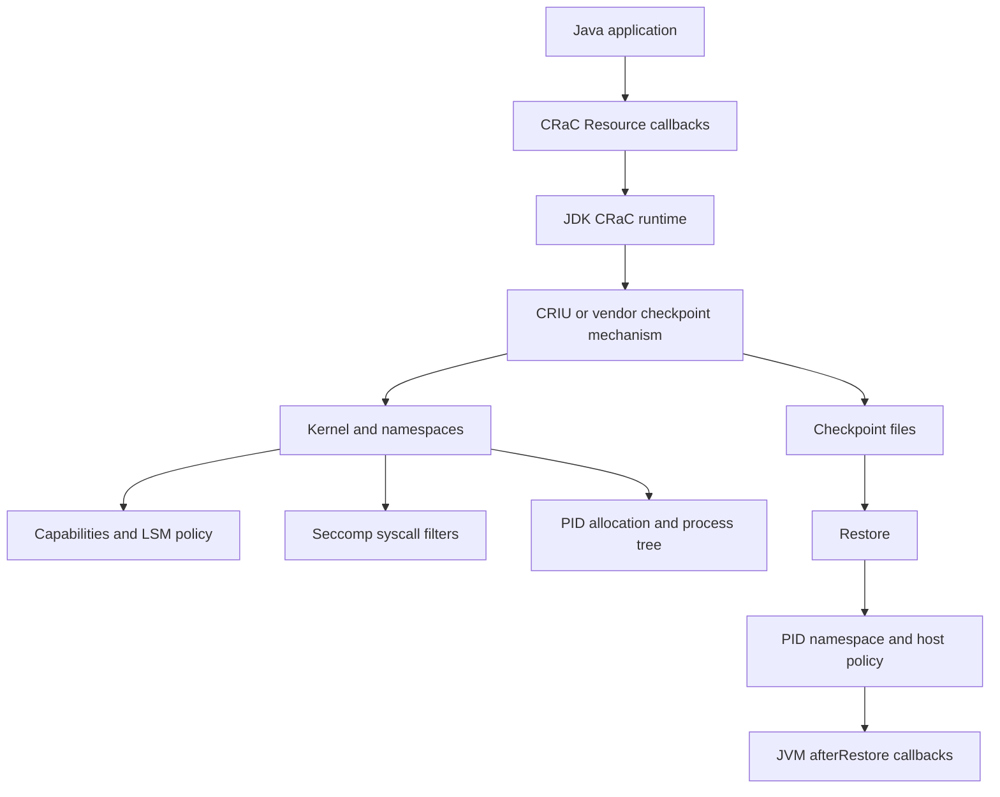

# Diagnosing Missing Permissions, Seccomp, and PID Conflicts

When checkpointing or restoring a Java CRaC application on Linux, errors do not always originate from Java code. The JVM must coordinate with the kernel, CRIU, process namespaces, filesystems, and host/container security policies. A checkpoint command can fail with `Operation not permitted`, `Permission denied`, `ptrace` errors, or syscall-related messages. Restore can fail because the PID cannot be reassigned, the source process still occupies the PID in the namespace, or another process is already using a resource that the snapshot needs to restore.

To diagnose effectively, you need to distinguish three categories of causes:

- **Missing permissions:** user, capabilities, user namespace, or `/proc` access permissions do not permit the required operation.
- **Seccomp and security policies:** syscalls are filtered or operations are denied by AppArmor/SELinux.
- **PID/process namespace conflicts:** the JVM, CRIU, or container runtime sees different PIDs, the PID to restore is already occupied, or the process is restored into an unsuitable namespace.

You should not fix this by enabling `--privileged`, disabling seccomp altogether, or running every container as root from the start. Identify the denied syscall/operation, check the corresponding permission layer, and grant only the minimum required permissions.

## 1. Recognizing Symptoms by Error Category

Error messages often indicate the layer to investigate first, though they do not always pinpoint the exact cause. For example, `Operation not permitted` can come from capabilities, seccomp, LSM policy, or namespace restrictions.

| Symptom | Possible cause category | Check first |
|---|---|---|
| `Operation not permitted` (`EPERM`) | Missing capability, seccomp error return, LSM policy, namespace restriction | Kernel logs, audit logs, capabilities, and seccomp status |
| `Permission denied` (`EACCES`) | Unix permissions, mount options, SELinux/AppArmor, `/proc` restriction | Owner/mode, mounts, audit denials |
| `ptrace: Operation not permitted` | Missing `CAP_SYS_PTRACE`, Yama, user namespace, or seccomp | `ptrace_scope`, capabilities, `/proc`, and security profile |
| Cannot read `/proc/<pid>/...` | PID namespace, `hidepid`, user permissions, process exited | PID namespace, procfs mount, UID, and actual PID |
| `jcmd` cannot attach to JVM | Wrong PID/namespace, different user, attach disabled, `/tmp` or procfs restricted | Run `jcmd -l` in the right namespace and check JVM flags |
| Cannot restore PID or `EEXIST` | PID already exists in target namespace or unsuitable namespace | Source process, PID namespace, and container sharing |
| `Address already in use` | TCP/UDP port or Unix socket already occupied | Socket listeners and process owning the port/path |
| Restore reports missing permission setting PID | Missing checkpoint/restore permission or namespace permission | `CAP_CHECKPOINT_RESTORE` capability, CRIU permissions, and host |
| Checkpoint succeeds yet restore fails | Restore environment, namespace, PID, permissions, kernel, or artifact | Compare host/runtime and full restore logs |

`EPERM` and `EACCES` are system error codes, not the name of a single root cause. Cross-reference JVM/CRIU logs with kernel audit logs to know exactly which operation was blocked.

## 2. Layering the Checkpoint/Restore Path

In a Java application running on Linux, the processing flow typically consists of:

1. The application requests a checkpoint via an API or control tool such as `jcmd`.
2. The CRaC JDK invokes the checkpoint/restore mechanism supported by the distribution.
3. The runtime coordinates with CRIU or the corresponding component to dump process state.
4. The kernel checks permissions, namespaces, syscalls, and resource accessibility.
5. Checkpoint artifacts are written to the target directory.
6. Upon restore, the runtime/CRIU recreates the process tree, memory, file descriptors, and supported system states.
7. The JVM invokes `afterRestore()` callbacks so the application can recover external resources.



When an error occurs, identify which step it appears at. If `beforeCheckpoint()` throws an exception, inspect the application lifecycle. If CRIU reports a denied syscall, investigate kernel/security policies. If the dump succeeds yet restore cannot create the PID, focus on process namespaces and existing processes in the target namespace.

## 3. Gathering Information Before Changing Configuration

Before changing capabilities or security profiles, save the state of the host and container. This helps compare successful runs with failed ones and avoids changing multiple variables at once.

### 3.1. Runtime and Operating System Information

Run on the exact host or inside the exact container experiencing the failure:

```bash
java -version
java -XshowSettings:properties -version
uname -a
uname -m
cat /etc/os-release
criu --version
criu check
```

Record the JDK vendor, distribution, version/build, CPU architecture, Linux distribution, kernel, and CRIU. If the JDK vendor provides its own diagnostic tool, run it additionally according to vendor documentation. `criu check` is only part of preflight; its result does not replace an actual checkpoint/restore with the exact JDK.

### 3.2. User Identity and Capabilities

```bash
id
grep -E '^(Uid|Gid|CapInh|CapPrm|CapEff|CapBnd|CapAmb|NoNewPrivs|Seccomp|Seccomp_filters):' /proc/self/status
```

The fields in `/proc/self/status` show the UID/GID and capability masks of the current process. `Seccomp: 0` typically indicates no seccomp filter; `Seccomp: 2` indicates filter mode. This value does not indicate which specific rule is blocking a syscall.

If the `capsh` tool is available, you can decode effective capabilities:

```bash
capsh --print
```

Run the command in the exact container and under the exact user running the JVM. Output from a different root shell does not represent the capabilities of the Java process.

### 3.3. Namespaces and PIDs

```bash
printf 'shell pid: %s\n' "$$"
printf 'namespace pid: %s\n' "$(readlink /proc/self/ns/pid)"
printf 'namespace user: %s\n' "$(readlink /proc/self/ns/user)"
printf 'namespace mount: %s\n' "$(readlink /proc/self/ns/mnt)"
cat /proc/self/status | grep '^NSpid:'
ps -ef
```

`NSpid` can display the PID chain from outer namespaces into the current namespace if the kernel provides that information. `readlink /proc/.../ns/pid` shows the namespace identifier inode to compare whether two processes share the same PID namespace.

Record the PID seen by the host, the PID inside the container, and the PID displayed by `jcmd -l`. Do not assume all three values are always identical.

## 4. Diagnosing Missing Capabilities

Linux capabilities divide traditional administrative privileges into smaller permissions. CRIU requires certain privileges depending on the operation, resource type, kernel, namespace, and execution method. There is no single capability list that applies to every CRaC application.

### 4.1. `CAP_CHECKPOINT_RESTORE`

Linux added `CAP_CHECKPOINT_RESTORE` starting in kernel 5.9. This capability allows several operations for checkpoint/restore, such as:

- Writing `ns_last_pid` in an appropriate PID namespace.
- Using `clone3()` with `set_tid` under kernel-defined conditions.
- Reading certain `/proc/<pid>/map_files` information according to corresponding permissions.

This capability does not automatically replace every permission CRIU needs. Dumping/restoring may still require privileges related to ptrace, network namespaces, mounts, file ownership, or other resources. On older kernels, how privileges are granted and requirements may differ; some operations may require `CAP_SYS_ADMIN` or broader privileges depending on the CRIU version.

Do not add `CAP_CHECKPOINT_RESTORE` and assume all CRIU errors will disappear. Inspect the specific syscall and operation in the logs.

### 4.2. `CAP_SYS_PTRACE`

CRIU may need to read or control process, thread, and memory state. `CAP_SYS_PTRACE` relates to many ptrace operations and process inspections, yet granting this capability can still be restricted by user namespaces, Yama, seccomp, or LSM policies.

If logs indicate a ptrace error, check:

- Whether CRIU runs under the appropriate user/capabilities.
- Whether the target process shares the same user namespace or has an appropriate permission relationship.
- Whether `kernel.yama.ptrace_scope` restricts attaching.
- Whether seccomp blocks `ptrace`, `process_vm_readv`, or related syscalls.
- Whether `/proc` is mounted with restrictive options such as `hidepid`.
- Whether AppArmor/SELinux has an audit denial for that operation.

### 4.3. Capability Bounding Set and User Namespaces

A container may be granted a capability in the runtime configuration, yet that capability remains restricted by the bounding set or user namespace. User namespaces map UID/GID inside the container to UID/GID on the host. Root inside a container is not necessarily root with corresponding privileges on the host.

Check `CapBnd` and `CapEff` in `/proc/self/status`. If a capability is not in the bounding set, running `setcap` or requesting additional capabilities inside the container will not elevate privileges beyond host/runtime limits.

In rootless containers, checkpoint/restore capability depends on kernel, CRIU, and runtime support. Do not assume root inside a user namespace can manipulate processes belonging to another user namespace or write `ns_last_pid` in an unpermitted scope.

### 4.4. Verifying Capabilities Without Granting Excessive Privileges

You can inspect container configuration from the host:

```bash
docker inspect <container-name-or-id>
```

Check relevant fields such as `CapAdd`, `CapDrop`, `Privileged`, `SecurityOpt`, user, and PID mode. For Kubernetes Pods, check `securityContext`, `runAsUser`, `allowPrivilegeEscalation`, `capabilities`, `seccompProfile`, `hostPID`, and runtime class configuration if present.

When you need to test a capability, create an isolated test environment, add only the exact capability required by the vendor/CRIU, and repeat the same scenario. Record the before/after difference. Do not keep `--privileged` as a production fix without proving necessity and assessing security impact.

## 5. Diagnosing ptrace and procfs Permissions

Some CRIU operations or JVM attach tools need to read process state. Linux controls this using UID/GID, capabilities, ptrace access checks, procfs mount options, and LSM.

### 5.1. Yama `ptrace_scope`

On some Linux distributions with the Yama LSM, the `kernel.yama.ptrace_scope` setting restricts which processes can attach to or inspect other processes.

Check:

```bash
cat /proc/sys/kernel/yama/ptrace_scope
```

Specific values and meanings depend on the kernel/Yama; common levels range from parent-child relationship restrictions to stricter limits. Do not automatically set it to `0` on production hosts. If logs confirm Yama is the cause, evaluate the required scope and use a dedicated configuration for CRaC nodes/runners according to security policy.

### 5.2. Procfs and `hidepid`

`/proc` may be mounted with `hidepid` or other options preventing users from seeing information about other processes. Check:

```bash
findmnt -no TARGET,FSTYPE,OPTIONS /proc
mount | grep ' on /proc '
```

If `hidepid` or mount namespaces restrict process visibility, determine which PID CRIU/JDK needs to access and whether it can run in the same namespace. Do not remount `/proc` host-wide with relaxed permissions if only one container needs access.

### 5.3. JVM Attach API and `jcmd`

`jcmd` must be able to attach to the target JVM. If `jcmd -l` does not list the process or the checkpoint command reports attach failure, check:

- `jcmd` belongs to the same JDK vendor/version/build as the target JVM.
- The tool and JVM run under compatible users.
- The tool runs in the right PID namespace.
- `/tmp` or the attach socket directory is properly shared and has appropriate permissions.
- The JVM was not started with `-XX:+DisableAttachMechanism` if the workflow requires attach.
- Procfs and security policies do not block the attach mechanism.
- The passed PID is the PID in the namespace visible to `jcmd`.

Example:

```bash
"$JAVA_HOME/bin/jcmd" -l
"$JAVA_HOME/bin/jcmd" <java-pid> VM.version
```

Only after `VM.version` attaches successfully should you try the checkpoint command. If `jcmd` cannot attach, resolve the attach issue first; that failure does not yet prove CRIU lacks permissions.

## 6. Diagnosing Seccomp

Seccomp is Linux's syscall filtering mechanism. Container runtimes typically apply a seccomp profile to limit the syscalls a process can invoke. A profile may allow a Java application to run normally while blocking syscalls CRIU needs during dump or restore.

### 6.1. Symptoms of Seccomp Blocking a Syscall

Common symptoms:

- `EPERM` error when invoking a syscall that the process is normally permitted to invoke.
- Kernel/audit logs record a seccomp violation.
- `/proc/<pid>/status` shows `Seccomp: 2`.
- The same image and JDK run on the host yet fail inside a container with a restrictive profile.
- Tests succeed using a broader profile yet fail with the production profile.

`Seccomp: 2` only indicates the process is in filter mode; it does not indicate which specific syscall is blocked or the rule action. Inspect audit/kernel logs, the actual profile, and syscall traces if permitted.

### 6.2. Checking Docker Seccomp Profiles

Inspect container configuration:

```bash
docker inspect <container-name-or-id>
```

Check `HostConfig.SecurityOpt`, `CapAdd`, `CapDrop`, and runtime configuration. If using the default seccomp profile, verify the Docker/container runtime version and applied profile; profiles can change across runtime versions.

Do not conclude that the Docker default profile always blocks a specific syscall across all versions. Match the denied syscall against the exact profile used on the host.

### 6.3. Checking Seccomp in Kubernetes

Pods can declare seccomp at the Pod level or container level via `securityContext.seccompProfile`. Common values include `RuntimeDefault`, `Localhost`, and `Unconfined` (depending on Kubernetes and runtime versions).

Explicit configuration example:

```yaml
apiVersion: v1
kind: Pod
metadata:
  name: crac-integration-test
spec:
  securityContext:
    seccompProfile:
      type: RuntimeDefault
  containers:
    - name: app
      image: registry.example/app:crac-test
      securityContext:
        allowPrivilegeEscalation: false
        capabilities:
          drop:
            - ALL
```

This configuration illustrates a restrictive baseline, not a profile verified to be sufficient for CRaC. If CRIU needs additional syscalls or capabilities, use a managed `Localhost` profile tested according to vendor/platform requirements. Do not switch directly to `Unconfined` in production just to make tests pass.

### 6.4. Identifying the Blocked Syscall

If audit logs are available, look for seccomp records matching the failure timestamp. On hosts with systemd/journald:

```bash
journalctl -k --since "10 minutes ago"
dmesg --ctime | tail -n 200
```

If auditd is enabled:

```bash
ausearch -m SECCOMP -ts recent
```

Field names and query syntax depend on the distribution/auditd. Host administrative privileges may be required to read kernel/audit logs.

If reproducible in an isolated environment, `strace` helps observe syscalls and errno:

```bash
strace -ff -o /tmp/crac-strace \
  -e trace=process,ptrace,prctl,seccomp,clone,clone3,unshare,setns \
  <vendor-documented-crac-command>
```

Not every syscall appears in every CRIU version; the trace list is only a starting point. `strace` may require ptrace permissions and can alter process timing or behavior. Do not run traces in production without assessing the impact.

### 6.5. Building a Custom Profile Based on Evidence

Once the blocked syscall is identified:

1. Record the syscall, PID, timestamp, and errno from audit/trace.
2. Match the syscall against the exact CRIU/JDK version and dump/restore operation.
3. Check whether any rule in the current profile blocks the syscall or returns an unsuitable action.
4. Add the minimal exception to a dedicated profile for the CRaC workload.
5. Re-run checkpoint/restore with the same test suite and security profile.
6. Verify other syscalls were not broadened beyond what is needed.

Do not copy a broad seccomp profile from the Internet without understanding every rule. Do not disable seccomp cluster-wide to fix a single workload's error.

## 7. AppArmor, SELinux, and Other Protection Layers

Seccomp is not the only protection layer. AppArmor and SELinux can deny access to files, `/proc`, signals, ptrace, mounts, or namespace-related operations.

### 7.1. AppArmor

Check status and profiles:

```bash
aa-status
```

Search for denials in kernel logs or audit logs. The profile name is usually recorded in the log entry. If AppArmor denies a CRIU operation, adjust a workload-specific profile and allow only the necessary paths/operations.

Do not switch the entire host to complain mode or disable AppArmor as a permanent fix. You can use diagnostic mode in a test environment to identify missing rules, then update the profile and re-test in enforce mode.

### 7.2. SELinux

On systems using SELinux, check the mode and audit denials:

```bash
getenforce
ausearch -m AVC,USER_AVC -ts recent
```

A `Permission denied` error can come from SELinux even when Unix file mode and owner look right. Inspect source/target contexts, type enforcement, and mount paths. If a policy needs to be generated, use audit analysis tools per your distribution's process; do not create overly broad allow rules simply by piping every denial into a policy without review.

### 7.3. Mount Options and Filesystem Permissions

The checkpoint directory may reside on a volume with unsuitable owner, mode, or mount options. Check:

```bash
id
namei -l /path/to/checkpoint
findmnt -T /path/to/checkpoint
df -h /path/to/checkpoint
df -i /path/to/checkpoint
```

Confirm the user running the JVM has permissions to traverse directories and write files. Check that the filesystem still has free space and inodes. An `ro` mount, NFS policy, root squash, or SELinux context permissions can cause failures even though the container sees the path exists.

## 8. Diagnosing PID Conflicts

A PID is a process identifier within a PID namespace. The same process can have different PIDs when viewed from the host versus from inside a container. Upon restore, CRIU/JDK needs to restore the process tree according to the saved state and corresponding namespace conditions.

Conflicts can occur when:

- The source process is still alive in the PID namespace that restore needs to use.
- Another process has already occupied the PID to be restored.
- Two workloads share the same PID namespace or run with `hostPID`.
- A test runner passes a host PID to `jcmd` inside a container or vice versa.
- The runtime creates a new namespace or attaches to an existing namespace improperly compared to checkpoint time.
- A service manager starts an additional instance of the application.
- A stale PID file causes a startup script or supervisor to misjudge which process is running.

### 8.1. PID Namespace

Linux PID namespaces isolate the PID space. A process may have PID `1` inside a container while having a different PID on the host. If containers use separate PID namespaces, two containers can both have PID `1` without conflicting with each other.

Conversely, a container running with `--pid=host` or a Pod with `hostPID: true` enabled shares the host's PID namespace. In that case, restored PIDs can conflict with host processes or other workloads. Sharing the PID namespace also increases visibility into and ability to affect other processes.

Check namespaces:

```bash
readlink /proc/1/ns/pid
readlink /proc/self/ns/pid
cat /proc/self/status | grep '^NSpid:'
```

Run these commands both on the host and inside the container. If the two namespace paths differ, the processes are in different PID namespaces. When comparing a specific process, inspect `/proc/<pid>/ns/pid` on the side that sees that PID.

### 8.2. Host PID vs. Container PID

Suppose Java has PID `1` in the container yet PID `24831` on the host. If you run:

```bash
jcmd 24831 JDK.checkpoint
```

inside a container with its own PID namespace, `jcmd` may not find process `24831`. Conversely, from the host, PID `1` may be systemd rather than Java inside the container.

Determine where the control tool runs:

- Running `jcmd` inside the container: use the PID seen inside the container.
- Running `jcmd` on the host: use the host PID and ensure appropriate user/capability/attach access.
- Using container runtime exec: check which PID namespace the exec command joins.

Do not take a PID from `docker inspect`, `docker top`, or host `ps` and pass it to a tool inside the container without namespace translation.

### 8.3. Source Process Still Alive After Checkpoint

Some checkpoint workflows can leave the source process running after the snapshot finishes; the exact behavior depends on the JDK/vendor and control tool. If you restore the image into the same PID namespace while the source process still occupies the required PID, restore may fail.

Before restoring, verify the source process state per runtime documentation. If the source process needs to be stopped, do so only after the checkpoint finishes and the artifact is confirmed valid. Do not kill the source process before the checkpoint command completes or before the runtime confirms the snapshot is finished.

If you need to run the source and restored processes side by side for comparison, use a separate PID namespace for the restored process in the way supported by the vendor/container runtime. Do not force two process trees to use the same PID in the same namespace.

### 8.4. Restoring the Same Image Multiple Times

A checkpoint image can serve as the source for multiple instances in a scale-out architecture, yet each instance needs an appropriate process namespace environment. If you restore multiple copies into the same PID namespace, PIDs in the snapshot can collide.

Typically, each container/pod needs its own PID namespace if the workload is designed to run independently. If the platform has a restore mechanism with PID remapping or separate namespaces, follow its specific documentation; do not manually edit PIDs in checkpoint files.

## 9. Distinguishing PID Conflicts from Port Conflicts and Stale PID Files

Not every error containing the words "already in use" is a PID collision.

### 9.1. Port Conflict

If logs contain `Address already in use` or `EADDRINUSE`, check ports:

```bash
ss -lntup
ss -lx
```

The first command lists listening TCP/UDP sockets; the second lists Unix domain sockets. Another service may already have bound the port the application needs after restore. This is a socket/network conflict, even though the operational cause may be another running process.

### 9.2. Stale PID Files

Some daemons write their PID to a file such as `/run/app/app.pid`. After restore or after an improper shutdown of the source process, the file may remain while that PID no longer exists or already belongs to another process.

Check:

```bash
cat /run/app/app.pid
ps -p "$(cat /run/app/app.pid)" -o pid,ppid,comm,args
```

Do not delete a PID file based solely on its contents. Confirm whether the process recorded in the file is actually an instance of the service. If the file is stale, remove it per the service's lifecycle before starting a new instance. If the current PID belongs to a different process, never blindly kill that process to free the PID.

### 9.3. Unix Sockets and Lock Files

Libraries may use Unix domain sockets, lock files, or marker files to enforce singleton behavior. After restore, the path/socket may already exist from the source process or filesystem volume. Check the owner, inode, listener, and service lifecycle.

Do not delete socket files or lock files before identifying the owning process. An existing file may be a legitimate artifact of a running service, not a leftover file.

## 10. PID 1, Signals, and Process Supervisors

In a container, the main process typically runs as PID `1` inside the PID namespace. If a shell script does not use `exec`, the shell may hold PID 1 and Java becomes a child process. This affects signal reception, shutdown handling, and process observation.

A simple entrypoint should replace the shell with Java:

```sh
#!/bin/sh
set -eu
exec java "$@"
```

If the application needs to handle checkpoints via `jcmd`, determine the actual Java PID inside the namespace. Do not assume PID 1 is always Java if there is an init process or supervisor.

### 10.1. Supervisors Can Create Duplicate Processes

Systemd, supervisord, or a custom entrypoint may automatically restart Java after the source process terminates. If restore is also launched, two instances may run concurrently, contend for ports, or create duplicate consumers.

When using checkpoint/restore, determine which process is managed by the supervisor and who is responsible for restoring. Disable auto-restart during the appropriate stage if it conflicts with the restore workflow; do not disable supervision entirely if production relies on it for fault management.

### 10.2. Signals and Process State

Container runtimes typically send signals to PID 1 when stopping a container. If a shell holds PID 1 and does not forward signals, Java may not receive signals properly. This can cause test cleanup or shutdown to hang, leaving old PIDs alive and causing conflicts on subsequent restores.

Use `exec`, or an init/supervisor designed to forward signals and reap child processes. Test both normal shutdown paths and checkpoint paths to distinguish processes remaining alive due to signal handling from CRIU errors.

## 11. PID Namespaces in Docker and Kubernetes

### 11.1. Docker

Docker by default typically creates a separate PID namespace per container, though `--pid=host` or sharing namespaces with another container can be configured. Check the actual configuration:

```bash
docker inspect <container-name-or-id>
docker top <container-name-or-id>
```

Check `HostConfig.PidMode` and related settings. With CRaC, prefer a separately managed PID namespace for the workload if the architecture allows. Avoid `--pid=host` merely to make processes visible to `jcmd`; handling namespaces and attach permissions properly is safer.

### 11.2. Kubernetes

Kubernetes can use a separate PID namespace for a Pod or share a PID namespace within a Pod depending on configuration. `hostPID: true` allows the Pod to share the host's PID namespace and increases the risk of cross-process visibility/conflicts.

Check the Pod manifest:

```yaml
spec:
  hostPID: false
  shareProcessNamespace: false
```

This is an illustrative configuration. `shareProcessNamespace` applies when containers in the same Pod need to see one another's processes; it does not mean sharing the host's PID namespace. Verify behavior according to the Kubernetes and runtime versions in use.

If the CRaC platform requires restoring in a specific namespace, the Pod/CRI runtime configuration must follow the platform's guidance. Do not enable `hostPID` as a default troubleshooting fix.

## 12. Step-by-Step Diagnostic Procedure

When checkpoint/restore fails, follow a fixed sequence to avoid changing multiple layers at once.

### Step 1: Identify the Failure Phase

Specify whether the failure occurs at startup, `jcmd` attach, `beforeCheckpoint`, CRIU dump, writing checkpoint files, CRIU restore, or `afterRestore`. Use log timestamps and run IDs to correlate events.

### Step 2: Confirm the Correct Runtime and Process

Run `java -version`, `jcmd -l`, and confirm the JDK vendor/build and PID. Ensure the `jcmd` tool belongs to the right JDK and runs in a namespace that can see the target JVM.

### Step 3: Collect Permissions and Namespaces

Retrieve `id`, `CapEff`, `CapBnd`, `NoNewPrivs`, `Seccomp`, PID namespace, user namespace, and mount namespace. Compare across host, container, and Java process.

### Step 4: Read Kernel and Security Logs

Search for `EPERM`, `EACCES`, seccomp records, AppArmor denials, or SELinux AVCs at the exact timestamp. Identify the blocked syscall/path/process.

### Step 5: Check PIDs and Occupied Resources

Check whether the source process is still alive, whether the PID namespace is shared, whether the PID to restore is already in use, whether a service manager launched another instance, and whether ports/Unix sockets are occupied.

### Step 6: Change One Small Condition

Test only the required capability or rule in a test environment. If modifying a seccomp profile, keep other factors unchanged so you know which change resolved the error.

### Step 7: Re-run Actual Checkpoint and Restore

Do not stop when the checkpoint command returns success. Restore the image, verify callbacks, readiness, and a business operation. Save the working configuration as a baseline.

## 13. Quick Decision Table

| If you see | Check | Common resolution |
|---|---|---|
| `jcmd` cannot find JVM | PID, namespace, user, attach socket, `DisableAttachMechanism` | Run tool with the right JDK/user/namespace and fix attach access |
| `ptrace` denied | `CAP_SYS_PTRACE`, Yama, seccomp, procfs, LSM | Grant minimal privilege and appropriate policy for the workload |
| CRIU reports `EPERM` on PID operations | `CAP_CHECKPOINT_RESTORE`, kernel, user namespace | Use supported capabilities/runtime and proper namespace |
| CRIU reports `EPERM` on another syscall | Corresponding seccomp/LSM/capability | Cross-reference audit/trace and update the exact rule |
| `EACCES` at checkpoint path | Owner/mode, mounts, SELinux/AppArmor, read-only | Fix permissions and context for the specific volume |
| Restore reports PID already exists | Source process, PID namespace, supervisor, hostPID | Stop source per procedure or restore in a separate namespace |
| `EADDRINUSE` | Listeners/ports and Unix sockets | Identify the process owning the socket; manage listeners per lifecycle |
| Restore runs yet readiness fails | `afterRestore`, dependencies, workers, credentials | Keep readiness false and fix resource recreation |

## 14. Example of Collecting a Diagnostic Bundle

You can create a diagnostic directory containing metadata and logs without copying checkpoint memory files into it:

```bash
#!/usr/bin/env bash
set -u

OUT="${1:-/tmp/crac-diagnostics}"
mkdir -p "$OUT"

java -version >"$OUT/java-version.txt" 2>&1
java -XshowSettings:properties -version >"$OUT/java-properties.txt" 2>&1
uname -a >"$OUT/uname.txt" 2>&1
uname -m >"$OUT/architecture.txt" 2>&1
cat /etc/os-release >"$OUT/os-release.txt" 2>&1
id >"$OUT/identity.txt" 2>&1
grep -E '^(Uid|Gid|CapInh|CapPrm|CapEff|CapBnd|CapAmb|NoNewPrivs|Seccomp|Seccomp_filters|NSpid):' \
  /proc/self/status >"$OUT/process-status.txt" 2>&1
readlink /proc/self/ns/pid >"$OUT/pid-namespace.txt" 2>&1
readlink /proc/self/ns/user >"$OUT/user-namespace.txt" 2>&1
findmnt -no TARGET,FSTYPE,OPTIONS /proc >"$OUT/proc-mount.txt" 2>&1
criu --version >"$OUT/criu-version.txt" 2>&1
criu check >"$OUT/criu-check.txt" 2>&1
ps -ef >"$OUT/processes.txt" 2>&1
ss -lntup >"$OUT/listeners.txt" 2>&1

echo "Diagnostic metadata written to $OUT"
```

The script must run in the exact environment and under the exact user being diagnosed. Some commands may be absent in the runtime image or lack permissions; preserve their errors so you know which information fields could not be collected. Kernel/audit logs usually must be collected separately from the host using an administrative identity.

Do not automatically copy `/proc/<pid>/mem`, core dumps, the checkpoint directory, or full environment variables into the diagnostic bundle. Those data sources may contain secrets and application content. Collect them only when appropriate security procedures, access controls, and retention policies are in place.

## 15. Remediations Following the Least Privilege Principle

Once the root cause is found, modify configuration with the narrowest possible scope:

1. **Missing capability:** add only the capability required by CRIU/JDK for that specific workload; confirm kernel support and that the privilege is not dropped by the bounding set.
2. **Ptrace restricted:** run tools under the appropriate user, check Yama/procfs, and adjust policy only on nodes/runners dedicated to the workload.
3. **Seccomp blocking syscalls:** build a dedicated profile based on audit/trace, allowing only necessary syscalls for that container.
4. **AppArmor/SELinux denial:** update the specific profile/type policy and keep enforce mode active after testing.
5. **Checkpoint directory denied:** fix owner, mode, mount, and security context of the volume; do not grant write permissions across the whole filesystem.
6. **PID collision:** isolate PID namespaces, stop the source process per procedure, or remove duplicate supervisor launches; do not kill processes of unknown ownership.
7. **Incompatible host:** move the workload to a node/runner meeting the kernel, CRIU, architecture, and JDK requirements.

After each change, re-run the same test and save the configuration. If you must temporarily relax a policy to isolate the issue, do so in an isolated environment, time-box it, and revert once the needed rule is identified.

## 16. Common Mistakes

**Assuming every `Operation not permitted` is caused by missing `CAP_SYS_ADMIN`.** The error can come from seccomp, Yama, user namespaces, or LSMs. Read audit/trace logs before adding capabilities.

**Adding only `CAP_CHECKPOINT_RESTORE` and ignoring other privileges.** This capability supports certain checkpoint/restore operations, yet does not replace every privilege CRIU requires.

**Running `jcmd` from the host with a container PID.** PIDs can differ across namespaces. Identify the namespaces of the tool and process before attaching.

**Using `--privileged` as a production solution.** That configuration grants an overly broad scope of privileges and obscures the actual root cause. Identify the required capabilities and syscalls.

**Disabling seccomp cluster-wide.** Only a CRaC workload may need a custom profile. Create a restricted profile and test on the exact runner.

**Looking only at `Seccomp: 2` and concluding a syscall is blocked.** Filter mode does not indicate which rule denied it. Check audit logs or traces.

**Disabling SELinux/AppArmor to fix `Permission denied`.** The error may relate only to a single path or operation. Adjust the specific policy and keep enforce mode enabled.

**Restoring multiple copies into the same PID namespace.** PIDs in the process tree can collide. Use a separate namespace for each instance according to deployment architecture.

**Killing a process holding a PID without verifying ownership.** This can break other workloads or host services. Inspect the process tree and owner before stopping it.

**Confusing `EADDRINUSE` with a PID collision.** This is usually an already-bound port/socket. Inspect `ss` and the process owning the listener.

**Blindly deleting PID files or socket files.** The file may belong to a running service. Verify the process, inode, and lifecycle before cleaning up.

**Assuming a successful checkpoint guarantees a successful restore.** Restore also depends on PID namespaces, host policies, kernel, CRIU, and artifacts. Always run an actual restore.

## 17. Self-Check Questions

1. **Why is `EPERM` not enough to conclude a capability is missing?** Because seccomp, LSMs, namespaces, or ptrace policies can also deny syscalls.
2. **What does `CAP_CHECKPOINT_RESTORE` solve?** It grants permission for certain kernel operations supporting checkpoint/restore such as setting `ns_last_pid` and related actions, though it does not replace every privilege CRIU needs.
3. **Which step can `CAP_SYS_PTRACE` relate to?** Reading/controlling process state and memory; it can still be restricted by Yama, namespaces, seccomp, or LSMs.
4. **What does `Seccomp: 2` prove?** The process is in filter mode; it does not indicate which specific syscall is blocked.
5. **Why does the host PID differ from the container PID?** Because a process has a distinct PID identifier in each PID namespace.
6. **Why can restoring the same image multiple times cause PID conflicts?** Process trees may need overlapping PIDs within the same namespace; each instance needs its own namespace or a supported remapping mechanism.
7. **What does `EADDRINUSE` usually indicate?** A port or Unix socket is already bound by another process, not necessarily a PID allocation failure.
8. **Why should `--privileged` not be used as a default fix?** It widens privileges excessively and fails to identify the specific policy causing the error.
9. **What evidence helps distinguish seccomp from AppArmor/SELinux?** Corresponding records in audit/kernel logs, combined with profiles and the denied syscall/path.

## Conclusion

Missing permissions, seccomp, and PID conflicts are three distinct categories of issues that can all manifest as `EPERM`, `EACCES`, or restore failures. Start by identifying the failing phase and collecting JDK/CRIU/kernel metadata, capabilities, seccomp mode, security audits, and PID namespaces. Use kernel logs, audit logs, and syscall traces to find the denied operation instead of loosening all permissions.

For permission errors, check capabilities, user namespaces, ptrace, and procfs; for seccomp, identify the syscall and build a dedicated profile; for PID conflicts, distinguish host/container PIDs, check the source process, and use an appropriate PID namespace per instance. Also separate port conflicts and stale PID files from PID allocation failures. After fixing, re-run actual checkpoint and restore on a production-like configuration, verifying callbacks, readiness, and business functionality. Keep all permission changes minimal and auditable.
