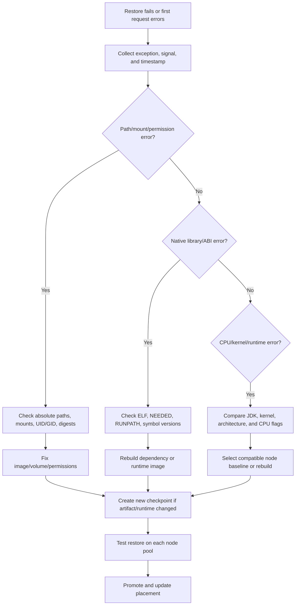

# Diagnosing Incompatible Paths, Libraries, or CPUs

A CRaC checkpoint is created from a Java process initialized in a specific environment. When restoring in a different environment, the JVM and application may encounter errors if paths, mounts, file access permissions, native libraries, or CPU instruction sets are no longer compatible. These errors may appear immediately upon restore, in the `afterRestore()` callback, or only when the first request hits a code branch that has never run before.

You should not conclude that every restore failure is caused by a corrupted checkpoint. A `NoSuchFileException` may result from an unmounted volume or a changed relative path; `UnsatisfiedLinkError` may come from a missing dependent library, wrong architecture, or ABI mismatch; `SIGILL` may result from machine code using a CPU instruction that the restore node does not support. You need to identify which layer the error occurs at and compare the checkpoint creation environment with the restore environment.

The diagnostic principle is to gather evidence before modifying the environment: verify the runtime/JDK, check paths and mounts, check file permissions, analyze native libraries and ABIs, and then compare CPU architectures/instruction sets. Use the same checkpoint and the same artifact when testing so that only one factor changes at a time.

## 1. Compatibility Layers to Check

A Java application can depend on many things beyond bytecode:

| Layer | Examples | Common error symptoms |
|---|---|---|
| Checkpoint/runtime | CRaC JDK build, checkpoint/restore tool, kernel/runtime | Restore rejected, runtime errors, or resource recovery failures |
| Filesystem path | Configuration files, temp directories, Unix sockets, native library directories | `NoSuchFileException`, `FileNotFoundException`, `AccessDeniedException` |
| Mount/namespace | PVC, `emptyDir`, bind mount, container mount namespace | File exists on host yet not inside container; path masked by volume |
| File descriptor/resource | Open files, sockets, pipes, devices, mmap | Invalid file handle, post-restore I/O errors, or resource callback failures |
| Native library | JNI/JNA, Netty native transport, compression codecs, native drivers | `UnsatisfiedLinkError`, `dlopen` failure, symbol not found |
| ABI/runtime library | glibc/musl, `libstdc++`, OpenSSL, SONAME, and symbol versions | `GLIBC_x.y not found`, `undefined symbol`, version mismatch |
| CPU architecture | `x86_64`, `aarch64`, 32/64-bit, endianness | ELF class/machine mismatch or unable to load library |
| CPU instruction set | AVX, AVX2, AVX-512, NEON, AES, CRC, or other extensions | `SIGILL`, native code errors, or JVM/runtime incompatibility |
| Operating system/kernel | Kernel features, page size, syscalls, namespaces | Restore failures or native components behaving differently on new node |

Inspect both the checkpoint creation environment and the restore environment. If you only collect information after restore, you may miss evidence about libraries, paths, or CPU features present when the image was created.

## 2. Distinguishing When the Error Occurs

When the error appears helps narrow the search scope.

| Timing | Possibilities to check first |
|---|---|
| Runtime refuses to start restore | JDK/CRaC build, checkpoint format, kernel, CPU/architecture, and runtime conditions |
| Restore starts yet fails before application resumes | Checkpoint files, filesystem, mounts, access permissions, file descriptors, or runtime state |
| `afterRestore()` fails | Resource callbacks, config paths, secrets/certificates, native clients, or unready dependencies |
| Application reports ready yet first request fails | Lazy class loading, lazy native library loading, files opened only on use, DNS, or endpoints |
| Only certain nodes fail | Differences in kernel, CPU flags, architecture, mounts, storage drivers, or system libraries |
| Only one replica fails | Per-instance volume/permissions, node placement, corrupted files, out of disk/inodes, or instance config |

Record the exact timing and the first stack trace. An error on the first request may not be related to core restore; it may simply be the first time the application calls `System.loadLibrary()`, reads a file, or executes native code on the new CPU.

## 3. Comparing Checkpoint Creation and Restore Environments

Before changing configuration, generate an environment manifest on both sides. The manifest should contain enough information for comparison without recording secrets.

Important information:

- Application build ID and JAR/container image digest.
- JDK vendor, version, build, and CRaC-enabled distribution.
- Key JVM startup options.
- OS distribution, kernel version, architecture, and page size.
- CPU model and relevant flags.
- glibc or musl version.
- Native libraries and SONAMEs required by the application.
- Key path values, mount points, and filesystem types.
- UID/GID, file modes, and directory access permissions.
- Versions of volumes/secrets/configs mounted at runtime.

Some useful Linux commands:

```bash
java -version
uname -a
uname -m
getconf LONG_BIT
getconf PAGESIZE
lscpu
ldd --version
```

To view more detailed CPU information on Linux:

```bash
grep -m1 -E '^(model name|Hardware|Features|flags)' /proc/cpuinfo
```

Commands and output may differ across x86_64, ARM64, and Linux distributions. Inside containers, some information reflects the host kernel or virtualized CPU. Collect the manifest from the exact container/node where the process creates the checkpoint and the exact node where the process restores.

Do not dump the entire `env` or system properties into logs indiscriminately: they may contain passwords, tokens, or connection strings. Log only an allowlist of properties needed for diagnosis and mask sensitive values.

## 4. Diagnosing Missing or Changed File Paths

### Absolute and Relative Paths

Relative paths are resolved based on the process's working directory or how the API is called. If the application is launched from `/opt/app` when creating the checkpoint while the restore entrypoint runs from `/`, a path like `config/runtime.yml` may point to a different location.

Example:

```java
Path configured = Path.of("config/runtime.yml");
Path resolved = configured.toAbsolutePath().normalize();

System.out.println("user.dir=" + System.getProperty("user.dir"));
System.out.println("resolved config=" + resolved);
System.out.println("exists=" + Files.exists(resolved));
System.out.println("readable=" + Files.isReadable(resolved));
```

For required files, configure explicit absolute paths or resolve from a fixed application home. Do not rely on the implicit working directory of a shell, Dockerfile, or process supervisor.

### Files Existing on Host Yet Missing in Container

Containers have their own mount namespace. A file at `/srv/config/app.yml` on the host does not automatically appear at the same path inside the container. The file is accessible only if it resides in the image filesystem or is mounted into the container.

In Kubernetes, a volume mount can mask content already present in the image at the mount path. For example, the image contains `/opt/app/config/default.yml`, yet a PVC is mounted at `/opt/app/config`; if the PVC is empty, `default.yml` from the image may no longer be visible from inside the container.

Check:

```bash
pwd
findmnt -T /opt/app/config
mount
df -h /opt/app/config
df -i /opt/app/config
```

`findmnt -T` shows the filesystem containing a specific path. `df -h` checks disk space, while `df -i` checks inodes. Running out of inodes can prevent an application from creating files even when byte capacity remains.

### Symlinks and Path Traversal

A symlink may point to a different target after a volume or image changes. Check the actual target:

```bash
readlink -f /opt/app/lib/libcodec.so
namei -l /opt/app/lib/libcodec.so
stat /opt/app/lib/libcodec.so
```

`namei -l` shows the permissions of every directory component along the path. To access a file, the process needs execute/search permissions on parent directories and appropriate permissions on the file. Checking only `ls -l` on the final file can miss a parent directory that disallows traversal.

### Different File Contents Despite Identical Paths

An identical absolute path does not guarantee the file has the same contents. A volume may have been updated, a symlink may point to another release, or an init container may have copied the wrong artifact. For configuration files, native libraries, or critical resources, record digests:

```bash
sha256sum /opt/app/config/runtime.yml
sha256sum /opt/app/lib/libcodec.so
```

Compare the digest with the checkpoint manifest. Do not swap files or mounts underneath a checkpointed process to try fixing an error; build a new artifact/version and test again.

## 5. Checking File and Directory Permissions

`AccessDeniedException` or `Permission denied` can be caused by differing UID/GID between builder and runtime, parent directory permissions, ACLs, SELinux, AppArmor, or read-only mounts.

Check process identity:

```bash
id
id appuser
ps -o pid,uid,gid,comm -p <PID>
```

Check path permissions:

```bash
namei -l /var/lib/app/checkpoint/metadata
stat -c '%A %a %U:%G %n' /var/lib/app/checkpoint
getfacl /var/lib/app/checkpoint
```

If using Kubernetes, inspect `runAsUser`, `runAsGroup`, `fsGroup`, `readOnlyRootFilesystem`, `volumeMounts.readOnly`, and the CSI driver. `fsGroup` is not handled identically across all volume types; verify actual permissions inside the container using the exact UID running the JVM.

Principles:

- Directories requiring traversal must have `x` permission for the appropriate user/group.
- Configuration files/native libraries require read permission.
- Temporary or runtime directories require write permission if the application creates files there.
- Immutable source checkpoints should be mounted read-only if the runtime allows.
- If the runtime requires a writable working directory, separate the working copy/directory from the source artifact.
- Do not use `chmod -R 777` to resolve permission errors; determine the exact required owner/group and mode.

With SELinux/AppArmor, file modes may look right while policy still blocks access. Check host audit logs and corresponding policy labels instead of disabling protection mechanisms node-wide.

## 6. File Descriptors and Filesystem-Dependent Resources

A process can hold open file descriptors before checkpoint. After restore, the application can continue using restored descriptors as supported by the runtime, yet paths may have changed, mounts may differ, or resources may need to be reopened according to lifecycle.

Resources commonly needing review:

- Open log files and audit files.
- Unix domain sockets or named pipes.
- File locks and lock files.
- Memory-mapped files (`MappedByteBuffer`).
- Temporary files created by libraries.
- Device files or special mounts.
- Files containing credentials, certificates, or reloaded configuration.

On Linux, you can inspect descriptors of a running process:

```bash
ls -l /proc/<PID>/fd
cat /proc/<PID>/maps
```

`/proc/<PID>/fd` displays open descriptors and the targets reported by the kernel; `maps` shows memory mapping regions, where mapped native libraries can be seen. This is diagnostic data at the time the command ran, not proof that every descriptor will restore validly.

If the application uses file locks to coordinate multiple instances, verify lock semantics after restore. An in-heap lock or an already-open file lock should not be treated as a still-valid distributed lease. For external resources, use CRaC `Resource` callbacks or supported integrations to close before checkpoint and reopen/re-register after restore.

Example of a resource managing a file handle:

```java
import org.crac.Context;
import org.crac.Core;
import org.crac.Resource;

import java.nio.channels.FileChannel;
import java.nio.file.Path;
import java.nio.file.StandardOpenOption;

public final class FileResource implements Resource {

    private final Path file;
    private FileChannel channel;

    public FileResource(Path file) throws Exception {
        this.file = file.toAbsolutePath().normalize();
        this.channel = openChannel();
        Core.getGlobalContext().register(this);
    }

    private FileChannel openChannel() throws Exception {
        return FileChannel.open(file,
                StandardOpenOption.READ,
                StandardOpenOption.WRITE);
    }

    @Override
    public void beforeCheckpoint(Context<? extends Resource> context)
            throws Exception {
        if (channel != null && channel.isOpen()) {
            channel.close();
            channel = null;
        }
    }

    @Override
    public void afterRestore(Context<? extends Resource> context)
            throws Exception {
        channel = openChannel();
    }
}
```

The example illustrates a file that the application can reopen by path. If the file was modified while the process was paused, the application needs to verify version/digest or business semantics before continuing. For log files, database files, or lock files, use the library's own mechanism instead of applying this template directly.

## 7. Diagnosing Native Library Loading Failures

Java bytecode is more portable than native code, yet an application can depend on `.so` libraries on Linux via JNI, JNA, or intermediary libraries. Common examples:

- JDBC drivers with native components or OpenSSL dependencies.
- Netty native transports such as epoll/kqueue.
- Compression codecs, image processing, or native cryptography.
- JNI/JNA libraries provided by the application or vendor.
- Native agents or profilers.

A commonly seen error is `java.lang.UnsatisfiedLinkError`, though the root causes can vary widely:

| Symptom | Possibility |
|---|---|
| `no foo in java.library.path` | The JVM cannot find `libfoo.so` via Java's library search mechanism |
| `libbar.so: cannot open shared object file` | The main library was found, yet the dynamic loader cannot find dependency `libbar.so` |
| `wrong ELF class` | 32-bit/64-bit mismatch |
| `ELF file data encoding not little-endian` or machine mismatch | Wrong architecture/endianness |
| `undefined symbol` | Dependent library is missing a symbol or has an ABI/version incompatibility |
| `GLIBC_x.y not found` | Library was built requiring a newer glibc than the restore environment |
| `version 'OPENSSL_x' not found` | Incompatible OpenSSL ABI/version |
| `SIGILL` when calling native method | Native binary may be using an unsupported CPU instruction |

### Java Library Path and Dynamic Loader Path Are Two Different Layers

`System.loadLibrary("codec")` uses the JVM's native library search mechanism, involving `java.library.path` and platform library naming rules, such as `libcodec.so` on Linux. Once the main library is located, the operating system's dynamic loader must also find the dependent libraries declared by the ELF file.

Therefore, a correct `java.library.path` is not necessarily enough. The main library may exist while a dependency such as `libstdc++.so.6`, `libssl.so`, or a custom SONAME is missing from the runtime image.

Check from Java:

```java
System.out.println("java.library.path=" +
        System.getProperty("java.library.path"));
System.out.println("os.name=" + System.getProperty("os.name"));
System.out.println("os.arch=" + System.getProperty("os.arch"));
System.out.println("java.home=" + System.getProperty("java.home"));
```

Check native files:

```bash
file /opt/app/lib/libcodec.so
readelf -h /opt/app/lib/libcodec.so
readelf -d /opt/app/lib/libcodec.so
```

`readelf -h` shows the ELF class, machine, and encoding. `readelf -d` shows `NEEDED`, `RPATH`, or `RUNPATH`. This is a way to inspect ELF metadata without executing the binary.

`ldd` can be useful on trusted binaries to display resolved dependencies in the current environment:

```bash
ldd /opt/app/lib/libcodec.so
```

Do not blindly run `ldd` on untrusted binaries; depending on the executable type and system, its implementation may invoke the loader. For untrusted artifacts, prefer `readelf -d` or static ELF analysis tools first.

### Checking Missing Dependencies

On Linux, the dynamic loader can search for libraries across sources such as `RPATH`/`RUNPATH`, `LD_LIBRARY_PATH`, the `ldconfig` cache, and default directories. The exact search order depends on the loader, tag type, and how the library is loaded.

Commands:

```bash
ldconfig -p | grep -E 'libssl|libcrypto|libstdc\+\+'
readelf -d /opt/app/lib/libcodec.so | grep -E 'NEEDED|RPATH|RUNPATH'
```

If you need to observe how the loader searches for libraries, you can launch a new diagnostic process with `LD_DEBUG=libs`:

```bash
LD_DEBUG=libs java -jar app.jar
```

This is an environment variable required when the process is launched. Do not expect to enable it for an already-restored process by changing the external shell environment. Output can be very large and contain internal paths; enable it only in test environments and store logs under controlled access.

### Checking ABI and Symbol Versions

A library may match the architecture yet still be ABI-incompatible. For example, a binary built on a newer distribution may reference `GLIBC_2.xx`, while the runtime image has an older glibc. Or the library may require OpenSSL/libstdc++ symbols that the runtime version does not provide.

You can check version requirements using:

```bash
readelf --version-info /opt/app/lib/libcodec.so
objdump -T /opt/app/lib/libcodec.so | grep -E 'GLIBC_|GLIBCXX_|OPENSSL_'
```

Compare the requirements in the binary against the actual libraries present in the runtime image. Do not solve this by randomly copying an `.so` file from another machine into production; build or select packages compatible with the base image and pin dependencies.

## 8. Wrong Architecture or Native Binary Format

A library built for `x86_64` cannot be loaded directly into an `aarch64` process, and vice versa. Similarly, 32-bit and 64-bit ELFs require their corresponding ABIs.

Check the architecture of the process and library:

```bash
uname -m
file /opt/app/lib/libcodec.so
readelf -h /opt/app/lib/libcodec.so | grep -E 'Class:|Data:|Machine:'
```

Common pairings:

| Runtime/host | Compatible native binary needed |
|---|---|
| Linux `x86_64` | ELF 64-bit, machine AMD x86-64 |
| Linux `aarch64` | ELF 64-bit, machine AArch64 |
| Linux `i686`/x86 32-bit | ELF 32-bit x86 and corresponding 32-bit ABI |
| ARM 32-bit | ARM ELF/ABI matching CPU and user space |

Do not check only the container image manifest architecture. Check native binaries packaged inside JARs, the `lib` directory, libraries loaded from plugins, or files mounted at runtime. A multi-architecture image may have the right manifest yet still contain an `.so` built only for a different architecture.

If the application supports multiple architectures, build and test native libraries separately for each architecture, or use pure Java libraries when appropriate. Do not assume an emulation layer makes checkpoints portable between two architectures; process state and generated machine code can depend on the actual CPU/runtime.

## 9. Incompatible CPU Instruction Sets

Two nodes can both report `x86_64` yet not support the same instruction set. One node has AVX2, another does not; one has AVX-512, another only has AVX; ARM CPUs can differ in extensions. If the JIT or a native library generates code using an instruction unsupported by the restore CPU, the process may encounter `SIGILL` (illegal instruction) when executing that code.

This is a major reason why checkpoints should not be distributed arbitrarily across nodes of the same architecture with different CPU feature sets.

Check the CPU on Linux:

```bash
lscpu
grep -m1 -E '^(flags|Features)' /proc/cpuinfo
```

On x86, pay attention to relevant flags such as `sse4_2`, `avx`, `avx2`, `avx512*`, `aes`, or extensions required by native libraries. On ARM64, pay attention to `asimd`/NEON, crypto, or related extensions. Flag names and how the kernel displays them can vary.

### Distinguishing Architecture from Instruction Set

- `uname -m` reports the architecture declared by the kernel/container.
- ELF `Machine` shows the architecture the binary was built for.
- CPU flags show the instructions/extensions potentially supported on the host.
- JDK/JIT decides how to use CPU features according to runtime and configuration.
- Native libraries may auto-detect features or contain code paths requiring specific features.

All these layers must match. Seeing `x86_64` in both places does not prove two nodes share the same instruction set.

### Handling `SIGILL`

If the process stops with `Illegal instruction` or exits with signal 4, determine the faulting instruction address and the library containing that code. Use core dumps, a debugger, or symbolized stacks if the environment allows. Compare CPU flags between the checkpoint creation node and restore node. If the failure occurs in JIT code, check the JDK build and the CPU options supported by the JVM. If the failure lies in a native library, inspect how the library dispatches instructions and its CPU requirements.

Do not blindly add JVM flags such as `-XX:UseAVX=0` to fix every `SIGILL`. Options and support levels depend on the JDK/architecture; they can affect performance yet will not fix a native library emitting AVX2 instructions on its own. Use a supported CPU baseline or build native libraries with the appropriate target features.

## 10. JDK, Kernel, and Restore Environment

Checkpoints can depend on the CRaC JDK build, kernel features, and how the runtime integrates with the checkpoint/restore mechanism. When restore fails on a node, compare at minimum:

- JDK vendor/version/build in builder and runtime.
- CRaC API/runtime implementation and options used.
- Kernel version and relevant configuration.
- Container runtime, CRIU, or corresponding helper if used in deployment.
- CPU architecture and feature set.
- Page size, memory layout, and relevant system limits.
- Native libraries and ABIs in the image.

Do not assume a checkpoint created by one CRaC JDK can be restored by any JDK of the same major version. Use the exact supported runtime and pin the base image digest. When upgrading the JDK, kernel, or native libraries, create a new checkpoint and run restore tests on the target node pools.

## 11. Using Java to Print Safe Diagnostic Information

An internal endpoint or startup diagnostic can print non-sensitive environment information for comparison. Do not expose this endpoint publicly and do not print non-allowlisted environment variables/system properties.

```java
import java.nio.file.Files;
import java.nio.file.Path;
import java.util.List;

public final class RuntimeDiagnostics {

    public static void print() {
        System.out.println("java.version=" + System.getProperty("java.version"));
        System.out.println("java.vendor=" + System.getProperty("java.vendor"));
        System.out.println("java.home=" + System.getProperty("java.home"));
        System.out.println("os.name=" + System.getProperty("os.name"));
        System.out.println("os.arch=" + System.getProperty("os.arch"));
        System.out.println("user.dir=" + System.getProperty("user.dir"));
        System.out.println("java.library.path=" +
                System.getProperty("java.library.path"));

        List<Path> requiredPaths = List.of(
                Path.of("/opt/app/config/runtime.yml"),
                Path.of("/opt/app/lib/libcodec.so"),
                Path.of("/var/lib/app/runtime"));

        for (Path path : requiredPaths) {
            Path resolved = path.toAbsolutePath().normalize();
            System.out.printf("path=%s exists=%s readable=%s writable=%s%n",
                    resolved,
                    Files.exists(resolved),
                    Files.isReadable(resolved),
                    Files.isWritable(resolved));
        }
    }
}
```

The paths in the example are placeholders to be replaced with the application's allowlist. `Files.isReadable()`/`isWritable()` are point-in-time checks; they do not guarantee subsequent operations will succeed because mounts or permissions may change. For required files, attempt to open the file the way the application actually uses it and handle specific errors.

Do not print all of `System.getenv()`, all of `System.getProperties()`, or the full command line if they may contain secrets. Instead, log sanitized build IDs, checkpoint IDs, and node identities to correlate logs.

## 12. Step-by-Step Diagnostic Procedure

When restore fails, follow a sequence to avoid changing too many variables at once.

### Step 1: Record the Root Error and Failure Timing

- Collect the exit code, signal, first exception, and full stack trace.
- Identify whether the error occurred during runtime restore, callbacks, resumed startup, or the first request.
- Record the checkpoint ID, application build, JDK build, and node/Pod identity.
- Retain logs before and after checkpoint; avoid taking only the tail where the initial cause is lost.

### Step 2: Confirm the Correct Artifact and Runtime

- Check the application digest and checkpoint ID actually used by the Pod.
- Verify JDK vendor/build, restore options, and checkpoint path.
- Compare the runtime/container image with the environment that created the checkpoint.
- Confirm there are no mutable tags or volume paths pointing to the wrong release.

### Step 3: Check Paths, Mounts, and Permissions

- Print `user.dir` and resolve relative paths to absolute paths.
- Use `findmnt -T`, `namei -l`, `stat`, `df -h`, and `df -i`.
- Confirm volume mounts are ready and do not mask files inside the image.
- Confirm UID/GID, modes, ACLs, and LSM policies.
- Compare digests of config/native files against the manifest.

### Step 4: Check Native Libraries

- Use `file` and `readelf -h` to confirm ELF class/machine.
- Use `readelf -d` to inspect `NEEDED`, `RPATH`, `RUNPATH`.
- Use `ldd` only on trusted binaries to see resolved dependencies.
- Use `readelf --version-info` or `objdump -T` to check ABI/symbol versions.
- Confirm libraries and dependencies exist in the container filesystem.

### Step 5: Check CPU and Kernel

- Compare `uname -m`, `lscpu`, `/proc/cpuinfo` between creation and restore nodes.
- Check CPU flags required by native libraries/JIT code.
- If `SIGILL` occurs, identify the instruction and originating library/code region.
- Compare kernel, page size, and runtime/CRIU compatibility.

### Step 6: Create a Minimal Test

- Restore the same checkpoint on a known compatible node to determine whether the error is node-specific.
- Run the application artifact via cold start on the failing node to distinguish application errors from checkpoint errors.
- Use the same image/checkpoint, changing only one variable: mount, library path, node pool, or runtime.
- Record results before making further changes.

### Step 7: Fix at the Source and Create a New Image If Needed

- Fix the Dockerfile/base image, dependency packages, mounts, or permissions.
- Rebuild native libraries for the proper ABI/architecture/CPU baseline.
- If code, JDK, native libraries, or key startup configuration change, create a new checkpoint.
- Run restore tests across all node groups permitted to run the workload.
- Update node affinity/placement to prevent checkpoints from running on incompatible nodes.

## 13. Error-to-Investigation Mapping Table

| Message/symptom | Check first | Common remediation |
|---|---|---|
| `NoSuchFileException` | Absolute path, `user.dir`, mounts, and volume paths | Fix paths, mount the right volume, or bundle required files |
| `Permission denied` | UID/GID, `namei -l`, ACL, SELinux/AppArmor, read-only mounts | Grant proper file/directory permissions or fix mount policies |
| File exists on host yet missing in container | Mount namespace and `findmnt -T` | Mount the file/volume in the right location; check if volume masks image content |
| `no ... in java.library.path` | `java.library.path`, filename, architecture | Place the main library on the right path or configure loader properly |
| `cannot open shared object file` | `NEEDED` dependencies, loader path, `ldconfig` | Install the matching dependency package version in the runtime image |
| `wrong ELF class` | `file`, `readelf -h`, 32/64-bit | Build/select the native binary with the right ABI |
| `Exec format error` or machine mismatch | ELF `Machine`, architecture | Use the binary matching the architecture and image manifest |
| `undefined symbol` | SONAME, symbol table, ABI/version | Align dependencies; rebuild native library with compatible ABI |
| `GLIBC_x.y not found` | glibc version and symbol requirements | Build on a compatible baseline or update the runtime base image |
| `Illegal instruction` / `SIGILL` | CPU flags, core dump, instruction, and native library | Restrict nodes to a matching CPU baseline or compile for a lower target |
| Restore fails on only one node | CPU, kernel, mounts, storage, node labels | Fix node pool or scheduling constraints |
| Only the first request fails | Lazy native loading, late-opened files/resources | Warm up/validate dependencies or handle lazy initialization after restore |

Error messages may be wrapped by frameworks or native wrappers. Always find the root exception/cause rather than relying only on the outermost message.

## 14. Checking Paths in Containers and Kubernetes

With Kubernetes, certain path errors only occur on specific Pods due to PVCs, `subPath`, init containers, or `securityContext`.

Questions to answer:

- Was the volume attached and mounted before the container restored?
- Did the init container finish downloading/copying the checkpoint?
- Does `mountPath` overlap with a directory containing application resources in the image?
- Does `subPath` point to the directory of the right release?
- Does the PVC have an access mode matching the replica count and nodes?
- Does `readOnly: true` prevent the runtime from writing required auxiliary files?
- Do `runAsUser`, `runAsGroup`, and `fsGroup` match ownership on the volume?
- Was the Pod scheduled onto a node with a different architecture/CPU/kernel baseline?

For the source checkpoint volume, use an immutable versioned directory and mount read-only if supported by the runtime. If the runtime needs to write, copy the checkpoint into the Pod's own working directory. Do not let multiple replicas concurrently modify a shared checkpoint directory.

Example checks inside a Pod:

```bash
id
pwd
findmnt -T /opt/app/checkpoint
namei -l /opt/app/checkpoint
df -h /opt/app/checkpoint
df -i /opt/app/checkpoint
find /opt/app/checkpoint -maxdepth 2 -type f -printf '%m %u:%g %p\n' | head -50
```

The `find` command here only lists file metadata; it does not print checkpoint contents. Restrict exec/debug access to production Pods and follow operational access policies.

## 15. Checking Lazily Loaded Native Libraries

Some libraries only call `System.loadLibrary()` when a feature is used for the first time. As a result, the application may restore and report ready successfully, yet the first request using a codec or native transport hits `UnsatisfiedLinkError`.

To detect early:

- Identify which native features are used on critical routes.
- Run smoke tests after restore to trigger those features.
- Verify native libraries and dependencies on the exact production base image.
- Record library versions and architecture in the startup manifest.
- Do not only warm up Java methods if native libraries have not yet been loaded.

It is not necessary to load every native library in every replica. Prepare only features within the serving scope and ensure loading does not create unrecoverable side effects or resources.

## 16. CPU Heterogeneity in Clusters

A cluster may contain multiple CPU generations or instance types. The scheduler typically only knows architecture labels such as `amd64`/`arm64`; it does not necessarily know whether a node has AVX2, AVX-512, or specific extensions required by the checkpoint.

An operational strategy:

1. Define the supported CPU feature baseline for checkpoints.
2. Label node pools by verified CPU/feature type.
3. Run restore tests on each node pool.
4. Use node affinity/selectors or scheduler policies to place Pods only on compatible nodes.
5. If multiple baselines must be supported, create separate checkpoint/runtime images per group with clear metadata.
6. Monitor `SIGILL` errors and node placement after every node pool change.

Example Kubernetes node selector using cluster-managed labels:

```yaml
spec:
  nodeSelector:
    kubernetes.io/arch: amd64
    crac.cpu-baseline: x86-64-v2
```

The `crac.cpu-baseline` label is an example; the cluster must apply it based on inventory and actual testing. Do not assign labels solely from instance names or a single CPU flag observed on one node.

If a checkpoint was created with higher CPU features than the restore node's baseline, select a matching node or create a new checkpoint on a lower supported baseline. There is no universal Java option that can translate all saved machine code to a different CPU architecture.

## 17. Compatibility Testing Before Releasing a Checkpoint

Checkpoints should be tested across the entire set of environments a deployment may use.

A reference test matrix:

| Component | Builder | Restore target | Assertion |
|---|---|---|---|
| JDK/CRaC | Exact pinned build | Same supported build | Restore succeeds and runtime version matches |
| OS/kernel | Image creation node pool | Each target node pool | Restore and resource callbacks succeed |
| Architecture | `amd64` or `arm64` | Same supported architecture | ELF and JVM architectures match |
| CPU baseline | Recorded feature set | Node with equal/higher baseline per policy | No `SIGILL`; native/JIT smoke tests pass |
| Filesystem | Checkpoint staging | Image layer/PVC/working copy | All files present, paths right, digests match |
| Permissions | Builder UID/GID | Runtime UID/GID | Checkpoint readable and required runtime files creatable |
| Native dependencies | Locked `.so` set | Runtime base image | No missing SONAME/symbols/ABIs |

Tests should run before an artifact is promoted. If a node pool is incompatible, exclude it from the placement policy or build a separate artifact; do not let failures surface only when the autoscaler places a replica onto that node.

## 18. Common Mistakes

### Checking Only Whether a File Exists

`Files.exists()` does not prove a file is readable, has the expected content, or is on the right filesystem. Verify the path, permissions, digest, and test actual operations.

### Assuming Identical Paths Mean the Same File

Volumes can mask image directories, symlinks can point to different targets, and contents may have changed. Check mount sources and checksums.

### Checking Only `java.library.path`

The main library may be found while its dependencies are missing or its ABI mismatches. Analyze ELF `NEEDED`, RUNPATH, and symbol versions.

### Copying `.so` Files from Another Host as a Fix

Files may differ in glibc, OpenSSL, libstdc++, architecture, or ABI. Build/package dependencies from a compatible base image and pin versions.

### Treating All `x86_64` Nodes as Equivalent

Instruction sets can differ. Use a verified CPU baseline and appropriate node placement.

### Testing Only Startup, Not the First Request

Native libraries or files may be lazily loaded. Run smoke tests on critical routes/features after restore.

### Replacing Files Underneath an Active Checkpoint

The process may retain old classes, mappings, or descriptors while new reads see different contents. Use immutable artifacts and create a new checkpoint after changes.

### Fixing Errors with Root or Broad Privileged Permissions

That obscures the root cause and widens blast radius. Identify the exact required UID/GID, capabilities, and filesystem policies.

### Testing on Only One Node

Fails to catch CPU/kernel/mount differences across the cluster. Test on every node pool permitted to receive checkpoints.

## 19. Remediation and Re-release Workflow

When a checkpoint is found incompatible with a path, library, or CPU baseline, fix the root cause in the artifact/runtime and create a new image if process state or dependencies changed.



If only a volume mount was temporarily missing, you can fix the deployment and retry the same checkpoint after verifying the artifact remains intact and the runtime supports the new environment. If the JDK, native libraries, code, packaged resources, or startup configuration changed, create a new checkpoint from a process initialized with those components.

## 20. Diagnostic Checklist

- [ ] Recorded the root error, failure timing, and checkpoint/application build ID.
- [ ] Verified JDK/CRaC vendor, version, build, and runtime options.
- [ ] Compared OS/kernel, architecture, page size, and CPU flags.
- [ ] Confirmed working directory and resolved relative paths.
- [ ] Confirmed volumes are mounted properly and do not mask files inside the image.
- [ ] Checked symlinks, owner, mode, ACLs, SELinux/AppArmor, and read-only mounts.
- [ ] Checked filesystem disk space and inodes.
- [ ] Compared checksums of configs, checkpoint, and native libraries.
- [ ] Used `file`/`readelf` to check ELF class, machine, NEEDED, RPATH/RUNPATH.
- [ ] Checked loader dependencies, glibc/musl, and symbol versions.
- [ ] If `SIGILL` occurred, identified the instruction and checked against CPU baseline.
- [ ] Ran smoke tests for features with lazy native loading after restore.
- [ ] Tested on every node pool the scheduler may select.
- [ ] Created a new checkpoint if code/runtime/native dependencies or startup environment changed.
- [ ] Did not log secrets or sensitive heap contents in diagnostic logs.

## 21. Conclusion

Path, library, or CPU errors after CRaC restore usually stem from differences between the environment where the checkpoint was created and the environment where it is being restored. Paths can change due to working directories, mount namespaces, symlinks, or permissions. Native libraries may miss dependencies, have the wrong ELF architecture, mismatch glibc/ABI, or require symbols absent from the runtime. Two nodes both reporting `x86_64` can still differ in CPU instruction sets and trigger `SIGILL` when the JVM or native code executes.

Diagnose by layer: determine failure timing, compare runtime manifests, check paths/mounts/permissions, analyze native dependencies, and compare CPU/kernel. Use `namei`, `findmnt`, `stat`, `file`, `readelf`, `ldd` on trusted binaries, `lscpu`, and `/proc/cpuinfo` to gather evidence. Keep application/checkpoint artifacts immutable, test on each node pool, and constrain scheduling to compatible baselines. When changing code, JDK, native libraries, or startup environment, create a new checkpoint from the verified artifact and runtime.
