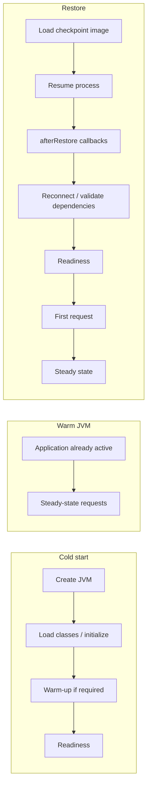

# Comparing Cold Start, Warm JVM, and Newly Restored Processes

When evaluating CRaC, the time it takes the JVM to start running is not the only metric that matters. A process may restore very quickly yet still need time to reconnect to databases, open HTTP clients, load caches, or wait for workers to become ready. Conversely, a long-running, warmed-up JVM can serve requests very fast, but that state does not represent the startup time of a new instance.

To evaluate accurately, compare three distinct states:

1. **Cold start:** creating a new JVM and initializing the application from scratch without using checkpointed process state.
2. **Warm JVM:** the same application already running, with classes loaded, representative workload executed, and JIT and caches warmed up; the process continues running uninterrupted.
3. **Newly restored process:** recovered from a checkpoint created after a preparation/warm-up phase; the JVM resumes from saved state and executes resource recovery steps.

These three states answer three different questions. Cold start shows the cost of creating a new instance. Warm JVM shows performance once the application has stabilized. Restore shows how quickly a pre-prepared instance can be brought back into service and what additional cost must be paid to recover resources.

## 1. Distinguishing the Three States Before Measuring

### 1.1. Cold Start

Cold start begins when a new JVM process is created. The application must perform work such as:

- Initializing the JVM and runtime libraries.
- Loading classes, building metadata, and initializing static state.
- Creating the framework's ApplicationContext or container.
- Instantiating singletons, proxies, serializers, mappers, and components.
- Reading configuration, secrets, and remote configuration.
- Creating connection pools or connecting to dependencies if required at startup.
- Running necessary warm-up before readiness is enabled.

Cold start does not necessarily mean the entire physical machine just rebooted or the OS page cache is completely empty. In application benchmarks, cold start is usually best defined as **a new JVM/process with unwarmed application state**, while OS cache state is held or controlled consistently. If you want to measure a true cold host, that is a different scenario and must be documented explicitly.

### 1.2. Warm JVM

A warm JVM is a live process that has already executed a sufficiently representative workload so critical components have moved past initial setup. Depending on the application, the warm state may include:

- Classes and metadata already loaded.
- Framework beans, proxies, and internal structures already created.
- Hot methods already JIT-compiled at various optimization tiers.
- Application caches populated with frequently accessed data.
- Connection pools, HTTP clients, and thread pools actively running.
- DNS, TLS sessions, or connection states potentially being reused.
- Background workers and schedulers running steadily.

A warm JVM provides a useful baseline for measuring steady-state latency/throughput. However, it is not a fresh startup. Do not take request times from a warm JVM and compare them directly with cold start times without clearly separating the two types of metrics.

### 1.3. Newly Restored Process

Restore begins from a checkpoint created in a pre-prepared application state. The JVM and process are recovered from the image; Resource callbacks execute closing/opening, verification, or recreation of resources as designed.

A newly restored process can retain much useful state such as the heap, initialized objects, class metadata, and runtime state supported for recovery by the CRaC JDK. However, do not assume all state remains valid:

- Sockets to databases or HTTP services may have been closed by peers.
- Credentials/tokens may have expired.
- Caches may have become stale during the checkpoint window.
- Schedulers or workers may need to be resumed or recreated.
- Native resources and external libraries may need separate lifecycle handling.
- Retention and reuse of JIT-compiled code depend on the specific CRaC JDK, runtime, and platform; measure on the exact target build.

Restore does not automatically guarantee the application is ready to accept requests. When the process recovers, when callbacks complete, and when readiness is enabled can differ significantly.

## 2. Timeline Milestones to Measure

A meaningful benchmark must explicitly define its start and end points. Recording merely "startup time" or "restore time" makes results difficult to compare.

| Metric | Start Point | End Point | Meaning |
|---|---|---|---|
| Cold start to readiness | JVM process is created | Application reaches readiness | Time to bring a new instance to a state ready to accept traffic. |
| Warm-up duration | Warm-up workload begins | Defined warm-up criteria are met | Cost of preparing classes, JIT, caches, and dependencies. |
| Warm steady-state latency | Request sent to stabilized JVM | Response completes | Request performance once the application is hot. |
| Checkpoint preparation | Checkpoint request begins | All `beforeCheckpoint(...)` complete | Cost of draining and preparing Resources. |
| Checkpoint duration | Engine begins dump | Image/metadata finish writing | Cost of creating the checkpoint image. |
| Restore engine duration | Engine begins restore | Process is recovered and resumes per runtime milestone | Cost of reading the image and recovering the process. |
| Restore callback duration | `afterRestore(...)` begins | Callbacks complete | Cost of recreating and verifying Resources. |
| Restore to readiness | Restore is triggered | Readiness is enabled | Actual time before the instance receives traffic. |
| First-request latency | First request sent after readiness | First response completes | Detects remaining lazy initialization or cache misses. |
| Post-restore steady-state latency | Post-restore workload stabilizes | Measured within steady-state window | Performance after recovery and additional warm-up finish. |



The diagram shows the milestones to observe. Depending on the engine and trigger mechanism, some steps may execute within the same process or be performed by an external orchestrator.

## 3. Do Not Confuse Restore Time with Time-to-Readiness

This is the most common measurement mistake. The engine may recover the process quickly, yet the application still needs time to run callbacks and reconnect dependencies.

For example, a system might exhibit:

- Restore engine: 300 ms.
- `afterRestore(...)` and connection pool recreation: 500 ms.
- Database checks, credential loading, and broker wait: 700 ms.
- Enabling readiness and receiving the first request: after 1.5 seconds total from restore start.

These figures only illustrate how to separate milestones and are not real benchmark results. Reporting only "300 ms restore" can mislead operators into thinking the instance is ready after 300 ms.

Report at least two numbers:

1. **Restore engine/process duration:** the time the runtime needs to recover the process according to the milestone exposed by the engine.
2. **Restore-to-ready duration:** the time from when restore is requested until the application actually accepts traffic.

If the platform does not expose a reliable engine milestone, state the measurement method explicitly and publish only application-level time-to-readiness. Do not infer engine duration from callback log timestamps unless the exact event boundaries are known.

## 4. Comparing Request Performance Across the Three States

Startup time and request latency are two separate metric groups. To understand the benefits of CRaC, measure both.

| Metric | Cold JVM | Warm JVM | Newly Restored |
|---|---|---|---|
| Class loading | Mostly occurs during startup and first requests. | Most critical classes are already loaded. | Many classes/metadata remain in process state, depending on runtime. |
| JIT compilation | Hot methods may not yet reach peak optimization. | Has likely reached steady state for the workload. | May be retained or require additional compilation depending on JDK/restore. |
| Application cache | Typically empty or freshly populated. | Contains warm data. | May retain caches from checkpoint, though freshness checks are needed. |
| Connection pool | Newly created and may require connection warm-up. | Active and able to reuse connections. | Must be verified; typically recreated or reconnected. |
| First-request latency | Can be high due to lazy initialization. | Typically lower after warm-up. | May spike if lazy init or dependency recovery remains. |
| Throughput | Can fluctuate during the warm-up phase. | Represents steady-state level. | Can reach comparable levels after recovery, though it must be measured. |
| Memory | Grows during initialization and warm-up. | Has a more stable live set and cache footprint. | Restores live set from image; may need additional memory headroom. |

Do not assume restore always matches warm JVM request latency. If caches or connection pools are recreated, the first request after restore can be slower. Conversely, if necessary state is preserved and dependencies reconnect rapidly, restore can approach the warm state.

### 4.1. Measuring Latency by Percentile

Do not rely solely on average latency. Averages can mask a very slow first request or a subset of timed-out requests.

Report:

- p50: latency of a typical request.
- p90/p95: tail latency that commonly affects user experience.
- p99 or p99.9 if the workload is large enough: extreme tail latency.
- Error rate and timeout rate.
- Throughput (requests/second) at defined concurrency.
- First-request latency separately.

For cold start and restore, keep a separate window for the first request and the period immediately after readiness. Only afterward measure steady state. Mixing all requests into a single percentile allows the sample count in each phase to skew the numbers.

### 4.2. Measuring Representative Workloads

Select the same workload for all three states:

- Same endpoints/use cases and payloads.
- Same concurrency and request arrival rate.
- Same input data and backend state.
- Same read/write ratio and request distribution.
- Same timeouts, retries, and connection pool limits.

For write operations, reset the dataset or use idempotency so each run does not produce a different backend state. Do not run a benchmark that creates production orders or messages without a cleanup plan.

## 5. Designing a Fair Benchmark

Comparing cold start, warm JVM, and restore is easily skewed by the environment. Control factors beyond CRaC that can cause results to differ.

### 5.1. Keeping the Environment Identical

Across comparative runs, pin or record:

- JDK vendor, version, build, and JVM flags.
- Same application artifact, dependencies, and configuration.
- CPU architecture, CPU feature baseline, and CPU limits.
- Memory limits, heap sizing, GC, and container limits.
- OS/kernel, container runtime, and checkpoint engine.
- Database, broker, cache, and HTTP dependencies.
- Network path, DNS, proxy, and TLS configuration.
- Dataset, cache source, and workload.
- Security context, UID/GID, filesystem, and storage class.

If the cold JVM runs with a 2 GB heap while restore runs with a 4 GB heap or a different CPU quota, the results cannot be attributed solely to CRaC.

### 5.2. Distinguishing Process-Cold from Host-Cold

A new JVM on an already-running host can benefit from the OS page cache, container image layer cache, and filesystem cache. This can still be called a cold process start, but not a cold host start.

Specify clearly which type the benchmark measures:

- **Cold process:** creates a new JVM process; the OS and host may already be warm.
- **Cold container:** creates a new container; image layers may already reside on the node.
- **Cold host:** freshly booted host or controlled OS caches; this cost usually belongs to infrastructure benchmarks.

It is unnecessary to purge OS caches on every run for an application benchmark. Doing so can require special privileges and create unrepresentative production conditions. What matters is applying the same methodology across runs and documenting the cache state.

### 5.3. Repeating Runs and Reporting Distributions

Execute multiple runs per scenario; do not draw conclusions from a single successful trial. Test order should be interleaved or randomized when possible to reduce effects from CPU temperature, background load, network fluctuations, or backend load.

For each scenario, record:

- Number of runs.
- Median and appropriate percentiles.
- Min/max or dispersion.
- Error/timeout counts.
- Discarded runs and the reasons.
- Environment and image/checkpoint identifiers.

If the number of runs is small, do not present p99 as a firm conclusion. For startup benchmarks, per-run distributions and the median are usually more informative than a single number.

### 5.4. Do Not Let the Benchmark Tool Become the Bottleneck

The load generator should run outside the measured process if the goal is measuring startup or restore. If the load generator runs inside the same JVM, it could be checkpointed, warmed up, or restored alongside the application and skew results.

Ensure the load generator has enough CPU/network capacity to sustain the offered load. Record latency on both client and server sides when possible to detect queueing in the load generator.

## 6. Designing the Three Benchmark Scenarios

### 6.1. Scenario A: Cold Start

1. Launch a new JVM from the application artifact.
2. Record the timestamp when the process is created.
3. The application initializes, connects to dependencies, and executes necessary warm-up.
4. The readiness probe transitions to ready.
5. Record the cold start-to-ready time.
6. Send the workload requests and record first-request latency.
7. Continue the same workload until steady state is reached, then measure latency/throughput.

Define explicitly whether warm-up is included in cold-start-to-ready. If the application is considered ready only after warm-up, warm-up time must be counted in startup latency. If readiness is enabled earlier, also measure time to performance-ready.

### 6.2. Scenario B: Warm JVM

1. Launch the JVM normally.
2. Wait for the application to reach readiness.
3. Run the warm-up workload until stability criteria are satisfied.
4. Do not checkpoint the process; keep the JVM running.
5. Measure request latency and throughput within the same workload window.
6. Record heap, GC, CPU, RSS, and cache hit rate.

Warm JVM serves as the steady-state performance baseline. Do not count prior uptime in per-request latency; if overall cost needs evaluation, report warm-up duration separately.

### 6.3. Scenario C: Restore from a Warmed-Up Checkpoint

1. Launch the application in a compatible environment.
2. Run the exact same warm-up workload as Scenario B.
3. Wait for warm-up tasks to complete and Resources to reach a safe state.
4. Close/drain resources that must be handled in `beforeCheckpoint(...)`.
5. Create the checkpoint image and record creation duration/image size.
6. Restore the image using the target engine and environment.
7. Record restore engine/process duration if reliably measurable.
8. Record `afterRestore(...)`, dependency reconnection, and readiness durations.
9. Send the first request and record its latency separately.
10. Run the steady-state workload and compare against the warm JVM.

The checkpoint must be created from the exact artifact and configuration to be deployed. If the JDK, CPU baseline, native libraries, or dependency configuration changes, create a new image and re-run the benchmark.

## 7. Measuring Warm-Up and Checkpoint Costs

CRaC shifts part of initialization work into the checkpoint preparation phase. Therefore, looking only at restore time overlooks warm-up and image-creation costs.

Costs to record:

| Cost | Meaning |
|---|---|
| Warm-up time | Time spent running workload to establish useful state. |
| Checkpoint preparation | Time spent stopping workers, draining requests, flushing, and closing Resources. |
| Checkpoint engine time | Time taken to create the image. |
| Image storage | Image and metadata size, plus storage/transfer costs. |
| Restore engine time | Time taken to recover the process. |
| Post-restore recovery | Recreating pools/clients, validating caches, and verifying dependencies. |
| Time-to-ready | Total time from restore request to readiness. |
| Runtime memory | RSS, heap, native memory, and memory headroom after restore. |

### 7.1. Benefits of Creating One Image and Restoring Many Times

If a checkpoint is created once and used to launch many replicas, warm-up/checkpoint costs can be amortized across multiple restores. However, account for additional storage, image copying, restore overhead, and resource recreation costs.

A simple model:

\[
T_{cold,total}(N) = N \times T_{cold}
\]

\[
T_{crac,total}(N) = T_{warmup} + T_{checkpoint} + T_{distribution} + N \times T_{restore-ready}
\]

Where:

- (N) is the number of instances created from the same image.
- (T_{cold}) is the cold start-to-ready time for a single instance.
- (T_{warmup}) is the initial cost of establishing warm state.
- (T_{checkpoint}) is the cost of creating the image.
- (T_{distribution}) is the cost of storing/copying the image to the restore location, if applicable.
- (T_{restore-ready}) is the time from when restore is requested until readiness.

This is a simplified total-time model for thinking about amortization, not a full capacity model. In real systems, instances may start in parallel, backends have load limits, and image distribution may be cached.

### 7.2. Calculating Reduction in Time to Readiness

If cold start-to-ready and restore-to-ready are measured under identical conditions, speedup can be expressed as:

\[
Speedup = \frac{T_{cold-ready}}{T_{restore-ready}}
\]

Percentage time reduction:

\[
Reduction(\%) = \frac{T_{cold-ready} - T_{restore-ready}}{T_{cold-ready}} \times 100
\]

Do not plug warm JVM steady-state latency into this formula, as it is a steady-state request metric rather than a startup time.

### 7.3. Break-Even Point

If an image is used for only a single instance, warm-up and checkpoint costs may exceed the startup time saved. If the image is used across many restores, net benefit can grow.

The break-even point can be estimated by comparing:

\[
N \times (T_{cold-ready} - T_{restore-ready})
\]

against the total cost of warm-up, checkpointing, and image distribution. Evaluate this alongside CPU/memory resources and operational costs, not just wall-clock time.

## 8. Measuring Memory and Checkpoint Size

A fast restore requiring a large image or high memory footprint may not suit RAM-constrained environments.

Collect:

- Heap used, committed, and max.
- Live set after warm-up.
- Metaspace and code cache.
- Direct/native memory.
- Thread count and thread stacks.
- Process/container RSS.
- Checkpoint image size and read/write duration.
- Memory peak during checkpoint/restore.
- OOMs, GC pauses, and container evictions, if any.

### 8.1. Comparing Memory at Matching Milestones

Measuring a cold JVM right after readiness may be unfair compared to a warm JVM after caches are populated. Record memory at multiple milestones:

1. After startup and readiness.
2. After warm-up.
3. Immediately before checkpoint.
4. After restore and callbacks.
5. After a post-restore steady-state window.

This reveals which caches and objects are retained, which resources are recreated, and whether memory peaks increase during recovery.

### 8.2. Image Size Is Not Memory Footprint

Checkpoint image size does not necessarily equal heap used or RSS. How the image is created, page sharing, compression, memory mapping, and the checkpoint engine all affect storage size. Report image size as a separate metric and measure RSS/container memory during restore.

## 9. Evaluating JIT and First-Request Performance

A major reason to warm up before checkpointing is reducing the work required on the first request. However, measure directly rather than assuming JIT state is preserved completely intact.

### 9.1. Influencing Factors

- Whether methods were JIT-compiled before the checkpoint.
- How the runtime retains and reuses the code cache after restore.
- Whether deoptimization or recompilation occurs after restore.
- Whether the restore environment's CPU feature baseline is compatible.
- Whether the post-restore workload exercises the same code paths as warm-up.
- Whether lazy-init dependencies get triggered on the first request.

JIT compilation is workload-dependent. Hitting one simple endpoint repeatedly does not warm up every module. Choose a representative workload and monitor compilation/deoptimization when needed.

### 9.2. Measuring First-Request Separately

After readiness is enabled, send a request with a defined payload and processing path. Record:

- Latency of the first request.
- Latency of a subsequent batch of requests.
- Number of additional classes loaded, if observable.
- Compilation activity and GC within that window.
- Cache misses, pool creation, and remote calls.

If the first request is slow while subsequent requests are fast, lazy initialization or cache misses may remain. If all post-restore requests are slow, inspect connection pools, CPU quota, JIT state, and dependencies.

## 10. Instrumentation and Measurement Tools

Combine multiple data sources to separate process, runtime, and application timings.

| Tool | Used to Measure |
|---|---|
| Orchestrator/process supervisor | Process creation time, restore request, and instance-level readiness. |
| Readiness probe | When the instance qualifies to receive traffic. |
| Application metrics | Startup phases, callback duration, dependency reconnection, and request latency. |
| Java Flight Recorder (JFR) | CPU, allocation, GC, class loading, compilation, and thread activity, as supported by the JDK. |
| GC logs | GC counts, pauses, heap occupancy, and collector behavior. |
| `jcmd` | JVM info, flags, thread dumps, and diagnostic data supported by the runtime. |
| External load generator | Offered load, latency, throughput, and error rate. |
| CRaC/CRIU logs | Checkpoint/restore phases, engine errors, and runtime-level timing if provided. |
| Container metrics | CPU throttling, RSS, memory peaks, I/O, and restarts/evictions. |

Do not rely on a single tool to infer the entire startup duration. For instance, JFR starting after the JVM is already running cannot measure full process creation time; the orchestrator can measure process lifetime but does not know which callback is consuming time.

### 10.1. Measuring Duration Inside Callbacks

You can use `System.nanoTime()` to measure elapsed intervals within the same callback invocation:

```java
@Override
public void afterRestore(Context<? extends Resource> context)
        throws Exception {
    long started = System.nanoTime();
    try {
        recreateDatabasePool();
        reconnectTelemetry();
        validateRequiredDependencies();
    } finally {
        long elapsedNanos = System.nanoTime() - started;
        metrics.recordAfterRestoreDuration(elapsedNanos);
    }
}
```

This is an illustrative example. If a step throws an exception, the metric is still recorded in `finally`; also record success/failure status so failed durations are not interpreted as successful ones.

`System.nanoTime()` is appropriate for measuring elapsed time within the same process and execution segment. To measure intervals spanning process creation, the restore engine, or two different processes, use the orchestrator/benchmark harness clock or timestamps with explicit synchronization rules. Never subtract two `nanoTime()` values taken from two different JVMs.

### 10.2. Recording Timestamps and Correlation IDs

Each checkpoint creation and restore should have IDs to correlate logs:

- `checkpointId` or image ID.
- `sourceInstanceId` and `restoredInstanceId` if the platform defines these concepts.
- JDK/runtime fingerprint.
- Warm-up start/end timestamps.
- Checkpoint request, callback, and engine completion timestamps.
- Restore request, callback, and readiness timestamps.

Do not write secrets or sensitive payloads into benchmark logs. Ensure logs of the source process and restored process can be correlated even if the PID changes.

## 11. Example Benchmark Results Table

Store results per run and aggregate afterward. The table below is a template and contains no sample measurements:

| Metric | Cold JVM | Warm JVM | Restored process |
|---|---:|---:|---:|
| Startup/restore to readiness (ms) | — | N/A (already running) | — |
| Warm-up duration (ms) | — | — | Paid prior to checkpoint |
| Checkpoint preparation (ms) | N/A | N/A | — |
| Checkpoint engine duration (ms) | N/A | N/A | — |
| Restore engine duration (ms) | N/A | N/A | — |
| `afterRestore` duration (ms) | N/A | N/A | — |
| First-request p50/p95 (ms) | — | — | — |
| Steady-state p50/p95/p99 (ms) | — | — | — |
| Throughput (req/s) | — | — | — |
| Error/timeout rate (%) | — | — | — |
| Heap live set (MB) | — | — | — |
| RSS (MB) | — | — | — |
| Checkpoint image size (MB) | N/A | N/A | — |

For a warm JVM, startup-to-readiness is N/A because the process is already running. If you want to compare "time from benchmark start until ready to measure requests," define a separate benchmark milestone and do not call it startup time.

### 11.1. Example of Interpreting Results

Suppose a benchmark shows:

- Cold start-to-ready drops significantly when using checkpoint restore.
- The restore engine is fast, yet the database-reconnection callback consumes most of the remaining time.
- The first request after restore is still slower than a warm JVM due to caches or lazy initialization.
- Steady-state throughput after stabilization closely matches the warm JVM.

The proper conclusion is that CRaC improves time to bring an instance to readiness, yet the application still needs to optimize callbacks/reconnection and the first-request path. Do not say "restore is faster than a warm JVM" because a warm JVM does not undergo startup/restore.

If restore-to-ready is fast while first-request latency is high, separate readiness from performance readiness or warm additional critical code paths before checkpointing. If first-request is fast yet throughput is low, investigate CPU limits, connection pools, GC, or the backend instead of focusing solely on startup.

## 12. Factors That Skew Benchmarks

### 12.1. Warm-Up Workload Does Not Match Production

If warm-up exercises only one endpoint, JIT and caches for other code paths may remain cold. Post-restore benchmarks must use a representative workload and compare the same code paths.

### 12.2. Backend Not in the Same State

Database caches, broker backlogs, connection limits, or remote service load can vary between trials. Reset or stabilize backend state appropriately, and record backend-side metrics as well.

### 12.3. Inconsistent Readiness Definitions

A cold JVM might mark ready after the web server starts but before caches finish loading. Restore might hold readiness false until every Resource completes. Comparing those two numbers is unfair if their readiness contracts differ.

Define a shared readiness contract: which dependencies and capabilities must be operational before an instance accepts traffic? If a separate performance-ready state exists, measure both.

### 12.4. Ignoring Callbacks and Resource Recovery

A benchmark measuring only engine restore time can miss pool recreation, token refreshes, cache validation, and worker startup. Measure from restore request to readiness to reflect operational experience.

### 12.5. Omitting Checkpoint Creation Cost

A checkpoint image must be created from a warmed-up process with prepared Resources. Warm-up/checkpointing consumes CPU, memory, and storage. Record this cost and determine across how many restores it is amortized.

### 12.6. Comparing `simengine` Against Cold Start

`simengine` simulates the callback lifecycle within the same process without creating/reading a real checkpoint image. It is suited for verifying callback logic, not for measuring restore performance. Use an engine that creates a real image on the target environment to benchmark restore time.

## 13. Evaluating by Deployment Goal

Not every application needs to optimize the same metric.

| Goal | Priority Metrics | Trade-offs to Consider |
|---|---|---|
| Fast scale-out | Restore-to-ready, instances/second, image distribution time | Storage, warm-up CPU, and backend load when many instances restore simultaneously. |
| Reduce cold start for serverless/jobs | Time-to-first-useful-work, first-request latency | Image creation cost, freshness, and memory footprint. |
| Low latency from the very first request | First-request p95/p99, cache/JIT readiness | Longer warm-up and larger image size. |
| Save RAM | RSS, heap live set, native memory, image size | May require lighter warm-up or lazy cache loading. |
| Optimize throughput | Steady-state throughput, CPU/request, GC | May require longer warm-up; does not guarantee faster startup. |
| Deploy across multiple CPU profiles | Restore success rate per profile, JIT/native compatibility | Requires separate checkpoint images or a common baseline CPU profile. |

### 13.1. Concurrent Scale-Out

When many instances restore simultaneously, image distribution, storage throughput, and backend reconnection can become bottlenecks. A small image and fast restore engine do not guarantee fast scale-out if every instance connects to the database or broker at the same moment.

Measure:

- Per-instance and group-wide restore-to-ready.
- Instances becoming ready per second.
- Storage read throughput and image fetch latency.
- Connection attempt rate against databases/brokers.
- Retries, throttling, and backend saturation.
- CPU/memory peaks on nodes during concurrent restores.

You can cap restore concurrency, stagger reconnection timing, and apply backoff/jitter to avoid spiking load on dependencies.

## 14. Practical Benchmarking Procedure

A repeatable procedure:

1. Record JDK, OS/kernel, CPU, container limits, artifact, and dependency versions.
2. Define the readiness contract and representative workload.
3. Run multiple cold starts, measuring process-to-ready and first-request latency.
4. Run warm-up on a normal JVM until stability criteria are met; record warm-up duration.
5. Measure warm JVM steady-state latency, throughput, GC, heap, and RSS.
6. Create a checkpoint after Resources are in a safe state; record preparation time, engine time, and image size.
7. Restore using the real engine on the target environment; record restore duration and callback duration.
8. Measure restore-to-ready, first-request latency, and post-restore steady state.
9. Repeat under identical conditions and aggregate median/percentiles/error rate.
10. Calculate speedup and startup-to-ready reduction; report warm-up/checkpoint costs separately.
11. Test multi-instance scale-out if that is a production goal.
12. Repeat whenever JDK, CPU baseline, kernel, CRIU, native libraries, or Resource configuration changes.

## 15. Checklist for Interpreting Results

- [ ] Cold start is defined as cold process or cold host.
- [ ] Warm JVM ran the same representative workload and reached steady state.
- [ ] Checkpoint was created from a defined warmed-up state.
- [ ] Readiness contract is identical between cold start and restore.
- [ ] Restore engine duration is separated from restore-to-ready.
- [ ] `beforeCheckpoint` and `afterRestore` durations are recorded separately.
- [ ] First-request latency is measured separately from steady-state latency.
- [ ] p50/p95/p99, throughput, and error rate are reported appropriately for the sample size.
- [ ] JDK, CPU, OS, memory limits, and backend are controlled.
- [ ] Heap, RSS, native memory, and checkpoint image size are measured.
- [ ] Warm-up and checkpoint creation costs are included in the overall evaluation.
- [ ] simengine is not used as real restore performance data.
- [ ] Startup time is not compared against warm JVM request latency as the same metric.
- [ ] Benchmarks have multiple iterations and failed runs are recorded.
- [ ] If testing concurrent scale-out, image distribution and backend load were measured.

## 16. Key Terms to Remember

- **Cold start:** time to create a JVM and initialize the application from scratch to a defined readiness milestone.
- **Cold process:** a fresh JVM process, though host/OS caches may still be warm.
- **Warm-up:** running an intentional workload to load classes, populate caches, and allow JIT to optimize hot code paths.
- **Warm JVM:** an active process whose runtime and application state have stabilized under workload.
- **Steady state:** a phase where metrics such as latency, throughput, and allocation remain relatively stable.
- **Checkpoint preparation:** time spent by Resources stopping/draining and preparing resources prior to dump.
- **Checkpoint duration:** time taken by the engine to create the checkpoint image.
- **Restore duration:** time taken by the engine to recover process state per defined measurement milestones.
- **Time-to-readiness:** time from startup/restore start until the instance is permitted to receive traffic.
- **First-request latency:** time to process the first request after readiness is enabled.
- **Tail latency:** latency at high percentiles such as p95/p99.
- **Amortization:** spreading upfront warm-up/checkpoint costs across multiple restores.
- **Image distribution:** time and resources required to deliver the checkpoint image to the restore target.
- **Performance readiness:** a state where the application can not only accept requests but also meet defined performance targets.

Evaluating CRaC requires placing cold start, warm JVM, and newly restored processes in proper context. Cold start measures the cost of creating a new instance; warm JVM provides the steady-state performance baseline; restore measures the ability to return a prepared state back into service. Measure engine duration, callback/recovery, time-to-readiness, first-request, and steady state separately, while accounting for warm-up, checkpointing, image storage, and memory costs. Only when milestones and workloads are consistently defined do results show which part of the application lifecycle CRaC genuinely improves.

## References

- [CRaC — About CRaC](https://crac.org/about/about-crac/): checkpoint/restore goals and the pre-initialization approach to reduce startup time.
- [CRaC — Checkpoint and restore](https://crac.org/use/checkpoint-and-restore/): workflow for creating checkpoints, restoring, and triggering methods.
- [CRaC — Best practices](https://crac.org/reference/best-practices/): preparing Resources and managing threads and resources before/after checkpoint.
- [OpenJDK — Java Flight Recorder](https://docs.oracle.com/en/java/javase/21/jfapi/): collecting runtime data for performance analysis.
- [OpenJDK — HotSpot VM Performance Enhancements](https://docs.oracle.com/en/java/javase/21/vm/java-hotspot-virtual-machine-performance-enhancements.html): JIT compilation and factors affecting JVM performance.
