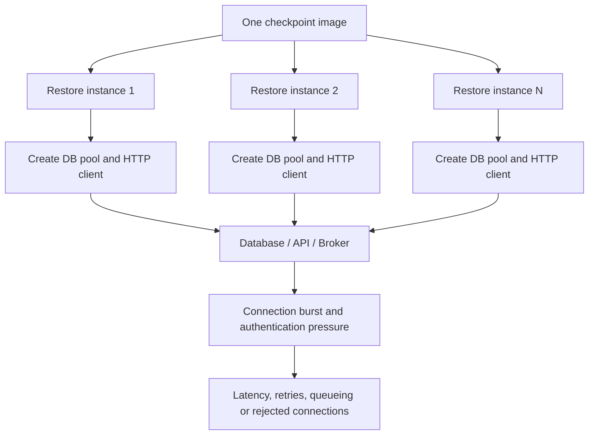

# Evaluating Concurrent Scalability and Reconnection Load

Checkpoint/restore can shorten the startup time of a Java application, but the restore speed of a single process does not reflect the scalability of the entire system. When many instances restore simultaneously, they typically initialize connection pools, open HTTP/TLS connections, authenticate credentials, register message consumers, and warm caches all at once. If all of this activity occurs within a short time window, external dependencies may receive a surge far larger than normal daily steady-state load.

Therefore, CRaC performance evaluation must consider two aspects together: **request-processing capacity as the instance count grows** and **dependency recovery behavior when many instances reconnect after restore**. A system can restore the JVM very quickly yet take minutes to recover its database pool or message consumers. Conversely, a system can reconnect quickly while opening too many concurrent connections, overloading the database or broker.

## 1. Distinguishing Restore Speed from Full-System Recovery Speed

A restore operation typically comprises multiple timeline milestones:

1. The runtime reads the checkpoint image and restores process state.
2. The JVM resumes execution and invokes `afterRestore()`.
3. Resources recreate connections, clients, workers, and environment-dependent resources.
4. The application verifies dependencies and transitions readiness to success.
5. The instance begins receiving traffic.
6. The system reaches stable throughput and latency.

Measuring only the time from invoking the restore command until the process exists misses most of the recovery cost. At least three intervals must be measured:

| Interval | Start | End | Meaning |
|---|---|---|---|
| Restore duration | Restore request | JVM resumes execution | Process/runtime restoration cost |
| Restore-to-ready | Restore request | Readiness succeeds | Time until the instance can accept traffic |
| Recovery-to-steady-state | Restore request or traffic opened | Latency/throughput stabilizes | Time for the entire system to recover performance |

For example, the JVM may restore in 300 ms, yet take 8 seconds to establish the database pool and 20 seconds for the broker to finish a consumer group rebalance. Reporting only 300 ms would fail to reflect the real-world experience.

## 2. Two Load Challenges to Evaluate

### 2.1. Concurrent Scalability

This is the system's ability to handle many requests, jobs, or messages concurrently as the number of instances or workers increases. Determine whether throughput scales proportionally, whether latency spikes sharply, and whether dependencies become bottlenecks.

Commonly influencing factors:

- Number of restored instances and requests received per instance.
- Number of worker threads and concurrency limits inside the application.
- Connection pool sizes of databases and HTTP clients.
- CPU, memory, GC, and thread scheduling.
- Lock contention, queue length, and backpressure.
- Connection, request rate, and concurrency limits of dependencies.

### 2.2. Post-Restore Reconnection Load

This is the load generated when many instances must re-establish out-of-process resources within a short period. For example:

- Many HikariCP pools opening database connections simultaneously.
- Many HTTP clients performing TCP connects, TLS handshakes, and authentication simultaneously.
- Many message consumers re-registering subscriptions simultaneously and triggering rebalances.
- Many instances fetching secrets, refreshing tokens, or registering leases simultaneously.
- Many caches loading background data simultaneously after startup.

This surge is commonly called a *reconnection storm* or *thundering herd*. It can occur even before business traffic is opened.

## 3. Why Does Concurrent Restore Cause a Reconnection Storm?

Suppose 40 instances are restored together from the same checkpoint image. Each instance has a database pool with a maximum of 20 connections and an HTTP client creating up to 10 connections during warm-up.

If all pools are initialized simultaneously and quickly reach their maximum size, the database can receive up to 800 new connections; the HTTP service can receive another 400 TCP/TLS connections. This is an upper-bound example, not the exact number guaranteed to be created: the actual count depends on whether pools eager-fill or lazy-create, the number of warm-up requests, and how clients manage connections.



Post-restore activities can synchronize because instances share the same image, configuration, and rollout timing. If all instances retry on the same fixed interval, each recovery of the dependency can trigger another burst.

## 4. Defining the Load Model Before Benchmarking

A benchmark result is only meaningful when how load is generated is known. Distinguish between concurrent requests, request arrival rate, and concurrently restoring instances.

| Model | Load Generation Method | Suited For Measuring |
|---|---|---|
| Fixed concurrency | Keep the number of virtual users/request workers fixed | Throughput and latency at a given concurrency level |
| Constant arrival rate | Send a steady number of requests per second | Serving capacity under a controlled arrival rate |
| Ramp-up | Increase concurrency or arrival rate over time | Saturation onset and error threshold |
| Burst | Spike load sharply for a short period | Resilience to sudden traffic or reconnection surges |
| Restore fan-out | Restore multiple processes/replicas simultaneously | Reconnection pressure and fleet time-to-readiness |
| Mixed workload | Combine business traffic with restore/reconnect | Impact of recovery on active users |

Do not use a single "concurrent users" figure to replace all models. 100 virtual users can generate vastly different request rates depending on response time and think time. Restore fan-out, meanwhile, measures the number of processes starting together, not request count.

### 4.1. Closed-Loop and Open-Loop Load

In the closed-loop model, each virtual user sends the next request after the previous one completes. When the system slows down, the request rate automatically drops. This can mask overload because the load generator reduces pressure right when the system weakens.

In the open-loop model, requests are issued at a predefined arrival rate, independent of response time. This model is suited for observing queueing and latency when the system faces a fixed arrival rate. Ensure the load generator has enough resources to maintain the arrival rate; otherwise, results will not reflect the intended load.

For systems recovering after restore, use both:

- Fixed concurrency to understand maximum throughput across worker counts.
- Constant arrival rate to observe latency and error rates when traffic does not back off with processing speed.
- Burst/restore fan-out to measure the reconnection surge separately.

### 4.2. Little's Law as a Sanity Check

In a stable system, Little's Law describes the relationship between the average number of items in the system (L), the average completion rate λ, and the time spent in the system (W):

\[
L = \lambda W
\]

For example, if the system processes an average of 500 requests/second with an average response time of 0.2 seconds, the average number of requests in flight is approximately 100. This is a sanity check for steady state; do not use it directly to infer load during a brief burst or when queues are growing unstably.

## 5. Designing Benchmarks Across Multiple Scale Levels

Do not measure only a small configuration and extrapolate linearly. Increase instance count, concurrency, and request rate step by step to find the saturation point.

An illustrative matrix:

| Scenario | Instance Count | Concurrent Restores | Request Concurrency | Objective |
|---|---:|---:|---:|---|
| Baseline | 1 | 1 | Low | Establish single-instance cost |
| Small scale-out | 4 | 1 per batch | Medium | Measure performance as replicas increase |
| Restore burst | 8 | 8 | 0 initially | Measure reconnection storm in isolation |
| Restore fan-out | 16 | 4 per batch | 0 initially | Measure effectiveness of staggering/batching |
| Concurrent traffic | 8 | 0 | Ramping | Find throughput and latency saturation |
| Mixed recovery | 8 | 2 per batch | High | Measure restore impact on existing traffic |
| Dependency degradation | 8 | 2 per batch | Medium | Measure retries, timeouts, and readiness when DB/API is slow |

The numbers above are examples for matrix design only. Replace them with expected production scale and test environment limits. If production runs hundreds of replicas, benchmark in batches and simulate the corresponding dependency limits.

### 5.1. Keeping Comparison Factors Constant

When comparing cold start with CRaC restore or comparing pool configurations, keep fixed:

- JDK vendor/version/build and JVM options.
- Application build, configuration, and dataset.
- CPU/memory limits and machine type.
- Test database, broker, and HTTP services.
- Network path, TLS configuration, and DNS.
- Request count, payload, test duration, and warm-up policy.
- Load generator and where it runs.

If multiple factors change simultaneously, it is difficult to determine whether improvement comes from CRaC, pool size, network, or host resources.

## 6. Connection Pool Capacity Planning

Connection pools are the most visible source of reconnection load. If each instance has a pool maximum of (C) connections and there are (N) active instances, the potential connection limit from the application is:

\[
Connections_{max} = N \times C
\]

Total connections must also add other applications, migrations, monitoring, admin sessions, and secondary replicas:

\[
Connections_{total} = \sum_i (N_i \times C_i) + C_{other}
\]

If the database has a connection limit (D), maintain headroom for administrative operations and load fluctuations:

\[
\sum_i (N_i \times C_i) + C_{other} \leq D - H
\]

Where (H) is operationally determined headroom and should not be set to 0. This is an upper-bound calculation; a lazy pool may open only a subset of connections if the workload does not require the full pool.

### 6.1. Example Limit Calculation

Suppose:

- The database allows 600 connections.
- Other services currently use 180 connections.
- 60 connections are reserved for migrations, admin tasks, and fluctuations.
- The CRaC application is expected to run 20 replicas.

Maximum remaining connections available for the application:

\[
600 - 180 - 60 = 360
\]

The average pool limit per replica is:

\[
360 / 20 = 18
\]

A pool of 18 is an initial arithmetic limit, not yet an optimal configuration. Measure connection acquisition time, transaction duration, and throughput to determine the actual pool size. Increasing the pool beyond what the database can handle can worsen contention and latency.

### 6.2. Evaluating Eager vs. Lazy Pools

An eager pool or a configuration maintaining a high `minimumIdle` can open many connections immediately upon instance restore. This reduces connection-creation wait time for the first request, but increases the reconnection burst.

A lazy pool or a low `minimumIdle` reduces the number of connections initialized simultaneously, though the first request may have to wait to open a connection. Compare:

- Restore-to-ready time.
- New connections per second.
- Connection acquisition latency.
- Request p95/p99 over the first few minutes.
- CPU/database load while the pool establishes connections.

With HikariCP, properties such as `maximumPoolSize`, `minimumIdle`, `connectionTimeout`, and how the application creates the pool affect behavior. Illustrative configuration example:

```yaml
spring:
  datasource:
    hikari:
      maximum-pool-size: 18
      minimum-idle: 2
      connection-timeout: 3000
```

These values are not universal recommendations. Choose them according to database limits and workload. Setting `minimumIdle` lower than `maximumPoolSize` allows the pool to scale dynamically; it does not guarantee every restore opens exactly two connections at all times. Verify behavior against your HikariCP version and application configuration.

## 7. Measuring Reconnection Rate

If each of (N) instances creates (K) new connections within time interval (T), the average connection creation rate is:

\[
ReconnectRate = \frac{N \times K}{T}
\]

For example, 20 instances each opening 10 connections in 5 seconds yields an average rate of 40 connections/second. In practice, activity can concentrate into a much shorter burst, so measure a histogram or per-second time series rather than taking only a whole-test average.

Metrics to collect:

- Connection open attempts/second.
- Connection success/failure rate.
- Concurrent active connections and idle connections.
- TLS handshake count, duration, and failures.
- Authentication request rate and token refresh rate.
- Database connection wait/acquisition time.
- Number of rejected or reset connections.
- Retry count and retry duration.
- Time from restore until dependency-ready.

Measuring only current active connections can miss bursts because connections can open and close rapidly. Collect cumulative counters for total open attempts, errors, and rates over time.

## 8. Limiting Reconnect Concurrency

One way to reduce bursts is to limit the number of concurrent connection operations. A semaphore or bounded executor can be used inside each process.

Example semaphore limiting concurrent reconnections inside a single JVM:

```java
import java.time.Duration;
import java.util.concurrent.Semaphore;
import java.util.concurrent.TimeUnit;

public final class ReconnectGate {
    private final Semaphore permits;
    private final Duration acquireTimeout;

    public ReconnectGate(int maxConcurrent, Duration acquireTimeout) {
        if (maxConcurrent <= 0) {
            throw new IllegalArgumentException("maxConcurrent must be positive");
        }
        this.permits = new Semaphore(maxConcurrent);
        this.acquireTimeout = acquireTimeout;
    }

    public void reconnect(CheckedRunnable operation) throws Exception {
        boolean acquired = permits.tryAcquire(
                acquireTimeout.toMillis(), TimeUnit.MILLISECONDS);
        if (!acquired) {
            throw new IllegalStateException("Reconnect admission timed out");
        }

        try {
            operation.run();
        } finally {
            permits.release();
        }
    }

    @FunctionalInterface
    public interface CheckedRunnable {
        void run() throws Exception;
    }
}
```

If a thread is interrupted during `tryAcquire`, `InterruptedException` propagates; the caller must handle it per lifecycle rules and preserve interrupt semantics. This gate only limits concurrency within a single JVM. If 20 replicas each have a semaphore permitting 2 connections, the whole system can still open 40 concurrent connections.

To enforce a fleet-wide limit, add coordination at the deployment or dependency layer:

- Batched restores capping the number of concurrent instances.
- A distributed token bucket or lease when a cluster-wide limit is needed.
- An API gateway/connection proxy with concurrency limits.
- A pool budget allocated based on replica count.
- Broker/database quotas sized for peak reconnection.

Do not rely on a local semaphore alone to protect database-wide connection limits.

## 9. Backoff and Jitter During Reconnection

If a dependency is not yet ready, having all instances retry after exactly 1 second can trigger a fresh burst in the next second. Exponential backoff progressively widens the wait interval; jitter spreads retry timestamps across instances.

With full jitter, the delay ceiling at retry attempt (a) can be computed as:

\[
cap_a = \min(maxDelay, baseDelay \times 2^a)
\]

Then sample randomly:

\[
delay_a \sim Uniform(0, cap_a)
\]

Java example:

```java
import java.time.Duration;
import java.util.concurrent.ThreadLocalRandom;

public final class RetryDelay {
    private RetryDelay() { }

    public static Duration fullJitter(
            int attempt,
            Duration baseDelay,
            Duration maxDelay) {
        if (attempt < 0 || baseDelay.isNegative() || baseDelay.isZero()
                || maxDelay.compareTo(baseDelay) < 0) {
            throw new IllegalArgumentException("Invalid retry configuration");
        }

        long base = baseDelay.toMillis();
        long max = maxDelay.toMillis();
        long ceiling = base;

        for (int i = 0; i < attempt && ceiling < max; i++) {
            ceiling = ceiling > max / 2 ? max : Math.min(max, ceiling * 2);
        }

        long delay = ThreadLocalRandom.current().nextLong(ceiling + 1);
        return Duration.ofMillis(delay);
    }
}
```

The snippet illustrates full jitter using milliseconds within typical configuration bounds. In production code, cap `maxDelay` so adding 1 cannot overflow, enforce an overall deadline, and honor `Retry-After` if returned by the dependency. Do not retry indefinitely; distinguish transient errors from configuration or authentication errors.

### 9.1. Jitter Does Not Replace Admission Control

Jitter spreads retries over time but does not guarantee concurrent connections stay below the limit. As soon as a dependency recovers, many requests can succeed at once and still create a burst. Combine backoff+jitter with concurrency limits, bounded queues, and restore batching.

### 9.2. Deadlines and Retry Budgets

A reconnect operation requires an overall deadline. If an application retries forever inside `afterRestore`, the callback can hang indefinitely and the instance will never reach readiness. Define:

- Maximum retry count or total deadline.
- Which error types are retryable.
- Timeout per connect/handshake attempt.
- Backoff and jitter.
- How retries are canceled when the instance stops.
- Behavior when the retry budget is exhausted: fail restore/readiness, or let the controller retry per policy.

Errors such as invalid credentials, expired certificates, or misconfigured hostnames are generally not resolved by continuous retries. Report the error clearly and do not open traffic.

## 10. Staggered Restore and Batched Rollouts

If restore timing can be controlled, there is no need to restore the entire fleet within the same second. Split into batches and wait for each batch to meet readiness criteria before continuing.

Example:

```text
Fleet: 24 instances

Batch 1: restore 4 -> reconnect -> readiness
Batch 2: restore 4 -> reconnect -> readiness
Batch 3: restore 4 -> reconnect -> readiness
Batch 4: restore 4 -> reconnect -> readiness
Batch 5: restore 4 -> reconnect -> readiness
Batch 6: restore 4 -> reconnect -> readiness
```

Batch size should be based on the connection budget, dependency capacity, and recovery SLA. Waiting solely for readiness may not suffice if connection pools have only partially initialized; an additional readiness condition for critical dependencies or a fleet-wide reconnect limit may be needed.

When using Kubernetes, settings such as `maxSurge`, `maxUnavailable`, rollout strategy, startup/readiness probes, and custom controllers can affect how many Pods start concurrently. However, a Pod restart or rollout does not automatically restore a CRaC image; integrate the platform's restore mechanism properly.

## 11. Message Brokers and Consumer Rebalancing

Reconnection load is not limited to database connections. When many consumers recover together, the broker may have to handle:

- Many new TCP/TLS connections.
- Authentication and authorization requests.
- Consumer group membership updates.
- Partition reassignment and rebalancing.
- Subscription and offset coordination.
- Retries while the broker or coordinator is not yet ready.

If consumers resume all at once, rebalance duration can increase and message-processing throughput can dip temporarily. Measure rebalance count, rebalance duration, assigned partition count, lag, and time from restore until consumers process messages steadily.

Consumer resumption can be staggered after connections are ready. Ensure consumers do not accept messages before application state and required dependencies are restored. Also verify at-least-once/exactly-once semantics, idempotency, and duplicate processing during the transition phase.

## 12. HTTP Clients, TLS, and DNS

An HTTP client may retain connection pool and TLS session state. After restore, old sockets may no longer be valid or may need to be closed and recreated. If dozens of instances perform TLS handshakes simultaneously, CPU and authentication services can become bottlenecks.

Measure separately:

- DNS lookup rate and latency.
- TCP connect latency and resets.
- TLS handshake latency, CPU, and certificate errors.
- OAuth/token endpoint request rate.
- Connection pool pending/acquire time.
- HTTP 429, 5xx, and timeouts.
- Retry count per endpoint.

Avoid having every instance refresh the same token or fetch the same configuration simultaneously on restore. Use a token cache with proper lifecycle handling, jittered refreshes, and rate-limited issuance/refresh mechanisms. Do not store short-lived tokens in the image and assume they remain valid when restoring hours later.

## 13. Cache Warm-Up and Cache Stampede

After restore, in-heap caches may be restored with the snapshot while external data may have changed. If the application proactively invalidates caches and all instances reload a large dataset at once, the database or cache backend can experience an abnormal load spike.

Strategies to mitigate stampedes:

- Warm up in batches or by key priority.
- Use single-flight so multiple requests inside an instance wait on one load.
- Use distributed locks/leases when coordination across multiple instances is required.
- Add jitter to cache refresh schedules.
- Cap concurrent loads and use bounded queues.
- Use stale-while-revalidate if business rules allow.
- Announce readiness only after mandatory caches are ready; do not block on optional caches.

Single-flight inside one JVM does not prevent 20 replicas from loading the same key simultaneously. If the cache backend is constrained, fleet-wide coordination or quotas are needed.

## 14. Designing Benchmark Workloads

A good benchmark clearly separates the phases:

1. **Baseline:** measure standard cold start and single-instance CRaC restore.
2. **Warm-up:** prepare the application and verify representative execution paths.
3. **Checkpoint:** create the image from the warmed-up process.
4. **Single restore:** restore one instance and measure restore-to-ready.
5. **Fan-out:** restore multiple replicas in batches or concurrently.
6. **Reconnect observation:** measure connection/auth/broker/cache load.
7. **Traffic ramp:** increase request rate as each batch becomes ready.
8. **Mixed load:** continue serving traffic while the next batch restores.
9. **Steady state:** sustain load long enough to measure stable throughput/latency.
10. **Recovery:** stop load and observe pools/queues/caches returning to normal.

Each phase needs timestamps and a run ID to correlate application, database, broker, load generator, and orchestration logs.

### 14.1. k6 Example for Post-Restore Traffic

k6 can generate traffic at a controlled arrival rate to measure the application after fleet restore. This script does not perform the CRaC restore itself; the orchestration step must restore instances first and run the test only when the endpoint is ready.

```javascript
import http from 'k6/http';
import { check } from 'k6';

export const options = {
  scenarios: {
    post_restore_traffic: {
      executor: 'ramping-arrival-rate',
      startRate: 20,
      timeUnit: '1s',
      preAllocatedVUs: 50,
      maxVUs: 300,
      stages: [
        { target: 50, duration: '1m' },
        { target: 100, duration: '2m' },
        { target: 200, duration: '2m' },
        { target: 200, duration: '3m' },
        { target: 0, duration: '30s' },
      ],
    },
  },
  thresholds: {
    http_req_failed: ['rate<0.01'],
    http_req_duration: ['p(95)<500', 'p(99)<1200'],
  },
};

export default function () {
  const response = http.get(`${__ENV.BASE_URL}/api/orders/health-sample`);
  check(response, {
    'status is successful': (r) => r.status === 200,
  });
}
```

The rates, durations, and thresholds are examples only. Substitute the endpoint, payload, SLA, and arrival profile for your application. Monitor `dropped_iterations` and load generator resources; if the generator cannot sustain the required arrival rate, the test is invalid. Use a representative business endpoint instead of a health endpoint if the goal is to measure real processing throughput.

### 14.2. Separating Reconnection Tests from Request Tests

To measure the reconnection storm separately, restore the fleet without opening business traffic yet. Collect connection metrics on the database/broker/API. Only after all instances are ready should you run k6 to measure request capacity.

Next, run a mixed-load test: hold traffic steady while restoring a new batch. This shows whether the reconnection burst degrades performance for existing users.

## 15. Metrics to Collect

Do not rely solely on CPU or average latency. Observe both the application and its dependencies.

| Group | Metrics | What to Detect |
|---|---|---|
| Restore | Restore duration, restore success/failure, time-to-ready | Whether JVM restore is fast or slow, which instances are stuck |
| Request | RPS, p50/p95/p99, error rate, timeout | User impact and saturation point |
| Concurrency | Active requests, worker count, queue depth, rejected tasks | Backpressure and thread saturation |
| Database | Active/idle connections, connect attempts, acquisition wait, query latency | Pool storms and database saturation |
| HTTP/TLS | TCP connects, handshake duration, auth rate, 429/5xx | Pressure on dependent services |
| Broker | Consumer count, rebalance count/time, lag, message rate | Consumer group recovery capability |
| Cache | Miss rate, load requests, refresh concurrency, backend latency | Cache stampede |
| JVM | CPU, heap, GC pause, thread count, class loading | Warm-up cost and contention |
| Host | CPU, memory, network, file descriptors, disk I/O | Bottlenecks at the node and checkpoint storage |
| Retry | Attempts, delay, exhaustion, circuit state | Retry storms or prolonged recovery |

### 15.1. Percentiles Matter More Than Averages

Average latency can hide a group of very slow requests while pools are re-establishing. Record p50, p95, p99, and max; for critical systems, track histograms across each phase of restore and steady state.

Do not combine percentiles across multiple instances by taking a simple mean. Use histograms with compatible buckets or request-level data from the load generator to calculate fleet percentiles accurately.

### 15.2. Observing Over Time

A useful combined chart aligns on the same time axis:

- Number of instances starting restore and number of instances ready.
- Connection attempts/second and active connection count.
- Request rate and p95/p99.
- Database CPU/queue and broker lag.
- Retry rate and connection errors.

When curves rise simultaneously, the relationship between restore fan-out and dependency pressure becomes clear. Do not examine only snapshot metrics at the end of the test.

## 16. Identifying Scaling Thresholds and Saturation Points

Gradually increase instance count or request rate until one of the following conditions appears:

- Throughput no longer scales proportionally with load.
- p95/p99 rises rapidly while throughput remains nearly flat.
- Error/timeout rate exceeds thresholds.
- Connection acquisition wait increases sharply.
- The database/broker reaches its connection or CPU limit.
- Queue depth grows continuously without returning to baseline.
- CPU throttling or GC pauses degrade responsiveness.
- Restore-to-ready time exceeds the SLA.

The saturation point is not necessarily 100% CPU. Database connection limits, TLS handshake CPU, the broker coordinator, or an application lock can saturate earlier.

### 16.1. Calculating Capacity with Headroom

Do not treat the highest measured throughput as production capacity. Determine a safe operating level below the saturation point with headroom for traffic bursts, retries, and other workloads.

For example, if at 8 replicas the system reaches 4,000 RPS while p99 already exceeds the SLA, whereas at 6 replicas it achieves 3,200 RPS with stable latency, 6 replicas may be the safer operating point. Decisions must rely on SLAs and observed data, not just the highest RPS figure.

### 16.2. Estimating Fleet Recovery Time

If there are (N) instances and each batch contains (B) instances, the approximate batch count is:

\[
BatchCount = \left\lceil \frac{N}{B} \right\rceil
\]

If each batch requires restore time (T_r), reconnect time (T_c), and verify/readiness time (T_v), and the phases execute sequentially, the approximate recovery time is:

\[
T_{fleet} \approx BatchCount \times (T_r + T_c + T_v)
\]

This is a conservative estimate for sequential batches. In practice, phases can overlap and durations depend on load; use percentile measurements and rollout simulations for planning.

## 17. Comparing Cold Start and CRaC Under Equal Load

CRaC generally reduces JVM and application initialization overhead, but does not eliminate dependency connection costs. A comparison should include these columns:

| Metric | Cold start | CRaC single restore | CRaC restore fan-out |
|---|---:|---:|---:|
| Process start/restore duration | Measured actuals | Measured actuals | Measured per instance and fleet |
| Time-to-ready | Measured actuals | Measured actuals | Measured until last instance is ready |
| First request p95/p99 | Measured actuals | Measured actuals | Measured during batch restore phase |
| Connection attempts/second | Measured actuals | Measured actuals | Measured at peak burst |
| Database active connections | Measured actuals | Measured actuals | Measured at fleet-wide peak |
| Error/retry rate | Measured actuals | Measured actuals | Measured when dependency handles reconnect burst |
| Steady-state throughput | Measured actuals | Measured actuals | Measured after fleet stabilizes |

Do not compare a single-instance cold start against a fleet-wide CRaC restore without normalizing total resources. Measure with identical replica counts, traffic, and dependency capacity to determine actual benefit.

## 18. Common Evaluation Mistakes

**Measuring only JVM restore time.** The application may not yet be connected to the database or broker. Measure restore-to-ready and recovery-to-steady-state.

**Benchmarking only a single instance.** Fails to expose reconnection storms or fleet-wide limits. Test multiple replicas restoring concurrently and in batches.

**Using average latency.** High percentiles can surge while pools re-establish. Track p95/p99 and histograms over time.

**Ignoring total connections across all replicas.** Pool size multiplied by replica count can exceed database limits. Establish a system-wide connection budget.

**Capping reconnects with a local semaphore and assuming the database is protected.** Each JVM has its own semaphore. Use rollout batching or distributed admission when cluster-wide limits are required.

**Retrying on a fixed interval.** Multiple instances can synchronize retries and create recurring bursts. Use exponential backoff with jitter and a retry budget.

**Allowing readiness to succeed before dependencies are ready.** Early traffic increases errors and retries. Open traffic only after mandatory resources are verified.

**Checking only whether reconnection eventually succeeds without measuring rate.** 100% of instances eventually connecting can still hide a database overloaded during the first 30 seconds. Measure attempts/second, peak concurrency, and latency.

**Under-provisioned load generator.** A generator failing to sustain the arrival rate makes the system look healthier than it is. Monitor dropped iterations and generator resources.

**Skipping mixed-load testing.** Reconnections can slow down active serving traffic. Keep traffic steady while restoring a new batch.

**Using a dependency environment larger than production.** Tests may miss connection limits or quotas. Test setups must mirror production limits.

## 19. Self-Check

1. **How does restore duration differ from restore-to-ready?** Restore duration measures the JVM restoration time; restore-to-ready also includes recreating dependencies and passing readiness checks.
2. **Why can many instances restoring simultaneously overload the database?** Pools can open connections, perform authentication, and warm up all at the same time.
3. **What is the upper-bound formula for the fleet connection pool?** The approximate sum is replica count multiplied by the maximum pool size per application type, plus other connection sources.
4. **Does a semaphore in one JVM limit reconnections cluster-wide?** No. It only limits concurrency within that process; batching or distributed admission is needed to limit the entire fleet.
5. **Why does exponential backoff need jitter?** To stagger retry timestamps and prevent many instances from retrying at the exact same moment.
6. **Why measure connection attempts/second instead of only active connections?** Connections can open and close rapidly; an active count at one instant does not capture the full burst.
7. **What can closed-loop load conceal?** When the system slows down, the request generation rate drops accordingly, making actual pressure lower than a fixed arrival rate.
8. **When should readiness be opened?** Once mandatory dependencies have been restored and verified; optional caches may continue warming up if application policy allows.
9. **Why is mixed-load testing necessary?** To measure the impact of reconnections on in-flight requests while the fleet scales or recovers.

## Conclusion

Evaluating CRaC scalability requires measuring both throughput as concurrency increases and reconnection load when many instances restore simultaneously. Separate restore duration, restore-to-ready, and recovery-to-steady-state; calculate the fleet-wide connection budget; and track connection creation rates, TLS/authentication, broker rebalancing, cache warm-up, and retries over time.

To avoid reconnection storms, combine pool sizing, concurrency limits, batched restores, exponential backoff with jitter, retry deadlines, and readiness gates. Benchmarks should include single restore, restore fan-out, traffic ramps, mixed loads, dependency degradation, and multiple iterations. Use p95/p99, error rates, queue depth, and dependency metrics to identify saturation points. Conclude that the system scales well only when the fleet not only restores quickly, but also recovers dependencies and maintains stable performance within SLA bounds.
