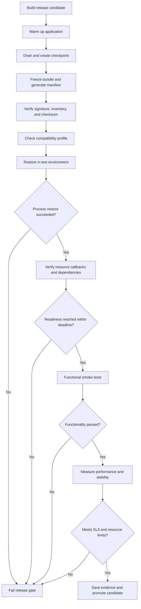
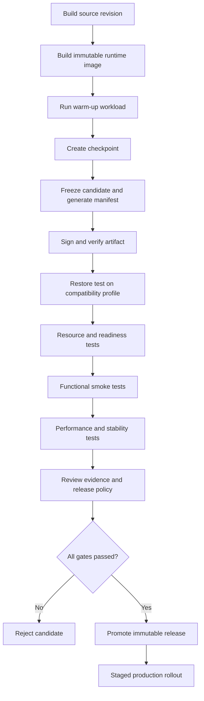

# Promote Only Images That Pass Restore Verification

A CRaC checkpoint is the state of a Java process at the time of image creation. A checkpoint command returning success only proves that image creation completed according to the runtime and tools in use; it does not prove that the image can be safely deployed, restored in the target environment, or serve real workloads.

Therefore, in production operations, a checkpoint must be treated as a conditional release artifact. Promote an image only after running a trial restore with the exact JDK, application build, dependencies, container image, and compatible environment; CRaC callbacks must finish; resources must be recovered; readiness must be reached; and the application must pass defined functional checks and performance criteria.

The release rule should be: **a checkpoint without evidence of successful restore on the target compatibility profile must not enter production**. If changes to the JDK, application, native libraries, JVM flags, base image, or CRIU/kernel configuration fall outside the tested scope, the release must re-run relevant checks before promotion.

## 1. Why Must Restore Testing Happen Before Release?

A checkpoint can be created successfully yet still fail at the restore stage or after the process has been restored.

Common scenarios:

- The JDK or JVM build used for restore does not match the runtime that created the checkpoint.
- The checkpoint is missing files, corrupted during copying, or paired with a different application image.
- The kernel, CRIU, container runtime, namespaces, or system permissions fail to meet restore prerequisites.
- The `afterRestore` callback fails to recreate database pools, broker clients, sockets, or native resources.
- The application restores, yet readiness switches to accepting too early.
- Background consumers or schedulers run before dependencies are ready.
- The first request fails due to stale caches, expired credentials, or unrefreshed instance state.
- Post-restore performance misses targets even though the process starts quickly.

These errors may not surface during build or checkpoint creation. They only appear when the image is restored in an environment close to where it will actually run.

### 1.1. Distinguishing Levels of Success

| Level | Evidence | Sufficient for release? |
| --- | --- | --- |
| Build succeeded | Application artifact and container image created | Not yet |
| Warm-up succeeded | Preparation workload ran and met criteria | Not yet |
| Checkpoint succeeded | JVM/CRIU created the image | Not yet |
| Process restore succeeded | Process reconstructed from the image | Not yet |
| Resource restore succeeded | Mandatory dependencies and resources recreated and verified | Not yet |
| Application ready | Readiness reached and test request handled | Not sufficient without required functional/performance checks |
| Release validation passed | Restore, functionality, performance, and release policies all passed | Eligible for promotion consideration |

Do not collapse these states into a single `checkpointSucceeded` boolean. The pipeline must store separate outcomes to know whether a failure occurred in build, checkpoint, restore, resources, or the post-restore application.

## 2. Identifying the Exact Artifact to Release

Before running restore tests, freeze the release candidate. A checkpoint must be bound to the exact set of components that produced it.

A release candidate typically includes:

- Checkpoint directory and all associated files.
- JDK vendor, version, and build supporting CRaC.
- Specific application JAR/WAR or module build.
- Dependency lockfile, runtime classpath, and native libraries.
- Container image digest or immutable runtime filesystem.
- JVM flags and launch configuration.
- Metadata on OS, architecture, kernel, and CRIU.
- Release manifest, checksums, and provenance.

Do not test one checkpoint and release another checkpoint regenerated later, even from the same source revision. Each image creation produces a distinct artifact; bind test results to the exact digest or release ID of the tested image.

### 2.1. Using Immutable Release IDs and Digests

Example release structure:

```text
orders-service/
  releases/
    1.8.0-build.412/
      manifest.yml
      application/
        app.jar
        dependencies.lock
      runtime/
        jvm-options.txt
        effective-flags.txt
      checkpoint/
        ... checkpoint files ...
      checksums/
        files.sha256
      validation/
        restore-test-result.json
```

The directory above only illustrates organization. Checkpoints may be stored separately in object storage and container images in a registry. What matters is that the manifest links them via immutable digests.

Do not use mutable tags such as `latest` as runtime identification evidence. Record the container image digest, application checksum, checkpoint file inventory digest, and full JDK build.

### 2.2. Do Not Modify Artifacts After Testing

If a checkpoint is copied, compressed, has permissions changed, or is repackaged after testing, re-verify checksums and ensure the operation does not alter structures required by the runtime. If contents change, prior test results are no longer firmly tied to the new artifact.

A release candidate should reside in an immutable staging location after image creation. The pipeline promotes only the exact tested and signed candidate.

## 3. Building a Compatibility Profile for Restore Testing

Restore success depends on the environment. Therefore, before running tests, define the compatibility profile the release will support.

| Component | Information to fix or record |
| --- | --- |
| JDK | Vendor, version, build, CRaC support, and JVM implementation |
| JVM flags | Heap sizing, GC, object layout, module options, agents, and important system properties |
| Application | Build ID, source revision, and checksum |
| Dependencies | Lockfile, classpath digest, framework and native library versions |
| Container | Image digest, runtime configuration, and mount points |
| Operating system | Linux distribution, architecture, and kernel version/capabilities |
| CRIU | Version, configuration, and capability check results |
| Resources | Memory/CPU limits, file descriptor limits, permissions, and capabilities |
| External services | Databases, brokers, caches, and secret providers used in testing |

The compatibility profile must represent the target environment. If production runs on multiple node types or kernel versions, define the supported profile set and test each critical profile.

### 3.1. The Test Environment Must Sufficiently Resemble Production

A restore test on a developer laptop does not prove a checkpoint runs in production Kubernetes. Differences can stem from:

- Kernel and CRIU versions.
- Container runtime, namespaces, and capabilities.
- Cgroups and memory limits.
- CPU architecture or CPU features.
- Filesystem and mount layout.
- File, socket, and device permissions.
- Secret provisioning, DNS, and network policies.

Use a managed test environment configured equivalently to production. If an exact match is impossible, document differences and determine whether they affect restore.

### 3.2. Checking the Environment Before Restoring

Before launching restore, the pipeline can collect:

```bash
java -version
uname -a
criu --version
criu check
```

These commands provide baseline information and check certain CRIU capabilities. They do not replace a real restore using the exact checkpoint. Store results alongside the test report for traceability when environments change.

## 4. Mandatory Test Gates

A release gate can be split into independent groups. Each group has clear passing criteria and evidence tied to the release ID.

### 4.1. Artifact and Integrity Gate

Before restoring:

- Manifest has a valid signature and trusted signer.
- Checkpoint file inventory matches the manifest.
- Checksums of all files match.
- Application artifact, dependency set, and container image digest belong to the right release.
- JDK and JVM flags match the compatibility profile.
- The release has not been revoked or violated anti-rollback policy.
- The staging location cannot be altered between verification and restore.

If any condition fails, the pipeline must halt before executing JVM restore.

### 4.2. Restore Runtime Gate

Restore tests must confirm:

- The restore command launches the right JDK and right checkpoint path.
- JVM/CRIU completes the recovery process.
- The process does not exit abnormally.
- No unhandled restore errors occur.
- Resource callbacks are invoked per expected lifecycle.
- No critical threads or native resources are in a failed state.

Merely observing a new PID is insufficient to conclude restore succeeded. Wait for the application to reach a state eligible for further checks.

### 4.3. Resource and Readiness Gate

After restore, confirm mandatory components are operational:

- Database pool creates connections and executes a validation query.
- Broker client authenticates and can perform required operations.
- Caches have their version verified or are refreshed per policy.
- Native clients, sockets, and file handles are recreated or verified.
- Schedulers/consumers resume only after dependencies are ready.
- HTTP listener can accept connections on the real serving port.
- Readiness switches to `ACCEPTING_TRAFFIC` only last.

Liveness and readiness must be checked separately. A live process whose readiness refuses traffic while reconnecting dependencies may be valid behavior. The pipeline must not immediately treat this state as a failure if it remains within the defined restore deadline.

### 4.4. Functional Gate

Once readiness is reached, run representative smoke tests:

- Critical data read endpoints.
- Write flows with side effects in a safe test environment.
- Serialization/deserialization.
- Authentication and authorization.
- Database transactions.
- Message publishing/consuming if within release scope.
- Essential background jobs.
- Flows involving native libraries or OS resources.

Smoke tests should check business outcomes, not just HTTP 200. For example, a record-creation request must verify the record was written accurately; a message consumer must verify the message was processed with right semantics.

### 4.5. Performance and Stability Gate

At minimum, measure:

- Time from restore start to readiness.
- Time from readiness to first successful request.
- p50/p95/p99 latency of representative workloads.
- Throughput and error rate.
- CPU and memory footprint after restore.
- GC pauses and allocation behavior.
- FD count and native resource status if the application uses native code.

Thresholds must be defined by the application's SLA and baseline. Do not use a single universal number across all services. A checkpoint may restore very fast yet exhibit high latency or exceed memory limits afterward; the release gate must cover the post-readiness phase as well.

## 5. End-to-End Restore Testing Workflow

A restore test should run from the frozen artifact, not a separate temporary checkpoint.



### 5.1. Testing a Newly Created Checkpoint

Minimum workflow:

1. Build application and container image.
2. Start application using the exact CRaC JDK.
3. Run warm-up workload per policy.
4. Drain requests and background tasks.
5. Complete `beforeCheckpoint` and create the image.
6. Wait for checkpointing to finish and close the process per tooling workflow.
7. Compute checksums, create manifest, and freeze the release candidate.
8. Launch restore test from that exact candidate.
9. Await callbacks and readiness.
10. Run smoke tests and performance-measuring workload.
11. Save report tied to the candidate's digest.

### 5.2. Testing Restore After Artifact Transfer

If production downloads checkpoints from an artifact store or registry, test that exact path:

1. Publish candidate to staging repository.
2. Download candidate using a deployment identity similar to production.
3. Verify signature and checksum after download.
4. Mount or copy to restore location.
5. Re-verify if copying alters paths or metadata.
6. Restore using the image digest specified by the manifest.

This catches permission, file ownership, path, transfer, and packaging issues that restoring directly on the build machine might miss.

## 6. Verifying Callbacks and Resource Recovery Order

A checkpoint is considered ready only when mandatory resources have completed their lifecycles. Record callback start/end timestamps and dependency statuses.

Example ordering:

| Phase | Component | Outcome to verify |
| --- | --- | --- |
| Before checkpoint | Consumer | Stops accepting new messages and drains in-flight messages |
| Before checkpoint | Service | Stops admission and completes running operations |
| Before checkpoint | Database pool | Closes after service is no longer using it |
| After restore | Database pool | Creates new pool and verifies connections |
| After restore | Service | Verifies database and opens internal state |
| After restore | Consumer | Connects to broker and resumes last |

Specific ordering depends on the application's dependency graph. For resources within the same CRaC context, follow callback order defined by the runtime and register dependencies before dependent components. If the framework owns a resource, avoid registering or closing/opening that same resource a second time.

### 6.1. Do Not Only Check That Callbacks Were Invoked

A log `afterRestore started` does not prove resources are ready. Tests must verify real outcomes:

- Database: acquire a connection and run a bounded validation query.
- Broker: authenticate, inspect metadata, or perform a safe operation.
- File/native handles: verify new descriptors work.
- Listener: connect to the real serving port and send a request.
- Cache: verify version or required data.

If a resource fails, readiness must remain in refusing-traffic status. Do not catch exceptions and mark the release passed.

## 7. Post-Restore Functional Testing

Post-restore smoke tests should be small enough to run fast while covering critical paths.

Example test suite for a Spring Boot service:

| Group | Test | Passing evidence |
| --- | --- | --- |
| Health | Read liveness and readiness | Liveness correct; readiness accepting after restore |
| HTTP | Call primary routes | Responses match schema and status |
| Database | Read and write test record | Transactions commit/roll back properly |
| Cache | Read warmed-up keys and new keys | Cache valid or refreshes properly |
| Messaging | Publish and consume test message | Message processed accurately without premature ack |
| Security | Authenticate requests and check permissions | Current credentials/identity are used |
| Native integration | Call required JNI/JNA functions | Handles work and clean up properly |
| Background work | Run a test job | Executors and schedulers operate per policy |

Smoke tests must use isolated test data. Do not let restore tests send emails, process payments, publish production messages, or update real user data.

### 7.1. Checking the First Request

Some bugs appear only on the first request after restore because lazy code paths were not exercised, classes were not loaded, or caches were not created. Therefore, beyond waiting for readiness, send at least one representative request for each major operation group.

If the first request has high latency while subsequent requests stabilize, leftover lazy initialization may exist. Decide whether this is a release-blocking condition or requires adding warm-up workload before checkpoint.

## 8. Post-Restore Performance Testing

The goal of CRaC is typically reducing time to bring an instance into service and improving initial request experience. Thus, testing should not stop at process restore succeeding.

Timestamps to measure:

- `T_restore_start`: restore request initiated.
- `T_process_available`: process restored and observable.
- `T_afterRestore_done`: resource recovery callbacks completed.
- `T_ready`: readiness switched to accepting.
- `T_first_success`: first business request succeeded.

From those, calculate:

\[
T_{restore\rightarrow ready} = T_{ready} - T_{restore\_start}
\]

\[
T_{ready\rightarrow first\ success} = T_{first\ success} - T_{ready}
\]

Measuring both intervals separates resource recovery time from the time the application takes to handle the first request.

### 8.1. Comparing Against Baseline

Compare at least three cases on identical hardware and workload:

1. Normal JVM startup without checkpoints.
2. Checkpoint restore without real traffic.
3. Checkpoint restore followed by representative workload.

Metrics to compare:

- Startup-to-ready or restore-to-ready.
- p50/p95/p99 latency.
- Throughput.
- Error/timeout rate.
- Heap and process memory.
- CPU and GC behavior.
- FD count and native memory if applicable.

A release may restore quickly yet consume more memory or show high tail latency. Evaluate against overall operational goals.

### 8.2. Thresholds Must Tie to SLAs

Illustrative policy example:

```yaml
restoreValidation:
  readinessDeadlineSeconds: 20
  firstRequestDeadlineMillis: 500
  smokeTestErrorRate: 0
  performance:
    maxP95LatencyMillis: 150
    maxErrorRate: 0.001
  resources:
    maxContainerMemoryPercent: 85
```

The numbers only illustrate policy structure, not defaults suitable for every system. Actual values must come from SLAs, baselines, memory limits, and workload types. Pipelines should store both raw metrics and evaluation results to explain why a gate passed or failed.

## 9. Failure and Timeout Testing

A release passes restore testing only when the application handles critical failure scenarios properly. You do not need to simulate every conceivable error, yet representative dependency and lifecycle cases are required.

| Scenario | Expected outcome |
| --- | --- |
| Database slow to start | Readiness keeps refusing; retries within deadline |
| Broker unreachable | Consumers do not resume; readiness follows dependency policy |
| Mandatory cache stale | Requests depending on cache rejected until refresh completes |
| Native resource fails to reopen | Callback reports error; instance stays unready |
| Callback exceeds timeout | Restore validation fails; release is not promoted |
| Listener not yet bound | Readiness does not accept |
| First request fails | Smoke test fails and saves logs/correlation ID |
| Missing checkpoint file | Preflight rejects before restore |
| Bad checksum | Artifact rejected before restore |
| JDK/image digest mismatch | Compatibility gate rejects candidate |

### 9.1. Verifying Readiness Does Not Open Too Early

In the test environment, delay a mandatory dependency to confirm readiness does not switch to accepting before that dependency is ready.

Test sequence:

1. Restore the checkpoint.
2. Keep the database or dependency in an unready state.
3. Confirm liveness still reflects the process is alive.
4. Confirm readiness still refuses traffic.
5. Allow the dependency to operate.
6. Confirm the resource reconnects and verifies.
7. Confirm readiness becomes accepting only after all mandatory conditions pass.

Do not use liveness failure to represent a temporarily unready dependency if the process can still recover on its own.

### 9.2. Testing Aborted Checkpoints or Preparation Failures

Restore tests do not replace testing checkpoint-creation failure paths. Confirm the pipeline does not publish an artifact when:

- `beforeCheckpoint` fails.
- Drain times out.
- The checkpoint command returns an error.
- The checkpoint directory is incomplete.
- The manifest or checksum cannot be generated.

If a checkpoint is aborted and the image-creating process continues running, the lifecycle manager must recover previously closed resources per policy. Do not let the pipeline treat an incomplete checkpoint directory as a release candidate.

## 10. Repeated and Multi-Instance Testing

A single successful restore is insufficient to evaluate stability. Repeat tests to uncover timing-dependent or resource bugs.

Useful tests:

- Restore the same release multiple times in fresh containers.
- Restore on every supported compatibility profile.
- Launch multiple instances from the same checkpoint if deployment architecture allows.
- Confirm instance IDs and credentials are refreshed independently.
- Confirm schedulers/leader leases are not unintentionally duplicated.
- Check consumer groups and message distribution.
- Measure FDs, threads, and memory after each cycle.

If multiple instances are created from the same checkpoint, mutable state on the heap is duplicated per process. Tests must confirm local locks are not used as distributed locks, identities do not collide, and exclusive work is coordinated via leases or external mechanisms.

### 10.1. Repeated Testing to Detect Leaks

Across multiple restore cycles, monitor:

- File descriptor count.
- Thread count.
- Heap and native memory.
- Connection pool size.
- Remaining open sockets and clients.
- Number of initialized workers/schedulers.
- Number of active consumers.

If values rise steadily across every cycle without reaching a designed plateau, resources may be doubly created or incompletely cleaned up.

## 11. Release Pipeline with Clear Gates

The pipeline must separate artifact creation, validation, and promotion. Do not automatically publish to production just because checkpoint creation succeeded.

An overview pipeline:



### 11.1. Example YAML Release Pipeline

```yaml
stages:
  - build
  - warmup
  - checkpoint
  - package
  - verify
  - restore-test
  - functional-test
  - performance-test
  - promote

jobs:
  build:
    stage: build
    script:
      - build-application
      - build-runtime-image
      - record-runtime-digests

  warmup:
    stage: warmup
    needs: [build]
    script:
      - start-application
      - run-warmup-workload
      - verify-warmup-policy

  checkpoint:
    stage: checkpoint
    needs: [warmup]
    script:
      - drain-application
      - create-crac-checkpoint
      - verify-checkpoint-command

  package:
    stage: package
    needs: [checkpoint]
    script:
      - generate-release-manifest
      - generate-checksums
      - sign-release-manifest
      - freeze-release-candidate

  verify:
    stage: verify
    needs: [package]
    script:
      - verify-signature
      - verify-file-inventory
      - verify-checksums
      - verify-compatibility-profile

  restore-test:
    stage: restore-test
    needs: [verify]
    script:
      - restore-exact-release-candidate
      - verify-resource-callbacks
      - wait-for-readiness

  functional-test:
    stage: functional-test
    needs: [restore-test]
    script:
      - run-post-restore-smoke-tests

  performance-test:
    stage: performance-test
    needs: [functional-test]
    script:
      - run-post-restore-performance-tests
      - verify-resource-limits

  promote:
    stage: promote
    needs: [performance-test]
    when: manual
    script:
      - promote-tested-release-id
```

The commands in the example are hypothetical pipeline step names, not standard CRaC commands. The CI/CD system must implement them with internal tooling. The `needs` conditions ensure promotion can run only after prior gates succeed. For production releases, a separate approval may be required after all evidence is ready.

### 11.2. Do Not Let Test Reports Point to Another Candidate

Each test report must contain:

- Release ID.
- Checkpoint digest or file inventory digest.
- Application checksum.
- JDK build and image digest.
- Compatibility profile.
- Test suite version.
- Test timestamp and test environment.
- Results of each gate and referenced logs/artifacts.

If a checkpoint is regenerated, issue a new release ID and re-run restore tests. Do not reuse the old candidate's report merely because source code did not change.

## 12. Pass/Fail Criteria Must Be Defined Upfront

If passing or failing is decided only after viewing results, release gates easily get relaxed arbitrarily. Define thresholds before running tests.

Example policy table:

| Gate | Pass condition | Fail condition |
| --- | --- | --- |
| Integrity | Signature, checksum, and inventory are all valid | Any file has wrong hash, missing file, or untrusted signer |
| Compatibility | Runtime tuple matches profile | JDK, image, architecture, or flags mismatch |
| Restore | Process and JVM restore finish within deadline | Restore error, process exit, or timeout |
| Resource | All mandatory resources verify successfully | Callback fails or dependency unavailable |
| Readiness | Accepting within deadline after resources ready | Readiness opens early or misses deadline |
| Function | All critical smoke tests pass | Any critical flow fails |
| Performance | Latency, throughput, and resource usage within SLA | Exceeds defined thresholds |
| Stability | Repeated restores pass without unbounded leaks | Flaky errors or uncontrolled resource growth |

A critical gate should fail closed: missing data or tests that failed to execute count as insufficient evidence, never automatically passed. If a test is waived, document an explicit exception with rationale and expiration.

## 13. Storing Restore Test Evidence

Test results must suffice for operators and approvers to confirm the release was tested with the exact artifact.

A report can store:

```json
{
  "releaseId": "orders-service-1.8.0-build.412",
  "checkpointDigest": "<checkpoint-inventory-digest>",
  "applicationSha256": "<application-sha256>",
  "imageDigest": "sha256:<image-digest>",
  "jdk": "<vendor-version-build>",
  "compatibilityProfile": "linux-amd64-prod-like-v3",
  "restore": {
    "status": "PASSED",
    "durationMillis": 820,
    "readinessDurationMillis": 3100
  },
  "tests": {
    "resourceLifecycle": "PASSED",
    "readiness": "PASSED",
    "functionalSmoke": "PASSED",
    "performance": "PASSED"
  },
  "validatedAt": "2026-11-13T07:30:00Z"
}
```

Values are examples only. Actual reports should be generated automatically and store corresponding logs/test artifacts. Do not log tokens, passwords, connection strings containing secrets, or sensitive heap data in reports.

### 13.1. Store Failure Evidence Too

When tests fail, preserve:

- JVM and CRaC logs.
- CRIU logs.
- Callback traces.
- Health/readiness timelines.
- Container events and resource usage.
- Checkpoint manifest and digest.
- Failing test cases and correlation IDs.

Preserving failure evidence helps distinguish artifact, environment, callback, or application errors. Do not delete staging immediately after a failure if investigation is needed; apply bounded retention and protect sensitive data.

## 14. Staged Rollout

Even when restore tests pass in CI, production may still differ in load, network, and dependencies. Deploy in stages to observe the release before expanding.

A strategy:

1. **Pre-production:** restore and run tests in a production-equivalent environment.
2. **Canary:** deploy a small number of instances using the tested checkpoint.
3. **Observation:** monitor restore-to-ready, error rate, latency, memory, GC, and dependency reconnects.
4. **Progressive rollout:** increase instance ratio while metrics remain within bounds.
5. **Complete:** finish rollout only when no significant regressions appear.

During canary, compare CRaC instances against an appropriate baseline. If the application supports running both cold-start and CRaC restore, a control group can be kept to identify benefits and regressions.

### 14.1. Rollout Stop Conditions

Pause rollout if:

- Restore failure rate exceeds threshold.
- Readiness misses its deadline.
- First requests or critical routes see rising errors.
- p95/p99 latency breaches SLA.
- Memory or FD usage grows abnormally.
- Resource callbacks time out or reconnects fail.
- Consumers/schedulers run redundantly or drop work.

Do not continue expanding just because the first instances managed to restore. Observing under real traffic is part of release validation.

## 15. Rollback and Handling Failed Releases

If a checkpoint fails a gate, do not promote it. Keep the current release serving and investigate the failed candidate.

If a failure appears only after canary runs, rollback must restore both the corresponding runtime and checkpoint. Do not swap only the container image or only the checkpoint path, because both components must match the same release.

Rollback procedure:

1. Stop the new rollout.
2. Route traffic back to the known-good release.
3. Drain instances running the failed candidate if needed.
4. Confirm the old release still has its complete bundle and artifacts.
5. Restore or relaunch the old release following tested procedures.
6. Verify readiness and functionality.
7. Save the failure report for the new candidate.

If database schemas or data formats changed, application rollback may require backward compatibility. Restoring an old checkpoint does not reverse changes already committed to external systems. Design data migrations and rollbacks separately.

## 16. Policy on Changes Requiring Re-Running Restore Tests

Not every change in the repository impacts checkpoints equally. However, changes affecting runtime state or resource lifecycles must trigger appropriate re-testing.

| Change | Tests to re-run |
| --- | --- |
| JDK vendor/version/build | Create new checkpoint and full restore testing |
| JVM heap/GC/object layout flags | Create new checkpoint, restore, and performance tests |
| Application code or framework | Create new checkpoint and functional restore tests |
| Java dependencies/classpath | Create new checkpoint and restore tests |
| Native libraries/agents | Create new checkpoint; test native resources and restore |
| Base image/OS packages | Compatibility check; restore on new image |
| Kernel/CRIU/container runtime | Restore test on new profile |
| CRaC callbacks/resource ordering | Unit tests and integration restore tests |
| Readiness/lifecycle policy | Test readiness timing and failure scenarios |
| Docs-only changes not affecting runtime | Per CI policy; new image not necessarily needed |

If a change is proven not to affect runtime artifacts or restore behavior, prior test results may be retained per policy. Record exceptions formally rather than silently skipping gates.

## 17. Common Mistakes When Releasing Checkpoints

| Mistake | Consequence | Resolution |
| --- | --- | --- |
| Checking only that checkpoint command returned success | Unknown whether image can restore | Require restore testing on frozen candidate |
| Checking only that process appears | Resources may not yet be ready | Await callbacks, readiness, and smoke tests |
| Testing one image, releasing another | Evidence no longer tied to artifact | Use digests/release IDs and immutable artifacts |
| Restoring in environment far removed from production | Misses kernel, CRIU, permission, or mount errors | Use equivalent compatibility profiles |
| Checking only health endpoints | Does not prove business logic works | Run smoke tests on critical routes/operations |
| Skipping first request | Lazy initialization bugs or high latency missed | Test first-request behavior |
| Not measuring memory after restore | Instances may OOM under load | Measure heap, native memory, and container usage |
| Not testing slow/failing dependencies | Readiness may open at the wrong time | Controlled fault injection in test environments |
| Using test report from another release | Unverified artifact released | Bind reports to checkpoint and image digests |
| Auto-promoting after checkpoint | Candidate skipped restore gate | Promote only after all gates and policies pass |
| Not retaining old releases | Rollback difficult or impossible | Retain immutable bundles per policy |
| Not monitoring canaries | Regressions surface only during wide rollout | Progressive rollout and stop conditions |

## 18. CRaC Image Release Checklist

Before promotion, use the following checklist in the release pipeline:

- [ ] Release candidate has an immutable ID.
- [ ] Manifest accurately links checkpoint, JDK, application, dependencies, and image digest.
- [ ] Signature, signer identity, and checksums are valid.
- [ ] Checkpoint inventory is complete with no stray or missing files.
- [ ] Compatibility profile matches the target restore environment.
- [ ] Restore testing uses the exact candidate to be released.
- [ ] JVM and CRIU complete restore within deadline.
- [ ] All mandatory resources are recovered and verified.
- [ ] Readiness accepts traffic only after listeners and dependencies are ready.
- [ ] Liveness and readiness are tested separately.
- [ ] Critical functional smoke tests pass.
- [ ] First request after restore works properly.
- [ ] Performance and resource usage stay within SLAs/limits.
- [ ] Repeated tests reveal no leaks or duplicate callbacks.
- [ ] Failure evidence and test reports are stored by release ID.
- [ ] Rollback bundle of the current release remains usable.
- [ ] Canary rollout and stop conditions are defined.

The checklist should be turned into automated gates in CI/CD. Steps that cannot be automated need clear evidence and an explicit owner.

## 19. Conclusion

Release a CRaC checkpoint only after running a trial restore of the exact artifact in a compatible environment. Verification must cover bundle integrity and compatibility, JVM/CRIU restorability, callback and resource lifecycles, readiness, functional smoke tests, performance, and behavior across multiple restores. A restored process alone is not enough to prove the application can serve safely.

Freeze release candidates by digest, bind every test report to the exact checkpoint, JDK, application, and container image, and promote only when all mandatory gates pass. After release, deploy via canary/progressive rollout, monitor restore-to-ready and live workloads, and retain a known-good release bundle for rollback. This process turns a checkpoint from a file created in a build pipeline into a production artifact with proven compatibility, resilience, and clear operational criteria.
