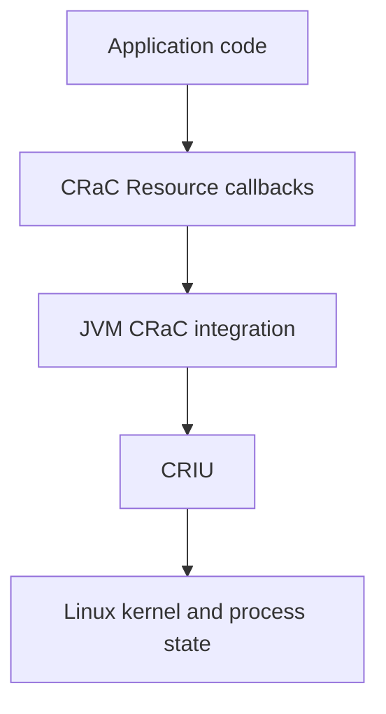
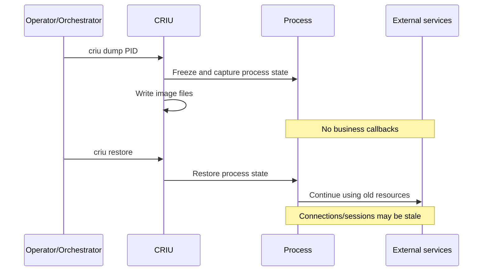
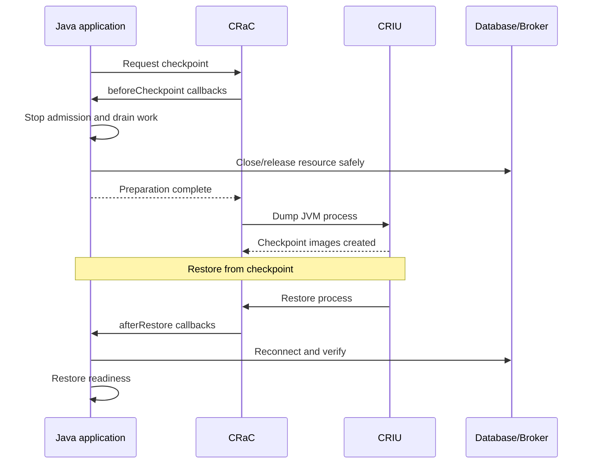

# CRaC and Process Checkpointing with CRIU Without Application Coordination

CRIU (Checkpoint/Restore In Userspace) is a Linux tool that can save the state of a process or process group and restore it later. CRIU operates at the operating system level: it collects memory state, threads, file descriptors, sockets, and kernel resources supported by the CRIU and kernel versions. CRIU can be used to checkpoint a process without modifying source code or adding callbacks to the application.

CRaC (Coordinated Restore at Checkpoint) solves a different problem at the application level. For Java, CRaC provides an API for the application to proactively prepare resources before checkpoint and recover them after restore. On Linux, a CRaC JDK distribution can use CRIU as the underlying process checkpoint mechanism. Through callbacks, the application can stop accepting new work, drain requests, close connection pools, release sockets, and recreate resources after restore.

The key difference is that **CRIU can capture and restore process state without understanding the business meaning of that state; CRaC allows the application to coordinate so state is saved and resumed at safer boundaries**. A CRIU image may be valid at the process level yet still fail to guarantee that transactions, messages, leases, sessions, or connections to external services can continue properly.

## 1. CRIU Checkpoints Processes at the Operating System Level

CRIU is a Linux userspace tool used to dump process state and restore from created images. During a dump, CRIU collects the information needed to reconstruct the process, for example:

- The process's address space and memory contents.
- Threads, register state, and relevant kernel state.
- File descriptors and resources supported by CRIU.
- Sockets, pipes, files, namespaces, and kernel objects supported by the version in use.
- Parent/child process relationships within the dump scope.
- Metadata needed to restore the recorded resources.

CRIU does not need to know whether the process is running a web server, database client, Java application, or worker. It views the process as a set of operating system states that can be dumped/restored.

### 1.1. Why Is It Called Checkpointing Without Application Coordination?

A pure CRIU workflow can be driven externally:

1. An operator or script identifies the PID to dump.
2. CRIU instructs the kernel and process to enter the state required to capture the image.
3. CRIU saves the process state and supported resources into an image directory.
4. Later, a restore command reconstructs the process from the images.

In this workflow, CRIU does not ask the application:

- Has the current request finished?
- Has the database transaction been committed or rolled back?
- Has the message been acknowledged?
- Is the scheduler currently running a periodic job?
- Does the connection pool need to be closed and recreated?
- Will credentials or leases still be valid after the time the checkpoint is stored?

CRIU can pause threads at dump time to record a process-level consistent memory state per its mechanism. However, stopping threads does not equate to completing a business transaction or coordinating with external systems.

### 1.2. CRIU Is More Than Copying RAM

Process checkpointing cannot be performed by simply copying the active RAM region. A process also has file descriptors, memory mappings, thread state, signal state, and kernel resources. CRIU must store enough information to restore those supported components.

For example, if the process has an open TCP socket, the image may contain metadata needed for CRIU to handle that socket. However, socket restoration depends on socket type, connection state, peer, network namespace, kernel, and CRIU options. A socket restored at the kernel level does not prove that the application protocol or session on the remote server is still valid.

## 2. CRaC Adds Application-Level Coordination

CRaC provides a lifecycle contract for the application. In Java, the application can implement `org.crac.Resource` and register the resource with a context. The runtime invokes callbacks before checkpoint and after restore.

```java
import org.crac.Context;
import org.crac.Core;
import org.crac.Resource;

public final class DatabaseResource implements Resource {

    private DatabasePool pool;

    public DatabaseResource() throws Exception {
        pool = DatabasePool.connect();
        Core.getGlobalContext().register(this);
    }

    @Override
    public void beforeCheckpoint(Context<? extends Resource> context)
            throws Exception {
        pool.close();
        pool = null;
    }

    @Override
    public void afterRestore(Context<? extends Resource> context)
            throws Exception {
        pool = DatabasePool.connect();
        pool.verifyConnection();
    }
}
```

`DatabasePool` is an illustrative application class. In real code, drain operations using the pool before closing, protect state with an admission gate, and mark the resource ready only after the connection is verified.

### 2.1. What Does Coordination Mean?

The application understands the semantics of the resources it uses. Therefore, it can:

- Stop accepting new requests or messages.
- Wait for in-flight requests, tasks, and transactions to complete.
- Flush buffers or persist business progress durably.
- Close connection pools, sockets, and clients that should not be kept across a checkpoint.
- Pause schedulers and background consumers.
- After restore, recreate resources and verify dependencies.
- Open readiness only after the application is truly ready.

CRIU does not make these business decisions on its own. CRaC gives the application a place to coordinate them with the checkpoint lifecycle.

### 2.2. CRaC and CRIU Can Coexist in One Architecture

On a supported Linux environment, a CRaC JDK can orchestrate Java callbacks and then use CRIU to dump/restore the process. The layers can be visualized as:



At checkpoint, the application prepares resources first; the JVM coordinates with CRIU to save the process state. At restore, the process is recovered at the lower layer, and then CRaC's restore lifecycle lets the application recreate resources and continue.

Implementation details, command lines, and support levels depend on the JDK distribution, CRaC/CRIU version, and Linux environment. Do not assume every JDK integrates CRIU in the same way.

## 3. Comparing Pure CRIU and Java CRaC

| Criterion | CRIU without application coordination | Java CRaC |
| --- | --- | --- |
| Operating layer | Process, threads, and kernel resources | Application/JVM lifecycle combined with process checkpoint |
| Application code changes needed | Not necessarily | Usually requires resource lifecycle integration to handle resources |
| Understands requests and transactions | No | Application can coordinate at business boundaries |
| Connection pool management | Does not understand pools; only handles FDs as supported | Callbacks can close and recreate pools |
| Draining background work | Does not know task semantics | Application can stop producers and await tasks |
| Resource recovery | Restores supported kernel state | Callbacks can recreate and verify resources |
| Readiness | Requires external mechanism | Application can control availability/readiness |
| Portability | Depends on Linux, kernel, and CRIU | Also depends on runtime/platform; application API establishes a clearer lifecycle |
| Suitability | Processes that can freeze/resume without application logic | Java applications requiring resource control and post-restore correctness |

Pure CRIU has the advantage of checkpointing many kinds of processes without modifying source code. CRaC has the advantage that the application proactively handles resources and state whose business semantics the kernel cannot understand.

The two options should not be viewed as mutually exclusive tools. CRaC on Linux can use CRIU at the lower layer; the difference lies in whether the application participates in preparation and recovery.

## 4. Process Consistency Does Not Mean Business Consistency

Suppose a Java service is processing an order:

1. Receive message `order-123` from the broker.
2. Write the order to the database.
3. Commit the transaction.
4. Send acknowledgment to the broker.

If the checkpoint occurs after step 3 but before step 4, the process may be dumped while the message is still unacknowledged. After restore, the broker may redeliver the message. If the handler is not idempotent, the order may be processed twice.

CRIU does not know that step 3 committed and step 4 is missing. It only records process state at dump time. CRaC allows the application to drain messages or complete business boundaries before checkpoint.

### 4.1. Example of an In-Flight HTTP Request

A request may be midway through these steps:

```text
HTTP request received
    -> validate input
    -> update database
    -> publish event
    -> write HTTP response
```

If the process is simply frozen in the middle of this sequence, memory state may be saved while the request is incomplete. After restore, the request thread may resume execution, but the external database and message broker do not necessarily revert to the same state. The event may have already been published, the transaction may have already committed, or the connection may have been closed by the server.

For applications with side effects, use an admission gate and drain before checkpoint. If draining cannot finish within the deadline, the checkpoint should fail or the task must be moved to a durable retryable state.

### 4.2. Process Freeze Does Not Replace Transaction Boundaries

CRIU needs to pause threads to capture state. This is a process snapshot mechanism, not a transaction coordinator for databases, brokers, object storage, or external services.

To guarantee correctness, the application still needs to:

- Commit or roll back transactions before checkpoint.
- Acknowledge messages only after side effects are durable.
- Use idempotency keys or unique constraints to guard against redelivery.
- Save progress of long-running jobs at durable boundaries.
- Do not hold transactions or distributed locks across the duration an image is stored.

## 5. Resource Types CRIU Can and Cannot Handle Automatically

CRIU's dump/restore capabilities depend on the resource type and environment. Do not use a simple table to conclude that every resource of the same category is supported.

| Resource | CRIU perspective | Application issues to consider |
| --- | --- | --- |
| Anonymous memory | Can save supported memory mapping state | Are objects in the heap still valid in business terms? |
| Thread/process | Saves supported thread state and process relationships | Are threads at a safe boundary? |
| Regular file FD | Can record descriptors and metadata under conditions | Are file paths, mounts, and contents still valid after restore? |
| TCP socket | Supported under certain conditions and options | Does the peer still maintain the connection/session? |
| Unix socket | Depends on socket type, namespace, and endpoint | Do the server and socket path still exist as expected? |
| Pipe/FIFO | Depends on both ends and peer state | Is the peer still alive or terminated? |
| epoll/eventfd | Depends on how it was created and CRIU/kernel support | Can the event loop and owner thread resume properly? |
| Device/GPU handle | Usually depends on driver and device type | Does the vendor support dump/restore? |
| Database transaction | CRIU does not understand transaction semantics | Must commit/roll back or recover via the application |
| Distributed lock/lease | CRIU does not verify ownership in external systems | Must re-acquire the lease after restore |
| Credential/token | May reside in the memory snapshot | Could it expire or be revoked while the image is stored? |

For certain FD types, CRIU may require specific options or environmental conditions. Consult the documentation for your CRIU version and test with the application's exact kernel, namespaces, and resource types.

## 6. Why Can Uncoordinated Checkpointing Be Dangerous for Java?

A Java process has multiple layers of state:

- Heap objects and object graphs.
- JVM internal structures.
- Java threads and native threads.
- JIT code and code cache.
- Garbage collector metadata.
- JNI/JNA native handles.
- File descriptors opened by the JVM or native libraries.
- Connection pools, client sessions, and background executors.

CRIU can record the process state it supports, but does not understand a Java library's lifecycle contract. For example, a database driver may hold sockets, heartbeat threads, timeout schedulers, and protocol state. Restoring an FD does not guarantee the database server still considers that session valid.

### 6.1. Threads Waiting or Holding Locks

A thread may be waiting on a monitor, condition, native mutex, or I/O. The snapshot may retain thread state and lock state at the process level, but upon restore, other threads or external systems may no longer be in the corresponding state.

Scenarios to consider:

- A thread holding a lock while calling a native method.
- A worker blocking on a socket to a closed peer.
- A thread waiting for a callback from an event loop that is no longer active.
- A thread holding a transaction or expiring resource lease.
- A thread pool holding accepted tasks that have not yet started.

The application needs to stop accepting new work and bring tasks to a safe boundary before checkpoint. Do not rely on process freeze to resolve deadlocks or lock ownership automatically.

### 6.2. Native Libraries and Descriptors

A JNI/JNA library may open FDs, create threads, or hold native pointers. If the library lacks a checkpoint/restore contract, CRIU may recover part of the process state, yet the library still does not know how to reconnect, re-initialize, or validate handles.

For critical native resources, use a CRaC `Resource` or a lifecycle coordinator to invoke the shutdown API before checkpoint and re-initialize after restore.

## 7. Example of Checkpointing a Process with Pure CRIU

CRIU provides `dump` and `restore` commands. Exact syntax and permission requirements depend on the CRIU version and deployment setup. A simple example on Linux:

```bash
mkdir -p /var/tmp/criu-images

# Dump the process with the specified PID into the image directory
sudo criu dump \
  -t 12345 \
  -D /var/tmp/criu-images \
  --shell-job
```

In the example, `12345` is an illustrative PID. `--shell-job` may be needed when the process is attached to shell job control/terminal. Not every process needs this option. CRIU may require root privileges or capabilities along with appropriate kernel/namespace conditions.

Restore:

```bash
sudo criu restore \
  -D /var/tmp/criu-images \
  --shell-job
```

The commands above only illustrate the basic flow. For a real workload, read `criu help dump`, `criu help restore`, run `criu check`, inspect logs, and determine appropriate options. Certain resources such as established TCP sockets may require special handling or options. Do not copy sample commands directly into production without checking the environment.

### 7.1. What CRIU Commands Do Not Do for the Application

The `criu dump` command does not automatically:

- Call a Java method to stop HTTP admission.
- Wait for database transactions to finish.
- Pause consumers and commit offsets per business semantics.
- Cancel scheduler triggers or save job progress.
- Refresh credentials after the checkpoint interval.
- Check readiness before the load balancer sends traffic.

If these operations are needed, coordination from the application or an external orchestration protocol is required. External orchestration can call admin endpoints, send signals, or run scripts before/after CRIU, but that is logic added by the deployment system; CRIU does not inherently understand those operations.

### 7.2. `--leave-running` and Consistency

CRIU has an option to keep the process running after dump in certain workflows. When used, understand that the original process and the checkpoint image can diverge along two different state branches. After the dump moment, the original process can continue producing side effects while the image retains the old state.

Do not treat an image created by leaving the original process running as a snapshot synchronized with external state. To test restore independently, isolate the environment or ensure side effects do not conflict. For production, have a clear plan for the original process, external data, and resource ownership.

## 8. Example of Java CRaC Coordinating Before Checkpoint

With CRaC, the application can register resources and invoke appropriate close/reopen operations. The example below illustrates a server with an admission gate:

```java
import org.crac.Context;
import org.crac.Core;
import org.crac.Resource;

public final class ServerResource implements Resource {

    private final RequestGate requestGate;
    private final ServerLifecycle server;

    public ServerResource(RequestGate requestGate,
                          ServerLifecycle server) {
        this.requestGate = requestGate;
        this.server = server;
        Core.getGlobalContext().register(this);
    }

    @Override
    public void beforeCheckpoint(Context<? extends Resource> context)
            throws Exception {
        requestGate.stopAccepting();
        requestGate.awaitDrained();
        server.stopAndCloseResources();
    }

    @Override
    public void afterRestore(Context<? extends Resource> context)
            throws Exception {
        server.reopenResources();
        server.verifyReady();
        requestGate.resume();
    }
}
```

`RequestGate` and `ServerLifecycle` are illustrative abstractions. Production code needs timeouts, interruption handling, rollback if the checkpoint is aborted, and opening the gate only after listeners and dependencies are verified. With server frameworks that have their own CRaC integration, use the framework's lifecycle properly to avoid closing/reopening listeners twice.

### 8.1. Differences in Responsibility

In the pure CRIU model, the operator or script is responsible for ensuring the process is in an appropriate state before calling `criu dump`. In the CRaC model, callbacks allow the application itself to coordinate this within the checkpoint lifecycle.

CRaC does not automatically make every resource safe. The application must still register and properly implement the resource lifecycle. Without callbacks or library support, resources can still cause problems.

## 9. External Coordination When the Application Cannot Be Modified

There are legacy applications whose source code cannot be modified or where the CRaC API cannot be added. An external orchestration layer can be built, but its limitations must be understood.

Example workflow:

1. The load balancer stops sending new requests to the instance.
2. The orchestrator calls an admin endpoint or sends a signal supported by the application.
3. Wait for running requests/tasks to finish based on metrics or a status endpoint.
4. Stop producers or schedulers if an external control mechanism exists.
5. Verify dependencies and that the process is in a dumpable state.
6. Invoke CRIU dump.
7. Upon restore, invoke a script or admin endpoint to reconnect/validate resources.
8. Put the instance into the load balancer only after health checks pass.

This approach can be useful when the application cannot be changed, but it is effective only if the application already has a sufficiently reliable management interface. Without a way to determine in-flight requests, transactions, or worker state, the orchestrator cannot safely infer this solely from thread count or CPU usage.

### 9.1. Signals Are Not Transaction Boundaries

Sending `SIGSTOP` or using a process freeze mechanism stops threads, but does not instruct the application to complete transactions or save progress. Nor can a signal handler arbitrarily perform complex operations safely in every context.

If the application supports a signal to enter drain mode, use a minimal handler to notify the main lifecycle manager. That manager then performs draining, closes resources, and reports readiness to the orchestrator.

### 9.2. Admin Endpoints or Control Channels

An admin endpoint can provide operations such as:

- `POST /admin/quiesce`: stop accepting new work.
- `GET /admin/status`: return the number of active requests/tasks.
- `POST /admin/prepare-checkpoint`: flush and close resources per policy.
- `POST /admin/resume`: resume operation if the checkpoint is aborted.
- `POST /admin/after-restore`: verify or start components after restore if CRaC callbacks are not used.

These are application-built APIs, not default CRIU endpoints. Authenticate and restrict access to them, since these operations can directly affect process state.

## 10. Impact on Databases, Brokers, and External Services

A process checkpoint does not capture a synchronized state of every system the process communicates with. Databases, brokers, caches, and external services continue operating independently.

### 10.1. Database Connections

A socket may be saved in the process image, but the database server may have closed the session or timed out the transaction while the checkpoint was stored. The driver may still hold a connection object in the heap, but that object is not guaranteed to remain usable.

For a Java application, it is usually advisable to:

- Stop accepting new queries.
- Wait for running transactions to complete.
- Close the connection pool per driver instructions.
- Create a new pool after restore.
- Run a validation query with a timeout.
- Open traffic only when the pool is ready.

### 10.2. Message Brokers

A consumer may have received a message without acknowledging it yet. If the process is restored from a pre-ack state while the broker has already redelivered the message to another consumer, duplicate processing can occur.

Before checkpoint, pause consumers and wait for in-flight messages to reach a safe boundary. If they cannot complete, allow the broker to redeliver according to defined semantics. Handlers must be idempotent.

### 10.3. Distributed Locks and Leases

A lock object in the heap or an FD to a service does not prove lease ownership still holds after restore. The lease could have expired and been granted to another instance while the checkpoint was stored.

After restore, request a new lease, verify the fencing token or ownership version, and only then run exclusive work.

### 10.4. Credentials and Sessions

Tokens can expire or be revoked while the checkpoint is stored. Do not keep an old session just because the token object remains in the heap. Refresh credentials through the identity provider or secret manager before opening readiness.

## 11. When Is Uncoordinated Checkpointing Acceptable?

Process checkpointing without application coordination may be suitable if the process has simple state that can be frozen and resumed without violating the semantics of external resources.

Some cases that can be considered:

- Pure computation workers whose input is durably persisted and output is not yet committed.
- Chunk-based data processing processes with independent business checkpoints.
- Short-lived tools or jobs running in an isolated environment.
- Legacy applications with a verified external management protocol.
- Experimental or research workloads where restarting on restore failure is acceptable.

Even in these cases, verify kernel resources and external state. If the process holds sockets, locks, database transactions, or device handles, specific testing is still required.

## 12. When Should You Use CRaC or Application Coordination?

Application coordination should be preferred when:

- The application serves HTTP or RPC requests with active in-flight requests.
- Database transactions or connection pools are used.
- Message consumers, schedulers, or background workers exist.
- Native libraries and special file descriptors are involved.
- Distributed locks, leases, or leader election are used.
- Expiring credentials/sessions exist.
- Accurate readiness is required before receiving traffic.
- Guarantees against lost or duplicate side effects are needed.

In these systems, a successful process snapshot is not enough. A lifecycle that understands resources and business semantics is required. CRaC provides the Java API to implement that; an external orchestration layer can also perform it if the application exposes a sufficiently reliable control interface.

## 13. Testing Pure CRIU

If choosing CRIU without application callbacks, build tests demonstrating that the process can dump/restore under realistic conditions.

### 13.1. Testing a Simple Process

Start with a test program that holds no complex external resources, such as a process writing a counter in memory and logging state periodically. Perform dump, restore, and verify the process continues.

Then incrementally increase complexity:

1. Multiple threads.
2. File descriptors to files.
3. Pipes and event descriptors.
4. TCP sockets.
5. Child processes.
6. Native libraries.
7. Database/broker clients in a test environment.

Each resource type needs dedicated tests because supportability and semantics differ.

### 13.2. Checking External Consistency

Beyond verifying that the process keeps running, confirm that:

- The database has no abandoned transactions.
- Messages are not lost or duplicated outside policy.
- Socket peers remain active or the application handles disconnects.
- File locks and leases are not held improperly.
- The process does not produce duplicate side effects after restore.

Without a way to observe these states, there is insufficient evidence to use uncoordinated checkpointing in production.

## 14. Testing CRaC

With CRaC, tests must cover both resource callbacks and restore results.

A basic test suite:

| Check | Expected result |
| --- | --- |
| `beforeCheckpoint` | Stops admission and drains tasks |
| Closing resources | No operations remain using connections/sockets that must be closed |
| Checkpoint | Runtime creates the image successfully |
| Restore | JVM is recovered from the exact image and runtime |
| `afterRestore` | Dependencies and resources are recreated and verified |
| Readiness | Accepts traffic only after listeners and dependencies are ready |
| Smoke test | Representative requests and jobs work properly |
| Repeated restore | Does not create duplicate resources or leaks |

Do not merely assert that callbacks were called. Tests must check real outcomes, such as database queries succeeding, broker consumers resuming properly, file descriptors being recreated, and readiness transitioning at the right time.

## 15. Comparing Operational Workflows

### 15.1. CRIU Without Application Coordination



### 15.2. CRaC With Application Coordination



The two diagrams illustrate the general coordination patterns. The exact sequence among the JVM, CRaC implementation, and CRIU depends on the JDK distribution and deployment environment.

## 16. Deciding Between Pure CRIU, CRaC, and External Orchestration

The following table can help guide the decision:

| Application condition | Appropriate direction to evaluate |
| --- | --- |
| Simple process holding no critical external sessions | Pure CRIU may suffice after testing |
| Cannot modify application, but has a reliable admin/drain interface | External orchestration combined with CRIU |
| Java service with many resources that need closing/reopening | CRaC Resource lifecycle |
| Application with requests, transactions, and consumers | CRaC or a coordination layer with business semantics |
| Native library does not support checkpointing | Close and re-initialize via lifecycle if an API exists; otherwise do not checkpoint that resource |
| Kernel/CRIU does not support a mandatory resource type | Change design/resource or do not use checkpointing for that workload |
| Cannot verify external consistency | Insufficient basis to release uncoordinated checkpointing |

The final choice must be based on tests of the specific workload. Do not decide solely from the fact that CRIU can successfully dump a PID.

## 17. Security and Operational Risks

A checkpoint can contain all data in memory, including tokens, passwords, sessions, and user information. Both CRIU and CRaC require protecting checkpoint artifacts.

Recommended requirements:

- Restrict read/write permissions on the checkpoint directory.
- Store artifacts in a repository or object store with authentication and auditing.
- Encrypt in transit and at rest per policy.
- Verify artifact checksums and provenance before restore.
- Bind the checkpoint to the exact JDK, application build, and compatible environment.
- Maintain a retention policy and procedure for deleting expired artifacts.
- Do not put heap contents or credentials into logs.
- Control CRIU, ptrace, capabilities, and namespace access permissions.

For pure CRIU, permission to execute dump/restore can be highly sensitive because the tool directly manipulates process state. Grant permissions only to authorized operational identities and restrict PIDs, namespaces, or workloads per policy.

## 18. Common Mistakes When Using Uncoordinated CRIU

| Mistake | Consequence | Remediation |
| --- | --- | --- |
| Assuming dump success means application consistency | Transactions or messages may be incomplete | Drain and verify business boundaries |
| Keeping database sockets across long durations | Server may close sessions or time out | Close pools and reconnect after restore |
| Not pausing message consumers | Messages may be redelivered or processed twice | Pause, drain, and use idempotency |
| Not checking socket peers | FD is restored, but the protocol is no longer valid | Verify or reconnect |
| Using `SIGSTOP` instead of quiesce | Threads stop mid-side-effect | Use an application drain protocol |
| Not checking FDs/native handles | Restore fails or libraries use stale handles | Inventory and test each resource type |
| Restoring on a different kernel/CRIU | Missing capabilities or incompatible resources | Pin compatibility profile and test target |
| Leaving original process running after dump without isolation | External state diverges from checkpoint | Manage the original process and side effects explicitly |
| Not checking readiness | Traffic reaches a process that hasn't recovered resources | Use a readiness gate before adding to load balancer |
| Not protecting the checkpoint | Runtime data leaks or artifact gets replaced | Use ACLs, encryption, signatures, and auditing |

## 19. Recommended Operational Workflow

If using pure CRIU for a process that can resume safely, the minimum workflow should include:

1. Identify the process, process tree, and open resources.
2. Verify kernel, CRIU, namespaces, capabilities, and required permissions.
3. Ensure the application is in a dumpable state per the operational contract.
4. Create the checkpoint in a staging location.
5. Verify image files, metadata, and checksums.
6. Restore in a compatible environment.
7. Confirm processes, FDs, threads, and external connections work.
8. Run test workloads and observe error/latency.
9. Release only after restore tests pass.

If using CRaC for a Java service, add:

1. Register `Resource` for components owning resources.
2. Close admission and drain requests/tasks in `beforeCheckpoint`.
3. Close resources needing recreation in dependency order.
4. Create the checkpoint using a compatible CRaC JDK.
5. After restore, recreate dependencies and resources in `afterRestore`.
6. Verify listeners, readiness, and run smoke tests.
7. Open traffic after the application is truly ready.

## 20. Conclusion

CRIU can checkpoint and restore Linux processes without requiring the application to implement callbacks. This approach is useful for simple processes or workloads that already have a reliable external orchestration protocol. However, CRIU works only with process state and kernel resources it supports; it does not understand transactions, requests, message acknowledgments, cache freshness, leases, or business sessions.

CRaC adds coordination at the Java application level through `Resource` callbacks. The application can stop accepting work, drain tasks, close resources before checkpoint, and recreate them after restore. On Linux, a CRaC implementation can use CRIU underneath, so the two technologies complement each other.

Choose pure CRIU only when it has been proven that the process can resume properly without application coordination. For Java services with connections, background tasks, or side effects, use CRaC or a coordination layer with clear semantics, test on the exact kernel/CRIU/JDK, and release only after restore, resources, and readiness all pass.
