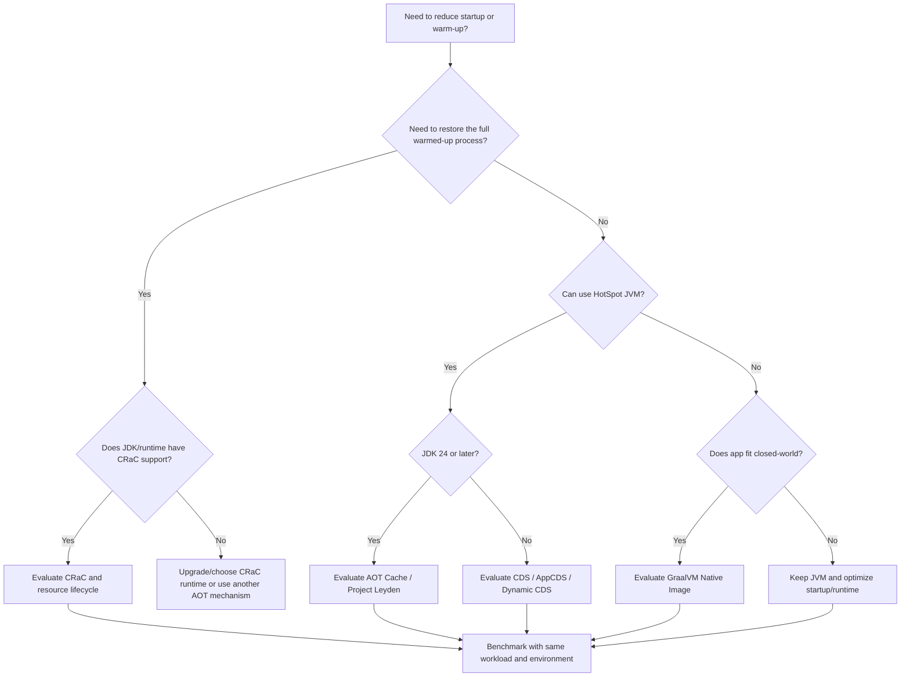

# CRaC and JDK AOT Mechanisms: Version-by-Version Verification

CRaC, Class Data Sharing (CDS), Application CDS (AppCDS), Project Leyden's AOT Cache, and GraalVM Native Image can all improve Java startup time, but they operate at different layers. When choosing a solution, identify the exact JDK in use, distribution, build, operating system, CPU, and type of artifact generated. A flag that existed in an older JDK may have been removed; a new AOT mechanism may only appear starting in JDK 24 or 25; and CRaC typically depends on a JDK/runtime build with checkpoint/restore integration.

The most important distinction is:

- **CRaC captures the state of a running Java process.** The JVM and application are initialized, possibly warmed up and JIT-compiled; the checkpoint saves the process state so restore resumes from the captured point.
- **CDS/AppCDS stores prepared class data.** A new JVM still starts normally, but can load class metadata faster and share certain read-only regions across multiple JVMs.
- **Project Leyden's AOT Cache stores pre-prepared artifacts for HotSpot.** Depending on the JDK, the cache can contain loaded/linked classes, cached heap objects, and method profiles; each run still creates a new JVM and executes application startup.
- **GraalVM Native Image compiles the application into a native executable using static analysis.** The application runs on a native runtime rather than starting a traditional HotSpot JVM.

Therefore, CRaC should not be viewed as another name for AOT. CRaC restores an existing process; AOT mechanisms prepare part of the work before a new run starts. They may share the goal of fast startup, but they differ in preserved state, compatibility constraints, and deployment approach.

## 1. Map of Mechanisms

| Mechanism | What is prepared ahead of time? | When running the application | Restores the running process intact? |
|---|---|---|---|
| CDS | Metadata of core platform classes in an archive | New JVM memory-maps the archive and loads classes from prepared data | No |
| AppCDS | Adds application and library classes to the archive | New JVM uses an archive matching classpath/module path | No |
| Dynamic CDS | Automatically writes an archive from classes loaded in a prior run | New JVM uses the archive created from that run | No |
| AOT Cache / Project Leyden | Class loading/linking, select heap objects, and method profiles depending on JDK version | New HotSpot JVM uses the cache to reduce startup/warm-up | No |
| Legacy `jaotc` | Experimental AOT compilation to machine code | JVM uses the legacy JDK's experimental AOT mechanism | No |
| GraalVM Native Image | Analyzes reachable code and compiles a native executable | Runs native executable, no separate HotSpot JVM needed | Not via the HotSpot CRaC mechanism |
| CRaC | State of a running JVM and application, including runtime-supported warmed-up state | Restore resumes from the checkpoint point | Yes |

These mechanisms can be combined in a pipeline, but they do not automatically replace one another. For example, AppCDS can reduce cold-start class loading cost; AOT Cache can prepare additional class/object/profile state; CRaC can bypass most of startup by restoring a prepared process. Native Image is a different deployment option with a different runtime model.

## 2. History by JDK Version

The name "AOT" has been used for several different technologies across JDK generations. When reading older documentation, check the specific JEP and version rather than assuming every AOT feature still exists in the current JDK.

| Version | Notable milestone | Implications for selection |
|---|---|---|
| JDK 8 and earlier | CDS existed in HotSpot; primarily shared JDK class metadata | CDS can be used according to distribution capabilities |
| JDK 9 | JEP 295 introduced the experimental `jaotc` AOT compiler | This is a legacy AOT mechanism, not the modern AOT Cache |
| JDK 10 | JEP 310 extended AppCDS to application classes and brought it into OpenJDK | AppCDS became a broader option, no longer only a commercial feature |
| JDK 13 | JEP 350 introduced Dynamic CDS Archives | Can create archives from loaded classes upon application exit |
| JDK 16 | `jaotc` and experimental Java-based Graal JIT were removed from the JDK | Do not build new workflows based on `jaotc` |
| JDK 17 | Migration guide confirms experimental AOT/Graal JIT components were removed in JDK 16 | Modern JDKs lack legacy `jaotc`; CDS/AppCDS continue |
| JDK 21 | CDS/AppCDS continue in the JDK; Leyden AOT Cache is not yet in standard JDKs | On JDK 21, evaluate CDS/AppCDS or a dedicated CRaC runtime; do not assume `-XX:AOTCache` exists |
| JDK 24 | JEP 483 introduced Project Leyden's AOT Cache into HotSpot | Provides training, assembly, and production workflows to prepare class loading/linking and objects |
| JDK 25 | JEP 514 simplified cache creation; JEP 515 added method profiling from training runs | AOT Cache improves startup and warm-up further; cache can be created with a single convenient command |
| JDK 26 | JEP 516 updated object caching to support all GCs, including ZGC | GC-dependent object cache restriction removed; introduces GC-agnostic object format |
| JDK 27 | AOT Cache and Leyden workflows remain present; JDK 27 has specific changes to JVMCI/Graal JIT | Check release notes for the exact vendor/build; do not infer from the generic AOT feature name |

### Notes on JDK 16 and JDK 17

`jaotc` was introduced in JDK 9 under JEP 295. It was HotSpot's experimental AOT compiler, with its own platform and operational limitations. This component along with the experimental Java-based Graal JIT was removed from JDK releases starting in JDK 16. The JDK 17 migration guide still lists them among the components removed in JDK 16.

Removing `jaotc` does not mean Java no longer has AOT. CDS/AppCDS continue to exist, Project Leyden later introduced AOT Cache in JDK 24, and GraalVM Native Image is a separate technology. GraalVM Native Image was not removed just because the JDK dropped `jaotc`.

## 3. CDS, AppCDS, and Dynamic CDS

CDS is a class-data sharing mechanism. The JVM can store class metadata in a HotSpot-prepared format, then memory-map the archive at startup. Multiple JVMs on the same host can share certain read-only pages, reducing class loading work and footprint.

AppCDS extends the archive to include application and library classes. Dynamic CDS helps create an archive from the classes actually loaded during a run, reducing the need to manually build a class list for each application.

### Version Milestones

- **CDS:** present in HotSpot releases prior to JDK 9; in Oracle JDK, a default CDS archive is pre-packaged starting in JDK 12.
- **AppCDS:** extended and contributed to OpenJDK in JDK 10 via JEP 310.
- **Dynamic CDS:** introduced in JDK 13 via JEP 350.
- **JDK 21/25/27:** CDS and AppCDS remain the class-data sharing mechanisms; specific usage and archive limits depend on the version.

### Creating a Dynamic CDS Archive

Example on a JDK that supports `-XX:ArchiveClassesAtExit`:

```bash
java \
  -XX:ArchiveClassesAtExit=app.jsa \
  -cp app.jar \
  com.example.Main
```

When the application terminates normally, the JVM creates the archive from eligible loaded classes. Use the archive in subsequent runs:

```bash
java \
  -XX:SharedArchiveFile=app.jsa \
  -cp app.jar \
  com.example.Main
```

This is a basic example; the classpath, JDK, module options, and archive must satisfy CDS compatibility conditions. Do not modify JARs or dependencies after creating the archive and expect the archive to remain valid. Recreate the archive whenever the application artifact or class-loading configuration changes.

### When Is CDS/AppCDS Appropriate?

CDS/AppCDS is suitable when you want to reduce class loading overhead during a fresh JVM startup, especially when multiple JVMs run the same application on a host. It is a relatively low-intrusion choice because the application still runs on HotSpot and follows the standard startup sequence.

CDS does not save overall business state, connection pools, dynamic caches, or thread state from a run. It does not replace JIT warm-up and does not restore a running process like CRaC.

## 4. Legacy `jaotc`: Not Applicable to Modern JDKs

JEP 295 introduced the experimental `jaotc` AOT compiler in JDK 9. This tool could compile selected classes to machine code ahead of execution. It belonged to an experimental phase of HotSpot and is not Project Leyden's AOT Cache workflow.

Since JDK 16, `jaotc` and the experimental Java-based Graal JIT have been removed. Therefore:

- Do not write new production guides based on `jaotc` for JDK 17, 21, 24, 25, 26, or 27.
- Do not confuse `jaotc` with `-XX:AOTCache`.
- Do not confuse the experimental Java-based Graal JIT in HotSpot with GraalVM Native Image.
- If old documentation mentions `jaotc`, check whether it refers to JDK 9/10/11 or a vendor-specific backport.

Quick check command on the current JDK:

```bash
java -version
jaotc --help
```

On modern JDKs, `jaotc` is generally no longer provided. Do not treat the presence of a tool with the same name in a vendor distribution as proof that it equals the JEP 295 feature.

## 5. Project Leyden's AOT Cache Starting in JDK 24

JEP 483 introduced AOT Cache in JDK 24. This is a HotSpot mechanism for storing pre-prepared artifacts, reducing work during startup and warm-up of subsequent runs.

Main parts of the workflow include:

1. **Training:** run the application with a representative workload so the JVM records class loading/linking and related state.
2. **Assembly:** use the training data to build the AOT Cache.
3. **Production:** launch a new JVM with the cache to reuse matching artifacts.

The cache is bound to a specific combination:

- Application and classpath/module path.
- Compatible JDK release/build.
- Operating system and CPU architecture.
- Supported JVM options and class-loading conditions.

When the application artifact, dependencies, JDK release, OS, or CPU architecture changes, create a new cache. The cache is not a portable artifact across arbitrary JDKs or architectures.

### Three-Step Workflow in JDK 24

The following example illustrates separating training and assembly:

```bash
# 1. Training: run the application with a representative workload
java \
  -XX:AOTMode=record \
  -XX:AOTConfiguration=app.aotconfig \
  -cp app.jar \
  com.example.Main

# 2. Assembly: create the AOT Cache from training data
java \
  -XX:AOTMode=create \
  -XX:AOTConfiguration=app.aotconfig \
  -XX:AOTCache=app.aot \
  -cp app.jar

# 3. Production: run a new JVM with the cache
java \
  -XX:AOTMode=on \
  -XX:AOTCache=app.aot \
  -cp app.jar \
  com.example.Main
```

During the assembly stage, the JVM reads the training configuration file and creates the cache; the application does not need to run again as a production run. Depending on the JDK build, option syntax and workflow details may differ; check the mode and option list in the `java` command documentation for the exact build.

### Notes on Training Workloads

Training needs to execute paths representative of production. If it only calls a health endpoint, the cache may lack important classes and execution branches. If it runs a full heavy test suite, the cache may include unnecessary classes and training will consume excessive resources.

A suitable training run should:

- Use the same application artifact and dependencies as production.
- Exercise startup paths and common use cases.
- Cover critical serializers, mappers, frameworks, and modules.
- Use safe fixture data without producing production side effects.
- Avoid changing classpath, JAR timestamps, or JVM options between training and production.
- Record a manifest containing JDK build, application digest, OS, CPU, and workload version.

## 6. JDK 25: AOT Command-Line Ergonomics and Method Profiling

JDK 25 adds two important improvements to AOT Cache.

### JEP 514: Simplifying Cache Creation

JEP 514 allows the common workflow to create a cache with a single option:

```bash
# Training run and create cache when the JVM exits
java \
  -XX:AOTCacheOutput=app.aot \
  -cp app.jar \
  com.example.Main

# Production run
java \
  -XX:AOTCache=app.aot \
  -cp app.jar \
  com.example.Main
```

In the one-step workflow, the JVM records training data and then spawns a child JVM to assemble the cache upon process exit. Therefore, the cache creation environment needs sufficient memory and CPU for both training and the assembly process. Under tight resource limits, separating training and assembly remains useful: training on a production-like environment, and assembly on a machine with more CPU/RAM.

### JEP 515: Ahead-of-Time Method Profiling

JEP 515 adds method execution profiles from training runs to the AOT Cache. When a new JVM starts, the JIT can use the stored profiles to begin compiling hot methods earlier, instead of waiting to collect all profiles during the current run.

This targets **warm-up** and time to reach good performance, alongside the class loading/linking benefits in JEP 483. The JVM can still continue profiling and adjusting optimizations at runtime; training profiles do not guarantee production workloads always match training.

### Production Mode and Fallback

On JDK 25 and later, `-XX:AOTMode=auto` is usually the right choice for production because the JVM can continue running normally if the cache is missing or incompatible. Fail-fast modes such as `on`/`required` are useful when testing the cache, but can prevent the application from starting if an option or agent makes the cache unusable.

Diagnostic example:

```bash
java \
  -XX:AOTMode=auto \
  -XX:AOTCache=app.aot \
  -Xlog:aot \
  -cp app.jar \
  com.example.Main
```

Inspect the logs to confirm whether the cache was loaded or skipped. Do not conclude the JVM used it simply because the `.aot` file exists.

## 7. JDK 26: AOT Object Caching with Any GC

JEP 516 updates how objects are stored and loaded in the AOT Cache to support every HotSpot garbage collector, including ZGC. Prior to JDK 26, portions of object caching depended on the GC's memory layout and did not work with every collector.

JDK 26 introduces a GC-agnostic object representation, allowing the JVM to stream objects into the heap instead of relying solely on memory mapping a collector-specific layout. This expands AOT Cache usability when an application chooses ZGC or another GC configuration.

Some JDK 26 builds provide an advanced flag `-XX:+AOTStreamableObjects` to request the streamable/GC-agnostic object format. Do not assume this flag exists across all vendors or updates; verify with `java -XX:+PrintFlagsFinal -version` and the exact build's documentation before using it. Unless specifically required, start with the default configuration and measure actual impact.

JEP 516 does not turn AOT Cache into a full-process checkpoint. It remains a cache artifact for a fresh JVM, without saving all threads, sockets, and running application state like CRaC.

## 8. JDK 27: Verifying the Actual Build and Feature Status

JDK 27 continues to provide HotSpot's AOT Cache workflows. However, command-line documentation and release notes may describe cache parts at varying levels of detail; specific features and flags must be verified on the deployed JDK vendor/build.

For JDK 27, verify:

- Whether the JDK provides AOT Cache and the corresponding `AOTMode`, `AOTCache`, and `AOTCacheOutput` options.
- Cache was created by the exact JDK release/build, OS, and CPU architecture.
- The GC in use and selected object cache format.
- Whether JEP 515 method profiles are recorded/loaded on that distribution.
- `-Xlog:aot` reports whether the cache was loaded or fell back.
- Whether JVMCI/Graal JIT options are still supported or were removed in that release.

JDK 27 introduces a major change regarding JVMCI: HotSpot's JVMCI components, the `jdk.graal.compiler` module, and the `-XX:+UseGraalJIT` option were removed from JDK 27. This does not mean GraalVM Native Image has disappeared; that is a separate product/tool with its own lifecycle and versioning. When upgrading from JDK 25/26 to 27, check for agents or launchers depending on JVMCI.

Do not infer AOT or CRaC support solely from the major version number. Vendors may ship different builds, backports, flags, or CRaC runtimes. Record the exact `java -version` output and inspect the vendor's release notes.

## 9. GraalVM Native Image: AOT to Native Executable

GraalVM Native Image uses a different model from HotSpot's AOT Cache. The `native-image` tool statically analyzes the application from its entry points, determines reachable code, and compiles it into a platform-specific native executable.

Example:

```bash
native-image -jar app.jar app
./app
```

The native executable does not need to ship a separate HotSpot JVM to run. In return, the build process relies on the closed-world assumption: required classes, methods, reflection, resources, serialization, and dynamic proxies must be known or declared at build time.

### Key Differences

| Aspect | HotSpot + CRaC | HotSpot + AOT Cache | GraalVM Native Image |
|---|---|---|---|
| Artifact | Process checkpoint | `.aot` cache file and application artifact | Native executable |
| Runtime | HotSpot JVM with CRaC support | HotSpot JVM with AOT Cache | Native Image native runtime |
| Class loading | Process state is already restored | JVM uses prepared classes from cache | Most code is determined at build time |
| JIT | Warmed-up JIT state can be restored per runtime | JIT uses saved profiles and continues operating | Does not use HotSpot JIT in the standard JVM model |
| Dynamic features | Can preserve runtime behavior, but requires handling resources at checkpoint | Still a regular JVM app; classpath/config must remain cache-compatible | Reflection/resources/proxies need hints; dynamic class loading is restricted |
| Startup | Very fast when restore succeeds | Faster than JVM cold start | Typically very fast |
| Memory | Depends on heap and checkpointed process state | Still has JVM heap and runtime | Often has smaller footprint, depending on application |
| Portability | Depends on runtime/kernel/CPU/checkpoint engine | Depends on app, JDK, OS, and CPU | Executable depends on OS/architecture/ABI |

### When Is Native Image Suitable?

Native Image is worth considering when:

- You need a standalone executable, very fast startup, and low footprint.
- The application can satisfy closed-world constraints.
- Necessary reflection/resource/proxy/JNI hints can be provided.
- You build native binaries per platform and test on the exact production runtime.

If the application relies heavily on dynamic class loading, plugins, undeclared reflection, or deeply dynamic runtime configuration, evaluate adaptation costs before choosing Native Image. Native Image is not an AOT flag you can toggle for any JAR.

## 10. CRaC: Checkpointing a Running JVM

CRaC (Coordinated Restore at Checkpoint) is a coordination mechanism between the application and runtime to create a checkpoint of a running Java instance. The application can initialize frameworks, load configuration, run warm-up, and execute critical code paths before checkpoint. Upon restore, the process resumes from the captured point.

CRaC has two key lifecycle callbacks:

- `beforeCheckpoint()`: the application stops new work, drains tasks, closes sockets/files/connections, or releases resources that cannot stay open across the checkpoint.
- `afterRestore()`: the application reconnects dependencies, refreshes credentials/configuration, restores schedulers, and verifies readiness.

Conceptual example:

```java
import org.crac.Context;
import org.crac.Core;
import org.crac.Resource;

public final class ClientResource implements Resource {

    private final ClientFactory factory;
    private Client client;

    public ClientResource(ClientFactory factory) {
        this.factory = factory;
        this.client = factory.open();
        Core.getGlobalContext().register(this);
    }

    @Override
    public void beforeCheckpoint(Context<? extends Resource> context)
            throws Exception {
        stopNewCallsAndDrain();
        if (client != null) {
            client.close();
            client = null;
        }
    }

    @Override
    public void afterRestore(Context<? extends Resource> context)
            throws Exception {
        client = factory.open();
        verify(client);
    }

    private void stopNewCallsAndDrain() throws Exception { /* ... */ }
    private void verify(Client value) throws Exception { /* ... */ }
}
```

`ClientFactory` and `Client` are application abstractions. In practice, prefer CRaC integrations provided by the library/framework if that version supports it. Do not close/reopen the same client twice via both a library integration and a custom callback.

### CRaC Is Not Uniformly Available Across All JDKs

The CRaC API is not a standard Java SE API. Some runtimes provide `jdk.crac`; the `org.crac` compatibility library lets applications compile/run on runtimes with or without an implementation, but adding the `org.crac` dependency does not magically give an ordinary JDK checkpoint capability.

Before choosing CRaC, check:

- Whether the JDK distribution includes a CRaC implementation.
- Whether the `jdk.crac`/`org.crac` API version and runtime are compatible.
- Required checkpoint engine, kernel, container runtime, and OS permissions.
- CPU architecture/features and limits on moving checkpoints across nodes.
- Whether frameworks, JDBC drivers, messaging clients, and native libraries have CRaC support or require custom callbacks.

### Can CRaC and AOT Be Combined?

In terms of goals, the two mechanisms can complement each other: AOT Cache can reduce startup time of the process used for training or creating the checkpoint; CRaC can preserve initialized and warmed-up state so subsequent restores skip that startup work.

However, do not assume every CRaC JDK supports AOT Cache or every flag combination is compatible. Check the exact vendor/build, GC, checkpoint engine, and restore command. If AOT Cache only speeds up checkpoint creation without making restore faster, calculate benefits over the actual lifecycle rather than mechanically adding percentage improvements.

## 11. Solution Selection Table by Goal

| Primary goal | Mechanism to evaluate first | Reason |
|---|---|---|
| Reduce class loading in a new JVM | CDS/AppCDS | Easy to try, minimal change to runtime model |
| Archive actually loaded classes without writing a manual class list | Dynamic CDS | Collects classes from a representative run |
| Reduce HotSpot startup and warm-up on JDK 24+ | AOT Cache / Project Leyden | Caches classes/objects; JDK 25 adds method profiles |
| Use ZGC with AOT object caching | JDK 26+ with JEP 516 | Supports GC-agnostic object caching, including ZGC |
| Fast startup and restoring state of a warmed-up instance | CRaC | Restores the process instead of starting a new JVM |
| Native executable without needing a HotSpot JVM | GraalVM Native Image | Pre-compiled under the closed-world model |
| Following old `jaotc` docs on modern JDKs | Do not choose `jaotc` | Experimental AOT tool removed in JDK 16 |

### Selection Examples by Application Type

- **Small CLI applications:** CDS or AOT Cache may suffice; Native Image is worth trying if a standalone executable is needed.
- **Spring Boot APIs with many beans and heavy class loading:** try AOT Cache on JDK 24+; consider CRaC if the runtime and libraries have strong support.
- **Services with long JIT warm-up and frequent scale-out:** CRaC can bring major benefits because it preserves warmed-up state.
- **Functions requiring low footprint:** compare Native Image against CRaC/AOT using the same workload and cold-start metrics.
- **Applications with dynamic plugins/reflection:** CDS/AOT Cache/CRaC generally preserve a more flexible JVM model than Native Image; still verify each mechanism's compatibility.

## 12. Verification Workflow for the Exact JDK Version

Do not start by copying an AOT command from a blog post and running it in production. Inspect the actual runtime being executed.

### Step 1: Identify Vendor and Build

```bash
java -version
java -XshowSettings:properties -version
```

Record the vendor, full version string, build number, `java.home`, OS, and architecture. Two runtimes both reporting Java 25 from different vendors/builds may differ in backports, flags, or integrations.

### Step 2: Check Whether Options Exist

```bash
java -XX:+PrintFlagsFinal -version 2>&1 \
  | grep -Ei 'AOT|CRaC|SharedArchive|UseGraalJIT|JVMCI'
```

On Windows, `grep` can be replaced with `findstr`. This command lets you inspect flags exposed by the runtime, but does not replace release notes or real testing. An API compatibility library may be present on the classpath while the runtime still does not support checkpointing.

### Step 3: Check CDS/AOT Logging

```bash
# Observe CDS
java -Xlog:cds=info -version

# Observe the AOT cache while running the application
java -Xlog:aot \
  -XX:AOTMode=auto \
  -XX:AOTCache=app.aot \
  -jar app.jar
```

If the cache is incompatible, check the logs to see whether the JVM skipped the cache or aborted startup. Use `AOTMode=auto` in production if you want safe fallback; use fail-fast mode in tests to catch cases where the cache fails to load.

### Step 4: Check CRaC Separately

Verify the JDK distribution's documentation for CRaC, the checkpoint engine, and OS requirements. Run smoke tests in an isolated environment using the checkpoint/restore commands specified by the runtime documentation. Do not infer CRaC support merely because source code can import `org.crac.Resource`.

### Step 5: Create the Cache/Checkpoint from the Exact Build

Record a manifest for each artifact:

```yaml
application:
  buildId: orders-2.1.0-build1842
  artifactDigest: sha256:REPLACE_WITH_REAL_DIGEST

runtime:
  vendor: recorded-jdk-vendor
  version: recorded-full-jdk-version
  os: recorded-os
  architecture: amd64
  gc: G1

optimization:
  mechanism: leyden-aot-cache
  trainingManifest: warmup-v7
  cacheId: orders-aot-1842
```

This is illustrative metadata. For CRaC, also record checkpoint ID, kernel/runtime compatibility, checkpoint engine, and creation timestamp. Do not store secrets or tokens in the manifest.

### Step 6: Measure Each Goal Separately

Measure at least:

- Time from process start/restore to readiness.
- Latency of the first request and the first 100 requests.
- Time to reach steady-state/JIT warm-up.
- Throughput, p95/p99, and error rate once steady.
- RSS/heap/native memory and GC behavior.
- Costs of training, assembly, checkpoint creation, storage, and artifact distribution.

Do not compare AOT Cache, Native Image, and CRaC using a single "startup time" number if the measurement scopes differ. CRaC can skip many startup steps; AOT Cache still initializes the JVM; Native Image has its own startup/runtime model.

## 13. Compatibility Limitations to Remember

### AOT Cache Is Not a Shared Cache Across All Builds

AOT Cache depends on the application/classpath, JDK release, OS, and CPU architecture. When building a new application version or upgrading the JDK, generate a new cache. Training and production must use compatible inputs; changing JAR timestamps, classpath, or certain JVM options can render the cache unusable.

### CDS Archives Also Depend on Classpath/Module Path

A different classpath or module path than when the archive was created can partially or completely invalidate the archive. Replacing a JAR after the archive is created can also prevent the archive from loading. Use immutable artifacts and recreate the archive after changes.

### CRaC Checkpoints Depend on Runtime and Environment

A checkpoint is not a file portable across arbitrary kernels, CPUs, and JDKs. Sockets, files, timers, leases, and connections must be handled via lifecycle callbacks. When changing the JDK, native libraries, application build, or compatible environment, create a new checkpoint and re-run restore tests.

### Native Image Depends on Target Platform and Closed-World Hints

Native executables must be built for the target OS/architecture/ABI. Reflection, resources, serialization, proxies, JNI, and dynamic access require appropriate hints. Do not take a Linux x86_64 executable and assume it can run on ARM64 or Windows.

## 14. Common Mistakes

### Calling Every Mechanism "AOT"

CDS, AOT Cache, `jaotc`, Native Image, and CRaC solve different problems. Identify which artifact is created and which runtime consumes it.

### Using `jaotc` on JDK 17 or Later

Legacy `jaotc` has been removed. Choose CDS/AppCDS, JDK 24+ AOT Cache, or Native Image depending on the goal.

### Assuming AOT Cache Replaces CRaC

AOT Cache helps a new JVM do less work at startup; it does not restore an existing running process. If you need to retain warmed-up state, evaluate CRaC.

### Assuming the `org.crac` Dependency Means the JDK Supports Checkpointing

The compatibility API allows code to compile across runtimes, but actual checkpointing requires a CRaC implementation in the runtime and a compatible checkpoint engine.

### Creating an AOT Cache from an Unrepresentative Workload

Training that fails to exercise hot routes or methods creates a much less useful cache. Use production-like workloads, safe fixtures, and versioned manifests.

### Using a Cache After Changing JARs or the JDK

The cache is tied to a specific application and runtime. Recreate it after changing application artifacts, dependencies, JDK, OS, or architecture.

### Using Fail-Fast AOT Mode in Production Without Controlling the Command Line

An incompatible cache can prevent the JVM from starting. Use an appropriate fallback mode and monitor `-Xlog:aot`; keep fail-fast for validation if policy permits.

### Assuming AOT Cached Objects Work Identically with All GCs on Older JDKs

JEP 516 extended object caching to any GC starting in JDK 26. If using JDK 24/25 or another vendor build, check specific GC support.

### Confusing GraalVM Native Image with HotSpot's Graal JIT

GraalVM Native Image creates native executables. Graal JIT is a runtime compiler; the JVMCI/Graal JIT modules in OpenJDK have their own history and lifecycle. JDK 27 removes JVMCI from HotSpot, but that does not mean Native Image was removed.

## 15. Selection Decision Tree



## 16. Conclusion

CRaC and AOT share the goal of fast startup but operate at different layers. CRaC checkpoints an initialized and warmed-up JVM process, then restores to resume from the saved state. CDS/AppCDS shares class metadata; Project Leyden's AOT Cache prepares class loading/linking, objects, and method profiles depending on the JDK version; GraalVM Native Image produces a native executable under the closed-world model.

When checking by version, keep key milestones in mind: AppCDS was extended in JDK 10, Dynamic CDS in JDK 13, experimental `jaotc` was removed in JDK 16, AOT Cache arrived in JDK 24, JDK 25 added CLI ergonomics and method profiling, and JDK 26 expanded object caching to all GCs. JDK 27 and vendor releases may differ in builds, options, or backports, so always verify `java -version`, release notes, actual flags, and AOT/CRaC logs on the exact runtime.

Do not pick a solution solely by the label "AOT" or a single startup figure. Identify the state to preserve, application constraints, target runtime, GC, CPU/OS, dependency refreshability, and training/restore overhead. Then benchmark cold start, first request, steady-state, and scale-out under the same workload. Checking by version and goal in this way helps select the right mechanism rather than applying a feature that does not exist or is incompatible with the running JDK.

## References

- [JEP 295: Ahead-of-Time Compilation](https://openjdk.org/jeps/295)
- [JEP 310: Application Class-Data Sharing](https://openjdk.org/jeps/310)
- [JEP 350: Dynamic CDS Archives](https://openjdk.org/jeps/350)
- [JEP 410: Remove the Experimental AOT and JIT Compiler](https://openjdk.org/jeps/410)
- [JEP 483: Ahead-of-Time Class Loading & Linking](https://openjdk.org/jeps/483)
- [JEP 514: Ahead-of-Time Command-Line Ergonomics](https://openjdk.org/jeps/514)
- [JEP 515: Ahead-of-Time Method Profiling](https://openjdk.org/jeps/515)
- [JEP 516: Ahead-of-Time Object Caching with Any GC](https://openjdk.org/jeps/516)
- [Oracle JDK 17: Removed Tools and Components](https://docs.oracle.com/en/java/javase/17/migrate/removed-tools-and-components.html)
- [Oracle JDK 25: Class Data Sharing](https://docs.oracle.com/en/java/javase/25/vm/class-data-sharing.html)
- [Oracle JDK 25: The `java` Command and AOT Cache](https://docs.oracle.com/en/java/javase/25/docs/specs/man/java.html)
- [Oracle JDK 26: Significant Changes](https://docs.oracle.com/en/java/javase/26/migrate/significant-changes-jdk-26-release.html)
- [Oracle JDK 27: Release Notes](https://www.oracle.com/java/technologies/javase/27-relnote-issues.html)
- [CRaC: What is CRaC?](https://crac.org/about/about-crac/)
- [Spring Boot: Introducing GraalVM Native Images](https://docs.spring.io/spring-boot/reference/packaging/native-image/introducing-graalvm-native-images.html)
- [Inside Java: Run Into the New Year with Java’s AOT Cache Optimizations](https://inside.java/2026/01/09/run-aot-cache/)
