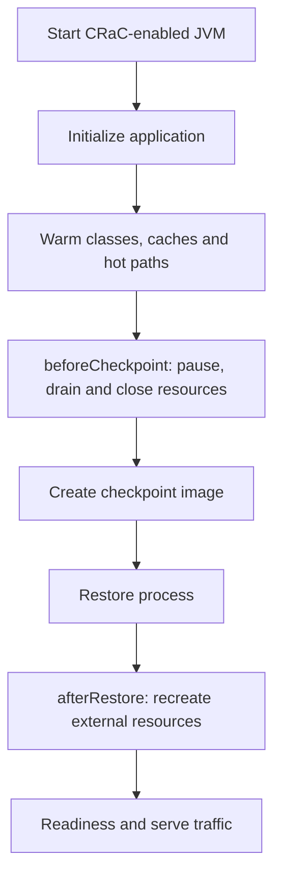
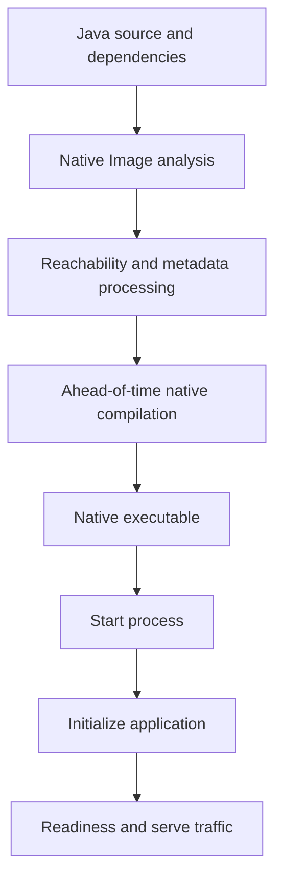

# CRaC and GraalVM Native Image: Startup, Compatibility, and Operational Trade-offs

When a Java application needs to start up very quickly, two approaches are commonly considered: **CRaC** and **GraalVM Native Image**. Both can reduce the time from deployment to when the application is ready, but they solve the problem in two different ways.

CRaC runs the application on a JVM that supports checkpoint/restore. The application is started, warmed up, and resources are brought to a safe state; then the JVM creates a checkpoint image. When a new instance is needed, the runtime restores the saved process state. GraalVM Native Image compiles the Java application ahead-of-time into a native executable before deployment. When running, the executable does not need to start a full HotSpot JVM like a regular Java application.

Therefore, the decision is not just comparing startup numbers. It is necessary to consider library compatibility, reflection and dynamic class loading, long-running throughput, memory, build process, deployment platform, debugging approach, and operational cost. A good choice is one that fits the workload and the team's capabilities, not the technology with the best result in a single benchmark.

## 1. Two ways to reduce startup time

### 1.1. CRaC: restoring a prepared JVM process

With CRaC, the application still runs on the JVM. Instead of repeating the entire startup process for each instance, a process is started once, loads classes, creates metadata, and warms up critical execution paths. After the Resources have prepared a safe state, the runtime creates a checkpoint image.

Upon restore, the JVM resumes from the saved state. Environment-dependent resources such as database connections, sockets, tokens, or workers need to be closed before checkpoint and recreated after restore through lifecycle callbacks.



The benefit is that the application retains the JVM execution environment and most of the existing Java ecosystem. The cost is having to operate checkpoint images, use the right CRaC JDK and compatible host, and carefully manage resource lifecycles.

### 1.2. GraalVM Native Image: compiling the application into a native executable

Native Image analyzes the application and its dependencies during the build process, then compiles the reachable code into a native executable for the target platform. When running the executable, the application does not need to initialize the HotSpot JVM in the usual way.



The benefit is that startup is typically very fast and the footprint can be lower than an equivalent JVM application. The cost is a more complex build, some dynamic Java features requiring metadata or code changes, and the executable being tied to the target OS/CPU along with required native libraries.

## 2. Overview comparison

| Criterion | CRaC | GraalVM Native Image |
|---|---|---|
| Approach | Snapshot and restore a warmed-up JVM process | Compile ahead-of-time into a native executable |
| Runtime | Requires a JDK with CRaC support | Runs a native executable; does not require a full HotSpot JVM |
| Startup | Typically very fast after restore; Resource recovery time remains | Typically very fast; still must initialize application and dependencies |
| Warm-up | Can be performed before checkpoint | Does not rely on HotSpot JIT warm-up like a regular JVM; can use PGO during build |
| Java compatibility | Close to regular JVM behavior, but the image depends on runtime and host | Depends on reachability analysis, metadata, and Native Image feature support |
| Reflection/dynamic loading | Usually works according to JVM; still must manage state in checkpoint | Requires metadata configuration or design suitable for closed-world analysis |
| Deployment artifact | OCI runtime image plus checkpoint artifact | Native executable plus required shared libraries/config |
| Platform | Compatible CRaC JDK, kernel, CRIU, and restore environment | Binary built for the target OS/architecture and ABI |
| Operations | Manage checkpoints, Resource lifecycle, and restore compatibility | Manage native build, metadata, native dependencies, and executable diagnostics |
| Best fit | Existing JVM applications needing fast restore and heavy use of dynamic features | Applications needing small startup/footprint and able to meet Native Image constraints |

The words "typically" and "can" are very important. Actual results depend on the application, framework, JDK/GraalVM version, GC configuration, workload, and dependencies. There is no fixed improvement ratio that applies to every project.

## 3. Trade-offs in startup and time to readiness

### 3.1. Measuring the right milestones

With CRaC, it is necessary to separate process restore time from resource recreation time. With Native Image, it is necessary to separate process creation time from framework and dependency initialization time. Both must be measured up to the same readiness condition.

Milestones to record:

- Process start or restore request.
- JVM/native runtime resumes execution.
- Application context completes.
- Database, HTTP client, and broker are ready.
- Readiness succeeds.
- First request completes.
- Throughput and latency reach steady state.

For example, Native Image can create a process very quickly but still take time to connect to the database. CRaC can restore the heap quickly, but `afterRestore()` must refresh tokens, open pools, and register consumers. Measuring only until the PID appears will skew the results.

### 3.2. CRaC shifts part of the cost to the checkpoint creation phase

CRaC pays the startup and warm-up cost upfront when creating the image. Loading classes, creating proxies, serializer caches, and executing critical code paths happen before the checkpoint. Subsequent restores can reuse the prepared state.

In return, one must also account for:

- Source process startup time.
- Warm-up and Resource preparation.
- Checkpoint duration and artifact size.
- Storage/transfer time of the checkpoint image.
- Restore and dependency recreation time.

If the checkpoint image is reused many times, the image creation cost can be amortized across many instances. If the workload only runs once or the image changes continuously, this benefit may be smaller.

### 3.3. Native Image pays more cost at build time

Native Image performs reachability analysis and native compilation in the build pipeline. Build time can be significantly longer than creating a JAR. Once the executable is built, runtime startup is typically fast without needing to restore a JVM snapshot.

Build costs must be factored into the release lifecycle:

- Building the native executable.
- Handling reflection/resource/proxy metadata.
- Running tests on the real executable.
- Optimizing profiles if using PGO.
- Creating artifacts for each target OS/architecture.

For applications deployed many times from the same artifact, the build cost can be acceptable. For applications that change frequently or have many targets, build time and the artifact matrix can become a significant cost.

## 4. Throughput and post-startup performance

CRaC keeps the application inside the JVM. If the workload has been appropriately warmed up, the application can start from a state with prepared execution profiles and caches. However, results also depend on how the CRaC JDK handles compiler/code cache state, GC, and the runtime limitations of the version in use. One should not assume all JIT optimizations are preserved identically across all JDKs.

Native Image compiles code ahead-of-time. It does not use the HotSpot C2 JIT the way a regular JVM application does. Performance can be very good, but it is not automatically faster than the JVM on every workload. Long-running workloads with many branches or runtime-profile dependencies may yield different results than short workloads.

GraalVM Native Image has optimization mechanisms such as Profile-Guided Optimization (PGO) during the build. PGO uses profile data to guide optimization of the native executable; it differs from the JVM continuously JIT-compiling based on the profile of a running process.

Should benchmark:

- Throughput after the application has stabilized.
- p50/p95/p99 latency.
- CPU time per request.
- Allocation rate and GC pause.
- Memory resident set size (RSS) and peak memory.
- Performance under increasing load and slow dependencies.
- First request latency after startup/restore.

Do not use startup benchmarks to draw conclusions about throughput. An application may start quickly but process requests more slowly in steady state; conversely, an application with a longer startup may achieve higher throughput after warm-up.

## 5. Memory and footprint

Native Image typically has a footprint advantage in many applications because it does not require the entire HotSpot runtime and can include only the code/data analyzed as reachable. However, the savings depend on dependencies, native runtime, GC, and how the application uses memory.

CRaC saves the warmed-up heap state. This can make the checkpoint image larger if warm-up creates many caches or objects that an instance does not actually need. After restore, the heap and caches continue to occupy memory as in the snapshotted state; reducing startup time does not automatically reduce footprint.

When comparing, measure under the same workload and the same container limits:

| Metric | Meaning |
|---|---|
| RSS after readiness | Actual resident memory of the process |
| Heap used/committed | JVM heap used and committed with CRaC |
| Native memory | Stack, direct buffer, native library, and runtime allocation |
| Peak memory during startup/restore | Highest memory demand during the startup phase |
| Checkpoint artifact size | Storage/transfer size required with CRaC |
| Native executable size | Binary and bundled library size with Native Image |

Do not compare JAR size with native executable size and draw conclusions about runtime memory. Artifact size and RSS are two different metrics.

## 6. Library compatibility and the dynamic Java model

This is often the most important technical difference when choosing between the two approaches.

### 6.1. CRaC preserves the JVM execution model

CRaC runs bytecode on the JVM. Features such as reflection, dynamic proxies, class loading, resource lookup, and runtime frameworks typically work according to the existing JVM model.

However, CRaC does not make every application automatically compatible. The application still has to handle resource lifecycles, threads, sockets, file descriptors, credentials, and host-dependent state. The checkpoint image also depends on the JDK vendor/build and supported restore environment.

If the current framework relies heavily on reflection or dynamic class loading, CRaC usually requires fewer architectural changes than Native Image, provided that runtime resources can be safely prepared and restored.

### 6.2. Native Image uses closed-world analysis

Native Image analyzes code and dependencies to determine which classes, methods, resources, and components need to be present in the executable. Because analysis happens at build time, things that are only discovered dynamically at runtime may not be automatically recognized.

Cases to watch out for:

- Reflection based on class/field/method names constructed from strings.
- Dynamic proxies or proxy classes generated at runtime.
- Classes loaded via plugins or custom class loaders.
- Resources looked up by patterns or dynamically generated names.
- Serialization based on runtime metadata.
- JNI/JNA and conditionally loaded native libraries.
- Frameworks scanning the classpath or annotations at runtime.

These features can be supported if metadata is provided, mechanisms supported by Native Image are used, or the implementation is changed. However, the native executable must be tested, not just unit tests on the JVM.

### 6.3. Reflection metadata and tracing agent

Native Image may require metadata describing components that must be accessed via reflection or dynamic proxies. GraalVM provides a tracing agent to observe execution paths on the JVM and generate suggested metadata.

The agent only records what the tests executed. If tests do not exercise a plugin, serializer, or configuration branch, the metadata may be incomplete. Running the agent once with a smoke test should not be treated as sufficient proof.

Example of running an application on the JVM with the agent, depending on the GraalVM version:

```bash
java \
  -agentlib:native-image-agent=config-output-dir=./native-image-config \
  -jar application.jar
```

Then run a test suite covering the reflection/resource/dynamic loading features that need support and inspect the generated metadata. Syntax, output format, and how metadata is merged may vary by GraalVM version; follow the documentation for the version in use.

### 6.4. Metadata must be managed like source code

Native Image metadata should be reviewed, version controlled, and tested. Do not delete metadata just because the executable builds successfully; some errors only appear in rare runtime branches.

Example of a reflection metadata file in the newer JSON format that can describe a class needing reflection:

```json
[
  {
    "name": "com.example.orders.OrderRequest",
    "allDeclaredConstructors": true,
    "allDeclaredFields": true
  }
]
```

The exact metadata format depends on the Native Image version and the metadata mechanism used. Use the corresponding GraalVM schema/tooling, and avoid copying old configurations without verifying.

## 7. Frameworks and ecosystem

Some frameworks have better Native Image support thanks to build-time processing, AOT transformation, and pre-maintained metadata. Other frameworks may rely heavily on runtime scanning, reflection, or class loaders.

When evaluating a framework, check:

- Whether the framework version announces Native Image support.
- Whether the starters/modules in use are supported or have limitations.
- Whether AOT processing or a separate build plugin is required.
- Whether reflection/proxy/resource metadata is provided by the framework or must be written by the application.
- Whether any third-party libraries do not yet support native.
- Whether the test suite can run on the native executable.
- Whether changes to serialization, logging, security, or dependency injection are required.

With CRaC, check whether the framework supports the checkpoint/restore lifecycle. Whether pools, schedulers, web servers, and clients require Resource integration. Some frameworks or libraries have built-in integration; remaining components may need custom adapters.

Do not decide solely based on claims like "framework supports GraalVM" or "framework supports CRaC." You must verify the exact version and the exact set of dependencies the application actually uses.

## 8. Build pipeline and release time

### 8.1. CRaC pipeline

A CRaC pipeline typically consists of:

1. Building the JAR and runtime container image with a pinned CRaC JDK.
2. Running the application on a compatible host.
3. Warming up classes, caches, and critical execution paths.
4. Preparing Resources: draining, closing resources, and stopping workers.
5. Creating the checkpoint image.
6. Recording the manifest of JDK, application build, OS, kernel, CRIU, and architecture.
7. Testing restore with the target runtime.
8. Verifying callbacks, readiness, and business logic.
9. Signing, storing, and releasing the OCI image along with the checkpoint artifact.

The pipeline depends on a Linux/CRIU environment and may require dedicated runners. If the JDK or host baseline changes, the compatibility matrix must be re-verified and a new checkpoint image is usually created.

### 8.2. Native Image pipeline

A Native Image pipeline typically consists of:

1. Building the application and dependencies.
2. Running AOT processing or framework-specific native preparation.
3. Providing required reflection/resource/proxy metadata.
4. Compiling the executable for the target OS/architecture.
5. Running tests on the native executable.
6. Scanning dependencies/native libraries and generating an SBOM.
7. Packaging the executable along with required shared libraries/config.
8. Signing and releasing artifacts per target.

Native builds can consume more CPU, RAM, and time than JAR builds. Dedicated runners or build caches may be needed. Changing the GraalVM version, compiler options, libc, or target architecture may require rebuilding and retesting.

### 8.3. Pipeline cost comparison

| Item | CRaC | Native Image |
|---|---|---|
| Compile application | Standard JAR build | Native executable build, typically more resource-intensive |
| Prepare runtime | Install CRaC JDK and compatible host | Install matching GraalVM Native Image/toolchain |
| Pre-release preparation | Warm-up and checkpoint | Metadata/AOT and native compilation |
| Required tests | Real checkpoint/restore | Test real native executable |
| Artifact | OCI image + checkpoint image + manifest | Native executable/image + metadata/SBOM |
| Upgrade runtime | Create/test checkpoint with new JDK build | Rebuild executable with new toolchain |

## 9. Platform and artifact compatibility

### 9.1. CRaC is tied to the runtime and restore environment

A checkpoint image contains the JVM process state and snapshotted system resources. It is not a portable artifact like a JAR. The image must be bound to the tested JDK vendor/build, OS, kernel, architecture, CRIU, and container/host conditions.

An image created on CRaC JDK build X is not guaranteed to restore on build Y or another vendor. When upgrading the JDK, the safe approach is to create a new checkpoint image unless the vendor explicitly announces supported version pairs.

### 9.2. Native Image is tied to the target binary

A native executable is built for a specific target OS/architecture and ABI. A Linux x86-64 binary does not automatically run on ARM64 or Windows. Shared libraries, libc, and native dependencies must also be compatible.

Native Image avoids checkpoint/restore host requirements, but requires releasing separate artifacts for each supported target. With containers, one must still check the base OS, shared libraries, and runtime security policies.

### 9.3. Artifact matrix

| Question | CRaC | Native Image |
|---|---|---|
| Can the artifact be copied to another host? | Only within the supported runtime/host matrix | Yes, if the host has the right OS/arch/ABI and dependencies |
| Does changing the JDK require recreating the artifact? | Usually requires creating a new checkpoint and verifying compatibility | Usually requires rebuilding the native executable with the new toolchain |
| Changing architecture? | Do not assume checkpoint image is portable | Build a separate binary for the target architecture |
| Requires specific kernel/CRIU? | May be required, depending on JDK/platform | Does not require CRIU to run the native executable |
| Requires native libraries? | Yes, if the application uses JNI/JNA/drivers | May be required; must be linked/packaged for the target |

## 10. Debugging, observability, and production diagnostics

### 10.1. CRaC retains familiar JVM tools

After restore, the application still runs on the JVM, so many existing JVM observability tools continue to be useful: JFR, JMX, thread dumps, heap dumps, and diagnostic tools compatible with the JDK in use.

However, pre-restore and post-restore states must be distinguished. Logs, metrics, and traces may carry stale timestamps or connection states if the application does not reset them properly. Resource callbacks should refresh necessary exporters, sockets, and clients. Checkpoint images may contain sensitive data, so heap dumps and checkpoints must be protected.

### 10.2. Native Image has a different diagnostic model

A native executable does not have the full HotSpot diagnostic surface. How thread dumps, heap profiles, JFR-like events, or crash information are collected depends on the GraalVM version, edition, build configuration, and enabled runtime features.

Some familiar JVM tools may not work the same way as on HotSpot. Observability capabilities must be verified before moving to production: logging, metrics, tracing, profiling, heap analysis, native crash dumps, and symbol/debug information.

Native crashes may require symbol files and build information to analyze stack traces. If symbols are stripped to reduce binary size, store the symbol artifacts separately per release.

### 10.3. Logging and tracing

Both options need to ensure:

- Log timestamps reflect the current time after restore.
- Trace exporters reconnect to the backend after checkpoint.
- Metrics do not miscount due to counters restored from a snapshot.
- Instance IDs and resource identities are not duplicated across replicas.
- Readiness does not report success before the required telemetry pipeline is ready.

With CRaC, state in the heap is restored, so counters, scheduled tasks, and exporters can continue from old values. With Native Image, instrumentation must be compatible with Native Image and metadata/build constraints. Telemetry must be tested on the final artifact.

## 11. Resource management and lifecycle

CRaC requires the application to prepare resources before checkpoint and recover them after restore. This increases lifecycle responsibility but allows reusing most of an existing JVM application.

Minimal Resource example:

```java
import org.crac.Context;
import org.crac.Resource;

public final class ClientResource implements Resource {
    private final ClientHandle client;

    public ClientResource(ClientHandle client) {
        this.client = client;
    }

    @Override
    public void beforeCheckpoint(Context<? extends Resource> context)
            throws Exception {
        client.stopAccepting();
        client.awaitDrained();
        client.closeConnections();
    }

    @Override
    public void afterRestore(Context<? extends Resource> context)
            throws Exception {
        client.reconnect();
        client.verifyReady();
    }
}
```

This is an application contract example; specific methods must be based on the real client. Do not call `close()` arbitrarily if the client cannot be reopened. If creating a new instance is needed, use a stable factory and facade.

Native Image does not have a corresponding checkpoint callback in normal execution flow. It still needs normal application lifecycles to create and close connections, workers, schedulers, and clients. Because it does not restore a heap snapshot, the application initializes fresh runtime state when the process starts.

Therefore, if the main goal is to avoid writing Resources for many libraries that do not support CRaC, Native Image can reduce checkpoint lifecycle work. In return, the project must resolve Native Image compatibility at build time.

## 12. Security and artifact supply chain

The two options have different artifacts and security risks.

**CRaC:** the checkpoint image may contain tokens, credentials, and user data in the heap. It is necessary to encrypt storage, restrict download permissions, sign manifests, verify runtime compatibility, set retention, and revoke artifacts when needed. Restore should only be allowed from checkpoints from trusted release sources.

**Native Image:** the executable is a native binary that may contain compiled code and libraries. It is necessary to pin GraalVM/toolchain, base image, dependencies, and native libraries; generate SBOM/provenance, scan, and sign digests. Not having a checkpoint heap does not mean the binary contains no secrets if the build embedded secrets into the artifact.

| Control | CRaC | Native Image |
|---|---|---|
| Artifact integrity | Sign OCI image and checkpoint manifest/bundle | Sign native executable or OCI image digest |
| Sensitive data | Protect heap snapshot and checkpoint storage | Do not embed secrets in build; protect runtime config |
| Runtime identity | Pin CRaC JDK build and host compatibility | Pin GraalVM build, target OS/arch, and native dependencies |
| Provenance | Record JAR source, runtime image, and checkpoint creation environment | Record source, builder, metadata, and native toolchain |
| Rollback | Keep checkpoint with compatible runtime | Keep executable and dependency bundle per release |

## 13. Operational cost and complexity

### 13.1. What the CRaC team must own

- Maintaining the CRaC JDK and compatible Linux runners/hosts.
- Building a repeatable warm-up process.
- Writing and registering Resources for managed resources.
- Checking threads, sockets, file descriptors, native resources, and external dependencies.
- Storing, signing, controlling access to, and revoking checkpoint images.
- Testing restore when upgrading the JDK, kernel, CRIU, or container runtime.
- Managing reconnect storms when restoring multiple replicas.

### 13.2. What the Native Image team must own

- Maintaining the GraalVM Native Image toolchain and build runners with sufficient CPU/RAM.
- Managing reachability metadata, reflection, proxy, and resource configurations.
- Handling libraries or frameworks that do not yet support native.
- Building and testing separately for each target OS/architecture.
- Managing shared libraries, ABI, and native crash diagnostics.
- Ensuring logging, metrics, tracing, and profiling work on the executable.
- Rebuilding and testing when upgrading GraalVM or native dependencies.

### 13.3. Operational burden comparison

| Activity | CRaC | Native Image |
|---|---|---|
| Startup preparation | Warm-up and checkpoint | Native compilation before deploy |
| Library integration | Resource lifecycle for resources needing close/reopen | Metadata/AOT compatibility for dynamic features |
| Runtime upgrade | Create and test checkpoint with new JDK/host | Rebuild/test executable with new toolchain |
| Scale-out | Restore image and control reconnect fan-out | Start native executable; still need to manage reconnects and dependencies |
| Debugging | Primarily JVM tools, plus CRaC/CRIU diagnostics | Native tools, symbols, and supported observability features |
| Artifact storage | OCI image plus sensitive checkpoint snapshot | Native executable/image and build metadata |

Neither option eliminates operations. CRaC shifts part of the complexity to runtime checkpoint/restore; Native Image shifts part to build-time analysis and the native toolchain.

## 14. When should you choose CRaC?

CRaC is usually a good candidate when:

- The current application runs stably on the JVM and needs reduced startup without migrating entirely to native compilation.
- Frameworks or libraries use reflection, proxies, dynamic class loading, or plugins at runtime.
- The application can be warmed up once and the checkpoint image reused across many instances.
- The CRaC JDK and compatible Linux/CRIU environment can be standardized.
- The team can manage Resource lifecycles and test real restores.
- JVM throughput/behavior is important and you want to keep the familiar runtime model.

CRaC is less suitable if the workload runs on a platform that does not support checkpoint/restore, relies heavily on resources that cannot be safely drained/closed, or the checkpoint image cannot be properly protected and distributed.

## 15. When should you choose GraalVM Native Image?

Native Image is usually a good candidate when:

- Fast startup and small footprint are critical requirements, such as serverless, scale-to-zero, or CLI.
- The application and framework have good Native Image support.
- The dependency graph is relatively stable and can be fully described at build time.
- Reflection, dynamic proxies, resources, and native libraries can be controlled.
- The team has suitable native build, test, and observability pipelines.
- You want to deploy a native executable without needing a CRaC JDK, CRIU, or checkpoint storage.

Native Image is less suitable when the application relies heavily on dynamic class loading, arbitrary plugins, or libraries where metadata cannot be configured; or when build time, the target matrix, and native binary diagnostics exceed current operational capacity.

## 16. Decision matrix

The matrix below can be used as a starting point for an architecture workshop:

| Question | Leans toward CRaC | Leans toward Native Image |
|---|---|---|
| Application uses heavy reflection/runtime scanning? | Usually fits the JVM model better | Requires thorough verification of metadata and framework support |
| Need to preserve HotSpot/JVM behavior? | Better fit | Requires benchmarking and verifying runtime differences |
| Want a small executable without needing a JDK runtime? | Not the primary goal | Better fit |
| Have a standardized Linux/CRIU host? | Favorable condition | Does not require CRIU to run |
| Want to avoid checkpoint storage and restore orchestration? | Requires these components | Can be simpler at runtime |
| Can invest in AOT metadata and native builds? | Not required in the Native Image way | Important prerequisite |
| Need fast scale-out from a warmed-up state? | Has an advantage if the restore pipeline is stable | Native startup may suffice without snapshots |
| Need multiple target OS/architectures? | Requires checkpoint/runtime/host matrix | Requires building separate executables per target |
| Have many native/JNI libraries? | Still must handle native resources in checkpoint | Must check ABI/linking and Native Image support |

Do not mechanically add up points and pick a technology. Define mandatory requirements first, such as startup-to-ready below a threshold, p99 below SLA, maximum footprint, deployment platform, and the set of libraries that must be kept.

## 17. Example evaluation of both options for a Spring Boot service

Suppose a Spring Boot service has the following characteristics:

- Uses Spring Data/JPA, Jackson, validation, and several runtime proxies.
- Connects to PostgreSQL, Redis, and a message broker.
- Runs multiple replicas in Kubernetes.
- Needs fast scale-out during traffic bursts.
- Has some internal libraries that have not announced GraalVM Native Image support.

### Option A: CRaC

1. Choose a supported CRaC JDK and Linux node baseline.
2. Start the Spring context and warm up serializers, repository metadata, validators, and main execution paths.
3. Write Resources to drain requests, stop consumers, and close connection pools and clients that cannot be kept across a checkpoint.
4. Create the checkpoint image and test restore in a Kubernetes-like environment.
5. During scale-out, restore in batches, recreate pools/clients, and wait for readiness.

The advantage is keeping most of the JVM model and being able to reuse warmed-up state. The risks are complex Resource lifecycles, sensitive checkpoint storage, and reconnect storms when scaling up replicas.

### Option B: Native Image

1. Check whether each Spring module and dependency supports Native Image at the exact version.
2. Run AOT processing and generate reflection/resource/proxy metadata.
3. Build the native executable for the target Linux/architecture.
4. Run tests on the real executable against test PostgreSQL, Redis, and broker instances.
5. Measure startup, memory, throughput, and observability.

The advantage is not needing checkpoint images or CRIU in runtime deployment. The risks are unsupported dependencies, missing metadata, and longer native build/test times.

### How to decide

If internal libraries cannot run on Native Image and modifying them is too costly, CRaC may be the more practical path. If dependencies are fully supported and the main goal is a small footprint along with fast startup across multiple Linux environments, Native Image is worth serious testing.

Do not decide based on a single simple endpoint. Pick a business flow that includes repositories, serializers, validation, security proxies, and message consumers for a representative benchmark.

## 18. Fair testing and benchmarking strategy

To make a meaningful comparison, build three artifacts from the same source revision:

1. JAR running on a regular JVM as a baseline.
2. JAR running on a CRaC JDK and checkpoint image.
3. GraalVM Native Image executable.

Keep the same business logic, dataset, dependencies, CPU/memory limits, network path, and request profile. If Native Image requires metadata or code changes, document those changes clearly to understand the migration cost.

### 18.1. Tests to run

| Test | What to measure |
|---|---|
| Cold start | Startup-to-ready of JVM and Native Image |
| Single restore | Restore-to-ready of CRaC |
| First request | Latency of the first request after becoming ready |
| Steady-state load | Throughput and p95/p99 after warm-up |
| Memory | RSS, heap/native memory, and peak memory |
| Scale-out | Time for the fleet to reach readiness when increasing replicas |
| Dependency outage | Retry, backoff, and recovery when DB/broker is temporarily unavailable |
| Long-running workload | Throughput, GC, memory growth, and stability |
| Observability | JFR/JMX or native diagnostics, logs, metrics, traces |
| Release pipeline | Build duration, artifact size, and test duration |

### 18.2. Standardizing measurement

- Use the same number of replicas and the same request arrival rate.
- Measure multiple times, reporting median and percentiles instead of a single run.
- Separate checkpoint creation time from restore time.
- Include Resource recreation and dependency readiness.
- Verify the load generator is not saturated.
- Run the native executable in the exact intended target container/OS.
- Use the exact CRaC JDK/host baseline intended for production.
- Record full versions of framework, JDK, GraalVM, and dependencies.

Do not compare a warmed-up CRaC image against a Native Image without configured metadata or build optimization and draw conclusions about the technology. Give each option a representative build/test process and publish the costs incurred to achieve those results.

## 19. Controlled adoption roadmap

One way to reduce risk is to experiment in small slices:

1. Pick a service with slow startup and a representative workload.
2. Establish a regular JVM baseline: startup, memory, throughput, and p99.
3. Create a CRaC experimental branch, list resources needing Resource callbacks, and measure restore-to-ready.
4. Create a Native Image experimental branch, check dependency support, and handle metadata.
5. Run the same integration/contract test suite on both artifacts.
6. Evaluate build pipeline, debugging, security, upgrades, and rollback.
7. Test scale-out and dependency outages in a staging environment.
8. Choose the option that meets the SLA with sustainable operational cost.
9. Deploy canary and monitor readiness, latency, error rate, memory, and reconnect load.
10. Keep a rollback path to the current JVM artifact until the new option is stable.

There is no need to migrate the entire system at once. Some services may suit CRaC, while others suit Native Image or a regular JVM. The decision can vary by workload.

## 20. Common mistakes when choosing

**Comparing only process startup time.** Readiness also depends on frameworks and dependencies. Measure up to the same readiness condition.

**Assuming Native Image is always faster than the JVM in throughput.** AOT and JIT have different optimization behaviors. Benchmark steady state under real workloads.

**Assuming CRaC eliminates all startup work.** Resource callbacks still have to recreate connections, tokens, workers, and external dependencies.

**Assuming a CRaC image is portable like a JAR.** Checkpoints depend on the JDK build, OS, kernel, CRIU, architecture, and supported environment.

**Assuming Native Image runs every Java library without configuration.** Reflection, proxies, resources, and dynamic class loading may require metadata or code changes.

**Using the tracing agent with one smoke test and finalizing metadata.** The agent only sees execution paths that were run. Critical runtime branches must be tested.

**Measuring only executable size to conclude footprint.** Measure RSS and peak memory under the same workload.

**Ignoring observability when choosing Native Image.** Familiar JVM tools may not work the same on a native executable. Check profiling and crash diagnostics before production.

**Ignoring reconnect storms when choosing CRaC.** Restoring many replicas can overload dependencies. Measure connection bursts and use batching/backoff.

**Not accounting for build and release costs.** Native compilation and checkpoint pipelines have different costs. Measure build duration, artifact handling, and test matrices.

## 21. Self-check of understanding

1. **How do CRaC and Native Image reduce startup?** CRaC restores a warmed-up JVM process; Native Image compiles the application into a native executable before running.
2. **Why does CRaC still need Resource callbacks?** Environment-dependent sockets, connections, tokens, and workers may become invalid after restore.
3. **Why does Native Image need reachability metadata?** Some classes, methods, or resources are accessed dynamically, so build-time analysis cannot automatically recognize them.
4. **Does the tracing agent guarantee complete metadata?** No. It only records code paths executed during the observed run.
5. **Does Native Image always have higher throughput than the JVM?** No. Results depend on the workload and AOT/PGO optimizations versus JIT.
6. **Are CRaC images portable across JDK vendors?** Not by default. A vendor-supported and tested compatibility matrix is required.
7. **Why must restore-to-ready be measured?** Because callbacks and dependency recreation can take time after the JVM has restored.
8. **When is Native Image an attractive choice?** When fast startup/small footprint are important, frameworks/dependencies have good support, and the team can maintain a native build pipeline.
9. **When does CRaC have an advantage?** When you need to keep the current JVM model, the application uses many dynamic features, and the checkpoint/restore environment can be standardized.
10. **Must the entire system use a single technology?** No. You can choose per service and workload if the build/deploy chain is clearly managed.

## Conclusion

CRaC and GraalVM Native Image can both shorten startup time, but they optimize at two different points. CRaC reuses the state of a prepared JVM process; Native Image shifts analysis and compilation to build time to produce a native executable. CRaC generally preserves a better JVM compatibility model but requires a supported JDK/host, checkpoint artifacts, and Resource lifecycles. Native Image can reduce startup and footprint, but requires controlling reachability, reflection metadata, native dependencies, target platforms, and diagnostic tools.

Evaluate startup-to-ready, throughput, p95/p99, RSS, build time, compatibility, and operational cost together. Run the same workload on a JVM baseline, CRaC, and Native Image; test dependency outages, scale-out, observability, and rollback. Choose the technology based on each service's mandatory requirements, framework support, and the extent to which the team can maintain the pipeline in the long term.
