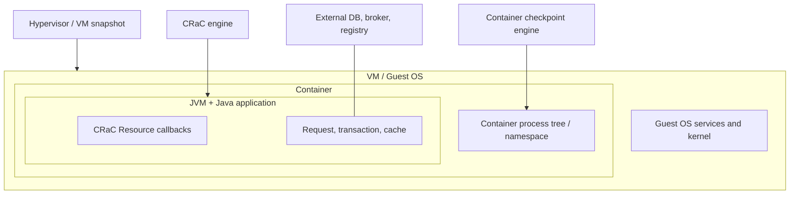

# CRaC and Virtual Machine or Container Snapshots: Responsibility Boundaries

CRaC, container checkpoint, and virtual machine (VM) snapshot can all help an application resume from a previously prepared state. However, they operate at different layers and assign responsibility to different components.

**CRaC focuses on the lifecycle of the Java application and the resources that the application manages. Container checkpoint focuses on the state of the process tree and container environment. VM snapshot focuses on the state of the entire virtual machine, including the guest operating system and virtual hardware state.** None of the three mechanisms automatically guarantees that a database, message broker, service registry, or external service is restored to the same consistent point in time.

To choose the right solution, it is necessary to know exactly which layer the snapshot covers, who is responsible for preparing and recovering resources, and which layer must be checked after restore. Without defining this boundary, two layers might both close/open the same resource, miss a resource, or both restore an old state while external services have continued to change.

## 1. Three mechanisms at three different layers

### CRaC: coordinating Java application state

CRaC provides an API for the application to register resources and participate in the checkpoint/restore lifecycle. Before checkpoint, the runtime calls `beforeCheckpoint(...)` so that the application brings the components it manages to a safe state. After restore, the runtime calls `afterRestore(...)` so that the application recreates or verifies the necessary resources.

CRaC understands the boundaries of a Java application better than a snapshot at a lower layer. For example, the application knows which requests are running, which transactions need to complete, which schedulers need to stop, which caches need to be refreshed, and that readiness should only open when dependencies are ready.

CRaC does not snapshot the entire VM or host by itself. Saving the actual process state still requires a checkpoint engine and a supporting operating system environment. The CRaC API coordinates the application part; the engine and platform are responsible for performing the checkpoint/restore operation at the process/operating system layer.

### Container checkpoint: saving process state in a container

Container checkpoint typically uses a tool such as CRIU to save the state of the process tree running inside a container along with supported operating system components. Depending on the runtime, kernel, and configuration, the checkpoint image can contain memory mappings, register/thread state, file descriptors, namespace-related state, and information needed to resume the process.

Container checkpoint is not synonymous with a container image. A container image provides filesystem layers and configuration to create a container; a checkpoint is the runtime state of a running container. Upon restore, the platform needs to combine the right filesystem/image, checkpoint artifact, container configuration, namespace, cgroup, mount, network, and required permissions.

Container checkpoint does not fully understand the business semantics of a Java application. It does not know which transactions should commit, which caches are stale, which instance IDs need to change, or which leases have expired. The application must prepare those states, or another orchestration layer must take responsibility.

### VM snapshot: saving the state of the entire virtual machine

VM snapshot is usually performed at the hypervisor or virtualization platform layer. Depending on the product and snapshot type, it can save the state of the virtual CPU, RAM, virtual devices, and one or more disk states. Some snapshots save only disk state; some support memory snapshots so the VM resumes almost from its running state.

VM snapshot covers more components than a single Java process: guest OS, processes, kernel state, filesystem cache, network stack, and other processes in the VM. However, the exact scope depends on the product. A disk-only snapshot is not equivalent to a memory snapshot; a memory snapshot does not automatically guarantee that data in a remote database or external block storage has been synchronized.

VM snapshot also does not understand business transactions or application semantics. If a VM is snapshotted while a request is being processed or a database transaction is open, the snapshot at the hypervisor layer does not automatically decide how to handle business logic when the VM is resumed.

## 2. Comparing snapshot scope

| Aspect | CRaC | Container checkpoint | VM snapshot |
|---|---|---|---|
| Primary layer | Java application/JVM | Process tree and container environment | Entire VM/guest OS |
| Application coordination mechanism | Has `Resource` API with pre/post checkpoint callbacks | Does not understand Java lifecycle natively; requires application or integration coordination | Does not understand Java lifecycle natively; requires guest agent or application coordination |
| Java Heap | Included in the checkpointed process state | Can be saved as process memory | Included in RAM snapshot if snapshot type includes memory |
| Thread/process | JVM and process threads handled by underlying engine | Process tree within container scope per engine capabilities | Processes inside the guest OS |
| Kernel/guest OS | Does not snapshot kernel/host | Uses host kernel; does not carry entire host kernel | Guest OS and VM state are snapshotted |
| Filesystem | Does not manage the application's entire filesystem itself | Typically requires matching filesystem/container image and checkpoint artifact | Can include disk state depending on snapshot type |
| Socket/descriptor | Application prepares; engine/platform determines checkpoint capability | Engine handles supported descriptor types; has limitations | Can retain device/network state inside guest, but external peers are not snapshotted |
| External dependencies | Application must reconnect/refresh | Application or platform must handle | Application or platform must handle |
| Identity when cloning | Application needs to create a distinct incarnation | Platform/container orchestration and application need distinct identity | Cloud/VM orchestration and application need distinct identity |
| Portability | Tied to compatible JDK, engine, and environment | Tied to kernel, CRIU/runtime, filesystem, and container configuration | Tied to hypervisor, VM hardware version, guest, and storage/network topology |

The rows in the table describe general responsibility boundaries. Specific details depend on the CRaC JDK, checkpoint engine, container runtime, hypervisor, and snapshot type being used.

## 3. What is snapshotted and what is not?

A common design mistake is thinking that a snapshot at one layer will cover the entire system. In reality, a snapshot typically covers only the state within the management scope of that layer.

### State typically within scope

| State | CRaC | Container checkpoint | VM snapshot |
|---|---|---|---|
| Java objects and static fields | Yes, in process state | Yes, as process memory | Yes, if RAM is snapshotted |
| JVM runtime state | Yes, in process checkpoint | Yes, as process state | Yes, if memory snapshot |
| Other processes in the same container | Outside the CRaC target of a single JVM | Can be included in process tree/container scope | Yes, if the process is inside the VM |
| Other guest OS processes | No | No | Yes |
| Host kernel | No | No | No; host/hypervisor remains outside guest snapshot |
| Container image filesystem | Does not snapshot the entire image itself | Image/filesystem managed separately or accompanies checkpoint depending on runtime | Can be included in disk snapshot if filesystem is on VM disk |
| Remote database | No | No | No |
| External message broker | No | No | No |
| DNS/service registry/lease service | No | No | No |
| Remote object storage | No | No | No |

### States requiring separate handling

- **Database transaction:** must commit/rollback or apply recovery/idempotency mechanisms. A process snapshot cannot force a remote database to return to the exact same point-in-time state.
- **Message delivery:** messages may have been sent or acknowledged by the broker during snapshot/restore. Offsets, acks, redelivery, and idempotency must be handled.
- **Lease and distributed lock:** lease duration continues to elapse while the process is paused. After restore, it is necessary to verify or acquire a new lease.
- **Credential and token:** tokens may expire or be revoked during downtime. They need to be refreshed via the identity provider.
- **Network connection:** the peer may have closed the socket or changed address. Connections must be reconnected or verified.
- **Timer and deadline:** wall-clock time continues to elapse while the process/VM is not running. Deadlines must be recalculated based on the clock and durable data.
- **Instance identity:** cloning the same snapshot can create multiple copies with the same ID, counter, or leader flag. Each instance needs its own incarnation.

## 4. Responsibility boundaries between teams

Snapshots are only reliable when someone is clearly responsible for each layer. A commonly used responsibility-sharing model:

| Owner | Pre-snapshot responsibility | Post-restore responsibility |
|---|---|---|
| Java application team | Drain requests/transactions/jobs, flush telemetry, close or prepare resources, write necessary state | Refresh config/secrets, recreate clients, register identity, check dependencies and readiness |
| Container/platform team | Prepare image, namespace, cgroup, mount, network, and checkpoint permissions | Combine correct image/checkpoint, create container, restore namespace/network, check runtime |
| VM/hypervisor team | Quiesce guest if needed, determine snapshot type, coordinate disk and memory consistency | Restore VM, virtual devices, disk, and network according to supported configuration |
| Database/data platform team | Provide transaction/backup/replication guarantees and recovery policies | Confirm database readiness, handle failover, and verify data |
| Messaging/integration team | Define ack/offset/consumer ownership and idempotency | Create new sessions, rejoin groups, handle redelivery and duplicates |
| Operations/deployment team | Manage artifacts, versions, compatibility matrix, rollout, and rollback | Issue instance identity, traffic routing, health gates, and replace failed instances |
| Security team | Define access permissions, encryption, retention, and secret policies | Verify provenance, rotate/revoke credentials, and audit restores |

One team may cover multiple roles in a small organization. The important thing is that no responsibility is left vacant or owned by two components sharing the same lifecycle without coordination.

## 5. Boundary between CRaC and container checkpoint

CRaC and container checkpoint can complement each other. CRaC provides an opportunity for the Java application to prepare before the process tree is dumped; the container checkpoint engine performs saving the process and container environment.

For example, a Java application inside a container can:

1. Close readiness and stop accepting requests.
2. Drain requests, transactions, and background tasks.
3. Close database pools or sockets that cannot be kept.
4. Flush logs/metrics/tracing.
5. Complete `beforeCheckpoint(...)`.
6. Let the container checkpoint engine dump the process/container according to the platform's mechanism.
7. Upon restore, the runtime recovers the container process.
8. CRaC calls `afterRestore(...)` so the application recreates dependencies and opens readiness.

In this model, CRaC owns **the Java application's lifecycle semantics**; the container runtime/checkpoint engine owns **the mechanism to dump/restore processes inside the container**. The two layers need to coordinate under a verified contract.

One should not automatically assume that every container checkpoint runtime will invoke CRaC callbacks. Integration must be supported and explicitly configured. If the engine only dumps the process without triggering CRaC callbacks, the application may hold unsafe sockets/transactions. Conversely, if CRaC callbacks have already closed a resource while the container platform has another hook closing the same resource, a double-close or race condition can occur.

### Example assignment by resource

| Resource | Logical owner | Execution mechanism |
|---|---|---|
| In-flight HTTP requests | Application/Spring | Admission gate, graceful shutdown, and request drain |
| JDBC transactions | Application/data layer | Transaction manager, commit/rollback, and pool lifecycle |
| JVM heap and thread state | CRaC contract + checkpoint engine | CRaC resource coordination then engine dump/restore process |
| Container namespace/cgroup | Container runtime/platform | Container checkpoint/restore API |
| Host kernel | Platform/host operator | Kernel and checkpoint engine compatibility; CRaC does not snapshot host kernel |
| Pod identity/service endpoint | Orchestrator + application | Issue new identity, service registration, and readiness |

## 6. Boundary between CRaC and VM snapshot

VM snapshot has a broader scope: it can preserve the state of the guest OS and multiple processes simultaneously. This is useful when a workload consists of multiple interdependent processes or when wanting to restore an appliance/VM nearly intact.

However, a VM snapshot usually does not know which business boundary the Java application is at. If the VM is snapshotted while the application has requests running, the snapshot may retain request threads and transaction contexts in RAM, while an external database may still commit, rollback, or time out while the VM is not running.

CRaC can add a coordination layer before the hypervisor snapshots the VM:

1. CRaC callbacks bring the Java application to a safe state.
2. The guest agent confirms that critical services have quiesced.
3. The hypervisor snapshots the VM according to consistency policy.
4. When the VM resumes, CRaC/guest lifecycle recovers the application and checks dependencies.

However, it is necessary to determine whether the VM snapshot captures the process right after CRaC has prepared it, and how callbacks are handled when the VM resumes. A VM snapshot is not automatically equivalent to a CRaC checkpoint. If the VM resumes the exact old RAM state, the runtime may not go through the same `afterRestore` path as a CRaC process restore; one must rely on the semantics of the actual integration.

### VM memory snapshot and disk snapshot

These two types need to be distinguished:

- **Disk snapshot:** saves disk/volume state according to hypervisor/storage semantics. It does not necessarily save RAM or CPU state. The guest usually has to reboot from the disk snapshot.
- **Memory/VM snapshot:** can save RAM and virtual device state to resume the VM. It can retain process state as well, but does not restore remote service state or guarantee distributed transactions.

A snapshot with memory can help resume a VM quickly, but storage and distribution costs are usually higher than a disk snapshot. If the goal is simply to reduce the cold start of a single JVM, snapshotting the entire VM may carry much unnecessary state.

## 7. Should multiple snapshot layers be nested?

CRaC can be combined with container checkpoint or VM snapshot, but this should not be done just because both mechanisms can save state. Each additional layer increases the number of artifacts, dependencies, compatibility constraints, and lifecycle callbacks that need to be coordinated.

Before nesting multiple layers, answer these questions:

1. Which layer is the source of truth for process state?
2. Which layer invokes `beforeCheckpoint` and `afterRestore`?
3. Which resources are closed at the application, container, or guest OS layer?
4. If the outer snapshot resumes RAM state intact, do CRaC callbacks run again?
5. If container restore creates a new process, does the container runtime trigger CRaC integration?
6. Who is responsible for issuing a new instance ID, network identity, and lease?
7. When one layer fails, which layer decides the fallback?

### Examples of intentional combinations

**CRaC + container checkpoint:** suitable when the Java application needs to drain/refresh resources while the platform still needs to dump the process tree and container namespace. CRaC handles Java callbacks; the container engine handles process/container state.

**CRaC + VM snapshot:** can be suitable for a VM appliance with multiple processes, where the Java app needs business-level preparation before the VM snapshot. Guest orchestration is needed to define the quiesce/resume order and avoid assuming CRaC callbacks run automatically when the VM only resumes memory.

**Container checkpoint inside VM snapshot:** can be used in a complex platform, but it is usually necessary to clearly define which snapshot is used for recovery and which is only a backup. If both serve as recovery sources, it is easy to create two processes or two copies with the same identity.

### Avoiding unnecessary double snapshots

If the goal is to quickly restore a single JVM, creating a CRaC checkpoint may be sufficient. If the goal is to recover multiple processes and the guest OS, a VM snapshot may be more appropriate. If there is a need to migrate a container process tree between compatible hosts, container checkpoint may be the right layer. Combine only when each layer addresses a distinct, measurable requirement.

## 8. Who is responsible for data consistency?

This is the most important boundary: a memory snapshot is not a transaction snapshot of the entire distributed system.

Suppose a Java service is processing an order:

1. The service writes the order to the database.
2. The service sends an `OrderCreated` message to the broker.
3. The service updates the cache and holds request state on the heap.
4. The VM or container is checkpointed.
5. While the process is paused, the database/broker continues operating.
6. The process restores and continues from the old state.

If the snapshot is taken at a point between steps, the application may replay an action, miss a message, or retain state that is no longer synchronized with the database. CRaC callbacks can require draining and completing transactions before checkpoint, but cannot create an atomic snapshot across multiple independent services on their own.

Measures needed at the application/data platform layer:

- Stop accepting new work before snapshot.
- Wait for transactions to commit/rollback.
- Use a transactional outbox or equivalent mechanism when database and event synchronization is needed.
- Use idempotency keys so retries do not create duplicate side effects.
- Ack messages only when business processing is complete according to broker semantics.
- Persist long-running job progress to durable storage.
- After restore, check remote state and reconcile if needed.

Do not treat a disk-consistent VM snapshot as a guarantee for transactions in a remote database. Similarly, a complete container checkpoint does not prove that message offsets and database records were snapshotted simultaneously.

## 9. Network and identity upon restore or clone

Snapshots at any layer may preserve some network state, but the network outside the process continues to change.

After restore, consider:

- Does the IP/hostname still belong to the instance?
- Does the listener need to rebind or can sockets be kept according to the platform?
- Is the advertised address in the service registry correct?
- Are DNS caches and HTTP connection pools stale?
- Are TLS sessions, certificates, and tokens still valid?
- Have leases and distributed locks expired?
- Is the instance ID duplicated if multiple restores come from the same snapshot?

CRaC typically helps the application handle these questions in `afterRestore`. Container platforms and VM orchestration are responsible for issuing network/identity at their respective layers. The application needs to re-read current information and register the correct endpoint.

If a checkpoint is cloned into multiple instances, each replica must have its own incarnation ID. Do not use a snapshotted singleton/static field as the cluster-wide unique ID source. Nor retain an old leader flag or lease ownership on the heap and continue writing data after restore.

## 10. Compatibility and portability

Snapshot mechanisms have different compatibility matrices:

| Factor | CRaC | Container checkpoint | VM snapshot |
|---|---|---|---|
| Runtime/JDK | JDK vendor/build and CRaC integration | Requires matching image/process binary | Guest JDK is in VM state; hypervisor manages VM compatibility |
| Kernel | Engine and kernel must support process state | Host kernel and CRIU/container runtime | Guest kernel is snapshotted; host hypervisor must support VM state |
| CPU | Process/native state depends on architecture/features | Host CPU and checkpoint engine | Virtual CPU compatibility and hypervisor/host CPU policy |
| Filesystem | Paths/native resources must be available | Container rootfs, mounts, and volumes | Virtual disk, datastore, and disk format |
| Network | App must refresh peers/identity | Namespace, IP, bridge/CNI, and socket behavior | Virtual NIC, network mapping, and external routes |
| Platform | CRaC JDK/engine | Container runtime and orchestrator | Hypervisor/cloud VM platform |

There is no single portability concept for all snapshots. A CRaC checkpoint may restore on a tested group of Linux hosts, but that does not mean it can restore on every JDK or architecture. Container checkpoint may depend tightly on kernel/CRIU. A VM snapshot may only resume on the same hypervisor family or hardware compatibility level.

Write a manifest for the artifact, identify the supported host group, and test on the exact target node pool. A checksum proves the bytes have not changed; it does not prove the target environment is compatible.

## 11. Security and artifact ownership

A snapshot may contain more data than a typical application image:

- Tokens, passwords, private keys, and sessions.
- Request contents, user data, and cache.
- Database URLs, endpoints, and connection information.
- Log/trace buffers or debug data.
- Memory of other processes in the same container/VM if the snapshot covers them.

The scope of sensitive data increases with the snapshot layer. A container checkpoint can contain the memory of multiple processes in the container; a VM memory snapshot can contain data from the entire guest OS and many other applications.

Therefore:

- Classify checkpoints by the sensitivity level of data in memory.
- Restrict read/write permissions on artifacts by role and service account.
- Encrypt at rest and in transit according to policy.
- Do not use production credentials in the image creation environment if they can be issued upon restore.
- Rotate/revoke credentials if an old artifact is exposed or no longer trusted.
- Apply retention and revocation policies per generation.
- Audit the creation, download, restore, and deletion of snapshots.

The application team is responsible for not putting unnecessary secrets on the heap; the platform team is responsible for protecting storage/distribution; the security team defines policies and audits. No snapshot layer automatically encrypts or removes all sensitive data according to business semantics.

## 12. Readiness and health after restore

A live process does not mean the service is ready. A VM may boot/resume successfully while the application has not reconnected to the database. A container may restore the process tree while the listener is not yet accepting traffic. A JVM may complete `afterRestore` while caches or credentials have not been fully refreshed.

Separate the states:

| State | Primary checker | Condition |
|---|---|---|
| VM resumed | Hypervisor/platform | Guest OS and virtual devices are operating |
| Container restored | Container runtime/platform | Process tree, namespace, filesystem, and cgroup are in expected state |
| JVM/application restored | Application/CRaC integration | `afterRestore` and resource recreation complete |
| Dependencies ready | Application and external service owners | Database, broker, registry, secret provider are usable |
| Traffic ready | Orchestrator/load balancer and application | Listener healthy, readiness succeeded, identity registered |

The readiness gate must be opened at the application layer after required dependencies are healthy. The orchestrator can control traffic, but cannot know on its own whether business caches or the transaction manager are ready unless the application provides an appropriate health signal.

## 13. Choosing a solution by goal

| Goal | Mechanism to consider first | Reason |
|---|---|---|
| Reduce cold start of a Java application | CRaC | Application can prepare classes, caches, and resources according to Java semantics |
| Migrate/restore multiple processes in one container | Container checkpoint | Process tree scope and container runtime match |
| Restore a VM appliance consisting of multiple services | VM snapshot | Covers guest OS and processes inside the VM |
| Ensure requests/transactions are safe before checkpoint | CRaC or application lifecycle hook | Only the application knows business boundaries and request state |
| Restore both guest OS and a prepared Java service | VM snapshot combined with application coordination | VM manages guest state; application must quiesce/refresh itself |
| Scale multiple containers from a warmed-up state | CRaC + container platform integration if supported | Reuses Java state while still requiring distinct identity/resources |

The choice depends on the unit to be recovered, startup requirements, process scope, platform capabilities, and operational cost. Do not choose a broader snapshot just because it appears to retain more state; a larger scope also brings larger artifacts, data risks, and broader compatibility responsibilities.

## 14. Architecture example: Java service in a container on a VM

Suppose a Java service runs in a container, the container sits on a VM, and is deployed by an orchestrator. The layers can be assigned as follows:

In a CRaC + container checkpoint flow:

1. Orchestrator stops routing traffic to the pod/container.
2. Java app closes the admission gate and drains requests.
3. CRaC callbacks close or prepare Java resources.
4. Container engine dumps the process tree/container state.
5. Artifact is stored along with container image digest and metadata.
6. Upon restore, container runtime recreates container state.
7. CRaC callbacks restore Java dependencies.
8. Application verifies database/broker and registers a new identity.
9. Orchestrator opens traffic after readiness.

If container checkpoint is replaced with a VM memory snapshot, the process tree dump step can be replaced by a full-VM hypervisor snapshot. However, when resuming the VM, the guest OS and processes may continue from the old state; a supported guest/application hook is needed to handle downtime and external dependencies. It cannot be assumed by default that CRaC `afterRestore` runs merely because the hypervisor resumes the VM.

## 15. Design mistakes caused by confusing responsibility boundaries

### Thinking CRaC snapshots the entire container or VM

The CRaC API coordinates Java application resources; the underlying engine can checkpoint the process. It does not replace container images, namespace management, or VM snapshots.

### Thinking container checkpoint knows which transactions are safe

The engine can dump process memory and file descriptors, but it does not understand business transactions. The application must drain/commit/rollback before checkpoint or have recovery semantics.

### Thinking VM snapshot synchronizes external databases

A VM snapshot does not freeze a remote database or message broker. Appropriate transactions, backup/replication, and application-level consistency must be used.

### Letting multiple layers close the same resource

CRaC callbacks, Spring lifecycle, container hooks, and a guest agent calling `close()` or shutdown together can cause race conditions/double-close. Choose a single lifecycle owner for each resource and coordinate layers in order.

### Not refreshing identity after cloning

Multiple VMs/containers/processes restored from the same snapshot may retain the same hostname, instance ID, lease, or counter. Issue a new identity and verify ownership of distributed resources.

### Opening traffic too early

The hypervisor reporting VM resumed or the container runtime reporting process restored does not mean the database, listener, and cache are ready. Readiness must be checked at the application layer.

### Using incompatible artifacts

Process/container/VM checkpoints may depend on runtime, kernel, CPU, hypervisor, filesystem, and network. Manage the manifest and compatibility matrix for the appropriate snapshot layer.

## 16. Testing layer by layer

A single smoke test should not be used to declare the entire snapshot stack operational. Test each layer and the integration points between them.

### Testing CRaC/application

- `beforeCheckpoint` is called and drains properly.
- No requests/transactions/jobs remain in an unsafe state.
- `afterRestore` recreates clients, pools, listeners, and telemetry.
- Identity, endpoints, leases, and caches are refreshed.
- Readiness opens only after dependency health checks.

### Testing container checkpoint

- Container image and checkpoint artifact are matched to the correct version.
- Runtime has compatible kernel/CRIU/permissions.
- Process tree, namespace, mounts, and cgroup are recovered.
- Network and file descriptors are handled correctly per engine capabilities.
- Restored container passes smoke tests and has no duplicate processes.

### Testing VM snapshot

- Snapshot type (disk-only or memory) matches the goal.
- Hypervisor/host compatibility is verified.
- Guest OS and virtual devices resume properly.
- Disk/storage consistency and network mapping are appropriate.
- Guest/application recovers dependencies and identity.

### End-to-end testing

- Database and broker continue operating independently during the snapshot period.
- No duplicate side effects or lost messages beyond the chosen semantics.
- Multiple replicas do not share the same identity/lease.
- Traffic is routed only to healthy instances.
- Cold start fallback or rollback is available when restore fails.

## 17. Decision matrix and ownership before deployment

Before choosing a solution, write a specific ownership table for the service:

| Question | Owner who must answer |
|---|---|
| Is the snapshot unit the JVM, container, or VM? | Architecture/platform |
| Who stops requests and transactions? | Application team |
| Who performs native dump/restore? | Container/VM platform |
| Who manages filesystem, mounts, and image digest? | Container/VM platform |
| Who issues new instance identity and network address? | Orchestrator + application |
| Who verifies database/message state? | Application team + data platform |
| Who opens readiness and routes traffic? | Application + deployment platform |
| Who manages checkpoint artifacts and retention? | Release/platform/security |
| Who is responsible for rollback/fallback? | Operations team/service owner |

If a question has no owner, the design is not clear enough to deploy safely. If two owners both answer "we manage it", specific APIs and coordination order must be defined.

## 18. Selection and operations checklist

- [ ] Clearly identified whether to snapshot the JVM, container process tree, or entire VM.
- [ ] Distinguished application/container image from checkpoint/snapshot artifact.
- [ ] Identified the engine and the scope of state the engine actually saves.
- [ ] Application has lifecycle hooks to drain requests, transactions, and background work.
- [ ] Each resource has a clear single lifecycle owner.
- [ ] Container/VM platform is responsible for namespace, mount, kernel, or hypervisor compatibility accordingly.
- [ ] External database, broker, registry, and object storage have separate consistency/recovery plans.
- [ ] Instance ID, network identity, lease, and credentials are refreshed after clone/restore.
- [ ] Readiness opens only after the application and required dependencies are healthy.
- [ ] Artifacts have version, digest, provenance, retention, and access control.
- [ ] Tested each snapshot layer and end-to-end on the target environment.
- [ ] Cold start fallback or rollback has been rehearsed.

## 19. Conclusion

CRaC, container checkpoint, and VM snapshot are not three names for the same operation. CRaC provides a lifecycle contract for a Java application to prepare and recover resources. Container checkpoint saves process tree state within the container scope according to kernel/runtime capabilities. VM snapshot saves guest VM state at the hypervisor layer, which may include RAM and virtual devices depending on the snapshot type.

The important boundary is which part understands application semantics and which part only saves system state. The application is responsible for draining transactions, refreshing caches, credentials, network identity, and readiness. The container/VM platform is responsible for process, namespace, filesystem, kernel, or hypervisor state. Databases, brokers, and external services still require separate consistency and recovery policies.

Choose the snapshot layer according to the unit to be recovered, assign a single lifecycle owner for each resource, and test the integration points between layers. When combining CRaC with container or VM snapshots, clearly define who invokes callbacks, who dumps/restores the process, and how the application knows that it has actually gone through a restore. That helps avoid double-close, stale connections, duplicate identities, and traffic being opened before the service is ready.
