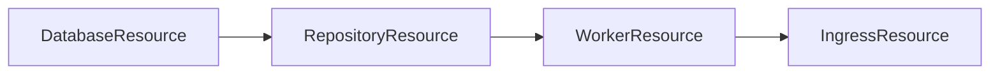

# Observing Callback Order of Dependent Resources

In a Java application using CRaC, multiple `Resource` instances have dependency relationships: the database pool provides connections to the repository, the worker uses the repository to process work, and the listener or ingress feeds work to the worker. If the database is closed before the worker stops, the worker may access a closed pool. If the listener opens before the worker is ready after restore, new requests may be routed into a system not yet able to handle them.

This practice exercise builds four `Resource` instances with dependency relationships, registers them into the same CRaC `Context`, and then observes the order of `beforeCheckpoint` and `afterRestore` through logs. The expected outcome is **stopping in consumer-before-provider order and starting in provider-before-consumer order**.

## 1. Practice Objectives

After this exercise, you will be able to:

- Draw the dependency graph among resources in an application.
- Register `Resource` instances in the right order within a `Context`.
- Observe callback order before checkpoint and after restore.
- Use logs and simulated state to detect resources stopped or started out of order.
- Distinguish resource registration order from object instantiation order or constructor invocation order.
- Verify how failures are handled when a callback fails.

The lab uses a single global context and four mock resources. The resources only toggle state flags and write logs without opening a real database or listener. Once you understand the ordering, you can replace the mock parts with real application resources.

## 2. Dependency Graph of the Lab

Suppose the application has four components:

| Resource | Role | Depends on |
|---|---|---|
| `DatabaseResource` | Opens and closes the database pool | Depends on no resource in this lab |
| `RepositoryResource` | Prepares the repository and data-access metadata | Database |
| `WorkerResource` | Processes background work via the repository | Repository |
| `IngressResource` | Receives requests/messages and dispatches tasks to the worker | Worker |

Dependency graph:



Arrows run from provider to consumer: repository needs database, worker needs repository, ingress needs worker. Therefore:

- Before checkpoint, stop ingress first, then worker, repository, and finally database.
- After restore, open database first, then repository, worker, and finally ingress.

## 3. Callback Ordering Rules of `Context`

Within the same CRaC `Context`, resources receive callbacks in the following order:

| Callback | Order | Purpose |
|---|---|---|
| `beforeCheckpoint` | Reverse registration order | Stop consumers before stopping providers |
| `afterRestore` | Registration order | Recover providers before recovering consumers |

Therefore, register along the dependency direction from provider to consumer:

```java
Context<? extends Resource> context = Core.getGlobalContext();
context.register(databaseResource);
context.register(repositoryResource);
context.register(workerResource);
context.register(ingressResource);
```

With this ordering, `beforeCheckpoint` runs from `IngressResource` back to `DatabaseResource`; `afterRestore` runs from `DatabaseResource` to `IngressResource`.

The order is determined by the `register()` call on the context, not by the order objects are instantiated with `new`, the order constructors execute, or the order fields appear in a class. This lab registers all resources into the same global context so results are easy to observe. When an application uses multiple nested contexts, consider the relationship between parent and child contexts as well, and verify via logs on the real runtime.

## 4. Preparing the Project

The example uses Java 17 or later and a CRaC API compatible with `org.crac`. With Maven, add the dependency:

```xml
<dependency>
    <groupId>org.crac</groupId>
    <artifactId>crac</artifactId>
    <version>1.5.0</version>
</dependency>
```

Version `1.5.0` is an illustrative version. Choose the API version matching the CRaC-enabled JDK and runtime your project uses. Adding this dependency alone does not give a regular JDK checkpoint/restore capability; you must run on a CRaC-supported runtime.

Create the class `ResourceOrderLab.java`. In this exercise, the resources are nested in the same class so it is easy to test with a single file.

Place the imports and class declaration at the top of the file. The code snippets in the following sections are members added sequentially into the body of this class:

```java
import java.time.Instant;
import java.util.concurrent.atomic.AtomicInteger;

import org.crac.CheckpointException;
import org.crac.Context;
import org.crac.Core;
import org.crac.Resource;
import org.crac.RestoreException;

public final class ResourceOrderLab {
    // Add nested classes, fields, and methods in the following steps.
```

## 5. Creating Shared State to Verify Dependencies

Before writing callbacks, create an object holding the state of all four components. At startup, all components are ready. On checkpoint, each resource switches its state to stopped. After restore, they are re-enabled in the proper dependency order.

```java
static final class LabState {
    volatile boolean databaseReady = true;
    volatile boolean repositoryReady = true;
    volatile boolean workerRunning = true;
    volatile boolean ingressAccepting = true;

    void require(boolean condition, String message) {
        if (!condition) {
            throw new IllegalStateException(message);
        }
    }

    boolean allReady() {
        return databaseReady
                && repositoryReady
                && workerRunning
                && ingressAccepting;
    }
}
```

The `volatile` flags ensure state visibility across threads if real callbacks or components use multiple threads. In this lab, callbacks are observed in context order; `volatile` still makes the semantics of shared state clear.

The `require()` method creates an assertion condition. If a resource is invoked out of order, the callback throws `IllegalStateException` and logs indicate which dependency was not yet in a valid state.

## 6. Creating a Logging Base Class

Each callback will log the resource name and the active phase. Include a timestamp so logs can be correlated if output from checkpoint and restore appears across different process or container logs.

```java
abstract static class LoggedResource implements Resource {
    protected final LabState state;
    private final String name;

    LoggedResource(String name, LabState state) {
        this.name = name;
        this.state = state;
    }

    protected void log(String callback) {
        System.out.printf("%s %-18s %s%n",
                Instant.now(), name, callback);
    }
}
```

The base class only handles logging and shared state. Each child resource will define its own `beforeCheckpoint` and `afterRestore` behavior.

## 7. Implementing `DatabaseResource`

Database is the foundational provider in the dependency graph. Before checkpoint, the database may close only after the repository has stopped. After restore, the database opens first so the repository can start.

```java
static final class DatabaseResource extends LoggedResource {
    DatabaseResource(LabState state) {
        super("Database", state);
    }

    @Override
    public void beforeCheckpoint(Context<? extends Resource> context) {
        state.require(!state.repositoryReady,
                "Repository must stop before database");
        log("beforeCheckpoint");
        state.databaseReady = false;
    }

    @Override
    public void afterRestore(Context<? extends Resource> context) {
        log("afterRestore");
        state.databaseReady = true;
    }
}
```

In a real application, `beforeCheckpoint` can drain connection leases, close the pool, or use the database library's CRaC integration. `afterRestore` creates a new pool, validates connections, and confirms the database is ready.

## 8. Implementing `RepositoryResource`

Repository depends on database. It must stop before database and restart only after database is ready.

```java
static final class RepositoryResource extends LoggedResource {
    RepositoryResource(LabState state) {
        super("Repository", state);
    }

    @Override
    public void beforeCheckpoint(Context<? extends Resource> context) {
        state.require(!state.workerRunning,
                "Worker must stop before repository");
        log("beforeCheckpoint");
        state.repositoryReady = false;
    }

    @Override
    public void afterRestore(Context<? extends Resource> context) {
        state.require(state.databaseReady,
                "Database must start before repository");
        log("afterRestore");
        state.repositoryReady = true;
    }
}
```

In a real application, the repository may hold metadata, statement caches, or adapters. Determine which parts can remain in the heap and which parts must be recreated when the database pool is reopened.

## 9. Implementing `WorkerResource`

Worker uses repository to process work. On checkpoint, ingress must stop sending new tasks and worker must drain in-flight tasks before repository is stopped. After restore, worker runs only when repository is ready.

```java
static final class WorkerResource extends LoggedResource {
    WorkerResource(LabState state) {
        super("Worker", state);
    }

    @Override
    public void beforeCheckpoint(Context<? extends Resource> context) {
        state.require(!state.ingressAccepting,
                "Ingress must stop before worker");
        log("beforeCheckpoint");
        state.workerRunning = false;
    }

    @Override
    public void afterRestore(Context<? extends Resource> context) {
        state.require(state.repositoryReady,
                "Repository must start before worker");
        log("afterRestore");
        state.workerRunning = true;
    }
}
```

A real worker might manage an `ExecutorService`, consumer, or scheduler. `beforeCheckpoint` must close admission, drain tasks within a deadline, and shut down the executor if the executor cannot be reused. `afterRestore` creates a new executor or consumer before reporting running.

## 10. Implementing `IngressResource`

Ingress is the outermost consumer of the worker in this example: it feeds requests or messages to the worker. Therefore, ingress stops first and starts last.

```java
static final class IngressResource extends LoggedResource {
    IngressResource(LabState state) {
        super("Ingress", state);
    }

    @Override
    public void beforeCheckpoint(Context<? extends Resource> context) {
        log("beforeCheckpoint");
        state.ingressAccepting = false;
    }

    @Override
    public void afterRestore(Context<? extends Resource> context) {
        state.require(state.workerRunning,
                "Worker must start before ingress");
        log("afterRestore");
        state.ingressAccepting = true;
    }
}
```

In a real system, ingress may be an HTTP listener, message consumer, scheduler, or internal producer. Stopping ingress must stop accepting new work, not merely toggle an in-heap flag. If requests are in progress, drain them or move state to a durable queue before dependencies are closed.

## 11. Registering Resources from Provider to Consumer

Create a coordinator class holding references to all resources and registering them exactly once:

```java
private final LabState state = new LabState();

private final DatabaseResource database = new DatabaseResource(state);
private final RepositoryResource repository = new RepositoryResource(state);
private final WorkerResource worker = new WorkerResource(state);
private final IngressResource ingress = new IngressResource(state);

private boolean registered;

private void registerResources() {
    if (registered) {
        throw new IllegalStateException("Resources already registered");
    }

    Context<? extends Resource> context = Core.getGlobalContext();
    context.register(database);
    context.register(repository);
    context.register(worker);
    context.register(ingress);

    registered = true;
    System.out.println("Registration order: Database -> Repository -> Worker -> Ingress");
}
```

The key point is that `register()` order is written explicitly. Do not register a resource inside each resource's own constructor if that makes ordering depend on object instantiation order. Nor should you register the same instance multiple times. Keep references to resources throughout the application lifecycle so lifecycle management remains clear.

## 12. Running Checkpoint/Restore and Observing Logs

Add `main()` to the coordinator class. When `Core.checkpointRestore()` succeeds, the checkpointed process exits and execution continues in the restored process. Log lines after the call will appear after `afterRestore` callbacks finish.

```java
public static void main(String[] args) throws Exception {
    ResourceOrderLab lab = new ResourceOrderLab();
    lab.registerResources();

    System.out.println("Application is ready for checkpoint");

    try {
        Core.checkpointRestore();
        System.out.println("checkpointRestore returned after restore");
        System.out.println("All resources ready: " + lab.state.allReady());
    } catch (CheckpointException e) {
        System.err.println("Checkpoint notification failed");
        e.printStackTrace(System.err);
        throw e;
    } catch (RestoreException e) {
        System.err.println("A resource failed during restore notification");
        e.printStackTrace(System.err);
        throw e;
    } catch (UnsupportedOperationException e) {
        System.err.println("This runtime does not support CRaC checkpoint/restore");
        throw e;
    }
}
}
```

This snippet assumes the classes and fields from previous sections reside in the same `ResourceOrderLab`. Configure checkpointing per your CRaC-enabled JDK's instructions, for example with a runtime supporting `-XX:CRaCCheckpointTo`:

```bash
java -XX:CRaCCheckpointTo=./target/checkpoint \
  -cp target/classes \
  com.example.ResourceOrderLab
```

Exact commands depend on the JDK distribution and how the environment runs CRaC. `Core.checkpointRestore()` requests the runtime to perform checkpoint/restore; if the runtime does not support it, the call may throw `UnsupportedOperationException`. Do not run this lab on a regular JDK and conclude callback ordering does not work.

## 13. Expected Results

With the registration order `Database → Repository → Worker → Ingress`, successful logs have the order:

```text
Registration order: Database -> Repository -> Worker -> Ingress
Application is ready for checkpoint
Ingress            beforeCheckpoint
Worker             beforeCheckpoint
Repository         beforeCheckpoint
Database           beforeCheckpoint
Database           afterRestore
Repository         afterRestore
Worker             afterRestore
Ingress            afterRestore
checkpointRestore returned after restore
All resources ready: true
```

Actual timestamps will differ. Output may be split across logs of the pre-checkpoint process and the restored process, depending on the container runtime and how stdout is collected. When investigating, correlate timestamps, checkpoint IDs, and process IDs rather than expecting every line to appear in a single log file.

The output block above omits timestamps for readability; each actual line begins with the `Instant.now()` value written by `LoggedResource.log()`. If the application has other libraries that also register resources into the global context, their callbacks may also appear in the logs; the order shown illustrates the four resources in this lab.

Interpretation:

1. `Ingress.beforeCheckpoint` runs first to stop creating new work.
2. `Worker.beforeCheckpoint` runs after ingress stops, draining and stopping the worker.
3. `Repository.beforeCheckpoint` runs when the worker is no longer using the repository.
4. `Database.beforeCheckpoint` runs last once the repository has stopped.
5. After restore, database opens first.
6. Repository is recovered once database is ready.
7. Worker starts after repository.
8. Ingress opens last, once the worker is able to accept tasks.

## 14. Experiment: Reversing Registration Order

To see the effect of ordering, you can change the registration block to:

```java
context.register(ingress);
context.register(worker);
context.register(repository);
context.register(database);
```

Callback order is now reversed relative to the desired dependencies:

| Phase | Callbacks when registered incorrectly | Issue |
|---|---|---|
| `beforeCheckpoint` | Database → Repository → Worker → Ingress | Database callback runs while repository is still active; precondition rejects before closing database |
| `afterRestore` | Ingress → Worker → Repository → Database | Consumer receives callback before provider; if provider has not been recovered yet, ingress may open too early |

The `require()` checks in the example will throw `IllegalStateException` when dependency preconditions are violated. Context collects callback failures and continues notifying the remaining resources; errors may be aggregated into `CheckpointException` or `RestoreException` depending on the phase.

Run this reversed-order experiment only in an isolated lab environment. When a callback fails, inspect all suppressed exceptions and do not treat the mocked state as ready. Restore the correct registration code before continuing the exercise.

## 15. Observing Order Using a Sequence Number

When multiple resources and threads log concurrently, timestamps may not be clear enough to determine order. You can add an incrementing counter:

```java
static final class CallbackTrace {
    private final AtomicInteger sequence = new AtomicInteger();

    void record(String resource, String callback) {
        int number = sequence.incrementAndGet();
        System.out.printf("%02d %-18s %s%n", number, resource, callback);
    }
}
```

Pass the same `CallbackTrace` into the resources and call `record()` in each callback. The counter resides in the heap, so its pre-checkpoint value is also saved in the snapshot; after restore, the sequence continues from its existing value. If you want to clearly distinguish the old process from the restored process, add a `processRunId` regenerated in `afterRestore` or record the current PID alongside each event.

Do not use the sequence number as the sole evidence when there are multiple independent contexts or multiple processes. Attach the context name, resource, checkpoint ID, and process identity so logs can be correlated.

## 16. Verifying Dependencies with Preconditions

In this lab, preconditions are checked right inside the callbacks:

| Callback | Condition before running |
|---|---|
| `Ingress.beforeCheckpoint` | No downstream dependency to check; this is the outermost consumer |
| `Worker.beforeCheckpoint` | `ingressAccepting == false` |
| `Repository.beforeCheckpoint` | `workerRunning == false` |
| `Database.beforeCheckpoint` | `repositoryReady == false` |
| `Database.afterRestore` | Database can open independently |
| `Repository.afterRestore` | `databaseReady == true` |
| `Worker.afterRestore` | `repositoryReady == true` |
| `Ingress.afterRestore` | `workerRunning == true` |

Preconditions turn callback ordering into verifiable assertions instead of reading logs and guessing. In a real application, preconditions can verify that the connection pool is open, the worker executor is initialized, the consumer subscription is confirmed, or dependency readiness is satisfied.

## 17. When a Callback Fails

To observe exception aggregation, you can intentionally add an error in one resource, such as throwing `IllegalStateException` from `WorkerResource.beforeCheckpoint`. Then:

- Context records the worker failure.
- Context still notifies the other resources so they have a chance to execute their callbacks.
- If checkpoint notification fails, the checkpoint is aborted and restore notification is invoked in the original JVM so resources can recover their state.
- `CheckpointException` aggregates the checkpoint failure and any errors that may occur during recovery.

If an error occurs in `afterRestore` of the new process, callback errors are aggregated into `RestoreException`. At that point the JVM has restored, yet the application may not be Ready.

When running this experiment, print the entire stack trace:

```java
catch (CheckpointException e) {
    e.printStackTrace(System.err);
    for (Throwable suppressed : e.getSuppressed()) {
        suppressed.printStackTrace(System.err);
    }
}
```

Java's `printStackTrace()` already prints the cause and suppressed tree recursively; the loop is only useful if you want to log each error to a separate logging system. Do not ignore exceptions just to keep the lab running.

## 18. Extending the Lab with Real Dependencies

Once the mocked ordering works, replace each resource with a real component:

| Lab resource | Real component substitute | What to observe |
|---|---|---|
| `DatabaseResource` | HikariCP/JDBC pool or database client | Pool closes after consumer drains; new connections are created after restore |
| `RepositoryResource` | Repository with prepared metadata or cache | No queries while pool is closed; metadata refreshes at the right time |
| `WorkerResource` | Executor, scheduled job, or message consumer | Accepts no new tasks, in-flight tasks finish, worker is recreated |
| `IngressResource` | HTTP listener, broker listener, or scheduler producer | Stops admission before checkpoint and reopens after worker is ready |

If a library already has CRaC integration, prefer using that integration. Avoid closing the same pool or executor twice by both the library integration and a custom resource. Each resource should have a single clear lifecycle owner.

## 19. Common Mistakes When Observing Callbacks

### Registering in Consumer-Before-Provider Order

Then pre-checkpoint callbacks may stop the provider before the consumer finishes. Register providers before consumers in the same context.

### Confusing Object Creation Order with Registration Order

Objects can be instantiated in any order. Callback order depends on the `context.register()` calls.

### Registering the Same Resource Multiple Times

A resource registered multiple times may receive duplicate callbacks. Place registration in one coordinator and ensure each instance is registered only once.

### Logging Only `beforeCheckpoint`

Without logging `afterRestore`, you cannot verify startup order and whether dependencies were ready before consumers.

### Assuming an Empty Queue Means the Worker Has Stopped

The worker may be processing an asynchronous task or callback. Drain both in-flight work and continuations before closing the repository/database.

### Opening Ingress Before the Worker Is Ready

Requests may be accepted and then fail during dispatch. Open ingress last.

### Running on a Non-CRaC Runtime

Being able to compile against the `org.crac` API does not prove the runtime can checkpoint. Run on a CRaC-enabled JDK and check runtime logs.

### Reading Only Logs Without Checking State

Logs show that callbacks were called; preconditions and post-restore state verify that dependencies are truly right.

## 20. Practice Questions

After running successfully, answer these for yourself:

1. Why is `DatabaseResource` registered before `RepositoryResource`?
2. Why must `IngressResource.beforeCheckpoint` run before `WorkerResource.beforeCheckpoint`?
3. Why does `DatabaseResource.afterRestore` run before `RepositoryResource.afterRestore`?
4. If the repository fails to start, should ingress open? Why?
5. If two resources do not depend on each other, do they need to be placed in any particular order? How would you decide?
6. If resources live in different child contexts, what else needs to be observed to confirm ordering?
7. When a callback fails, why must you inspect suppressed exceptions instead of only reading the outermost message?

## 21. Lab Completion Checklist

- [ ] Created four resources following the dependency graph Database → Repository → Worker → Ingress.
- [ ] Registered in the correct provider-before-consumer order.
- [ ] Logged in both `beforeCheckpoint` and `afterRestore`.
- [ ] Verified pre-checkpoint callbacks run in reverse registration order.
- [ ] Verified post-restore callbacks run in registration order.
- [ ] Preconditions did not fail during the correct run.
- [ ] Final state after restore showed all resources ready.
- [ ] Tested reversing the order in a lab environment and observed the dependency failure.
- [ ] Inspected stack traces and suppressed exceptions when a callback failed.
- [ ] Ran using a compatible CRaC-enabled runtime.

## 22. References

- [CRaC API — `Context`](https://javadoc.io/doc/org.crac/crac/latest/org/crac/Context.html): registering and managing resources in a context.
- [CRaC API — `Resource`](https://javadoc.io/doc/org.crac/crac/latest/org/crac/Resource.html): the `beforeCheckpoint` and `afterRestore` contract.
- [CRaC API — `Core`](https://javadoc.io/doc/org.crac/crac/latest/org/crac/Core.html): global context and checkpoint/restore requests.
- [CRaC Project](https://crac.org/): overview of the runtime and checkpoint/restore workflow.

The expected outcome to observe is that `beforeCheckpoint` callbacks run in reverse registration order so consumers stop before providers, while `afterRestore` runs in registration order so providers become ready before consumers. Registering resources along the dependency direction, logging in both phases, and placing preconditions inside callbacks will help detect ordering bugs early before applying the same model to real database pools, workers, schedulers, and ingress.
