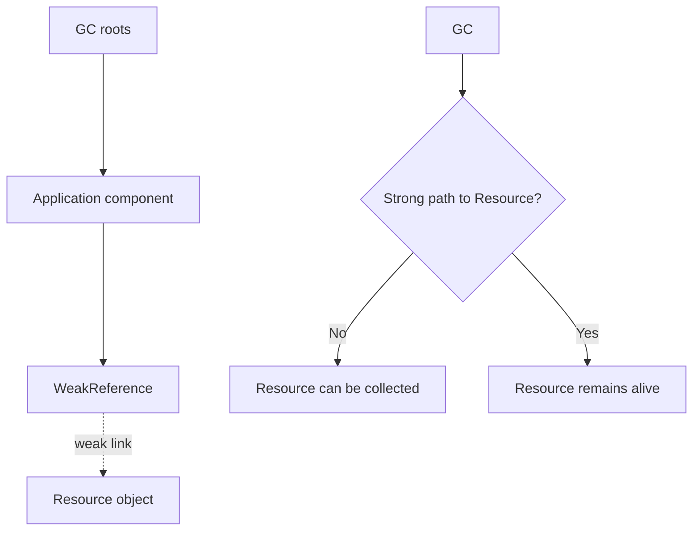

# Reproducing Resource Garbage Collection Due to Weak-Only References

In Java, the garbage collector (GC) retains an object only if the object remains reachable from a GC root through a chain of strong references. `WeakReference` does not keep an object alive. When a `Resource` is pointed to only by weak references, the GC can collect the resource before CRaC calls `beforeCheckpoint` or `afterRestore`.

This bug often appears when an application manages resources with a registry storing only `WeakReference`, or when a component holds a resource in a weak field to avoid retaining the object too long. The registry still contains the entry, so logs may show the resource was once registered, yet `WeakReference.get()` returns `null` after the object is collected. Then there is no object left for the callback to invoke, and resources may not be closed or recovered as planned.

A distinction must be drawn between weak references held by the application and CRaC's registration mechanism. If a resource is registered directly into a `Context` whose implementation holds a strong reference, that registration may keep the resource alive. Do not guess the internal behavior of every JDK or CRaC distribution. The safe design is to have a sufficiently long-lived component hold a strong reference to each resource throughout its lifecycle, while also testing the behavior of the exact runtime in use.

## 1. Reachability and Object Lifetime

The GC does not collect an object simply because a local variable goes out of scope in a naive syntactic sense. The GC evaluates reachability at collection time based on references that can still be used.

Main reference categories in Java:

| Reference type | Keeps referent alive? | Behavior during GC |
| --- | --- | --- |
| Strong reference | Yes | Objects reachable through strong references will not be collected |
| `SoftReference` | Conditionally | GC may clear soft references before collecting the object, typically based on memory pressure |
| `WeakReference` | No | GC may clear weak references when the referent is no longer strongly reachable |
| `PhantomReference` | No | Used to detect that an object has reached phantom reachability, typically paired with `ReferenceQueue` for special cleanup |

A field of type `WeakReference<Resource>` is not an owner of the resource. It only allows checking whether the object is still alive.

### 1.1. Strong Reachability

Suppose an application component holds the resource as follows:

```java
public final class ResourceOwner {

    private final CacheResource resource;

    public ResourceOwner(CacheResource resource) {
        this.resource = resource;
    }

    public CacheResource resource() {
        return resource;
    }
}
```

If `ResourceOwner` remains reachable from the application context or a GC root, the `resource` field creates a strong reference. GC cannot collect `CacheResource` while the owner holds that field.

### 1.2. Weak-Only Reachability

Replace the strong field with a weak reference:

```java
import java.lang.ref.WeakReference;

public final class WeakResourceOwner {

    private final WeakReference<CacheResource> resource;

    public WeakResourceOwner(CacheResource resource) {
        this.resource = new WeakReference<>(resource);
    }

    public CacheResource resource() {
        return resource.get();
    }
}
```

If the caller does not retain `CacheResource` elsewhere, the object can become weakly reachable and be collected by GC. Afterward `resource()` returns `null`.



A registry may remain alive and still hold a weak reference while the object it intended to manage has vanished. This is the difference between the lifetime of the registry and the lifetime of the resource.

## 2. Why Is This Bug Dangerous for CRaC Resources?

A CRaC resource typically manages resources with critical lifecycles, for example:

- Database connection pools.
- HTTP clients or sockets.
- Message consumers.
- Schedulers or executors.
- Native handles and file descriptors.
- Caches that need flushing or validation after restore.
- Server listeners or framework-created resources.

If the resource is collected before checkpoint, the `beforeCheckpoint` callback may not run on that object. If the resource is recreated or expected to exist for the post-restore callback yet the sole reference was lost, `afterRestore` also has no object to call.

Consequences depend on the resource:

- Connections or sockets are not closed according to application procedure.
- Background workers are not paused/drained.
- Buffers or state are not flushed.
- Resources are not recreated after restore.
- Readiness may switch to accepting even though a component has not been recovered.
- Bugs surface only during checkpoint or restore, making them hard to reproduce in normal execution flows.

The GC does not know that `Resource` has special meaning to CRaC. If an object is no longer strongly reachable, GC will not keep it alive merely because the class implements `org.crac.Resource`.

## 3. Pinpointing the Weak Reference Causing the Bug

Seeing a `WeakReference` in an application does not automatically mean there is a bug. Weak references can be legitimately used for caches or metadata that do not own the resource's lifecycle. The problem arises when a weak reference is the sole reference path to an object that must stay alive.

Check:

1. Who creates `Resource`?
2. Who keeps a strong reference after the constructor or factory returns?
3. Does the registry store `Resource` directly or only `WeakReference<Resource>`?
4. Is the resource registered directly into the CRaC `Context`?
5. Does any component hold the resource in a strong field throughout its lifecycle?
6. Does any code set the owner field to `null`, swap the registry, or unregister prematurely?
7. Was the resource created in a local method and the method returned without transferring ownership?
8. Do callbacks, lambdas, or inner classes accidentally retain objects—or fail to retain objects as the author expected?

### 3.1. Distinguishing a Weak Application Registry from CRaC Context

The following example illustrates a custom registry written by the application:

```java
final class ApplicationResourceRegistry {
    private final List<WeakReference<Resource>> resources =
            new ArrayList<>();
}
```

This registry stores only weak references. Without another strong owner, the resource can be collected by GC.

Meanwhile, the CRaC API provides registration via `Context.register(resource)`. Retention behavior inside the context depends on the implementation and contract of the specific runtime/API. Do not use a weak-only application registry and assume CRaC context will definitely compensate with strong ownership unless the runtime's documentation confirms it. Keeping a strong field on an application owner is clear and easy to test.

### 3.2. Do Not Confuse a Missing Callback with a GC'd Resource

A callback may fail to appear for several other reasons:

- The resource was not registered.
- Registered into a different context from the one being checkpointed.
- Registration failed or was unregistered.
- Checkpoint bypassed the CRaC lifecycle and used another mechanism.
- The callback failed before completing logging.
- The resource was collected due to having only weak references.

To conclude GC collection occurred, you need evidence such as `ReferenceQueue`, cleanup logs, heap dumps, or observing a weak reference returning `null`. Merely missing a callback log line does not prove the resource was GC'd.

## 4. Creating a Program to Reproduce the Bug with WeakReference

The example below simulates a registry holding only weak references. A resource is created in a method, registered into the registry, and no strong owner retains it.

```java
import java.lang.ref.ReferenceQueue;
import java.lang.ref.WeakReference;
import java.util.ArrayList;
import java.util.Iterator;
import java.util.List;

interface ManagedResource {
    void beforeCheckpoint() throws Exception;
}

final class DemoResource implements ManagedResource {

    private final String name;

    DemoResource(String name) {
        this.name = name;
    }

    @Override
    public void beforeCheckpoint() {
        System.out.println("beforeCheckpoint: " + name);
    }
}

final class WeakOnlyRegistry {

    private final ReferenceQueue<ManagedResource> collected =
            new ReferenceQueue<>();
    private final List<WeakReference<ManagedResource>> entries =
            new ArrayList<>();

    void register(ManagedResource resource) {
        entries.add(new WeakReference<>(resource, collected));
    }

    void invokeBeforeCheckpoint() throws Exception {
        for (Iterator<WeakReference<ManagedResource>> it =
                entries.iterator(); it.hasNext();) {
            ManagedResource resource = it.next().get();
            if (resource == null) {
                it.remove();
                continue;
            }
            resource.beforeCheckpoint();
        }
    }

    int entryCount() {
        return entries.size();
    }

    int liveCount() {
        int count = 0;
        for (WeakReference<ManagedResource> entry : entries) {
            if (entry.get() != null) {
                count++;
            }
        }
        return count;
    }

    boolean awaitCollected(long timeoutMillis) throws InterruptedException {
        return collected.remove(timeoutMillis) != null;
    }
}

public final class WeakResourceReproduction {

    private static void createAndRegister(WeakOnlyRegistry registry) {
        ManagedResource resource = new DemoResource("native-client");
        registry.register(resource);
        // Method returns; no other strong reference is kept.
    }

    public static void main(String[] args) throws Exception {
        WeakOnlyRegistry registry = new WeakOnlyRegistry();
        createAndRegister(registry);

        System.out.println("entries=" + registry.entryCount());
        System.out.println("live before GC=" + registry.liveCount());

        System.gc(); // Only a GC hint, not a guarantee of collection.

        boolean collected = registry.awaitCollected(5_000);
        System.out.println("reference enqueued=" + collected);
        System.out.println("live after GC=" + registry.liveCount());

        registry.invokeBeforeCheckpoint();
    }
}
```

Typical output when GC collects the resource:

```text
entries=1
live before GC=1
reference enqueued=true
live after GC=0
```

When `invokeBeforeCheckpoint()` runs, the registry has no resource left to invoke. The line `beforeCheckpoint: native-client` does not appear.

`System.gc()` is only a GC hint. The JVM may ignore the hint or choose a different collection timing. Thus, actual output depends on the GC, heap pressure, and how the program is compiled. The program above is an observable reproduction, not a proof that every run must collect immediately after `System.gc()`.

## 5. Using ReferenceQueue to Prove the Referent Was Collected

`ReferenceQueue` lets you receive notifications when a reference is processed by GC. This is a useful way to verify that a weak reference was enqueued.

```java
ReferenceQueue<ManagedResource> queue = new ReferenceQueue<>();
WeakReference<ManagedResource> weak =
        new WeakReference<>(resource, queue);
```

When the referent is collected, the reference may be placed into the queue. Observation code:

```java
Reference<? extends ManagedResource> reference = queue.remove(5_000);
if (reference != null) {
    System.out.println("Resource was collected");
}
```

Do not use `ReferenceQueue` as a substitute for ownership. The queue only notifies that the referent has been processed; it does not recover the resource and cannot run CRaC callbacks on an already collected object.

### 5.1. Why Avoid Hidden Strong References in Tests?

A reproduction may fail to occur if the test accidentally keeps the resource alive:

```java
ManagedResource resource = new DemoResource("client");
WeakReference<ManagedResource> weak = new WeakReference<>(resource);
System.gc();
```

In this snippet, the `resource` variable may still be used afterward, so the JIT can keep strong reachability. To test weak-only behavior, create the resource in a helper method and return only the weak reference or let the registry hold the weak reference.

Do not rely on a local variable “leaving a block” to conclude the object is definitely unreachable. The compiler and runtime may optimize local variable lifetimes according to actual reachability.

## 6. Reproduction with a Real CRaC Resource

To simulate the CRaC lifecycle, a resource can implement `org.crac.Resource`. The following example uses a weak-only application registry to illustrate the ownership bug.

```java
import java.lang.ref.ReferenceQueue;
import java.lang.ref.WeakReference;
import java.util.ArrayList;
import java.util.Iterator;
import java.util.List;

import org.crac.Context;
import org.crac.Resource;

final class WeakCracResourceRegistry {

    private final ReferenceQueue<Resource> queue = new ReferenceQueue<>();
    private final List<WeakReference<Resource>> resources = new ArrayList<>();

    synchronized void add(Resource resource) {
        resources.add(new WeakReference<>(resource, queue));
    }

    synchronized void beforeCheckpoint(
            Context<? extends Resource> context) throws Exception {
        for (Iterator<WeakReference<Resource>> it =
                resources.iterator(); it.hasNext();) {
            Resource resource = it.next().get();
            if (resource == null) {
                it.remove();
            } else {
                resource.beforeCheckpoint(context);
            }
        }
    }

    synchronized void afterRestore(
            Context<? extends Resource> context) throws Exception {
        for (Iterator<WeakReference<Resource>> it =
                resources.iterator(); it.hasNext();) {
            Resource resource = it.next().get();
            if (resource == null) {
                it.remove();
            } else {
                resource.afterRestore(context);
            }
        }
    }
}
```

This is a custom registry written to reproduce the bug; it is not the CRaC `Context` implementation. If only this registry retains the resource, GC can collect the object and callbacks will not be called.

Test resource:

```java
import org.crac.Context;
import org.crac.Resource;

final class LoggingCracResource implements Resource {

    private final String id;

    LoggingCracResource(String id) {
        this.id = id;
    }

    @Override
    public void beforeCheckpoint(Context<? extends Resource> context) {
        System.out.println(id + ": beforeCheckpoint");
    }

    @Override
    public void afterRestore(Context<? extends Resource> context) {
        System.out.println(id + ": afterRestore");
    }
}
```

Factory creating weak-only ownership:

```java
static void registerWeakOnly(WeakCracResourceRegistry registry) {
    Resource resource = new LoggingCracResource("resource-A");
    registry.add(resource);
}
```

After `registerWeakOnly()` finishes, if no other strong reference exists, the resource may be collected by GC. When the registry iterates the list, `get()` may return `null` and the callback is skipped.

### 6.1. Distinguishing Registry Tests from CRaC Context Tests

The snippet above proves a weak-only application registry does not keep the resource alive. It does not prove that `Core.getGlobalContext().register(resource)` in every CRaC runtime holds weak references.

If you want to test registration directly with CRaC context:

1. Use the exact CRaC JDK distribution planned for deployment.
2. Register the resource via the `Context.register` API per runtime documentation.
3. Keep an additional weak reference strictly for observation.
4. Intentionally drop all other application strong references.
5. Generate controlled GC pressure and observe the weak reference.
6. Run a checkpoint/restore integration test and record callbacks.
7. Compare results against the runtime's registration contract.

If the context holds a strong reference, the observing weak reference will not be cleared while the resource remains registered. If the resource is collected, check whether registration actually occurred, whether it was unregistered, or whether the context uses different retention semantics. Regardless of the outcome, a strong application owner remains the clearest and least implementation-dependent design.

## 7. Fixing the Bug with Strong Ownership

The direct solution is to keep a strong reference to the resource in a sufficiently long-lived component. For example:

```java
import org.crac.Core;

public final class CracResourceOwner {

    private final LoggingCracResource resource;

    public CracResourceOwner() {
        this.resource = new LoggingCracResource("resource-A");
        Core.getGlobalContext().register(resource);
    }
}
```

The `resource` field holds a strong reference throughout the lifetime of `CracResourceOwner`. If the owner is a singleton bean or an application lifecycle component, the resource remains reachable while the application runs.

### 7.1. Strong-Reference Registry

If the application needs a registry managing multiple resources, the registry should store the objects directly:

```java
import java.util.ArrayList;
import java.util.List;
import org.crac.Resource;

public final class StrongResourceRegistry {

    private final List<Resource> resources = new ArrayList<>();

    public synchronized void register(Resource resource) {
        resources.add(resource);
    }

    public synchronized void unregister(Resource resource) {
        resources.remove(resource);
    }

    public synchronized List<Resource> snapshot() {
        return List.copyOf(resources);
    }
}
```

A strong-reference registry makes clear that the registry owns the resources. When a resource is no longer needed, the application must explicitly unregister and clean it up. Strong references must be managed intentionally to avoid memory leaks; do not dump every object into a global static list and retain it forever.

### 7.2. Registering Once and Retaining Ownership

An owner can both hold a strong field and register with CRaC:

```java
public final class NativeClientLifecycle {

    private final NativeClientResource resource;

    public NativeClientLifecycle(NativeClientFactory factory) {
        this.resource = new NativeClientResource(factory);
        Core.getGlobalContext().register(resource);
    }

    public NativeClientResource resource() {
        return resource;
    }
}
```

Do not create a resource in a local method and merely call a function that registers it into a weak-only registry. Transfer ownership into a strong field before the method finishes.

## 8. Comparing Ways to Retain Resources

| Storage method | Is resource kept alive? | Suitable for lifecycle resources? |
| --- | --- | --- |
| Strong field in a singleton owner | Yes, while owner is reachable | Yes |
| `List<Resource>` in a strong registry | Yes, while registry is reachable | Yes, with proper unregister/cleanup |
| `Map<String, Resource>` | Yes, while map is reachable | Yes, if ownership is clearly managed |
| `WeakReference<Resource>` | Not guaranteed | No, if it is the sole reference |
| `WeakHashMap<Resource, Metadata>` | Key can be collected when no strong ref remains | Do not use as Resource owner |
| `SoftReference<Resource>` | Not guaranteed long-term | Not suitable for retaining lifecycle resources |
| `PhantomReference<Resource>` | Does not keep object alive | Only suitable for special notification/cleanup, not invoking callbacks on a lost object |

Weak references suit recreatable caches or auxiliary associations where losing an entry does not affect correctness. CRaC resources typically need to survive precisely through a lifecycle phase, so they need a strong owner.

## 9. Do Not Use Cleaner or Finalizers Instead of the CRaC Lifecycle

`Cleaner` and finalization are not guaranteed to run at the moment the application needs to prepare a checkpoint. Nor are they the right place to perform logic that must finish before checkpoint.

Example not to rely on:

```java
private static final Cleaner CLEANER = Cleaner.create();

private final Cleaner.Cleanable cleanable =
        CLEANER.register(this, this::closeNativeHandle);
```

Cleaner can be useful as a last-resort safeguard for resources when callers forget to close, but does not replace deterministic `close()` or CRaC callbacks. A Cleaner's cleanup Runnable also should not hold a strong back-reference to the object meant to be collected, otherwise it may prevent that very collection.

With CRaC, the resource owner should proactively close resources in `beforeCheckpoint` and recreate or verify them in `afterRestore`. Cleaner may serve as a fallback by library design, not a guarantee that callbacks will run.

## 10. Regression Testing: Weak-Only Fails, Strong Owner Retains Resource

A test suite should have two goals:

1. Prove a weak-only registry can lose a resource when the referent is GC'd.
2. Prove a strong registry or owner keeps the resource reachable until explicitly unregistered.

### 10.1. Weak Test: Confirming an Entry Can Lose Its Referent

Do not write tests that depend on a single `System.gc()` call and always assert the object was collected. GC is best-effort. Registry logic can be tested deterministically by clearing the weak reference in the test:

```java
import static org.junit.jupiter.api.Assertions.assertEquals;
import static org.junit.jupiter.api.Assertions.assertNull;

import java.lang.ref.WeakReference;
import org.junit.jupiter.api.Test;

class WeakRegistryTest {

    @Test
    void weakOnlyEntryDoesNotOwnResource() throws Exception {
        WeakOnlyRegistry registry = new WeakOnlyRegistry();
        ManagedResource resource = new DemoResource("temporary");
        WeakReference<ManagedResource> weak =
                new WeakReference<>(resource);

        registry.register(resource);
        resource = null;

        // The test can keep the reference to simulate post-collection state.
        weak.clear();

        assertNull(weak.get());
        assertEquals(0, registry.liveCount());
        registry.invokeBeforeCheckpoint();
    }
}
```

This test verifies the semantics of a weak registry after the referent is gone. It does not prove GC collects automatically in that run, because `clear()` is called directly to make the result deterministic.

### 10.2. Strong Owner Test

With a strong registry, the registry continues retaining the resource after the caller drops its local reference:

```java
import static org.junit.jupiter.api.Assertions.assertNotNull;

import java.lang.ref.ReferenceQueue;
import java.lang.ref.WeakReference;
import org.junit.jupiter.api.Test;

class StrongRegistryTest {

    @Test
    void registryKeepsResourceStronglyReachable() {
        StrongResourceRegistry registry = new StrongResourceRegistry();
        ReferenceQueue<Resource> queue = new ReferenceQueue<>();

        Resource resource = new LoggingCracResource("owned");
        WeakReference<Resource> observer =
                new WeakReference<>(resource, queue);

        registry.register(resource);
        resource = null;

        assertNotNull(observer.get());
        assertEquals(1, registry.snapshot().size());
    }
}
```

In this test, `registry.snapshot()` creates a temporary strong list; that also keeps the resource alive while the snapshot exists. The key point is that the registry still holds the object even after the local variable is set to `null`.

To test lifecycle cleanup, call `unregister` with a stable key or handle managed by the registry, then verify the resource can become unreachable once no other strong owner remains. Avoid letting the test retain the object in a field or unintended lambda.

### 10.3. Real GC Test with Timeout

An integration-style test can use `ReferenceQueue` and wait within a time bound:

```java
static boolean awaitCollection(
        WeakReference<?> reference,
        ReferenceQueue<?> queue,
        Duration timeout) throws InterruptedException {

    long deadline = System.nanoTime() + timeout.toNanos();
    while (System.nanoTime() < deadline) {
        if (reference.get() == null) {
            return true;
        }

        System.gc();
        queue.remove(100);
    }
    return reference.get() == null;
}
```

This helper waits with a bound and does not assume GC must run immediately. The test needs to create the object in a helper method to avoid keeping a strong local reference alive. If the test fails to observe collection, report an inconclusive result rather than concluding weak references keep objects alive.

## 11. Reproducing in a CRaC Integration Test

Weak registry unit tests help confirm the cause in application code. To test the real impact on checkpoints, run with a compatible CRaC JDK.

A test flow can be:

1. Start the test application with a resource recorder.
2. Register the resource using the suspected approach, such as a weak-only registry.
3. Keep a `WeakReference` and `ReferenceQueue` to observe the referent.
4. Drop strong references held by the test or factory.
5. Generate controlled GC pressure and wait with a bounded timeout.
6. Record whether the weak reference was enqueued.
7. Request a checkpoint using the exact JDK's CRaC mechanism.
8. Observe callback traces and resource state.
9. Repeat with a strong owner for comparison.

Results should clearly note the JDK vendor/version/build, GC, heap size, how pressure was generated, and reference status. Do not draw conclusions from a single run if GC did not occur.

### 11.1. Two Experiment Branches

| Branch | Ownership | Expected outcome |
| --- | --- | --- |
| A – weak-only | Only weak references remain in the application registry | Resource may be collected; registry callbacks can no longer be invoked |
| B – strong owner | Long-lived component holds a strong field | Resource remains reachable and callbacks can be invoked per lifecycle |

If the resource is registered directly with CRaC Context, additionally record the effect of the context implementation. Do not conflate weak-only registry results with conclusions about how CRaC Context retains resources.

## 12. Inspecting with Heap Dumps and JVM Tools

When a bug appears only in large environments, a heap dump can be used to trace reference paths to the resource.

Questions to answer:

- Does the resource still exist in the heap?
- If yes, which GC root keeps it alive?
- If not, which weak reference previously pointed to it?
- Does the registry still hold an entry while `get()` returns `null`?
- Was any strong owner set to `null` or unregistered prematurely?
- Were multiple resource instances created while only one instance was registered?

You can use `jcmd` to take a heap dump or obtain a class histogram for the running JDK:

```bash
jcmd <pid> GC.class_histogram
jcmd <pid> GC.heap_dump /tmp/application-heap.hprof
```

These commands may cause pauses or consume significant disk space. Use in a test environment or according to approved operational procedures. Heap dumps may contain sensitive data in the heap; protect files and delete them per retention policy.

### 12.1. Heap Dumps Do Not Always Show Cleared Weak References

Once GC processes a weak reference, the referent may no longer appear in the heap dump. Therefore, combine:

- Logs at resource creation and registration.
- A stable resource identity in logs.
- `ReferenceQueue` events.
- Counts of entries and live referents in the registry.
- Callback traces.
- Heap dumps before and after GC if needed.

Do not use `System.identityHashCode()` as a persistent identifier across process restores. It is only useful for diagnostics within the same run.

## 13. Common Design Mistakes

| Mistake | Consequence | Resolution |
| --- | --- | --- |
| Registry stores only `WeakReference<Resource>` | Resource may be GC'd before callbacks | Keep strong references in a long-lived owner |
| Creating resource in a local method and returning | No strong owner remains | Store resource in a field or strong registry |
| Using `WeakHashMap<Resource, Metadata>` as a lifecycle registry | Keys may vanish when no strong reference remains | Use a strong map and unregister explicitly |
| Assuming `implements Resource` prevents GC by itself | Interfaces do not create strong references | Design explicit ownership |
| Checking only registry entry count | Entry may remain while `get()` is already `null` | Check live referents and ReferenceQueue |
| Relying on Cleaner/finalizers | Cleanup does not align with checkpoint timing | Use deterministic `close()` and CRaC callbacks |
| Keeping resources in a static map with no cleanup | Old resources are retained indefinitely | Manage unregistration and shutdown |
| Unregistering before checkpoint unintentionally | Callbacks are no longer dispatched | Unregister only when resource lifecycle truly ends |
| Assuming CRaC Context always holds strong references without checking | Wrong assumption across implementations | Review API contract and test on target runtime; keep strong owners |
| Test calls `System.gc()` only once | Flaky tests or false conclusions | Use ReferenceQueue, bounded waits, and deterministic logic tests |

## 14. Ownership Rules for CRaC Resources

A resource should have a clear owner from creation until its lifecycle ends.

| Phase | Required ownership |
| --- | --- |
| Resource creation | Factory or component takes ownership immediately after creation |
| CRaC registration | Owner keeps a strong reference and registers in the right context |
| Before checkpoint | Owner still holds the resource while callbacks are dispatched |
| After restore | The same owner or lifecycle coordinator continues managing the resource |
| Resource replacement | Create new resource, transfer ownership in a controlled way, and clean up old resource |
| Application shutdown | Unregister/close per API and release strong references when no longer needed |

If resources can be created dynamically, manage them in a strong-reference registry with thread-safe register/unregister operations. Do not use weak references as an automatic eviction mechanism for resources with mandatory lifecycles.

### 14.1. Keeping a Strong Owner Does Not Mean Keeping Every Resource Open

A strong reference keeps the Java object alive; it does not require sockets or connections to stay open at all times. The resource can remain in the heap while `beforeCheckpoint` closes the native handle and sets the handle field to `null`. After restore, the same resource object can create a new handle in `afterRestore`.

This separates two concepts:

- **Object lifetime:** the resource object needs to stay alive to receive callbacks.
- **Underlying resource lifetime:** sockets, pools, or native handles can be closed/opened according to the checkpoint lifecycle.

Do not use weak references to solve wanting to close resources before checkpoint. Keep the object alive and close resources inside callbacks.

## 15. Notes on Lambdas, Inner Classes, and Callbacks

Java closures can hold strong references to outer objects, yet you should not rely on accidental capture to manage lifecycles.

Example of a lambda capturing an owner:

```java
Resource resource = new LoggingCracResource("cache");
Runnable callback = () -> System.out.println(resource);
```

A lambda can keep the resource alive by capturing it. Yet if the lambda is replaced or becomes unreachable, the resource can be collected again. Keeping an object alive merely through a side callback is not an explicit ownership contract.

Similarly, non-static inner classes retain an implicit reference to the outer instance. This can unintentionally keep an entire large object graph alive for a long time. For CRaC resources, use owner fields or an explicit registry so ownership relationships are easy to understand and test.

## 16. Testing Unregistration and Resource Replacement

Strong references require cleanup to avoid leaks. When a resource reaches the end of its lifecycle, the owner must:

1. Stop using the resource.
2. Wait for in-flight operations to finish.
3. Call the cleanup/close API.
4. Unregister from the CRaC context if the resource no longer participates in future cycles.
5. Remove strong references from the owner/registry.

If replacing a resource while the application is still running, avoid a window where both the old and new resources receive callbacks or own the same socket. Transfer ownership in an internal transaction: create and verify the new resource, switch traffic, then clean up and unregister the old resource.

Do not unregister a resource merely because it temporarily closes its handle in `beforeCheckpoint`; the object still needs to exist to receive `afterRestore` if that lifecycle requires it.

## 17. Reproduction and Fix Checklist

When suspecting a resource was GC'd due to weak-only references, you can follow these steps:

- [ ] Identify where `Resource` is created and where it is held after the factory returns.
- [ ] Search for `WeakReference`, `SoftReference`, `WeakHashMap`, and similar registries.
- [ ] Check whether a strong owner exists throughout the lifecycle.
- [ ] Check whether the resource is registered directly into the right CRaC context.
- [ ] Add a `ReferenceQueue` to observe collection.
- [ ] Log the resource ID upon creation, registration, callbacks, and cleanup.
- [ ] Reproduce the weak-only case in an isolated test.
- [ ] Compare against the strong-owner case.
- [ ] Verify pre-checkpoint and post-restore callbacks.
- [ ] Check exceptions, timeouts, and unregistration.
- [ ] Run integration tests using the exact CRaC JDK distribution.
- [ ] Verify that strong references are released when the resource's lifecycle truly ends.

## 18. Conclusion

`WeakReference` does not keep its referent alive. If a `Resource` is only weakly referenced in an application registry or owner, the GC can collect the object before CRaC invokes callbacks. The registry may still exist while `WeakReference.get()` returns `null`, causing callbacks to be skipped.

To reproduce, create the resource in a helper method, store only a `WeakReference`, observe with a `ReferenceQueue`, and run GC within a bounded wait. Because `System.gc()` does not guarantee collection, combine real GC tests with deterministic tests using `WeakReference.clear()` to verify registry logic. When fixing, keep strong references in a long-lived owner or strong registry, register the resource in the right context, and unregister only when the lifecycle truly ends. The `Resource` object must survive through callbacks; the sockets, pools, and native handles inside it can still be closed and recreated across `beforeCheckpoint`/`afterRestore`.
