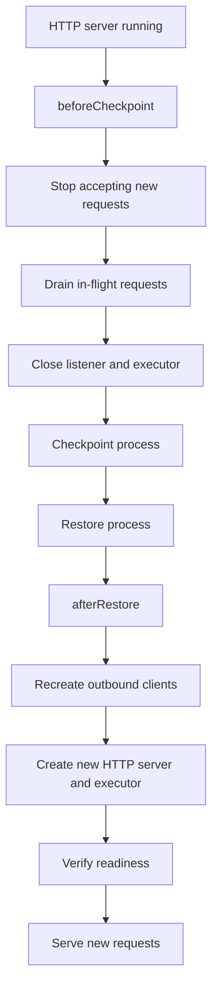

# Pausing an HTTP Server and Re-establishing Connections After Restore

An HTTP server typically holds a listening socket, open TCP connections, worker threads, and the state of in-flight requests. When a Java application is checkpointed, these resources may no longer be valid after the process is restored. Therefore, the application needs to stop accepting new requests, let running requests finish, close the server before checkpoint, and recreate the listener after restore.

This practice exercise uses the JDK's `com.sun.net.httpserver.HttpServer` to demonstrate that lifecycle. A `Resource` will manage the server, executor, and the number of running requests. In `beforeCheckpoint()`, the Resource stops the listener and waits for workers to finish. In `afterRestore()`, the Resource creates a new `HttpServer` along with a new executor and rebinds to the old address.

The goal is to verify a complete cycle:

1. Start the HTTP server and send requests.
2. Create a slow-running request to test draining.
3. Request a checkpoint while the request is being processed.
4. Verify that the server has stopped before the snapshot.
5. Restore the process using the same compatible CRaC runtime.
6. Verify that the new server rebinds to the port and serves requests.
7. Check that outbound connections or environment-dependent clients are recreated after restore.

## 1. Why must the HTTP server be stopped before checkpoint?

An HTTP server typically manages multiple types of state:

- A listening socket bound to an IP and port.
- Open TCP connections with clients.
- Requests currently being read or processed.
- Worker threads and the executor queue.
- Timers, schedulers, or internal callbacks.
- Clients connecting externally such as databases, HTTP APIs, or message brokers.

If checkpointed while the server is still accepting requests, the snapshot may contain partially processed requests or listeners/sockets tied to the old network state. After restore, the port may fail to bind, clients holding old keep-alive connections may receive errors, or workers may continue using expired dependencies.

The procedure should have two phases:

**Before checkpoint:** stop accepting new connections, drain in-flight requests, close the listener, and stop the executor. Only after the callback completes is the process in a safe state for snapshot.

**After restore:** recreate the executor and HTTP server, rebind the address, re-establish outbound clients, verify dependencies, and only open readiness once the server and required dependencies are ready.



## 2. Prepare the practice project

The example uses Java 21 and the `org.crac` API. Choose a CRaC-enabled JDK and an API version compatible with the distribution in use. The `org.crac` library provides interfaces for the application to register Resources; it does not turn a regular JDK into a JVM capable of checkpoint/restore.

A simple project structure:

```text
http-crac-lab/
├── pom.xml
└── src/
    └── main/
        └── java/
            └── com/example/crac/
                ├── HttpServerResource.java
                └── HttpServerDemo.java
```

Example Maven dependency:

```xml
<dependencies>
    <dependency>
        <groupId>org.crac</groupId>
        <artifactId>crac</artifactId>
        <version>${crac.version}</version>
    </dependency>
</dependencies>
```

Define `${crac.version}` according to the version supported by the project's JDK/framework. If the vendor provides the API according to its own distribution, follow the vendor's instructions and avoid packaging conflicting API classes.

`HttpServer` belongs to the `jdk.httpserver` module. For a project using `module-info.java`, declare:

```java
module com.example.crac {
    requires jdk.httpserver;
    requires org.crac;
}
```

The module name of the CRaC API needs to be verified against the dependency in use. If running on the classpath, there is no need to create `module-info.java`.

## 3. Define the lifecycle contract

Before writing the Resource, clearly define the states and actions:

| State | HTTP listener | Executor | Action |
|---|---|---|---|
| `NEW` | Not yet bound | Not yet created | Initial initialization |
| `RUNNING` | Accepting requests | Processing | Normal serving state |
| `STOPPING` | Stopping accepting requests | Draining | Waiting for current exchanges to finish |
| `STOPPED` | Closed | Shutdown | State to be checkpointed |
| `FAILED` | Must not be considered ready | May still have failed workers | Stop readiness and report error |

You cannot call `start()` on an `HttpServer` that has already been `stop()`ped and assume the listener will work again. This practice creates a new `HttpServer` after restore. Similarly, an executor that has been shut down cannot be reused; a new executor must be created.

## 4. Write the Resource managing the HTTP server

Create the file `HttpServerResource.java`:

```java
package com.example.crac;

import com.sun.net.httpserver.HttpExchange;
import com.sun.net.httpserver.HttpHandler;
import com.sun.net.httpserver.HttpServer;
import org.crac.Context;
import org.crac.Resource;

import java.io.IOException;
import java.io.OutputStream;
import java.net.InetSocketAddress;
import java.nio.charset.StandardCharsets;
import java.time.Duration;
import java.util.concurrent.ExecutorService;
import java.util.concurrent.Executors;
import java.util.concurrent.TimeUnit;
import java.util.concurrent.atomic.AtomicInteger;

public final class HttpServerResource implements Resource, AutoCloseable {
    private enum State {
        NEW,
        RUNNING,
        STOPPING,
        STOPPED,
        FAILED
    }

    private final InetSocketAddress bindAddress;
    private final int backlog;
    private final int workerCount;
    private final int stopDelaySeconds;
    private final Duration executorWait;
    private final HttpHandler applicationHandler;
    private final AtomicInteger activeRequests = new AtomicInteger();

    private volatile HttpServer server;
    private volatile ExecutorService executor;
    private volatile State state = State.NEW;

    public HttpServerResource(
            InetSocketAddress bindAddress,
            int backlog,
            int workerCount,
            int stopDelaySeconds,
            Duration executorWait,
            HttpHandler applicationHandler) {
        if (workerCount <= 0 || stopDelaySeconds < 0
                || executorWait.isNegative() || executorWait.isZero()) {
            throw new IllegalArgumentException("Invalid server lifecycle configuration");
        }
        this.bindAddress = bindAddress;
        this.backlog = backlog;
        this.workerCount = workerCount;
        this.stopDelaySeconds = stopDelaySeconds;
        this.executorWait = executorWait;
        this.applicationHandler = applicationHandler;
    }

    public synchronized void startInitial() throws IOException {
        if (state != State.NEW) {
            throw new IllegalStateException("Initial start is invalid in state " + state);
        }
        startNewServer();
    }

    private void startNewServer() throws IOException {
        HttpServer newServer = HttpServer.create(bindAddress, backlog);
        ExecutorService newExecutor = Executors.newFixedThreadPool(workerCount);

        newServer.setExecutor(newExecutor);
        newServer.createContext("/", exchange -> {
            activeRequests.incrementAndGet();
            try {
                applicationHandler.handle(exchange);
            } finally {
                exchange.close();
                activeRequests.decrementAndGet();
            }
        });

        try {
            newServer.start();
            server = newServer;
            executor = newExecutor;
            state = State.RUNNING;
        } catch (RuntimeException failure) {
            newExecutor.shutdownNow();
            throw failure;
        }
    }

    @Override
    public synchronized void beforeCheckpoint(Context<? extends Resource> context)
            throws Exception {
        if (state != State.RUNNING) {
            throw new IllegalStateException(
                    "Cannot checkpoint HTTP server in state " + state);
        }

        state = State.STOPPING;
        HttpServer oldServer = server;
        ExecutorService oldExecutor = executor;

        try {
            // Stops accepting new exchanges and waits up to the configured delay.
            oldServer.stop(stopDelaySeconds);

            oldExecutor.shutdown();
            if (!oldExecutor.awaitTermination(
                    executorWait.toMillis(), TimeUnit.MILLISECONDS)) {
                oldExecutor.shutdownNow();
                if (!oldExecutor.awaitTermination(2, TimeUnit.SECONDS)) {
                    throw new IllegalStateException(
                            "HTTP worker executor did not terminate");
                }
                throw new IllegalStateException(
                        "HTTP worker executor exceeded its graceful shutdown timeout");
            }

            if (activeRequests.get() != 0) {
                throw new IllegalStateException(
                        "HTTP requests remain active: " + activeRequests.get());
            }

            server = null;
            executor = null;
            state = State.STOPPED;
        } catch (InterruptedException interrupted) {
            Thread.currentThread().interrupt();
            state = State.FAILED;
            throw interrupted;
        } catch (Exception failure) {
            state = State.FAILED;
            throw failure;
        }
    }

    @Override
    public synchronized void afterRestore(Context<? extends Resource> context)
            throws Exception {
        if (state != State.STOPPED) {
            throw new IllegalStateException(
                    "Cannot restore HTTP server in state " + state);
        }

        try {
            startNewServer();
        } catch (Exception failure) {
            state = State.FAILED;
            throw failure;
        }
    }

    public boolean isReady() {
        return state == State.RUNNING && server != null && executor != null;
    }

    public int activeRequests() {
        return activeRequests.get();
    }

    @Override
    public synchronized void close() {
        if (state == State.RUNNING) {
            server.stop(0);
            executor.shutdownNow();
            server = null;
            executor = null;
            state = State.STOPPED;
        }
    }

    public static void send(
            HttpExchange exchange,
            int status,
            String body) throws IOException {
        byte[] bytes = body.getBytes(StandardCharsets.UTF_8);
        exchange.getResponseHeaders().set(
                "Content-Type", "text/plain; charset=utf-8");
        exchange.sendResponseHeaders(status, bytes.length);
        try (OutputStream output = exchange.getResponseBody()) {
            output.write(bytes);
        }
    }
}
```

Key points in the implementation:

- `HttpServer.stop(delay)` closes the listening socket, stops accepting new exchanges, and waits for current exchanges up to the maximum time specified by the `delay` parameter in seconds.
- After the listener stops, the executor is shut down and waits for workers to finish.
- `activeRequests` helps detect handlers still running when the callback prepares for checkpoint.
- `server` and `executor` are set to `null` after stopping successfully to avoid accidentally using old objects.
- After restore, `startNewServer()` creates a new server and executor before publishing the `RUNNING` state.
- If draining or shutdown fails, the Resource reports an error and transitions to `FAILED`; it does not let the application pretend to be ready.

This is a practice implementation with a finite timeout. Once the server has been `stop()`ped, the old listener cannot be recovered if the callback fails. Therefore, a drain/shutdown failure is treated as a fatal error: the checkpoint must be rejected and the application needs to keep readiness failed for the supervisor to handle. In a production system, a separate recovery strategy can be added, but only restart the listener after proving no old handlers are still using resources.

## 5. Create an HTTP handler with test endpoints

Create the file `HttpServerDemo.java`:

```java
package com.example.crac;

import com.sun.net.httpserver.HttpExchange;
import org.crac.Core;

import java.io.IOException;
import java.net.InetSocketAddress;
import java.time.Duration;
import java.util.concurrent.CountDownLatch;

public final class HttpServerDemo {
    private HttpServerDemo() { }

    public static void main(String[] args) throws Exception {
        int port = Integer.parseInt(
                System.getenv().getOrDefault("HTTP_PORT", "8080"));

        HttpServerResource http = new HttpServerResource(
                new InetSocketAddress("0.0.0.0", port),
                128,
                8,
                10,
                Duration.ofSeconds(5),
                HttpServerDemo::handle);

        http.startInitial();
        Core.getGlobalContext().register(http);

        Runtime.getRuntime().addShutdownHook(new Thread(http::close));

        System.out.println("HTTP server ready on port " + port);
        new CountDownLatch(1).await();
    }

    private static void handle(HttpExchange exchange) throws IOException {
        String path = exchange.getRequestURI().getPath();

        switch (path) {
            case "/health" -> HttpServerResource.send(
                    exchange, 200, "ready");
            case "/hello" -> HttpServerResource.send(
                    exchange, 200, "hello after restore");
            case "/slow" -> handleSlow(exchange);
            default -> HttpServerResource.send(
                    exchange, 404, "not found");
        }
    }

    private static void handleSlow(HttpExchange exchange) throws IOException {
        int millis = 3000;
        String query = exchange.getRequestURI().getRawQuery();
        if (query != null && query.startsWith("ms=")) {
            try {
                millis = Math.min(8000, Math.max(0,
                        Integer.parseInt(query.substring(3))));
            } catch (NumberFormatException invalid) {
                HttpServerResource.send(exchange, 400, "invalid ms parameter");
                return;
            }
        }

        try {
            Thread.sleep(millis);
            HttpServerResource.send(
                    exchange, 200, "slow request completed after " + millis + " ms");
        } catch (InterruptedException interrupted) {
            Thread.currentThread().interrupt();
            throw new IOException("Slow request interrupted", interrupted);
        }
    }
}
```

The endpoints:

| Endpoint | Behavior | Purpose |
|---|---|---|
| `GET /health` | Returns `200 ready` | Check that the listener is active |
| `GET /hello` | Returns a message | Check new requests after restore |
| `GET /slow?ms=3000` | Holds the worker for a few seconds then returns response | Check draining of in-flight requests |

`CountDownLatch` keeps the main thread alive in the console example. In a Spring Boot application, the lifecycle of `ApplicationContext` already keeps the process alive; this latch is not needed. The `Runtime` shutdown hook serves normal shutdown, while CRaC callbacks are still managed by the Resource.

## 6. Register Resources in the right order

In the example there is only one Resource. Real applications often also have a database pool, outbound HTTP client, message consumer, and scheduler.

If the HTTP server is the ingress receiving requests and using those dependencies, the callback order should ensure:

- Before checkpoint: the HTTP server stops accepting requests first, and then dependencies close.
- After restore: dependencies are recreated first, and the HTTP server only opens its listener after dependencies are ready.

For Resources in the same context, callback order depends on registration order: `beforeCheckpoint()` runs in reverse registration order and `afterRestore()` runs in registration order. Therefore, you can register dependencies first and the HTTP server after:

```java
Core.getGlobalContext().register(databaseResource);
Core.getGlobalContext().register(outboundClientResource);
Core.getGlobalContext().register(httpServerResource);
```

This order ensures the server stops before dependencies and starts after dependencies. Verify the callback order of the `org.crac`/JDK version in use and avoid registering the same resource multiple times.

## 7. Compile and run the application

Build the JAR using the project's tooling. Then select a CRaC-enabled JDK verified on Linux. Example environment variables:

```bash
export JAVA_HOME=/opt/jdk-crac
export PATH="$JAVA_HOME/bin:$PATH"
export HTTP_PORT=8080

java -version
```

Launch with a dedicated checkpoint directory:

```bash
RUN_DIR="$(mktemp -d /tmp/http-crac.XXXXXX)"
CHECKPOINT_DIR="$RUN_DIR/checkpoint"
mkdir -p "$CHECKPOINT_DIR"
chmod 0700 "$RUN_DIR" "$CHECKPOINT_DIR"

java "-XX:CRaCCheckpointTo=$CHECKPOINT_DIR" \
  -jar target/http-crac-lab.jar \
  > "$RUN_DIR/application.log" 2>&1 &

APP_PID=$!
```

The option name `-XX:CRaCCheckpointTo` is used on CRaC JDKs that support this option. Use the exact syntax according to the vendor's documentation. It must run on a Linux host with a compatible kernel, CRIU, and permissions; having only the `org.crac` dependency is not enough.

Verify the server:

```bash
curl --fail http://127.0.0.1:8080/health
curl --fail http://127.0.0.1:8080/hello
```

The expected result is HTTP 200 and the corresponding content. If the server fails to bind, check the port, bind permissions, firewall, and processes using the port before continuing.

## 8. Create an in-flight request to test draining

Open Terminal B and send a slow request:

```bash
curl --fail "http://127.0.0.1:8080/slow?ms=4000" \
  > /tmp/http-slow-response.txt &

SLOW_CURL_PID=$!
```

Wait about half a second. While the request is running, switch to Terminal A (the terminal that launched the JVM) and request a checkpoint:

```bash
"$JAVA_HOME/bin/jcmd" "$APP_PID" JDK.checkpoint
```

`jcmd` needs to attach to the right JVM in the same PID namespace and use tools compatible with the running JDK. If Java runs in a container, execute the command in the right container/PID namespace or use the platform's control mechanism.

In `beforeCheckpoint()`, `HttpServer.stop(10)` stops accepting new exchanges and waits for current exchanges for up to 10 seconds. The `/slow` request takes about 4 seconds, so it can complete within the waiting window. Afterward, the executor is shut down and the Resource confirms there are no remaining running requests.

After the checkpoint command in Terminal A completes, return to Terminal B to wait for and read the request result. The `SLOW_CURL_PID` variable is held in the same shell that launched `curl`:

```bash
wait "$SLOW_CURL_PID"
cat /tmp/http-slow-response.txt
```

The expected result is the response `slow request completed after 4000 ms`. This shows that in-flight requests have a chance to finish before the server stops.

### 8.1. Verify the server has stopped

After the callback completes, try calling `/health` from a client. New connections must fail because the listener is closed. Do not treat connection errors at this point as a test failure; that is the expected state during the checkpoint phase.

Do not send additional traffic while the server is stopped. In production, the load balancer or ingress needs to stop routing traffic to the instance before or concurrently with the checkpoint process.

## 9. Restore the process and rebind the HTTP port

Use the same CRaC JDK and the checkpoint directory that was created:

```bash
java "-XX:CRaCRestoreFrom=$CHECKPOINT_DIR"
```

`-XX:CRaCRestoreFrom` is a common option on supported CRaC JDK builds; verify according to vendor documentation. Restore does not re-run `main()` like a fresh startup. The JVM restores the checkpointed state and then calls `afterRestore()`.

The Resource checks the `STOPPED` state, creates a new `HttpServer`, creates a new executor, registers the handler, and rebinds `0.0.0.0:8080`. After `start()` succeeds, the state transitions to `RUNNING`.

Verify:

```bash
curl --fail http://127.0.0.1:8080/health
curl --fail http://127.0.0.1:8080/hello
```

The expected result is that both requests return HTTP 200. This is proof that the server has rebound and is accepting new requests after restore.

### 9.1. Handle the source process after checkpoint

The behavior of the source process after checkpoint depends on the CRaC JDK and vendor workflow. Some workflows leave the source process running after the snapshot completes. If the source process still holds port 8080, the restored process may encounter `Address already in use` when rebinding.

Before restoring, check the state of the source process according to runtime documentation. If the source process needs to be stopped, only do so after the checkpoint completes and the artifact has been verified. Or restore in a separate PID/network namespace according to the model supported by the platform. Do not kill the source process before the snapshot completes.

## 10. Re-establish outbound connections after restore

The HTTP listener is an inbound connection. A real web application also has outbound connections to a database, Redis, HTTP API, or broker. Those connections need to be managed separately.

Example of a client handle with a factory:

```java
public interface OutboundClient extends AutoCloseable {
    void verifyReady() throws Exception;
    String callHealthEndpoint() throws Exception;

    @Override
    void close() throws Exception;
}

public interface OutboundClientFactory {
    OutboundClient create() throws Exception;
}
```

A Resource for the outbound client can close the old instance and create a new instance:

```java
import org.crac.Context;
import org.crac.Resource;

public final class OutboundClientResource implements Resource {
    private final OutboundClientFactory factory;
    private volatile OutboundClient client;

    public OutboundClientResource(OutboundClientFactory factory)
            throws Exception {
        this.factory = factory;
        this.client = createReadyClient();
    }

    @Override
    public synchronized void beforeCheckpoint(
            Context<? extends Resource> context) throws Exception {
        OutboundClient old = client;
        if (old != null) {
            old.close();
            client = null;
        }
    }

    @Override
    public synchronized void afterRestore(
            Context<? extends Resource> context) throws Exception {
        if (client != null) {
            throw new IllegalStateException("Outbound client is already installed");
        }
        client = createReadyClient();
    }

    private OutboundClient createReadyClient() throws Exception {
        OutboundClient created = factory.create();
        try {
            created.verifyReady();
            return created;
        } catch (Exception failure) {
            try {
                created.close();
            } catch (Exception cleanupFailure) {
                failure.addSuppressed(cleanupFailure);
            }
            throw failure;
        }
    }

    public String callHealthEndpoint() throws Exception {
        OutboundClient current = client;
        if (current == null) {
            throw new IllegalStateException("Outbound client is unavailable");
        }
        return current.callHealthEndpoint();
    }
}
```

This is an illustrative adapter. In production, an admission/drain gate is needed so the client is not closed while a request is using it. Consumers should call through a stable facade instead of holding a direct reference to the old client. For a database pool, use the pool's API to stop accepting new connections, wait for transactions to finish, and close the pool according to the supported lifecycle.

Do not reuse snapshotted sockets or tokens if they depend on time, host, or lease. The factory should read current configuration and credentials when creating a new client.

## 11. Handle client keep-alive and retries

When the HTTP server stops, existing TCP connections may be closed after the exchange completes or when the drain timeout expires. Clients holding old connection pools may receive resets or I/O errors after the server is restored.

Clients need mechanisms to:

- Detect closed or stale connections.
- Create new connections to the endpoint once the server is ready.
- Retry transient connection errors with exponential backoff and jitter.
- Have a deadline and a maximum number of retries.
- Not infinitely retry requests with side effects without an idempotency key.
- Only report success after a valid response.

For load balancers/ingress, health checks need to remove the instance from the pool before checkpoint and put it back after readiness succeeds. Do not send traffic to the server during `STOPPING` or `STOPPED`.

## 12. Test timeout when requests do not drain in time

Replace `ms=4000` with a duration longer than `stopDelaySeconds`, for example:

```bash
curl --fail "http://127.0.0.1:8080/slow?ms=15000" &
```

Then request a checkpoint. `HttpServer.stop(10)` only waits up to 10 seconds. If the worker has not finished, the executor may exceed its wait timeout and the Resource reports an error. The checkpoint must be rejected.

In this example, the server has already been stopped before the timeout is detected. The Resource transitions to `FAILED` so the application does not report readiness success with a closed listener. In production, a clear recovery policy is needed: a new server can be restarted after confirming old handlers have stopped, or let the supervisor restart the process. Do not automatically open a new listener while old workers are still running and using dependencies.

The test needs to verify:

- The callback reports an error when draining exceeds the timeout.
- The checkpoint artifact is not published as a valid image.
- The application does not report readiness success when the server is in `FAILED`.
- Logs indicate the timeout and the number of active requests.
- The recovery or restart procedure is triggered according to policy.

## 13. Integration with Spring Boot embedded servers

In Spring Boot, the HTTP server may be Tomcat, Jetty, or Reactor Netty. These servers have their own lifecycles and stop/start differently from `com.sun.net.httpserver.HttpServer`.

When deploying CRaC:

1. Check whether the Spring Boot version and server engine have official CRaC integration.
2. Prefer framework/vendor-supported integration.
3. If managing manually, use the server's official lifecycle API and verify whether the server can restart after stopping or needs a new instance created.
4. Stop accepting new requests at the connector before closing dependencies used by handlers.
5. Wait for in-flight requests to finish within a timeout.
6. After restore, recover dependencies first and only then open the connector/readiness.
7. Test on the exact embedded server and version running in production.

Do not assume calling `WebServer.stop()` then `WebServer.start()` always works across all server implementations. Some implementations or configurations require recreating the server/context. Also do not create an additional HTTP listener alongside the embedded server without clearly defining port, lifecycle, and ownership.

## 14. Observe and log the lifecycle

Logs with timestamps and instance IDs should be recorded at these points:

| Event | Information to log |
|---|---|
| Server started | Bind address, port, worker count |
| Checkpoint requested | Run ID, number of running requests |
| Stop accepting | Timestamp when stopping accepting requests |
| Drain completed | Drain duration, last active requests |
| Server stopped | Listener/executor closed |
| Restore callback entered | Necessary runtime/instance context |
| Outbound client recreated | Dependency and verification result, do not log secrets |
| HTTP server rebound | Bind address, port, and initialization time |
| Readiness enabled | Required dependencies are ready |

Useful metrics:

- `http_server_active_requests`.
- `http_server_drain_duration_seconds`.
- `http_server_stop_timeout_total`.
- `http_server_rebind_duration_seconds`.
- `outbound_client_reconnect_total`.
- `outbound_client_reconnect_duration_seconds`.
- `crac_restore_to_ready_seconds`.
- Count of failed binds and connection refused errors.

Do not log access tokens, passwords, cookies, or sensitive payloads in lifecycle logs.

## 15. Practice completion checklist

- [ ] Use the correct CRaC-enabled JDK on Linux.
- [ ] HTTP server binds to the port and responds to `/health`.
- [ ] The `/slow` endpoint creates an in-flight request.
- [ ] The Resource is registered with the CRaC global context once.
- [ ] `beforeCheckpoint()` stops accepting new requests.
- [ ] In-flight requests are drained within the timeout.
- [ ] The old listener and executor are closed.
- [ ] The checkpoint artifact is completely created.
- [ ] Restore uses the right compatible JDK/runtime.
- [ ] `afterRestore()` creates a new HTTP server and executor.
- [ ] The server rebinds to the right port and responds to `/health`.
- [ ] Outbound clients/database pools are recreated and verified.
- [ ] Readiness only succeeds after dependencies are ready.
- [ ] Timeout test confirms checkpoint is rejected when requests fail to drain.
- [ ] No other source process holds the port during restore.

## 16. Common mistakes

**Only closing the socket without draining requests.** Running handlers may be cut off mid-execution. Stop accepting new requests and wait for exchanges to complete within a time limit.

**Reusing `HttpServer` after `stop()`.** A stopped listener must not be assumed to be restartable. Create a new instance in `afterRestore()`.

**Reusing a shut-down executor.** The old executor cannot accept new tasks. Create a new executor along with the new server.

**Checkpointing while requests are still running.** The snapshot may contain unfinished processing. Check draining and active requests before the callback completes.

**Ignoring timeouts.** A hung handler can cause checkpoint to hang indefinitely. Use a finite timeout and report an error when draining fails.

**Opening the HTTP listener before dependencies are ready.** New requests may hit unconnected databases/clients. Recover dependencies first and open the listener/readiness afterward.

**Keeping old outbound sockets across restore.** TCP/TLS connections or leases may have expired. Close before checkpoint and recreate after restore.

**Restoring while the source process still holds the port.** The new server fails to bind and reports `Address already in use`. Handle the source process according to runtime documentation or use a separate namespace.

**Only checking that the PID exists.** The JVM may be running while the listener is not yet bound or dependencies are not ready. Send actual HTTP requests and check readiness.

**Automatically restarting the server while old workers are still active.** Two generations of handlers may simultaneously use dependencies or ports. Only recover after confirming old workers have finished.

## 17. Self-check for understanding

1. **Why is it necessary to stop the HTTP server before checkpoint?** To stop accepting new requests, drain running exchanges, and close the listener/socket before the snapshot.
2. **What does `HttpServer.stop(delay)` do?** Closes the listening socket, stops accepting new exchanges, and waits for current exchanges up to the specified number of seconds before closing remaining connections.
3. **Why must a new `HttpServer` be created after restore?** The old instance has already been stopped; one should not assume it can rebind/listen again.
4. **Why must the executor be recreated?** A shut-down executor cannot be used to process new tasks.
5. **How do you test draining?** Create a `/slow` request, request a checkpoint while the request is running, and verify the response completes before the callback ends.
6. **Why is it necessary to re-establish outbound clients?** Sockets, TLS sessions, connection pools, or tokens may no longer be valid after restore.
7. **When is readiness re-enabled?** After the listener binds successfully and all required dependencies have been recovered and verified.
8. **What causes `Address already in use` on restore?** A source process or another process is still holding the port in the same network namespace.
9. **Can this `HttpServer` code be applied directly to Tomcat/Netty?** No. You need to use the lifecycle API or supported CRaC integration of the specific server engine and test on the exact version.

## Conclusion

To safely pause an HTTP server before checkpoint, stop accepting new requests, wait for running requests to finish, close the listener, and shut down the executor. After restore, create a new server and executor, rebind the port, and only open readiness after outbound clients and required dependencies have connected and verified successfully.

This practice uses `HttpServer.stop(delay)` to drain requests, track active requests, and manage the `RUNNING`, `STOPPING`, `STOPPED`, `FAILED` states. The `/slow` test helps observe running requests during checkpoint; `/health` and `/hello` confirm the listener is working again after restore. With Spring Boot embedded servers, use the lifecycle API or supported integration for Tomcat, Jetty, or Reactor Netty instead of assuming every server can restart the same object. Only consider the practice complete when checkpoint, restore, rebind, reconnect, and readiness are all verified on the exact target CRaC JDK and Linux environment.
