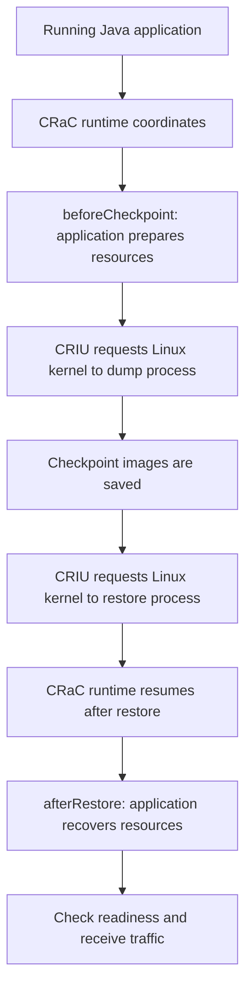

# The Role of CRIU in the Linux-Based Checkpoint Mechanism

CRIU stands for **Checkpoint/Restore In Userspace**. It is an open-source tool for Linux capable of recording the state of a running process into checkpoint files and restoring that process from the saved files. In CRaC deployments on Linux that use CRIU, CRIU handles the checkpoint and restore operations at the operating system process level, while CRaC provides the mechanism for the Java application to prepare and recover its own resources.

These two components solve two different layers of problems. CRaC helps the JVM and the application coordinate the right time for taking a snapshot, such as closing a connection pool or pausing a scheduler before a checkpoint. CRIU works with Linux process state such as memory, threads, registers, file descriptors, and the operating system resources it supports. Thanks to that coordination, a Java application can be prepared beforehand, have its state captured on Linux, and then be restored to continue running.

## 1. What is CRIU and where does it sit in the CRaC architecture?

CRIU is a program that runs in user space. It is not a Java API, not a Spring Boot-specific feature, and not a Java object storage format. CRIU uses interfaces and capabilities provided by the Linux kernel to collect a process's state, write that state into images, and recreate the process upon restore.

In a typical CRaC workflow on Linux integrated with CRIU, the components have the following roles:

| Component | Responsibility |
|---|---|
| Java application | Determines which resources need to be stopped, closed, flushed, or reinitialized |
| CRaC API and runtime in the JDK | Coordinates `beforeCheckpoint` and `afterRestore` callbacks, prepares the JVM for state transition |
| CRIU | Records and restores Linux process state as requested by the runtime |
| Linux kernel | Provides low-level mechanisms to observe, stop, read, and restore process state along with operating system resources |
| Deployment platform | Prepares a compatible environment, stores checkpoints, and launches the restored process |

This relationship can be visualized through the diagram:



The diagram shows the boundary of responsibilities at a conceptual level. How the JDK invokes CRIU, where images are stored, management commands, and integration details depend on the CRaC/JDK distribution and the deployment environment. Not every checkpoint mechanism on every platform is required to use CRIU; the content here focuses on the Linux-based path with CRIU as the backend.

## 2. Why does checkpointing a Java process require CRIU?

A running JVM is not just a set of objects residing in the heap. The process also has many states at the operating system and CPU level, for example:

- Memory regions mapped into the process's address space.
- Contents of the heap, stack, and other memory regions supported by the checkpoint mechanism.
- Thread states, including execution information needed to resume the process.
- CPU registers and execution state at the time of the snapshot.
- File descriptors, pipes, sockets, and operating system resources that CRIU can save or recreate.
- Process information, parent-child and thread relationships, along with certain namespace, IPC, or cgroup states depending on configuration and kernel capabilities.

Java Serialization only converts objects that the application chooses to serialize. It does not automatically record the entire state of the JVM, executing threads, native memory, file descriptors, or the operating system process. Therefore, serialization cannot replace a process-level checkpoint/restore mechanism.

CRIU solves the operating system-level part by coordinating with the Linux kernel to write process state to checkpoint images. Upon restore, CRIU reconstructs the supported states so the process can continue from the point where it was captured. These images describe the process state and related resources; they are not a full virtual machine clone or a consistent backup of all external services.

For the JVM, restoring process-level state is still not enough to ensure the application works properly. An object representing a database connection may still be in the heap, but the socket on the database side may have been closed. A scheduler thread may be restored, but the lease it previously held may have expired. Therefore, CRIU needs to coordinate with an application-level lifecycle mechanism such as CRaC.

## 3. How does CRIU perform a checkpoint on Linux?

At a high level, CRIU executes a sequence of operations: identifying the process to checkpoint, collecting state, handling related resources, writing data to images, and terminating or freezing the process according to the requested mode. Details depend on the resource type and the Linux/CRIU version.

### 3.1. Identifying the process and scope to capture

CRIU needs to know the root process and the scope of related processes/threads. A Java application is usually a single process with multiple threads. If the process spawns child processes, the checkpoint scope must be determined appropriately so as not to miss a component that the application depends on.

CRIU uses information provided by Linux, such as data in `/proc`, to inspect process structure, memory, and file descriptors. Depending on the operation, CRIU may use `ptrace` and other kernel interfaces to control or read execution state.

### 3.2. Collecting memory and CPU state

To resume a process, the system needs to save the contents of relevant memory regions and thread execution information. CRIU coordinates with the kernel to collect memory mappings, data pages, thread states, and necessary CPU information. This data is written into images according to a structure managed by CRIU.

One should not assume that CRIU only copies the Java heap. A JVM also has metaspace, code cache, thread stacks, native memory, and memory regions mapped by native libraries. The ability to save and restore each type of memory region depends on how the region was created, the kernel, the architecture, and CRIU's support. A memory region mapped from a file or device may require the corresponding source file or environmental conditions upon restore.

### 3.3. Recording file descriptors and operating system resources

A process may have open files, pipes, Unix domain sockets, TCP sockets, or other types of file descriptors. CRIU must determine which resources can be recreated, which resources must be provided externally, and which resources cannot be checkpointed under the current configuration.

For example, for regular files, restoring usually requires matching file paths and contents. For sockets, CRIU must handle network state and peer-side conditions. For devices or special resources, external configuration may be needed or they may not be supported. The presence of a file descriptor in a process does not mean CRIU can always automatically recreate the corresponding resource.

### 3.4. Creating checkpoint images

After collecting the state, CRIU writes the data to an image directory. This directory may contain multiple files describing processes, threads, memory, file descriptors, and related resources. Specific file names and organization are CRIU implementation details and should not be parsed or modified directly by the Java application.

Checkpoint images must be kept intact and have appropriate access permissions. If images, dependent files, or environmental resources are missing, restore may fail. Copying images also requires preserving the full structure and related data, not just picking an arbitrary file from the directory.

## 4. How does CRIU perform a restore?

Restore is the process of reconstructing a process from checkpoint images. Conceptually, CRIU reads the images, requests Linux to recreate the process and thread structures, restores memory regions, connects or recreates supported operating system resources, and then restores the execution state so the process continues.

A general sequence includes:

1. Reading the checkpoint images and identifying the processes, threads, and resources to reconstruct.
2. Creating appropriate process and thread structures in the restore environment.
3. Restoring memory mappings and memory data.
4. Restoring CPU state and necessary execution information.
5. Reopening or attaching file descriptors and external resources according to the images and configuration.
6. Completing process recovery so code can resume execution.
7. Letting the CRaC runtime and application run post-restore steps, such as the `afterRestore` callback.

From the application's perspective, the restored process continues from the checkpointed state. It does not necessarily go through `main()` from the beginning, recreate all objects, or rebuild the Spring `ApplicationContext`. This is why CRaC can reduce startup time. However, components that depend on the current environment must still be checked and recovered.

### Images are not a backup of the entire system

CRIU focuses on process state within its supported scope. It does not automatically checkpoint the state of a database server on another machine, a message broker, Redis, object storage, or HTTP services that the process is calling. Those systems have their own lifecycles and consistency mechanisms.

For example, if the application is processing a database transaction at the time of checkpoint, the process image does not replace the database's transaction log or snapshot. The application must ensure the transaction has completed or rolled back according to policy before allowing a checkpoint. Similarly, a message received from a broker needs to be processed and acknowledged according to the consumer's rules; the image does not replace the broker's message acknowledgment mechanism.

## 5. At what points does CRaC coordinate with CRIU?

CRaC adds a Java-level coordination layer so that process-level dump/restore does not corrupt application resources. A resource can register `beforeCheckpoint` and `afterRestore` callbacks.

```java
import org.crac.Context;
import org.crac.Core;
import org.crac.Resource;

public final class DatabaseClientResource implements Resource {

    private DatabaseClient client;

    public DatabaseClientResource(DatabaseClient client) {
        this.client = client;
    }

    @Override
    public void beforeCheckpoint(Context<? extends Resource> context)
            throws Exception {
        // Stop operations using the client first, then close the resource.
        if (client != null) {
            client.close();
            client = null;
        }
    }

    @Override
    public void afterRestore(Context<? extends Resource> context)
            throws Exception {
        // Reconnect to the database in the current environment.
        client = DatabaseClient.connect();
    }

    public static void register(DatabaseClient client) {
        Core.getGlobalContext().register(new DatabaseClientResource(client));
    }
}
```

`DatabaseClient` is an illustrative class, not a built-in CRaC API. Real code needs to manage the client according to the library being used and ensure no threads are still using the client when the callback closes it.

The roles of the layers are divided as follows:

| Phase | CRaC/JVM and application | CRIU and Linux |
|---|---|---|
| Before checkpoint | Stop accepting new work, drain requests, pause schedulers/consumers, flush data, and handle resources | Prepare to dump the process as requested by the runtime |
| Dump | JVM is in a state prepared by the application | Collect process state and write checkpoint images |
| Restore | Runtime resumes from the restored state | Reconstruct the process and supported operating system resources |
| After restore | Run callbacks, reconnect to services, refresh tokens/leases, and check readiness | Complete the process-level recovery handled by CRIU |

CRIU does not automatically know when an application's connection pool should be closed, how a scheduler should be paused, or how a token needs to be refreshed. That is the responsibility of the application and the CRaC layer. Conversely, Java callbacks cannot recreate all CPU state, memory mappings, and threads of a process by themselves; that is the job of the operating system-level checkpoint/restore mechanism.

## 6. Requirements and limitations from Linux

CRIU depends on Linux kernel capabilities. Being able to install the `criu` command does not mean the environment can definitely checkpoint and restore every application. Actual capability depends on the kernel, kernel configuration, CPU architecture, execution permissions, namespaces, cgroups, and the types of resources the process is using.

### 6.1. Kernel and system configuration

Some operations require kernel features related to checkpoint/restore, namespace management, memory, and processes. Kernel configurations such as `CONFIG_CHECKPOINT_RESTORE` may be one of the prerequisites; specific requirements vary by CRIU and kernel version. CRIU provides a command to check the environment's capabilities, but a general check result does not guarantee that a specific application will dump/restore successfully.

Commonly involved Linux interfaces include:

- `/proc`: provides information about processes, threads, memory, and file descriptors.
- `ptrace`: assists in controlling and observing process execution state during appropriate operations.
- Namespaces: isolate views such as PID, mount, network, and IPC.
- Cgroups: manage and limit resources of process groups.
- Kernel memory and socket mechanisms: assist in collecting or restoring corresponding states.

These are typical groups of mechanisms. Not every CRIU command uses all of the above mechanisms, and specific requirements depend on the type of resource being checkpointed.

### 6.2. Execution permissions

Checkpoint/restore deeply affects processes and operating system resources. CRIU often needs elevated privileges or an appropriate set of capabilities to read, stop, and recreate process state. Required capabilities and permissions vary by kernel, namespace, resource type, and how CRIU is run. In containers, it is necessary to check capability configuration, seccomp, AppArmor/SELinux, and access permissions for relevant mounts.

Permission errors should not be solved by defaulting to running all components with the broadest root privileges. Determine the minimum permissions that the environment and CRIU version actually need, then configure them intentionally.

### 6.3. Compatibility between creation and restore environments

Checkpoints are tied to process state and assumptions about the environment. Restore can be limited by:

- CPU architecture and CPU features used by the process.
- Linux kernel version and capabilities.
- CRIU version and image format.
- File paths, mounts, native libraries, and device resources.
- Namespace, cgroup, and network configurations.
- Sockets or external resources that no longer exist or cannot be recreated.

Therefore, a checkpoint should not be treated as an artifact that can be moved arbitrarily between any Linux machines. Create and test checkpoints on an environment compatible with the intended restore environment. When upgrading the JDK, CRIU, kernel, or OS image, the checkpoint creation and restore process must be re-tested.

## 7. Sockets, network connections, and external resources

Sockets are one of the most confusing parts when discussing process checkpointing. A socket resides in the process's file descriptor table, but communication state also involves the kernel, the network namespace, and the other end of the connection.

CRIU is capable of handling certain types of sockets and network connections under specific conditions. For instance, restoring an established TCP connection may require features like `TCP_REPAIR` and coordination from the network environment. That does not mean every TCP connection, every protocol, or every connection state can be moved to an arbitrary machine and continue as-is.

For Java applications, a design that is usually easier to operate is to proactively handle external clients via CRaC callbacks:

- Before checkpoint: stop requests using the client, wait for running tasks, close or put the client/pool into a state supported by the library.
- After restore: create new connections, re-authenticate, check endpoints, and verify dependencies are working.
- Before readiness: only allow receiving traffic after mandatory dependencies are ready.

One should not rely solely on a Java object still being in the heap to conclude that a connection is still usable. Nor should one assume all sockets must be closed: some environments and libraries support checkpointing specific resources. Decisions should be based on guidance from CRIU, the JDK, and the library owning the resource.

Other external resources also need to be examined individually:

| Resource | Questions to answer before checkpoint |
|---|---|
| Database connection | Does the driver/pool support CRaC? Should the pool be closed and recreated after restore? |
| HTTP client | Can the connection pool and TLS sessions be safely reused? |
| Message consumer | Has it stopped receiving messages and processed/acknowledged in-flight messages? |
| Scheduler | How to prevent the same task from running on multiple restored instances? |
| Files and mounts | Do the paths, permissions, contents, and mounts exist in the restore environment? |
| Leases or tokens | Do they expire during the checkpoint duration? At which step do they need to be reissued? |
| Devices or IPC | Do CRIU and the kernel support that resource type in the current configuration? |

## 8. CRIU in containers and deployment environments

CRIU is often used in the Linux container ecosystem because a container is also a group of processes running with namespaces and cgroups. However, a container is not a complete virtual machine. Checkpointing a container still depends on the host's kernel and the resources the container is using.

When running CRIU in a container, it is necessary to distinguish between process permissions inside the container and the actual permissions allowed by the host. Namespaces can cause a process to see only a portion of the system, while the checkpoint operation needs access to information or resources at a broader scope. The container runtime may need specific support and configuration for checkpoint/restore.

A deployment workflow needs to clearly define:

1. Who requests the checkpoint: the JDK/runtime, deployment tool, or container runtime?
2. Does CRIU run on the host or inside the container environment?
3. Where are the images stored and which process has read/write permissions?
4. Does the restore environment have the same necessary types of namespaces, mounts, cgroups, and network?
5. Who starts the process after restore and checks readiness?
6. When restore fails, can the platform fall back to a cold start?

If using CRaC, prioritize the checkpoint/restore flow supported by the JDK and deployment platform. Manually invoking CRIU externally while bypassing CRaC callbacks can capture the JVM before the application has prepared its resources, leading to a restored process state where the application does not function properly.

## 9. Trying CRIU at the Linux tool level

CRIU provides an environment check command and process-level dump/restore commands. The illustrative example below shows the shape of basic operations:

```bash
# Check the checkpoint/restore features supported by the current environment.
sudo criu check

# Dump a Linux process with PID 12345 into the image directory.
sudo criu dump -t 12345 -D /var/lib/criu/example-checkpoint

# Restore the process from that image directory.
sudo criu restore -D /var/lib/criu/example-checkpoint
```

The commands above only illustrate the general CRIU interface. Actual PIDs, permissions, options, open resources, and configurations must match the application. A specific process may require additional configuration or may not be checkpointable due to the types of resources it uses.

For Java applications running with CRaC, do not take the direct `criu dump` example as a production workflow. Use the checkpointing method guided by the CRaC JDK and the distribution being deployed, so that application callbacks are executed before CRIU dumps and after the process is restored. Running CRIU directly can bypass that coordination step.

## 10. How to investigate checkpoint/restore errors

When dump or restore fails, it is necessary to determine which layer the error lies in. A useful investigation sequence is:

1. **Application/CRaC:** check callback logs, which resource failed to close, which requests or threads have not stopped, and which callback failed.
2. **CRIU:** read CRIU's error messages and logs to identify the resource type or kernel operation that was denied.
3. **Kernel/permissions:** check kernel version, required configuration, capabilities, namespaces, cgroups, seccomp, and security policies.
4. **Restore environment:** verify that images are complete, paths/mounts are available, and network and external resources are compatible.
5. **Compatibility:** compare JDK, CRIU, kernel, architecture, and OS image between the checkpoint creation site and the restore site.
6. **Readiness:** if restore succeeded, check dependency reconnection, token/lease renewal, and background thread startup before enabling traffic.

Some common error categories:

| Symptom | Possible cause | Investigation direction |
|---|---|---|
| `criu check` reports missing features | Kernel or environment does not provide required features | Check kernel, configuration, and corresponding CRIU documentation |
| Dump permission denied | Missing capabilities or blocked by seccomp/LSM | Check actual permissions on host/container and security policies |
| Unable to restore file descriptor | File, socket, or related resource cannot be recreated | Identify the specific resource and configure pre-checkpoint handling |
| Restore fails due to mount/path | Restore environment is missing mounts or dependent files | Synchronize environment structure and verify access permissions |
| JVM restores but requests fail | External client, token, or dependency is no longer valid | Check `afterRestore` callbacks and readiness |
| Tasks run repeatedly after restore | Scheduler/consumer/lease was not restarted in a controlled manner | Re-establish ownership and duplicate-processing prevention mechanisms |

Do not simply escalate permissions or change the kernel immediately upon seeing an error. First, read the specific error to determine whether CRIU is missing a feature, cannot access a resource, or the application has not properly prepared its lifecycle.

## 11. What CRIU is not responsible for

To delineate responsibilities when designing a system, keep the following limitations in mind:

- CRIU does not replace the CRaC API and does not automatically decide when a Java application should stop accepting requests.
- CRIU does not understand the business semantics of Java objects, transactions, messages, or caches.
- CRIU does not automatically create consistent snapshots for databases, brokers, or services on other machines.
- CRIU does not guarantee that every file descriptor, socket, device, or memory region can be restored.
- CRIU does not make a checkpoint an artifact compatible with every kernel, architecture, and Linux machine.
- CRIU does not automatically guarantee that the application is ready to receive traffic after restore.

Therefore, a CRaC deployment needs both layers: CRIU to handle process state on Linux and CRaC/application to handle resource lifecycles at the JVM, library, and business levels.

## 12. Design and operations checklist

Before bringing CRIU-based checkpointing into a deployment environment, determine the following points:

- **Platform:** Linux kernel version, CPU architecture, kernel configuration, and CRIU version have been identified.
- **Permissions:** CRIU has the right capabilities and necessary permissions; container/security policies do not block required operations.
- **Resources:** an inventory of files, sockets, threads, native resources, mounts, IPC, and external dependencies has been made.
- **Application lifecycle:** `beforeCheckpoint` callbacks stop work and prepare resources; `afterRestore` recovers what is needed.
- **Consistency:** requests, transactions, messages, and background tasks are not left unfinished or duplicated due to checkpointing.
- **Compatibility:** image creation and restore environments have been tested with the actual JDK, CRIU, kernel versions, and configurations.
- **Storage:** checkpoint images are stored completely, with appropriate access permissions and a deletion/rotation policy.
- **Error recovery:** there is a cold-start or rollback plan when restore fails.
- **Readiness:** traffic is only routed after resource callbacks and dependency checks complete.
- **Observability:** logs and metrics distinguish between dump time, restore time, application recovery time, and time to reach readiness.

Both success and intentional failure cases should be tested: database unreachable after restore, expired tokens, missing mounts, incomplete callbacks, or a dependency only appearing after the process is restored. These scenarios show whether the system can recover in a controlled manner or only works in a single favorable trial.

## 13. Conclusion

CRIU is the Linux tool layer that helps record and restore process state at the operating system level. In the Linux-based CRaC mechanism using CRIU, the JDK/CRaC coordinates the JVM lifecycle and invokes the appropriate checkpoint/restore mechanism; CRIU collects, saves, and reconstructs process state; the application is responsible for handling resources and dependencies according to its semantics.

When analyzing a CRaC error, first identify whether the error belongs to the application layer, CRaC runtime, CRIU, or the Linux kernel. This division helps find the right root cause: CRIU may restore the process successfully while the application still needs to reconnect to the database, or the application has prepared properly but the kernel does not support a required resource. Understanding the role of CRIU helps design checkpoints that are controllable, testable, and suited to real-world Linux environments.
