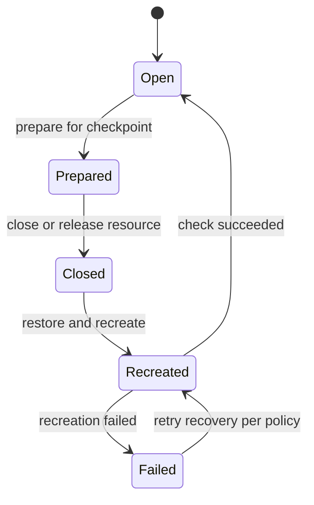
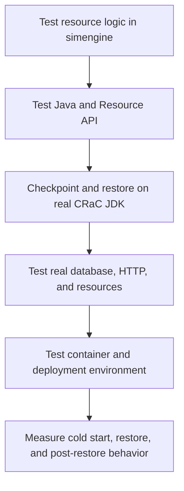

# Simulation Scope with simengine and Limitations of Test Results

When learning CRaC, learners do not always have a Linux environment, a CRaC-supporting JDK, and an appropriate checkpoint/restore configuration readily available. A simengine can help practice processing flows by modeling the states and events that the lesson focuses on. As a result, learners can observe how an application prepares before checkpoint, restores resources after restore, and responds to error scenarios.

However, the result of a simulation is only meaningful within the scope of the model it represents. A simulation scenario that runs successfully does not by itself prove that a real JVM can create a checkpoint, that CRIU can restore the process on the kernel in use, or that all external connections will work after restore. To evaluate CRaC for a real application, simulation must be combined with testing on the exact JDK, operating system, libraries, and dependent services.

## 1. Why is simulation needed when learning CRaC?

CRaC involves multiple components at the same time: the Java application, the JVM, the operating system, the checkpoint/restore tool, and external services. An error after restore can originate from application logic, resource management, environmental limitations, or changes in external systems. Starting with a real environment that has many components can make identifying the root cause difficult.

Simulation helps narrow down the problem. Learners can focus on specific questions:

- What state does the application need to transition to before checkpoint?
- Which resources need to be prepared, closed, or paused?
- Upon restore, which callbacks need to run and which resources need to be checked or recreated?
- What happens if a preparation step fails?
- Is the application marked as ready before required resources are operational?
- Does a restore operation being called again cause duplicate resource creation or corrupt state?

In this lesson, `simengine` is treated as a simulation environment for practicing modeled CRaC behaviors. The exact scope depends on the states, resources, events, and rules provided by the version of simengine being used. It should not be inferred that the simulator models the entire JVM or the entire operating system checkpoint/restore mechanism if the documentation and actual functionality have not confirmed this.

## 2. What does the simulation model represent?

A model typically simplifies a real system into observable and testable components. For CRaC practice exercises, four groups of concepts can be used to read and design simulation scenarios.

### 2.1. Application lifecycle

An application can be represented through conceptual phases such as:

| Phase | Meaning in the model |
|---|---|
| Startup | Creates initial state and initializes modeled components. |
| Running | The application performs work and uses resources. |
| Preparing checkpoint | The application performs necessary steps before saving state. |
| Checkpointed | The model records that the checkpoint step has been accepted or completed according to simulation rules. |
| Restore | The model transitions the application from the checkpointed state to the restored state. |
| Restore completed | The application has processed post-restore steps within the scope of the model. |
| Ready | Readiness conditions checked by the model are satisfied. |
| Failed | A step in the scenario cannot continue according to model rules. |

This is a breakdown for thinking about the process, not a guarantee that simengine uses these exact state names or has a corresponding enum. When practicing, use the actual states and terminology provided by your version of the tool.

### 2.2. Resource and resource lifecycle

A resource in the model can represent a database connection, HTTP client, socket, file, thread pool, scheduler, or any component with a lifecycle that needs to coordinate with checkpoint/restore.

For example, a model might represent a resource using the following conceptual states:

This model helps raise questions about processing order and expected outcomes. It does not assert that a real-world socket or database connection can transition through those exact states using the same operations. A real resource may be affected by remote servers, timeouts, access permissions, network protocols, and many conditions not represented in the simulator.

### 2.3. Events and callbacks

With the CRaC API, two commonly mentioned coordination points are `beforeCheckpoint(...)` and `afterRestore(...)` of `org.crac.Resource`. The model can use corresponding events to test whether the application performs work in the right phase.

- Before checkpoint: stop or pause appropriate work, complete in-progress operations, close or re-prepare resources as required.
- After restore: check resource state, create new connections if needed, restart appropriate components, and only report ready when necessary conditions are met.

The simulator can verify that an action was requested in the scenario, or that a callback was invoked according to the model flow. That does not prove that a real JVM invokes the callback at the exact right time under all conditions, nor does it prove that third-party libraries handle their internals properly.

### 2.4. Test conditions and results

A simulation scenario typically consists of input conditions, a sequence of events, modeled behaviors, and exit conditions. For example:

1. The application is running and has a resource marked as open.
2. The scenario requests checkpoint preparation.
3. The model checks the application's preparation behavior.
4. The scenario transitions to the restore phase.
5. The model requests resource restoration.
6. The result is compared against expected conditions, such as a required resource having to be operational before the application is ready.

The result is only meaningful for the conditions and behaviors included in the model. If the scenario does not represent the database server closing the connection during checkpoint, a successful result does not indicate that the application will handle that situation in reality.

## 3. What can be tested with simengine

The exact scope depends on the simulator's capabilities, but the following types of questions are generally well-suited to a lifecycle model.

### 3.1. Processing order in the lifecycle

It is possible to test whether the application performs the pre-checkpoint preparation step and the post-restore recovery step in the sequence defined by the model. For example, the application must not be marked as ready before completing the restoration step for a required resource.

A useful output is a readable event trace, which helps identify which steps ran, which steps were skipped, and where the processing flow stopped.

### 3.2. Resource management rules

If the simulator has a corresponding resource model, scenarios such as the following can be tested:

- A resource is prepared before checkpoint.
- A resource needs to be recreated after restore.
- An optional resource fails to restore, yet the application can still continue according to policy.
- A required resource fails to restore, and the application must remain in a not-ready state.
- A restoration step is called again and needs to avoid creating duplicate resources.

These exercises help clarify the application's lifecycle contract. They are particularly useful when designing resource management code to be observable, handle errors, and support retries.

### 3.3. Modeled error branches

Simulation can intentionally inject an error at a step to observe how the application reacts. For example: a preparation step fails, a resource cannot be recreated, or a readiness condition is not satisfied.

Learners should observe both the final state and the side effects before the error occurred. A scenario is considered handled correctly when the application does not declare readiness at the wrong time, does not ignore mandatory errors, and has a next-step handling path aligned with the chosen policy.

### 3.4. Repeatability of scenarios

If simengine allows re-running the same scenario with the same inputs, that can be used to verify the determinism of the model logic. The same conditions should produce the same sequence of events and results, unless the scenario intentionally introduces randomness or timing factors.

Repeatability helps compare changes in code and reduces difficulty in reproducing bugs. It does not mean that the real environment will always produce the same results: network, scheduler, response times, system load, and external services can vary between runs.

## 4. What simulation results cannot prove

This is the most important limitation to keep in mind when reading reports from simengine. The model only tests what has been represented; behaviors outside the model must be tested at the appropriate layer.

| Aspect | What simulation can help test | What requires real-world testing to confirm |
|---|---|---|
| Application logic | Modeled processing sequence and state transition conditions. | Behavior of the application running on a real JVM. |
| Resource | Rules for preparing, closing, recreating, or marking errors in the model. | Whether real file descriptors, sockets, threads, and resources are handled properly. |
| CRaC callbacks | Logic that the simulator binds to corresponding steps. | Whether a real CRaC JDK invokes callbacks according to the lifecycle and handles errors as expected. |
| Checkpoint | Transitioning the simulation state to a phase marked as checkpoint. | Whether the JVM and OS tools can create a valid checkpoint image. |
| Restore | Model flow after the restore event. | Whether CRIU and the kernel can restore the process, memory mappings, threads, and file descriptors. |
| Database and broker | Reactions to simulated results if those scenarios are modeled. | Whether real connections are recreated, authenticate successfully, and process transactions accurately. |
| HTTP and network | Application logic branches for simulated network outcomes. | Whether real sockets, listening ports, DNS, TLS, timeouts, and connections work after restore. |
| Performance | Can compare the cost of steps in the model if the tool measures them. | Cold start time, restore time, request latency, throughput, and resource usage on the target environment. |
| Compatibility | Compatibility assumptions declared in the model. | Exact JDK distribution, Java version, kernel, CPU architecture, libraries, and container configuration. |

### 4.1. Simulation does not create a real checkpoint image

A state recorded by the simulator as “checkpointed” may only be an internal state of the model. Unless the tool actually invokes an operating system checkpoint/restore mechanism and produces the corresponding artifact, that result does not prove that process memory, threads, native state, or file descriptors have been saved.

To confirm a real checkpoint, you need to run the application with a CRaC-supporting JDK and a compatible checkpoint/restore environment, perform the operations according to that distribution's instructions, and then verify that the process can be restored.

### 4.2. Simulated resources are not equivalent to real services

A simulated database can return “connection succeeded” based on a predefined rule. A real database also has authentication, pools, connection limits, open transactions, timeouts, failover, and data state. Similarly, a simulated HTTP client cannot thoroughly test DNS, TLS handshake, proxies, sockets, and remote server state.

Therefore, simulation can test that application code reacts to a known error result, but it cannot by itself prove that real connections will succeed or that business data will not be lost or duplicated.

### 4.3. Simulation does not replace concurrency and load testing

If the simulator does not fully model the scheduler, threads, locks, and resource contention, it cannot validate the application's concurrent behavior. A sequential event flow in the model may fail to expose race conditions, deadlocks, or errors when multiple requests arrive simultaneously.

Similarly, simulation execution time should not be used as CRaC performance metrics. Results depend on how the simulator is implemented and the level of detail in the model, and do not directly reflect the cost of the JVM, kernel, or real services.

## 5. Example: simulating database connection recovery

Suppose an application uses a connection pool to access a database. Before checkpoint, the application needs to handle in-use connections according to its policy. After restore, the application must ensure the pool can provide valid connections before accepting requests that require the database.

A simple simulation scenario might set the following conditions:

| Moment | Modeled behavior | What to observe |
|---|---|---|
| Before checkpoint | The pool is marked as active. | The application recognizes that the resource needs preparation. |
| Preparing checkpoint | The pool stops issuing new connections and handles borrowed connections according to model policy. | No operations remain that the model marks as in-use. |
| Restore | The model marks old connections as no longer reliable. | The code does not assume pre-checkpoint connections are still usable. |
| Recovery | The pool performs a resource recreation or check step. | Pool creation errors are propagated to the appropriate handling state. |
| Ready | The operational pool condition is satisfied. | The application only accepts traffic requiring the database after the pool is ready. |

To test the error branch, change the condition at the recovery step to “database unreachable”. The expected outcome in the model might be that the application remains in a not-ready state, logs the cause, and retries according to policy. If the model only has a fixed success response, it cannot test this error branch yet.

The simulation above helps verify the decisions of the pool management code. It cannot yet test whether a borrowed connection has an unfinished transaction, whether the server closed the socket, whether credentials expired, or whether the real pool can create new connections. Those scenarios must be tested using a real database and driver on a compatible environment.

## 6. How to design a valuable simulation scenario

A good scenario should answer a specific question and clearly state which conditions are being assumed.

### 6.1. Define the question to be tested

Avoid setting a vague goal like “test that CRaC works”. Turn it into an observable question, such as:

- Does the application wait for required resources to recover before reporting ready?
- If a resource fails to recover, does the application maintain an appropriate error state?
- When re-running the recovery step, does the code create duplicate resources?
- If an optional resource is unavailable, which functionality is affected?

### 6.2. Explicitly state the model's assumptions

Before running, document what the simulator is assuming. For example:

- The database is represented by a success/failure result, not a real database server.
- There are no open transactions at the time of checkpoint.
- Callbacks are invoked by the model in a deterministic order.
- Packet loss, DNS changes, or server restarts are not simulated.
- Thread contention is not simulated unless explicitly declared by the scenario.

These are only examples of how to write assumptions; replace them with the actual capabilities and configuration of the simengine in use. Do not record a capability as tested if the tool does not represent it.

### 6.3. Set input conditions and expected results

Each scenario needs a clear initial state, triggering events, expected outcomes, and observable evidence. For example:

| Component | Example value |
|---|---|
| Initial state | Application is running; required resource is in active state. |
| Event | Start the checkpoint process and then restore. |
| Variant | Resource recreation succeeds or fails. |
| Expected outcome on success | Resource is operational and the application meets the readiness condition. |
| Expected outcome on failure | Application is not ready; error is observable and handled according to policy. |
| Evidence | Event trace, final state, and error information provided by the simulator. |

### 6.4. Run each variant separately

Start with the success flow, then add each error individually. Do not change multiple conditions simultaneously, because when the result differs from expectations, it will be hard to identify the cause. If the simulator supports saving scenario configurations, save the inputs so they can be re-run and compared.

### 6.5. Record limitations alongside results

The report of results should clearly state:

1. The simengine version and configuration used.
2. Initial state and input conditions.
3. Which behaviors were modeled.
4. Observed results and pass/fail criteria.
5. What was not simulated and needs testing in a real environment.

Writing only “CRaC test: PASS” can cause readers to interpret it too broadly. A more accurate way to record it is: “Resource lifecycle simulation scenario PASSED under declared conditions; checkpoint/restore on a real JVM and CRIU have not been verified.”

## 7. Reading simulation results properly

When reviewing output, distinguish between three types of information:

- **Events that occurred:** which callbacks or processing steps the simulator recorded as having run.
- **Conditions that were checked:** which assertions or rules were evaluated.
- **Unverified assumptions:** behaviors replaced by simulated values or outside the model's scope.

A `PASS` status only means that the conditions configured in the scenario were met. It does not mean all other CRaC conditions are true. Conversely, a `FAIL` in simulation may indicate a logic error in the model or in the code under test; the event trace and configuration must be read to pinpoint the exact cause.

If the simulator reports success but the real application fails, compare the two environments difference by difference: JDK, OS/kernel, permissions, real resources, library versions, input data, and event order. Do not immediately conclude that the simulator is wrong or the application is wrong before identifying which behavior was not modeled.

## 8. Combining simulation with testing on a real environment

Simulation is one testing layer in the process, not the endpoint. Verification can be organized into the following layers:

### Layer 1: Logic testing in simengine

Use small scenarios to check order, states, error branches, and readiness conditions within the model's scope. Save the event trace and assumptions.

### Layer 2: Testing Java code

Test resource management classes and callback logic with appropriate tests. Confirm how the code reacts to errors, repeated invocations, resource release, and post-recovery state. This is still testing code in a test environment and does not prove the operating system's checkpoint capability.

### Layer 3: Real checkpoint/restore

Run the application on a CRaC-supporting JDK and an operating system that meets the requirements. Perform a checkpoint and then restore the process. Confirm that the application continues operating, callbacks are actually invoked, and the observed state matches expectations.

### Layer 4: Integration testing

Connect real databases, message brokers, caches, and HTTP services, or an equivalent integration environment. Test authentication, connection pools, transactions, timeouts, reconnection, and behavior when external services change during checkpoint.

### Layer 5: Deployment environment and performance testing

Run in a container or target machine with a near-production configuration. Verify permissions, volumes, kernel configuration, resources, health checks, and fallback procedures. Measure cold start and restore under the same conditions, then send realistic workloads to test latency, throughput, and stability.

## 9. Matrix for selecting test types

The following table helps choose the appropriate testing layer for the question that needs answering:

| Question | Appropriate test type | Conclusion that can be drawn |
|---|---|---|
| Does the logic call preparation and recovery steps according to rules? | simengine simulation or unit test. | The tested logic satisfies the modeled conditions. |
| Do Java callbacks execute the right code? | Java unit test or integration test. | The callback code works with the dependencies in the test environment. |
| Does the JVM create a checkpoint image? | Real CRaC test. | The specific environment can create a checkpoint on the tested run. |
| Can the process be restored? | Real restore test. | The specific checkpoint can be restored in the tested compatible environment. |
| Does the database work after restore? | Integration test with a real database. | The tested connections and operations work with that database configuration. |
| Does the system meet startup/restore targets? | Benchmark and load testing on the target environment. | Metrics measured under the recorded benchmark conditions. |

No single test type can answer every question. Choose evidence based on what needs to be asserted.

## 10. Common misinterpretations

**“simengine PASS means CRaC works on this machine.”** The result only proves that the simulation scenario met the configured conditions. Checkpoint/restore capability on the machine must be verified with a real JDK and operating system mechanism.

**“Resource marked restored means the real connection is working.”** That state may only be a model state. Actual access operations to the service must be tested after restore.

**“Simulation runs fast, so real restore will also be fast.”** Simulation time is not a performance measurement of the JVM or CRIU. To compare, you must measure on the same type of environment and realistic workload.

**“One successful scenario represents all cases.”** A scenario only covers the states, inputs, and error branches included in it. Additional variants are needed to test other important conditions.

**“No errors seen in simulation means there are no race conditions.”** This can only be concluded if the model truly represents the relevant concurrent execution schedules and has checked the necessary interleavings. Otherwise, concurrency testing on an appropriate environment is required.

**“Simulation results can be used as production-ready evidence.”** Simulation supports development and logic testing. Deployment decisions require additional evidence from real checkpoint/restore, integration testing, operational testing, and benchmarks.

## 11. Checklist when practicing with simengine

- [ ] Identify the version and functional scope of the simengine being used.
- [ ] Clearly state the question the scenario needs to test.
- [ ] Record the initial state, inputs, and assumptions of the model.
- [ ] Only use states, resources, and events that the tool actually supports.
- [ ] Test both the success flow and important error branches.
- [ ] Read the event trace and identify which assertions were evaluated.
- [ ] Distinguish simulation results from real checkpoint/restore results.
- [ ] Clearly note behaviors that were not simulated.
- [ ] Plan follow-up testing on a real JDK, OS, and real services when deployment readiness needs to be confirmed.
- [ ] Do not use simulation time as cold start or restore metrics for a real application.

## 12. Terminology to remember

- **Simulation:** purposeful representation of part of a system's behavior using a model that can be run and observed.
- **Simengine:** the simulation environment used in the practice exercises; its scope depends on actual functionality and configuration.
- **Model:** the set of states, events, rules, and assumptions used to represent a system.
- **Event trace:** a trace of events showing the order in which steps occurred.
- **Assertion:** a condition checked to determine the outcome of a scenario.
- **Integration test:** testing the coordination between an application and real dependencies or an equivalent integration environment.
- **Checkpoint image:** checkpoint data used for restoring a real process.
- **Fidelity:** the degree to which a model reflects the behavior of the real system within the scope under study.

When using simengine, treat each result as a conditional statement: which rules the code or model satisfied, under which states and assumptions. Then choose Java testing, real checkpoint/restore, service integration, or benchmarking to confirm behaviors that simulation cannot prove. This way of interpreting results helps leverage simulation for learning and finding bugs early while keeping technical conclusions faithful to the evidence obtained.
