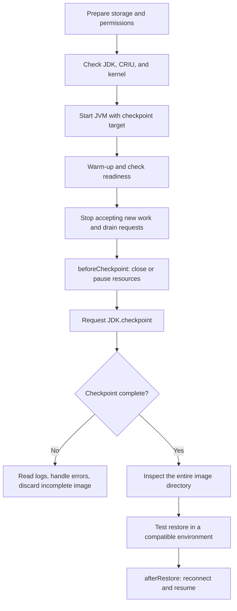

# Preparing the Image Directory and Pre-Checkpoint Conditions

A checkpoint in CRaC records the state of a running JVM process so that the process can be restored later. Before requesting a checkpoint, you need to prepare the image storage location, access permissions, storage capacity, operating system environment, and application state. A writable target directory is only the initial condition: if the application is still processing requests, holding unrecoverable connections, or writing data halfway, the generated image may not be usable as intended.

The procedure should be prepared as a controlled operational action:

1. Choose a stable checkpoint storage location and protect its access permissions.
2. Confirm that the CRaC JDK, CRIU, kernel, and process permissions meet the requirements.
3. Start the application with the appropriate checkpoint configuration.
4. Bring the application to a ready state, stop accepting new work, and handle resources that need to be closed.
5. Request the checkpoint, wait for the operation to complete, and inspect the image.
6. Test restoring in a compatible environment before putting the image into use.

## 1. What Is the Checkpoint Directory Used For?

A checkpoint image is the dataset created by the CRaC JVM and the operating system's checkpoint mechanism to restore process state. Depending on the JDK and tools packaged with the environment, the image may consist of multiple files and subdirectories. You should not assume the entire image is only a single file.

The checkpoint path has two roles:

- When creating an image, the JVM writes checkpoint data to the configured location.
- When restoring, the JVM reads the generated data from the corresponding location.

In CRaC distributions that support common HotSpot options, you can specify the checkpoint destination at JVM startup with `-XX:CRaCCheckpointTo`. After the application is ready, send the checkpoint command via `jcmd`. When starting up to restore, use `-XX:CRaCRestoreFrom` with the image path.

Illustrative example on Linux:

```bash
java \
  -XX:CRaCCheckpointTo=/var/lib/myapp/crac/release-001 \
  -jar app.jar
```

After identifying the JVM's PID:

```bash
jcmd <pid> JDK.checkpoint
```

Start up to restore the created image:

```bash
java -XX:CRaCRestoreFrom=/var/lib/myapp/crac/release-001
```

Option names and administrative commands may vary by CRaC JDK distribution. Check the documentation for the exact JDK being used and the commands that the JVM exposes via `jcmd <pid> help`. The commands above illustrate the common flow and do not replace the instructions of a specific runtime.

## 2. Choosing the Image Storage Location

The checkpoint directory should be in a writable location with sufficient space that still exists when a restore is needed. You should use a dedicated directory for the application, separate from source code directories, log directories, and build directories.

### Use Absolute, Stable Paths

Absolute paths make image creation and restoration configurations clear. Avoid depending on the process's current working directory because the working directory can change depending on how the service, container, or script is run.

Example:

```text
/var/lib/myapp/
└── crac/
    ├── release-001/
    └── release-002/
```

Each image should have its own directory. Do not let two processes write to the same checkpoint destination at the same time. Do not reuse an old image's directory without clearly determining the replacement policy of the JDK and checkpoint tool. A failed checkpoint may leave incomplete data; do not treat that directory as a valid image.

You should prepare the parent directory before starting the JVM. The runtime may create the target directory itself or require the target to be in a specific state depending on the distribution. Follow the contract of the JDK in use; do not automatically delete a target directory that contains a valuable image.

### Ownership and Write Permissions

The JVM process must have permission to create and write the necessary files in the checkpoint location. If the application runs under a dedicated user, the directory should belong to that user/group. You should not grant broad write permissions to all users on the machine.

Example of creating the parent directory on Linux:

```bash
sudo install -d \
  -o myapp \
  -g myapp \
  -m 0700 \
  /var/lib/myapp/crac
```

The command above creates the parent directory with access permissions for the owner. Replace `myapp` with the actual user and group of the service. If the process runs under a different user, the ownership must match that user. The required permissions of the target directory must also match how the runtime creates the image.

Do not use `chmod -R 777` to resolve permission errors. Doing so exposes the image contents and allows unrelated processes to modify or delete the state needed for restoration.

### Storage Space and Inodes

A checkpoint image can be large because it stores memory state and process data needed for restoration. The required space depends on heap, native memory, thread count, mappings, and image format. You cannot use `-Xmx` alone to accurately calculate the space needed for the checkpoint directory.

Before running, check the filesystem space and available inodes:

```bash
df -h /var/lib/myapp/crac
df -i /var/lib/myapp/crac
```

After the checkpoint completes, you can check the image size:

```bash
du -sh /var/lib/myapp/crac/release-001
find /var/lib/myapp/crac/release-001 -type f -maxdepth 2
```

If you need to compare the logical size of files with the actual allocated blocks, also use `ls -lh` or a tool appropriate for the filesystem. Sparse files can cause logical size and disk usage to differ.

Account for user quotas, volume quotas, temporary space during writing, and space needed to retain previous images. A filesystem running out of space mid-checkpoint can cause the operation to fail or leave an incomplete image.

### Choosing the Filesystem and Storage Lifecycle

Prefer a local filesystem or a storage type that has been verified with the JDK, CRIU, and deployment environment. For network filesystems or special volumes, you need to test both image creation and restore because performance, permissions, file locking, sparse files, and mount options can affect the process.

Do not place the only copy of an image in a temporary directory like `/tmp` or a filesystem that only exists for the container's lifecycle if the image is needed after the container is replaced. For containers, mount a persistent volume at the exact path the JVM uses. During restore, the volume and paths in the mount namespace must be available in a manner compatible with the image.

Example structure:

```text
Container
  /var/lib/myapp/crac  ─────── persistent volume
                                │
                                └── release-001/
```

The volume still existing is not enough if the mount path, user permissions, or file paths that the process had open change. Keep the filesystem structure consistent with the environment where the checkpoint was created.

## 3. Protecting the Checkpoint Image

A checkpoint image can contain the process's memory contents at the time of capture. Memory may contain access tokens, passwords, keys, personal data, request contents, connection information, or business data. Therefore, the image directory should be treated as sensitive application data.

Principles to apply:

- Restrict read, write, and delete permissions to the necessary user/service.
- Use encryption at the storage or filesystem layer if required by deployment policy.
- Apply a retention period and a procedure for deleting old images.
- Do not commit images to Git, do not include images in the Docker build context, and do not upload images to public sharing locations.
- Protect backups, artifacts, and transport channels used to transfer images.
- Do not log secret contents or all sensitive metadata of the image.

If an image is transferred between machines or environments, check access permissions at both the source and destination. Only copy the image after the checkpoint has completed successfully; do not sync the directory while the runtime is still writing. When storing or releasing an image, record the application version, JDK, operating system, and corresponding configuration in deployment metadata outside the image.

## 4. Operating System and Runtime Conditions

CRaC requires support from the JDK and the operating system's checkpoint/restore mechanism. For common Linux environments, CRIU is a key component in saving and restoring process state. Installing a JDK with the CRaC API without the corresponding operating system conditions is not enough for a checkpoint to succeed.

### CRaC JDK and CRIU

Before deploying, confirm:

- The running JDK is a distribution with CRaC support.
- The JDK version has the checkpoint/restore APIs and options used by the application.
- CRIU is installed and compatible with the kernel, CPU architecture, and system configuration.
- CRIU check commands and runtime documentation do not report missing required features.
- Native libraries used by the application are compatible with the restore environment.

You can check tool versions:

```bash
java -version
criu --version
```

In environments with CRIU, `criu check` is a useful verification step:

```bash
criu check
```

Check results should be read alongside JVM logs and container configuration. A successful check command does not prove the entire application can be checkpointed; the application may still use sockets, devices, filesystems, or native resources not supported by the environment.

### Process Permissions and Container Configuration

Checkpoint/restore may require kernel privileges, namespaces, access to process information, and appropriate security configurations. In containers, restrictions such as capabilities, seccomp, AppArmor/SELinux, `/proc` mounts, cgroups, and user namespaces can affect CRIU.

Do not enable `--privileged` by default just to make checkpointing work. Identify the specific permissions required by your CRIU version and deployment platform, then grant the exact scope to the container or service. Check both the image creation environment and the restore environment; configurations on both sides must be compatible.

### Compatibility Between Creation and Restore Environments

A checkpoint image contains state dependent on the process and system environment. You cannot assume an image created on any Linux machine can be restored on another Linux machine.

Factors to compare include:

| Factor | What to Maintain or Verify |
|---|---|
| CPU architecture | Compatible with the architecture where the image was created |
| Kernel and OS features | Meets the requirements of CRIU and the image format |
| CRaC JDK | Distribution and version compatible with the image |
| Native libraries | Exact or compatible versions present |
| Paths and mounts | Filesystems needed by the process are mounted at the right locations |
| User/group and permissions | Matches process permissions and restored data |
| Environment variables/configuration | Meets the application's assumptions after restore |
| External resources | Endpoints, credentials, and dependent services are still available |

If an image needs to be moved between hosts or OS versions, explicitly verify supportability and test restoring on the exact target. Do not treat copying the entire image directory as proof of portability.

## 5. Preparing Application State Before Checkpoint

An image can be technically created successfully yet still be unsuitable for serving requests after restore. Before checkpointing, the application needs to be in a consistent state with a clear plan for each resource.

### Startup and Warm-Up

Typically, you should bring the application to a state where startup and warm-up are complete according to the deployment goal:

- Required configuration is loaded.
- Application components are initialized.
- Intentional warm-up tasks are completed.
- Caches that the application wants to retain after restore are populated.
- Readiness and required dependencies are checked.

Not all data should be included in the image. Large caches can significantly increase image size; unnecessary caches can be reloaded after restore. The decision to keep or re-warm caches should be based on the trade-off between image size, restore time, and first-request latency.

### Stopping New Work and Draining In-Flight Requests

Before capturing state, coordinate with the load balancer or orchestration layer to:

1. Remove the instance from the flow receiving new requests.
2. Wait for in-flight requests to complete within a defined timeout.
3. Complete or gracefully cancel remaining tasks.
4. Block consumers or schedulers from picking up more work while preparing for checkpoint.

The goal is to avoid capturing the application in the middle of a business operation. If a request is updating a database or sending a message while in-memory state is not yet synchronized with external systems, restoring can lead to duplicate processing or inconsistency.

### Completing Transactions and Flushing Data

Before checkpointing, determine which data is already durable and which data is still in buffers:

- Complete, commit, or roll back transactions according to business rules.
- Flush data that needs to be written to files or logs.
- Ensure received messages have the appropriate acknowledgment state.
- Save in-progress work state if the workflow allows resuming after restore.
- Design operations to be retryable or idempotent when there is a risk of reprocessing.

Do not leave an external transaction in an unclear state and expect the checkpoint to resolve it automatically. CRaC restores the process; it does not replace the application's transaction, message delivery, or data synchronization mechanisms.

## 6. Managing Resources with CRaC Resource

Some resources should not be kept open across a checkpoint, especially network connections and connections to external services. The application can register a `Resource` to prepare resources before checkpoint and re-establish them after restore.

Two main callbacks:

- `beforeCheckpoint`: called when preparing to create an image. The application closes, pauses, or puts resources into a safe state.
- `afterRestore`: called after the process is restored. The application reopens connections, checks dependencies, and resumes work.

The example below illustrates the lifecycle of an external client. `ExternalClient` is an application class; the `close()` and `reconnect()` methods need to be implemented according to the actual library.

```java
import org.crac.Context;
import org.crac.Core;
import org.crac.Resource;

public final class ExternalClientResource implements Resource {

    private final ExternalClient client;

    public ExternalClientResource(ExternalClient client) {
        this.client = client;
        Core.getGlobalContext().register(this);
    }

    @Override
    public void beforeCheckpoint(Context<? extends Resource> context)
            throws Exception {
        client.close();
    }

    @Override
    public void afterRestore(Context<? extends Resource> context)
            throws Exception {
        client.reconnect();
    }
}
```

This snippet only illustrates the concept and is not a built-in client in the JDK. In a real application, ensure the resource is registered exactly once, connection closing completes before checkpoint, and the reconnect operation fits the library in use.

### Resources to Review

| Resource | Typical Preparation Needed |
|---|---|
| JDBC/database connection | End transactions, close old connections, and create new connections after restore |
| HTTP client/socket | Close or reset connections that cannot continue; reconnect after restore |
| Message consumer | Stop receiving messages, handle acknowledgments, and restart the consumer after restore |
| Scheduled task | Pause the scheduler or ensure tasks do not run twice after restore |
| Thread pool | Stop accepting new work, drain the queue, and restart necessary components |
| File or file lock | Flush, close, or re-verify paths and locks according to the environment |
| Native resource | Release or re-prepare according to the native library's API |
| Credential/token | Verify expiration and the ability to obtain valid credentials after restore |

Not every resource must be closed. The decision depends on the support capabilities of CRaC, CRIU, the operating system, and the specific library. The important thing is not to assume an open socket or connection will always work normally after process restoration.

Callbacks should complete within a reasonable time, have sufficient logging for diagnostics, and handle errors clearly. Do not catch errors and silently ignore them if closing a resource fails. An unprepared resource can prevent the checkpoint from completing or create an unsafe state. Verify the error behavior of the exact CRaC JDK in use.

## 7. Threads, Background Jobs, and Consistent State

Java applications often have request-serving threads, thread pools, schedulers, consumers, and background tasks. Before checkpointing, you need to know which threads are running and what resources they hold.

Questions that should be answered:

- Is any thread holding a lock while waiting on an external service?
- Is any background task halfway through writing a file or updating data?
- Has any consumer received a message without committing/acknowledging it?
- Could a scheduler re-run the same task after restore?
- Can a thread pool continue safely, or does it need to be stopped and recreated?
- Is any native library inside a system call or in a state incompatible with checkpointing?

There is no general rule that all Java threads must be manually stopped before every checkpoint. CRaC and CRIU handle process state according to the capabilities of the runtime and operating system. However, the application must ensure that the threads it manages are not in the middle of an inconsistent business operation and that the libraries in use support the checkpoint/restore lifecycle. Monitor warnings from the JVM/CRIU instead of assuming every thread state is valid.

For tasks that may be re-executed, use idempotency keys, leases, business checkpoints, or appropriate deduplication mechanisms. Restoring along with thread state does not replace coordination with external distributed systems.

## 8. Procedure for Preparing and Creating a Checkpoint

An operational procedure can be divided into the following phases:



### Step 1 — Prepare Storage

Create the parent directory, identify the user running the JVM, and check the filesystem:

```bash
sudo install -d -o myapp -g myapp -m 0700 /var/lib/myapp/crac
df -h /var/lib/myapp/crac
df -i /var/lib/myapp/crac
```

Choose a dedicated target name for this image creation run. Verify that the volume will exist in the restore environment and that the user has permission to read the image.

### Step 2 — Check Runtime

Record the versions of the JDK, CRIU, kernel, CPU architecture, and key native libraries. Check OS/container permissions according to the runtime's instructions. Do not start an image release process if the environment has not passed basic checks.

### Step 3 — Start the Application

Pass the checkpoint path to the JVM right at startup:

```bash
java \
  -XX:CRaCCheckpointTo=/var/lib/myapp/crac/release-001 \
  -jar app.jar
```

The application should register the necessary `Resource` instances during startup. Record the PID, application version, and runtime configuration for comparison.

### Step 4 — Bring the Application to a Ready State

Wait for the application to complete warm-up and pass readiness checks. Load necessary data, determine which caches will be retained, and then stop accepting new requests. Drain in-flight requests and stop consumers/schedulers according to the application's policy.

### Step 5 — Request Checkpoint

Send the command to the right JVM:

```bash
jcmd <pid> JDK.checkpoint
```

Monitor stdout, stderr, application logs, JVM logs, and CRIU logs. Wait until the runtime confirms the operation is complete. Do not copy, move, compress, or restore the directory while the tool is still writing data.

### Step 6 — Verify the Image

After the checkpoint completes, check:

- The operation ended with a success status according to the runtime.
- The target directory contains all files created by the tool.
- File sizes and modification times are reasonable.
- Access permissions remain correct for the user expected to perform the restore.
- The filesystem still has enough space and the image was not truncated due to quota.

You can use `du -sh` to record the directory size. If you need to transfer the image, copy the entire structure intact and preserve permissions, symlinks, and necessary metadata. Do not just pick a few files that look important.

### Step 7 — Test Restore

Perform a restore in a compatible environment using the exact image path and appropriate runtime. Check `afterRestore` callback logs, database/message broker reconnections, readiness, actual requests, and background tasks.

A successful checkpoint does not guarantee that restore will succeed. Only put an image into the release pipeline after testing the restore and application behavior post-restore.

## 9. Common Errors When Preparing a Checkpoint

| Symptom | Possible Cause | How to Check |
|---|---|---|
| Cannot create image directory | Parent path does not exist or user lacks permissions | Check path, owner, mode, and JVM logs |
| Write error mid-checkpoint | Out of disk space, out of inodes, or quota exceeded | Check `df -h`, `df -i`, quota, and CRIU logs |
| CRIU fails to run | Missing tool, kernel feature, or permissions | Check version, `criu check`, capabilities, and security policy |
| Checkpoint fails while closing resources | `beforeCheckpoint` callback failed or resource still active | Check logs for each resource, timeouts, and preparation order |
| Restore cannot find files | Path or volume differs from the image creation environment | Check mounts, paths inside container, and read permissions |
| Restore fails due to environment | Incompatible JDK, kernel, architecture, or native library | Compare manifest of image creation environment and restore environment |
| Application restores but is not ready | Old connections, schedulers, or consumers not yet recovered | Check `afterRestore` callback and readiness |
| Task processed twice | Message or transaction was incomplete before checkpoint | Check ack/commit, idempotency, and drain procedure |
| Image larger than expected | Heap, native memory, caches, or threads are still large | Measure heap, RSS, native memory, and image contents separately |

Do not resolve errors by granting broad permissions, disabling all security policies, or deleting old checkpoint directories without verifying ownership. First, find the root cause in the JVM, CRIU, and operating system logs.

## 10. Pre-Checkpoint Checklist

### Storage and Permissions

- [ ] An absolute, stable, and application-dedicated path has been chosen.
- [ ] The user running the JVM has write permission to the checkpoint location and the restore user has read permission.
- [ ] The checkpoint destination is prepared according to the requirements of the CRaC JDK in use.
- [ ] Disk space, inodes, quotas, and old image retention policies have been checked.
- [ ] The volume will not be lost when the container or instance is replaced.
- [ ] The image directory is protected because it may contain sensitive in-memory data.

### Runtime and Operating System

- [ ] Confirmed that the JDK supports CRaC and has the right checkpoint/restore options.
- [ ] CRIU, kernel, CPU architecture, and process permissions meet requirements.
- [ ] Container configuration, namespaces, capabilities, and security policies have been verified.
- [ ] The restore environment has a compatible JDK, native libraries, mounts, and configuration.

### Application

- [ ] The application has started, warmed up, and reached readiness.
- [ ] Stopped accepting new requests and drained in-flight requests.
- [ ] Transactions, file buffers, logs, and messages are in a consistent state.
- [ ] Schedulers, consumers, and background jobs are paused or safely managed.
- [ ] Necessary CRaC `Resource` instances are registered.
- [ ] `beforeCheckpoint` closes or prepares resources successfully.
- [ ] There is a plan to reconnect and resume in `afterRestore`.

### Post-Checkpoint

- [ ] The checkpoint command completed successfully and logs have no unhandled errors.
- [ ] The entire image structure, size, and access permissions have been checked.
- [ ] Do not copy or restore the image while the tool is still writing.
- [ ] Tested restore and verified readiness along with business behavior.

## 11. Operational Conclusion

Preparing a checkpoint involves both the image storage infrastructure and the internal state of the application. The directory needs to be stable, writable, have enough space, and be protected; the runtime needs to be compatible with CRIU and the operating system; the application needs to stop accepting new work, complete running operations, and manage resources through CRaC callbacks. After creating the image, all data must be inspected and restore must be tested in an appropriate environment. Only when both image creation and restoration succeed is the checkpoint ready to be used in deployment.
