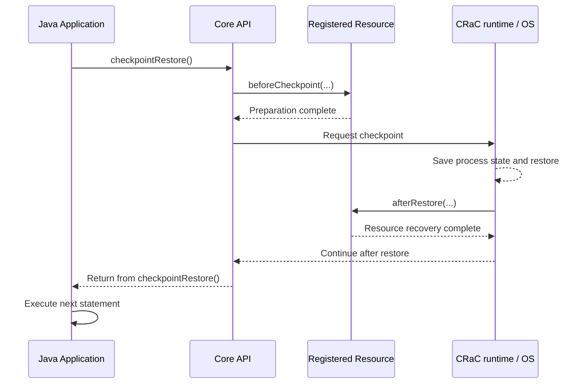

# Requesting a Checkpoint Programmatically with `Core.checkpointRestore()`

CRaC allows a Java application to proactively request a checkpoint and restore directly from code through the `org.crac.Core.checkpointRestore()` API. This approach lets the application choose an appropriate point in its own lifecycle, such as after initializing components, loading configuration, and warming up critical processing paths.

This call is a transition point in the execution flow: the application requests the runtime to perform checkpoint/restore, the process pauses during that operation, and then resumes from the restored state. When the call returns normally, the code after it continues running in the post-restore process. To use the API properly, you need to understand when to call it, how to register and coordinate Resources, how to handle errors, as well as the environmental conditions the API depends on.

## 1. What is `Core.checkpointRestore()` used for?

`Core` is the facade class of the CRaC API in the `org.crac` package. The `checkpointRestore()` method allows Java code to request a checkpoint/restore of the current process. The application does not need to wait for an external tool to choose the checkpoint timing; the code itself can decide when the state is ready to be saved.

For example, an application can perform the following tasks before calling the API:

- Read configuration and initialize the necessary components.
- Create shared objects and load initial data.
- Warm up the application with some representative operations.
- Register Resources that need to coordinate before checkpoint and after restore.
- Bring the application to a safe point, with no unfinished transactions or in-flight work that must complete before saving state.

Then, the application calls `Core.checkpointRestore()`. When the process is successfully restored, the code flow continues from the position immediately after the call. As a result, work completed before the checkpoint can be retained in the process state, reducing the amount of initialization that must be performed again when using a checkpoint.

This API only requests the runtime to perform the operation. Actual checkpoint/restore capability still depends on a JDK that supports CRaC and a compatibly configured operating system environment. Calling the method does not automatically install CRIU, grant operating system permissions, create container configurations, or guarantee that all external resources remain valid after restore.

## 2. Execution flow from call to return

From the application's perspective, the process can be divided into the following phases:

1. The application starts up and prepares the state it wants to retain.
2. The application registers the Resources that need to participate in the CRaC lifecycle.
3. Code calls `Core.checkpointRestore()` at the chosen point.
4. The Resources are requested to perform `beforeCheckpoint(...)` work.
5. The runtime and the environment's checkpoint/restore mechanism save the process state.
6. The process is restored in a compatible environment.
7. The Resources perform `afterRestore(...)` work to recover or verify resources.
8. The `Core.checkpointRestore()` call returns and code continues at the next statement.



The diagram illustrates the coordination model at a conceptual level. Execution details, error handling, and operating system mechanisms depend on the CRaC JDK and the deployed environment version.

The key point is that code after `Core.checkpointRestore()` belongs to the post-restore continuation flow. The application should not treat this call like a normal file-writing function that returns immediately after saving a few objects. During checkpoint/restore, the entire process is affected; resources and runtime state must be handled according to the CRaC lifecycle.

## 3. Example of calling the API in a Java program

The example below illustrates where to call the API in a small program. The program initializes the application, warms up part of the processing, requests a checkpoint/restore, and only then begins its main serving work.

```java
import org.crac.Core;
import org.crac.CheckpointException;
import org.crac.RestoreException;

public final class Application {

    public static void main(String[] args)
            throws CheckpointException, RestoreException {

        initializeApplication();
        warmUpApplication();

        // The process will resume from here after a successful restore.
        Core.checkpointRestore();

        // Only start serving after the checkpoint/restore call returns.
        startServing();
    }

    private static void initializeApplication() {
        System.out.println("Initialize application");
    }

    private static void warmUpApplication() {
        System.out.println("Warm up application");
    }

    private static void startServing() {
        System.out.println("Application is ready");
    }
}
```

This is an example illustrating the API call structure; the initialization and serving functions are simplified to focus on the checkpoint point. When running in practice, you need to use a compatible CRaC JDK and prepare the checkpoint/restore environment according to that JDK's documentation.

In the example, `initializeApplication()` and `warmUpApplication()` run before the checkpoint. After restore, the program continues at the `startServing()` statement. Therefore, if the goal is to accept traffic only after resources have been restored, placing the start of serving after this call is an easy-to-understand way to organize it. For applications where a server or scheduler is started earlier, you need to manage the readiness and lifecycle of those components with appropriate Resources.

### 3.1. What happens to statements before and after the call?

Suppose the code has the structure:

```java
prepare();
Core.checkpointRestore();
continueWork();
```

When checkpoint/restore completes successfully:

- `prepare()` has run before the checkpoint.
- The process state at the checkpoint is saved according to the runtime's mechanism.
- After restore, execution flow continues after the `Core.checkpointRestore()` call.
- `continueWork()` is executed in the restored process.

This helps the application retain the prepared state. However, it does not mean all state outside the process is preserved as well. Database servers, message brokers, HTTP services, or other systems have their own lifecycles; the application must still verify and restore the related connections.

## 4. Registering a Resource before requesting a checkpoint

`Core.checkpointRestore()` requests the checkpoint/restore, while Resources allow the application to coordinate resource handling within that lifecycle. A Resource must be registered with the context before performing a checkpoint so the runtime can invoke the corresponding callbacks.

A Resource implements `org.crac.Resource` and provides two main methods:

- `beforeCheckpoint(...)`: prepares the resource before the process state is saved.
- `afterRestore(...)`: verifies, recreates, or completes resource recovery after the process is restored.

Illustrative example:

```java
import org.crac.Context;
import org.crac.Core;
import org.crac.Resource;

public final class ConnectionResource implements Resource {

    @Override
    public void beforeCheckpoint(Context<? extends Resource> context)
            throws Exception {
        pauseNewDatabaseWork();
        closeConnectionIfRequired();
    }

    @Override
    public void afterRestore(Context<? extends Resource> context)
            throws Exception {
        reconnectDatabase();
        verifyConnection();
        resumeDatabaseWork();
    }

    private void pauseNewDatabaseWork() {
        // Prevent new work from using the connection during the preparation phase.
    }

    private void closeConnectionIfRequired() {
        // Close or bring the connection to a safe state according to policy.
    }

    private void reconnectDatabase() {
        // Recreate the connection or restart the pool after restore.
    }

    private void verifyConnection() {
        // Verify usability before allowing work to be accepted.
    }

    private void resumeDatabaseWork() {
        // Allow work using the database to resume.
    }
}
```

Register the Resource with the global context before calling the API:

```java
Core.getGlobalContext().register(new ConnectionResource());
Core.checkpointRestore();
```

In a real application, you should register the Resource where the corresponding component's lifecycle is managed, ensuring it is registered only the required number of times. If there are multiple Resources, you need to design the dependency relationships and preparation/recovery order according to the contract of the API and the application; do not rely on an unconfirmed implicit order.

The example above only illustrates the responsibilities of a Resource. Closing connections, restarting pools, or pausing workers must use the actual API of the library in use. Do not copy the hypothetical methods in the example as if they were built-in methods of JDBC or a connection pool.

## 5. Choosing when to call `Core.checkpointRestore()`

Where the API is called directly affects the state that gets saved. A suitable call site is usually after the application has completed the initialization it wants to retain and before it starts accepting work that could mutate state in hard-to-control ways.

### 5.1. Calling after initialization and warm-up

An often manageable sequence is:

```text
Start JVM
    ↓
Initialize configuration and components
    ↓
Load initial data
    ↓
Warm up critical processing flows
    ↓
Register Resources
    ↓
Core.checkpointRestore()
    ↓
Recover and verify resources
    ↓
Application continues / starts serving
```

Not every application needs warm-up before checkpoint. Warm-up is useful when you want to retain class-loading state or runtime optimizations, but you must weigh checkpoint creation time, memory, and workload representativeness. Only run safe initialization operations that do not produce unintended business side effects.

### 5.2. Avoid calling in the middle of an incomplete business operation

Do not arbitrarily call checkpoint when the application is holding an uncommitted/unrolled-back transaction, is midway through writing data, or is holding a lock that a callback needs. Before calling, determine:

- Are there any data write operations that need to finish?
- Are there any in-flight transactions or message acknowledgements?
- Are any workers processing work that cannot be safely paused?
- Are any locks being held that could cause mutual waiting with a callback?
- Are there any buffers or output files that need to be flushed/closed?

A checkpoint does not automatically understand the business semantics of a transaction or message. The application must prepare a consistent state before requesting the runtime to save the process.

### 5.3. Avoid unintended repeated calls

After restore, code continues immediately after the call. If the call site is inside a loop, scheduler, or execution path triggered multiple times, the application may unexpectedly request checkpoints repeatedly.

An unsuitable example is placing `Core.checkpointRestore()` directly inside a request-handling loop without a control condition. Every time execution passes that call site, it could initiate a new checkpoint/restore cycle.

Choose an intentional call site, such as a one-time startup phase, and use appropriate control state if application flow can revisit that code. Ensure the control condition remains valid after restore because the process state continues from the checkpoint.

## 6. Handling errors when calling the API

The `Core.checkpointRestore()` method declares checkpoint and restore error types through `CheckpointException` and `RestoreException`. When using the API, handle these exceptions according to the application's policy.

Example of letting errors propagate to the caller layer:

```java
import org.crac.CheckpointException;
import org.crac.Core;
import org.crac.RestoreException;

public final class CheckpointCoordinator {

    public void checkpointAtSafePoint()
            throws CheckpointException, RestoreException {
        Core.checkpointRestore();
    }
}
```

If the application needs to catch the error locally, log sufficient context, preserve the cause, and clearly decide whether it can continue or must halt startup:

```java
try {
    Core.checkpointRestore();
} catch (CheckpointException | RestoreException e) {
    // Log the error and apply the application's operational policy.
    throw e;
}
```

Do not catch the exception and ignore it. If checkpoint fails, the application may not have reached the state expected by the deployment workflow. If restore or a recovery callback fails, some resources may not be ready. Continuing to serve in an incomplete state can lead to data errors or hard-to-detect connection errors.

When analyzing an error, identify the phase in which it occurred:

| Phase | Questions to check |
|---|---|
| Checkpoint preparation | Which Resource failed in `beforeCheckpoint(...)`? Are there any incomplete operations? |
| Checkpoint creation | Do the JDK, checkpoint/restore tool, kernel, permissions, and environment configuration meet the requirements? |
| Process restore | Is the checkpoint compatible with the launch environment? Are there errors from the operating system or runtime? |
| Resource recovery | Which connections or resources were not recreated? Are external services available? |
| After the API returns | Does the application check readiness and handle an unready state properly? |

Not every error can be resolved by calling `Core.checkpointRestore()` again. Before retrying, determine the state of the process and resources, avoiding creating additional checkpoints or duplicate resources while the previous state is unclear.

## 7. Distinguishing requests from code and requests from external tools

A checkpoint/restore cycle can be initiated from application code or from an external process management mechanism, depending on the CRaC deployment approach.

| Criterion | Calling `Core.checkpointRestore()` | Request from an external tool |
|---|---|---|
| Where timing is decided | Java application logic. | Scripts, operational tools, or process management systems. |
| Trigger point | A specific location in the code flow. | The tool acts on the running process through a supported mechanism. |
| Application context | Code can choose a point after an initialization step or at a safe point. | The application still needs Resources to prepare and recover resources. |
| Business control | Can be tied to internal application conditions and state. | Requires a coordination mechanism to know whether the application is ready for checkpoint. |
| Environmental requirements | Still requires a CRaC JDK and a compatible environment. | Also requires a compatible JDK/runtime and checkpoint/restore environment. |

Calling from code does not eliminate operational requirements. The application still needs configuration for where to store checkpoints, required permissions, compatible runtime versions, and a restore procedure. Conversely, requesting from an external tool does not eliminate the application's responsibility for managing Resources.

## 8. What `Core.checkpointRestore()` does not handle automatically

When reading code or designing architecture, distinguish the responsibilities of the API from those of the application and environment.

- **Does not automatically register library Resources:** the application must ensure required Resources are registered or that the library already has appropriate CRaC integration.
- **Does not automatically know business state:** the API does not know which transactions need to commit, which messages need to be acknowledged, or which work can be paused.
- **Does not guarantee all connections remain valid:** databases, brokers, sockets, and HTTP services can change state while the process is inactive.
- **Does not set up OS infrastructure:** the CRaC JDK and checkpoint/restore mechanism require a compatible environment, permissions, and proper configuration.
- **Does not replace readiness checks:** the application must verify mandatory resources before accepting traffic.
- **Is not a business data backup mechanism:** checkpoint saves process state via the runtime mechanism and does not replace database backups or durable storage systems.
- **Does not guarantee a checkpoint works on every version or machine:** restore capability depends on runtime and environment compatibility conditions.

These boundaries help avoid placing too much responsibility on a single API call. `Core.checkpointRestore()` is the point that requests the checkpoint/restore cycle; recovery quality still depends on Resource design and the surrounding system.

## 9. Testing the API call across layers

To verify the integration, separate the questions into layers of evidence:

1. **Code inspection:** confirm the program calls the API at the right location, Resources are registered before the call site, and exceptions are handled.
2. **Callback testing:** confirm `beforeCheckpoint(...)` and `afterRestore(...)` execute the resource policy properly in an appropriate test environment.
3. **Real CRaC testing:** run on a CRaC-supporting JDK and compatible environment, call `Core.checkpointRestore()`, and confirm the process resumes after restore.
4. **Integration testing:** confirm databases, brokers, HTTP clients, files, and out-of-process components work after restore.
5. **Operational testing:** confirm health checks, readiness, logs, metrics, permissions, checkpoint storage location, and failure handling for checkpoint/restore.

Some scenarios that should be included in the test suite:

| Scenario | What to verify |
|---|---|
| Successful checkpoint/restore flow | Code continues at the statement after `Core.checkpointRestore()`. |
| `beforeCheckpoint(...)` fails | The error is observed and the application does not assume the checkpoint succeeded. |
| `afterRestore(...)` fails | The application does not report ready when a mandatory resource is not yet working. |
| Database service temporarily unavailable | Reconnection policy and readiness behave as expected. |
| Call site triggered unexpectedly | Control mechanism prevents unwanted repeated checkpoint cycles. |
| Running in an unsupported environment | The application detects or reports the error clearly according to the chosen implementation. |

Do not use a unit test mocking the method call to conclude that the JVM can actually checkpoint/restore. That capability must be verified by running in a compatible CRaC environment.

## 10. Checklist when using `Core.checkpointRestore()`

- [ ] The JDK in use supports CRaC and the checkpoint/restore environment is prepared.
- [ ] The application state to retain at checkpoint has been identified.
- [ ] Necessary Resources are registered before calling the API.
- [ ] In-flight business work, transactions, and write operations have been handled.
- [ ] The API is not called while holding locks or resources that could cause callbacks to wait on each other.
- [ ] The call site is at an intentional point in the application lifecycle.
- [ ] Code after the call only starts appropriate work after restore completes.
- [ ] `CheckpointException` and `RestoreException` are handled according to a clear policy.
- [ ] Resources are verified or recreated before the application accepts traffic.
- [ ] Real checkpoint/restore and dependent services have been tested in the target environment.

## 11. Key terminology to remember

- **`Core`:** facade class of the CRaC API, providing shared operations and contexts.
- **`Core.checkpointRestore()`:** method that requests checkpoint and restore of the current process from Java code.
- **Global context:** context used to register Resources participating in the application's CRaC lifecycle.
- **Resource:** component implementing `org.crac.Resource`, coordinating preparation before checkpoint and recovery after restore.
- **`beforeCheckpoint(...)`:** callback that prepares resources before saving the process state.
- **`afterRestore(...)`:** callback that handles resources after the process is restored.
- **Safe point:** point at which the application has brought work and resources to a suitable state for checkpoint.
- **Readiness:** condition determining whether the application is ready to accept traffic or new work.
- **`CheckpointException` / `RestoreException`:** exception types representing errors during checkpoint or restore.

When calling `Core.checkpointRestore()`, treat it as a clear boundary in the application lifecycle: code prepares state before the call, Resources coordinate resource handling, the runtime performs checkpoint/restore, and then the application continues after restore. Placing the call at a safe point and thoroughly checking resources after restore will help the application leverage the prepared state while maintaining operational correctness.