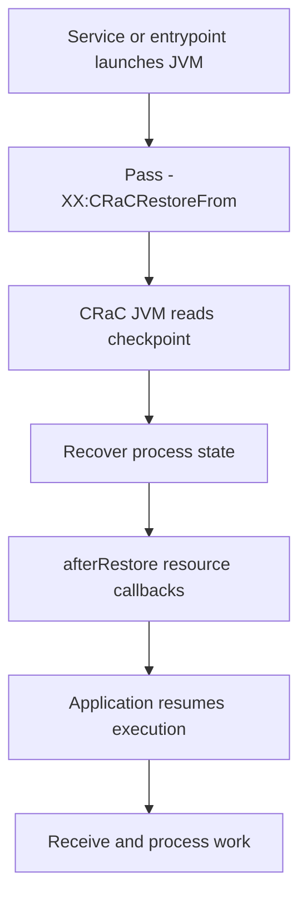

# Restoring an Application Using `-XX:CRaCRestoreFrom`

In Java CRaC (Coordinated Restore at Checkpoint), an application can be restored from a previously created checkpoint. Instead of starting the JVM and re-running all of the application's startup code, a CRaC-enabled JVM reads the saved process state and resumes from that state. The JVM option `-XX:CRaCRestoreFrom` specifies the checkpoint location that the JVM should use to perform the restore process.

This is an option for runtimes with CRaC support. Adding this option to a regular JDK does not add restore capability. The application also needs a valid checkpoint, created by a compatible environment, and needs to recover external resources according to the CRaC lifecycle before continuing to serve work.

## 1. What is `-XX:CRaCRestoreFrom` used for?

`-XX:CRaCRestoreFrom=<path>` instructs the JVM to initialize by restoring state from the checkpoint at `<path>`. The path points to the checkpoint directory created by a previous CRaC checkpoint. It is not the path to the application's JAR file or class file.

Basic syntax:

```bash
java -XX:CRaCRestoreFrom=/absolute/path/to/checkpoint
```

When the restore succeeds, the JVM recovers the captured process, including the heap state and execution state saved by the runtime in the checkpoint. The application continues from the checkpoint point in time according to the CRaC model; `main()` is not re-run as a new application startup. Registered resources are notified via the `afterRestore` callback to refresh the resources needed after recovery.

This option is commonly used in the command that launches a process to serve from a checkpoint. Use the exact syntax supported by your project's CRaC runtime. The example above illustrates how to pass an absolute path and does not represent every configuration detail of each JDK distribution.

## 2. Prerequisites before restoring

Before running the restore command, ensure the following conditions are met:

1. **Have a complete checkpoint.** The directory passed to `-XX:CRaCRestoreFrom` must be a checkpoint successfully created by the corresponding Java process and CRaC runtime.
2. **Use a runtime with CRaC support.** The JVM must recognize the `-XX:CRaCRestoreFrom` option. A regular JDK may report an unrecognized option.
3. **Maintain environment compatibility.** Use a JDK/runtime version, operating system, CPU architecture, native libraries, and kernel conditions that match the environment where the checkpoint was created. Specific requirements depend on the CRaC distribution and how the application is packaged.
4. **Ensure access permissions.** The user running the restore JVM must be able to read the checkpoint and related files. If the checkpoint resides on a separate filesystem, the mount and access permissions must be ready before launch.
5. **Prepare external resources.** Network connections, databases, sockets, file descriptors, background threads, and resources whose lifecycle is external to the process must be handled properly in CRaC callbacks.
6. **Keep the right application version.** Restore with artifacts, native libraries, and deployment configurations compatible with the time of the checkpoint. Replacing JARs or libraries after creating a checkpoint can make the environment inconsistent with the saved state.

A checkpoint saves the process state at the time it is created. It does not automatically update when configuration, secrets, certificates, DNS, endpoints, or external data change. A procedure is needed to determine which parts are preserved and which parts must be refreshed after restore.

## 3. Creating a checkpoint before restoring

`-XX:CRaCRestoreFrom` only uses an existing checkpoint. A cycle typically has two phases: starting the application on a CRaC-enabled JDK to prepare state and create a checkpoint; then running a CRaC-enabled JVM to restore from that directory.

For example, an application that has been started and warmed up can create a checkpoint through the JDK diagnostic tool if the runtime provides the corresponding command:

```bash
jcmd <pid> JDK.checkpoint
```

In the example, `<pid>` is the PID of the Java process to checkpoint. The command and execution permissions depend on the installed CRaC runtime. Before creating a checkpoint, the application must complete its preparation steps, and `beforeCheckpoint` resource callbacks must bring resources into a safe state.

After the checkpoint is successfully created, keep the checkpoint directory structure intact. Do not delete or replace files inside it, do not merge data from different checkpoints, and do not use an arbitrary directory just because it exists.

## 4. Launching a restore with the JVM option

Suppose the checkpoint is located at `/var/lib/myapp/checkpoints/ready`. Illustrative restore command:

```bash
java -XX:CRaCRestoreFrom=/var/lib/myapp/checkpoints/ready
```

The option must be passed to the JVM at launch. It is not a Java system property, so do not write it as `-DCRaCRestoreFrom=...`, and do not place it after the class name or `-jar` as an application argument.

Because the checkpoint contains the state of an already-running process, the restore operation resumes that process instead of asking the launcher to run a new `main` class again. Follow the restore launch instructions of the JDK you are using, especially if the platform provides its own scripts or wrappers.

### 4.1. Using an environment variable to manage the path

In deployment scripts, you can put the checkpoint path in a variable to avoid repeating literals:

```bash
CHECKPOINT_DIR=/var/lib/myapp/checkpoints/ready
exec java "-XX:CRaCRestoreFrom=${CHECKPOINT_DIR}"
```

`exec` replaces the shell process with the JVM, allowing the process management system to track the JVM directly. When the path contains spaces, ensure it is passed as a single argument using the quoting mechanism appropriate for your shell.

PowerShell example on Windows for passing the argument:

```powershell
$checkpointDir = 'D:\crac\myapp\ready'
java "-XX:CRaCRestoreFrom=$checkpointDir"
```

Checkpoint/restore capability on Windows depends on the CRaC distribution and supported platforms. The PowerShell example only illustrates how to pass an argument containing a path; confirm that the target runtime supports that platform before using it in deployment.

### 4.2. Placing the option in service configuration

If the application is managed by a service manager or container entrypoint, the restore launch command must pass the option to the right JVM. Example of an entrypoint script:

```bash
#!/usr/bin/env bash
set -eu

CHECKPOINT_DIR="${CHECKPOINT_DIR:-/var/lib/myapp/checkpoints/ready}"

if [ ! -d "$CHECKPOINT_DIR" ]; then
  echo "Checkpoint directory does not exist: $CHECKPOINT_DIR" >&2
  exit 1
fi

exec java "-XX:CRaCRestoreFrom=$CHECKPOINT_DIR"
```

This is a skeleton example. The `-d` check only confirms that the path is a directory; it does not prove that the checkpoint is valid. Checkpoint validation and compatibility checks still need to be performed in the build, packaging, and deployment pipeline.

Do not simultaneously configure the entrypoint to run a fresh application startup and a restore command for the same process. Choose the right launch mode according to the deployment state: initialize to create a checkpoint or restore from an existing checkpoint.

## 5. What happens during the restore process?

At a high level, the restore process proceeds as follows:



The JVM needs to read the checkpoint and recover the process state before the application can continue. During this process, `afterRestore` callbacks are used to restore the resources that the application has registered. Once the recovery steps are complete, the execution flow continues at the saved state.

Because the application resumes from the checkpoint, startup code before the checkpoint point in time does not automatically re-run. Values in static fields, objects on the heap, and thread states are restored according to the snapshot. This saves startup work, but it also means stale data can continue to exist if the application does not actively refresh it.

## 6. Using `afterRestore` to refresh resources

An application can register a `Resource` with CRaC to close resources before checkpoint and recreate resources after restore. The example below illustrates the lifecycle of a client connecting to an external service:

```java
import org.crac.Context;
import org.crac.Core;
import org.crac.Resource;

public final class ApiClientResource implements Resource {
    private ApiClient client;

    public ApiClientResource() {
        Core.getGlobalContext().register(this);
        this.client = ApiClient.connect();
    }

    @Override
    public void beforeCheckpoint(Context<? extends Resource> context)
            throws Exception {
        if (client != null) {
            client.close();
            client = null;
        }
    }

    @Override
    public void afterRestore(Context<? extends Resource> context)
            throws Exception {
        client = ApiClient.connect();
    }

    public ApiClient client() {
        if (client == null) {
            throw new IllegalStateException("API client is not ready");
        }
        return client;
    }
}
```

`ApiClient` is an illustrative type and needs to be replaced with the application's actual client. You must synchronize threads currently using the client before closing it, handle connection errors when reopening, and prevent requests from entering before the resource is ready.

The `afterRestore` callback must complete the necessary recovery work before the application uses the corresponding resource. If a callback fails, the application must treat it as a critical recovery failure according to system policy; do not silently mark the application as ready while required connections are still not working.

You should not use `afterRestore` to re-run the entire application initialization logic. Safe, time-consuming pure-Java work can be prepared before the checkpoint. Post-restore callbacks focus on resources and state that need refreshing.

## 7. Checkpoint paths and deployment configuration

The path passed to `-XX:CRaCRestoreFrom` must point to the exact checkpoint from which the process is created. In real deployments, configure the path clearly and control access permissions.

Points to note:

- **Prefer absolute paths.** Relative paths depend on the process working directory. A service manager or container may launch from a different directory than during testing.
- **Mount data properly.** If the checkpoint is stored on a volume, the volume must be mounted at the exact path before the JVM restores.
- **Do not modify a checkpoint in use.** A deployment process should not read a directory that is being written to or modified by another process.
- **Keep access permissions minimal.** A checkpoint may contain in-memory data such as tokens, credentials, or business data. Protect read permissions, write permissions, and storage locations according to the application's sensitivity level.
- **Tie checkpoints to application versions.** Record the JDK version, application artifact, configuration, and checkpoint creation time to avoid using the wrong snapshot.
- **Plan the lifecycle.** Define when a checkpoint expires, when it needs to be recreated, and how to clean up old checkpoints once no process depends on them.

Do not update a checkpoint by replacing individual files inside it. When you need to change the application or platform configuration, create a new checkpoint using a tested procedure and switch the deployment to the new checkpoint in a way that can be rolled back.

## 8. Common errors during restore

### JVM reports unrecognized option

If the JVM reports `Unrecognized VM option 'CRaCRestoreFrom=...'`, the running runtime may not support CRaC or may not support this exact option. Check the path to the `java` executable, the JDK version, and the CRaC distribution's documentation. Do not confuse having the `org.crac:crac` dependency on the classpath with the JVM supporting restore.

### Checkpoint not found

Check spelling, absolute path, working directory, volume mount, and read permissions of the user running the JVM. Confirm that the directory passed is the successfully created checkpoint directory itself, not a parent directory or a copy missing files.

### Checkpoint incompatible with runtime

A checkpoint depends on the runtime and environment that created it. Differences in JDK, CPU architecture, operating system, kernel, or native libraries can cause restore to fail. Create the checkpoint on a platform matching where it will be restored and follow the runtime's support matrix.

### Restore succeeds but the application cannot reach services

The process may be restored while sockets or connection pools are stale. Check whether `beforeCheckpoint` brought resources into a safe state and `afterRestore` recreated them. Also check DNS, certificates, secrets, endpoints, and access permissions at restore time.

### Application continues with old configuration

A checkpoint saves memory state at the time of capture. If the application holds configuration in static fields or singletons, changing configuration files after the checkpoint does not automatically update values in the heap. Identify which configurations need to be re-read after restore and implement a controlled refresh mechanism.

### Application does not become ready

Check restore logs and errors in `afterRestore` callbacks. A resource may have failed to recreate, a background thread may not have restarted, or an external dependency may not be ready. Readiness checks should only succeed after required components have finished recovering.

### Accidentally running in fresh startup mode

If the service still runs the regular `java -jar app.jar` command, the process will start a new application instead of requesting a restore from the checkpoint. Check the entrypoint configuration, scripts, and actual JVM arguments. The `-XX:CRaCRestoreFrom` option must be passed to the right JVM executable.

## 9. Verification and observation after restore

Do not rely solely on the JVM reporting no errors to conclude that the application is ready. Both the recovery state and the application's behavior must be verified.

A verification procedure may include:

1. Record the checkpoint path, JDK version, application version, and environment configuration that created the checkpoint.
2. Launch restore using the right CRaC-enabled runtime and `-XX:CRaCRestoreFrom` pointing to that checkpoint.
3. Collect JVM logs and application logs during the restore phase, especially resource callback errors.
4. Confirm that required connections, background threads, caches needing refresh, and framework components are ready.
5. Send test requests to confirm that the application can process work after restore.
6. Measure the time from the start of restore to readiness and the first-request latency.
7. Repeat with new checkpoints and test across multiple cycles to detect resource leaks or accumulated stale state.

Distinguish the timing milestones: the time for the JVM to recover the snapshot, the time for post-restore callbacks, the time for the application to reach readiness, and the time to process the first request. These milestones help identify whether the remaining overhead lies in the runtime or in the application's resource recovery step.

## 10. Controlled restore deployment workflow

In a production environment, you can organize the workflow according to the following steps:

1. **Prepare the checkpoint:** start the application on the appropriate runtime, load configuration, initialize components, and run the necessary warm-up.
2. **Bring resources to a safe state:** stop accepting new work, synchronize threads, and execute `beforeCheckpoint`.
3. **Create and store the checkpoint:** use the checkpoint mechanism supported by the runtime, then confirm the operation completed and store version metadata.
4. **Test the restore:** run `java -XX:CRaCRestoreFrom=<checkpoint-path>` in the target environment and confirm recovery callbacks succeed.
5. **Confirm readiness:** only accept traffic when required resources have been recreated and health checks meet requirements.
6. **Shift traffic:** bring the restored process into service according to the system's deployment mechanism.
7. **Rollback when needed:** keep the previous checkpoint or deployment version according to the retention policy so you can return to a verified state.

Do not delete the old checkpoint immediately when starting a restore if the rollback procedure still needs it. Cleanup should be based on deployment state and retention policy, not solely on the age of the directory.

## 11. Checklist before running `-XX:CRaCRestoreFrom`

- [ ] Confirmed that the `java` executable is the appropriate CRaC-enabled runtime.
- [ ] Created the checkpoint successfully using a compatible environment.
- [ ] The checkpoint path points to the exact directory and uses an absolute path in the deployment environment.
- [ ] The user running the JVM has read permissions for the checkpoint and required volumes.
- [ ] The JDK version, artifacts, native libraries, operating system, and architecture match.
- [ ] Resources have registered callbacks to handle pre-checkpoint and post-restore actions.
- [ ] `afterRestore` recreates environment-dependent connections and state.
- [ ] Readiness checks wait for required components to finish recovering.
- [ ] Logs, restore time, and first request are recorded.
- [ ] There is a policy for retaining, replacing, and cleaning up checkpoints.

`-XX:CRaCRestoreFrom` is the entry point for a CRaC-enabled JVM to recover a process from a saved checkpoint. To use it properly, pass the checkpoint path to the JVM at launch, keep the runtime and environment compatible, and implement `afterRestore` callbacks to refresh resources. After restoring, confirm readiness and verify real requests before putting the process back into service.
