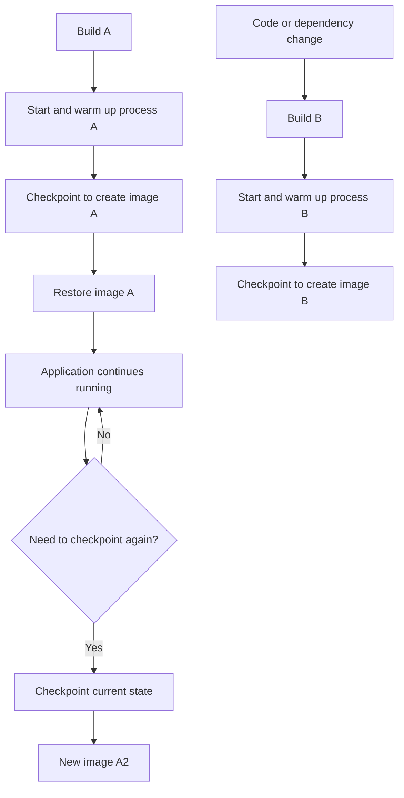

# Limitations of Repeated Checkpointing by Build and Image Creation Mechanism

In CRaC, a checkpoint image is created from the state of a running Java process. Therefore, the image is tied to the program already loaded into the JVM, the JDK version, dependencies, configuration, and the operating system environment at the time of the checkpoint. When the source code or runtime changes, the old image does not automatically update to match the new build.

This directly affects how the checkpoint–restore cycle is organized. The development team needs to determine when a new image must be created, how many times an image can be restored, what happens when checkpointing again from a restored process, and how to manage images created across multiple builds. Understanding this mechanism is necessary to avoid using an outdated image by mistake, mixing states between releases, or creating multiple instances with the same identity data.

## 1. A checkpoint image is a process snapshot

A checkpoint image describes the state of a process at a point in time. Depending on the implementation, an image may consist of multiple files and metadata, including memory state, threads, the JVM runtime, and operating system resources supported by the checkpoint mechanism.

An image is not simply a copy of a JAR file. Once the JVM has launched the application, it may have loaded classes, created objects, initialized frameworks, created threads, opened files, and set up runtime structures. Part of that state resides in the image. Restore recreates the process from the snapshot, so classes and objects that existed at the time of the checkpoint continue to belong to the restored state.

For example, a Spring Boot application has initialized its context and loaded `OrderService`. Afterwards, the development team modifies the `OrderService` code, rebuilds the JAR, and places the new JAR at the same path. The checkpoint image created before the code modification still contains the process state of the old version. Replacing the JAR file on the filesystem does not change the classes already loaded into the snapshot, nor does it turn the old image into an image of the new build.

Therefore, three artifacts must be distinguished:

| Artifact | Content and role |
|---|---|
| Application build | JAR, dependencies, and application resources built from a source code revision |
| Runtime/container image | Filesystem, JDK, system libraries, and configuration needed to run the application |
| CRaC checkpoint image | State of a running process, created from an application build in a specific runtime and environment |

The three artifacts are related but cannot replace one another. A container image can contain the JDK and JAR, while a checkpoint image stores the state of the process launched from that environment.

## 2. Relationship between a build and a checkpoint image

A checkpoint image must be tied to the identity of the build that created it. This identity should include more information than just the application's display version number:

- Git commit or source revision identifier.
- Application version and checksum of the input JAR/artifact.
- Vendor, full version, and build of the CRaC-enabled JDK.
- Resolved dependency versions, including the dependency lock.
- Digest of the container/runtime image if using containers.
- Operating system, CPU architecture, and compatibility conditions related to the kernel/CRIU.
- Configuration profile used when launching and warming up the application.
- Image creation timestamp and restore test results.

Not every value needs to be included in the directory name. However, they need to be stored in accompanying metadata so it is possible to identify which build and environment an image belongs to.

### 2.1. When must a new image be created?

Typically, a checkpoint image needs to be recreated when there is a change that alters the process state or restore conditions, such as:

| Change | Why the image needs to be evaluated or recreated |
|---|---|
| Application source code or JAR | The old snapshot still contains the execution state of previously loaded code |
| Dependencies or frameworks | Classes, object structures, and library code in the snapshot may no longer match the new build |
| JDK or JVM build | Runtime state and internal formats may depend on the JDK version |
| Native libraries/JNI/agents | The runtime may depend on binaries or native state that have changed |
| Configuration read at startup | Configuration values may already reside in objects of the captured process |
| Warm-up profile or data | The new image may require different cache states and prepared data |
| Operating system, architecture, or restore environment | Compatibility conditions of the process may change |

An external configuration change does not necessarily always require creating a new image. If the application reads that configuration after restore and does not store the old value in the snapshot, it can be handled with runtime configuration. However, if the configuration was already read into objects, used to create beans, select endpoints, or set up resources before the checkpoint, the image may still retain the old value. Determine when the configuration is read and verify the actual result.

### 2.2. An old image is not a way to update an application

Restore does not re-run the entire startup process like a fresh JVM. It continues from the captured state. Therefore, the following workflow cannot be used as a way to deploy a new version:

1. Create a checkpoint image from build A.
2. Replace the JAR with build B.
3. Restore image A and expect the application to run code B.

The image still represents the state created from build A. The correct approach is to build B, launch build B with the appropriate runtime, prepare the necessary state, and then create checkpoint image B. Only after image B restores successfully should it be added to the catalog of deployable artifacts.

## 3. One checkpoint creates a new snapshot

Each checkpoint is a capture of the process state at the time of the request. The new snapshot reflects the actual state at that moment, including changes that have occurred since the previous restore or startup.

You should not assume that repeated checkpointing will only write the changed parts to the old image, automatically merge multiple snapshots, or update an already released image. The CRaC/JDK mechanism and OS tools may have their own internal storage methods, but at the application workflow level, treat each image creation as generating a new artifact with its own destination directory. Only use incremental/pre-dump mechanisms if the specific implementation in use announces support for them and they have been tested separately.

An example cycle might look like this:



Image A2 is a new snapshot from the process state after restoring and continuing operation. It is not image A updated in place. Image B, on the other hand, is created from a process running build B.

### 3.1. Checkpointing again after restore

In a supported cycle, a restored process can be prepared and checkpointed again to create a subsequent snapshot. However, how the JVM handles the checkpoint request, the state of the original process after capture, and how restore is launched depend on the JDK/CRaC distribution and platform tooling. You should not assume all distributions have the same behavior or equally support all forms of repeated checkpointing.

Read the documentation for the exact JDK version and test the full cycle: launch, checkpoint, restore, continue running, checkpoint again, and then restore the new image. Check callbacks, resources, and readiness across both cycles. If the vendor restricts certain usages or requires starting a new process at a stage, adhere to those restrictions.

### 3.2. A snapshot after restore may contain different state

Suppose image A is created after the application has initialized the Spring context and warmed up the cache. After restore, the application processes requests, updates counters, modifies the cache, and creates several new objects. If checkpointed again, image A2 will reflect the state after those operations.

This can be useful when an additionally prepared state needs to be preserved. However, if the goal is to create a base image shared across multiple instances, checkpointing after processing real data may introduce instance-specific or user-specific information into the image. Therefore, the checkpoint boundary must be chosen deliberately.

## 4. Restoring multiple times from the same image

A checkpoint image can be used as a source to start restored processes according to the capabilities of the platform and deployment workflow. When multiple instances are restored from the same image, think of each instance as starting from the same initial snapshot and then continuing independently.

That does not mean the instances share a Java heap. Each restored process has its own memory state recreated from the image. However, they may carry the same values that already existed in the snapshot:

- The same UUID or node identifier generated before the checkpoint.
- The same consumer or subscription name.
- The same in-memory counter state.
- The same previously loaded cache data.
- The same token, session, or lease stored in the heap.
- The same pending business state.

If these values need to be unique per instance or have an expiration time, the application must regenerate or revalidate them after restore. Otherwise, multiple instances may register the same identity, share an expired lease, or execute a side effect repeatedly.

### 4.1. Restoring multiple times does not safely duplicate external state

A checkpoint image only describes the process state. It does not create a synchronized transaction snapshot for a database, message broker, or remote service. If the image contains an object indicating that a message is awaiting acknowledgment, restoring multiple times does not cause the broker to automatically duplicate the message according to business intent.

For example, the process sent a payment request and stored a `paymentSubmitted = true` flag in the heap before the checkpoint. If the external state changes while the image is saved, multiple restored instances could all continue from that flag. The application still needs to check the external transaction state and use an idempotency key to avoid sending duplicate payments.

### 4.2. Do not use a single image as a replica synchronization mechanism

Each instance after restore needs to manage its own state: identity, connections, subscriptions, schedules, and readiness. Using the same image does not provide distributed locks, leader election, schedule coordination, or data synchronization between replicas. Those requirements still need mechanisms at the application or infrastructure layer.

## 5. Callbacks and resources across multiple cycles

CRaC Resource allows the application to prepare before a checkpoint and recover after a restore. When the checkpoint–restore process repeats, resource logic may also be invoked across multiple cycles. Therefore, callbacks must be designed around the actual lifecycle, without assuming they run only once during the application's lifetime.

Some important principles:

- `beforeCheckpoint` needs to bring the resource to a safe state for each checkpoint.
- `afterRestore` needs to recreate or validate the resource for each restore.
- Closing resources should be safe when the state is already closed or uninitialized.
- Creating resources needs to avoid creating duplicate pools, threads, listeners, or subscriptions.
- Internal flag states must accurately reflect whether the resource is currently open, closed, or recovering.
- If a callback fails, the application should not publish an unverified image or mark the instance as ready while required resources are not yet operational.

Illustrative example of a resource managing a connection:

```java
import org.crac.Context;
import org.crac.Core;
import org.crac.Resource;

import javax.sql.DataSource;
import java.sql.Connection;
import java.sql.SQLException;

public final class DatabaseResource implements Resource {

    private final DataSource dataSource;
    private Connection connection;

    public DatabaseResource(DataSource dataSource) {
        this.dataSource = dataSource;
    }

    @Override
    public synchronized void beforeCheckpoint(
            Context<? extends Resource> context) throws SQLException {
        if (connection != null) {
            connection.close();
            connection = null;
        }
    }

    @Override
    public synchronized void afterRestore(
            Context<? extends Resource> context) throws SQLException {
        if (connection == null || connection.isClosed()) {
            connection = dataSource.getConnection();
        }
    }

    public synchronized Connection getConnection() {
        return connection;
    }
}
```

The resource needs to be registered once in an appropriate lifecycle management location:

```java
DatabaseResource resource = new DatabaseResource(dataSource);
Core.getGlobalContext().register(resource);
```

The example only illustrates the idempotent idea for a single connection. With an actual connection pool, you must use the library's pool close/open APIs and ensure internal threads are handled properly. At the same time, the application needs to manage concurrent access to the resource; the example above is not a complete connection manager for direct production use.

Do not re-register the same resource every time a callback runs. If after restore the application initializes an additional new resource while the old resource remains registered, callbacks may be invoked on multiple objects owning the same resource. Place the registration at exactly one point in the lifecycle and check how the chosen JDK maintains the context across restore.

## 6. Limitations of the image creation mechanism

### 6.1. An image is an implementation-dependent set of artifacts

A checkpoint image can consist of multiple files, not necessarily a single file that can be renamed or copied arbitrarily. The structure, metadata, and how the image is read depend on the JDK, CRIU, and platform. Do not manually edit files inside it, do not omit some files thinking they are cache, and do not manually merge contents from two checkpoints.

Use the exact path and restore mechanism required by the JDK/CRaC distribution. If you need to package or transport the image, keep the artifact structure and metadata intact according to that implementation's instructions.

### 6.2. Do not assume images are updated incrementally

At the build workflow level, create the new image in a separate staging directory. Do not directly overwrite an image currently used in production, and do not mix leftover files from a previous checkpoint with the output of a new one.

A safe workflow is:

1. Create a staging directory carrying the build ID and image creation attempt.
2. Ensure the output path does not contain old artifacts.
3. Run the application and perform the checkpoint according to the JDK's instructions.
4. Verify all generated files and save the corresponding metadata.
5. Test restoring from that exact staging directory.
6. Only after verification succeeds, publish the artifact under an immutable version identifier.
7. Clean up failed staging directories according to the retention policy, without deleting images still referenced by deployments.

Do not treat overwriting an in-use image directory by copying as a safe update. If you need to switch versions, create a new image, verify it, and then update the deployment reference to the new artifact in a controlled operation.

### 6.3. Not every environment can restore an image

An image depends on the runtime and environment that created it. Factors such as JDK version, CPU architecture, kernel, native libraries, filesystem, mount paths, process permissions, namespaces, and network configuration can affect restore.

Pinning a container image digest only fixes the container's filesystem contents. The kernel and many checkpoint/restore conditions still belong to the host. Therefore, the image must be tested on the target platform or in an environment with verified compatibility conditions.

### 6.4. Images can be large and time-consuming to create

An image reflects the memory state and resources of the process. Applications with a large heap, many threads, large caches, or many touched memory pages can produce large images. Writing the image can consume CPU, I/O, and storage capacity; restoring also takes time to read and recreate the state.

Therefore, continuous repeated checkpointing can produce many artifacts, increase storage costs, and complicate version management. Only create checkpoints at points with clear value, measure actual size and duration, and set a retention policy for old images.

### 6.5. Images may contain sensitive data

The heap may contain tokens, credentials, user data, request payloads, cache data, and business objects. When checkpointing, that data may appear in the image. Images need to be protected like sensitive data: restrict access permissions, encrypt at rest and in transit according to policy, set retention periods, and delete artifacts that are no longer needed.

Do not create a shared image after the application has processed real personal data or real transactions if that state is not permitted to appear in the image. Create the base image from test data or a controlled initialization state.

## 7. Per-build image creation and release workflow

A reproducible workflow should treat a checkpoint image as a build-bound output, not an independent artifact that can be used forever. The pipeline can be organized into stages:

**Stage 1 — Build the application.** Check out the exact revision, using the Gradle Wrapper, JDK, and locked dependencies. Build the JAR and checksum. Record the commit hash, application version, and dependency information.

**Stage 2 — Prepare the runtime.** Run the JAR with a CRaC-enabled JDK in the chosen Linux environment and architecture. Confirm that the JDK version, CRIU, and system configuration match the verified matrix.

**Stage 3 — Initialize and warm up.** Let the application create necessary components, load metadata, and perform reusable warm-up steps. Use a configuration that does not contain instance-specific or user-specific data.

**Stage 4 — Prepare resources.** Stop accepting new work if needed, drain in-flight requests, complete transactions, and close or pause resources according to callbacks. Do not create a checkpoint in the middle of a business operation that has not reached a safe boundary.

**Stage 5 — Create the checkpoint.** Request a checkpoint and write the output to a build-specific staging directory. The exact invocation depends on the JDK distribution; many CRaC builds support configuring the checkpoint path and the `JDK.checkpoint` diagnostic command via `jcmd`.

**Stage 6 — Test restore.** Launch the process from the image according to the JDK's instructions. Check `afterRestore` callbacks, required connections, health checks, and readiness. Do not merely check that the restore command exits, but confirm that the application can actually serve traffic.

**Stage 7 — Publish the artifact.** Associate the image with the build ID, JAR checksum, JDK version, dependencies, and environment. Publish the image under an immutable identifier so deployments can reference it accurately.

**Stage 8 — Retain and clean up.** Keep images for releases that are still in use or needed for rollback. Delete failed staging directories and expired images according to policy, after confirming no deployment still references them.

Example of the shape of a common command workflow on a CRaC JDK supporting the corresponding options:

```bash
# Launch the application and specify the checkpoint destination directory
java -XX:CRaCCheckpointTo=build/crac-image -jar build/libs/application.jar

# Request JVM checkpoint (PID needs to be obtained from the running process)
jcmd <pid> JDK.checkpoint

# Launch the process from the checkpoint image
java -XX:CRaCRestoreFrom=build/crac-image
```

This is an example of the operation flow, not a universal command for every JDK distribution. Option names, trigger conditions, how the original process exits or continues, and how restore is invoked must be confirmed against the documentation of the CRaC distribution in use. The `build/crac-image` path in the example should also be replaced with a fresh staging directory for each build/image creation.

## 8. Metadata to avoid using the wrong image

A manifest should be stored alongside the image so deployment tools can determine which artifact is suitable. For example:

```yaml
checkpointImage:
  imageId: "orders-api-1.8.0-build-245"
  application:
    version: "1.8.0"
    gitCommit: "<commit-sha>"
    artifactSha256: "<jar-sha256>"
  jdk:
    vendor: "<vendor>"
    version: "<full-version-and-build>"
  dependencies:
    lockfileSha256: "<lockfile-sha256>"
  platform:
    os: "<distribution-and-version>"
    architecture: "amd64"
    criuVersion: "<tested-version>"
    containerDigest: "sha256:<digest>"
  checkpoint:
    createdAt: "<timestamp>"
    profile: "warmup-default"
    restoreValidation: "PASS"
```

Placeholders must be replaced with actual values. The manifest should be generated from build/CI information rather than manually entering values that can be obtained automatically. If a field is not yet determined, record an explicit unknown state; do not assign a guessed version.

Before restoring, the deployment can compare runtime requirements against the image metadata. If the image was created from a different build, different JDK, or incompatible architecture, halt the rollout and require creating/selecting the correct artifact. Metadata checks do not replace restore smoke tests, but they help eliminate many misuse cases early.

## 9. Image naming and storage strategy

Each image should have a unique and immutable identifier. You can combine the application name, version, short commit, architecture, and creation number:

```text
orders-api/
  1.8.0/
    8f31c2a-amd64-build245/
      checkpoint-image/...
      manifest.yml
      checksums.txt
    8f31c2a-amd64-build246/
      checkpoint-image/...
      manifest.yml
      checksums.txt
```

Do not use a `latest` directory as a target for writing checkpoints directly. `latest`, if present, should only be a reference to an image that has already been created, tested, and published successfully. That way, a failed image creation does not corrupt the artifact currently used by a deployment.

The retention policy needs to balance rollback capability and storage cost. You can keep the image currently in production, the image from the previous release, and a few tested images. Before deleting, check the manifest or deployment metadata to ensure no workload still references that image.

## 10. Testing the limits of repeated checkpointing

A cycle test needs to prove more than the ability to create an image the first time. You can use a test application that records the callback count and an in-memory state value:

1. Launch build A and record the build ID and initial state.
2. Create checkpoint image A.
3. Restore image A, verify the build ID is still A and the `afterRestore` callback is invoked.
4. Perform a controlled state change in the restored process.
5. If the JDK and deployment workflow support subsequent checkpointing, create image A2 in a new directory.
6. Restore image A2 and verify it contains the state at the time of the second checkpoint.
7. Create build B with an observable code change, then create image B from a new process B.
8. Verify that image B runs build B and image A is still identified as an artifact of build A.
9. Try restoring the same base image into two separate instances, and check that instance IDs, connections, and subscriptions are not unintentionally shared.
10. Test callback or restore failure cases; verify the image is not published and readiness does not transition to success.

Metrics to collect:

| Metric | Purpose |
|---|---|
| Startup-to-checkpoint time | Measure snapshot preparation cost |
| Image creation time | Evaluate checkpoint and I/O cost |
| Image size | Estimate storage and transfer capacity |
| Restore time | Measure process recreation time |
| Restore-to-readiness | Measure actual time before receiving traffic |
| Checkpoint/restore success rate | Track stability of the environment setup |
| Images per build and retained storage | Track artifact retention cost |

Do not compare restore time alone. If callbacks have to recreate connection pools, load configuration, or refresh tokens, the time from restore to readiness is what accurately reflects when the application can serve.

## 11. Common pitfalls

**Using an old image after rebuilding the application.** The snapshot still contains the state of the process that loaded the old code. Create a new image from a process running the new build.

**Checkpointing multiple times into the same directory.** Old files may remain or the output structure may not be overwritten as expected. Use a new staging directory for each creation and only publish after a test restore.

**Assuming the second checkpoint is incremental.** Do not assume the image storage mechanism will only write the changed parts. Only rely on incremental/pre-dump when the specific implementation supports and has been tested for it.

**Restoring the same image for multiple replicas while keeping identifiers unchanged.** Processes may start with the same UUID, token, lease, or subscription. Regenerate or revalidate instance-bound state after restore.

**Checkpointing after processing real data.** The image may contain business data, user information, or unconfirmed side effects. Choose a controlled checkpoint boundary and warm-up data.

**Assuming callbacks run only once.** A new cycle may require preparing and restoring resources again. Design callbacks to be safe on repeated calls and avoid duplicate resource registration.

**Treating an image as a database backup.** An image does not synchronously save the state of external systems. Use appropriate transaction, backup, and idempotency mechanisms for business data.

**Publishing an image before testing restore.** An image created successfully is not guaranteed to restore in the target environment. Only add the artifact to the release catalog after verifying restore and readiness.

## 12. Self-check questions

1. **Why does rebuilding a JAR not update an old checkpoint image?** Because the image contains the state of the process that already loaded code and objects at the time of the checkpoint; replacing a file on the filesystem does not change that snapshot.
2. **Does repeated checkpointing implicitly update the old image incrementally?** No. Treat each creation as a new artifact unless the specific implementation announces support for an incremental mechanism and it has been verified.
3. **How is image A2 created after restoring image A different?** A2 reflects the process state at the new checkpoint, which may include changes that occurred after restoring A.
4. **Why does restoring the same image for multiple replicas require handling identifiers?** Each process may start from the same values saved in the snapshot, leading to duplicate UUIDs, leases, or subscriptions.
5. **Can an image be released as soon as the checkpoint command returns successfully?** You need to test restoring in a compatible environment and check callbacks and readiness before publishing.
6. **Why must callbacks tolerate multiple cycles?** Resources may need to be prepared before each checkpoint and restored after each restore; assuming a single invocation easily leads to leaks or duplicate resource creation.

## Conclusion

A checkpoint image is a snapshot of a running process, tied to the build and environment that created it. When code, dependencies, the JDK, or restore conditions change, its validity must be evaluated and a new image usually must be created from a process running the new build. A subsequent checkpoint creates a new snapshot of the current state; do not assume it is an operation that updates or merges the old image.

To manage the checkpoint–restore cycle, create artifacts in separate per-build directories, store a version-identifying manifest, test restore before release, design callbacks to tolerate multiple cycles, and refresh instance-specific identity/resource data. These principles help avoid using the wrong image, control storage costs, and deploy multiple processes from the same snapshot more safely.
